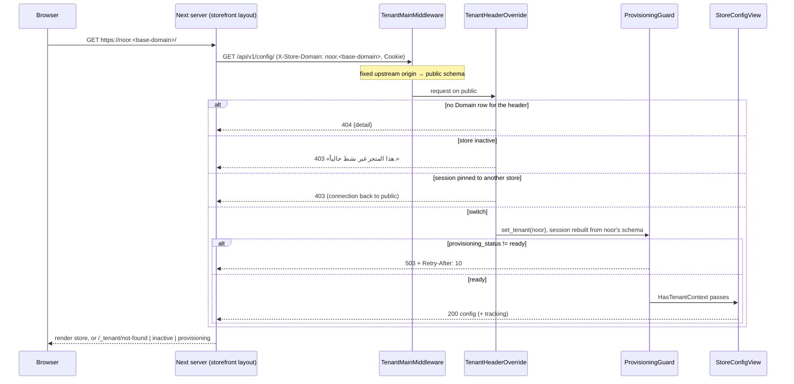

# Multi-tenancy — schemas and tenant resolution

> **Source**: DOC-448, DOC-449 · inventory A.4, Domains 1, 2, 6, 8, 11, 12, 14, 16 · INT-002 (M47), INT-010, INT-017, INT-019, INT-021, INT-023, INT-030, INT-031, INT-032, INT-037, INT-041, INT-048, INT-049
> **Code**: `sharwa_saas/config/settings.py` (`SHARED_APPS`, `TENANT_APPS`, `MIDDLEWARE`, `TENANT_MODEL`, `ROOT_URLCONF`, `PUBLIC_SCHEMA_URLCONF`) · `config/urls_public.py`, `config/urls_tenant.py` · `api/middleware.py` (`TenantHeaderOverrideMiddleware`) · `tenants/middleware.py` (`TenantProvisioningGuardMiddleware`) · `api/permissions.py` (`HasTenantContext`) · `tenants/models.py`, `core/models.py`, `billing/models.py`, `sharwapay/models.py`, `appstore/models.py`, `marketing/models.py`, `sharwa_ship/models.py`, `products/models/*` · `sharwa-frontend/src/features/tenant/api/probe.ts` · `src/app/api/bff/public/provisioning/[token]/route.ts`
> **Tests**: `sharwa_saas/api/test_tenant_guard_api.py` (`TenantGuardProbeTests`, 5 tests)
> **Last verified against code**: 2026-10-27 (official Step 06)

## 1. Purpose

Sharwa runs every store in its own PostgreSQL schema, with django-tenants. Platform-wide data lives once, in the `public` schema. This page states:

- **which data lives where**: the model placement register (§3, [`#schemas`](#schemas));
- **how a request is bound to a store**: tenant resolution, the header override, the provisioning guard and the probe the storefront runs before rendering (§4, [`#resolution`](#resolution)).

It does not cover how a store is created ([`11-provisioning.md`](11-provisioning.md)), how custom hostnames are verified ([`12-custom-domains.md`](12-custom-domains.md)), how the console reads into store schemas ([`13-cross-schema-access.md`](13-cross-schema-access.md)), or deactivation ([`14-store-lifecycle.md`](14-store-lifecycle.md)).

## 2. Components

| Component | Location | Role |
|---|---|---|
| django-tenants | `settings.TENANT_MODEL = "tenants.Client"`, `TENANT_DOMAIN_MODEL = "tenants.Domain"`, `DATABASE_ROUTERS = ('django_tenants.routers.TenantSyncRouter',)` | one schema per `Client`; `TenantSyncRouter` migrates `SHARED_APPS` into `public` and `TENANT_APPS` into every store schema |
| `SHARED_APPS` | `config/settings.py` | `django_tenants`, `tenants`, `core`, `billing`, `sharwapay`, `appstore`, `marketing`, `sharwa_ship`, `django.contrib.*` (admin, auth, contenttypes, sessions, messages, staticfiles), `rest_framework`, `drf_spectacular` |
| `TENANT_APPS` | `config/settings.py` | `django.contrib.contenttypes`, `auth`, `sessions`, `messages`, `products`, `api` |
| URL confs | `PUBLIC_SCHEMA_URLCONF = 'config.urls_public'`, `ROOT_URLCONF = 'config.urls_tenant'` | the platform host serves registration, the console admin (`sharwa-secure-gate/`), the Sharwa Pay pages and the inbound webhooks; a store host serves the storefront and the dashboard. **Both** mount `api/v1/` (`include('api.urls')`) |
| `TenantMainMiddleware` | django-tenants | resolves the store from the request `Host` and sets the connection schema |
| `TenantHeaderOverrideMiddleware` | `api/middleware.py` | under `/api/` only: resolves the store from `X-Store-Domain` instead |
| `TenantProvisioningGuardMiddleware` | `tenants/middleware.py` | `503` for a store whose schema is not ready |
| `HasTenantContext` | `api/permissions.py` | DRF permission on every store API view: refuses a request that is still on `public` |
| `probeStore()` | `sharwa-frontend/src/features/tenant/api/probe.ts` | the Next.js storefront's server-side state check (`GET /api/v1/config/`) |

`django.contrib.sessions`, `auth`, `contenttypes` and `messages` are in **both** lists. Their tables therefore exist in `public` and in every store schema. A session is read from the schema the connection is on when `request.session` is first touched. This is why the header override rebuilds the session after switching (§4.2, fix of 2026-10-20).

The `api` app has no models of its own; it is in `TENANT_APPS` because its views query `products` models.

<a id="schemas"></a>

## 3. Data model — public vs store schema (DOC-448)

### 3.1 Placement register

One row per model named in the inventory, plus the other public models found in the code. "Store" means every store schema (`TENANT_APPS`), "public" means the `public` schema only (`SHARED_APPS`).

| Model / code | App | Schema | What it holds | Added or changed by |
|---|---|---|---|---|
| `Client` (`TenantMixin`) | `tenants` | public | the store: `schema_name`, `name`, `is_active`, `provisioning_status` (`pending`, `provisioning`, `ready`, `failed`), interested market categories | `tenants/0001`, `0025_client_provisioning_status` |
| `Domain` (`DomainMixin`) | `tenants` | public | hostnames that resolve to a `Client` (subdomain and verified custom domains); read by `TenantMainMiddleware` and the header override | `tenants/0001` |
| `CustomDomain` | `tenants` | public | a merchant's **claim** on a hostname before it is proven; becomes a `Domain` row only after DNS verification ([`12-custom-domains.md`](12-custom-domains.md)) | `tenants/0026_customdomain` |
| `TenantStatsSnapshot` | `tenants` | public | daily per-store totals (orders, completed, refunded, revenue in SAR) for the multi-store rollup and the console | `tenants/0019_tenant_stats_snapshot` |
| `MerchantAccount`, `MerchantAccountClient` | `tenants` | public | one merchant identity across stores and its links to `Client` rows (INT-049) | `tenants/0023` |
| `TenantDeactivationRecord` | `tenants` | public | deactivation and reinstatement of a store ([`14-store-lifecycle.md`](14-store-lifecycle.md)) | `tenants/0022`, `0027_platform_console_api` |
| `PendingWebhookEvent` | `tenants` | public | carrier webhook events kept for replay, keyed by waybill and `tenant_schema_name` | `tenants/0020` |
| `WaybillRegistry` | `tenants` | public | globally unique waybill number → store schema + carrier; lets a carrier webhook that knows only the waybill find the store | `tenants/0020` |
| `ThirdPartyLogisticsProvider`, `ThirdPartyLogisticsClientAgreement` | `tenants` | public | platform carrier accounts and each store's agreement (`credential_source` `platform_shared` / `merchant_own`, encrypted credentials) | `tenants/0018`, `0021` |
| `PlatformActionLog` | `tenants` | public | console audit trail | `tenants/0027_platform_console_api` |
| `WhatsAppSessionIndex` | `tenants` | public | WhatsApp gateway `session_id` → store `schema_name` (unique `session_id`) | `tenants/0010` |
| `ChannelSessionIndex` | `tenants` | public | social-channel session → store schema (INT-037) | `tenants/0024` |
| inbound webhook receivers (`tenants/webhooks.py`, `webhooks_ai.py`, `webhooks_channels.py`, `webhooks_suppliers.py`) | `tenants` | public (code, mounted in `urls_public.py` under `webhooks/…`) | receive on the platform host, find the store through an index, then work inside `schema_context(<store>)` | — |
| `CentralCustomerTrust` | `core` | public | platform-wide COD history of a phone / browser / device | `core` migrations |
| `OTPRequestTracker` | `core` | public | the device tracker behind the WhatsApp OTP limits (used by checkout `cod-otp/send|verify/`) | `core` migrations |
| `Plan`, `Subscription`, `PlatformBillingSettings`, `Feature`, `PlanFeature`, `TenantFeatureOverride` | `billing` | public | plans, the store's subscription, the feature catalogue and per-store overrides ([`15-plans-and-features.md`](15-plans-and-features.md)) | `billing` migrations (moved out of `tenants` by `tenants/0016_move_models_to_new_apps`) |
| `App`, `AppBillingOverride` | `appstore` | public | the platform app catalogue and per-store app pricing (INT-032) | `appstore` migrations |
| `MarketCategory` | `marketing` | public | market categories offered at registration (`db_table = 'tenants_marketcategory'`) | `tenants/0011`, moved by `0016` |
| `SharwaPayWallet` (`balance_sar`, `balance_usd`, `balance_yer_old`, `balance_yer_new`), `SharwaPayWalletTransaction`, `SharwaPayTopupRequest`, `SharwaPayWithdrawalRequest` | `sharwapay` | public | the cross-store customer wallet, its ledger rows and top-up / withdrawal requests (INT-048) | `tenants/0004`–`0008`, `0015`, moved by `0016` |
| `SharwaShipZone` | `sharwa_ship` | public | central Sharwa Ship pricing zones (cost to the merchant per waybill) | `sharwa_ship` migrations |
| Django `auth`, `sessions`, `contenttypes`, `messages` | contrib | **both** | console users and their sessions live in `public`; store sessions live in the store schema | — |
| Catalogue: `Product`, `ProductVariant`, `Category`, `Brand`, `Tag`, `Collection`, `ProductBadge`, `BundleComponent`, `Auction`, `ProductChangeLog`, … | `products` | store | the store's catalogue | `products` migrations |
| Orders and returns: `Order`, `OrderItem`, `OrderRefund`, `OrderStatus`, `DeliveryMethod` (incl. `is_sharwa_official`), `PaymentIntent`, `ReturnRequest`, `ReturnAuthorization` | `products` | store | orders, statuses, refunds and returns | `products` migrations |
| Shipping: `ShipmentOrder`, `ShipmentEvent`, `PendingAWBQueue`, zones, courier custody and shifts | `products` | store | the store's waybills and delivery operations (the public `WaybillRegistry` only indexes them) | `products` migrations |
| `AuditLog` | `products` | store | the store's audit trail | `products` migrations |
| Inventory and locations: `StockMovement`, `InventoryItem`, `InventoryReservation`, `Location`, `LocationInventory`, `Fulfillment`, … | `products` | store | one stock ledger per store | `products` migrations |
| Customer ledgers: `Wallet`, `WalletTransaction`, `CustomerPoints`, `CustomerPointsTransaction`, `CustomerReliabilityRecord` | `products` | store | customer wallet (SAR), loyalty points, the store's own COD trust | `products` migrations |
| Merchant money: `MerchantWallet`, `MerchantWalletTransaction`, `MerchantWithdrawalRequest`, `OperatingExpense`, `AppBillingCharge`, `PlatformCommissionRecord` | `products` | store | merchant wallet, expenses and the dues the store owes the platform | `products` migrations |
| Staff and RBAC: `StaffMember`, `Role`, `Permission`, `RolePermission`, `StaffSession`, `TrustedDevice`, `PersonalAccessToken`, `ApprovalRequest`, `BehaviorAlert` | `products` | store | the store's team, roles, sessions, approvals | `products` migrations |
| Settings: `StoreSetting`, `StoreSection`, `GiftSettings`, `TrackingSettings`, `PaymentCredential`, `PayoutAccount` | `products` | store | the store's configuration (the `/config/` payload is read from `StoreSetting`) | `products` migrations |
| Channels, marketplaces, dropshipping: `Conversation`, `Message`, `ChannelProductLink`, `MarketplaceListing`, `MarketplaceSyncJob`, `SupplierConnection`, `SupplierOrder`, … | `products` | store | sales channels and supplier links | `products` migrations |
| POS: `CashRegister`, `Shift`, `PosReceipt`, `PosIdempotencyKey` | `products` | store | point of sale | `products` migrations |
| Bookings: `BookingSlot`, `ServiceAvailability` | `products` | store | services and slots | `products` migrations |
| Apps: `StoreAppInstallation`, `AppInstallationEvent`, `AppUsageLog` | `products` | store | which catalogue apps this store installed | `products` migrations |
| Support: `SupportSession`, `SupportMessage`, `SupportTicket`, `SupportBotSettings` | `products` | store | support and the AI bot | `products` migrations |
| Notifications: `Notification`, `NotificationRead` | `products` | store | the dashboard bell ([`../api/domains/02-dashboard-shell/m49-notifications.md#model`](../api/domains/02-dashboard-shell/m49-notifications.md#model)) | `products/0216_notifications` |
| Reports: `DailyStoreMetrics`, `ReportExportJob`, `ScheduledReportSubscription` | `products` | store | the store's daily metrics and exports (copied daily into the public `TenantStatsSnapshot`) | `products` migrations |

> ⚠️ Discrepancy — roadmap says the public `appstore` app holds the market categories / code: `MarketCategory` is in the `marketing` app (`marketing/models.py:13`, `db_table = 'tenants_marketcategory'`), which is also in `SHARED_APPS`. Same schema, different app. Reported in official Step 06.

> ⚠️ Discrepancy — roadmap says the `sharwapay` app holds "audit rows" / code: there is no separate audit model in `sharwapay/models.py`; each balance change writes one `SharwaPayWalletTransaction` ledger row, which is the audit trail. Reported in official Step 06.

### 3.2 Rules

1. **Platform trust and store trust are never merged.** `CentralCustomerTrust` (public) is the platform-wide history of a phone and device. `CustomerReliabilityRecord` (store, "Tenant-scoped" in its docstring) is the store's own COD refusal count and its `cod_disabled` flag. The customer screens show both side by side; platform trust is a merchant signal only and never disables COD by itself (inventory Domain 6, INT-014 / INT-017).
2. **Sharwa Pay is public and cross-store.** Its wallet, ledger and requests live in `public`. Its API answers only on the platform origin: `api/views_sharwa_pay.py` raises `NotFound('غير موجود.')` when `connection.schema_name` is not the public schema, so a store host or an `X-Store-Domain` header gets `404` (FR-40.01).
3. **The console runs only on public.** `api/views_platform.py` applies the same `_public_only()` check to every console route, so platform data is never exposed from a store origin (FR-20.01). Console users are Django `auth` users of the `public` schema. The onboarding API (`api/views_onboarding.py`) follows the same rule.
4. **No foreign key crosses the schema boundary.** django-tenants forbids it, so the public side keeps string schema names (`WaybillRegistry.tenant_schema_name`, `PendingWebhookEvent.tenant_schema_name`, `WhatsAppSessionIndex.schema_name`) or keys into `Client` (`MerchantAccountClient.client`, `ThirdPartyLogisticsClientAgreement.client`). Store rows never point to public rows by foreign key.
5. **Public code that serves a store captures the store schema before switching.** See §3.3.

### 3.3 Bug class: `connection.schema_name` inside `schema_context('public')`

`schema_context('public')` sets the connection to `public` for the duration of the block. Inside it, `connection.schema_name` is `'public'`, not the store's schema. Any code that means "the current store" must read `connection.schema_name` **before** entering the block.

INT-021 fixed two cases:

- `resolve_carrier_credentials(code)` (`products/services/carrier_service.py:21`) looked up the store's carrier agreement with `client__schema_name=connection.schema_name` inside the block. The merchant's own credentials (`merchant_own`) were therefore never found.
- `carrier_settings_save_view` (`products/views/carrier_settings.py:31`) looked up the `Client` the same way. The agreement was saved against the public tenant.

Both now do `tenant_schema = connection.schema_name` first, then enter `schema_context('public')` and use `tenant_schema`.

```python
tenant_schema = connection.schema_name        # the store, read before switching
with schema_context('public'):
    agreement = ThirdPartyLogisticsClientAgreement.objects.filter(
        provider=provider, client__schema_name=tenant_schema,
    ).first()
```

> ⚠️ Discrepancy — roadmap presents the bug class as fixed by INT-021 / code: two writers still read `connection.schema_name` inside `schema_context('public')`: `issue_external_waybill` (`products/services/carrier_service.py:175-179`) and the Sharwa Ship waybill issue (`products/services/shipping_billing_service.py:110-113`). Both create `WaybillRegistry` rows whose `tenant_schema_name` is therefore `'public'`. `WaybillRegistry` is how a carrier webhook finds the store (its docstring, and the carrier webhook entry point in `api/views.py:705`), so a webhook for such a waybill would not reach its store. Not run against a database; documented from the code. No code was changed. Reported in official Step 06.

<a id="resolution"></a>

## 4. Flows — tenant resolution and the store guard (DOC-449)

### 4.1 Middleware chain

`MIDDLEWARE` in `config/settings.py`, in order. The first middleware that answers wins.

| # | Middleware | Effect on tenancy |
|---|---|---|
| 1 | `config.middleware.RealIpMiddleware` | records the real client IP (rate limits run later); `DevMediaMiddleware` is inserted at position 2 when `DEBUG` |
| 2 | `django_tenants.middleware.main.TenantMainMiddleware` | finds a `Domain` row for the request host and sets the store schema and `request.urlconf`; a host with a `public` tenant `Domain` stays on `public` (`PUBLIC_SCHEMA_URLCONF`). A host with no `Domain` row is refused by django-tenants itself (`Http404`, no Sharwa body) |
| 3 | `SessionMiddleware` | makes `request.session` available (lazy) |
| 4 | `api.middleware.TenantHeaderOverrideMiddleware` | for paths under `/api/` with an `X-Store-Domain` header: switches to that store (§4.2) |
| 5 | `tenants.middleware.TenantProvisioningGuardMiddleware` | `503` when the resolved store is not `ready` (§4.3) |
| 6 | `CorsMiddleware` (when `CORS_ENABLED`), `SecurityMiddleware`, `UTMTrackingMiddleware`, `CommonMiddleware`, `CsrfViewMiddleware`, `AuthenticationMiddleware`, `StaffSessionMiddleware`, `MessageMiddleware`, `XFrameOptionsMiddleware` | ordinary request processing, already on the right schema |
| 7 | the view | store API views carry `HasTenantContext`; platform-only views carry `_public_only()` |

> ⚠️ Discrepancy — roadmap says `TenantHeaderOverrideMiddleware` "resolves the store from host / `X-Store-Domain`" / code: resolution by `Host` is done by django-tenants' `TenantMainMiddleware`; the override (`api/middleware.py:48-55`) acts only on paths starting with `/api/` that carry `X-Store-Domain`. Reported in official Step 06.

### 4.2 `TenantHeaderOverrideMiddleware` (`api/middleware.py`)

Why it exists: the Next.js BFF and server fetchers reach Django on one fixed origin (for example `localhost:8000`, which resolves to `public`), and mobile apps or Postman have no store subdomain either. The header names the store explicitly.

Steps, in code order:

1. Only for `request.path` starting with `/api/`, and only when `X-Store-Domain` is present (trimmed, lower-cased). Storefront and dashboard HTML pages stay bound to their `Host`, so a forged header on a browser page cannot reach another store.
2. `Domain.objects.select_related('tenant').get(domain=<value>)`: exact match on the hostname. No row ⇒ `404`.
3. `tenant.is_active` false ⇒ `403`.
4. `connection.set_tenant(tenant)`. This is what django-tenants does for `Host`.
5. **Session rebuilt from the store schema** (fix of 2026-10-20): `request.session = type(request.session)(session_key)`. The request started on `public`, so a session read before the switch came from the public sessions table and was empty; login answered `204` and `/auth/me/` answered `401`.
6. **Pinned sessions cannot switch** (critical fix of 2026-09-16): if the session carries `auth_tenant_schema` (written at merchant or staff login, `products/views/auth_security.py`) and it differs from this store, the connection is set back to `public` and the answer is `403`. Before the fix, `is_merchant_authenticated` was a global flag and a store-A session could work inside store B by sending the header.
7. `request.tenant = tenant`, `request.urlconf = settings.ROOT_URLCONF`.

### 4.3 `TenantProvisioningGuardMiddleware` (`tenants/middleware.py`)

A new store gets its `Domain` row at registration; its schema is created by a Celery task a minute or two later ([`11-provisioning.md`](11-provisioning.md)). A request in between would hit `relation does not exist`. The guard runs after both resolvers, so it covers `Host` and `X-Store-Domain` alike:

- condition: `request.tenant` is set, its schema is not `public`, and `provisioning_status != 'ready'`;
- answer: `503`, HTML from `tenants/store_provisioning_wait.html` rendered with `render_to_string` and **no request** (the project's context processors query store tables that do not exist yet), `Retry-After: 10`, `Cache-Control: no-store`;
- `failed` gets the same `503` with the "failed" variant of the page.

No extra query: `request.tenant` was already loaded by the resolver.

### 4.4 The probe matrix

The storefront's question "what is the state of the store behind this host?" is `GET /api/v1/config/` with `X-Store-Domain: <host>` (`probeStore()`, server-side, `cache: "no-store"`, `redirect: "manual"`, the visitor's `Cookie` forwarded). There is no dedicated probe endpoint: the middlewares answer before the view when something is wrong.

| Status | Cause | Body (verbatim) | Produced by |
|---|---|---|---|
| `200` | the store exists, is active, is `ready`, and the session (if pinned) belongs to it | the config payload ([`config.md`](../api/domains/01-public-onboarding/config.md)) | `StoreConfigView` |
| `404` | no `Domain` row equals the `X-Store-Domain` value | `{"detail": "لا يوجد متجر مرتبط بالنطاق \"<domain>\" في ترويسة X-Store-Domain."}` | `TenantHeaderOverrideMiddleware` |
| `404` | the request `Host` has no `Domain` row (no header sent) | django-tenants' default `Http404` page (no Sharwa text) | `TenantMainMiddleware` |
| `403` | the store's `is_active` is false | `{"detail": "هذا المتجر غير نشط حالياً."}` | `TenantHeaderOverrideMiddleware` |
| `403` | the session is pinned (`auth_tenant_schema`) to another store | `{"detail": "الجلسة الحالية موثَّقة على متجر مختلف — لا يمكن التحويل إلى متجر آخر بهذه الجلسة."}` | `TenantHeaderOverrideMiddleware` |
| `403` | no store was resolved at all (platform host, no header) | `{"detail": "لم يتم تحديد المتجر المطلوب. استخدم النطاق الفرعي للمتجر أو أرسل ترويسة X-Store-Domain."}` | `HasTenantContext` on the view |
| `503` + `Retry-After: 10` | `provisioning_status` is `pending`, `provisioning` or `failed` | HTML wait page («… قيد التجهيز» or «تعذّر تجهيز …») | `TenantProvisioningGuardMiddleware` |

The two `403` bodies of the header override share a status. `probeStore()` tells them apart by behaviour, not by text: it repeats the call once **without** the cookie, and if that succeeds the `403` was the session (outcome `session_bound_elsewhere`). The full mapping to the five storefront outcomes, the `/_tenant/*` error routes and their real HTTP statuses is in [`m47-tenant-guard.md`](../api/domains/01-public-onboarding/m47-tenant-guard.md) §4.4.

`api/test_tenant_guard_api.py` locks the contract with five tests: a ready store returns the nine fields the storefront requires (`store_name`, the four colours, the two fonts, `design_style`, `theme_preset`) and a `sections` list; an unknown domain is `404` with `detail`; an inactive store is `403` with `detail`; `pending`, `provisioning` and `failed` are each `503` with `Retry-After: 10`; `HEAD` answers like `GET` (`200`, then `503` once the store is set to `pending`).



### 4.5 The other two Next callers

- **Provisioning status (BFF).** `GET /api/bff/public/provisioning/[token]` (`src/app/api/bff/public/provisioning/[token]/route.ts`) is a legacy adapter for Django `GET /register/status/<token>/`, which lives on the **public** URL conf. It calls `upstreamFetch(..., { omitStoreHeader: true })`, so no `X-Store-Domain` is sent. A token Django signed but rejects is a real `404` «لم نجد طلب التأسيس هذا.»; Django unreachable is `502` «الخادم غير متاح حالياً.» (fixture only with mocks on and a fixture token). On `ready` it clears the platform's `sharwa_prov` cookie. Statuses and the setup token: [`11-provisioning.md`](11-provisioning.md), [`m02-onboarding.md#provisioning`](../api/domains/01-public-onboarding/m02-onboarding.md#provisioning).
- **`HEAD` poll.** A visitor who lands on a store that is still being prepared, without a status token, gets a wait page that polls `HEAD /api/v1/config/` every 10 s through the same-origin `/api/v1/*` passthrough ([`bff.md#passthrough`](../api/overview/bff.md#passthrough)). Django answers `HEAD` like `GET` (test above); any non-OK answer counts as "still provisioning".

### 4.6 `/config/` as the storefront bootstrap

`StoreConfigView` (`api/views.py:75`, permission `HasTenantContext`) serialises the store's `StoreSetting` with `StoreConfigSerializer` and then adds `tracking`. It is the single public description of a store; the field list and owners are in [`config.md`](../api/domains/01-public-onboarding/config.md). The extensions added during Phase 002:

| Handed over to | Fields | Where they come from |
|---|---|---|
| INT-010 (M34 settings) | `currency`, `free_shipping_threshold`, `seo_title`, `seo_description`, `seo_keywords`, `seo_og_image`, `contact_email`, social links, `about_us`, `return_policy`, `timezone`, `week_start_day`, announcement colours and scroll speed, the four `show_banner_on_*` flags | `StoreConfigSerializer.Meta.fields` |
| INT-023 (M19 tracking) | `tracking` (public ids only, `null` outside the plan feature `tracking_tools` or when off) | added by the view: `public_tracking(request, settings_feature_enabled)` |
| INT-019 (M13 gifting, loyalty) | `gifting_enabled`, `loyalty_enabled` | **not emitted** (see below) |

> ⚠️ Discrepancy — roadmap says the INT-010, INT-019 and INT-023 extensions are "all served by `StoreConfigSerializer`" / code: `tracking` is added by `StoreConfigView` (`api/views.py:81-84`), not by the serializer, and `gifting_enabled` / `loyalty_enabled` are emitted by neither (`api/serializers.py:82-94`), although the Zod `storeConfigSchema` declares them. With Django live both flags are always `false` on the storefront. Already recorded in [`config.md`](../api/domains/01-public-onboarding/config.md) (run 06); restated here. Reported in official Step 06.

### 4.7 Public-only endpoints on a store host

Because `api/urls.py` is mounted in **both** URL confs, a platform-only API route is reachable by path on a store host. Each such view refuses it itself:

| Area | Check | Answer on a store host or with `X-Store-Domain` |
|---|---|---|
| Console `/api/v1/platform/…` (INT-030 → INT-032) | `_public_only()` in `api/views_platform.py:90` | `404` `{"detail": "غير موجود."}` |
| Sharwa Pay `/api/v1/sharwa-pay/…` (INT-048) | `_public_only()` in `api/views_sharwa_pay.py:26` | `404` `{"detail": "غير موجود."}` |
| Onboarding `/api/v1/public/…` (INT-004) | the base view in `api/views_onboarding.py:219` | `404` `{"detail": "غير موجود."}` |

`404` rather than `403` is deliberate: the platform does not confirm that these routes exist to a store origin. The BFF adds its own platform-origin gate on top for the console and Sharwa Pay ([`../api/domains/16-platform-console/auth.md`](../api/domains/16-platform-console/auth.md)).

## 5. Invariants

| Invariant | Enforced by |
|---|---|
| A store API view never runs on `public` | `HasTenantContext` (`connection.schema_name != 'public'`) on every store view |
| A platform API view never runs on a store schema | `_public_only()` in the console, Sharwa Pay and onboarding views |
| A session pinned to store A never acts in store B through the header | `TenantHeaderOverrideMiddleware` step 6 |
| No store table is queried before the store's schema exists | `TenantProvisioningGuardMiddleware` (before any view, any context processor) |
| `X-Store-Domain` never changes the store of an HTML page | the override acts only under `/api/` |
| Public rows refer to stores by schema name or `Client` key, never by FK into a store schema | django-tenants; models in §3.1 |

## 6. Background work

Celery tasks run outside a request, so no middleware resolves a store for them. A task that touches store data receives the schema name and enters `schema_context(<schema>)` itself; webhook receivers on the platform host first look the store up in a public index (`WaybillRegistry`, `WhatsAppSessionIndex`, `ChannelSessionIndex`) and then do the same. The job register is [`50-background-jobs.md`](50-background-jobs.md).

## 7. Configuration

| Setting | Default | Role |
|---|---|---|
| `TENANT_BASE_DOMAIN` | `localhost` | stores are `<subdomain>.<TENANT_BASE_DOMAIN>`; validated at start-up |
| `ALLOWED_HOSTS` | required (no `*` default) | must cover the platform host, `*.<base>` and verified custom domains |
| `PUBLIC_SCHEMA_URLCONF` / `ROOT_URLCONF` | `config.urls_public` / `config.urls_tenant` | platform vs store URL conf |
| `SESSION_COOKIE_NAME` | Django default | read by the header override to rebuild the session after switching |

Full environment list: the ops environment page (DOC-511, `docs/ops/`).

## 8. Failure modes and fixes

| Failure | Symptom | Cause | Handling / fix |
|---|---|---|---|
| Cross-store session through the header | a store-A session works inside store B | `is_merchant_authenticated` was a global session flag | 2026-09-16: `auth_tenant_schema` pin + `403` (§4.2) |
| Session read from the wrong schema | login `204`, then `/auth/me/` `401` forever | session loaded from `public` before the switch | 2026-10-20: session rebuilt after `set_tenant` |
| Store not yet provisioned | `500 relation does not exist` | schema created asynchronously | `TenantProvisioningGuardMiddleware`, `503` + `Retry-After: 10` |
| Merchant carrier credentials ignored / saved on public | `merchant_own` never applied | `connection.schema_name` inside `schema_context('public')` | INT-021 (§3.3) |
| Waybill indexed under `public` | carrier webhook cannot find the store (expected) | same bug class, two remaining writers | **open** (§3.3 discrepancy) |

## 9. Open items

- **Two remaining writers of the `schema_context('public')` bug class** (§3.3): `issue_external_waybill` and the Sharwa Ship waybill issue record `tenant_schema_name = 'public'` in `WaybillRegistry`. Decision needed: add the fix to the Step 52 fix list, and check existing `WaybillRegistry` rows.
- **`is_active` is only enforced on the header path.** Within the files read, the only `is_active` check on the store is in `TenantHeaderOverrideMiddleware`. A request that resolves the store by `Host` alone (legacy HTML pages on the store subdomain, an API client without the header) is not refused by any middleware when the store is inactive. The Next.js storefront always sends the header, so its probe is not affected. Not verified across every legacy view; see [`14-store-lifecycle.md`](14-store-lifecycle.md).
- **Unknown `Host`** is answered by django-tenants' own `404` page, not a Sharwa JSON body. Clients that do not send `X-Store-Domain` see a non-JSON `404`.
- **`failed` vs waiting**: the guard returns the same `503` for `failed`; the storefront cannot tell them apart from the probe (recorded in [`m47-tenant-guard.md`](../api/domains/01-public-onboarding/m47-tenant-guard.md) §6).
- **`gifting_enabled` / `loyalty_enabled`** are not emitted by `/config/` (§4.6).

## 10. Related pages

- API: [`m47-tenant-guard.md`](../api/domains/01-public-onboarding/m47-tenant-guard.md) (probe and storefront outcomes) · [`config.md`](../api/domains/01-public-onboarding/config.md) (the `200` payload) · [`m02-onboarding.md#provisioning`](../api/domains/01-public-onboarding/m02-onboarding.md#provisioning) · [`../api/overview/auth.md`](../api/overview/auth.md) (session pinning) · [`../api/overview/csrf.md`](../api/overview/csrf.md) · [`../api/overview/bff.md#passthrough`](../api/overview/bff.md#passthrough) · [`../api/domains/16-platform-console/auth.md`](../api/domains/16-platform-console/auth.md)
- Architecture: [`11-provisioning.md`](11-provisioning.md) · [`12-custom-domains.md`](12-custom-domains.md) · [`13-cross-schema-access.md`](13-cross-schema-access.md) · [`14-store-lifecycle.md`](14-store-lifecycle.md) · [`15-plans-and-features.md`](15-plans-and-features.md) · [`20-bff.md`](20-bff.md) · [`30-security.md`](30-security.md) · [`50-background-jobs.md`](50-background-jobs.md) · [`90-open-items.md`](90-open-items.md)
