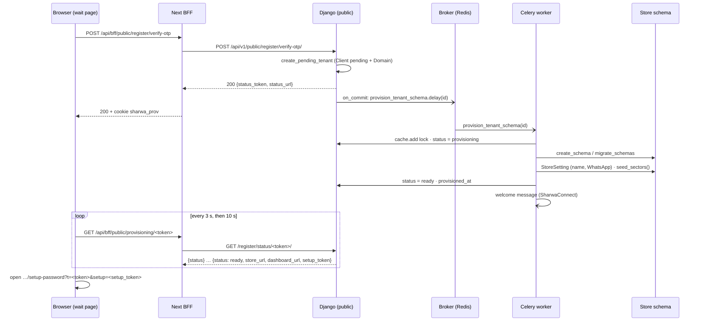
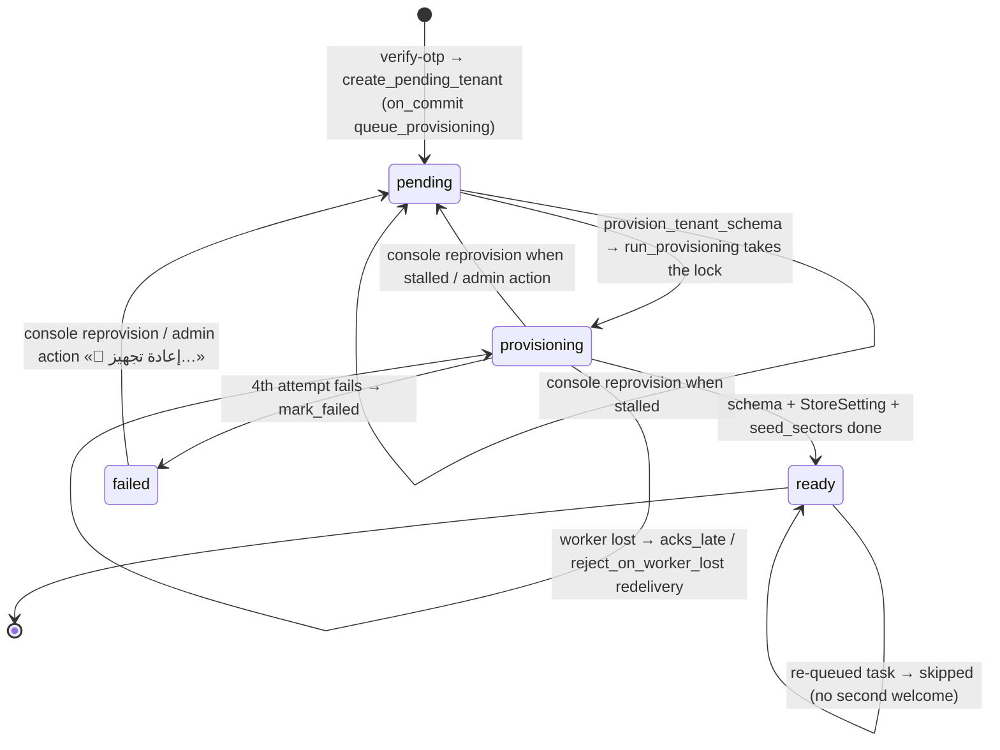

# Store provisioning, the sweeper and re-provisioning

> **Source**: DOC-450 · inventory A.8 · INT-004 (M02), INT-002 (M47), INT-030 (M20), INT-009 (M49), INT-032 (M46)
> **Code**: `sharwa_saas/tenants/registration.py` (`create_pending_tenant`) · `sharwa_saas/tenants/provisioning.py` (`queue_provisioning`, `run_provisioning`, `mark_failed`, status and setup tokens) · `sharwa_saas/tenants/tasks.py` (`provision_tenant_schema`, `retry_stalled_tenant_provisioning`) · `sharwa_saas/tenants/validators.py` · `sharwa_saas/tenants/middleware.py` (`TenantProvisioningGuardMiddleware`) · `sharwa_saas/tenants/views.py` (`tenant_provisioning_status`) · `sharwa_saas/api/views_onboarding.py` · `sharwa_saas/api/views_auth.py` (`MerchantSetupPasswordView`) · `sharwa_saas/tenants/console_service.py` (`reprovision`, `is_stalled`, `stalled_q`) · `sharwa_saas/tenants/admin.py` (`reprovision_tenants`) · `sharwa_saas/config/settings.py` (`CELERY_BEAT_SCHEDULE`) · `sharwa-frontend/src/lib/tenant.ts` (`SUBDOMAIN_MIN`/`SUBDOMAIN_MAX`, `RESERVED_SUBDOMAINS`)
> **Tests**: `sharwa_saas/tenants/test_provisioning.py` (18 tests: signup, `run_provisioning`, task, sweeper, status endpoint, guard middleware, fan-out) · `sharwa_saas/tenants/test_reserved_names.py` · `sharwa_saas/api/test_onboarding_api.py` · `sharwa_saas/api/test_platform_console_api.py` (`test_reprovision_and_detail`)
> **Last verified against code**: 2026-10-27 (official Step 06)

## 1. Purpose

A new store needs its own PostgreSQL schema (about 208 `products` migrations), its `StoreSetting` row and the 35 central sectors before anyone can open it. Doing that inside the registration request took tens of seconds and could kill a Gunicorn worker half-way, leaving a half-built store.

This page describes the design that replaced it:

- the registration request writes only the fast **public-schema** rows and returns at once;
- a **Celery task** builds the schema in the background;
- a **guard middleware** answers `503` for the store's host until it is ready;
- a **sweeper** on Celery Beat re-queues stores that got stuck;
- the **platform console** (and the Django admin) can re-provision a store that failed.

It does **not** cover the registration API payloads, the OTP rules or the BFF/poller behaviour; those are in [`m02-onboarding.md`](../api/domains/01-public-onboarding/m02-onboarding.md) (`#register`, `#otp`, `#provisioning`). It does not cover how a request is routed to a store (see [`10-multi-tenancy.md`](10-multi-tenancy.md)) or custom domains (see [`12-custom-domains.md`](12-custom-domains.md)).

## 2. Components

| Component | Location | Role |
|---|---|---|
| Registration API | `api/views_onboarding.py` — `MarketCategoryListView`, `RegisterView`, `ResendOtpView`, `VerifyOtpView` (`/api/v1/public/market-categories/`, `public/register/`, `register/resend-otp/`, `register/verify-otp/`) | collects the draft, sends the WhatsApp code, creates the store after the code is verified |
| Legacy public routes | `tenants/views.py` on `config/urls_public.py`: `/register/check-subdomain/` (live availability check), `/register/status/<token>/` (`tenant_provisioning_status`) | still used by Next through Django-first BFF adapters |
| `create_pending_tenant` | `tenants/registration.py` | single creation path for the API and the legacy Django screen: `Client` (`pending`) + primary `Domain` + interested categories + default free plan, then `on_commit` → `queue_provisioning` |
| Subdomain rules | `tenants/validators.py` (`subdomain_reason`, `store_subdomain_error`, `validate_store_subdomain`, `store_domain`, `validate_domain_not_reserved`) · mirrored in `src/lib/tenant.ts` | one source for format, reserved names and length |
| `queue_provisioning` | `tenants/provisioning.py` | `provision_tenant_schema.delay(client_id)`; **never raises** — a dead broker only logs and returns `False` |
| `provision_tenant_schema` | `tenants/tasks.py` | Celery task with retries; calls `run_provisioning`, then `mark_failed` when the retries are spent |
| `run_provisioning` | `tenants/provisioning.py` | lock → `provisioning` → create or resume the schema → `StoreSetting` → sectors → `ready` → welcome message |
| Sweeper | `tenants/tasks.py` `retry_stalled_tenant_provisioning` · Beat entry `retry-stalled-tenant-provisioning` | re-queues stores stuck in `pending` or `provisioning` |
| Guard | `tenants/middleware.py` `TenantProvisioningGuardMiddleware` | `503` + `Retry-After: 10` for every request to a store that is not `ready` |
| Status + setup tokens | `tenants/provisioning.py` (`make_status_token`, `make_setup_token`, `setup_token_matches`) | let the registering browser follow the build and set the first password |
| First password | `api/views_auth.py` `MerchantSetupPasswordView` (`POST /api/v1/auth/merchant/setup-password/`) | refuses any request without a valid setup token for this store |
| Console re-provision | `api/views_platform.py` `ConsoleReprovisionView` (`POST /api/v1/platform/stores/reprovision/`) → `tenants/console_service.py` `reprovision` | re-queues `failed` or stalled stores, with a reason per store |
| Admin action | `tenants/admin.py` `ClientAdmin.reprovision_tenants` «🔁 إعادة تجهيز المتاجر المحددة (الفاشلة/العالقة)» | the original manual action the console mirrors |
| First-run notice | `products/services/notification_service.py` `_provisioning` | `provisioning_notice` «متجرك جاهز» for a ready store with no product yet |

## 3. Data model

All provisioning state lives on the public-schema tenant row.

| Model | Schema | Key fields | Constraints / notes | Added or changed by |
|---|---|---|---|---|
| `tenants.Client` (`TenantMixin`) | public | `schema_name` (= the subdomain), `name`, `merchant_phone` (unique), `is_active`, `created_on`, `terms_accepted_at`, `interested_categories` (M2M `marketing.MarketCategory`) | `merchant_phone` unique ⇒ one store per phone; `auto_create_schema = True` on the model, set to `False` **on the instance** by `create_pending_tenant` only | Phase 1 Task 2.1 |
| ″ | public | `provisioning_status` (`pending` «بانتظار التجهيز», `provisioning` «قيد التجهيز», `ready` «جاهز», `failed` «فشل التجهيز»; default `ready`), `provisioning_started_at`, `provisioned_at`, `provisioning_error` (text, ≤ 2000 chars written) | default `ready` so every store that existed before the field is ready without a data migration; indexed | migration `tenants/0025_client_provisioning_status` (Phase 1 Task 2.1) |
| `tenants.Domain` (`DomainMixin`) | public | `domain` = `<subdomain>.<TENANT_BASE_DOMAIN>`, `tenant`, `is_primary=True` | created in the same transaction as the `Client` | — |
| `billing.Subscription` | public | via `Subscription.assign_plan(client, plan)` | only when `PlatformBillingSettings.subscriptions_enabled` is on (see §5) | — |

`stalled` is **not** a stored status. It is derived (§4.3).

The draft between `register` and `verify-otp` is **not** a database row: it is a cache entry that lives `PENDING_TTL_SECONDS = 30 * 60` (1800 s). After it expires, `verify-otp` answers `410` «انتهت صلاحية الرمز» and `resend-otp` answers `410` «انتهت صلاحية الطلب، ابدأ من جديد.» ([`m02-onboarding.md#otp`](../api/domains/01-public-onboarding/m02-onboarding.md#otp)).

## 4. Flows

### 4.1 Registration → pending store

| Step | Route / function | What happens | Failure answers |
|---|---|---|---|
| 1 | `GET /api/v1/public/market-categories/` | categories for the "interested in" chips | — |
| 2 | `GET /register/check-subdomain/?subdomain=` (legacy) | live availability with the short reasons «فارغ», «أحرف إنجليزية وأرقام فقط», «محجوز للنظام», «يجب أن يكون بين 3 و50 حرفاً», «مستخدم بالفعل» | — |
| 3 | `POST /api/v1/public/register/` | validates fields, checks conflicts, sends the WhatsApp code, stores the draft (1800 s); code lifetime `OTP_TTL_SECONDS = 600` | `400` `{field: [...]}`; `429` + `Retry-After` (3 sends per phone per 600 s; loose per-IP ceiling, CGNAT); WhatsApp failure on the phone field |
| 4 | `POST /api/v1/public/register/resend-otp/` | new code replaces the old one; 30 s cooldown | `410` (draft gone); `429`; `502` `{detail}` when the WhatsApp send fails |
| 5 | `POST /api/v1/public/register/verify-otp/` | checks the code; **re-checks** the subdomain (`subdomain_reason`) and the conflicts; counts the per-IP creation ceiling; calls `create_pending_tenant`; returns `{status_token, status_url}` | `400` `{code: [...]}`; `400` `{subdomain: [...]}` / `{merchant_phone: [...]}` (a parallel registration won the race — also on `IntegrityError`); `410`; `429` lock after 3 wrong codes (600 s) or «تم الوصول للحد الأقصى من عمليات إنشاء المتاجر خلال ساعة. يرجى المحاولة لاحقاً.» + `Retry-After: 3600`; `500` on an unexpected error |

The full payloads, messages and BFF mappings are in [`m02-onboarding.md`](../api/domains/01-public-onboarding/m02-onboarding.md). The status codes in one line: **400** `{field}` or `{code}`, **410** after the 30-minute draft, **429** + `Retry-After`, **502** when WhatsApp cannot send on resend.

`create_pending_tenant` runs in **one transaction**:

1. `Client(schema_name=subdomain, name, merchant_phone, terms_accepted_at=now, provisioning_status="pending")`, with `auto_create_schema = False` on this instance only (tests, the admin and `seed_tenants` keep the synchronous schema creation of django-tenants);
2. `Domain(domain=store_domain(subdomain), tenant=client, is_primary=True)`;
3. interested categories;
4. the default free plan when subscriptions are on (§5);
5. `transaction.on_commit(lambda: queue(client_id))` — the worker never sees an uncommitted `Client`.

Any exception rolls the whole transaction back: no half-created store.

### 4.2 Building the schema

`run_provisioning(client_id)` in order:

| # | Step | Detail |
|---|---|---|
| 1 | Lock | `cache.add("tenant-provisioning-lock:<id>", 1, timeout=1200)` (`PROVISIONING_LOCK_TTL_SECONDS = 20 * 60`). If the key exists → `ProvisioningLocked`; the task returns `{status: "locked"}` without retrying. The lock is deleted in `finally`, so a failure releases it. |
| 2 | Skip | a `ready` store returns `{status: "ready", skipped: True}` — no second welcome message. |
| 3 | Mark | `provisioning_status = "provisioning"`, `provisioning_started_at = now`, `provisioning_error = ""`. |
| 4 | Schema | if `schema_exists(schema_name)`: `migrate_schemas --tenant --schema=<name>` (**resume** a half-migrated schema — `create_schema(check_if_exists=True)` would have skipped it and left it broken); else `client.create_schema(check_if_exists=True)`. |
| 5 | Settings | `StoreSetting.load()` in the store schema: `store_name = client.name`, `whatsapp_number = client.merchant_phone`. |
| 6 | Catalog | `seed_sectors()` — the 35 central sectors, their product templates and the variant dictionary (M04, 2026-10-22). Idempotent. |
| 7 | Ready | `provisioning_status = "ready"`, `provisioned_at = now`, `provisioning_error = ""`. |
| 8 | Welcome | `notify_sharwaconnect_of_merchant_welcome` with `store_url` / `dashboard_url` from `build_store_urls(primary domain)` (`https` in production, `http` + port 8000 with `DEBUG`). Never raises. |

Steps 4–6 can raise. The exception goes back to the task, which retries or marks the store `failed`. The store is never marked `ready` before the catalog seed has finished.

### 4.3 Provisioning statuses and every transition

| Status | Set by | Left by |
|---|---|---|
| `pending` | `create_pending_tenant`; console `reprovision`; admin `reprovision_tenants` | a task starting `run_provisioning` |
| `provisioning` | `run_provisioning` step 3 (each attempt refreshes `provisioning_started_at`) | `ready` (step 7) or `failed` (`mark_failed`); stays while Celery retries |
| `ready` | `run_provisioning` step 7 | never by this design (deactivation is a separate flag, see [`14-store-lifecycle.md`](14-store-lifecycle.md)) |
| `failed` | `mark_failed(client_id, exc)` after the last retry — writes `"<ExceptionType>: <message>"` (cut to 2000 chars) into `provisioning_error` | only a manual re-provision; the sweeper **never** touches it |
| `stalled` (derived) | `console_service.is_stalled` / `stalled_q`, the same rule as the sweeper: `pending` with `created_on` older than 5 min, **or** `provisioning` with `provisioning_started_at` older than 20 min | — |

The console shows `is_stalled` on each store row, filters with `?status=stalled`, and counts `stalled_stores` and `failed_stores` in its overview. The store detail shows `provisioning_error` to the platform owner. The registrant never sees it: the status route answers `failed` with only «تعذّر تجهيز متجرك تلقائياً. فريق الدعم أُبلغ وسيتواصل معك قريباً.».

> ⚠️ Discrepancy — the state diagram in [`m02-onboarding.md`](../api/domains/01-public-onboarding/m02-onboarding.md#provisioning) draws "provisioning → pending: sweeper re-queues (> 20 min)". The sweeper does not change the status: `retry_stalled_tenant_provisioning` only calls `queue_provisioning`, and the re-queued task sets `provisioning` again with a new `provisioning_started_at` (`tenants/tasks.py:207-234`, `tenants/provisioning.py:178-182`). Only the console and admin re-provision write `pending`. Reported in official Step 06.

### 4.4 While the store is not ready

Every request whose tenant is not `ready` is answered by `TenantProvisioningGuardMiddleware` with `503`, `Retry-After: 10`, `Cache-Control: no-store` and the page `tenants/store_provisioning_wait.html` (the `failed` variant does not auto-refresh). The public schema is never blocked. The Next storefront maps this to its provisioning screen through `probeStore()` — see [`m47-tenant-guard.md`](../api/domains/01-public-onboarding/m47-tenant-guard.md) and [`10-multi-tenancy.md#resolution`](10-multi-tenancy.md#resolution).

Background jobs that fan out over stores (`aggregate_tenant_stats` and the other per-store fan-outs) iterate only over `provisioning_status = "ready"` stores: a store without tables is skipped, not crashed (`FanOutSkipsUnreadyStoresTests`).

### 4.5 First password: the signed setup token

A new store has no dashboard password. If the first-password route accepted any visitor, whoever reached the new store first could claim it (owner decision 2026-10-21, item 9).

| Token | Made by | Salt | Max age | Bound to |
|---|---|---|---|---|
| status token | `make_status_token(client_id)` after `verify-otp` | `tenants.provisioning.status` | 3600 s (`STATUS_TOKEN_MAX_AGE_SECONDS`) | the `Client` id (signed and compressed, so ids cannot be enumerated) |
| setup token | `make_setup_token(schema_name)` — added to the status answer **only** when the status is `ready` | `tenants.setup_password` | 3600 s (`SETUP_TOKEN_MAX_AGE_SECONDS`) | the store's schema name |

Only the browser that passed the WhatsApp code holds the status token, so only it can receive the setup token. The wait page redirects to `…/setup-password?t=<token>&setup=<setup_token>`. `POST /api/v1/auth/merchant/setup-password/` `{password, password_confirm, setup_token}` then checks, in order:

| Order | Check | Answer |
|---|---|---|
| 1 | CSRF | `403` |
| 2 | a password already exists (`StoreSetting.admin_password`) | `409` `{"detail": "كلمة مرور المتجر معيّنة بالفعل — سجّل الدخول.", "code": "already_set"}` — the token is spent after the first success |
| 3 | 10 attempts per IP per 900 s | `429` «محاولات كثيرة، حاول بعد 900 ثانية» + `Retry-After: 900` |
| 4 | `setup_token_matches(token, connection.schema_name)` | `403` `{"detail": "رابط تفعيل المتجر غير صالح أو منتهٍ. افتح الرابط من صفحة تجهيز المتجر، أو فعّل المتجر برمز واتساب من لوحة التحكم.", "code": "setup_token_invalid"}` |
| 5 | password strength (`validate_password_strength`) and confirmation «كلمتا المرور غير متطابقتين.» | `400` field errors |
| — | success | `204` + an owner session |

A token minted for store A fails on store B (`data["s"] != schema_name`). The session model is in [`../api/overview/auth.md`](../api/overview/auth.md).

### 4.6 Re-provisioning from the console

`POST /api/v1/platform/stores/reprovision/` `{"schemas": ["…"]}` (console session; writes need the `superuser` role — an operator may read but not write the `stores` area). Per schema, `console_service.reprovision`:

| Store | Result row | Reason (verbatim) |
|---|---|---|
| unknown schema (or `public`) | `queued: false` | «متجر غير معروف.» |
| `ready` | `queued: false` | «المتجر جاهز — لا شيء لإعادة تجهيزه.» |
| `pending` / `provisioning` and **not** stalled | `queued: false` | «إعادة تجهيز قيد التنفيذ بالفعل.» |
| `failed`, or stalled | `queued: true`: `provisioning_status = "pending"`, `provisioning_error = ""`, `queue_provisioning(id)`, a `PlatformActionLog` row `stores.reprovision` «أُرسلت مهمة إعادة التجهيز (provision_tenant_schema).» | `null` |

The answer is `200` `{"detail": "أُرسلت <n> من <m> مهمة إعادة تجهيز.", "results": [{schema_name, queued, reason}]}`; an empty or missing list is `400` `{"schemas": ["اختر متجراً واحداً على الأقل."]}`. Payloads: [`../api/domains/16-platform-console/m20-console.md`](../api/domains/16-platform-console/m20-console.md).

The Django admin action `reprovision_tenants` does the same write (`pending`, empty error, `queue_provisioning`) for every selected store that is not `ready`.

> ⚠️ Discrepancy — `console_service.py:8` and `:448` say the console re-provision is "the admin action «🔁 إعادة تجهيز» verbatim". The admin action re-queues **any** non-ready store (`tenants/admin.py:126-144`), including a `provisioning` store that is still within its 20 minutes; the console refuses those («إعادة تجهيز قيد التنفيذ بالفعل.», `console_service.py:445`). The run lock prevents a double build either way. Reported in official Step 06.

## 5. Invariants

| Invariant | Enforced by |
|---|---|
| One store per phone number | `Client.merchant_phone` unique; conflicts re-checked at `verify-otp`; `IntegrityError` → `400` with the field conflict |
| Store address is 3–50 chars, `[a-z0-9]+`, not reserved | `tenants/validators.py`: `SUBDOMAIN_RE = ^[a-z0-9]+$`, `SUBDOMAIN_MIN_LENGTH = 3`, `SUBDOMAIN_MAX_LENGTH = 50` (owner decision 2026-10-21; 50 is the form limit and stays under the 63-char DNS label and PostgreSQL identifier limits). The same numbers are `SUBDOMAIN_MIN`/`SUBDOMAIN_MAX` in `src/lib/tenant.ts`. The check order is the same everywhere: empty → format → reserved → length, so a short reserved name such as `ai` always gets «محجوز للنظام» |
| Reserved names are never a store | `RESERVED_SUBDOMAINS` (22 names: `www`, `admin`, `administrator`, `root`, `api`, `dashboard`, `mail`, `email`, `support`, `help`, `app`, `sharwa`, `sharrwah`, `static`, `media`, `test`, `demo`, `staging`, `public`, `localhost`, `ai`, `console`) — identical list in Django and Next. Full messages: «رابط المتجر غير صالح. استخدم أحرف إنجليزية وأرقام فقط وبدون مسافات أو رموز.», «هذا الرابط محجوز للنظام. يرجى اختيار رابط آخر.», «رابط المتجر يجب أن يكون بين 3 و50 حرفاً.». The console's domain edits use `validate_domain_not_reserved` («هذا النطاق محجوز للنظام ولا يمكن ربطه بمتجر.») — see [`12-custom-domains.md`](12-custom-domains.md) |
| No half-created store rows | `create_pending_tenant` in one `transaction.atomic()`; the task is sent `on_commit` |
| A broker outage never fails a registration | `queue_provisioning` catches every exception and returns `False`; the sweeper re-sends |
| One build per store at a time | atomic `cache.add` lock (Redis in production), 20 min TTL, released in `finally` |
| A half-migrated schema is resumed, not skipped | `schema_exists` → `migrate_schemas` (idempotent) |
| No store is `ready` without settings and sectors | `ready` is written after `_init_store_settings` and `_seed_catalog` |
| A `failed` store is never retried automatically | the sweeper filters `pending`/`provisioning` only |
| The registrant never sees internal errors | status route returns only `status` (+ the fixed message on `failed`) |
| New stores get the default plan only if it is free **and** active | `Plan.objects.filter(is_default_free=True, is_active=True).first()`; none found → warning log, no subscription. Nothing is assigned while `subscriptions_enabled` is off (the platform default). Feature resolution without a plan: [`15-plans-and-features.md`](15-plans-and-features.md) |

## 6. Background work

| Task | Trigger | Queue | Retries / limits | Idempotency |
|---|---|---|---|---|
| `tenants.tasks.provision_tenant_schema(client_id)` | `queue_provisioning` (registration `on_commit`, sweeper, console, admin) | `default` (`CELERY_TASK_DEFAULT_QUEUE`; deliberately no dedicated queue, so the worker's `-Q` list needs no change — forgetting it would leave every new store stuck) | `bind=True`, `acks_late=True`, `max_retries=3`, `default_retry_delay=60` s, `soft_time_limit=900` s, `time_limit=960` s (above the general tenant limits 300/360 s — ~208 migrations can take minutes); globally `CELERY_TASK_ACKS_LATE = True` and `CELERY_TASK_REJECT_ON_WORKER_LOST = True` | lock; `ready` skip; resumable schema step; idempotent sector seed |
| `tenants.tasks.retry_stalled_tenant_provisioning()` | Celery Beat `retry-stalled-tenant-provisioning`, `crontab(minute='2-59/5')` — every 5 minutes at :02, :07, … | `default` | none | re-sending is harmless: the lock and the `ready` skip absorb duplicates; returns `{requeued: n}` and logs the ids |

Thresholds: `STALLED_PENDING_AFTER_MINUTES = 5` (measured from `created_on` — the broker was down at registration) and `STALLED_IN_PROGRESS_AFTER_MINUTES = 20` (measured from `provisioning_started_at` — the worker died mid-migration). The 20-minute lock TTL equals the in-progress threshold, so by the time the sweeper re-queues a dead run its lock has expired.

Attempts: the first run plus 3 retries. `mark_failed` runs when `self.request.retries >= max_retries`, i.e. on the 4th failing attempt (`test_final_failure_marks_failed_and_sends_no_welcome`).

The worker and Beat processes and their queue list are in [`50-background-jobs.md`](50-background-jobs.md) and [`../ops/runbooks/celery.md`](../ops/runbooks/celery.md). Beat must run (deploy checklist: store provisioning is asynchronous); never run two Beats.

## 7. Configuration

| Setting / variable | Default | Effect |
|---|---|---|
| `TENANT_BASE_DOMAIN` | `localhost` | store host = `<subdomain>.<TENANT_BASE_DOMAIN>`; validated at start-up (name only, no scheme or port) |
| `CELERY_BROKER_URL`, `REDIS_CACHE_URL` | — | broker for the task; cache for the lock and the draft (the lock is only atomic across workers with a shared cache such as Redis) |
| `PROVISIONING_STATUS_POLLS_PER_IP_PER_MINUTE` | 3000 | ceiling of the status route (CGNAT stance, [`../api/overview/rate-limits.md`](../api/overview/rate-limits.md)) |
| `DEBUG` | `False` | `build_store_urls` uses `http` + port 8000 when on, `https` otherwise |

Environment details: [`../ops/environment.md`](../ops/environment.md).

## 8. Failure modes and fixes

| Failure | Symptom | Cause | Handling / fix |
|---|---|---|---|
| Registration request timed out / worker killed | half-built store, `500` | schema + migrations inside the HTTP request | Phase 1 Task 2.1: async provisioning (this page) |
| Broker down at registration | store stays `pending` | `delay()` failed | `queue_provisioning` swallows it; sweeper after 5 min |
| Worker killed mid-migration | store stuck in `provisioning` | SIGKILL / deploy | `acks_late` + `reject_on_worker_lost` redelivery; sweeper after 20 min; resume with `migrate_schemas` |
| Two builds of one store | duplicate work, races | sweeper re-send while a real run is active | cache lock → `{status: "locked"}` |
| A store without tables reached by a request | `ProgrammingError` → `500` | schema not built yet | guard middleware `503` + `Retry-After` |
| New store opened by a stranger | store claimed before its owner | first-password route open to anyone | signed setup token (owner decision 2026-10-21) |
| "Fill from a standard sector" empty in new stores | no sectors | `seed_variant_templates` was manual | `_seed_catalog` → `seed_sectors()` in every provisioning (M04, 2026-10-22); `seed_variant_templates` remains for older stores |
| Dashboard link pointed at Django's own port | merchant landed on Django's dashboard on `:8000` | `request.get_host()` behind the BFF | `build_store_urls_for_request` takes only port and scheme from `X-Forwarded-Host` / `X-Forwarded-Proto` (2026-10-21); the domain always comes from the `Domain` row |

## 9. Open items

- **First-run notice.** `provisioning_notice` is generated by the notification sync of a `ready` store when it has **no product** and no earlier notice with `dedupe_key = "provisioning:ready"`: title «متجرك جاهز», body «اكتمل تجهيز المتجر. أضف أول منتج وشارك رابط متجرك.», link `/dashboard/products`, owner only (`merchant_only`), not stateful (the sync never resolves it), dated at the store's `created_on`. Because of the `dedupe_key` check it is created at most once per store ([`../api/domains/02-dashboard-shell/m49-notifications.md#model`](../api/domains/02-dashboard-shell/m49-notifications.md#model)).
- **A `failed` store keeps its schema.** `mark_failed` does not drop it (kept for manual inspection); re-provisioning resumes it with `migrate_schemas`. There is no "delete a failed store" tool.
- **Admin and console differ** on stores still in progress (§4.6 discrepancy).
- **Status poll and `404`.** A Django throttle or outage during the wait is turned into a final `404` by the BFF — see [`m02-onboarding.md`](../api/domains/01-public-onboarding/m02-onboarding.md#provisioning). Pending decision recorded there.
- Cross-cutting register: [`90-open-items.md`](90-open-items.md).

## 10. Related pages

- API: [`../api/domains/01-public-onboarding/m02-onboarding.md`](../api/domains/01-public-onboarding/m02-onboarding.md) · [`../api/domains/01-public-onboarding/m47-tenant-guard.md`](../api/domains/01-public-onboarding/m47-tenant-guard.md) · [`../api/domains/16-platform-console/m20-console.md`](../api/domains/16-platform-console/m20-console.md) · [`../api/overview/auth.md`](../api/overview/auth.md)
- Architecture: [`10-multi-tenancy.md`](10-multi-tenancy.md) · [`12-custom-domains.md`](12-custom-domains.md) · [`13-cross-schema-access.md`](13-cross-schema-access.md) · [`14-store-lifecycle.md`](14-store-lifecycle.md) · [`15-plans-and-features.md`](15-plans-and-features.md) · [`50-background-jobs.md`](50-background-jobs.md)
- Ops: [`../ops/runbooks/celery.md`](../ops/runbooks/celery.md) · [`../ops/environment.md`](../ops/environment.md)
