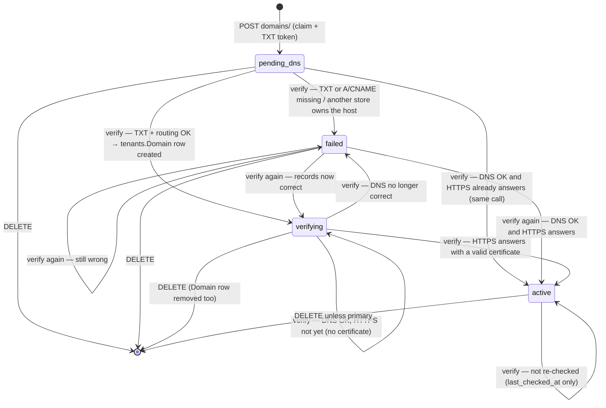
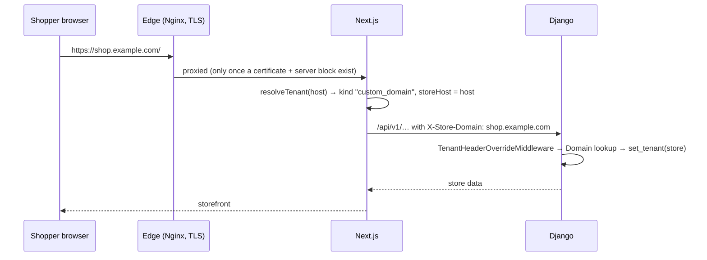

# Custom domains (claim → DNS → routing → TLS)

> **Source**: DOC-451 · inventory A.10 · INT-023 (M19), INT-030 (M20), INT-010 (M34), INT-049 (M43)
> **Code**: `sharwa_saas/tenants/models.py` (`Domain`, `CustomDomain`) · `sharwa_saas/products/services/domain_service.py` · `sharwa_saas/api/views_integrations.py` (`DomainListView`, `DomainDetailView`, `DomainVerifyView`, `DomainSetPrimaryView`) · `sharwa_saas/tenants/console_service.py` (`add_domain`, `set_primary_domain`, `_domains`) · `sharwa_saas/api/views_platform.py` (`ConsoleDomainListView`, `ConsoleDomainPrimaryView`) · `sharwa_saas/tenants/validators.py` (`validate_domain_not_reserved`) · `sharwa_saas/products/services/settings_service.py` (`store_url`) · `sharwa_saas/tenants/merchant_rollup.py` · `sharwa_saas/api/middleware.py` (`TenantHeaderOverrideMiddleware`) · `sharwa_saas/config/settings.py` (`TENANT_BASE_DOMAIN`, `SHARWA_EDGE_IP`, `SHARWA_EDGE_CNAME`) · `sharwa_saas/deploy/README.md` §3 · `sharwa-frontend/src/features/integrations/{schemas.ts,api.ts,components/domains-screen.tsx}` · `sharwa-frontend/src/lib/tenant.ts` (`resolveTenant`) · BFF `sharwa-frontend/src/app/api/bff/domains/**` · fixture `sharwa-frontend/src/mocks/integrations/domains.ts`
> **Tests**: `sharwa_saas/api/test_integrations_api.py` — `DomainApiTests` (7 tests) · `sharwa_saas/api/test_platform_console_api.py` — `test_domains`
> **Last verified against code**: 2026-10-27 (official Step 06)

## 1. Purpose

Every store is reachable on its subdomain `<store>.<TENANT_BASE_DOMAIN>` from the moment it is registered ([`11-provisioning.md`](11-provisioning.md)). M19 lets the store owner attach domains they own (`shop.example.com`, `example.com`) and make one of them the address shoppers are sent to.

The design has one goal: **nobody can take over a hostname before proving they control it**. django-tenants routes any `tenants.Domain` row immediately, and `Domain.domain` is unique, so whoever wrote a host first would "own" it. Custom domains therefore go through a separate claim table and a DNS proof before any `Domain` row is written.

This page covers the claim lifecycle, the DNS records, how routing starts, where TLS comes in, the primary-domain switch and the console's own domain tools. The request/response tables of the routes belong to [`../api/domains/12-settings-staff-integrations/m19-domains-integrations.md`](../api/domains/12-settings-staff-integrations/m19-domains-integrations.md); how a host is resolved to a store in general is in [`10-multi-tenancy.md#resolution`](10-multi-tenancy.md#resolution).

## 2. Components

| Component | Location | Role |
|---|---|---|
| `tenants.Domain` | public schema (django-tenants `DomainMixin`) | the routing table: one row = one host served by one store; `is_primary` marks the store's main address |
| `tenants.CustomDomain` | public schema | the claim: requested host, TXT token, status, DNS result, failure reason, check times |
| `domain_service` | `products/services/domain_service.py` | list, add, verify (DNS + HTTPS), set primary, delete; DNS via **dnspython**, HTTPS via `requests` |
| Merchant API | `api/views_integrations.py` → `/api/v1/domains/`, `domains/<id>/`, `domains/<id>/verify/`, `domains/<id>/set-primary/` | owner only (`OwnerAPIMixin`, staff ⇒ `403` «النطاقات مقصورة على مالك المتجر.»); no plan feature |
| BFF | `src/app/api/bff/domains/route.ts`, `[id]/route.ts`, `[id]/verify/route.ts`, `[id]/set-primary/route.ts` | `liveOrMock(request, "integrations", "/api/v1/domains/…", mock)` |
| Merchant screen | `/dashboard/settings/domains` — `domains-screen.tsx`, hooks in `features/integrations/api.ts` | add form, DNS records with copy buttons, «تحقّق الآن», primary switch, delete |
| Console API | `/api/v1/platform/stores/<schema>/domains/` (`POST`), `…/domains/<id>/` (`POST` = make primary) → `console_service.add_domain`, `set_primary_domain` | platform owner manages `Domain` rows directly (§4.6) |
| Tenant resolution | `TenantMainMiddleware` (django-tenants, by `Host`) and `TenantHeaderOverrideMiddleware` (by `X-Store-Domain` on `/api/`) | both look the host up in `tenants.Domain` |
| Next host resolution | `resolveTenant()` in `src/lib/tenant.ts` | a host outside `*.<base>` is `kind: "custom_domain"` and is sent upstream verbatim as `X-Store-Domain` |
| Edge / TLS | Nginx + certbot (`deploy/README.md` §3) | serves HTTPS for the host; until a certificate exists the host falls into the catch-all server (`444`) |

## 3. Data model

| Model | Schema | Key fields | Constraints / indexes | Added or changed by |
|---|---|---|---|---|
| `tenants.Domain` | public | `domain` (unique, from `DomainMixin`), `tenant` (FK `Client`), `is_primary` | `domain` unique across **all** stores | django-tenants |
| `tenants.CustomDomain` | public | `client` (FK, `CASCADE`), `domain` (≤ 253, indexed), `verification_token` (≤ 64), `status` (`pending_dns` «بانتظار DNS» · `verifying` «جارٍ التحقق» · `active` «نشط» · `failed` «فشل»; default `pending_dns`), `dns_ok`, `failure_reason` (≤ 255), `last_checked_at`, `verified_at`, `created_at` | `UniqueConstraint(client, domain)` `unique_custom_domain_per_client` — the **same host may be claimed by several stores**: pending claims do not block each other; the first store to prove ownership gets the `Domain` row | migration `tenants/0026_customdomain` (INT-023, 2026-10-25) |
| `products.StoreSetting.custom_domain` | store | legacy text field | mirror of the primary custom domain for old consumers (abandoned-cart links, catalog sync) | — |

The merchant API exposes each store's hosts as one list (`list_domains` → `{base_domain, results: [...]}`):

| Row | `id` | `kind` | `status` | Notes |
|---|---|---|---|---|
| the subdomain | **`0`** (`SUBDOMAIN_ID`) — a fixed id, not a database id | `subdomain` | always `active`, `dns_ok: true`, no records | read-only; cannot be verified or deleted; `is_primary` = true when no **claimed** custom domain is primary; `created_at` = the store's `created_on` |
| each claim | `CustomDomain.id` | `custom` | the claim's status | `dns_records`, `failure_reason`, `next_step`, `verified_at`, `last_checked_at`, `is_primary` |

The subdomain row is the `Domain` equal to `TENANT_BASE_DOMAIN` or ending in `.<TENANT_BASE_DOMAIN>`; if none matches, the store's first `Domain` row.

## 4. Flows

### 4.1 Claim (`POST /api/v1/domains/` `{domain}`)

The host is lower-cased, trimmed and stripped of a trailing dot, then checked in this order:

| # | Check | Answer `400` |
|---|---|---|
| 1 | `format_error(domain, base)` — **the same text, rule for rule, as the frontend's `domainFormatError`** (`features/integrations/schemas.ts`), so the form and the server agree | `{"domain": ["…"]}` with one of: «أدخل النطاق.» · «أدخل النطاق وحده بلا بروتوكول أو مسار (مثل shop.example.com).» · «النطاق أحرف لاتينية وأرقام ونقاط وشرطات فقط.» · «صيغة النطاق غير صحيحة (مثل example.com).» · «امتداد النطاق غير صحيح.» · «لا يمكن ربط نطاق تحت <base> — هذا نطاق المنصة.» · «النطاق أطول من المسموح.» (> 253) |
| 2 | already claimed by this store, or already one of its `Domain` rows | `{"domain": ["هذا النطاق مضاف لمتجرك بالفعل."]}` |
| 3 | a `Domain` row of **another** store | `{"domain": ["هذا النطاق مرتبط بمتجر آخر."]}` |
| 4 | the store already has **5** claims (`MAX_CUSTOM`) | `{"detail": "وصلت إلى الحد الأقصى (5 نطاقات مخصصة)."}` |

Rule 1 refuses anything under the platform's own domain, so a merchant can never claim a reserved platform host such as `ai.<base>`. `www.` and any other label are allowed on the merchant's **own** domain (frontend decision 2026-10-19). A claim pending in another store does **not** block a new claim (rule 3 looks only at `Domain`).

On success: `CustomDomain(status="pending_dns", verification_token="sharwa-verify=<32 hex>")` and `201` with the claim view, including the DNS records to add.

### 4.2 DNS records

`dns_records(domain, token)`:

| Host kind | Records the merchant adds |
|---|---|
| sub-host (e.g. `shop.example.com`) | `CNAME` name `shop` → `SHARWA_EDGE_CNAME` · `TXT` name `_sharwa.shop` → `sharwa-verify=…` |
| apex (e.g. `example.org`, or `example.com.ye` style) | `A` name `@` → `SHARWA_EDGE_IP` · `TXT` name `_sharwa` → `sharwa-verify=…` |

- **Apex detection** (`is_apex`): two labels, or three labels where the middle one is `com`/`net`/`org`/`gov`/`edu` and the last is a 2-letter country code. Names are given relative to the registrable domain (`_host_part`).
- **Edge targets**: `SHARWA_EDGE_CNAME` defaults to `TENANT_BASE_DOMAIN`; `SHARWA_EDGE_IP` defaults to empty.
- The ownership proof is always the TXT record `_sharwa.<host>` containing the claim's token. Routing is proved separately (§4.3).

### 4.3 Verify (`POST /api/v1/domains/<id>/verify/`) and the state machine

`verify_domain(pk)`:

| Step | Rule |
|---|---|
| 0 | `id = 0` → `400` «النطاق الفرعي يعمل دائماً ولا يحتاج تحققاً.»; unknown id → `404` «النطاق غير موجود.» |
| 1 | an `active` claim is **not re-checked**: only `last_checked_at` is updated |
| 2 | DNS lookups with dnspython (`dns.resolver.resolve`, 5 s lifetime; `NXDOMAIN`, no answer, no nameservers and timeout count as "no record"). dnspython not installed → `503` «فحص DNS غير متاح على الخادم الآن — حاول لاحقاً.» |
| 3 | `txt_ok` = the token is among the TXT values of `_sharwa.<host>` |
| 4 | `route_ok`: apex → the host's A records ⊆ {`SHARWA_EDGE_IP`} (or ⊆ the A records of `SHARWA_EDGE_CNAME` when no IP is set); sub-host → its CNAME equals `SHARWA_EDGE_CNAME`, or, for providers that flatten CNAMEs, its A records ⊆ the edge's A records |
| 5a | either fails → `failed`, `dns_ok=false`, `failure_reason` «لم نجد سجل <TXT \| A \| CNAME> المطلوب لـ <host> عند مزوّد النطاق.», `next_step` «أضف السجلات أعلاه كما هي عند مزوّد النطاق، انتظر حتى ساعة لانتشارها، ثم اضغط «تحقّق الآن».» |
| 5b | both pass, but another store already has a `Domain` row for the host → `failed`, `dns_ok=true`, «هذا النطاق مرتبط بمتجر آخر.» |
| 5c | both pass → in one transaction `Domain.objects.get_or_create(domain=host, tenant=store, defaults={"is_primary": False})` → `verifying`, `dns_ok=true`; `next_step` «سجلات DNS صحيحة — نُصدر شهادة HTTPS للنطاق الآن؛ تحقّق مرة أخرى بعد قليل.» |
| 6 | still in the same call: `https_ready(host)` — `HEAD https://<host>/` (timeouts 3 s connect / 5 s read, no redirects, certificate verified by `requests`). Any HTTP answer → `active`, `verified_at = now`. A TLS or connection error → stays `verifying` |

Every call sets `last_checked_at`.

**What moves a claim forward is always a `verify/` call.** There is no Celery task or Beat entry that checks domains. The merchant screen re-reads the list every 30 s while a custom domain is `pending_dns` or `verifying` (`refetchInterval` in `useDomains`), but `GET domains/` only reads stored state.

> ⚠️ Discrepancy — roadmap says the claim goes "`verifying` → `active` once HTTPS answers", and the screen tells the merchant «نتحقق من النطاقات قيد الانتظار تلقائياً كل 30 ثانية.» (`domains-screen.tsx:91`) / code: the 30-second poll only re-reads `GET /api/v1/domains/` (`features/integrations/api.ts:46-52`), which runs no DNS or HTTPS check (`domain_service.list_domains`); a claim changes status only when «تحقّق الآن» calls `verify/` (`domain_service.py:249-284`). A domain whose certificate is issued later stays `verifying` until the owner presses the button. The mock behaves the same way (`src/mocks/integrations/domains.ts:136-158`). Reported in official Step 06.

> ⚠️ Discrepancy — roadmap names the first state `pending` / code: the stored and wire value is `pending_dns` (`tenants/models.py:434-439`, `DOMAIN_STATUSES` in `schemas.ts:10`); there is no `pending`. Reported in official Step 06.

The UI shows `verifying` with `dns_ok: true` as «جارٍ إصدار الشهادة» (`domainStatusText`).

### 4.4 Routing

Routing starts when the `tenants.Domain` row is created at `verifying`, not at `active`:

- Next sends every host outside `*.<base>` upstream verbatim as `X-Store-Domain`; Django resolves it from `tenants.Domain`. A host with no `Domain` row gets `404` «لا يوجد متجر مرتبط بالنطاق "<host>" في ترويسة X-Store-Domain.»; a deactivated store `403` «هذا المتجر غير نشط حالياً.» (details in [`10-multi-tenancy.md#resolution`](10-multi-tenancy.md#resolution)).
- A request that reaches Django **directly** with the custom host (legacy HTML pages) is routed by django-tenants' own `Host` lookup in the same table; that host must also be allowed by `ALLOWED_HOSTS`, which has no wildcard default (an operations concern; see [`../ops/environment.md`](../ops/environment.md)).

### 4.5 TLS — the operations step

The platform's own wildcard certificate (`*.<base>`, certbot DNS-01) does not cover merchant domains. Per `deploy/README.md` §3, each custom domain needs **its own certificate (HTTP-01 per domain) and a server block**; until then the host falls into Nginx's catch-all server and is refused (`444`). Automating this (for example on-demand TLS) is a separate task. While it is missing, `https_ready` fails and the claim stays `verifying`.

The step-by-step procedure (when a claim reaches `verifying`, issue the certificate, renew it, failure handling, edge IP/CNAME values) is the runbook [`../ops/runbooks/custom-domain-tls.md`](../ops/runbooks/custom-domain-tls.md) (DOC-516).

### 4.6 Primary domain and delete

`POST domains/<id>/set-primary/`:

| Target | Rule | Effect |
|---|---|---|
| `0` (the subdomain) | always allowed | in one transaction: the subdomain `Domain` → `is_primary=True`, every other row of the store → `False`; `StoreSetting.custom_domain = None`; answer `{"id": 0, "is_primary": true}` |
| a claim | must be `active`, else `400` «لا يصير النطاق أساسياً قبل أن يكون نشطاً.» | same switch on its `Domain` row; `StoreSetting.custom_domain = <host>` (the legacy mirror); answer = the claim view |

`DELETE domains/<id>/`:

- `0` → `400` «النطاق الفرعي لا يُحذف.»;
- the primary → `400` «لا يُحذف النطاق الأساسي — اجعل نطاقاً آخر أساسياً أولاً.»;
- otherwise, in one transaction, the `Domain` row (routing stops at once) and the claim are deleted → `204`; a second delete → `404`.

### 4.7 Console domain management (INT-030)

The platform owner can attach hosts to any store from the console:

| Route | Rule |
|---|---|
| `POST /api/v1/platform/stores/<schema>/domains/` `{domain}` | lower-case, ≤ 253, `DOMAIN_RE` format, else `400` `{"domain": ["صيغة النطاق غير صحيحة (مثل example.com)."]}`; `validate_domain_not_reserved` — the base domain itself or `<reserved name>.<base>` → «هذا النطاق محجوز للنظام ولا يمكن ربطه بمتجر.»; any existing `Domain` row → «هذا النطاق مرتبط بمتجر بالفعل.». Creates a **`tenants.Domain` row directly** (primary only if the store had none) and logs `domain.add` |
| `POST /api/v1/platform/stores/<schema>/domains/<id>/` | makes that `Domain` the primary in one transaction; logs `domain.primary`; unknown id → `404` «النطاق غير موجود.» |

Both answer `{"domains": [{id, domain, is_primary}]}` (primary first). Writes need the console `superuser` role. The console path **skips the TXT proof**: the platform owner is trusted to have checked ownership. There is no console delete.

### 4.8 Who reads the primary domain

| Consumer | Rule |
|---|---|
| `store_url` in store settings (INT-010) | `https://<primary Domain of the tenant>`; falls back to the request host |
| Multi-store rollup `domain` (INT-049) | the primary `Domain`, else any `Domain` of the store, else `"#"` (`NO_DOMAIN`) — see [`../api/domains/02-dashboard-shell/m43-multi-store.md`](../api/domains/02-dashboard-shell/m43-multi-store.md) |
| Welcome message after provisioning | `client.get_primary_domain()` — at that point always the subdomain |
| Legacy consumers (abandoned-cart links, catalog sync) | `StoreSetting.custom_domain`, written only by the merchant `set-primary` |

## 5. Invariants

| Invariant | Enforced by |
|---|---|
| A host routes to at most one store | `Domain.domain` unique; checked again inside the verify transaction |
| No routing before ownership is proved (merchant path) | the `Domain` row is created only when TXT **and** routing pass |
| A host under the platform domain is never claimable by a merchant | `format_error` (and `domainFormatError` on the client) |
| Reserved platform hosts never reach a store from the console | `validate_domain_not_reserved` |
| At most 5 custom claims per store | `MAX_CUSTOM` |
| Only an `active` domain can be primary; the primary and the subdomain cannot be deleted | `set_primary`, `delete_domain` |
| Exactly one primary per store after a switch | both switches update all rows of the store in one transaction |
| Merchant domain tools are owner-only | `OwnerAPIMixin` (staff → `403` «النطاقات مقصورة على مالك المتجر.») |

## 6. Background work

None. Every DNS and HTTPS check runs synchronously inside `verify/` (up to two DNS lookups of 5 s each plus an HTTPS `HEAD` of up to 8 s). Certificate issuance is manual (§4.5).

## 7. Configuration

| Setting / variable | Default | Effect |
|---|---|---|
| `TENANT_BASE_DOMAIN` | `localhost` | the platform domain: subdomains live under it; merchants cannot claim hosts under it |
| `SHARWA_EDGE_CNAME` | `TENANT_BASE_DOMAIN` (also when set empty) | CNAME target for sub-hosts; source of the edge A records when no IP is set |
| `SHARWA_EDGE_IP` | empty | A-record target for apex domains |
| `ALLOWED_HOSTS` | required, no default | must admit custom hosts that reach Django directly |
| dnspython | must be installed on the server | without it `verify/` answers `503` |

See [`../ops/environment.md`](../ops/environment.md).

## 8. Failure modes and fixes

| Failure | Symptom | Cause | Handling / fix |
|---|---|---|---|
| Hostname squatting | a store "owns" a host it does not control | writing `Domain` directly | claim table + TXT proof (INT-023) |
| Missing or wrong DNS records | `failed` with «لم نجد سجل … المطلوب …» | records not added or not propagated | merchant fixes records and presses «تحقّق الآن» |
| Host already routed to another store | `failed` «هذا النطاق مرتبط بمتجر آخر.» | another store proved ownership first | — |
| dnspython missing | `503` | server dependency | install dnspython |
| No certificate yet | stays `verifying` («جارٍ إصدار الشهادة») | TLS is manual; catch-all `444` | ops runbook, then «تحقّق الآن» |
| Two stores verify the same host at the same moment | the second may get a server error | `get_or_create` on the unique `Domain.domain` raises `IntegrityError`, which `verify_domain` does not catch | not handled; very unlikely (both stores must pass the TXT proof for the same host) |

## 9. Open items

- **No automatic re-check** of `pending_dns` / `verifying` claims (§4.3 discrepancy). Decision needed: add a Beat task that calls `verify_domain` for those claims, or change the screen text.
- **Active domains are never re-checked.** If the merchant later points the DNS elsewhere, the claim stays `active` and the `Domain` row keeps routing for the store.
- **Apex records without `SHARWA_EDGE_IP`.** When the IP is empty, `dns_records` shows the edge *host name* as the value of an `A` record (`domain_service.py:84`), which DNS providers reject. Production must set `SHARWA_EDGE_IP`.
- **`https_ready` accepts any HTTP status.** A certificate-valid `HEAD` answering `404` or `5xx` still activates the claim.
- **Console and merchant views of the primary disagree.** A host added and made primary from the console has no `CustomDomain` claim; the merchant list computes "primary" only among claimed hosts, so it still shows the subdomain as primary, and `StoreSetting.custom_domain` is not mirrored by the console switch (`console_service.set_primary_domain`).
- Cross-cutting register: [`90-open-items.md`](90-open-items.md).

## 10. Related pages

- API: [`../api/domains/12-settings-staff-integrations/m19-domains-integrations.md`](../api/domains/12-settings-staff-integrations/m19-domains-integrations.md) · [`../api/domains/16-platform-console/m20-console.md`](../api/domains/16-platform-console/m20-console.md) · [`../api/domains/02-dashboard-shell/m43-multi-store.md`](../api/domains/02-dashboard-shell/m43-multi-store.md) · [`../api/domains/01-public-onboarding/m47-tenant-guard.md`](../api/domains/01-public-onboarding/m47-tenant-guard.md)
- Architecture: [`10-multi-tenancy.md`](10-multi-tenancy.md) · [`11-provisioning.md`](11-provisioning.md) · [`13-cross-schema-access.md`](13-cross-schema-access.md) · [`20-bff.md`](20-bff.md)
- Ops: [`../ops/runbooks/custom-domain-tls.md`](../ops/runbooks/custom-domain-tls.md) · [`../ops/environment.md`](../ops/environment.md)
