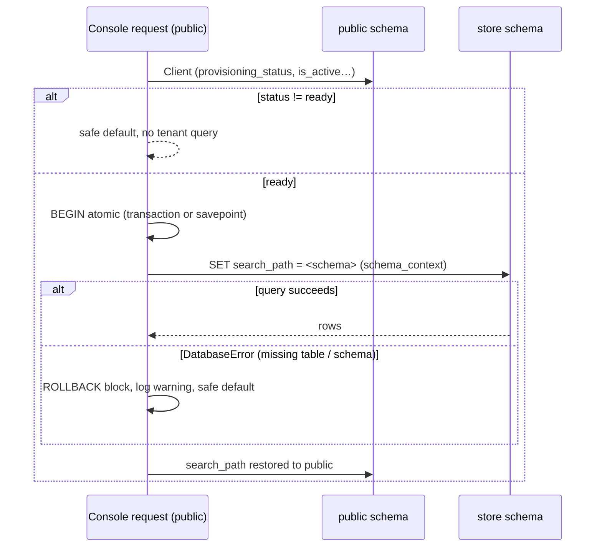
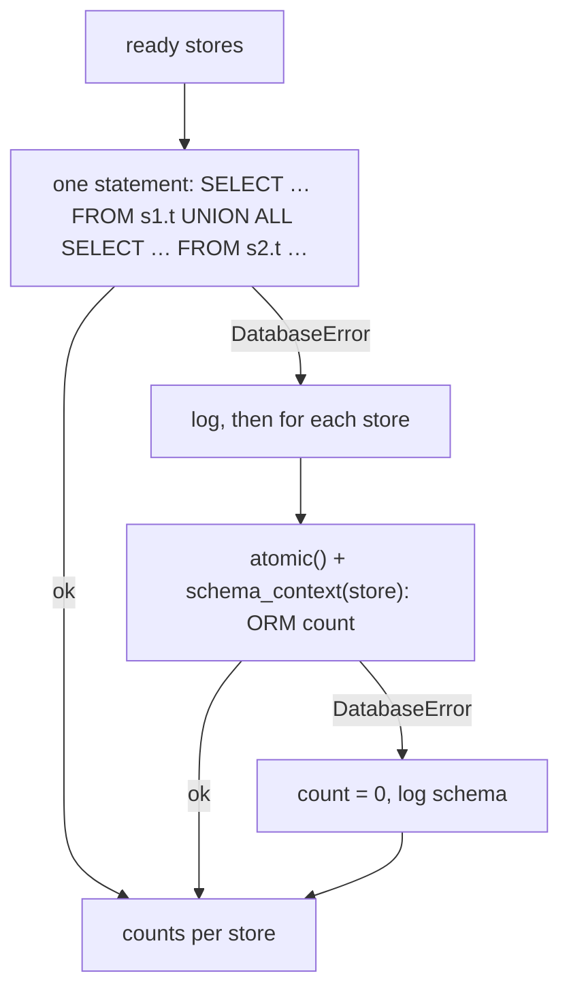

# Cross-schema access from the public console

> **Source**: DOC-452 · inventory A.11 · INT-030 (M20), INT-031 (M45), INT-032 (M46), INT-049 (M43)
> **Code**: `sharwa_saas/tenants/console_service.py` (`sharwa_ship_active`, `sharwa_ship_state`, `_installations`, `store_detail`, `tenant_custody_blocker`, `custody`) · `sharwa_saas/tenants/console_money_service.py` (`_pending_counts`, `dues_overview`, `dues_detail`, `due_action`) · `sharwa_saas/tenants/console_billing_service.py` (`_installation_counts`) · `sharwa_saas/tenants/merchant_rollup.py` (`rollup`) · `sharwa_saas/products/services/app_marketplace_service.py` (`generate_billing_charge`) · `sharwa_saas/tenants/tasks.py` (Sharwa Ship tasks) · tests `api/test_platform_console_api.py` (`TenantSchemaReadsTests`, `MissingSchemaTests`), `api/test_platform_money_api.py`, `api/test_platform_billing_api.py`
> **Last verified against code**: 2026-10-27 (official Step 06)

## 1. Purpose

The platform console (`console.<base>`, M20/M45/M46) runs on the **public schema** only (see [`10-multi-tenancy.md`](10-multi-tenancy.md)). Most of what it shows lives in public tables: `Client`, `Domain`, `Subscription`, `TenantFeatureOverride`, `TenantDeactivationRecord`, `TenantStatsSnapshot`, `SharwaPayWallet`. A few facts exist **only inside a store schema**:

| Fact | Store-schema table | Read by |
|---|---|---|
| Is Sharwa Ship active for this store? | `DeliveryMethod` (`is_sharwa_official`, `is_active`) | store list, overview, store detail, Sharwa Ship toggle |
| Which apps are installed? | `StoreAppInstallation` | store detail; per-app installation counts |
| Are there open shipments or pending platform dues? (custody) | `ShipmentOrder`, `PlatformCommissionRecord`, `AppBillingCharge` | deactivation state and the «إغلاق» option |
| How many dues are pending per store? | `PlatformCommissionRecord`, `AppBillingCharge` | dues overview |
| The dues of one store, and the actions on them | same tables + `StoreAppInstallation` | dues detail and the eight due actions |

This page gives the rules for reaching into a store schema from a public-schema request, and the patterns the console already uses. It does not cover a store reading public tables (that direction is described in [`10-multi-tenancy.md`](10-multi-tenancy.md)).

## 2. Components

| Component | Location | Role |
|---|---|---|
| `schema_context(schema_name)` | `django_tenants.utils` | switches the connection's `search_path` for the block and restores the previous schema on exit |
| `transaction.atomic()` around the read | every guarded read in `console_service.py`, `console_money_service.py`, `console_billing_service.py` | contains a database error to the block (see §5 "Why `atomic()` + `DatabaseError`") |
| Readiness filter | `client.provisioning_status == Client.PROVISIONING_READY` | no schema exists before `ready`, so nothing is read for `pending`, `provisioning` or `failed` stores |
| One `UNION ALL` query | `_pending_counts` (dues), `_installation_counts` (apps) | one round trip for a count across every store schema |
| `TenantStatsSnapshot` | public table, filled daily by `aggregate_tenant_stats` | the only source for sales and order numbers in the console overview, the dues overview and the merchant rollup (no live cross-schema sum) |
| Cache marker `platform:sharwa-ship-job:<schema>` | `console_service._ship_job_key` | remembers a queued Sharwa Ship job for up to `SHIP_JOB_TTL_SECONDS = 10 * 60` |

## 3. Data model

No model is added for cross-schema access. The pattern reads existing tenant tables through `schema_context` and writes only to public tables (`PlatformActionLog` for every console action) — except the due actions of §4.5, which write inside the store schema.

## 4. Flows

### 4.1 A guarded single-store read (the default pattern)

`sharwa_ship_active`, `_installations` and `tenant_custody_blocker` all have the same shape:

```python
# tenants/console_service.py — sharwa_ship_active (abridged)
if client.provisioning_status != Client.PROVISIONING_READY:
    return False                       # no schema yet → known answer, no query
try:
    from products.models import DeliveryMethod
    with transaction.atomic(), schema_context(client.schema_name):
        return DeliveryMethod.objects.filter(is_sharwa_official=True, is_active=True).exists()
except DatabaseError:
    logger.warning('تعذّرت قراءة حالة شروة شيب | schema=%s', client.schema_name)
    return False                       # broken schema → safe default, request continues
```

The safe default differs per read:

| Read | Not `ready` | `DatabaseError` |
|---|---|---|
| `sharwa_ship_active` | `False` | `False` (logged) |
| `_installations` | `[]` | `[]` (logged) |
| `tenant_custody_blocker` | `None` (no schema ⇒ no shipments, no dues) | the blocker sentence «تعذّر فحص عهدة المتجر الآن — حاول مجدداً.» — so a store whose custody cannot be checked **cannot be closed** |

`MissingSchemaTests.test_missing_schema_does_not_break_the_request` locks the behaviour: a `ready` store whose schema was dropped by hand returns `inactive` for Sharwa Ship, `[]` for installations and an unsettled custody, and a later query in the same transaction still works.



### 4.2 Cross-store counts — one `UNION ALL`, per-schema fallback

Two console screens need a number **per store** for many stores at once. Opening every schema in turn would cost one round trip per store. Both use one SQL statement instead:

| Function | SQL built | Used by |
|---|---|---|
| `console_money_service._pending_counts(clients)` | for every store and for each of the two tables `PlatformCommissionRecord` and `AppBillingCharge`: `SELECT %s AS s, COUNT(*) AS n FROM "<schema>"."<table>" WHERE status = 'pending'`, joined with ` UNION ALL ` (the schema name is a bound parameter for the label column) | `GET platform/dues/overview/` → `pending_count` per row (M45) |
| `console_billing_service._installation_counts()` | for every `ready` store: `SELECT app_code, COUNT(*) FROM "<schema>"."<StoreAppInstallation table>" GROUP BY app_code`, joined with ` UNION ALL ` | `GET platform/apps/` → `installations` per app (M46) |

Identifiers are quoted with `connection.ops.quote_name`; schema names come from `Client.schema_name`, never from the request.

If **any** schema in the list is missing a table, PostgreSQL rejects the whole statement. The function then logs «تعذّر عدّ المستحقات دفعة واحدة — مرور لكل متجر» (or «تعذّر عدّ التثبيتات دفعة واحدة — مرور لكل متجر») and falls back to one guarded read per store (§4.1 pattern). A store that still fails counts as `0` and is logged with its schema name. The answer is therefore always complete: exact for healthy schemas, `0` for broken ones.



Tests: `test_platform_money_api.py` `test_overview_and_detail_contract` (`pending_count == 2` from the store schema) and `test_platform_billing_api.py` (class docstring «عدّ التثبيتات عبر schemas المتاجر باستعلام UNION واحد — من schema متجر حقيقي.», `test_counts_come_from_store_schemas`).

### 4.3 Store detail and store list reads

`store_detail(schema)` (`GET platform/stores/<schema>/`) combines:

| Part | Where it is read |
|---|---|
| row fields, `primary_domain`, `current_plan`, `deactivation_status` | public: one prefetched `store_queryset()` (domains, current subscription with plan, open deactivation records) |
| `sharwa_ship` | **store schema** (§4.4) |
| `domains` | public `Domain`, primary first then by id |
| `subscription`, `subscription_history` | public `Subscription` |
| `installations` | **store schema** `StoreAppInstallation` (§4.1); app names from public `appstore.App` |
| `override_count` | public `TenantFeatureOverride` count |
| `recent_actions` | public `PlatformActionLog`, last `RECENT_ACTIONS = 20` |

The store list (`GET platform/stores/`, up to `PAGE_SIZE_MAX = 100` rows) and the overview (`recent_stores`, `RECENT_STORES = 50`) build every row with `store_row()`, which calls `sharwa_ship_state()`. That is **one guarded store-schema query per row** (only for `ready` stores) — see §9.

### 4.4 Sharwa Ship truth and the 10-minute marker

The truth is the store schema: Sharwa Ship is active when a `DeliveryMethod` with `is_sharwa_official = True` and `is_active = True` exists. The console never stores a copy. The code comment states the rule as «الحقيقة = DeliveryMethod(is_sharwa_official, is_active) داخل schema المتجر. «قيد التفعيل/الإلغاء» = علامة كاش تُوضع لحظة إرسال المهمة وتسقط ما إن تطابق الحالةُ الفعلية الهدف (أو بعد 10 دقائق).»

`POST platform/stores/<schema>/sharwa-ship/ {active}` (`toggle_sharwa_ship`):

1. Refuses a store that is not `ready` (`400` «المتجر غير جاهز بعد.»), a store with a job in flight (`409` «مهمة أخرى قيد المعالجة على هذا المتجر.») and a no-op (`409` «شروة شيب مفعّلة بالفعل.» / «شروة شيب غير مفعّلة أصلاً.»).
2. For activation, checks the `sharwa_ship` plan feature with `Feature.is_enabled_for_client` (`400` «ميزة «شروة شيب» غير متاحة لهذا المتجر — فعّلها من «الميزات» أولاً.»).
3. Sets the cache key `platform:sharwa-ship-job:<schema>` to `activate` or `deactivate` for 600 s, then queues `activate_sharwa_ship_task` / `deactivate_sharwa_ship_task` with `[schema]`. Those Celery tasks enter the store with `schema_context` and create or deactivate the official `DeliveryMethod`.
4. If the broker is down, the marker is removed and the answer is `503` «تعذّر إرسال المهمة الآن — حاول بعد قليل.».
5. Answers `{detail, store}` with «قيد تفعيل شروة شيب — يتحدّث تلقائياً.» or «قيد إلغاء شروة شيب.».

`sharwa_ship_state` derives the state shown in the console:

| Marker | Truth (`DeliveryMethod`) | State | Marker afterwards |
|---|---|---|---|
| `activate` | inactive | `activating` | kept |
| `deactivate` | active | `deactivating` | kept |
| any | already matches the target | `active` / `inactive` | **deleted** on this read |
| none | — | `active` / `inactive` | — |

A job that never runs leaves the marker for at most 10 minutes; after that the state falls back to the truth. Cache errors are swallowed (`_cache_get` returns `None`), so a cache outage shows the truth without the in-flight state.

### 4.5 Dues of one store (M45)

`dues_detail(client)` (`GET platform/dues/<schema>/`) reads pending commissions, pending and waived charges, installations and the generated `(installation, period)` pairs inside **one** `schema_context(client.schema_name)` block. `due_action` (`POST platform/dues/<schema>/actions/`) runs the eight actions inside `schema_context` too; each action takes its own `transaction.atomic()` with `select_for_update()` on the record before deciding (collect, waive, unwaive, generate, suspend, reactivate). Both refuse a store that is not `ready` with `404` «متجر غير معروف أو غير جاهز.» (`_ready_client`). See §8 for the missing `DatabaseError` guard here.

### 4.6 Multi-store rollup — no cross-schema query at all

The merchant rollup (`GET /api/v1/merchant/stores/`, M43, on the store host) shows numbers for several stores of the same owner. It reads **only** public tables inside `schema_context('public')`:

1. the current `Client` and its `MerchantAccount` (`_account_for`);
2. the account's `Client` rows with their domains (one query + one prefetch);
3. **one grouped `Sum`** over `TenantStatsSnapshot` for the date range (`orders_count`, `completed_orders_count`, `refunded_orders_count`, `revenue_sar`) grouped by client;
4. **one grouped `Max('date')`** over `TenantStatsSnapshot` grouped by client (`last_snapshot_date`, not range-bound).

The query count is fixed whatever the number of stores. Freshness is the snapshot's: numbers are as of the last `aggregate_tenant_stats` run. Contract, gates and examples: [`m43-multi-store.md`](../api/domains/02-dashboard-shell/m43-multi-store.md). The console overview (`overview()`) and the dues overview use the same snapshot table (`Sum('revenue_sar')`, `Sum('orders_count')`, `Max('date')`).

## 5. Invariants

- **Readiness first.** Never open a store schema unless `provisioning_status == 'ready'`. Before that, the schema may not exist and the safe answer is known (§4.1 table).
- **Contain the failure.** Every guarded tenant read is `with transaction.atomic(), schema_context(schema):` inside `try … except DatabaseError`. On failure: log with `schema=%s`, return the read's safe default, keep serving the request.
- **Why `atomic()` + `DatabaseError`.** On PostgreSQL a failed statement aborts the surrounding transaction: every later query fails until rollback. `ATOMIC_REQUESTS` is not set in `config/settings.py`, so in a normal console request the `atomic()` block is its own transaction; when the read runs inside another `atomic()` (a service transaction, or a test's wrapping transaction) the block becomes a **savepoint**. In both cases the failed statement is rolled back to the block's start and the connection stays usable — this is what the code and tests call "the savepoint".
- **`schema_context` restores the schema.** On exit it switches back to the previous schema even after an exception; `TenantSchemaReadsTests` asserts `connection.schema_name == 'public'` after the reads.
- **No live cross-schema sums.** Sales, revenue and order counts across stores come from `TenantStatsSnapshot` (public). Live per-schema queries are limited to existence checks and counts.
- **Schema names are trusted data.** Raw SQL only interpolates `Client.schema_name` values quoted with `connection.ops.quote_name`; request input never reaches an identifier.
- **Writes into a store schema are row-locked.** Due actions lock the record with `select_for_update()` inside `atomic()`; the action log row is written to public after the store-schema block.

## 6. Background work

| Task | Schema access | Note |
|---|---|---|
| `tenants.tasks.activate_sharwa_ship_task(schema_names)` / `deactivate_sharwa_ship_task` | `schema_context(schema)` per store | queued by the console toggle (§4.4); the activate task skips a store whose `sharwa_ship` feature is off |
| `tenants.tasks.aggregate_tenant_stats` | reads each store, writes `TenantStatsSnapshot` in `schema_context('public')` | the producer of every console and rollup number (schedule and retries: [`50-background-jobs.md`](50-background-jobs.md)) |

## 7. Configuration

| Setting | Value | Where |
|---|---|---|
| `SHIP_JOB_TTL_SECONDS` | `600` | `tenants/console_service.py` |
| `RECENT_ACTIONS` / `RECENT_STORES` | `20` / `50` | `tenants/console_service.py` |
| `PAGE_SIZE_DEFAULT` / `PAGE_SIZE_MAX` | `50` / `100` | `tenants/console_service.py` |
| `ATOMIC_REQUESTS` | not set (Django default `False`) | `config/settings.py` |
| Cache backend | the project cache (Sharwa Ship marker) | [`../ops/README.md`](../ops/README.md) |

## 8. Failure modes and fixes

| Failure | Symptom | Cause | Handling / fix |
|---|---|---|---|
| A `ready` store whose schema is missing or half-migrated | before INT-030: any console page touching it failed, and later queries in the same transaction raised "current transaction is aborted" | unguarded tenant read | guarded reads (§4.1) with safe defaults — INT-030; locked by `MissingSchemaTests` |
| One broken schema in a cross-store count | the single `UNION ALL` statement fails | PostgreSQL rejects the whole statement | per-schema fallback, broken store counted `0` (§4.2) — INT-031 (dues), INT-032 (apps) |
| `generate_billing_charge` called inside a console transaction for a period that already has a charge | `TransactionManagementError` on the follow-up query | `IntegrityError` from `AppBillingCharge.objects.create` (unique `installation` + `period_label`) was caught **without** a savepoint, leaving the outer transaction aborted | the create is wrapped in `with transaction.atomic():` (`app_marketplace_service.py:268-279`); the `except IntegrityError` branch then reads the existing charge and returns «توجد فاتورة مولَّدة مسبقاً لهذه الدورة بالفعل.» — INT-031 |
| Sharwa Ship job lost (worker down after queueing) | state stuck on `activating` / `deactivating` | marker without a matching state change | marker expires after 10 minutes; the state then shows the truth (§4.4) |
| Broker down at toggle time | — | `task.delay` raises | marker deleted, `503` «تعذّر إرسال المهمة الآن — حاول بعد قليل.» |

> ⚠️ Discrepancy — roadmap says every tenant-schema read from the console is wrapped in a savepoint / code does: the dues reads and actions of M45 enter the store schema with a bare `with schema_context(client.schema_name):` and no `atomic()` + `DatabaseError` guard (`tenants/console_money_service.py:254` in `dues_detail`, `:334` in `due_action`). They are protected only by the `ready` check of `_ready_client`; a `ready` store with a missing schema makes `GET platform/dues/<schema>/` and the due actions fail with a server error instead of a safe answer. Reported in official Step 06.

## 9. Open items

- **Per-row Sharwa Ship reads.** `list_stores` (≤ 100 rows) and `overview` (50 recent stores) call `sharwa_ship_state()` for every row, i.e. one guarded store-schema query per `ready` row. It is correct but grows with the page size; a `UNION ALL` existence query (§4.2 pattern) would make it one statement.
- **Dues overview hides suspended stores.** `dues_overview` lists only `ready` **and** `is_active` stores, while the dues of a suspended store stay reachable by URL (`_ready_client` ignores `is_active`). See [`14-store-lifecycle.md`](14-store-lifecycle.md) §5.
- **Guard gap** of §8 (dues detail and actions).

## 10. Rules for any new console read into a store schema

1. **Check readiness in public first.** `client.provisioning_status == Client.PROVISIONING_READY`; return a documented safe default otherwise.
2. **Wrap the read** in `with transaction.atomic(), schema_context(client.schema_name):` inside `try … except DatabaseError`, log `schema=%s` with a sentence that names the read, return the safe default. Choose a default that can never unlock a dangerous action (custody: "not settled", not "settled").
3. **Materialise inside the block.** Call `list(...)`, `.exists()`, `.count()` inside `schema_context`; a lazy queryset evaluated after the block runs against `public`.
4. **Do not mix public writes into the block.** Read the store schema, leave the block, then write public rows (`log_action`, overrides…).
5. **Many stores → one statement.** For a per-store count across many stores, build one `UNION ALL` over `ready` schemas with `connection.ops.quote_name`, inside `atomic()`, with the per-store fallback of rule 2.
6. **Numbers across stores → snapshots.** Revenue, orders and similar totals come from `TenantStatsSnapshot`, never from a live loop over schemas.
7. **Writes into a store schema** go through the existing service (`collect()`, `generate_billing_charge`, Celery task) inside `atomic()` with `select_for_update()` on the row; catch `IntegrityError` only inside its own `atomic()` (the INT-031 lesson).
8. **Test the broken case.** Add a `MissingSchemaTests`-style test: a `ready` `Client` created with `auto_create_schema = False`, then assert the safe default and that a later query in the same transaction still works.

Copy-ready pattern:

```python
import logging
from django.db import DatabaseError, transaction
from django_tenants.utils import schema_context
from tenants.models import Client

logger = logging.getLogger(__name__)


def store_open_tickets(client) -> int:
    """Example: one fact from a store schema for a public-schema caller."""
    if client.provisioning_status != Client.PROVISIONING_READY:
        return 0                                   # rule 1 — no schema yet
    try:
        from products.models import SupportTicket   # tenant model, imported lazily
        with transaction.atomic(), schema_context(client.schema_name):   # rule 2
            return SupportTicket.objects.filter(status='open').count()   # rule 3
    except DatabaseError:
        logger.warning('could not read open tickets | schema=%s', client.schema_name)
        return 0                                   # documented safe default
```

(`SupportTicket` and the sentence are illustrative; name the real model and write the log sentence in the module's language.)

## 11. Related pages

- [`10-multi-tenancy.md`](10-multi-tenancy.md) — public vs store schemas, model placement
- [`11-provisioning.md`](11-provisioning.md) — the `ready` status every rule depends on
- [`14-store-lifecycle.md`](14-store-lifecycle.md) — custody checks used here
- [`15-plans-and-features.md`](15-plans-and-features.md) — the `sharwa_ship` feature check
- [`42-concurrency.md`](42-concurrency.md) — row locks and `atomic()` conventions
- [`62-infra-fixes.md`](62-infra-fixes.md) — savepoints among the cross-cutting fixes
- API: [`m20-console.md`](../api/domains/16-platform-console/m20-console.md) · [`m45-dues-sharwa-pay-admin.md`](../api/domains/16-platform-console/m45-dues-sharwa-pay-admin.md) · [`m46-plans-billing.md`](../api/domains/16-platform-console/m46-plans-billing.md) · [`m43-multi-store.md`](../api/domains/02-dashboard-shell/m43-multi-store.md)
