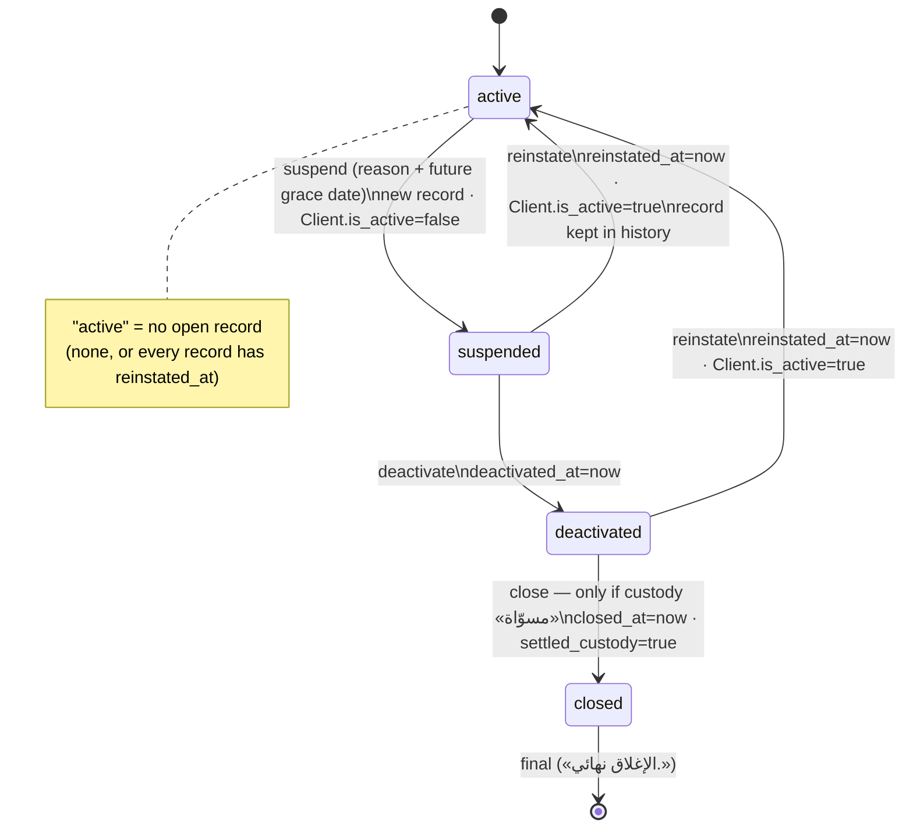

# Store lifecycle — suspension, deactivation, closure and reinstatement

> **Source**: DOC-453 · inventory A.11, Domain 16 · INT-030 (M20), INT-031 (M45), INT-049 (M43)
> **Code**: `sharwa_saas/tenants/models.py` (`Client.is_active`, `TenantDeactivationRecord`) · `sharwa_saas/tenants/console_service.py` (`deactivation_state`, `deactivation_action`, `custody`, `tenant_custody_blocker`, `_record_view`) · `sharwa_saas/api/views_platform.py` (route) · guards `sharwa_saas/products/services/shipping_billing_service.py` (waybill issue), `sharwa_saas/products/views/edge_cases.py` (`_active_suspension`) · `sharwa_saas/tenants/console_money_service.py` (`_ready_client`, `dues_overview`) · `sharwa_saas/tenants/merchant_rollup.py` (`is_available`) · `sharwa_saas/api/middleware.py` (inactive store `403`) · migrations `tenants/0022_tenantdeactivationrecord`, `tenants/0027_platform_console_api` · frontend `sharwa-frontend/src/features/platform-admin/{schemas/stores.ts,components/stores/deactivation-tab.tsx}` · tests `api/test_platform_console_api.py` (`test_deactivation_lifecycle`), `api/test_platform_money_api.py` (`test_suspended_store_dues_stay_reachable`)
> **Last verified against code**: 2026-10-27 (official Step 06)

## 1. Purpose

A store can be taken out of service by the platform without deleting it, for example after complaints or while it still has shipments on the road. This page describes the states a store passes through, what each transition changes, which parts of the system stop and which must keep working, and how the console decides whether a store may be closed for good.

It is **not** about provisioning (`pending → provisioning → ready | failed`, see [`11-provisioning.md`](11-provisioning.md)) and not about the merchant's own settings. The two state machines are independent: `is_available` in the rollup combines them (§4.4).

## 2. Components

| Component | Location | Role |
|---|---|---|
| `Client.is_active` | public `tenants_client` | the single flag the request guards read; `False` while a store is suspended, deactivated or closed |
| `TenantDeactivationRecord` | public | one row per suspension episode: status, reason, grace period, custody flag, timestamps, last actor |
| `deactivation_state(client)` | `tenants/console_service.py` | builds `{current, history, options}`: the open record, all records newest first, and the four actions with `allowed` + `reason` |
| `deactivation_action(schema, data, actor)` | `tenants/console_service.py` | applies one transition under a row lock and writes `PlatformActionLog` |
| `custody(client)` | `tenants/console_service.py` | «مسوّاة» check: no open shipments, no pending platform dues, zero merchant Sharwa Pay balance |
| Route | `GET`/`POST /api/v1/platform/stores/<schema>/deactivation/` (`views_platform.py`) | the console's only entry point; contract and examples in [`m20-console.md`](../api/domains/16-platform-console/m20-console.md) |
| Guards | waybill issue, edge-cases banner, `X-Store-Domain` switch | read the open record or `is_active` (§5) |

## 3. Data model

`TenantDeactivationRecord` (public schema, `ordering = ['-created_at']`):

| Field | Type | Meaning | Added by |
|---|---|---|---|
| `client` | FK `tenants.Client`, `CASCADE`, `related_name='deactivation_records'` | the store | `0022` |
| `status` | `suspended` «موقوف مؤقتاً» · `deactivated` «معطَّل» · `closed` «مغلق نهائياً» (default `suspended`) | the record's stage | `0022` |
| `reason` | text | why; required on `suspend`, optional and overwritten on later actions | `0022` |
| `grace_period_ends_at` | datetime | end of the grace period, required on `suspend` and must be in the future | `0022` |
| `deactivated_at` · `closed_at` | datetime | set by `deactivate` / `close` | `0022` |
| `settled_custody` | bool | frozen to `true` by `close` | `0022` |
| `created_at` | datetime | episode start | `0022` |
| `reinstated_at` | datetime, nullable | set by `reinstate`. A record with `reinstated_at` **no longer blocks** the store; every guard filters `reinstated_at__isnull=True` | `0027_platform_console_api` |
| `actor` | char(150) | console username of the **last** transition (`by` in the API; `—` when empty) | `0027` |
| `updated_at` | datetime, `auto_now` | last change; backfilled to `created_at` for existing rows by `0027` | `0027` |

The "open" record of a store is the newest one with `reinstated_at IS NULL`. A closed record stays open in that sense forever (§4.2). There is no unique constraint: one open record per store is enforced by the action code under `select_for_update()` (§5).

`0027_platform_console_api` also added `PendingWebhookEvent.resolved_at` and created `PlatformActionLog`; those belong to the webhook and audit pages.

## 4. Flows

### 4.1 The transitions

| Action (console label) | Allowed when | Changes | Refusal |
|---|---|---|---|
| `suspend` («تعليق») | no open record | **creates** a record `status=suspended`, `reason`, `grace_period_ends_at`, `actor`; sets `Client.is_active = False` | `409` «المتجر معلّق أو معطّل بالفعل.» / «المتجر مغلق بالفعل.»; `400` `{reason: [«اذكر سبب التعليق — يراه فريق الدعم.»]}` and/or `{grace_period_ends_at: [«اختر تاريخ نهاية مهلة في المستقبل.»]}` |
| `deactivate` («تعطيل») | open record is `suspended` | `status=deactivated`, `deactivated_at=now`, `actor` | `409` «يُعطَّل المتجر المعلّق فقط.» |
| `close` («إغلاق») | open record is `deactivated` **and** custody is settled | `status=closed`, `closed_at=now`, `settled_custody=True`, `actor` | `409` «يُغلق المتجر المعطّل فقط.», or the custody reason (§4.3) |
| `reinstate` («إعادة التفعيل») | open record is `suspended` or `deactivated` | `reinstated_at=now`, `actor`; sets `Client.is_active = True`. The record is **kept** (history) | `409` «الإغلاق نهائي.» (closed) / «المتجر نشط.» (no open record) |

Other answers of the `POST`: unknown `action` → `400` `{action: [«إجراء غير معروف.»]}`; a race where the record changed between the state read and the lock → `409` «تم التعامل معه مسبقاً — للمتجر سجل تعطيل مفتوح.» or «تم التعامل معه مسبقاً — لا سجل تعطيل مفتوح.». Every successful action answers the new `deactivation_state` and logs `deactivation.<action>` in `PlatformActionLog` with the detail «عُلِّق المتجر…», «عُطِّل المتجر…», «أُغلق المتجر…» or «أُعيد تفعيل المتجر…» (plus `: <reason>` when one was given).

`grace_period_ends_at` accepts `YYYY-MM-DD` (read as 23:59:59 of that day) or a full ISO timestamp.

Side effects per state:

| State | `Client.is_active` | Store API by `X-Store-Domain` / storefront probe | New waybills | Edge-cases banner | Dues (console) | Rollup `is_available` |
|---|---|---|---|---|---|---|
| active | `true` | served | allowed (other guards apply) | none | reachable, listed in overview | `true` when `ready` |
| suspended | `false` | `403` «هذا المتجر غير نشط حالياً.» | refused «المتجر موقوف/معطَّل مؤقتاً — لا يمكن إصدار بوليصات شحن جديدة.» | shown | reachable by URL, **not** listed in overview | `false` |
| deactivated | `false` | `403` | refused (same sentence) | shown | reachable by URL, not listed | `false` |
| closed | `false` | `403` | not refused by this guard (§5) — the store is unreachable anyway | not shown | reachable by URL (custody was settled) | `false` |
| reinstated (= active again) | `true` | served | allowed | none | listed again | `true` |

The `403` comes from `TenantHeaderOverrideMiddleware`, which the storefront probe and every BFF call to a store go through; the storefront then renders its inactive page (see [`m47-tenant-guard.md`](../api/domains/01-public-onboarding/m47-tenant-guard.md)).

> ⚠️ Discrepancy — roadmap says the lifecycle states are active / deactivated / reinstated / code does: four actions over three record statuses — `suspended` → `deactivated` → `closed`, with `reinstate` allowed from `suspended` or `deactivated` and refused after `closed` (`tenants/console_service.py:823-833`). "Reinstated" is not a state: it is an `active` store whose last record carries `reinstated_at`. Reported in official Step 06.

### 4.2 Reinstatement closes the record — it never deletes it

`reinstate` sets `reinstated_at` and keeps the row, so `history` shows the whole episode (the console renders «أُعيد التفعيل» with the date). The frontend mock used to delete the record; Django is the authority and the mock was aligned (INT-030). `test_deactivation_lifecycle` asserts that after `reinstate`, `current` is `null`, `history` still has one row with `reinstated_at`, the store is active again and exactly one `deactivation.reinstate` action was logged.

A **closed** record never gets `reinstated_at`, so it remains the store's open record: `suspend` is refused («المتجر مغلق بالفعل.») and so is `reinstate` («الإغلاق نهائي.»). Closure is final through the API.

In `history`, a closed or reinstated record shows its **frozen** `settled_custody`; the open, not-closed record shows the **live** custody check of this request (`_record_view`).

### 4.3 Custody «مسوّاة»

`custody(client)` returns `(settled, reason)`. Settled means all three hold:

| # | Condition | Where it is read | Reason when it fails |
|---|---|---|---|
| 1 | no open shipments: `ShipmentOrder` whose `status` is not `delivered`, `returned` or `cancelled` | store schema (guarded read, [`13-cross-schema-access.md`](13-cross-schema-access.md) §4.1) | «N شحنة جارية لم تُسلَّم أو تُرجَع بعد — العهدة غير مسوّاة.» (N = the count) |
| 2 | no pending platform dues: no `PlatformCommissionRecord` and no `AppBillingCharge` with `status='pending'` | store schema (same block) | «مستحقات معلّقة على المتجر — حصّلها أو أعفِها أولاً.» |
| 3 | the merchant's Sharwa Pay wallet (`customer_phone = clean_phone_number(merchant_phone)`) has a zero balance in all four currencies (`balance_sar`, `balance_usd`, `balance_yer_old`, `balance_yer_new`), or no wallet exists | public `sharwapay` | «رصيد محفظة شروة باي للتاجر لم يُصرف — العهدة غير مسوّاة.» |

If the store-schema read fails, the reason is «تعذّر فحص عهدة المتجر الآن — حاول مجدداً.» and the store **cannot** be closed — the safe direction. A store that never reached `ready` has no schema, so conditions 1–2 hold trivially. The custody result is the `reason` of the disabled `close` option, so the console shows why closing is blocked (`test_deactivation_lifecycle`: a 5 SAR balance blocks `close` with the Sharwa Pay sentence, then `POST close` answers `409`).

### 4.4 Availability in the multi-store rollup

`merchant_rollup.rollup()` marks each store of the owner's account with `is_available = Client.is_active AND provisioning_status == 'ready'`. The numbers stay visible for an unavailable store (they come from `TenantStatsSnapshot`); only the link is disabled in «كل متاجري». See [`m43-multi-store.md`](../api/domains/02-dashboard-shell/m43-multi-store.md).

## 5. Invariants

- **One open record per store.** `deactivation_action` runs in `transaction.atomic()`, locks the newest open record with `select_for_update()`, and re-checks: `suspend` refuses if one exists, the other actions refuse if none exists. The option table is computed first (`deactivation_state`) and then re-validated under the lock.
- **`is_active` follows the record.** Only `suspend` sets it to `false` and only `reinstate` sets it to `true`. `deactivate` and `close` leave it `false`.
- **Guards read the open, non-closed record.** Both store-side guards filter the public table with `status__in=['suspended', 'deactivated']`, `closed_at__isnull=True`, `reinstated_at__isnull=True`:
  - waybill issue — `shipping_billing_service.py:52-62`, after the `sharwa_ship` feature check, refuses with «المتجر موقوف/معطَّل مؤقتاً — لا يمكن إصدار بوليصات شحن جديدة.». Completion of deliveries and custody settlement for couriers with running shipments stay open (code comment at the guard).
  - edge-cases banner — `products/views/edge_cases.py` `_active_suspension()` feeds the grace-period banner of the legacy «الحالات الحدّية» screen.
- **Dues of a suspended store stay reachable.** `console_money_service._ready_client` requires `ready` but **not** `is_active`, so `GET platform/dues/<schema>/` and the due actions work for suspended and deactivated stores. Without this, "close only after the dues are settled" would dead-lock: the legacy Django dues page required `is_active`. Locked by `test_suspended_store_dues_stay_reachable`.
- **Closure needs settled custody**, checked live at the moment of the action, then frozen in `settled_custody`.
- **Every transition is audited** in `PlatformActionLog` (public), with the console username in `TenantDeactivationRecord.actor`.

## 6. Background work

None. No task reads `grace_period_ends_at`: in the files read, the grace date is informational (shown to support and to the merchant's banner) and the store stays suspended until a console user acts. See §9.

## 7. Configuration

No setting. The console roles that may call the route (owner vs operator) are in [`m20-console.md`](../api/domains/16-platform-console/m20-console.md) and [`30-security.md`](30-security.md).

## 8. Failure modes and fixes

| Failure | Symptom | Cause | Handling / fix |
|---|---|---|---|
| Reinstated store still blocked | waybills refused / banner shown after reinstatement | before INT-030 a reinstatement deleted or ignored the record; guards had no `reinstated_at` filter | reinstatement sets `reinstated_at`; both guards filter `reinstated_at__isnull=True` (INT-030) |
| Store cannot be closed because its dues cannot be settled | legacy dues page refused a suspended store | the page required `is_active` | `_ready_client` ignores `is_active` (INT-030/INT-031) |
| Custody check on a broken schema | — | missing store tables | blocker sentence, `close` stays disabled ([`13-cross-schema-access.md`](13-cross-schema-access.md)) |
| Two console users act at once | duplicate open records or double transitions | concurrent requests | row lock + re-check; the loser gets `409` «تم التعامل معه مسبقاً — …» |

## 9. Open items

- **Grace period has no automatic effect.** The console copy for `suspend` says the store stops «حتى نهاية المهلة أو إعادة التفعيل» (`deactivation-tab.tsx`), but nothing ends the suspension at `grace_period_ends_at`; a person must `reinstate` or continue to `deactivate`. Decide whether the copy or the behaviour should change.
- **Dues overview hides suspended stores.** `dues_overview` filters `is_active=True`, so a suspended store's pending dues are reachable only by its URL, not from the overview list.
- **Wallet lookup key.** `custody()` looks up the wallet by `clean_phone_number(merchant_phone)` only, while `console_money_service._merchant_wallet` tries the raw `merchant_phone` first, then the cleaned one. A wallet stored under the raw format would be missed by the custody check (it would wrongly count as zero).
- **Host-only requests.** `is_active` is checked by `TenantHeaderOverrideMiddleware`, i.e. only for `/api/` requests that carry `X-Store-Domain` (the BFF and the storefront probe send it). `TenantProvisioningGuardMiddleware` checks `provisioning_status`, not `is_active`. A request that reaches a suspended store by its own host without the header is not refused by either middleware; no other `is_active` check was found in `config/middleware.py`. Not verified for the legacy HTML views.
- **Closed stores and the waybill guard.** The guard ignores `closed` records (`closed_at__isnull=True`); a closed store is unreachable through the API (`is_active=false`), so this only matters for code that issues waybills outside a store request.

## 10. Related pages

- API: [`m20-console.md`](../api/domains/16-platform-console/m20-console.md) (route, examples) · [`m45-dues-sharwa-pay-admin.md`](../api/domains/16-platform-console/m45-dues-sharwa-pay-admin.md) · [`m43-multi-store.md`](../api/domains/02-dashboard-shell/m43-multi-store.md) · [`m47-tenant-guard.md`](../api/domains/01-public-onboarding/m47-tenant-guard.md)
- Guide: [`deactivation.md`](../guides/console/16-platform-console/deactivation.md)
- Architecture: [`10-multi-tenancy.md`](10-multi-tenancy.md) · [`11-provisioning.md`](11-provisioning.md) · [`13-cross-schema-access.md`](13-cross-schema-access.md) · [`37-audit.md`](37-audit.md) · [`43-ledgers.md`](43-ledgers.md)
