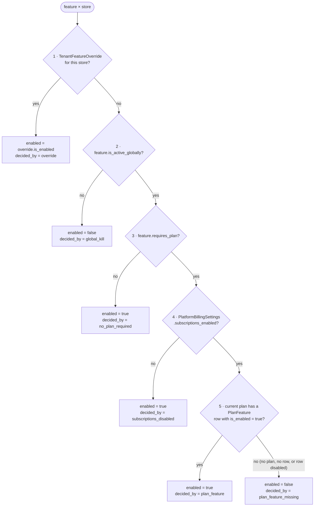

# Plans, plan features and the feature decision engine

> **Source**: DOC-454 · inventory A.5 · INT-030 (M20), INT-032 (M46), INT-033 (M16)
> **Code**: `sharwa_saas/billing/models.py` (`Plan`, `Subscription.assign_plan`, `PlatformBillingSettings`, `resolve_feature_decision`, `_resolve_feature_enabled`, `Feature.is_enabled_for_client`, `PlanFeature`, `TenantFeatureOverride`) · `sharwa_saas/billing/context_processors.py` (`FeatureFlags`) · `sharwa_saas/products/decorators.py` (`require_feature`, `require_feature_json`, `feature_required`) · `sharwa_saas/api/views_settings.py` (`settings_feature_enabled`, `FEATURE_MESSAGE`) · `sharwa_saas/api/views_auth.py` (`_enabled_features`) · `sharwa_saas/api/views_public.py` (`public_plans_payload`) · `sharwa_saas/tenants/console_service.py` (`store_features`, `save_store_features`, `feature_views`, `patch_feature`, `resolve_for_store`, `bulk_override`, `delete_override`) · `sharwa_saas/tenants/console_billing_service.py` (plans, matrix, `assign_subscription`, `patch_billing_settings`, `AUTO_ASSIGN_NOTE`) · `sharwa_saas/tenants/registration.py` (`create_pending_tenant`) · migrations `billing/0001`–`0013` · frontend `sharwa-frontend/src/features/platform-admin/schemas/billing.ts` (`DECIDED_BY`, `DECIDED_BY_STEP`, `RESOLUTION_STEPS`) · tests `api/test_platform_console_api.py` (`test_feature_resolution_and_overrides`, `test_feature_catalog_and_bulk_overrides`), `api/test_platform_billing_api.py` (`test_matrix_and_subscriptions`, `test_enabling_plans_assigns_the_default_free_plan`, `test_plans_crud_and_rules`)
> **Last verified against code**: 2026-10-27 (official Step 06)

## 1. Purpose

Sharwa sells the same software to every store and decides **per store** which modules are switched on. The decision is a function of five platform-owned inputs: a per-store exception, a platform kill switch, whether the feature needs a plan at all, whether the plan system is on, and the store's current plan. This page describes that function, every place that calls it, the subscription rules it depends on, and the switch that turns the plan system on.

It does not list the routes each code gates: that per-route table (40 codes) is [`plan-features.md`](../api/overview/plan-features.md). Where the feature gate sits among the other gates (session, owner, permission) is in [`conventions.md#gates`](../api/overview/conventions.md#gates). Commissions and app billing are money topics ([`43-ledgers.md`](43-ledgers.md)).

## 2. Components

| Component | Location | Role |
|---|---|---|
| `resolve_feature_decision(*, feature, override, plan, plan_feature, subscriptions_enabled)` | `billing/models.py` | **the single decision source**. Returns `(enabled, decided_by)` |
| `_resolve_feature_enabled(...)` | `billing/models.py` | returns `resolve_feature_decision(...)[0]`; used where only the boolean matters |
| `Feature.is_enabled_for_client(client)` | `billing/models.py` | loads the inputs for one feature and one store, then calls `_resolve_feature_enabled` |
| `FeatureFlags(client)` | `billing/context_processors.py` | lazy, per-request cache of all inputs for one store; `flags[code]` calls `_resolve_feature_enabled`. Feeds the legacy templates (``) and `auth/me` |
| `require_feature(code)` / `feature_required` (alias) / `require_feature_json(code)` | `products/decorators.py` | legacy Django HTML views: redirect with the message «هذه الميزة غير متاحة في باقتك الحالية», or `403 {"error": "Forbidden"}` for AJAX |
| `settings_feature_enabled(request, code)` | `api/views_settings.py` | the `/api/v1` gate: "same decision as `require_feature(code)`" — `Feature.objects.filter(code=code).first()` then `is_enabled_for_client(request.tenant)`; a missing code is **off** |
| `_enabled_features(tenant)` | `api/views_auth.py` | `features[]` in `GET /api/v1/auth/me/`: every catalogue code for which `FeatureFlags(tenant)[code]` is true, ordered by code |
| `public_plans_payload()` | `api/views_public.py` | landing page: which feature names each active plan grants (steps 2–5 without a store, §4.4) |
| Console services | `tenants/console_service.py`, `tenants/console_billing_service.py` | per-store feature table with `source`, `resolve` probe, overrides (one store / bulk), kill switch and `requires_plan` edits, plans, matrix, subscriptions, the plan-system switch |

## 3. Data model

All tables are in the **public** schema (`billing` is a shared app). `Plan`, `Subscription` and `PlatformBillingSettings` keep their historical table names `tenants_plan`, `tenants_subscription`, `tenants_platformbillingsettings` (`db_table`), because they moved out of `tenants` without SQL changes.

| Model | Key fields | Constraints / rules | Added or changed by |
|---|---|---|---|
| `Feature` | `code` (slug, unique, fixed after creation), `name`, `description`, `module_group` (display grouping only), `is_active_globally` (default `True`, the **kill switch**), `requires_plan` (default `False`) | ordering `module_group, name` | `0002_feature_toggling`; codes seeded by `0003`–`0011`, `0013` |
| `PlanFeature` | `plan` FK (`CASCADE`), `feature` FK (`CASCADE`), `is_enabled` (default `True`) | unique (`plan`, `feature`) `unique_plan_feature`. A row with `is_enabled=True` **grants**; no row = not granted | `0002` |
| `TenantFeatureOverride` | `feature` FK (`CASCADE`), `client` FK (`CASCADE`, `related_name='feature_overrides'`), `is_enabled` (no default — the console must choose), `notes` (≤ 255), `created_at`, `updated_at` | unique (`feature`, `client`) `unique_feature_override_per_client` | `0002`; `updated_at` (auto_now, backfilled to `created_at`) by `0012_tenantfeatureoverride_updated_at` — the console lists overrides by it |
| `Plan` | `code` (slug, unique, fixed), `name`, `is_free`, `price`, `currency`, `billing_interval` (`monthly` · `yearly` · `lifetime`), `commission_type`/`commission_value`, `max_products`, `max_orders_per_month`, `is_active`, `is_default_free`, `display_order` | `save()` clears `is_default_free` on every other plan when this one sets it ⇒ **one default** | `tenants/0012` (then moved to `billing`) |
| `Subscription` | `client` FK (`CASCADE`), `plan` FK (**`PROTECT`**), `status` (`active` · `cancelled` · `expired`), `is_current`, `started_at`, `current_period_end`, `cancelled_at`, `notes` | index (`client`, `is_current`); history is never deleted | `tenants/0012` (moved) |
| `PlatformBillingSettings` | `subscriptions_enabled` (default `False`), `commission_enabled` (default `False`), `updated_at` | singleton: `save()` forces `pk=1`, `delete()` does nothing, `load()` = `get_or_create(pk=1)` | `tenants/0012` (moved) |

`billing/0001_initial` and `0012` seed no feature code, so the catalogue is exactly the **40 codes** of `0003`–`0011` and `0013` listed in [`plan-features.md`](../api/overview/plan-features.md#seeding) (this closes the caveat on that page about the two migrations it had not seen).

## 4. Flows

### 4.1 The decision order

`resolve_feature_decision` evaluates five steps in a fixed order. The first step that applies decides; `decided_by` names it. The values are the same in the console contract (`DECIDED_BY` in `schemas/billing.ts`).

| Step | `decided_by` | Result | Console label (store features tab) | Why it sits here |
|---|---|---|---|---|
| 1 | `override` | `override.is_enabled` | «استثناء المتجر» | a trial for one store despite the kill switch, or blocking one problem store although everyone has it |
| 2 | `global_kill` | `false` | «إيقاف عالمي» | switch a broken feature off for the whole platform at once — stores with an override (step 1) keep their exception |
| 3 | `no_plan_required` | `true` | «لا تتطلب باقة» | lets an existing feature live in the catalogue without a `PlanFeature` row for every plan |
| 4 | `subscriptions_disabled` | `true` | «الباقات غير مفعّلة» | while the plan system is off (the default), nothing that requires a plan is taken away from anyone |
| 5 | `plan_feature` / `plan_feature_missing` | `true` / `false` | «خلية الباقة» / «غائبة عن الباقة» | the plan matrix decides; absence means "no" |

The console shows the step number with the label (`DECIDED_BY_STEP`: `plan_feature` and `plan_feature_missing` are both step 5) and the tooltip texts of `RESOLUTION_STEPS`, e.g. «خلية الباقة الحالية (PlanFeature.is_enabled) — الغياب = غير متاحة».

> ⚠️ Discrepancy — roadmap says the decision order is kill switch → override → plan → default / code does: override → kill switch → `requires_plan` → plan system off → plan cell (`billing/models.py:200-210`). The store override is evaluated **first**, so it beats the kill switch; `test_feature_catalog_and_bulk_overrides` asserts `decided_by == 'override'` for an overridden store and `'global_kill'` only once the override is removed. Reported in official Step 06.

Consequences with today's catalogue (all from [`plan-features.md`](../api/overview/plan-features.md#seeding)):

- 39 of the 40 codes have `requires_plan = False`; they stop at step 2 or 3, so **the plan matrix has no effect on them**.
- `pos` (seeded by `0013_seed_pos_feature`, `requires_plan = True`, active globally) is the only plan-gated code. With the plan system off it is on for everyone (`subscriptions_disabled`); once the system is on, only plans with an enabled `PlanFeature(pos)` grant it.
- `multi_location`, `staff_rbac`, `social_channels`, `marketplaces`, `dropshipping` are seeded with `is_active_globally = False`: off for every store (`global_kill`) unless the store has an override with `is_enabled = True`.

### 4.2 Who calls the engine

| Caller | How it gets the inputs | On a missing code | On an error |
|---|---|---|---|
| `/api/v1` route gates — `settings_feature_enabled(request, code)` (settings sections, inventory, POS, integrations and every module listed in [`plan-features.md`](../api/overview/plan-features.md)) | `Feature.is_enabled_for_client(request.tenant)`: override + (only if `requires_plan`) current plan, its `PlanFeature`, the singleton | off ⇒ `403` | exception propagates |
| Legacy HTML views — `require_feature` / `require_feature_json` | same | redirect with «هذه الميزة غير متاحة في باقتك الحالية» / `403 {"error": "Forbidden"}` | — |
| Templates and `auth/me` `features[]` — `FeatureFlags` | one load per request: whole catalogue, the store's overrides, current plan, its `PlanFeature` rows, the singleton | `False` | **fail closed**: any exception while loading logs «تعذّر تحميل بيانات الميزات لـ FeatureFlags» and resolves every feature to `False`, so the page still renders |
| Console store features tab — `store_features(client)` | one load for the store, then `resolve_feature_decision` per catalogue row → `{code, name, module_group, effective, source, override}` | — | — |
| Console probe — `GET platform/features/<code>/resolve/?schema=` (`resolve_for_store`) | loaded for that pair → `{feature_code, schema_name, enabled, decided_by, plan}` | `404` «الميزة غير موجودة.»; unknown store `400 {"schema": ["متجر غير معروف."]}` | — |
| Other server code — Sharwa Ship console toggle, `activate_sharwa_ship_task`, waybill issue (`shipping_billing_service`) | `Feature.objects.filter(code='sharwa_ship').first()` + `is_enabled_for_client` | waybill: refused «شروة شيب غير متاحة لهذا المتجر حالياً.» | — |
| Landing page — `public_plans_payload()` | no store: only globally active features (step 2 as a filter); per plan, `grants = not requires_plan or not subscriptions_enabled or (plan, feature) in enabled PlanFeature rows` (steps 3–5, no step 1) | — | — |

All five boolean paths end in `resolve_feature_decision`, which is why the console's `source` always matches what a store sees. `FeatureFlags` and `is_enabled_for_client` load the plan inputs differently (`is_enabled_for_client` skips the plan queries when `requires_plan = False`, because step 3 returns before they are read), but they cannot disagree.

### 4.3 Overrides and the kill switch (console)

| Action | Route | Behaviour |
|---|---|---|
| Edit one store's exceptions | `PUT platform/stores/<schema>/features/ {overrides: [{code, is_enabled: true\|false\|null, notes}]}` | all-or-nothing validation (`overrides.<code>`: «ميزة غير معروفة.», «قيمة غير صالحة.», «الملاحظة أطول من 255 حرفاً.»), then in one `atomic()`: `null` deletes the override (back to steps 2–5), `true`/`false` `update_or_create`. An explicit override is kept even when it equals the current default, so the owner's decision survives a later plan change. Logs `feature_override.update` |
| One feature, many stores | `POST platform/feature-overrides/bulk/ {feature_code, schema_names, is_enabled\|null, notes}` | validates the feature («اختر ميزة.»), the store list («اختر متجراً واحداً على الأقل.» / «متاجر غير معروفة: …»), the value and the note; one `atomic()`; answers `{detail, created, updated, removed}`; one `feature_override.bulk` log row per store |
| Delete one override | `DELETE platform/feature-overrides/<id>/` | `409` «الاستثناء غير موجود أو تم التعامل معه مسبقاً.» when already gone |
| List overrides | `GET platform/feature-overrides/?feature&schema&page&page_size` | newest `updated_at` first |
| Kill switch, `requires_plan`, name, description | `PATCH platform/features/<code>/` | booleans must be real booleans («قيمة غير صالحة.»), a name is required («أدخل اسم الميزة.»); the code is fixed; logs `feature.update`. The catalogue view returns `override_count`, `enabled_override_schemas` (the stores that keep the feature after a kill) and `plans_enabled` |

A store cannot change its own features: there is no merchant write route.

### 4.4 Plans, the matrix and subscriptions

**Plans** (`platform/plans/`): `Plan.save()` keeps a single default. The console adds two rules when a plan is marked default: «الباقة الافتراضية يجب أن تكون مجانية.» and «الباقة الافتراضية يجب أن تكون نشطة — التسجيل يُسندها للمتاجر الجديدة.». Deleting a plan with current subscriptions answers `409` «لا يمكن حذف باقة عليها N اشتراكاً حالياً — انقلها إلى باقة أخرى أولاً.» (N = the count); a plan that only has historical subscriptions hits `Subscription.plan = PROTECT` and answers `409` «الباقة مرتبطة باشتراكات سابقة في سجل المتاجر — عطّلها («غير نشطة») بدل الحذف.».

**Matrix** (`GET|PUT platform/plan-features/ {plan_id, feature_code, is_enabled}`): `update_or_create` of one `PlanFeature` cell; unknown plan or feature → `400` «باقة أو ميزة غير معروفة.». A cell only matters for `requires_plan` features (§4.1).

**Assigning a plan.** `Subscription.assign_plan(client, plan, status='active', current_period_end=None, notes='')` is the **only** place a subscription is created. In one `atomic()` it sets `is_current = False` on every current subscription of the store and creates a new current one. It never deletes history. It is called from three places:

| Caller | Extra behaviour around `assign_plan` |
|---|---|
| Console `POST platform/subscriptions/assign/` (`assign_subscription`) | validates store («اختر متجراً.»), plan («اختر باقة.», «الباقة غير نشطة.»), status, period end and note; then, in the same transaction, marks the previous current **active** subscription `status='cancelled'`, `cancelled_at=now` before calling `assign_plan`, so history says what happened; logs `subscription.assign`; answers `201` |
| Registration (`tenants/registration.py` `create_pending_tenant`) | only when `subscriptions_enabled` is on at registration time: assigns `Plan.objects.filter(is_default_free=True, is_active=True).first()`; if there is none, logs a warning and the store has no subscription |
| Turning the plan system on (§4.5) | assigns the default plan with `notes = AUTO_ASSIGN_NOTE` |

> ⚠️ Discrepancy — roadmap says `Subscription.assign_plan` marks the previous current subscription `cancelled` with its date / code does: `assign_plan` only clears `is_current` (`billing/models.py:126-137`); the `status='cancelled'` + `cancelled_at` update is done by the console's `assign_subscription` before it calls `assign_plan` (`tenants/console_billing_service.py:284-286`). Any other caller of `assign_plan` leaves the old row `status='active'`, `is_current=False`. Reported in official Step 06.

### 4.5 Turning plans on

`PATCH platform/billing-settings/ {subscriptions_enabled, commission_enabled}` (`patch_billing_settings`) locks the singleton with `select_for_update()` inside `atomic()`. When `subscriptions_enabled` goes from `false` to `true`:

1. find the default plan: `is_default_free=True` **and** `is_active=True`; none → `400` «لا باقة مجانية افتراضية نشطة — أنشئها أولاً.» and nothing changes;
2. for every **ready** store without a current subscription, `Subscription.assign_plan(client, default, notes='إسناد تلقائي عند تفعيل الباقات')`;
3. save the switch, in the same transaction.

Without step 2, every `requires_plan` feature (today `pos`) would vanish at once for stores with no plan, because step 5 of the engine treats "no plan" as `plan_feature_missing`. The console announces the assignment before confirming, using `stores_without_subscription` and `default_free_plan` from `GET platform/billing-settings/`. The action log reads «الباقات: مفعّلة · العمولة: …» plus « · أُسندت الباقة الافتراضية لـ N متجراً.» when N > 0. Stores that already had a subscription keep it, and stores that are not `ready` are skipped (`test_enabling_plans_assigns_the_default_free_plan`).

Turning the system **off** assigns nothing and removes nothing; `requires_plan` features return to `subscriptions_disabled` for everyone.

## 5. Invariants

- **One decision function.** Every boolean about a feature for a store comes from `resolve_feature_decision`; adding a caller means calling it (or `_resolve_feature_enabled` / `is_enabled_for_client` / `FeatureFlags`), never re-implementing the steps.
- **Missing code = off.** A code absent from the catalogue is refused by every gate. Shipping a gated module therefore requires a seeding migration (`get_or_create`, safe to re-run).
- **Codes are fixed.** `Feature.code` and `Plan.code` do not change after creation (console `PATCH` ignores them).
- **At most one override per (feature, store)**, and one `PlanFeature` per (plan, feature) — unique constraints.
- **At most one default plan** (`Plan.save()`), and it must be free and active (console validation).
- **History is never deleted.** `Subscription.plan` is `PROTECT`; plans with history are deactivated, not deleted.
- **One current subscription per store** — maintained by `assign_plan`, the single assignment point.
- **The switch and the auto-assignment commit together** (one `atomic()`, singleton row-locked).

### Features checked by the API

The roadmap lists 32 codes. The code seeds 40 and the API checks 35 of them; the per-route detail is in [`plan-features.md`](../api/overview/plan-features.md) (verified against the views in run 04).

| Group | Codes checked by `/api/v1` |
|---|---|
| Store settings sections | `contact_info`, `store_policies`, `shipping_settings`, `currency_settings`, `seo_settings`, `coupon` (also announcements), `multi_location` |
| Marketing & design | `coupon`, `campaigns`, `abandoned_carts`, `timeline`, `gift_settings`, `loyalty_settings`, `storefront_design`, **`affiliates`**, **`influencers`** |
| Payments & finance | `payment_gateways`, `local_wallets`, `bank_transfers`, `merchantwallet` |
| Shipping | `shipping_settings`, `shipping_companies`, `pickuplocation`, `shipping_providers`, `sharwa_ship` |
| Staff, tracking, apps | `staff_rbac`, `tracking_tools`, `app_marketplace` |
| Commerce | `inventory`, `refunds`, `customer_wallets`, `bookings`, **`reports`**, `pos` (only family that adds `code: "feature_disabled"` with «ميزة نقطة البيع غير مفعّلة في خطتك.») |
| Channels | `social_channels`, `marketplaces`, `dropshipping` |
| Seeded, **not** checked by any `/api/v1` route (legacy HTML only) | `bulk_upload`, `product_report`, `customer_report`, `marketing`, `promotions` |

> ⚠️ Discrepancy — roadmap lists 32 codes as "the full list of features checked by the API" / the API also checks `reports`, `affiliates` and `influencers` (35 checked), and the catalogue holds 5 more codes that no API route checks (40 seeded). Same finding as [`plan-features.md`](../api/overview/plan-features.md) §2. Reported in official Step 06.

### Areas with no plan feature, by design

Dues (`wallet/dues`) and `store/payments` (INT-020 — a store must always be able to pay the platform), procurement (INT-035, permission keys `suppliers.manage` / `suppliers.approve`), support (INT-042), expenses (INT-043, `expenses.manage`), plus the core (orders, customers, catalogue, products and product extras, B2B, search, notifications), Sharwa Pay and the console. Details: [`plan-features.md#ungated`](../api/overview/plan-features.md#ungated) and its §4.

## 6. Background work

None. Plan enforcement is synchronous. `aggregate_tenant_stats` and the commission recording read plans but do not decide features ([`50-background-jobs.md`](50-background-jobs.md)).

## 7. Configuration

| Item | Default | Changed by |
|---|---|---|
| `PlatformBillingSettings.subscriptions_enabled` | `False` | console `PATCH platform/billing-settings/` (or Django admin) |
| `PlatformBillingSettings.commission_enabled` | `False` | same |
| `Feature.is_active_globally` per code | per seeding migration | console `PATCH platform/features/<code>/` |
| `Feature.requires_plan` per code | `False` except `pos` | same |

No environment variable affects the engine.

## 8. Failure modes and fixes

| Failure | Symptom | Cause | Handling / fix |
|---|---|---|---|
| Templates and API disagree about a feature | menu shows an entry the API refuses (or the reverse) | two implementations of the rules | one function; `FeatureFlags` and `is_enabled_for_client` both call `_resolve_feature_enabled` → `resolve_feature_decision` (INT-030 added `decided_by` without a second copy) |
| Plans switched on with no default plan | `pos` disappears for stores without a subscription | no plan ⇒ `plan_feature_missing` | the switch refuses with `400` until an active free default exists, and auto-assigns it in the same transaction (INT-032) |
| Feature catalogue cannot be loaded in a template | — | database error | `FeatureFlags` fails closed (every feature `False`) and logs, the page renders |
| POS refused by permission vs by plan | same `403` status | — | POS adds `code: "feature_disabled"` (INT-033) |

## 9. Open items

- **Stores registered while plans were off and still provisioning when they are turned on** get no subscription: registration did not assign one (system off), and the switch only assigns to `ready` stores. Once ready, such a store has no plan and every `requires_plan` feature resolves to `plan_feature_missing`. The console's `stores_without_subscription` counter shows them; assign the plan by hand or extend the switch to `pending`/`provisioning` stores.
- **Default plan "free" rule** is enforced only by the console form; registration and the switch filter `is_default_free=True, is_active=True` and do not re-check `is_free`. A default set from the Django admin is not validated.
- **Cancelled-status rule** lives in the console service, not in `assign_plan` (discrepancy above); a future caller must repeat it or the rule should move into `assign_plan`.

## 10. Related pages

- API: [`plan-features.md`](../api/overview/plan-features.md) (the 40 codes and their routes) · [`conventions.md#gates`](../api/overview/conventions.md#gates) · [`permissions.md`](../api/overview/permissions.md) · [`m46-plans-billing.md`](../api/domains/16-platform-console/m46-plans-billing.md) · [`m20-console.md`](../api/domains/16-platform-console/m20-console.md) · [`m01-landing.md`](../api/domains/01-public-onboarding/m01-landing.md) (`public/plans`)
- Guides: [`features-and-overrides.md`](../guides/console/16-platform-console/features-and-overrides.md) · [`plans.md`](../guides/console/16-platform-console/plans.md) · [`subscriptions-and-billing.md`](../guides/console/16-platform-console/subscriptions-and-billing.md)
- Architecture: [`10-multi-tenancy.md`](10-multi-tenancy.md) · [`11-provisioning.md`](11-provisioning.md) · [`13-cross-schema-access.md`](13-cross-schema-access.md) · [`31-authorization.md`](31-authorization.md) · [`43-ledgers.md`](43-ledgers.md)
