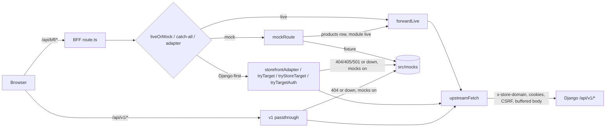
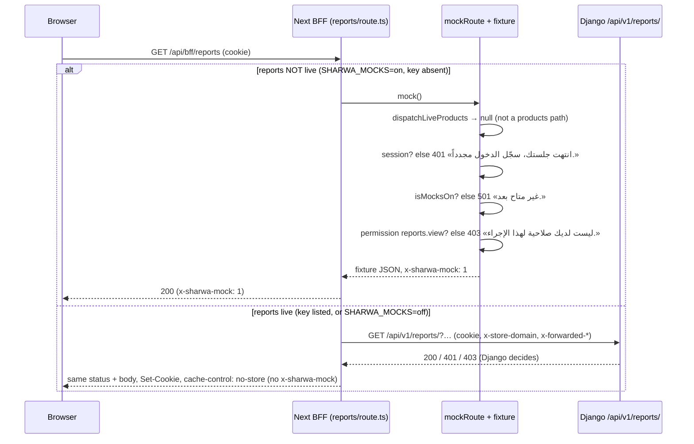
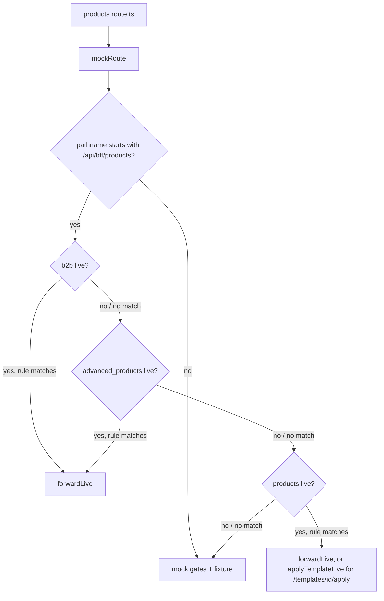
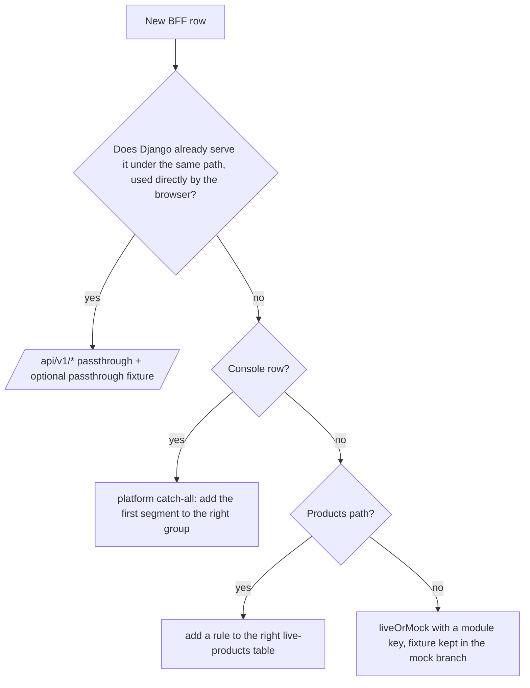

# BFF & live/mock switch architecture

> **Source**: DOC-455, DOC-456, DOC-457, DOC-462, DOC-464 · inventory A.2, A.11, A.13 · INT-001 → INT-005, INT-011 → INT-016, INT-026, INT-028 → INT-032, INT-034, INT-036, INT-044 → INT-046, INT-049
> **Code**: `sharwa-frontend/src/lib/bff/{live-route,upstream,mock-route,live-products,storefront-adapter,target-adapter,auth-adapter}.ts` · `sharwa-frontend/src/mocks/runtime.ts` · `sharwa-frontend/src/app/api/v1/[...path]/route.ts` · `sharwa-frontend/src/app/api/bff/{platform,sharwa-pay,pos,inbox}/[...path]/route.ts` · `sharwa-frontend/src/app/api/bff/b2b/[[...path]]/route.ts` · `sharwa-frontend/src/app/api/bff/account/stores/route.ts` · `sharwa_saas/config/settings.py` (`DATA_UPLOAD_MAX_MEMORY_SIZE`) · `sharwa_saas/deploy/nginx/snippets/sharwa-proxy.conf`
> **Last verified against code**: 2026-10-27 (official Step 07)

## 1. Purpose

The browser never calls Django directly. It calls the Next.js **BFF** (backend for frontend) on its own origin, and the BFF decides, row by row, whether the answer comes from a **fixture** (`src/mocks/**`) or from **Django** (`/api/v1/**`). This page is the design view of that layer: why it is built this way, what the moving parts are, which rule decides each row, and what can go wrong.

It is **not** the row-level reference. Every BFF row, its upstream path and its live key are listed in the API reference [`../api/overview/bff.md`](../api/overview/bff.md) (DOC-040 → DOC-047). This page links to it instead of repeating it, except where a task asks for a table here.

What the BFF is responsible for:

- choosing fixture or Django per row (the live/mock switch, §3);
- forwarding a request to Django **without changing it**: query string, cookies, CSRF header, body and status pass through as they are (§3, §7);
- telling Django which store the request is for (`x-store-domain`) and who the visitor is (`x-forwarded-for` / `x-real-ip`);
- dropping the storefront cache of a store after a successful dashboard write.

What it is **not** responsible for: authentication, permissions, plan features and business rules in live mode. Django is the authority; the BFF has no session gate on a live row.

## 2. Components

| Component | Location | Role |
|---|---|---|
| Upstream bridge | `src/lib/bff/upstream.ts` | `contextFromRequest` (host → store), `upstreamFetch` (one call to Django with the allowed headers and a **buffered** body), `forwardResponse` (status, body, allowed headers, every `Set-Cookie`, `cache-control: no-store`), `unavailableResponse` (`502` «الخادم غير متاح حالياً.») |
| Live switch | `src/lib/bff/live-route.ts` | `liveOrMock(request, module, upstreamPath, mock)` and its live half `forwardLive` |
| Mock skeleton | `src/lib/bff/mock-route.ts` | `mockRoute`: products dispatch first, then session gate (`401`), `notAvailable()` when mocks are off, permission gate (`403`), fixture, cache revalidation |
| Products table | `src/lib/bff/live-products.ts` | `PRODUCTS_LIVE_RULES`, `B2B_LIVE_RULES`, `ADVANCED_LIVE_RULES`, `dispatchLiveProducts`, `applyTemplateLive` |
| Django-first adapters | `src/lib/bff/storefront-adapter.ts`, `target-adapter.ts`, `auth-adapter.ts` | try Django first, fixture only while the route is "not shipped" (`404`/`405`/`501`) or Django is down |
| `/api/v1/*` passthrough | `src/app/api/v1/[...path]/route.ts` | same-origin passthrough for the «Ready» rows (`ready-api-v1.md`) |
| Catch-alls | `src/app/api/bff/platform/[...path]`, `sharwa-pay/[...path]`, `pos/[...path]`, `inbox/[...path]`, `b2b/[[...path]]` | one route file for a whole module, with a host gate or a per-group switch |
| Mock runtime | `src/mocks/runtime.ts` | `isMocksOn()`, `isModuleLive()`, `mockJson()` (`x-sharwa-mock: 1`), `notAvailable()` (`501` «غير متاح بعد.», `x-sharwa-mock: 0`) — design in [`21-mock-runtime.md`](21-mock-runtime.md) |
| Django body limit | `sharwa_saas/config/settings.py:368` | `DATA_UPLOAD_MAX_MEMORY_SIZE = 8 * 1024 * 1024` |
| Django's Nginx | `sharwa_saas/deploy/nginx/snippets/sharwa-proxy.conf:12` | `client_max_body_size 55m` (see §7.4) |



<a id="liveormock"></a>

## 3. The live/mock switch and the transparent passthrough (DOC-455)

### 3.1 Why one switch per module

The integration protocol ([`02-integration-protocol.md`](02-integration-protocol.md)) froze the browser side first: hooks, Zod schemas and screens were built against fixtures. When Django shipped a module, only the **route handler** had to change. `liveOrMock` is that change:

```ts
// src/lib/bff/live-route.ts
export async function liveOrMock(request, module, upstreamPath, mock) {
  if (!isModuleLive(module)) return mock();
  return forwardLive(request, upstreamPath);
}
```

The fixture branch is kept unchanged, so the same screen can run on fixtures (development, E2E scripts) or on Django (production) by environment alone. `isModuleLive(module)` is `true` when `SHARWA_MOCKS=off`, or when the module key is in `SHARWA_LIVE_MODULES` (comma-separated, lower-cased, `*` = all). The 39 keys are in [`22-live-module-keys.md`](22-live-module-keys.md); the env rules are in [`../api/overview/bff.md#liveormock`](../api/overview/bff.md#liveormock).

### 3.2 What `forwardLive` guarantees

| Guarantee | How (code) |
|---|---|
| Same path, same query | `upstreamPath` is the full Django path with its trailing slash; the original `search` is appended unchanged |
| Same method, same body | the method is the browser's; a write body is read once with `arrayBuffer()` and sent as bytes (§7) |
| Same identity | request headers copied: `cookie`, `content-type`, `accept`, `accept-language`, `x-csrftoken`, `idempotency-key`, `if-none-match` |
| Same store | `x-store-domain` set from the browser host (`contextFromRequest`); `x-forwarded-host`, `x-forwarded-proto`, `origin`, `referer` set for Django's CSRF referer check |
| Same visitor IP | `x-forwarded-for` and `x-real-ip` overwritten with one validated IP (`clientIp`), so Django's per-IP limits see the visitor, not the Next server |
| Same answer | `forwardResponse`: Django's status and body; `Set-Cookie` (all of them); allowed headers `content-type`, `content-disposition`, `content-language`, `retry-after`, `etag`, `location`, `x-sharwa-mock`, `x-export-rows` |
| No caching | `fetch(…, { cache: "no-store", redirect: "manual" })` upstream; `cache-control: no-store` on every answer |
| Django down | `UpstreamUnavailableError` → `502` `{"detail": "الخادم غير متاح حالياً."}` — never a fixture |

**No Next-side gate in live mode.** `forwardLive` does not look at the session. Django answers `401`, `403` (permission, plan feature, CSRF), `409` and `429` itself, and the body reaches the browser untouched. The session and permission gates in `mockRoute` exist only on the fixture path, where Django is not there to answer.

### 3.3 Bodies: JSON, multipart, size

- The body is **buffered**, never streamed — the reason is the bug in §7.
- **Multipart is forwarded as-is.** `content-type` (with its boundary) is copied and the bytes are not parsed, so a multipart request reaches Django exactly as the browser built it. Live multipart rows: theme logo (`store/theme`, key `design`), offers (`marketing/offers`, key `marketing`), dropshipping feeds (key `dropshipping`), Sharwa Pay top-up receipts (`sharwa-pay/topups`, key `sharwa_pay`) and the product CSV import (`products/import`, key `advanced_products`). Product gallery images are multipart too, one file per request (key `products`).
- **Size.** The BFF imposes no limit of its own. Django's `DATA_UPLOAD_MAX_MEMORY_SIZE` is 8 MB (`settings.py:368`); it caps non-file request data (JSON bodies, base64 images inside JSON, form fields), while file parts of a multipart body are bounded by the view (for example the feed reader's own maximum). The edge limit is Nginx — see §7.4.

> ⚠️ Discrepancy — roadmap says "write bodies buffered with Content-Length, 8 MB max = `DATA_UPLOAD_MAX_MEMORY_SIZE`" / code buffers with **no cap in the BFF** (`live-route.ts`, `upstream.ts` `bufferedBody`); the 8 MB is Django's setting and applies to non-file data only, and the Nginx that ships in `sharwa_saas/deploy/` allows 55 MB. Reported in official Step 07.

### 3.4 Cache invalidation after a live write

A successful write (`res.ok`, method not `GET`/`HEAD`/`OPTIONS`) on a **store host** calls `revalidateTag(storeTag(store), { expire: 0 })` (`store:<slug>`, `src/lib/cache.ts`). The storefront's `"use cache"` reads for that store are dropped at once, so a renamed category or a new price is visible on the next storefront visit. `mockRoute` does the same after a successful fixture write, so both modes behave alike (M09 SC-09.2). On the platform origin there is no store and nothing is revalidated. `applyTemplateLive` revalidates once at the end if at least one product was updated.

### 3.5 Response headers

`retry-after` and `x-export-rows` (INT-017, the row count of the customers export) are in the copied list, so a Django `429` keeps its wait and the export toast keeps its count.

> ⚠️ Discrepancy — roadmap says forwarded response headers include `Cache-Control` / code does **not** forward Django's `Cache-Control`: `cache-control` is not in `FORWARD_RESPONSE_HEADERS`, and `forwardResponse` always sets `cache-control: no-store` (`src/lib/bff/upstream.ts`). Every BFF answer is uncacheable, whatever Django sent. Reported in official Step 07.

### 3.6 Sequence — a GET in mock mode and in live mode

Example row: `GET /api/bff/reports` → `GET /api/v1/reports/` (key `reports`).



### 3.7 Sequence — a multipart POST in mock mode and in live mode

Example row: `POST /api/bff/marketing/offers` with an image → `POST /api/v1/promotions/offers/` (key `marketing`).

```mermaid
sequenceDiagram
  participant B as Browser
  participant N as Next BFF (marketing/offers/route.ts)
  participant M as mockRoute + fixture
  participant D as Django /api/v1/promotions/offers/
  B->>N: POST multipart/form-data; boundary=… (cookie, X-CSRFToken)
  alt marketing NOT live
    N->>M: mock()
    M->>M: session → 401 · mocks off → 501 · discounts.manage → 403
    M->>M: fixture parses the form, stores the offer in memory
    M-->>N: 201 fixture body, x-sharwa-mock: 1
    M->>M: res.ok and write → revalidateTag(store:<slug>)
    N-->>B: 201 (x-sharwa-mock: 1)
  else marketing live
    N->>N: forwardLive: body = await request.arrayBuffer() (bytes, not parsed)
    N->>D: POST /api/v1/promotions/offers/ (same content-type + boundary, Content-Length, cookie, x-csrftoken, x-store-domain)
    D->>D: CSRF, session, permission, plan feature, validation
    D-->>N: 201 / 400 field errors / 403
    N->>N: res.ok and store host → revalidateTag(store:<slug>)
    N-->>B: Django's status + body, cache-control: no-store
  end
```

<a id="products-rules"></a>

## 4. Products rule tables and the three independent product switches (DOC-456)

### 4.1 Why a table instead of `liveOrMock` per file

The products screens use 26 BFF route files, up to eight folders deep, and every one of them already goes through `mockRoute()`. Instead of editing 26 files, `mockRoute()` asks `dispatchLiveProducts(request)` **first, before any mock gate**. If a rule matches a live module, the request goes to Django; otherwise `null` comes back and the fixture path continues. The three tables in `src/lib/bff/live-products.ts` are therefore the single reviewable map of the products contract.



### 4.2 Three switches, independent of each other

| Key | Table | Rows | What it covers | Task |
|---|---|---|---|---|
| `products` | `PRODUCTS_LIVE_RULES` | 21 | Phase A: list, create, quick add, bulk, formula preview, detail, change log, stock, gallery, variants, dictionary, templates, sectors | INT-005 |
| `b2b` | `B2B_LIVE_RULES` | 2 | quantity (tier) prices from the product editor | INT-044 |
| `advanced_products` | `ADVANCED_LIVE_RULES` | 14 | M37 extras (bundles, compatibility, personalization, auction + bids, serials) and CSV import ×3 + export | INT-045 |

`b2b` and `advanced_products` are tested first, so any combination works: `products` can be off while `b2b` is on, and the reverse. Phase B (decision D6) is why the extras and the CSV rows are not under `products`. Categories, brands, tags, collections and badges are a different module (`catalog`) wired with `liveOrMock` in their own files.

### 4.3 Every BFF products row and the switch that routes it

A rule matches the path for any method; the methods that exist are the ones the route file exports (Next answers `405` for others before the table is reached), and Django then decides within those. `{id}` is `\d+`, `{job}` is `[\w-]+`.

| # | BFF path (`/api/bff/products…`) | Route file (`src/app/api/bff/products/…`) | Django (`/api/v1/…`) | Switch |
|---|---|---|---|---|
| 1 | `` (list · create) | `route.ts` | `products/` | `products` |
| 2 | `/quick` | `quick/route.ts` | `products/quick/` | `products` |
| 3 | `/bulk` | `bulk/route.ts` | `products/bulk/` | `products` |
| 4 | `/formula-preview` | `formula-preview/route.ts` | `products/formula-preview/` | `products` |
| 5 | `/{id}` | `[id]/route.ts` | `products/{id}/` | `products` |
| 6 | `/{id}/changes` | `[id]/changes/route.ts` | `products/{id}/changes/` | `products` |
| 7 | `/{id}/stock` | `[id]/stock/route.ts` | `products/{id}/stock/` | `products` |
| 8 | `/{id}/images` | `[id]/images/route.ts` | `products/{id}/images/` | `products` |
| 9 | `/{id}/images/reorder` | `[id]/images/reorder/route.ts` | `products/{id}/images/reorder/` | `products` |
| 10 | `/{id}/images/{iid}` | `[id]/images/[iid]/route.ts` | `products/{id}/images/{iid}/` | `products` |
| 11 | `/{id}/variants/generate` | `[id]/variants/generate/route.ts` | `products/{id}/variants/generate/` | `products` |
| 12 | `/{id}/variants/bulk` | `[id]/variants/bulk/route.ts` | `products/{id}/variants/bulk/` | `products` |
| 13 | `/variant-attributes` | `variant-attributes/route.ts` | `variant-attributes/` | `products` |
| 14 | `/variant-attributes/{id}` | `variant-attributes/[id]/route.ts` | `variant-attributes/{id}/` | `products` |
| 15 | `/variant-attributes/{id}/options` | `variant-attributes/[id]/options/route.ts` | `variant-attributes/{id}/options/` | `products` |
| 16 | `/variant-attributes/options/{oid}` | `variant-attributes/options/[oid]/route.ts` | `variant-attributes/options/{oid}/` | `products` |
| 17 | `/templates` | `templates/route.ts` | `product-templates/` | `products` |
| 18 | `/templates/{id}` | `templates/[id]/route.ts` | `product-templates/{id}/` | `products` |
| 19 | `/templates/{id}/apply-global` | `templates/[id]/apply-global/route.ts` | `product-templates/{id}/apply-global/` | `products` |
| 20 | `/templates/{id}/apply` | `templates/[id]/apply/route.ts` | **no Django route** — `applyTemplateLive` (§4.4) | `products` |
| 21 | `/global-templates` | `global-templates/route.ts` | `global-variant-templates/` | `products` |
| 22 | `/{id}/extras/tier-prices` | `[id]/extras/[...path]/route.ts` | `products/{id}/tier-prices/` | `b2b` |
| 23 | `/{id}/extras/tier-prices/{tier}` | same catch-all | `products/{id}/tier-prices/{tier}/` | `b2b` |
| 24 | `/{id}/extras/bundle-components` | same catch-all | `products/{id}/bundle-components/` | `advanced_products` |
| 25 | `/{id}/extras/bundle-components/{row}` | same catch-all | `products/{id}/bundle-components/{row}/` | `advanced_products` |
| 26 | `/{id}/extras/compatibility-rules` | same catch-all | `products/{id}/compatibility-rules/` | `advanced_products` |
| 27 | `/{id}/extras/compatibility-rules/{rule}` | same catch-all | `products/{id}/compatibility-rules/{rule}/` | `advanced_products` |
| 28 | `/{id}/extras/personalization-fields` | same catch-all | `products/{id}/personalization-fields/` | `advanced_products` |
| 29 | `/{id}/extras/personalization-fields/reorder` | same catch-all | `products/{id}/personalization-fields/reorder/` | `advanced_products` |
| 30 | `/{id}/extras/personalization-fields/{field}` | same catch-all | `products/{id}/personalization-fields/{field}/` | `advanced_products` |
| 31 | `/{id}/extras/auction` | same catch-all | `products/{id}/auction/` | `advanced_products` |
| 32 | `/{id}/extras/auction/bids` | same catch-all | `products/{id}/auction/bids/` | `advanced_products` |
| 33 | `/{id}/extras/serials` | same catch-all | `products/{id}/serials/` | `advanced_products` |
| 34 | `/import` | `import/route.ts` | `products/import/` | `advanced_products` |
| 35 | `/import/{job}` | `import/[job]/route.ts` | `products/import/{job}/` | `advanced_products` |
| 36 | `/import/{job}/run` | `import/[job]/run/route.ts` | `products/import/{job}/run/` | `advanced_products` |
| 37 | `/export.csv` | `export.csv/route.ts` | `products/export/` (list filters kept in the query) | `advanced_products` |
| — | `/{id}/extras/<anything else>` | same catch-all | none | fixture only (no rule) |
| — | storefront `catalog/products/{id}/{auction, auction/bids, …}` | `src/app/api/bff/catalog/products/[id]/…` | `catalog/products/{id}/…` | **no switch — Django-first** (`storefrontAdapter`, §5.3) |

Check against the code: `src/app/api/bff/products/` holds **26** `route.ts` files (listed on the device, 2026-10-27): 21 one-to-one with rows 1–21, 4 with rows 34–37, and the extras catch-all `[id]/extras/[...path]/route.ts` serving rows 22–33. No products route file is outside the tables. The extras catch-all is nested deeper than the staging limit and was not read; its behaviour is taken from `live-products.ts` and the M37 page. Upstream paths were checked against `api/urls.py` in [`../api/overview/bff.md#products-rules`](../api/overview/bff.md#products-rules).

Live permissions are Django's: reads `inventory.view`, writes `catalog.manage`, stock from the list `inventory.adjust`, sale fields `discounts.manage` ([`../api/domains/03-catalog/m04-products.md`](../api/domains/03-catalog/m04-products.md)).

### 4.4 «تطبيق على منتجات» stays in the BFF (decision D7)

Row 20 has no Django endpoint by design. In live mode `applyTemplateLive` reads the template from Django (`GET /api/v1/product-templates/{id}/`), validates it with `productTemplateSchema`, then sends one `PATCH /api/v1/products/{pid}/` per product **in sequence** with the template's `fields` plus `blueprint_id`. Each PATCH keeps all of Django's own validation (an active auction refuses it). The answer is `{applied, skipped:[{id, reason}], fields}`, the same shape as the fixture. Errors produced by the BFF: `400` `{"product_ids": ["اختر منتجاً واحداً على الأقل."]}` and `502` `{"detail": "تعذّرت قراءة القالب من الخادم."}`. Not transactional across products. Full behaviour: [`../api/overview/bff.md#products-rules`](../api/overview/bff.md#products-rules) §2.4.

### 4.5 Storefront auction rows

The buyer-side auction and bid rows (`catalog/products/[id]/auction`, `…/auction/bids`) are **not** in these tables and have no switch: they go through `storefrontAdapter` and call Django on every request (INT-045). Only the merchant-side auction rows (31–32) follow `advanced_products`.

<a id="adapters"></a>

## 5. Adapter patterns: platform catch-all and the Django-first adapters (DOC-457)

### 5.1 The patterns side by side

| Pattern | File | Calls Django when | Fixture when | Modules / tasks using it |
|---|---|---|---|---|
| `liveOrMock` per route | `live-route.ts` | the module key is live | key not live (and mocks on; otherwise `501`) | the 39-key modules — [`22-live-module-keys.md`](22-live-module-keys.md) |
| Products tables | `live-products.ts` via `mockRoute` | the row's key is live | key not live | `products` (INT-005), `b2b` (INT-044), `advanced_products` (INT-045) |
| Platform catch-all | `api/bff/platform/[...path]/route.ts` | the row's **group** is live | group not live, mocks on; else `501` | M20 `platform` (INT-030), M45 `platform_money` (INT-031), M46 `platform_billing` (INT-032) |
| Server fetchers | `features/storefront/api/*`, `features/tracking/api.ts`, `features/tenant/api/probe.ts`, `features/landing/api/*`, `features/dashboard-shell/api/overview.ts` | **always first** | catalogue, config, tracking, probe: `404`/`405`/`501` or down, mocks on · plans, stats, overview: **any** failure (see discrepancy) | INT-001, INT-002, INT-003, INT-011, INT-012, INT-015 |
| `storefrontAdapter` | `storefront-adapter.ts` | **always first** | Django `404`/`405`/`501` or down, **and** mocks on; else `501` | INT-011 → INT-015, INT-028 (5 storefront rows), INT-029, INT-034 (referral), INT-036 (buyer slots), INT-045 (storefront auction + bids) |
| `tryTarget` | `target-adapter.ts` | **always first**, public URLConf (`omitStoreHeader`) | `null` (not shipped / down) → route uses its fixture if mocks on, else `501` | INT-004 onboarding (`public/market-categories`, `register`, `verify-otp`, `resend-otp`) |
| `tryStoreTarget` | `target-adapter.ts` | **always first**, store URLConf, CSRF injected for `POST` | `null` → route checks the session (`401`), then `501` or fixture | INT-003 `dashboard/overview`, `dashboard/counters`, `dashboard/overview/refresh` |
| `tryTargetAuth` | `auth-adapter.ts` | **always first**, `POST /api/v1/auth/<path>/` with CSRF | `null` → fixture | INT-003 auth rows (login ×2, logout, forgot/reset/setup password) |
| Legacy `upstreamFetch` in the route | `upstream.ts` | always | per route (none for `public/provisioning/[token]`) | INT-001 `public/plans`, `public/stats`; INT-004 `public/check-subdomain`, `public/provisioning/[token]` |
| `/api/v1/*` passthrough | `src/app/api/v1/[...path]/route.ts` | always | Django **`404`** with a registered fixture, or Django down — mocks on only; else Django's answer / `502` | «Ready» rows: cart (INT-013), PWA #11–#14 (INT-016), returns (INT-026), B2B drafts (INT-044), courier actions (INT-046) |
| Fixture-only hook | inside a catch-all | never | always | `pos/__reset`, `inbox/_mock/*`, `b2b/_test/bump` (§5.6) |

"Not shipped" is one rule shared by every Django-first helper: status `404`, `405` or `501`. Anything else (`400`, `401`, `403`, `409`, `410`, `429`, `5xx`) is a real Django answer and is forwarded. The consequence — a real record `404` is mistaken for a missing route — is documented in [`../api/overview/bff.md#django-first`](../api/overview/bff.md#django-first) §4.6.

> ⚠️ Discrepancy — roadmap says Django-first server fetchers use the fixture "only on 404/405/501 or Django down" / code does it for the catalogue, config, tracking and probe fetchers only; `getPublicPlans`, `getProofStats` and `getOverview` fall back on **any** non-OK status, invalid payload or network error (already recorded in [`../api/overview/bff.md#django-first`](../api/overview/bff.md#django-first) §4.2). Reported in official Step 07.

### 5.2 Live key vs Django-first: the design choice

| | Live-key row | Django-first row |
|---|---|---|
| Who decides to call Django | `isModuleLive(key)` | nobody — Django is always called first |
| Can it be rolled back by environment | yes — remove the key | **no** — only a code change can stop it calling Django |
| Django down, mocks on | `502` | fixture |
| Production (`SHARWA_MOCKS=off`) | Django | Django; a "not shipped" answer becomes `501` «غير متاح بعد.» |

Rows that were integrated first (the public site, the storefront, onboarding, the dashboard overview, auth) were built Django-first because Django already served them, or because a fixture fallback on "not shipped" was safe during development. Rows integrated later through the protocol got a key, so they can be switched on one module at a time and rolled back. The runbook [`../ops/runbooks/switch-module-live.md`](../ops/runbooks/switch-module-live.md) relies on this difference.

### 5.3 The platform console catch-all

`src/app/api/bff/platform/[...path]/route.ts` is one handler for the whole console (M20, M45, M46). The path after `platform/` **is** the Django path, so a row going live changes nothing in the screens:

1. **Host gate.** `resolveTenant(host)` must be the reserved `admin` group (the console host, `console.<base>`); anything else gets `404` `{"detail": "غير موجود."}`. Django refuses again: its platform views run on the public schema only.
2. Segments are `encodeURIComponent`-encoded and joined; the **first segment** picks the live group:

| Group (key) | First segments | Task |
|---|---|---|
| `platform` | `auth`, `overview`, `stores`, `clients`, `webhook-events`, `features`, `feature-overrides` | INT-030 (M20) |
| `platform_money` | `dues`, `sharwa-pay`, `sharwa-ship` | INT-031 (M45) |
| `platform_billing` | `plans`, `plan-features`, `subscriptions`, `billing-settings`, `apps`, `app-billing-overrides`, `market-categories` | INT-032 (M46) |

3. Group live → `forwardLive(request, "/api/v1/platform/<path>/")`. Not live and mocks off → `501`. Otherwise the fixture router `platformMock` with the role from the mock admin cookie.

The group follows the first segment, not the topic: `stores/<schema>/sharwa-ship/` is `platform`, `sharwa-ship/zones/` is `platform_money`. A console page that reads two groups can be half live during a rollout. Full route map: [`../api/overview/bff.md#platform`](../api/overview/bff.md#platform).

### 5.4 Server fetchers and the buyer-side adapter

Server fetchers run while a Server Component renders and call Django with `fetch` directly (not through `/api/bff`). Their per-fetcher behaviour, caching and fallbacks are in [`../api/overview/bff.md#django-first`](../api/overview/bff.md#django-first) §4.2; the store probe is designed in [`10-multi-tenancy.md#resolution`](10-multi-tenancy.md#resolution).

`storefrontAdapter(request, targetPath, mock, {invalidatesStore})` serves the buyer's browser calls. It requires a store host (`404` «استخدم النطاق الفرعي للمتجر.» otherwise), calls Django with the buyer's cookies (the Django session is the buyer's identity), forwards any "shipped" answer, and only in development falls back to the fixture with a mock cart cookie. Its rows are listed per task in [`../api/overview/bff.md#django-first`](../api/overview/bff.md#django-first) §4.3. Several of those route files (for example `catalog/products/[id]/auction`) are nested deeper than the staging limit and were not re-read in this step.

### 5.5 The `/api/v1/*` passthrough for «Ready» rows

`src/app/api/v1/[...path]/route.ts` exposes Django's own paths on the Next origin for rows Django served before the BFF existed (`ready-api-v1.md`). It forwards with `upstreamFetch`/`forwardResponse` for `GET`, `POST`, `PUT`, `PATCH`, `DELETE`, `HEAD`, with no key and no caching.

Fallback rule (mocks on only): Django answers **`404`** and a fixture is registered for that path in `mocks/{storefront,returns,b2b,courier}/passthrough`, or Django is unreachable. `405`/`501` are **not** treated as "not shipped" here. With mocks off, Django's answer is final and an unreachable Django is `502`. `HEAD` answers are stripped of their body (the provisioning poller probes `/api/v1/config/` with `HEAD`). The current state of every «Ready» row is audited in [`23-ready-api-v1-audit.md`](23-ready-api-v1-audit.md).

### 5.6 Fixture-only hooks that never go live

| Hook | Code | Purpose |
|---|---|---|
| `pos/__reset` | `pos/[...path]/route.ts`: `if (joined === "__reset") return mock()` before `liveOrMock(…, "pos", …)` | resets the POS fixture seed for the E2E check |
| `inbox/_mock/*` | `inbox/[...path]/route.ts`: `if (segs[0] === "_mock") return mock()` before `liveOrMock(…, "channels", …)` | simulated inbound message, check reset |
| `b2b/_test/bump/<approval_id>` | `b2b/[[...path]]/route.ts`: only `options` goes through `liveOrMock(…, "b2b", "/api/v1/orders/b2b-options/", …)`; every other path is `mock()` | lets `scripts/b2b-check.ts` make another approver decide first (the `409` path) |

All three still pass through `mockRoute`, so they answer `401` without a session and `501` «غير متاح بعد.» when mocks are off — they cannot be reached in production.

### 5.7 The platform-origin gate for Sharwa Pay

`src/app/api/bff/sharwa-pay/[...path]/route.ts` answers only when `resolveTenant(host).kind === "platform"` (the platform origin itself). A store origin, a custom domain **and** the console host get `404` `{"detail": "غير موجود."}`. Behind the gate it is a normal `liveOrMock(request, "sharwa_pay", "/api/v1/sharwa-pay/<path>/", …)` row (INT-048), and Django refuses again off the public schema. Only `GET` and `POST` are exported. The console's view of the same wallets goes through the platform catch-all (`platform_money`), not this route.

### 5.8 Choosing an adapter for a new row



New rows should not use the Django-first helpers: they cannot be rolled back by environment (§5.2). The integration protocol ([`02-integration-protocol.md`](02-integration-protocol.md)) makes `liveOrMock` the default.

<a id="deprecated"></a>

## 6. The superseded `account/stores` BFF route (DOC-462)

**Final state (Step 52, 2026-10-30): the route is REMOVED.** Step 07 flagged it deprecated (deleting it was a code change reserved for Step 52); Step 52 removed the whole removal set below (DOC-535). The deprecation itself was first recorded with DOC-055 in [`../api/domains/02-dashboard-shell/m03-overview.md#deprecated`](../api/domains/02-dashboard-shell/m03-overview.md#deprecated) and in `docs/CHANGELOG.md`.

| | `account/stores` (superseded) | `merchant/stores` (current, M43) |
|---|---|---|
| BFF route | `src/app/api/bff/account/stores/route.ts` | `src/app/api/bff/merchant/stores` (`liveOrMock(…, "rollup", "/api/v1/merchant/stores/", …)`) |
| Django route | none | `GET /api/v1/merchant/stores/` (`api/views_rollup.py`, INT-049) |
| Behaviour | no session → `401` «انتهت جلستك، سجّل الدخول مجدداً.»; staff → `200 []`; owner with mocks off → `501` «غير متاح بعد.»; owner with mocks on → three-store fixture `accountStoresMock` | owner-only rollup with `has_account`, per-store numbers and `is_available` — [`../api/domains/02-dashboard-shell/m43-multi-store.md`](../api/domains/02-dashboard-shell/m43-multi-store.md) |
| Consumers | none found | `useLinkedStores()` in `src/features/stores-rollup/api.ts`, used by the topbar `store-switcher.tsx` and by the ⌘K `command-palette.tsx` ("the same `merchant/stores` contract as the topbar switcher") |

Consumer check (2026-10-27): `store-switcher.tsx`, `topbar.tsx`, `user-menu.tsx`, `command-palette.tsx`, `palette-index.ts`, `stores-rollup/api.ts` and `src/lib/**` were searched for `account/stores`, `accountStore` and `useLinkedStores`; only `useLinkedStores` → `/api/bff/merchant/stores` is used. A repository-wide grep was not possible in this step (no shell on the user's computer); the Step 52 removal must start with `grep -rn "account/stores\|accountStore" src`.

Removal set — **applied in Step 52** (the two files are deleted with `git rm`; the schema exports, the now-unused `provisioningStatusSchema` import and the README row are removed; a search of `scripts/` and of the shell components found no other reference; `npx tsc --noEmit` is the final guard): `src/app/api/bff/account/stores/route.ts`, `src/mocks/dashboard/stores.ts` (`accountStoresMock`), the `accountStoreSchema` / `accountStoresSchema` / `AccountStore` exports in `src/features/dashboard-shell/schemas.ts:147-155`, and the `account/stores` row of `src/app/api/bff/README.md` (still marked "mock").

<a id="body-buffering"></a>

## 7. The request-body buffering fix (DOC-464)

### 7.1 Failure

The first `upstreamFetch` handed the incoming request body to `fetch` as a **stream**. Node's `fetch` (undici) sends a stream with `Transfer-Encoding: chunked` and **no `Content-Length`**. Django — `runserver` and gunicorn alike — reads the body length from `CONTENT_LENGTH`, so it saw an **empty body**:

- every write through the `/api/v1/*` passthrough answered `400` with "required field" errors on every field — `POST /api/v1/pwa/install-event/`, push subscribe, storefront writes;
- every live `liveOrMock` write would have done the same;
- reads were unaffected (a `GET` has no body), which hid the bug until the first passthrough write.

### 7.2 Fix

Both entry points now send bytes, so `fetch` computes a `Content-Length`:

| Place | Rule |
|---|---|
| `upstreamFetch` (`src/lib/bff/upstream.ts`) | for a method other than `GET`/`HEAD`: if the caller passed no body, `bufferedBody(request)` reads `arrayBuffer()`; it returns **`null`** when there is no body, when the body was already used (`request.bodyUsed`), or when it is zero bytes |
| `forwardLive` (`src/lib/bff/live-route.ts`) | for a write (not `GET`/`HEAD`/`OPTIONS`) reads `arrayBuffer()` itself and passes `{ body }` — `null` when empty — so `upstreamFetch` does not read again |
| `duplex: "half"` | added **only** when the body is a `ReadableStream`, which now happens only if a caller passes an explicit stream (none does today) |

The adapters that read the body themselves pass it explicitly: `tryTarget` sends `JSON.stringify(json)`, `tryTargetAuth` the JSON string, `tryStoreTarget` `null` for its body-less `POST refresh`, `applyTemplateLive` a JSON string per PATCH. The passthrough clones the request before the upstream call only when a fixture may need the body (`request.clone()` with mocks on).

### 7.3 Features that depend on it

Since the fix, these writes reach Django with their body:

- **B2B drafts** (INT-044): `POST /api/v1/orders/b2b-draft/` and `POST /api/v1/orders/b2b-draft/<id>/resolve/` through the passthrough;
- **Courier actions** (INT-046): `POST /api/v1/agent/shipments/<id>/status/`, `agent/shifts/start/`, `agent/shifts/end-and-handover/`, `agent/fulfillments/<id>/scan-pickup/` and `…/partial-delivery/` through the passthrough;
- **PWA** (INT-016): `pwa/install-event/`, `push/subscribe/`, `push/unsubscribe/`;
- every live `liveOrMock` write, including multipart (§3.3).

### 7.4 Size bound and Nginx parity

Buffering holds the whole body in the Next server's memory, so it is only safe if something upstream bounds the size. The BFF has no limit of its own.

| Layer | Limit | Source |
|---|---|---|
| Next BFF | none | `live-route.ts`, `upstream.ts` |
| Django | 8 MB of non-file request data (`DATA_UPLOAD_MAX_MEMORY_SIZE`) | `sharwa_saas/config/settings.py:368` |
| Nginx in front of Django (repository config) | `client_max_body_size 55m` — "Feeds accept up to 50 MB (`feed_reader.MAX_FILE_BYTES`); receipts 5 MB." | `sharwa_saas/deploy/nginx/snippets/sharwa-proxy.conf:11-12` |
| Nginx in front of Next | not in either repository | — (`upstream.ts` requires an Nginx in front of Next in production for `x-real-ip`) |

> ⚠️ Discrepancy — roadmap says "8 MB bound and Nginx `client_max_body_size 8M` parity" / the Nginx config in the repository allows **55 MB** (`deploy/nginx/snippets/sharwa-proxy.conf:12`) so that 50 MB dropshipping feeds fit. If production Nginx is set to `8M` as the roadmap says, a feed upload above 8 MB is refused with `413` at the edge before Django sees it; if it is `55m`, the BFF buffers up to 55 MB per request in memory. The production value is an operations decision, not visible in code. Reported in official Step 07.

### 7.5 Regression test recipe — passthrough POST with a JSON body

Run against a development pair: Django on `:8000`, `next dev` on `:3000`, `TENANT_BASE_DOMAIN=localhost`, a provisioned fixture store such as `noor`. Mocks may stay on: the passthrough calls Django first.

1. **The fix holds** — a JSON write through the passthrough reaches Django with its body:

   ```bash
   curl -i -X POST "http://noor.localhost:3000/api/v1/pwa/install-event/" \
     -H "Content-Type: application/json" \
     -d '{"event_type":"prompt_shown","source":"nextjs_app"}'
   ```

   Expected: `HTTP/1.1 201`, body `{"ok":true}`, and **no** `x-sharwa-mock` header (Django answered — `PWAInstallEventView`, `api/views.py:246-267`; `event_type` and `source` are `ChoiceField`s, `api/serializers.py:227-233`).

2. **What the failure looked like** — reproduce Django's view of an empty body:

   ```bash
   curl -i -X POST "http://noor.localhost:3000/api/v1/pwa/install-event/" \
     -H "Content-Type: application/json" -d ''
   ```

   Expected: `400` with a required-field error on both `event_type` and `source` (DRF's standard required-field message in the `ar-sa` locale). Before the fix, request 1 answered exactly this.

3. **The same through a live BFF row** — with a key on (`SHARWA_LIVE_MODULES=reports`) and an owner session cookie plus CSRF token from the store host, `POST /api/bff/reports/schedules` with a JSON body must answer Django's `201` (or a field-specific `400` such as an invalid e-mail), never a `400` that lists every field as required.

4. **Header check** — in the Next server log or a proxy, the upstream request must carry `Content-Length` and must not carry `Transfer-Encoding: chunked`.

Run 1 and 2 after any change to `upstream.ts`, `live-route.ts` or the Next.js / Node version (undici changes how bodies are sent).

## 8. Invariants

| Invariant | Enforced by |
|---|---|
| A live row never answers from a fixture, and a fixture never runs when Django served the row | `liveOrMock` / `dispatchLiveProducts` branch before `mockRoute`'s gates; Django-first helpers return the Django answer unless "not shipped" |
| The BFF never caches an API answer | `cache: "no-store"` upstream, `cache-control: no-store` on every response (`forwardResponse`, `mockJson`, `jsonResponse`) |
| Django sees the browser's store and visitor, not the Next server | `x-store-domain`, `x-forwarded-host`, single-entry `x-forwarded-for` / `x-real-ip` (`upstreamFetch`) |
| Every write body is sent with a `Content-Length` | buffering in `upstreamFetch` and `forwardLive` (§7) |
| A fixture answer is always identifiable | `x-sharwa-mock: 1` from `mockJson`; `notAvailable()` sends `x-sharwa-mock: 0`; Django answers carry neither |
| Production never serves fixtures | `SHARWA_MOCKS` defaults to `off` when `NODE_ENV=production`; every fallback path checks `isMocksOn()` |
| Console data never leaves the console host; wallet data never leaves the platform origin | host gates in `platform/[...path]` and `sharwa-pay/[...path]`, repeated by Django's public-schema-only views |

## 9. Configuration

| Variable | Default | Effect |
|---|---|---|
| `SHARWA_MOCKS` | `on` outside production, `off` in production | `off`: every key is live and every fallback becomes `501` |
| `SHARWA_LIVE_MODULES` | unset | keys live while mocks are on; `*` = all — [`22-live-module-keys.md`](22-live-module-keys.md), [`../ops/environment.md#live-modules`](../ops/environment.md#live-modules) |
| `API_INTERNAL_URL` / `API_PROXY_URL` | `http://localhost:8000` | Django origin (`UPSTREAM_ORIGIN`; the proxy URL wins when set) |
| `TENANT_BASE_DOMAIN` | `localhost` in development | host → store resolution in `contextFromRequest` |

## 10. Failure modes and fixes

| Failure | Symptom | Cause | Handling / fix |
|---|---|---|---|
| Empty body upstream | every passthrough / live write `400`, all fields required | streamed body sent chunked | buffered bodies (§7, A.11; INT-016, INT-044, INT-046) |
| Django down | `502` «الخادم غير متاح حالياً.» on live rows; fixtures on Django-first rows in development | network error | by design; no retry or timeout in the BFF |
| Real `404` read as "not shipped" | fixture in development, `501` in production, instead of Django's `404` | `notShipped(404)` cannot tell route from record | open — [`../api/overview/bff.md#django-first`](../api/overview/bff.md#django-first) §4.6 |
| Per-IP limit hits everyone | one visitor's limit locks out all | Django saw the Next server's IP | `clientIp` + single-entry `x-forwarded-for` (decision 2026-10-21; CGNAT stance in [`../api/overview/rate-limits.md`](../api/overview/rate-limits.md)) |
| Stale storefront after a dashboard edit | old name/price until cache expiry | cached `"use cache"` reads | `revalidateTag(storeTag(store))` after successful writes in both modes (§3.4) |
| Half-live console page | real and fixture data side by side | only one console group live | by design during rollout (§5.3) |
| Upload refused at the edge | `413` from Nginx | body above `client_max_body_size` | align the production value with the feed limit (§7.4 discrepancy) |

## 11. Open items

- Production `client_max_body_size` (8M per roadmap vs 55m in the repository config) — decision for fares (§7.4).
- ~~`account/stores` removal and the stale README row~~ — done in Step 52 (§6).
- The "not shipped" ambiguity of `404` on Django-first rows — decision already pending from DOC-043.
- Route files nested deeper than the staging limit (the products extras catch-all, storefront `catalog/products/[id]/*`) were described from `live-products.ts`, the BFF README and earlier pages, not re-read in this step.
- Stale `[NEEDS BACKEND]` comments in route files that are integrated (for example `src/app/api/bff/products/route.ts`) — see [`02-integration-protocol.md`](02-integration-protocol.md).

## 12. Related pages

- Row-level reference: [`../api/overview/bff.md`](../api/overview/bff.md) — `#liveormock`, `#products-rules`, `#platform`, `#django-first`, `#passthrough`, `#mock-runtime`, `#buffering`, `#live-keys`
- Mock runtime: [`21-mock-runtime.md`](21-mock-runtime.md) · live keys: [`22-live-module-keys.md`](22-live-module-keys.md) · «Ready» audit: [`23-ready-api-v1-audit.md`](23-ready-api-v1-audit.md)
- Runbook: [`../ops/runbooks/switch-module-live.md`](../ops/runbooks/switch-module-live.md) · environment: [`../ops/environment.md`](../ops/environment.md)
- System overview and request paths: [`00-system-overview.md`](00-system-overview.md) · integration protocol: [`02-integration-protocol.md`](02-integration-protocol.md) · tenant resolution: [`10-multi-tenancy.md#resolution`](10-multi-tenancy.md#resolution)
- Headers and gates: [`../api/overview/conventions.md`](../api/overview/conventions.md) · CSRF: [`../api/overview/csrf.md`](../api/overview/csrf.md) · uploads: [`../api/overview/conventions.md#uploads`](../api/overview/conventions.md#uploads)
