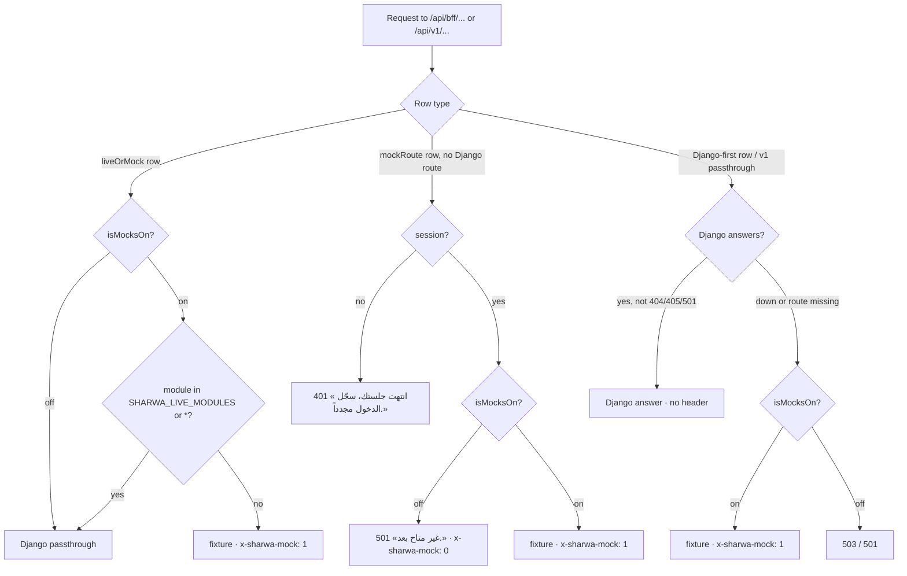

# Mock runtime

> **Source**: DOC-458 · inventory A.2 (mock runtime paragraph) · INT-044 (`requireMocks()` pattern)
> **Code**: `sharwa-frontend/src/mocks/runtime.ts` · `src/lib/bff/mock-route.ts` · `src/lib/bff/live-route.ts` · `src/mocks/passthrough.ts` · `src/app/api/v1/[...path]/route.ts` · `src/env.ts` · `src/lib/api-client.ts` · `src/components/shared/mock-indicator.tsx` · `scripts/*-check.ts`
> **Last verified against code**: 2026-10-27 (official Step 07)

## 1. Purpose

The mock runtime lets every screen of the frontend run on in-memory fixtures, with no Django behind it, and tells the developer — through one response header — which answers came from a fixture. It is what Phase 001 was built on and what every mock end-to-end script still runs on.

It is **not** a second backend: since Phase 002, Django is the authority for every business rule. A fixture only imitates the Django answer so the UI can be developed and checked without a server; where the two disagree, Django wins and the fixture is meant to be aligned (§6).

API-level detail (every function's signature, the rows that never go live) is in [`../api/overview/bff.md#mock-runtime`](../api/overview/bff.md#mock-runtime). This page is the design view and the "how do I run a screen on fixtures" guide.

## 2. Components

| Component | Location | Role |
|---|---|---|
| Runtime | `src/mocks/runtime.ts` | `MOCK_HEADER`, `isMocksOn()`, `isModuleLive()`, `mockJson()`, `mockError()`, `mockFieldErrors()`, `notAvailable()` — plain functions, no server, no state |
| Env validation | `src/env.ts` | `SHARWA_MOCKS: z.enum(["on","off"]).default(isProd ? "off" : "on")`; `SHARWA_LIVE_MODULES` accepted as a comma list (`/^[A-Za-z0-9_*,\s-]*$/`) |
| Dashboard skeleton | `src/lib/bff/mock-route.ts` (`mockRoute`) | live products rules first, then session gate (`401`), then `notAvailable()` when mocks are off, then optional permission gate (`403`), then the fixture handler |
| Live/mock switch | `src/lib/bff/live-route.ts` (`liveOrMock`) | fixture handler when the module is not live; Django passthrough when it is ([`20-bff.md`](20-bff.md#liveormock)) |
| `/api/v1/*` passthrough fallback | `src/app/api/v1/[...path]/route.ts` + `src/mocks/passthrough.ts` | Django first; a registered fixture answers only when mocks are on **and** Django is unreachable or answers `404` |
| Fixtures | `src/mocks/<module>/` (39 folders) + shared `_fixtures.ts`, `store-state.ts`, `empty-store.ts` | in-memory data per store (`noor`, `glow`, …) and the handlers that imitate each Django route |
| Mock session | `src/mocks/dashboard/auth.ts` (`MOCK_SESSION_COOKIE` = `sharwa_mock_session`), `src/features/dashboard-shell/api/session.ts` | while mocks are on, a dev session marker cookie stands in for the Django session when `/api/v1/auth/me/` gives none |
| Dev indicator | `src/lib/api-client.ts` (`onMockResponse`) → `src/components/shared/mock-indicator.tsx` | amber 1px line with the label «بيانات تجريبية» once any browser response carried `x-sharwa-mock: 1`; hidden in production |
| Mock E2E scripts | `scripts/*-check.ts` (Playwright, run with `npx tsx`) | functional checks per module on the fixtures; `scripts/b2b-check.ts` holds the `requireMocks()` preflight (§5) |

## 3. Data model

No database. Each fixture folder keeps its state in module-level maps keyed by store, so it lives as long as the `next dev` process: a restart re-seeds every store. Hot reload replaces passthrough handlers in place (registry keyed by matcher, decision 2026-10-19 in `src/mocks/passthrough.ts`) instead of stacking a stale copy.

## 4. Flows

### 4.1 The three switches and what decides a row

| Variable | Values | Default | Read by |
|---|---|---|---|
| `SHARWA_MOCKS` | `on` · `off` | `on` unless `NODE_ENV === "production"` (`isMocksOn()`; the same default in `src/env.ts`) | every adapter |
| `SHARWA_LIVE_MODULES` | comma list of the 39 keys ([`22-live-module-keys.md`](22-live-module-keys.md)), `*` = all | empty = none | `isModuleLive(module)` — only when mocks are on |
| Django reachability | `API_INTERNAL_URL` answers or not | — | Django-first rows and the `/api/v1/*` passthrough |

`isModuleLive(module)` is `true` when mocks are off, otherwise when the trimmed, lower-cased list contains `*` or the module key. Any other word — `none`, a typo such as `inventroy` — simply matches no row. `src/env.ts` checks only the characters, not the key names, so **a misspelt key is silently ignored**.



### 4.2 Which header proves what

| `x-sharwa-mock` on the response | Meaning |
|---|---|
| `1` | a fixture answered (`mockJson`) |
| `0` | mocks are off and the row has no Django endpoint (`notAvailable()` → `501` `{"detail": "غير متاح بعد."}`) |
| *absent* | Django answered. The BFF copies Django's headers, and Django never sets this one |

In the browser, `src/lib/api-client.ts` reports every response to `setMockObserver`; `MockIndicator` turns on the amber line «بيانات تجريبية» after the **first** response with `1` and keeps it on for the session. So the line tells you *some* data on the page is a fixture, not that *all* of it is. To prove a whole screen is on fixtures, open DevTools → Network and check that every `/api/bff/*` and `/api/v1/*` response carries `x-sharwa-mock: 1`.

### 4.3 Run any screen fully on fixtures

Mocks on with no live module is not enough by itself: Django-first rows (storefront, tracking, `auth/me`, dashboard overview, the `/api/v1/*` passthrough) still ask Django first and only fall back to the fixture when Django is down or lacks the route. For a screen that is **entirely** fixtures:

1. `.env.local`: `SHARWA_MOCKS=on` (or leave it unset in `next dev`).
2. No live modules: `SHARWA_LIVE_MODULES=none` (or remove the line — see §4.4 on why `none` is safer).
3. Stop Django, or point `API_INTERNAL_URL` at a port nothing listens on. Every Django-first row then answers from its fixture with `x-sharwa-mock: 1`.
4. Start `next dev`, open `http://noor.localhost:3000/dashboard` (or any store in the fixtures). The mock login sets the `sharwa_mock_session` cookie; the scripts set it directly (`value: "merchant"`, `"manager"`, …).
5. Check the header as in §4.2.

With Django running and a module not live, you get a **mixed** screen: `liveOrMock` rows from fixtures, Django-first rows from Django. That is the normal development mode during integration, and the reason the header is per response.

### 4.4 Setting the variables per shell

Variables set in the shell win over `.env.local` (Next.js loads `.env*` files only for keys not already in `process.env`). Deleting a variable in the shell therefore **lets `.env.local` decide again**.

| Shell | No live modules for this run | Remove the shell value |
|---|---|---|
| Windows `cmd` | `set SHARWA_LIVE_MODULES=none&& npm run dev` | `set SHARWA_LIVE_MODULES=` |
| PowerShell | `$env:SHARWA_LIVE_MODULES="none"; npm run dev` | `Remove-Item Env:SHARWA_LIVE_MODULES` |
| bash / zsh | `SHARWA_LIVE_MODULES=none npm run dev` | `unset SHARWA_LIVE_MODULES` |

Two `cmd` rules:

- **No space before `&&`.** `cmd`'s `set` keeps everything after `=` up to the `&&`, spaces included: `set SHARWA_LIVE_MODULES=none && npm run dev` stores `"none "`. For this variable the trailing space is harmless (`isModuleLive` trims), but the same habit with `set SHARWA_MOCKS=off && …` stores `"off "`, which `isMocksOn()` does not recognise and `src/env.ts` rejects (`z.enum(["on","off"])`).
- **`set X=` deletes `X`**, it does not set it to empty. After `set SHARWA_LIVE_MODULES=&& npm run dev` the shell has no value, so a `SHARWA_LIVE_MODULES=…` line in `.env.local` applies again. Use `none` when `.env.local` carries a list you want to override for one run.

> ⚠️ Discrepancy — `scripts/b2b-check.ts:78` and [`bff.md#mock-runtime`](../api/overview/bff.md#mock-runtime) (§6.3) recommend `set SHARWA_LIVE_MODULES=&& npm run dev` as "the clearer way" / that form deletes the shell variable, so it switches off live modules only when `.env.local` does not set them (the script's hint adds "or remove `products`/`b2b` from `SHARWA_LIVE_MODULES` in .env.local"). The roadmap's `set SHARWA_LIVE_MODULES=none&& npm run dev` is the form that also overrides `.env.local`. Reported in official Step 07.

## 5. Invariants

| Rule | Enforced by |
|---|---|
| Every fixture response carries `x-sharwa-mock: 1` and `cache-control: no-store` | `mockJson()` — every mock handler builds its response through it (`respond()`, `mockError()`, `mockFieldErrors()`) |
| With `SHARWA_MOCKS=off`, no fixture is ever served: a row without Django answers `501` «غير متاح بعد.» | `mockRoute` (after the session gate), the `/api/v1/*` passthrough (`isMocksOn()` guards both fallbacks), Django-first adapters |
| A Django answer always wins over a fixture | `liveOrMock` never calls the fixture in live mode; the passthrough and Django-first adapters fall back only on unreachable / `404` (`405`/`501` for Django-first) |
| The session gate runs before the fixture, in mock mode too | `mockRoute`: `401` «انتهت جلستك، سجّل الدخول مجدداً.» before anything else |
| Mock permission checks use the same permission keys as Django (no role names) | `mockRoute({permission})`, `canManageCatalog(session)` → `hasPermission(…, "catalog.manage")` |
| A successful mock write drops the store's cached storefront reads, like a live write | `mockRoute` and `forwardLive` both call `revalidateTag(storeTag(store), { expire: 0 })` |
| Production never shows the indicator | `MockIndicator` returns `null` when `NODE_ENV === "production"` |

### 5.1 The `requireMocks()` preflight — copy into any mock script

A mock script run against a dev server where its module is live fails far from the cause: the fixture cookie `sharwa_mock_session` means nothing to Django, so the first live row answers `401`. `scripts/b2b-check.ts` (INT-044) checks this up front:

```ts
// scripts/<module>-check.ts — call right after launch(), before any assertion.
async function requireMocks(browser: Browser) {
  const probe = await page(browser, { store: "glow" });
  await probe.goto(`${GLOW}/dashboard`, { waitUntil: "load" });
  // one cheap GET per live key the script depends on
  const routes = { "/api/bff/products?page_size=1": "products", "/api/bff/b2b/options": "b2b" } as const;
  const live: string[] = [];
  for (const [path, module] of Object.entries(routes)) {
    const r = await probe.evaluate(async (u) => {
      const res = await fetch(u, { headers: { accept: "application/json" } });
      return { status: res.status, mock: res.headers.get("x-sharwa-mock") };
    }, path);
    if (r.mock !== "1") live.push(`${module} (${path} → ${r.status}, not the fixture)`);
  }
  await probe.context().close();
  if (live.length) {
    console.error(`✗ runs on mocks, but these modules are live:\n  - ${live.join("\n  - ")}\n` +
      "  Restart without them, e.g. in cmd:  set SHARWA_LIVE_MODULES=none&& npm run dev");
    await browser.close();
    process.exit(1);
  }
}
```

To adapt it: replace the `routes` map with one `GET` per live key the script touches (the key list is in [`22-live-module-keys.md`](22-live-module-keys.md)), keep the probe on a page of the same store host so the cookie and `x-store-domain` are right. The hint above uses `none` (§4.4); the original in `b2b-check.ts` prints the empty form.

### 5.2 Which scripts guard themselves

Of the 43 `scripts/*-check.ts` files:

| Guard | Scripts |
|---|---|
| `requireMocks()` preflight (exit 1 when a key is live) | `b2b-check.ts` |
| Reads `x-sharwa-mock` and asserts `1` on its rows | `onboarding-check.ts` (market-categories, register, verify-otp) |
| No guard | the other 41: `admin-billing`, `admin-money`, `admin-shell`, `admin-stores`, `affiliates`, `apps-support`, `bookings`, `bundles`, `catalog-orders`, `courier`, `customers`, `domains`, `dropshipping`, `engagement`, `expenses`, `inbox`, `inventory`, `locations`, `marketing`, `marketplaces`, `payments`, `phase5-decisions`, `phase7-decisions`, `pos`, `procurement`, `product-editor-ux`, `product-minimum`, `reports`, `returns`, `rollup`, `settings`, `sharwa-pay`, `sharwa-ship`, `shipping`, `staff`, `storefront`, `tenant-isolation`, `tenant-shell`, `theme`, `visual`, `wallets` |

Run every unguarded script only on a dev server started with no live modules (§4.4). Run them as their header says, for example `npx tsx scripts/inventory-check.ts [port]` (default port `3000`, store `noor`); only `visual-check` has an `npm` script (`npm run visual-check`).

## 6. Fixtures and the "mock aligned" rule

Fixtures live in `src/mocks/<module>/`, one folder per module: `affiliates`, `approvals`, `apps`, `b2b`, `bookings`, `catalog`, `courier`, `customers`, `dashboard`, `design`, `dropshipping`, `engagement`, `expenses`, `inbox`, `integrations`, `inventory`, `locations`, `loyalty`, `marketing`, `marketplaces`, `notifications`, `orders`, `payments`, `platform`, `pos`, `procurement`, `product-extras`, `public`, `reports`, `returns`, `rollup`, `settings`, `sharwa-pay`, `shipping`, `staff`, `storefront`, `support`, `tenant`, `wallets`. Fixtures for the real `/api/v1/*` paths register themselves on the passthrough registry (`src/mocks/{storefront,returns,b2b,courier}/passthrough`).

**Rule (integration protocol, Step 4):** when a module is integrated, Django is the authority; the fixture is then aligned to Django's rules and messages ("mock aligned" in each INT write-up), so a screen behaves the same on fixtures and live. See [`02-integration-protocol.md`](02-integration-protocol.md).

Known fixtures that are **not** aligned (found while documenting; each is flagged on its API page):

| Module | Fixture | Difference from Django | Documented in |
|---|---|---|---|
| M37 bundles | `src/mocks/product-extras/state.ts:216` (`componentPrice` returns `Number(c.price)`) | bundle total uses raw prices; Django converts each component to the bundle's currency and uses formula prices | [`m37-advanced-products.md#bundle-total`](../api/domains/03-catalog/m37-advanced-products.md#bundle-total) |
| M05 categories | `src/mocks/catalog/organization.ts:43, :111` | SEO-limit message `70 حرفاً على الأكثر.` vs Django's per-field sentences; no duplicate-name / parent checks on PATCH; docstring says `children=lift\|grandparent` | [`m05-organization.md#categories`](../api/domains/03-catalog/m05-organization.md#categories) |
| M05 brands, tags, collections, badges | `src/mocks/catalog/organization.ts` | unknown-id delete answers `200` (Django `404`); no name limits; no tag-slug suffixing; empty badge colour refused | [`m05-organization.md#brands-tags`](../api/domains/03-catalog/m05-organization.md#brands-tags), [`#collections-badges`](../api/domains/03-catalog/m05-organization.md#collections-badges) |
| M02 onboarding OTP | onboarding fixtures | OTP lifetime / lock-out 300 s, 5 wrong codes → 60 s; Django 600 s, 3 wrong codes → 600 s | [`m02-onboarding.md#otp`](../api/domains/01-public-onboarding/m02-onboarding.md#otp) |

## 7. Configuration

| Variable | Where | Default | Notes |
|---|---|---|---|
| `SHARWA_MOCKS` | `.env.local` / shell | `on` in `next dev`, `off` in a production build | `on` / `off` only; anything else fails `src/env.ts` validation |
| `SHARWA_LIVE_MODULES` | `.env.local` / shell | empty | ignored when mocks are off; full key list and sample line in [`../ops/environment.md#live-modules`](../ops/environment.md#live-modules) |
| `API_INTERNAL_URL` | `.env.local` | `http://localhost:8000` in `.env.example` | point it at a dead port to force Django-first rows onto fixtures (§4.3) |
| `SHARWA_CHROMIUM` | shell, for the scripts | — | Chromium path for `scripts/*-check.ts` |

## 8. Failure modes and fixes

| Failure | Symptom | Cause | Handling |
|---|---|---|---|
| Mock script fails with `401` on a dashboard row | first assertion after login fails | module live on the dev server; Django does not know `sharwa_mock_session` | restart with `SHARWA_LIVE_MODULES=none` (§4.4); add `requireMocks()` (§5.1) |
| "No live modules" did not take effect | `x-sharwa-mock` absent on a row | `set SHARWA_LIVE_MODULES=` deleted the shell value and `.env.local` still lists the key | use `none`, or edit `.env.local` |
| Dev server refuses to start after `set SHARWA_MOCKS=off && …` | env validation error | value stored as `"off "` | no space before `&&` |
| Screen shows «بيانات تجريبية» although the module is live | indicator stays on | the indicator is sticky after the first fixture answer on the page (another row, e.g. a Django-first fallback) | check the headers per response (§4.2) |
| A row answers `501` «غير متاح بعد.» | `x-sharwa-mock: 0` | mocks off and the row has no Django endpoint | expected in production for fixture-only hooks ([`bff.md#mock-runtime`](../api/overview/bff.md#mock-runtime) §6.4) |
| A key in `SHARWA_LIVE_MODULES` does nothing | row stays on the fixture | typo or a key that does not exist — not validated | compare with [`22-live-module-keys.md`](22-live-module-keys.md) |

> ⚠️ Discrepancy — `.env.example:15` documents the mocks-off answer as `501 {"detail":"غير متاح بعد"}` / the code answers «غير متاح بعد.» with a final full stop (`src/mocks/runtime.ts:59`). Comment only. Reported in official Step 07.

## 9. Open items

- 41 of 43 mock scripts have no live-module guard (§5.2). Adding `requireMocks()` to them is a code change, outside this documentation step.
- Non-aligned fixtures (§6) stay until each module's fixture is aligned to Django.
- `SHARWA_LIVE_MODULES` key names are not validated; a typo is silent.

## 10. Related pages

- [`20-bff.md`](20-bff.md) — `liveOrMock`, adapters, buffering
- [`22-live-module-keys.md`](22-live-module-keys.md) — the 39 keys
- [`02-integration-protocol.md`](02-integration-protocol.md) — Step 4 QA gates and "mock aligned"
- [`../api/overview/bff.md#mock-runtime`](../api/overview/bff.md#mock-runtime) — function table and rows that never go live
- [`../ops/environment.md#live-modules`](../ops/environment.md#live-modules) — the sample line
- [`../ops/runbooks/switch-module-live.md`](../ops/runbooks/switch-module-live.md) — switch a module live / roll it back
