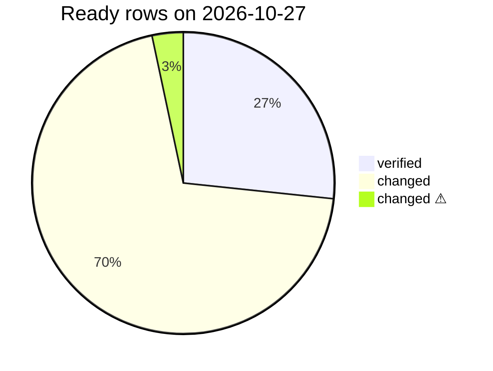

# Ready API v1 re-audit («Ready» passthrough list)

> **Source**: DOC-463 · inventory A.2, A.11, A.13 · INT-002, INT-011 → INT-013, INT-016, INT-018, INT-026, INT-044, INT-046
> **Code**: `sharwa_saas/api/urls.py` · `api/views.py` (`StoreConfigView`, `CategoryListView`, `ProductListView`, `ProductDetailView`, `CartView`, `CartActionView`, `PWAInstallEventView`, `PushVapidPublicKeyView`, `PushSubscribeView`, `PushUnsubscribeView`, `B2BDraft*View`, `Agent*View`, `CarrierWebhookView`) · `api/serializers.py` · `api/views_returns.py` + `products/services/returns_api_service.py` · `api/views_design.py` + `products/services/design_service.py` · `products/services/storefront_cart_service.py`, `storefront_product_service.py`, `cod_collection_service.py`, `shipment_state_service.py`, `courier_app_service.py` · `sharwa-frontend/src/app/api/v1/[...path]/route.ts` · Zod: `src/lib/schemas/store-config.ts`, `src/features/storefront/schemas/{catalog,cart}.ts`, `src/features/pwa/schemas.ts`, `src/features/returns/schemas.ts`, `src/features/b2b/schemas.ts`, `src/features/courier/schemas.ts`, `src/features/design/schemas.ts`
> **Audited list**: `sharwa-frontend/specs/001-sharwa-frontend-platform/contracts/ready-api-v1.md` (30 rows, "verified 2026-10-17", last edited during INT-016)
> **Last verified against code**: 2026-10-27 (official Step 07)

## 1. Purpose

`ready-api-v1.md` lists the 30 Django `/api/v1/` endpoints that existed **before** the BFF was built («Ready»). The frontend calls them without a BFF row of their own: through the same-origin passthrough `src/app/api/v1/[...path]/route.ts`, or from a Next server fetcher. Phase 002 changed most of them behind the same URLs. This page records, for every Ready row, what Django answers today, whether the frontend's Zod schema accepts it, which INT task owns the change, and what the list should say. It does **not** edit the list itself (it lives under `specs/001-…`, outside `docs/`); §6 gives the replacement text, ready to paste.

Out of scope: rows that are not on the list (for example the four courier reads, `returns/options/`, `returns/rma/`, `orders/refunds/`, `cart/coupon/`) — they are BFF live-key rows, documented in [`../api/overview/bff.md#live-keys`](../api/overview/bff.md#live-keys).

## 2. Components

| Component | Location | Role for the Ready rows |
|---|---|---|
| Same-origin passthrough | `sharwa-frontend/src/app/api/v1/[...path]/route.ts` | Forwards `GET/POST/PUT/PATCH/DELETE/HEAD /api/v1/<path>` to Django verbatim (`upstreamFetch` → `forwardResponse`). With `SHARWA_MOCKS=on` only: a Django `404` or an unreachable Django falls back to the registered fixtures (`mocks/{storefront,returns,b2b,courier}/passthrough`, `x-sharwa-mock: 1`). `HEAD` answers carry no body. No live key. |
| Server fetchers | `getPublicJson` in `src/features/storefront/api/{config,catalog}.ts` | Call Django directly from the Next server for rows #1–#4 (Django-first, fixture only on `404/405/501` or Django down) — [`../api/overview/bff.md#django-first`](../api/overview/bff.md#django-first) |
| BFF `admin/sections` rows | `src/app/api/bff/admin/sections/**` (key `design`) | Rows #8–#10 are no longer reached through the passthrough since INT-018 (§4.3) |
| Django providers | `sharwa_saas/api/views.py`, `views_returns.py`, `views_design.py` + services | The behaviour audited below |

```mermaid
flowchart LR
  B[Browser] -- "/api/v1/cart/, /pwa/, /push/, /returns/, /orders/b2b-*, /agent/*" --> P[Next /api/v1/[...path]]
  P -- verbatim --> D[Django /api/v1/...]
  P -. "404 or Django down, mocks on" .-> F[passthrough fixture]
  S[Next server: getPublicJson] -- "#1–#4" --> D
  B -- "#8–#10 via /api/bff/admin/sections" --> BFF[BFF liveOrMock key design] --> D
  C[Carrier] -- "#30 X-Carrier-Signature" --> D
```

## 3. Status legend

| Status | Meaning |
|---|---|
| **verified** | The list row is still correct; Django and the Zod schema agree with it. |
| **changed** | Django changed the row after the list was written (new fields, gates, errors or routing); the Zod schema accepts the new shape; the list row is stale. |
| **changed ⚠** | As *changed*, and Django can answer something the Zod schema or the screen does not fully handle (noted in the row). |

Every row below was checked on **2026-10-27** against the Django view/serializer/service named in it and the Zod schema its frontend consumer parses with.

## 4. Audit table

### 4.1 Storefront bootstrap and catalogue (#1–#4)

| # | Method · path | Django today | Zod schema (consumer) | Status | INT |
|---|---|---|---|---|---|
| 1 | `GET /config/` | `StoreConfigView`: `StoreConfigSerializer` (identity, theme, `brand_shades`, announcement styling and banner flags, `sections[]`, `free_shipping_threshold` as `"0.00"` string, `currency`, SEO, contact links, `about_us`, `return_policy`, `timezone`, `week_start_day`) **plus `tracking`, added by the view** (`public_tracking`). Tenant gate `HasTenantContext`. Field list: [`config.md`](../api/domains/01-public-onboarding/config.md). | `storeConfigSchema` in `src/lib/schemas/store-config.ts` (re-exported by `storefront/schemas/config.ts`); consumers `getPublicJson` (render), `probeStore()` (M47), the `HEAD` poller through the passthrough | changed | INT-002, INT-010, INT-019, INT-023 |
| 2 | `GET /catalog/categories/` | `CategoryListView`, no pagination: root categories, each `{id, name, image, subcategories[]}` recursively; `image` is an absolute URL or `null` (INT-011); order = `Category.Meta.ordering` (`sort_order`, `name`, `id` — the merchant's drag-and-drop order, INT-006) | `CategoryNodeSchema` / `CategoryTreeSchema` (`image` optional) — server fetcher | changed | INT-011 (INT-006 order) |
| 3 | `GET /catalog/products/` | `ProductListView`: `?category` (includes sub-categories), `brand`, `tag`, `collection`, `search` (Arabic-normalised), `is_featured`, `ordering`, `currency`, `page`, `page_size` (default 20, max 50). Card = `id, name, image, image_url, category` (name), `display_price, display_old_price, stock, is_featured, is_free_shipping, payment_policy, badges[{name,color}], slug`. A search with no result writes a `ZeroResultSearchLog` row. | `ProductCardSchema`, `ProductPageSchema` (all extensions optional) — server fetcher | changed | INT-011 |
| 4 | `GET /catalog/products/<id>/` | `ProductDetailView` on `Product.objects.visible()`: the card + `description, sizes_list, colors_list, deposit_required` + `detail_extensions()` (images, variants and display style, attributes, tier prices, bundle, personalization fields, availability, min/max quantity, booking/auction flags, reviews summary, related, SEO…) | `ProductDetailSchema` (extends the card; extensions optional) — server fetcher | changed | INT-012 |

### 4.2 Cart (#5–#7)

| # | Method · path | Django today | Zod schema (consumer) | Status | INT |
|---|---|---|---|---|---|
| 5 | `GET /cart/` | `CartView` → `storefront_cart_service.serialize`: `{items[], count, currency, display_subtotal, coupon_code, display_discount, applied_offers[{name, offer_type, display_discount}], display_total, free_shipping_applies, display_free_shipping_remaining, free_shipping_progress}`; each item `{product_id, name, size, color, quantity, display_price, display_subtotal, image, variant_id, variant_label, product_slug, max_quantity, stock, is_auction, start_datetime, is_available}`; held booking slots count in `count`. `?currency=` is stored in the session first. | `CartSchema` (`features/cart/api.ts` through the passthrough) — every key above is declared | changed | INT-013 |
| 6 | `DELETE /cart/` | `storefront_cart_service.clear` → `204` | `CartSchema.optional()` | verified | — |
| 7 | `POST /cart/actions/` | `apply_action`: body adds `variant_id`, `quantity`, `personalization`, `start_datetime` (bookable products) to `{product_id, size, color, action_type}`; answer `{cart_count, product_qty}`. Errors: `400` `{"product_id": ["منتج غير صالح."]}`, `400` `{"action_type": ["إجراء غير معروف."]}`, `404` `{"detail": "هذا المنتج غير متاح."}`, `400` «المتغيّر المحدد لا يخص هذا المنتج.», `400` «اختر المقاس واللون أولاً.», `400` «اختر موعداً أولاً لهذه الخدمة.» | `CartActionResultSchema` | changed | INT-013, INT-036 (slots) |

### 4.3 Home-page sections (#8–#10)

| # | Method · path | Django today | Zod schema (consumer) | Status | INT |
|---|---|---|---|---|---|
| 8 | `GET/POST /admin/sections/` | Moved to `views_design.SectionListView` (`DesignAPIMixin`): **owner session** (no more `IsAdminUser`); gates `401` «انتهت جلستك، سجّل الدخول مجدداً.» → staff `403` «تصميم المتجر مقصور على مالك المتجر.» → plan feature `storefront_design` `403` «هذه الميزة غير متاحة في باقتك الحالية». List = `[{id, section_type, label, order, is_active, settings, content_data}]` (defaults seeded on first read); `POST` → `201` section; `400` «نوع قسم غير معروف.» / «قسم مفرد موجود مسبقاً.» | `adminSectionListSchema`, `adminSectionSchema` — called as `/api/bff/admin/sections` (live key `design`), **not** through the passthrough | changed | INT-018 |
| 9 | `PATCH/DELETE /admin/sections/<pk>/` | `SectionDetailView`: `PATCH` → section (`400` «لا يمكن تغيير نوع القسم.»), `DELETE` → `204`; a singleton section is refused `400` «قسم مفرد لا يُحذف — عطّله بدلاً من حذفه.». **No `PUT`** any more (`405`). | same | changed | INT-018 |
| 10 | `POST /admin/sections/reorder/` | `{ordered_ids}` must list **every** section id once → `{ok: true, reordered: n}`; `400` «قائمة معرّفات غير صالحة.» / «أرسل كل معرّفات الأقسام بترتيبها الكامل.» | `reorderResultSchema` | changed | INT-018 |

### 4.4 PWA and Web Push (#11–#14)

| # | Method · path | Django today | Zod schema (consumer) | Status | INT |
|---|---|---|---|---|---|
| 11 | `POST /pwa/install-event/` | no authentication, `HasTenantContext`; 300/min per IP → `429` `{"detail": "طلبات كثيرة جداً، حاول لاحقاً."}`; `{event_type, source}` validated by `PWAInstallEventSerializer` (choice fields); session key and user agent taken from the request, never from the body; `201` `{"ok": true}` | `InstallEventResultSchema` exists, but `install-events.ts` sends with a fire-and-forget `fetch` and never parses the answer | verified (the list already carries the INT-016 change) | INT-016 |
| 12 | `GET /push/vapid-public-key/` | `{publicKey}` (public key only) | `VapidKeySchema` (`push-subscribe.tsx`) | verified | — |
| 13 | `POST /push/subscribe/` | 120/min per IP (`429` as #11); body `{endpoint, keys{p256dh, auth}, order_uuid?, customer_phone?}`; the subscription's phone comes **only** from the order of `order_uuid`; unknown order → `400` `{"order_uuid": ["لم نجد هذا الطلب."]}`; `customer_phone` is accepted by the serializer but never stored; an anonymous re-subscribe of the same endpoint does not erase a phone set by an earlier order; `201` `{"ok": true}` | `PushResultSchema` — the component still sends `customer_phone`, which is now ignored | verified (the list already carries the INT-016 change) | INT-016 |
| 14 | `POST /push/unsubscribe/` | `{endpoint}` → `is_active=False` (row kept) → `{"ok": true}`; missing endpoint → `400` `{"detail": "endpoint مطلوب."}` | `PushResultSchema` | verified | — |

### 4.5 Returns and RMA (#15–#18, #27–#29)

Common gate since INT-026 (`ReturnsAPIMixin`): session `401` «انتهت جلستك، سجّل الدخول مجدداً.» → plan feature `refunds` `403` «ميزة المرتجعات غير مفعّلة في خطتك.» → permission `403` «ليست لديك صلاحية لتنفيذ هذا الإجراء.» (`orders.process_returns`; scan and QA also accept `inventory.adjust`). Service errors are DRF-shaped (`{field: [..]}` or `{detail}`). All seven rows are called through the passthrough (`features/returns/api.ts`).

| # | Method · path | Django today | Zod schema | Status | INT |
|---|---|---|---|---|---|
| 15 | `GET/POST /returns/` | `GET ?status&q&page` → **paginated** `{count, next, previous, results}` (20 per page); item `{id, order_id, customer_name, customer_phone, lines_count, display_amount, reason, refund_method, status, location{id,name}\|null, version, created_at}`. `POST {order_id, reason, refund_method, line_items[{fulfillment_item_id, quantity_returned, restock}]}` → `201` **return detail** (#17). Errors include `404` «الطلب غير موجود.», `reason` «اكتب سبب الإرجاع.» / «السبب أطول من 255 حرفاً.», `refund_method` «اختر طريقة الاسترجاع.», `line_items` «حدد سطراً واحداً على الأقل.», `400` «استُرجع هذا الطلب بالكامل — لا عناصر قابلة للإرجاع.» | `returnListSchema`, `returnDetailSchema` | changed | INT-026 |
| 16 | `GET /returns/order/<order_id>/items/` | `[{fulfillment_item_id, product_name, quantity, remaining, unit_refund_amount, location_name, sku, product_deleted, display_unit_refund_amount}]`; `quantity`/`remaining` are **numbers** (integer when whole), `unit_refund_amount` a 2-decimal string | `returnableItemsSchema` | changed | INT-026 |
| 17 | `GET /returns/<pk>/` | list item + `decision_note`, `updated_at`, `line_items[{id, fulfillment_item_id, product_id, product_name, sku, quantity_returned, refund_amount_allocated, display_refund_amount, restock, product_deleted}]`, `timeline[{id, at, text, actor}]`; `404` «طلب الإرجاع غير موجود.» | `returnDetailSchema` | changed | INT-026 |
| 18 | `POST /returns/<pk>/approve/` | `{decision: approve\|reject, version?, location_id?, note?}` — `decision` defaults to `approve`; `version` is **optional** (checked only when sent); `reject` needs `note` ≥ 3 characters (`400` «اكتب سبب الرفض.»); approve needs a restock location when lines restock (`400` «حدد موقع إعادة المخزون.» / «الموقع غير متاح.»). Answers the **updated detail**; `409` `{"detail": "حُدِّث طلب الإرجاع من مستخدم آخر.", "current_version": n}` or «حُسم هذا الإرجاع من قبل (…).»; cash shortage `400` `{"detail": "CashLiquidityError: …"}` | `returnDetailSchema` | changed | INT-026 |
| 27 | `POST /returns/rma/create/` | `{order_id, fulfillment_item_id, destination_location_id, quantity?, reason}` → **`201`** RMA view `{id, order_id, fulfillment_item{id, product_id, product_name, sku}, reason, status, fee_payer, destination_location, quantity, customer_name, created_at, restock_movement_id, events[]}`; `quantity` defaults to 1. Field errors «الطلب غير موجود.», «اختر عنصر تنفيذ من الطلب.», «اختر موقع الوجهة.», «اختر سبب الإرجاع.», «الكمية بين 1 و…». | `rmaSchema` | changed | INT-026 |
| 28 | `POST /warehouse/returns/scan/` | `{rma_id, location_id}` → RMA view; `400` «رقم RMA غير صالح.», «الموقع غير موجود.», wrong destination; `409` when already scanned | `rmaSchema` | changed | INT-026 |
| 29 | `POST /warehouse/returns/<rma_id>/qa-decision/` | `{decision: restocked \| rejected_disposal}` → RMA view; `400` «القرار restocked أو rejected_disposal.»; `409` before receipt | `rmaSchema` | changed | INT-026 |

### 4.6 B2B drafts (#19–#21)

Gate (`MerchantAPIMixin.check_merchant`): a session **without the `is_merchant_authenticated` flag** → `401` «غير مصرح لك بالوصول.»; then, for a staff member, a missing key → `403` «لا تملك صلاحية تنفيذ هذا الإجراء.». Called through the passthrough (`features/b2b/api.ts`). See the staff-session finding in §5.

| # | Method · path | Django today | Zod schema | Status | INT |
|---|---|---|---|---|---|
| 19 | `POST /orders/b2b-draft/` | key `orders.create_b2b`; **staff only** (owner → `403` «يتطلب إنشاء طلب الجملة تسجيل دخول موظف.»); `400` «اسم العميل وهاتفه وعنوانه مطلوبة.», «يجب تحديد منتج واحد على الأقل.», «دور المعتمد غير موجود.», «الفرع غير موجود.», «لا يوجد فرع متاح — أنشئ فرعاً أولاً أو حدّد location_id.» (multi-location stores must send `location_id`), «عملة غير مدعومة.»; prices from the database with tier prices in the draft's currency; `201` `{"detail": "أُنشئت المسودة وهي الآن بانتظار موافقة المدير.", order_id, approval_id}` | `b2bCreatedSchema` | changed | INT-044 |
| 20 | `GET /orders/b2b-drafts/` | either `orders.create_b2b` **or** `orders.approve_b2b`; rows add `created_by_name` and `escalated_at`; order = escalated first, then newest; `total_price` is a decimal string | `b2bDraftListSchema` (both fields optional; the schema comment still calls them "proposed") | changed | INT-044 |
| 21 | `POST /orders/b2b-draft/<pk>/resolve/` | `<pk>` is the **`ApprovalRequest` id** (`approval_id` of #20), not the order id; key `orders.approve_b2b`; `{decision: approved\|rejected, version}`; `400` «القرار يجب أن يكون approved أو rejected.» / «قيمة الإصدار (version) مطلوبة وصحيحة.»; `404` «طلب الموافقة غير موجود.»; self-approval `403`; stale version `409`; `200` `{"detail": "حُسمت الموافقة بنجاح.", decision}` | `b2bResolvedSchema` | verified (shape) — the list should name the id | INT-044 |

### 4.7 Courier actions (#22–#26)

Gate: no owner/staff session → `401` «غير مصرح لك بالوصول.». Since INT-046 the agent is the **logged-in** staff member's `shipping_provider_profile`: no profile → `403` «حساب الموظف هذا غير مرتبط بأي ملف مندوب شحن.»; disabled profile → `403` «ملف المندوب هذا معطّل. تواصل مع مالك المتجر.»; a shipment/fulfilment not assigned to that agent → `404` «الشحنة غير موجودة.». Only an owner session may name an agent (`agent_id`; else `400` «agent_id مطلوب وصحيح.»). Sent through the offline queue (`features/courier/queue.ts`, `apiFetchRaw` — the answers are **not** Zod-parsed at runtime).

| # | Method · path | Django today | Zod schema | Status | INT |
|---|---|---|---|---|---|
| 22 | `POST /agent/shipments/<id>/status/` | body as listed + optional `raw_payload`; idempotency key `<shipment_id>:<to_status>:<client_generated_uuid>`; answer `{shipment_id, waybill_number, status, accepted, rejection_reason, flagged_for_review}`. `rejection_reason` ∈ `invalid_transition`, `stale_event`, `order_already_reversed`, `compensated_lost_scan` **and `geo_required`** (delivery from the agent app without coordinates, `shipment_state_service.py:215`) | `transitionResultSchema` — `REJECTION_REASONS` lists the first four only; the screen shows «رُفض الحدث.» for `geo_required` | changed ⚠ | INT-046 |
| 23 | `POST /agent/shifts/start/` | `{vehicle_ref?, agent_id?}` → `{shift_id, agent{id, name}, started_at, closed_previous_shift_id}` (an open shift is closed first) | `startShiftSchema` | changed | INT-046 |
| 24 | `POST /agent/shifts/end-and-handover/` | `{shift_id, new_agent_id?, vehicle_ref?}` → `{shift_id, ended_at}` or `{new_shift_id, handed_over_to{id, name}, balance}`; an agent may only end their own shift; `404` «المناوبة غير موجودة.», `400` «هذه المناوبة مغلقة مسبقاً.», «اختر مندوباً آخر لتسليم المناوبة.», «المندوب الجديد معطّل.», `404` «المندوب الجديد غير موجود.» | `endShiftSchema` | changed | INT-046 |
| 25 | `POST /agent/fulfillments/<id>/scan-pickup/` | `{scanned_code}` → `{ok: true, fulfillment_id}` / `400` `{detail, scan_mismatch: true}`; ownership check added | `scanResultSchema` | verified (shape) | INT-046 |
| 26 | `POST /agent/fulfillments/<id>/partial-delivery/` | `{line_items[…], client_generated_uuid, geo_*?}` (`400` «line_items مطلوبة.» / «client_generated_uuid مطلوب.») → `{collected_amount, display_collected_amount, currency, delivered, rejected, duplicate, status?}`; `collected_amount` is a 2-decimal string; refusal `409` `{"detail": "رُفض التسليم.", "rejection_reason": …}` | `partialResultSchema` | changed | INT-046 |

### 4.8 Carrier webhook (#30)

| # | Method · path | Django today | Zod schema | Status | INT |
|---|---|---|---|---|---|
| 30 | `POST /webhooks/carrier/<carrier_code>/` | no session; shared secret per carrier in `X-Carrier-Signature` (`CARRIER_WEBHOOK_SECRETS`) — wrong or unconfigured → `401` `{"detail": "غير مصرح."}`; `400` `{"detail": "waybill_number وstatus إلزاميان."}`; `202` `{"received": true}`; queues `process_carrier_webhook_event` (runs on the public schema and resolves the store through `WaybillRegistry`) | — (display URL only) | verified | — (INT-021 / INT-030 operate it) |

### 4.9 Totals

| Status | Rows |
|---|---|
| verified | #6, #11, #12, #13, #14, #21 (shape), #25 (shape), #30 — 8 |
| changed | #1–#5, #7–#10, #15–#20, #23, #24, #26–#29 — 21 |
| changed ⚠ | #22 — 1 |



## 5. Findings

> ⚠️ Discrepancy — [`bff.md`](../api/overview/bff.md#passthrough) §5.3 says the list "was last edited before INT-013/016/018/026/044/046" / the list already carries the INT-016 changes in rows #11 (300/min, CGNAT) and #13 (`order_uuid`, phone from the order, `400 {order_uuid}`), and its file date matches INT-016. Every other INT change is missing. Reported in official Step 07.

> ⚠️ Discrepancy — [`bff.md`](../api/overview/bff.md#passthrough) §5.3 marks row #2 "unchanged" / `CategorySerializer` adds `image` (absolute URL or `null`, INT-011) and the order follows the merchant's `sort_order` (INT-006) (`api/serializers.py`, `CategorySerializer`). Reported in official Step 07.

> ⚠️ Discrepancy — the list says the courier rows' answers are parsed with `courier/schemas.ts` / `queue.ts` sends them with `apiFetchRaw` and never parses the answer; `transitionResultSchema.rejection_reason` also lacks `geo_required`, which Django returns (`shipment_state_service.py:215`). The read endpoints map unknown reasons to `null` (`courier_app_service.py:164`), so only the action banner is affected («رُفض الحدث.» instead of a specific sentence). Reported in official Step 07.

> ⚠️ Discrepancy — rows #8–#10 are listed as Ready passthrough rows with `IsAdminUser` / the code serves them from `views_design.py` with the owner session and the frontend calls them through `/api/bff/admin/sections` (live key `design`). They are no longer passthrough rows; `PUT` was removed. Reported in official Step 07.

> ⚠️ Discrepancy — inventory INT-044 says "B2B drafts need a staff session" / `MerchantAPIMixin.check_merchant` (`api/views.py:369-376`) first requires `request.session['is_merchant_authenticated']`, and `StaffLoginView` (`api/views_auth.py:330`) **removes** that flag when a staff member logs in through `POST /api/v1/auth/staff/login/`. Read from the code, a staff session created by the JSON login therefore gets `401` «غير مصرح لك بالوصول.» on rows #19–#21, while #19 refuses the owner (`403`). `api/test_b2b_api.py` sets the flag and patches the staff resolver, so the suite does not exercise this path. The courier rows use `is_merchant_authenticated or request.staff` and are not affected. Not reproduced at run time in this step — needs a live check. Reported in official Step 07.

Other observations (no behaviour risk):

- `b2bDraftSchema` still comments `created_by_name` / `escalated_at` as "proposed" extensions; Django serves both since INT-044.
- Row #13: the frontend keeps sending `customer_phone`; Django ignores it (intended, INT-016 "zero impersonation").
- Row #18: the list says `version` is required; Django treats it as optional. The screen always sends it, so the `409` still works.

## 6. Proposed updates to `ready-api-v1.md`

Paste-ready replacement for the table and its header line. The conventions paragraph at the end of the file stays as it is.

```markdown
**Source**: discovery 03 §1, verified 2026-10-17; **re-audited 2026-10-27** against `sharwa_saas` after Phase 002 (INT-002 → INT-046) — detail per row in `docs/architecture/23-ready-api-v1-audit.md`. Mounted on both tenant and public URLConfs; tenant context from `Host` or `X-Store-Domain` (under `/api/` only). Rows #1–#4 are read by Next server fetchers (Django-first); rows #5–#7 and #11–#29 by the browser through the same-origin passthrough `/api/v1/[...path]`; rows #8–#10 moved behind the BFF (`/api/bff/admin/sections`, live key `design`).

| # | Method | Path | Auth / gate | Request | Response | Zod schema (file) | Consumers | Changed by |
|---|---|---|---|---|---|---|---|---|
| 1 | GET | `/api/v1/config/` | none (`HasTenantContext`) | — | `StoreConfig` (identity, theme, `brand_shades`, announcement styling + banner flags, `sections[]`, `free_shipping_threshold`, currency, SEO, contact, policies, `timezone`, `week_start_day`) + `tracking` · 404/403/503 as tenant probe | `src/lib/schemas/store-config.ts` → `storeConfigSchema` | M47 probe, M09, M10, M11, M12, M41, M44, M08 | INT-002, INT-010, INT-019, INT-023 |
| 2 | GET | `/api/v1/catalog/categories/` | none | — | `[{id, name, image, subcategories[]}]` in the merchant's `sort_order` (no pagination) | `storefront/schemas/catalog.ts` → `CategoryNodeSchema` | M09, M05, M08, M13 | INT-011, INT-006 |
| 3 | GET | `/api/v1/catalog/products/` | none | `?category&brand&tag&collection&search&is_featured&ordering&currency&page&page_size(20, ≤50)` | `Paginated<ProductCard>` — card adds `image_url, is_free_shipping, payment_policy, badges[{name,color}], slug` | `ProductCardSchema`, `ProductPageSchema` | M09, M05, M13, M16, M23 | INT-011 |
| 4 | GET | `/api/v1/catalog/products/<id>/` | none | `?currency` | `ProductDetail` (card + `description, sizes_list, colors_list, deposit_required` + INT-012 extensions: images, variants, attributes, tier prices, bundle, personalization, availability, reviews summary, related, SEO) | `ProductDetailSchema` | M10, M42 | INT-012 |
| 5 | GET | `/api/v1/cart/` | session cookie | `?currency` (sticky) | `{items[], count, currency, display_subtotal, coupon_code, display_discount, applied_offers[], display_total, free_shipping_applies, display_free_shipping_remaining, free_shipping_progress}`; items add `image, variant_id, variant_label, product_slug, max_quantity, stock, is_auction, start_datetime, is_available` | `storefront/schemas/cart.ts` → `CartSchema` | M11, M12, header badge | INT-013 |
| 6 | DELETE | `/api/v1/cart/` | session cookie | — | 204 | — | M11 | — |
| 7 | POST | `/api/v1/cart/actions/` | session cookie | `{product_id, size?, color?, variant_id?, quantity?, personalization?, start_datetime?, action_type: add\|decrease\|remove_line}` | `{cart_count, product_qty}` · 400/404 per `storefront_cart_service.apply_action` | `CartActionResultSchema` | M10, M11 | INT-013, INT-036 |
| 8 | GET/POST | `/api/v1/admin/sections/` | **owner session** + CSRF; plan feature `storefront_design`; staff 403 | section object | `[{id, section_type, label, order, is_active, settings, content_data}]` / 201 | `features/design/schemas.ts` → `adminSectionListSchema` (via BFF `admin/sections`, key `design`) | M08 | INT-018 |
| 9 | PATCH/DELETE | `/api/v1/admin/sections/<pk>/` | same | per `section_type` | section / 204 (singleton: 400, disable instead); no PUT | same | M08 | INT-018 |
| 10 | POST | `/api/v1/admin/sections/reorder/` | same | `{ordered_ids:[every id]}` | `{ok, reordered}` | `reorderResultSchema` | M08 | INT-018 |
| 11 | POST | `/api/v1/pwa/install-event/` | none, 300/min/IP | `{event_type: prompt_shown\|ios_hint_shown\|accepted\|dismissed\|installed, source:'nextjs_app'}` | 201 `{ok}` / 429 | `pwa/schemas.ts` | M44 | INT-016 |
| 12 | GET | `/api/v1/push/vapid-public-key/` | none | — | `{publicKey}` | `pwa/schemas.ts` | M44, M49 | — |
| 13 | POST | `/api/v1/push/subscribe/` | none, 120/min/IP | `{endpoint, keys:{p256dh, auth}, order_uuid?}` — the phone comes from `order_uuid`'s order; `customer_phone` is ignored; 400 `{order_uuid}` for an unknown order | 201 `{ok}` / 429 | same | M44, M49 | INT-016 |
| 14 | POST | `/api/v1/push/unsubscribe/` | none | `{endpoint}` | `{ok}` / 400 `{detail}` | same | M44, M49 | — |
| 15 | GET/POST | `/api/v1/returns/` | merchant session + CSRF; plan feature `refunds`; perm `orders.process_returns` | `?status&q&page` · POST `{order_id, reason, refund_method, line_items:[{fulfillment_item_id, quantity_returned, restock}]}` | `{count, next, previous, results}` (20/page) / 201 return detail | `features/returns/schemas.ts` | M24, M06 | INT-026 |
| 16 | GET | `/api/v1/returns/order/<order_id>/items/` | same | — | `[{fulfillment_item_id, product_name, quantity, remaining, unit_refund_amount, location_name, sku, product_deleted, display_unit_refund_amount}]` | same | M24 | INT-026 |
| 17 | GET | `/api/v1/returns/<pk>/` | same | — | return detail (`line_items`, `timeline`, `decision_note`, `version`) | same | M24 | INT-026 |
| 18 | POST | `/api/v1/returns/<pk>/approve/` | same | `{decision: approve\|reject, version?, location_id?, note?}` (note required to reject) | updated detail / 409 `{detail, current_version}` / 400 `{detail}` (`CashLiquidityError`) | same | M24 | INT-026 |
| 19 | POST | `/api/v1/orders/b2b-draft/` | **staff** session + CSRF, perm `orders.create_b2b` | `{customer_name, customer_phone, address, items:[{product_id, quantity}], approver_role_id?, location_id? (required in multi-location stores), currency?}` | 201 `{detail, order_id, approval_id}` | `features/b2b/schemas.ts` | M36, M06 | INT-044 |
| 20 | GET | `/api/v1/orders/b2b-drafts/` | perm `orders.create_b2b` or `orders.approve_b2b` | — | `[{id, customer_name, customer_phone, total_price, currency, created_at, sales_channel, approval_id, approval_version, items_count, created_by_name, escalated_at}]`, escalated first | same | M36 | INT-044 |
| 21 | POST | `/api/v1/orders/b2b-draft/<approval_id>/resolve/` | perm `orders.approve_b2b` | `{decision: approved\|rejected, version}` | 200 `{detail, decision}` / 400 / 403 self-approval / 404 / 409 | same | M36 | INT-044 |
| 22 | POST | `/api/v1/agent/shipments/<id>/status/` | staff session (agent profile) + CSRF; own shipments only | `{to_status, client_generated_uuid(≤64), event_time?, geo_lat?, geo_lng?, geo_accuracy_m?}` | 200 `{shipment_id, waybill_number, status, accepted, rejection_reason (incl. geo_required), flagged_for_review}` | `courier/schemas.ts` | M38, M39 | INT-046 |
| 23 | POST | `/api/v1/agent/shifts/start/` | staff session (agent) or owner with `agent_id` | `{vehicle_ref?, agent_id?}` | `{shift_id, agent:{id,name}, started_at, closed_previous_shift_id}` | same | M38 | INT-046 |
| 24 | POST | `/api/v1/agent/shifts/end-and-handover/` | same; own shift only | `{shift_id, new_agent_id?, vehicle_ref?}` | `{shift_id, ended_at}` or `{new_shift_id, handed_over_to:{id,name}, balance}` | same | M38 | INT-046 |
| 25 | POST | `/api/v1/agent/fulfillments/<id>/scan-pickup/` | same; own fulfilments only | `{scanned_code}` | `{ok, fulfillment_id}` / 400 `{detail, scan_mismatch:true}` | same | M38 | INT-046 |
| 26 | POST | `/api/v1/agent/fulfillments/<id>/partial-delivery/` | same | `{line_items:[{fulfillment_item_id, delivered_quantity, rejection_reason}], client_generated_uuid, geo_*?}` | `{collected_amount, display_collected_amount, currency, delivered, rejected, duplicate, status?}` / 409 | same | M38 | INT-046 |
| 27 | POST | `/api/v1/returns/rma/create/` | as #15 | `{order_id, fulfillment_item_id, destination_location_id, quantity? (1), reason}` | 201 RMA | `features/returns/schemas.ts` | M24 | INT-026 |
| 28 | POST | `/api/v1/warehouse/returns/scan/` | as #15, or `inventory.adjust` | `{rma_id, location_id}` | RMA / 409 | same | M24 | INT-026 |
| 29 | POST | `/api/v1/warehouse/returns/<rma_id>/qa-decision/` | as #28 | `{decision: restocked\|rejected_disposal}` | RMA / 409 | same | M24 | INT-026 |
| 30 | POST | `/api/v1/webhooks/carrier/<carrier_code>/` | `X-Carrier-Signature` | `{waybill_number, status, event_time?, event_id?}` | 202 `{received:true}` / 401 / 400 | — (display URL only) | M15, M39 | — |
```

Two code-side follow-ups go with the list refresh (application code, outside this documentation step): add `geo_required` to `REJECTION_REASONS` / `REJECTION_TEXT` in `src/features/courier/schemas.ts`, and drop the "proposed" wording from `b2bDraftSchema`.

## 7. Failure modes and fixes

| Failure | Symptom | Cause | Handling / fix |
|---|---|---|---|
| Passthrough writes reached Django with an empty body | every `POST /api/v1/*` answered `400` "required field" (e.g. `pwa/install-event/`) | streamed body sent chunked without `Content-Length` | buffered bodies in `upstreamFetch` — [`../api/overview/bff.md#buffering`](../api/overview/bff.md#buffering) (A.11; INT-016, INT-044, INT-046) |
| A real `404` read as "row not shipped" | with mocks on, a fixture answers instead of Django's `404` (unknown record) | the passthrough cannot tell a missing route from a missing record | open decision recorded in [`../api/overview/bff.md#django-first`](../api/overview/bff.md#django-first) §4.6 |
| Push subscriptions bound to any phone | anyone could receive another number's order updates | phone taken from the request body | phone derived from `order_uuid`'s order (INT-016) |
| Any courier could act on any shipment | status/scan/delivery accepted for shipments of other agents | no ownership check | `_agent_owns` + agent from the login identity (INT-046, audit fix 2026-09-16 for impersonation) |

## 8. Open items

- Refresh `ready-api-v1.md` with §6 (or retire it in favour of this page) — decision for fares; the file is outside `docs/` and is not edited in this step.
- `geo_required` missing from the courier Zod enum (code change).
- Rows #8–#10: decide whether they stay on the Ready list at all, since they are BFF live-key rows now.
- Rows #19–#21: verify live that a staff member logged in through `auth/staff/login/` can create, list and resolve drafts (§5); if not, `MerchantAPIMixin` needs the same `is_merchant_authenticated or request.staff` test as the courier rows (code change).

## 9. Related pages

- [`../api/overview/bff.md#passthrough`](../api/overview/bff.md#passthrough) — the passthrough handler and the first re-audit
- [`20-bff.md`](20-bff.md) — BFF architecture (`#adapters`, `#body-buffering`)
- [`../ops/runbooks/switch-module-live.md`](../ops/runbooks/switch-module-live.md) — why Django-first rows cannot be switched back
- API pages that own these rows: [`config.md`](../api/domains/01-public-onboarding/config.md) (#1) · [`m09-storefront-home-catalog.md`](../api/domains/05-storefront/m09-storefront-home-catalog.md) (#2, #3) · [`m10-product-detail.md`](../api/domains/05-storefront/m10-product-detail.md) (#4) · [`m11-cart.md`](../api/domains/05-storefront/m11-cart.md) (#5–#7) · [`m08-theme-customizer.md`](../api/domains/07-marketing-design-partners/m08-theme-customizer.md#sections) (#8–#10) · [`m44-pwa.md`](../api/domains/05-storefront/m44-pwa.md#storefront-rows) (#11–#14) · [`m24-returns.md`](../api/domains/04-orders-returns/m24-returns.md) (#15–#18, #27–#29) · [`m36-b2b-wholesale.md`](../api/domains/09-b2b/m36-b2b-wholesale.md#drafts) (#19–#21) · [`m38-courier-app.md`](../api/domains/11-shipping/m38-courier-app.md) (#22–#26) · [`m15-shipping.md`](../api/domains/11-shipping/m15-shipping.md) (#30)
