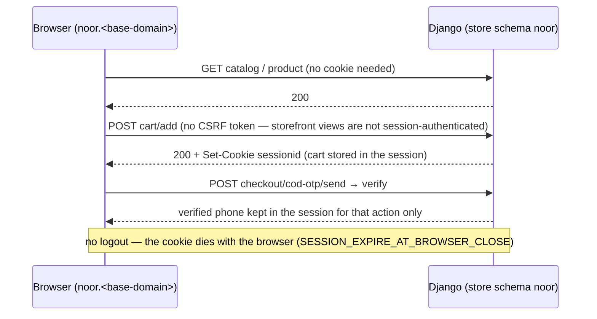
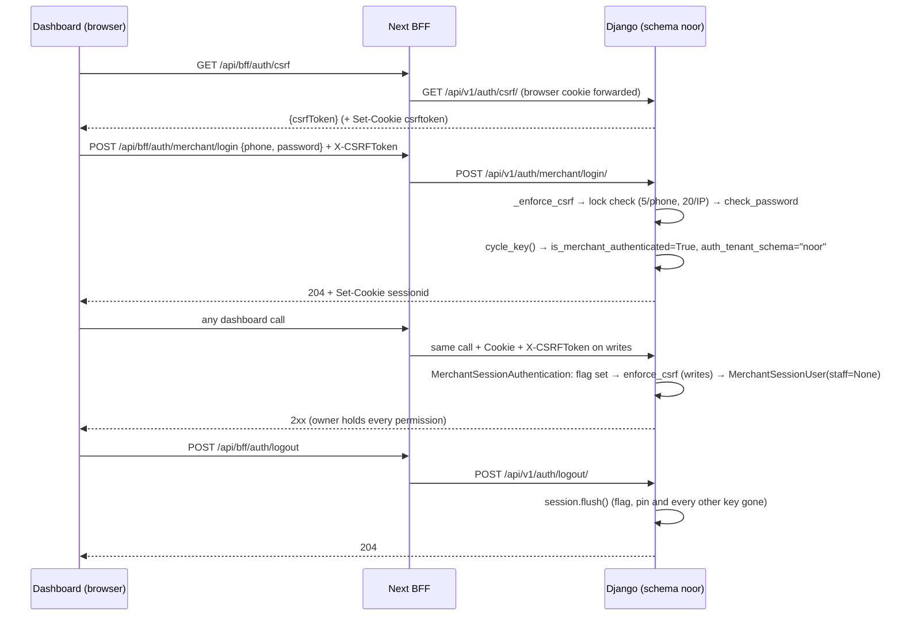
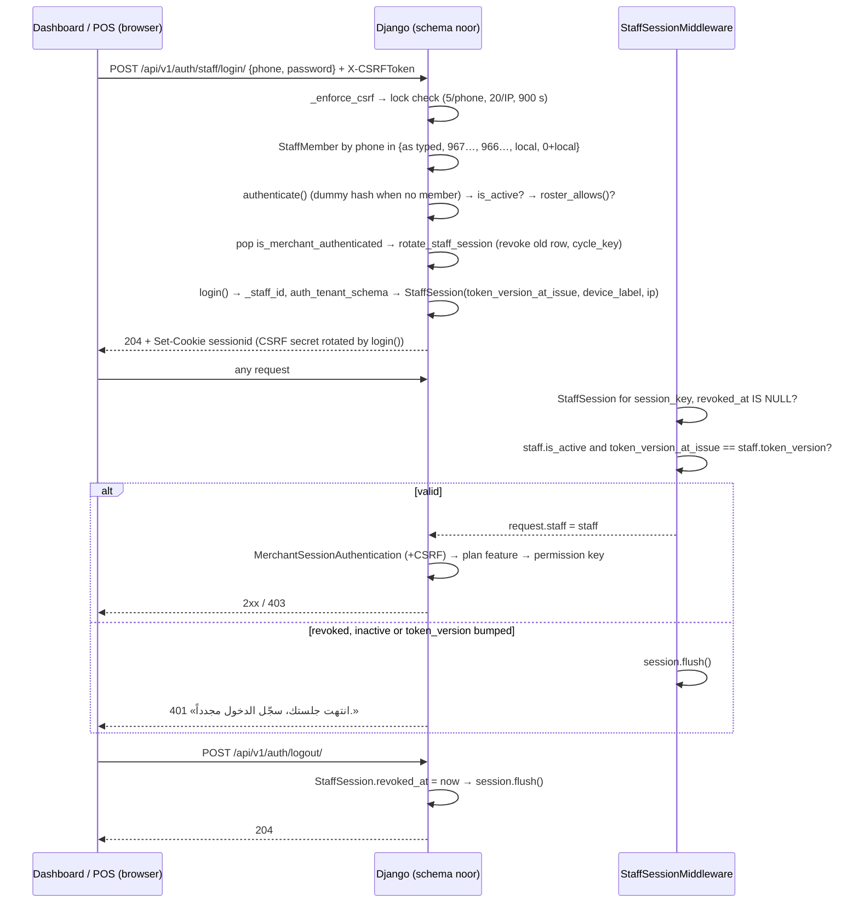
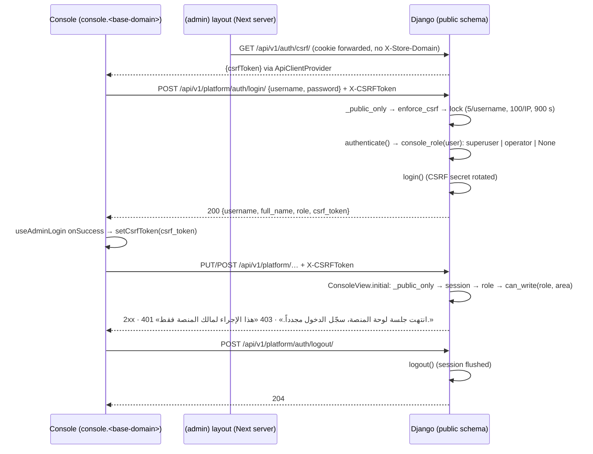
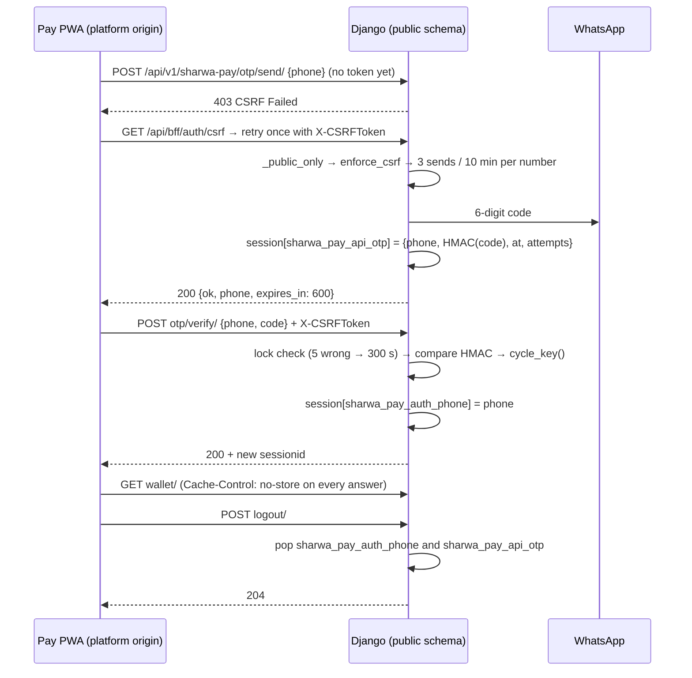
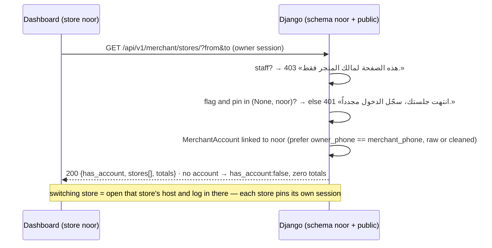
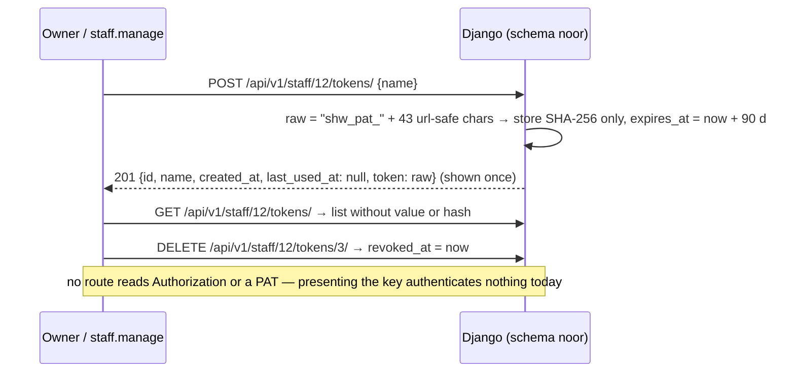
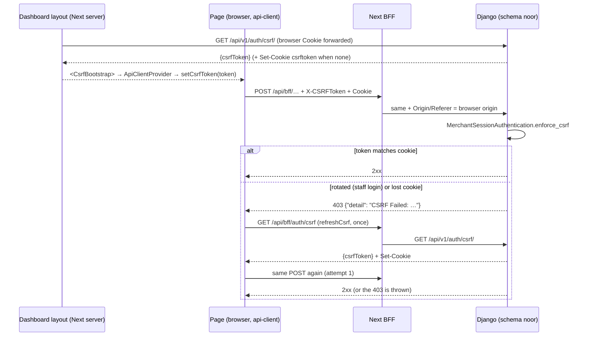
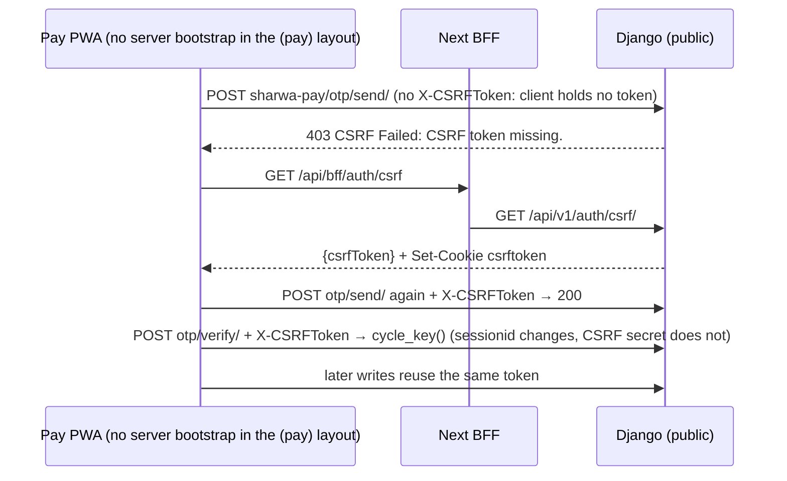

# Security architecture — identities, sessions and CSRF

> **Source**: DOC-465 (`#identities`), DOC-466 (`#csrf`) · inventory A.4 · INT-003, INT-022, INT-030, INT-046, INT-048, INT-049
> **Code**: `sharwa_saas/config/settings.py` (session/CSRF settings, `MIDDLEWARE`) · `api/authentication.py` (`MerchantSessionAuthentication`) · `api/views_auth.py` (`CsrfTokenView`, `_enforce_csrf`, `MerchantLoginView`, `StaffLoginView`, `LogoutView`, `MeView`) · `products/views/auth_security.py` (lockout constants, legacy `merchant_login`) · `products/middleware.py` (`StaffSessionMiddleware`) · `products/models/staff_sessions.py` (`StaffSession`, `PersonalAccessToken`, `TrustedDevice`) · `products/services/staff_service.py` (`roster_allows`, `device_label`, `terminate_staff`, `revoke_sessions`) · `products/services/permission_resolver.py` (`resolve_request_staff`) · `api/middleware.py` (`TenantHeaderOverrideMiddleware`) · `api/views.py` (`MerchantAPIMixin`, `_resolve_agent`) · `api/views_courier.py` (`AgentReadMixin`) · `api/views_platform.py` + `tenants/console_service.py` (`ConsoleSessionAuthentication`, `console_role`, `can_write`) · `api/views_sharwa_pay.py` + `sharwapay/customer_api.py` · `api/views_rollup.py` + `tenants/merchant_rollup.py` · `sharwa-frontend/src/lib/{api-client,api-error,csrf}.ts` · `src/app/api/bff/auth/csrf/route.ts` · layouts `src/app/(dashboard)/%5Fd/[store]/dashboard/layout.tsx`, `src/app/(admin)/%5Fa/layout.tsx`, `src/app/(pay)/sharwa-pay/layout.tsx` · `src/features/platform-admin/api/{hooks,session}.ts`
> **Tests**: `api/test_auth_api.py` · `api/test_staff_api.py` · `api/test_platform_console_api.py` · `api/test_sharwa_pay_api.py` · `api/test_courier_api.py` · `api/test_rollup_api.py` · `api/test_tenant_guard_api.py` · `api/test_b2b_api.py`
> **Last verified against code**: 2026-10-27 (official Step 08)

## 1. Purpose

This page is the **design view** of who can call Sharwa and how that caller is recognised: the eight kinds of identity, the session each one gets, the class or helper that checks it on every request, how it ends, and how CSRF protects every write those sessions make.

It is not the route reference. Request/response bodies, every error sentence and `curl` walkthroughs are on the API pages:

- [`../api/overview/auth.md`](../api/overview/auth.md) — identity matrix, tenant pinning, courier and multi-store checks, personal access tokens.
- [`../api/overview/csrf.md`](../api/overview/csrf.md) — token handshake, `curl`, Postman.
- [`../api/domains/02-dashboard-shell/m03-auth.md`](../api/domains/02-dashboard-shell/m03-auth.md) — owner and staff login, password reset.
- [`../api/domains/16-platform-console/auth.md`](../api/domains/16-platform-console/auth.md) — console login and role matrix.

What happens **after** the identity is known — plan features, permission keys, owner-only areas — is the authorisation page [`31-authorization.md`](31-authorization.md). WhatsApp codes are in [`33-otp.md`](33-otp.md), login and send limits in [`34-rate-limits.md`](34-rate-limits.md), and the ownership fixes (courier, push, rollup) in [`36-ownership-checks.md`](36-ownership-checks.md).

## 2. Components

| Component | Location | Role |
|---|---|---|
| Django sessions (database backend) | `django.contrib.sessions` in **both** `SHARED_APPS` and `TENANT_APPS` | One session table **per store schema**, one in `public` for the platform origin and the console. A cookie from one store does not exist on another store's host. |
| Session/CSRF settings | `config/settings.py:380-392`, production block `:504-505` | `SESSION_EXPIRE_AT_BROWSER_CLOSE = True`, `SESSION_COOKIE_HTTPONLY = True`, `CSRF_COOKIE_HTTPONLY = True`, `SESSION_COOKIE_SAMESITE` env (default `Lax`), `CSRF_COOKIE_SAMESITE = 'Lax'`, `*_COOKIE_SECURE = True` in production. |
| `TenantHeaderOverrideMiddleware` | `api/middleware.py` | Chooses the store from `X-Store-Domain` and **refuses to move a pinned session to another store** (`auth_tenant_schema`). See [`10-multi-tenancy.md#resolution`](10-multi-tenancy.md#resolution). |
| `StaffSessionMiddleware` | `products/middleware.py` | On every store-schema request: finds the live `StaffSession` for the cookie, checks `staff.is_active` and `token_version_at_issue == staff.token_version`, sets `request.staff`, otherwise `session.flush()`. Skipped on `public`. |
| `MerchantSessionAuthentication` | `api/authentication.py` | DRF class for every owner/staff route. If the session has `is_merchant_authenticated` **or** `request.staff` is set, it runs `enforce_csrf` and returns a non-persistent `MerchantSessionUser`; otherwise `None` and the view answers 401. It decides **identity and CSRF only**, never permissions. |
| `resolve_request_staff` | `products/services/permission_resolver.py:114` | `getattr(request, 'staff', None)` — `None` means "the owner" for every permission helper. |
| `_enforce_csrf` | `api/views_auth.py:84` | Explicit CSRF check at the top of the owner/staff logins and password flows (no session exists yet, so the class cannot do it). |
| `ConsoleSessionAuthentication` | `api/views_platform.py` | DRF `SessionAuthentication` with `authenticate_header() = 'Session'`, so "no session" is **401** (`WWW-Authenticate: Session`), never 403. |
| `ConsoleView.initial` | `api/views_platform.py` | `_public_only()` → session → `console_role(user)` → `can_write(role, area)` on unsafe methods. |
| `SharwaPayView.initial` | `api/views_sharwa_pay.py:41` | `_public_only()` → `SessionAuthentication().enforce_csrf()` on every unsafe method (including OTP login) → `Cache-Control: no-store` on every response. |
| `CsrfTokenView` | `api/views_auth.py:65` | `GET /api/v1/auth/csrf/` → `{"csrfToken"}` from `get_token`; no authentication, no tenant requirement, `no-store`. |
| BFF CSRF route | `src/app/api/bff/auth/csrf/route.ts` | Same handshake from the browser's own origin, forwarding every upstream `Set-Cookie`. |
| `CsrfBootstrap` | dashboard and `(admin)` layouts | Server component: fetches the token with the browser's cookie and hands it to `ApiClientProvider` → `setCsrfToken`. |
| `api-client.ts` | `src/lib/api-client.ts` | Adds `X-CSRFToken` to `POST/PUT/PATCH/DELETE` when it holds a token; on a CSRF 403 (`ApiError.isCsrf`) refreshes once and retries once. |

## 3. Data model

| Model / store | Schema | Key fields | Constraints | Added or changed by |
|---|---|---|---|---|
| Django session row | store schema (owner, staff, visitor) · `public` (console, Sharwa Pay) | owner: `is_merchant_authenticated`, `auth_tenant_schema` · staff: Django auth keys, `_staff_id`, `auth_tenant_schema` · Sharwa Pay: `sharwa_pay_auth_phone`, `sharwa_pay_api_otp` · visitor: cart, `wishlist_phone`, holds, OTP keys, UTM keys | expires at browser close | — |
| `StaffSession` | store | `staff`, `session_key` (unique), `token_version_at_issue`, `device_fingerprint` (SHA-256 of the User-Agent, 40 chars), `device_label`, `ip_address`, `created_at`, `last_seen_at` (`auto_now`), `revoked_at` | `session_key` unique | staff migrations; `device_label` by INT-022 (`0223_staff_api`) |
| `StaffMember` (identity fields) | store | `user` (Django `User`, username = phone as typed), `phone`, `is_active`, `token_version`, `terminated_at`, `terminated_reason`, `enforce_roster_schedule`, `shipping_provider_profile` (courier agent link) | — | INT-022 (soft termination) |
| `RosterSchedule` | store | `staff`, `weekday` (0 = Sunday), `starts_at`, `ends_at`, `location` (null = global) | — | INT-022 |
| `PersonalAccessToken` | store | `staff`, `name`, `token_hash` (SHA-256, unique), `token_version_at_issue`, `expires_at` (required, 90 days), `revoked_at`, `last_used_at` | `token_hash` unique | INT-022 (`0223_staff_api`) |
| `TrustedDevice` | store | `location`, `staff` (null = shared device of the location), `device_id` (unique), `label`, `approved_by`, `is_active`, `last_seen_at`, `created_at` | `device_id` unique | INT-022 (`staff`, `last_seen_at`) |
| Django `User` (console) | `public` | `is_superuser` («مالك المنصة»), `is_staff` («مشرف تشغيلي»), `is_active` | — | — |
| `MerchantAccount` + `MerchantAccountClient` | `public` | `owner_phone`, links to stores | — | multi-store (INT-049 reads them) |
| Login lock counters | cache | `rl:<schema>:merchant_login:phone:<phone>` / `:ip:<ip>`, `rl:<schema>:staff_login:phone:…` / `:ip:…`, `rl:public:console_login:user:<username>` / `:ip:…` | TTL = lock window | — |

<a id="identities"></a>

## 4. Identities and session establishment (DOC-465)

### 4.1 Summary

| # | Identity (glossary) | Login | Session evidence | Checked on each request by | Pinning | Lockout | Logout / forced end |
|---|---|---|---|---|---|---|---|
| 1 | Storefront visitor | none — cookie created on the first write | cart, buy-now cart, `wishlist_phone`, booking holds, OTP keys, `applied_coupon_id`, campaign keys | nothing (storefront views: `authentication_classes = []`); per-action OTPs prove phone ownership | none — the store host's own table | per-action OTP limits ([`33-otp.md`](33-otp.md)) | browser close (`SESSION_EXPIRE_AT_BROWSER_CLOSE`) |
| 2 | Store owner «مالك المتجر» | `POST auth/merchant/login/` (store WhatsApp phone + `StoreSetting.admin_password`), `setup-password`, `reset-password` | `is_merchant_authenticated=True`, `auth_tenant_schema=<schema>`; `cycle_key()` on login | `MerchantSessionAuthentication` (+ CSRF on writes) | `TenantHeaderOverrideMiddleware` refuses another store | 5 failures / phone, 20 / IP, 900 s | `POST auth/logout/` → `session.flush()` |
| 3 | Staff member | `POST auth/staff/login/` (phone + password) | Django auth session + `_staff_id` + `auth_tenant_schema` + `StaffSession` row | `StaffSessionMiddleware` → `request.staff` → `MerchantSessionAuthentication` + permission key | as owner | 5 / phone, 20 / IP, 900 s; inactive 403; off-roster 403 | `auth/logout/` revokes the `StaffSession` and flushes; terminate / revoke-sessions / reset-password / deactivate bump `token_version` |
| 4 | Courier agent «المندوب» | the staff login of a member with `shipping_provider_profile` | as staff | `AgentReadMixin.agent_or_error` (reads), `_resolve_agent` + `_agent_owns` (actions) | as staff | as staff | as staff |
| 5 | Console user «مالك المنصة» / «مشرف تشغيلي» | `POST platform/auth/login/` on the platform origin (public) | Django auth session in `public` | `ConsoleSessionAuthentication` + `console_role` + `can_write` | `_public_only()` — 404 on a store host or with `X-Store-Domain` | 5 / username, 100 / IP, 900 s | `POST platform/auth/logout/` → `logout()` |
| 6 | Sharwa Pay customer | `POST sharwa-pay/otp/send/` → `otp/verify/` (WhatsApp) | `sharwa_pay_auth_phone` in the `public` session; `cycle_key()` on verify | `SharwaPayView.initial` (session key + CSRF) | `_public_only()` | 3 sends / 10 min / number; 5 wrong → 300 s lock | `POST sharwa-pay/logout/` removes the two keys (no flush) |
| 7 | Multi-store owner | the owner session (2) | owner flag + pin + a `MerchantAccount` linked to the current store | `MerchantStoresView` (owner only) | as owner | as owner | as owner |
| 8 | Personal access token (staff) | created `POST staff/<pk>/tokens/`, returned once | `shw_pat_…` presented by a client | **nothing — no route accepts it** (§4.9) | — | — | revoke / terminate / 90-day expiry |

Rules that hold for every row:

- **An identity is never read from a body or header.** `X-Store-Domain` only chooses *which store* a request addresses. The one explicit exception is `agent_id` on courier actions, accepted only from the owner.
- **The owner has no `User` row.** The session flag is the identity, and `MerchantSessionUser(staff=None)` stands for it inside DRF.
- **Every login that creates a session rotates the session key** (`cycle_key()` before writing the flag, or `rotate_staff_session` before `login()`), so a session id planted before login is worthless (no session fixation).
- **Wrong phone and wrong password get the same answer** (`400` «رقم الهاتف أو كلمة المرور غير صحيحة.» for owner and staff, «اسم المستخدم أو كلمة المرور غير صحيحة.» for the console), and a password hash is always checked — against a dummy hash when no account matches — so response time does not reveal which accounts exist.
- **The lock is checked before the password**: during a lock even the right password gets `429` + `Retry-After`.

### 4.2 Storefront visitor



Checked by: nothing beyond `HasTenantContext`. Protection rests on the per-action OTPs ([`33-otp.md`](33-otp.md)) and on rate limits ([`34-rate-limits.md`](34-rate-limits.md)). Because these routes are not CSRF-protected, they must never change anything that belongs to the merchant or to another buyer.

### 4.3 Store owner «مالك المتجر»



- The first password (`setup-password`, signed setup token after provisioning) and `reset-password` (WhatsApp code to the store number) end in the same `cycle_key()` + flag + pin. See [`11-provisioning.md`](11-provisioning.md) and [`33-otp.md`](33-otp.md).
- `409 {"code": "setup_required"}` when no password was ever set.
- The legacy HTML `merchant_login` (`products/views/auth_security.py`) writes the same flag and pin, with the same lock numbers (`MERCHANT_LOGIN_MAX_FAILURES_PER_PHONE = 5`, `…_PER_IP = 20`, `MERCHANT_LOGIN_LOCKOUT_WINDOW_SECONDS = 900`) and message «تم تجاوز عدد محاولات الدخول المسموح بها. يرجى المحاولة بعد 15 دقيقة.».
- Owner routes accept `auth_tenant_schema in (None, <this schema>)` (an old session without a pin still works on its own host); the Sharwa AI console-token route requires an exact match ([`../api/overview/auth.md#tenant-pinning`](../api/overview/auth.md#tenant-pinning)).

### 4.4 Staff member



| Rule | Where | Value |
|---|---|---|
| Phone forms | `_phone_candidates` (`views_auth.py:233`) | the value as typed, its cleaned `967…` form, and for `967`/`966` prefixes the local number with and without a leading `0` |
| Inactive member | `StaffLoginView` | **403** «هذا الحساب غير مفعّل، تواصل مع مدير المتجر.» — only after the password is correct (no account probing) |
| Roster | `roster_allows` (`staff_service.py:740`) | only when `enforce_roster_schedule` is on **and** the member has slots; local time in `StoreSetting.timezone` (default `Asia/Aden`); weekday `0 = Sunday`; inside a slot when `starts_at ≤ now < ends_at`; no slots = no restriction. Outside → **403** «الدخول خارج أوقات جدول عملك غير مسموح — تواصل مع مدير المتجر.» |
| Owner flag removed | `StaffLoginView:330` | an owner session in the same browser is not inherited by the staff session |
| Device label | `device_label()` | «Chrome · Android» from the User-Agent, display only, fallback «جهاز غير معروف» |
| Forced end | `terminate_staff`, `revoke_sessions`, `reset_password`, `patch_staff(is_active=false)` | `token_version += 1` (+ `revoked_at` on every `StaffSession`); the middleware flushes every device on its next request |
| Termination | `terminate_staff` | soft: `is_active=False`, `terminated_at`, `terminated_reason`, `token_version+1`, all sessions and all PATs revoked, audit `staff.terminate`; self-termination refused «لا يمكنك إنهاء خدمتك بنفسك.» |

> ⚠️ Discrepancy — the roadmap treats a staff session as accepted by every owner/staff route through `MerchantSessionAuthentication` + permission key / code does: the three B2B draft views (`B2BDraftCreateView`, `B2BDraftListView`, `B2BDraftResolveView`) go through `MerchantAPIMixin.check_merchant`, which **also** requires `session["is_merchant_authenticated"]` (`api/views.py:369-376`) and answers **401** «غير مصرح لك بالوصول.» without it. `StaffLoginView` removes that flag on purpose (`views_auth.py:330`), and the legacy HTML `staff_login_view` never sets it (`products/views/staff_sessions.py:41-59`). A staff member therefore gets 401 on all three routes, while `B2BDraftCreateView` refuses the owner with 403 «يتطلب إنشاء طلب الجملة تسجيل دخول موظف.». In a browser with a normal login, **nobody can create a B2B draft**, and only the owner can list or resolve them. The suite does not see it because `api/test_b2b_api.py` sets `is_merchant_authenticated = True` on staff requests (`:58`, `:190`). Found by reading the code, not reproduced. Reported in official Step 08.

### 4.5 Courier agent «المندوب»

Not a separate login: a staff session whose `StaffMember.shipping_provider_profile` is set.

```mermaid
sequenceDiagram
  participant A as Courier app (PWA)
  participant D as Django (schema noor)
  A->>D: POST /api/v1/auth/staff/login/ (agent's phone)
  D-->>A: 204 + sessionid (a normal StaffSession)
  A->>D: GET /api/v1/agent/me/
  D->>D: AgentReadMixin: staff? → shipping_provider_profile? → profile.is_active?
  D-->>A: 200 · owner 403 · no profile 403 · disabled profile 403
  A->>D: POST /api/v1/agent/fulfillments/7/scan-pickup/
  D->>D: _resolve_agent (staff = own profile; owner must send agent_id) → _agent_owns
  D-->>A: 200 · another agent's fulfillment 404 «الشحنة غير موجودة.»
  A->>D: POST /api/v1/auth/logout/ → 204
```

Owner sessions are refused by the four **reads** («هذا التطبيق لحسابات المندوبين. يدير مالك المتجر المندوبين من شاشة الإشراف في لوحة التحكم.») but may run the five **actions** for any agent through `agent_id` — the supervision screen needs that. The ownership rules are on [`36-ownership-checks.md`](36-ownership-checks.md); the full table is in [`../api/overview/auth.md#agent`](../api/overview/auth.md#agent).

### 4.6 Platform console user «مالك المنصة» / «مشرف تشغيلي»



- `console_role`: `is_superuser` → `superuser` («مالك المنصة»); `is_staff` → `operator` («مشرف تشغيلي»); inactive or neither → no access. A valid Django user without console rights gets the same «اسم المستخدم أو كلمة المرور غير صحيحة.» as a wrong password.
- `can_write`: the superuser writes everywhere; the operator reads everything and writes only the areas in `OPERATOR_WRITES = ('dues', 'sharwa_pay')` (`tenants/console_service.py:77`).
- Lock: «محاولات دخول كثيرة — حاول بعد 15 دقيقة.» + `Retry-After: 900`. The per-IP ceiling is deliberately loose (100) because Yemeni networks sit behind CGNAT; the real limit is per username ([`34-rate-limits.md`](34-rate-limits.md)).
- The server-side console session check (`getAdminSession`, `features/platform-admin/api/session.ts`) calls `GET /api/v1/platform/auth/me/` with the browser's cookies; any 401/403/unreachable keeps the console on its login screen.

### 4.7 Sharwa Pay customer



- Platform origin only: on a store host, or with `X-Store-Domain`, every route is 404 «غير موجود.», so a wallet is never readable from a store page.
- The session key `sharwa_pay_auth_phone` is the one the legacy page (`tenants/sharwa_pay_views.py`) uses, so both surfaces see the same login.
- No session → **401** «سجّل الدخول برقم جوالك.». Login never creates a wallet ([`43-ledgers.md`](43-ledgers.md)).
- Code, limits and lock: [`33-otp.md`](33-otp.md) and [`../api/overview/auth.md#sharwa-pay`](../api/overview/auth.md#sharwa-pay).

### 4.8 Multi-store owner



There is no cross-store session. The account link is read from `public` (`MerchantAccountClient`); the old HTML page matched the phone only and could list another account's stores — fixed in INT-049 ([`36-ownership-checks.md`](36-ownership-checks.md), [`../api/domains/02-dashboard-shell/m43-multi-store.md`](../api/domains/02-dashboard-shell/m43-multi-store.md)).

### 4.9 Personal access tokens and trusted devices



> ⚠️ Discrepancy — the roadmap lists PATs as an identity / code does: no authentication class, middleware or view accepts a PAT, `last_used_at` is never written, and `revoke_sessions` does not revoke PAT rows (only `terminate_staff` does). Already recorded in step 03 ([`../api/overview/auth.md#personal-access-tokens`](../api/overview/auth.md#personal-access-tokens)); still true. Reported in official Step 08.

**Trusted devices** (`TrustedDevice`) are POS devices approved for a location, optionally for one staff member. The staff screen lists them (`staff/<pk>/devices/`) and removal **deactivates** the row (`is_active = False`, audit `staff.device_removed`) so the record of who approved it stays. They are a register only today: nothing in `pos_service.py` or `views_pos.py` checks a device before opening a shift, and `TrustedDevice.last_seen_at` is never written (the list falls back to `created_at`). See §9.

<a id="csrf"></a>

## 5. CSRF end to end (DOC-466)

### 5.1 Design

1. **The secret is unreadable by scripts.** `CSRF_COOKIE_HTTPONLY = True`: neither the browser nor any client script reads `csrftoken`. The token travels only in a response **body**.
2. **One token source.** `GET /api/v1/auth/csrf/` returns `{"csrfToken"}` from Django's `get_token(request)`, derived from the request's own cookie (or a new pair when there is none, with `Set-Cookie: csrftoken=…; HttpOnly; SameSite=Lax`), `Cache-Control: no-store`.
3. **The BFF keeps the pair together.** `GET /api/bff/auth/csrf` calls it with the browser's `Cookie` header and appends every upstream `Set-Cookie` verbatim; a mock token is returned only when Django is unreachable **and** mocks are on — Django rejects it.
4. **Every unsafe method carries it.** `api-client.ts` sets `X-CSRFToken` on `POST/PUT/PATCH/DELETE` when it holds a token; the BFF forwards `x-csrftoken` with the cookie and sets `Origin`/`Referer` to the browser's origin ([`20-bff.md`](20-bff.md)).
5. **One repair, then fail.** `ApiError.isCsrf = status === 403 && /csrf/i.test(detail)`. For an unsafe method on the first attempt, the client calls `refreshCsrf()` and repeats the same request once; a second CSRF 403 reaches the caller.
6. **Enforced inside DRF, per surface.** DRF views are CSRF-exempt at the middleware, so each surface enforces it itself (table §5.2). Logins are protected too (no "login CSRF").

### 5.2 Who enforces it

| Surface | Enforced by | Writes covered | Token after login |
|---|---|---|---|
| Store owner / staff routes | `MerchantSessionAuthentication.enforce_csrf` | every write of a request that carries an owner flag or `request.staff` | owner: unchanged (`cycle_key()` does not touch the CSRF secret) · staff: rotated by `login()`, repaired by the client's refresh-once |
| Owner/staff logins and password flows | `_enforce_csrf()` first line of `post()` | `merchant/login`, `setup-password`, `forgot-password`, `reset-password`, `staff/login` | — |
| Console | `ConsoleSessionAuthentication` (+ explicit `enforce_csrf` in login) | login and every write | rotated by `login()`; login and `auth/me/` answer `csrf_token`, adopted by `useAdminLogin` → `setCsrfToken` |
| Sharwa Pay | `SharwaPayView.initial` → `SessionAuthentication().enforce_csrf` | **every** unsafe method, including `otp/send/`, `otp/verify/`, `logout/` | unchanged (`cycle_key()` only) |
| Storefront visitor routes | not enforced (`authentication_classes = []`) | — | — |
| Webhooks | not applicable — machine callers with their own signatures | — | — |

Why the merchant class exists at all (`api/authentication.py` docstring): every store lives under the same base domain, so `SameSite=Lax` alone does not stop a page on store A from posting to store B with a merchant's cookie. Before Phase 0 Task 1.3 the dashboard routes were cookie-authenticated **and** CSRF-exempt.

### 5.3 Token lifecycle — dashboard (owner and staff)



### 5.4 Token lifecycle — console

```mermaid
sequenceDiagram
  participant L as (admin) layout (Next server)
  participant C as Console page
  participant D as Django (public)
  L->>D: GET /api/v1/auth/csrf/ (no store host)
  D-->>C: token T1 → setCsrfToken(T1)
  C->>D: POST platform/auth/login/ + X-CSRFToken: T1
  D->>D: enforce_csrf(T1) ✓ → login() rotates the secret
  D-->>C: 200 {…, csrf_token: T2}
  C->>C: setCsrfToken(T2)
  C->>D: PUT platform/… + X-CSRFToken: T2 → 2xx
  Note over C,D: a page reload re-runs the layout bootstrap; GET platform/auth/me/ also returns a fresh csrf_token
```

### 5.5 Token lifecycle — Sharwa Pay



The cold first write costs one extra round trip on every fresh visit. That is the price of the `(pay)` layout having no `CsrfBootstrap`; it is functionally correct.

## 6. Invariants

| Invariant | Enforced by |
|---|---|
| A session from store A never acts on store B | per-schema session tables + `TenantHeaderOverrideMiddleware` pin check (403) |
| A revoked, terminated or deactivated staff member is out on the next request, on every device | `token_version` comparison + `revoked_at` in `StaffSessionMiddleware` (flush → 401) |
| Every session-authenticated write carries a matching CSRF token | `MerchantSessionAuthentication`, `ConsoleSessionAuthentication`, `SharwaPayView.initial`, `_enforce_csrf` |
| No login reveals whether an account exists | single error sentence + dummy-hash comparison + "inactive"/"off-roster" only after the password is right |
| A planted session id is useless after login | `cycle_key()` / `rotate_staff_session` before the identity is written |
| An owner session never becomes a staff session silently | `StaffLoginView` pops `is_merchant_authenticated` |
| Console and Sharwa Pay never run on a store host | `_public_only()` (404) |
| Platform money writes by an operator are limited to dues and Sharwa Pay | `can_write` + `OPERATOR_WRITES` |

## 7. Configuration

| Setting / variable | Default | Effect |
|---|---|---|
| `SESSION_EXPIRE_AT_BROWSER_CLOSE` | `True` | every identity ends with the browser |
| `SESSION_COOKIE_HTTPONLY` / `CSRF_COOKIE_HTTPONLY` | `True` / `True` | no script access to either cookie |
| `SESSION_COOKIE_SAMESITE` | env, default `Lax` | |
| `CSRF_COOKIE_SAMESITE` | `Lax` | |
| `SESSION_COOKIE_SECURE`, `CSRF_COOKIE_SECURE` | `True` in the production block | HTTPS only; Django also checks `Referer` on HTTPS writes |
| `CSRF_TRUSTED_ORIGINS` | env list + `http://localhost:8000`, `http://127.0.0.1:8000`, `https://<base>`, `https://*.<base>` (+ `:3000` dev origins in `DEBUG`) | `Origin` must be trusted |
| No `SESSION_COOKIE_DOMAIN` / `CSRF_COOKIE_DOMAIN` | unset (2026-10-20 fix) | cookies stay host-only, one jar per store host |
| `REST_FRAMEWORK["DEFAULT_AUTHENTICATION_CLASSES"]` | `[]` | each view declares its class — a view without one is anonymous |
| Lock constants | owner/staff 5 / 20 / 900 s · console 5 / 100 / 900 s | `products/views/auth_security.py`, `api/views_auth.py:220-221`, `api/views_platform.py` |

Environment variables per deployment: [`../ops/environment.md`](../ops/environment.md).

## 8. Failure modes and fixes

| Failure | Symptom | Cause | Handling / fix |
|---|---|---|---|
| Cross-store action with one cookie | merchant of A acts in B via `X-Store-Domain` | header switch without a pin | `auth_tenant_schema` pin + 403 (2026-09-16 fix) |
| Login 204 then `auth/me/` 401 forever | header-addressed login on `public` | session read from the wrong schema's table | middleware reloads the session after `set_tenant` (2026-10-20 fix) |
| 500 on staff re-login in the same browser | duplicate `StaffSession.session_key` | `login()` keeps the key for the same user | `rotate_staff_session` revokes the old row and cycles the key first (2026-10-24 fix) |
| Dashboard writes without CSRF | cookie-authenticated, CSRF-exempt DRF views | `DEFAULT_AUTHENTICATION_CLASSES = []` | `MerchantSessionAuthentication` (Phase 0 Task 1.3) |
| First console write after login 403 | `login()` rotated the secret | stale token in the client | login and `auth/me/` return `csrf_token`; `useAdminLogin` adopts it (INT-030) |
| First Sharwa Pay write 403 | no bootstrap in `(pay)` | client holds no token | refresh-once-and-retry (INT-048) |
| Every write fails «CSRF token incorrect» | server bootstrap minted a pair whose cookie never reached the browser | browser cookie not forwarded | `getCsrfToken(storeHost, cookieHeader)` always forwards the cookie |
| Staff 401 on B2B drafts | `check_merchant` requires the owner flag | see §4.4 call-out | open — Step 52 candidate |

## 9. Open items

- **B2B drafts unreachable for staff** (§4.4) — needs a live check, then a code fix (accept `request.staff` in `check_merchant`).
- **PATs authenticate nothing** (§4.9) — decision carried from step 03.
- **Roster is checked at login only.** `StaffSessionMiddleware` does not call `roster_allows`, so a member who logged in during a slot keeps working after it ends until logout or a forced end. Intended or not is undecided.
- **`StaffSession.last_seen_at` is `auto_now` but nothing saves the row after login**, so "last activity" in the sessions list (`staff_service.py:613`) shows the login time.
- **Trusted devices are not enforced** (§4.9): no POS check, `last_seen_at` never written.
- **Storefront writes are CSRF-free by design**; any future storefront route that changes merchant data must declare an authentication class.

These items are collected in [`90-open-items.md`](90-open-items.md) when that register is written.

## 10. Related pages

- Authorisation (gate order, permission keys, owner-only areas): [`31-authorization.md`](31-authorization.md)
- Secrets: [`32-secrets.md`](32-secrets.md) · OTP designs: [`33-otp.md`](33-otp.md) · Rate limits: [`34-rate-limits.md`](34-rate-limits.md) · Ownership fixes: [`36-ownership-checks.md`](36-ownership-checks.md) · Audit: [`37-audit.md`](37-audit.md)
- Tenant resolution and pinning: [`10-multi-tenancy.md#resolution`](10-multi-tenancy.md#resolution) · BFF header forwarding: [`20-bff.md`](20-bff.md)
- API: [`../api/overview/auth.md`](../api/overview/auth.md) · [`../api/overview/csrf.md`](../api/overview/csrf.md) · [`../api/domains/02-dashboard-shell/m03-auth.md`](../api/domains/02-dashboard-shell/m03-auth.md) · [`../api/domains/16-platform-console/auth.md`](../api/domains/16-platform-console/auth.md) · [`../api/domains/08-finance/m40-sharwa-pay.md#auth`](../api/domains/08-finance/m40-sharwa-pay.md#auth)
- Glossary: [`../glossary.md`](../glossary.md)
