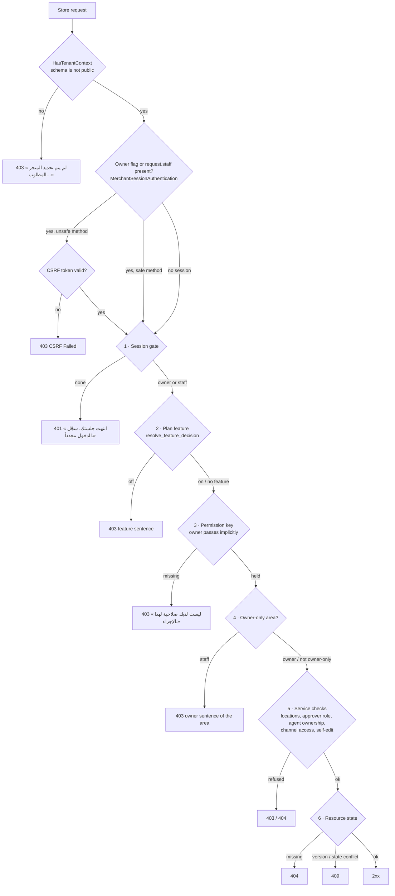
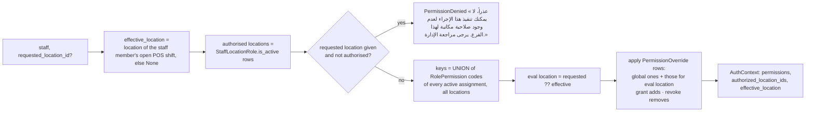

# Authorisation model — gates, permission keys, owner-only areas

> **Source**: DOC-467 · inventory A.5 · INT-022 (M18) and every merchant module that gates writes
> **Code**: `sharwa_saas/products/services/permission_resolver.py` (`resolve_context`, `resolve_request_staff`, `staff_has_permission`) · `sharwa_saas/api/views_products.py` (`ProductsAPIMixin.gate` / `can`) · one gate mixin per module in `sharwa_saas/api/views_*.py` · `sharwa_saas/api/authentication.py` (`MerchantSessionAuthentication`) · `sharwa_saas/api/permissions.py` (`HasTenantContext`) · `sharwa_saas/products/services/staff_service.py` (roles, overrides, approvals, `effective_permissions`) · `sharwa_saas/products/services/pos_service.py` (`actor_for`, `discount_ceiling`, `can_resolve`) · `sharwa_saas/products/models/staff_rbac.py` · seed migrations `products/0144`, `0159`, `0172`, `0174`, `0178`, `0182`, `0186`, `0194`, `0200`, `0210`, `0235` · `sharwa-frontend/src/features/dashboard-shell/navigation.ts` (sidebar gates)
> **Last verified against code**: 2026-10-27 (official Step 08)

## 1. Purpose

This page explains **how a store request is authorised** once the tenant is resolved and the caller is identified: which gates run, in which order, how a staff member's permission keys are computed, which areas are reserved to the owner, and which services add their own checks on top. It is the design view; the per-route tables live in the API overview pages:

- per-route list of every key → [`../api/overview/permissions.md`](../api/overview/permissions.md);
- status codes, bodies and the per-module gate order → [`../api/overview/conventions.md#gates`](../api/overview/conventions.md#gates);
- plan features (gate 2) → [`15-plans-and-features.md`](15-plans-and-features.md) and [`../api/overview/plan-features.md`](../api/overview/plan-features.md);
- who the caller is (owner, staff, courier, console, Sharwa Pay) → [`30-security.md`](30-security.md) and [`../api/overview/auth.md`](../api/overview/auth.md).

**Out of scope**: the platform console (public schema — superuser «مالك المنصة» vs `is_staff` «مشرف تشغيلي», see [`../api/domains/16-platform-console/auth.md`](../api/domains/16-platform-console/auth.md)), buyers on the storefront (no RBAC, only state checks and rate limits — [`34-rate-limits.md`](34-rate-limits.md)), and Sharwa Pay customers (phone-OTP identity — [`33-otp.md`](33-otp.md)).

## 2. Components

| Component | Location | Role |
|---|---|---|
| `HasTenantContext` | `api/permissions.py` | DRF permission class on every store view: refuses `connection.schema_name == 'public'` with `403` «لم يتم تحديد المتجر المطلوب. استخدم النطاق الفرعي للمتجر أو أرسل ترويسة X-Store-Domain.» |
| `MerchantSessionAuthentication` | `api/authentication.py` | Recognises an owner flag (`is_merchant_authenticated`) **or** `request.staff`; enforces CSRF on unsafe methods; returns a lightweight `MerchantSessionUser` (never a real `User`). Authorises nothing |
| `StaffSessionMiddleware` | `products/middleware.py` | Fills `request.staff` from the session (`_staff_id`), or `None` |
| `resolve_request_staff(request)` | `permission_resolver.py:114` | `getattr(request, 'staff', None)` — `None` means "owner" for every gate |
| `resolve_context(staff, requested_location_id)` | `permission_resolver.py:48` | **The** permission computation (§4.2) |
| `staff_has_permission(staff, code, location=None)` | `permission_resolver.py:124` | `resolve_context(...).has_permission(code)` |
| `ProductsAPIMixin.gate(request, permission)` / `.can()` | `api/views_products.py:72-83` | Session gate (`401`) + optional key (`403`). `can()` returns `staff is None or staff_has_permission(...)` — the owner passes implicitly. Almost every module mixin extends this class |
| Module mixins | `api/views_*.py` (`StaffAPIMixin.check`, `PaymentsAPIMixin.check`, `MarketingAPIMixin.check`, `_ChannelsBase.guard`, `SharwaShipAPIMixin.run`, …) | Compose the gates in the module's own order (§4.1) and add owner-only sentences |
| Legacy `MerchantAPIMixin.check_merchant` | `api/views.py:356-376` | Older gate used by the B2B draft rows only: owner flag **required**, then a key for staff (§8, failure mode 1) |
| Service-level checks | `staff_service.can_decide`, `pos_service.actor_for` / `discount_ceiling` / `can_resolve`, `courier` `_resolve_agent` / `_agent_owns` (`api/views.py:640-690`), inbox `StaffChannelAccess` | Rules that need data, not just a key (§4.6) |
| Sidebar gates | `navigation.ts` (`permission?: PermissionGate`, `ownerOnly?: boolean`) | Hide entries the session cannot use. A list means **any of**. `ownerOnly` items are hidden for staff, never shown disabled. UI only — Django re-checks every call |

## 3. Data model

All tables are in the **store schema**.

| Model | Key fields | Constraints | Added by |
|---|---|---|---|
| `Permission` | `code` (unique, e.g. `orders.view`), `name` (Arabic), `category` | `ordering = ['category', 'code']` | `0143_staff_rbac`; rows seeded by the migrations in §4.4 |
| `Role` | `name`, `is_system_role`, `is_active`, `max_discount_percent` (decimal 5,2, null = no ceiling) | `unique_role_name` | `0143`, system roles seeded by `0144` |
| `RolePermission` | `role` (CASCADE), `permission` (**PROTECT**) | `unique_role_permission` | `0143` |
| `StaffLocationRole` | `staff`, `location` (PROTECT), `role` (PROTECT), `is_active`, `assigned_by` | `unique_staff_location_role (staff, location, role)` | `0143` |
| `PermissionOverride` | `staff`, `permission`, `location` (null = global), `is_granted`, `reason`, `granted_by` | `unique_permission_override (staff, permission, location)`; **no `ordering`** | `0143` |
| `ApprovalRequest.approver_role` | FK to `Role` | a role that is an approver of a past request cannot be deleted (409) | `0147_staff_approvals`, `0225` (location) |
| `StaffChannelAccess` | `staff`, `channel_code`, `can_reply` | per staff × channel | inbox migrations (`0190`/`0231`) |
| `StoreSetting.pos_manager_code_hash` | Django password hash | — | `0229_pos_api` (see [`32-secrets.md`](32-secrets.md)) |

A role knows nothing about locations, and a location carries no permissions: the intersection is the `StaffLocationRole` row. One staff member may be «مدير الفرع» in one branch and «كاشير» in another — two rows, no structural duplication (`staff_rbac.py` docstring).

## 4. Flows

### 4.1 Gate order

The canonical chain is the one below. **The first failing gate answers and later gates are never evaluated.**

The order is **not uniform** across modules. Older modules check owner-only before the plan feature, two modules check the key before the feature, and the multi-store rollup checks owner-only before the session. The authoritative per-module order is the table in [`../api/overview/conventions.md#gates-per-module`](../api/overview/conventions.md#gates-per-module); §4.7 below repeats it per module, with the tests.

> ⚠️ Discrepancy — roadmap says the gate order is session (401) → plan feature (403) → permission key (403) → owner-only (403) → resource state (404/409) / code does seven different orders: e.g. `PaymentsAPIMixin.check`, `ShippingAPIMixin.check` and `DesignAPIMixin.owner_gate` test owner-only **before** the feature; `views_marketplaces.py` and `views_dropshipping.py` call `self.gate(request, PERMISSION)` **before** `settings_feature_enabled`; `views_rollup.py` answers the owner sentence before the session gate. Clients must not infer the cause of a `403` from its position in the chain. Reported in official Step 08.

Two consequences matter for clients:

- **The owner holds every key.** `resolve_request_staff()` returns `None` for an owner session; every `gate()` / `can()` treats `None` as allowed. Keys therefore only ever restrict staff. Owner-only areas are the converse: any request with a staff identity is refused, whatever keys it holds.
- **When a session carries both flags** (an owner flag left in the session and a staff identity), the staff identity decides (`staff is not None` ⇒ the key is checked). The JSON staff login removes a previous owner flag (`views_auth.py:330`, pinned by `StaffLoginApiTests.test_a_previous_owner_flag_is_not_inherited`).

### 4.2 How a staff member's keys are computed — `resolve_context`

Rules that follow from the code (`permission_resolver.py:48-104`):

1. **Zero trust in the location from the request.** The location used for overrides is the open shift's location, or a requested one that must be in the staff member's active assignments.
2. **Role keys are not location-scoped.** The union is taken over *every* active assignment, so a key held through a role in branch A is effective while the staff member works in branch B. Only **overrides** are location-scoped.
3. **Overrides last.** A global or location override is applied after the role union; a revoke removes a key even when a role grants it.
4. **What the resolver does not look at**: `Role.is_active` and `StaffMember.is_active`. Inactive or terminated staff never reach it because their session is refused upstream (login `403`, `token_version` bump on termination — [`30-security.md`](30-security.md)); an inactive **role**, however, still grants its keys (§8, failure mode 3).

The staff screen shows the result through `GET staff/<id>/effective-permissions/?location_id` (`staff_service.effective_permissions`), with, per key, `from_role`, `override` and `effective`.

> ⚠️ Discrepancy — roadmap says `effective_permissions` was "verified equal to `resolve_context()`" / code differs in three cases (`staff_service.py:585-605` vs `permission_resolver.py:64-97`): (a) with `location_id`, `effective_permissions` counts only roles assigned **at that location**, while the resolver unions roles from **all** locations; (b) without `location_id`, it applies only global overrides, while the resolver also applies the overrides of the open shift's location; (c) when a global and a location override exist for the same key, `effective_permissions` makes the location override win, while the resolver applies them in unspecified database order (`PermissionOverride` has no `ordering`). The matrix screen can therefore show a key as off that the API accepts (case a), or the reverse. Reported in official Step 08.

### 4.3 Owner flag, staff identity and the session gate

| Session content | `resolve_request_staff` | Session gate (`ProductsAPIMixin.gate`) | Keys |
|---|---|---|---|
| owner flag, no staff | `None` | pass | all, implicitly |
| staff, no owner flag (JSON staff login) | `StaffMember` | pass | computed (§4.2) |
| staff **and** owner flag | `StaffMember` | pass | computed — staff wins |
| neither | `None` | `401` «انتهت جلستك، سجّل الدخول مجدداً.» | — |

The legacy `MerchantAPIMixin.check_merchant` (`api/views.py:369-376`) is the one gate that does **not** follow this table: it requires the owner flag even for staff (§8, failure mode 1).

### 4.4 The permission key catalogue

**36 keys** are seeded. The roadmap's list of 29 is complete for the keys it names (every one exists in code), and it omits seven.

| Group | Keys (seeded in) | Seeded to system roles |
|---|---|---|
| Orders | `orders.view`, `orders.update_status`, `orders.refund`, `orders.delete` (0144) · `orders.process_returns`, `orders.create_b2b`, `orders.approve_b2b` (0159) | 0144 copies "the whole catalogue of that moment" to «مدير المتجر» and «مدير الفرع»; 0159 grants its three to both explicitly |
| Customers | `customers.view`, `customers.edit_profile`, `customers.manage_tier`, `customers.export` (0144) | managers; «كاشير» holds `customers.view` |
| Catalogue | `catalog.manage` (0210) | «مدير المتجر», «مدير الفرع» (explicit, once at migration time) |
| Inventory | `inventory.view`, `inventory.adjust`, `inventory.writeoff` (0144) | managers; «أمين مخزن» holds all three; «كاشير» holds `inventory.view` |
| Discounts | `discounts.apply`, `discounts.manage` (0144) | managers; «كاشير» holds `discounts.apply` |
| Reports | `reports.view`, `reports.export` (0144) · `reports.sales.view`, `reports.profit.view`, `reports.customers.view`, `reports.inventory.view` (0172) · `reports.staff_performance.view` (0174) | 0144 keys: managers (+ `reports.view` for «أمين مخزن»). **0172 / 0174 keys: no role grant in any migration** |
| Staff | `staff.view`, `staff.manage`, `staff.manage_roles`, `staff.manage_assignments`, `staff.view_sessions` (0144) | managers |
| Procurement | `suppliers.manage`, `suppliers.approve` (0178) | **no role grant** |
| Support | `support.takeover_session` (0182) | managers |
| Channels | `channels.inbox.access` (0186) · `channels.marketplaces.manage` (0194) · `channels.dropshipping.manage` (0200) | managers |
| Finance | `expenses.manage` (0235, category «المالية») | managers (`ADMIN_ROLE_NAMES = ['مدير المتجر', 'مدير الفرع']`) — pinned by `ExpensesApiTests.test_permission_is_seeded_for_admin_roles` |

Count: 20 (0144) + 3 (0159) + 4 new in 0172 (`reports.export` already existed) + 1 (0174) + 2 (0178) + 1 each in 0182, 0186, 0194, 0200, 0210, 0235 = **36**. A grep of every quoted dotted code in `api/views_*.py` and `products/services/*.py` finds no permission key that is checked but not seeded; the other dotted strings there (`staff.terminate`, `customers.cod_disabled`, `inventory.low_stock`, …) are audit-log action codes and webhook event names, not keys.

> ⚠️ Discrepancy — roadmap lists 29 keys / code seeds 36. The seven keys the roadmap omits are `orders.delete` and `customers.manage_tier` (seeded and held by managers, but **no route checks them**), `customers.export` (checked by `GET customers/export.csv`), and `reports.profit.view`, `reports.customers.view`, `reports.inventory.view`, `reports.staff_performance.view` (checked through the reports registry). No key in the roadmap list is missing from code. Reported in official Step 08 (first reported for `permissions.md` in run 04).

Category labels: the seven early categories are stored as English identifiers (`orders`, `staff`, `customers`, `inventory`, `reports`, `discounts`, `suppliers`); `GET permissions/` maps them to Arabic through `staff_service.CATEGORY_LABELS` («الطلبات», «الموظفون», «العملاء», «المخزون», «التقارير», «الخصومات», «الموردون»). The later seeds store Arabic categories directly («الدعم الفني», «قنوات البيع», «المنتجات والكتالوج», «المالية»). So the API always answers Arabic.

> ⚠️ Discrepancy — `../api/overview/permissions.md` (§2, note under the tables) says the category strings in `GET permissions/` are "English identifiers for the first ones" / code serves them in Arabic: `list_permissions()` applies `CATEGORY_LABELS.get(p.category, p.category)` (`staff_service.py:49-52, 363-367`). The English identifiers exist only in the database. Reported in official Step 08.

**System roles** (`0144`, `is_system_role = True`): «مدير المتجر» (no discount ceiling), «مدير الفرع» (ceiling 20), «كاشير» (ceiling 10, five keys), «أمين مخزن» (no ceiling, five keys). They are **read-only** through the API (FR-18.04): `save_role` answers `403` «الأدوار النظامية للقراءة فقط — انسخها كدور مخصص.» and `delete_role` `403` «الأدوار النظامية لا تُحذف.» (pinned by `StaffApiTests.test_roles_system_read_only_and_delete_rules`). A custom role cannot be deleted while assigned (`403` «الدور مُعيَّن لموظفين — أعد تعيينهم أولاً.» with the staff list) or while it is the approver of a past request (`409` «الدور معتمِد في طلبات موافقة سابقة — لا يُحذف حفاظاً على سجلها.»).

Consequence of "system roles are read-only" + "0172/0174/0178 granted to no role": a manager on a store that only has the seeded roles does not hold the sales/profit/customers/inventory report keys, the staff-performance key, or the two procurement keys until the owner creates a custom role that carries them. This was flagged as "to confirm on a live store" in [`permissions.md`](../api/overview/permissions.md) §3 and is unchanged.

### 4.5 Role-based extras

| Rule | Where | Behaviour |
|---|---|---|
| POS discount ceiling | `pos_service.discount_ceiling` (`pos_service.py:218-236`) | Highest `max_discount_percent` among the staff member's **active** roles that grant `discounts.apply` at the register's locations; `NULL` on any such role = no ceiling; no such role = `0.00`; owner = no ceiling. Above the ceiling: a valid manager code (hashed in `StoreSetting.pos_manager_code_hash`, 5 wrong tries lock the register 15 min) or a pending `discount_exception` approval |
| Approver role for POS discount exceptions and shortages | `pos_service.approver_role()` | The first **active** role named in `APPROVER_ROLE_NAMES = ('مدير الفرع', 'مدير المتجر')`; none ⇒ `400` «لا يوجد دور «مدير الفرع» لاعتماد الطلب — أعده من صفحة الأدوار.» |
| POS shift variance | `pos_service.can_resolve` / `resolve_variance` (`pos_service.py:247-255, 558-564`) | Owner, holder of `staff.manage`, or holder of «مدير الفرع» / «مدير المتجر» at one of the actor's POS locations; else `403` «حلّ فرق الوردية لمدير الفرع أو مالك المتجر.» (pinned by `PosApiTests.test_shortage_resolved_from_approvals_queue`) |
| Approver of an `ApprovalRequest` | `staff_service.can_decide` / `resolve_approval` (`staff_service.py:869-931`) | Route needs `staff.view`; then owner, or `staff.manage`, or the request's `approver_role` held at the request's location (any location when the request has none). Else `403` «الحسم لحامل دور «<role>» في هذا الموقع أو للمالك.» |
| No self-approval | same | `403` «لا يمكنك الموافقة على طلبك.» (the model also raises `PermissionError` — `test_staff_approvals.ApprovalRequestTests.test_self_approval_rejected`); purchase orders use their own sentence «لا يمكن الموافقة على طلبك الخاص.» (`ProcurementApiTests.test_self_approval_refused`) |
| No self-edit of assignments or overrides | `StaffAPIMixin.check(..., target=pk)` (`views_staff.py:37-49`) | `403` «لا يمكنك تعديل تعييناتك أو استثناءات صلاحياتك بنفسك.» on `PUT staff/<pk>/assignments/`, `POST staff/<pk>/overrides/`, `DELETE …/overrides/<oid>/` (pinned by `StaffApiTests.test_feature_and_permissions`) |
| No self-termination | `staff_service.terminate_staff` (`staff_service.py:305-306`) | `400` (not 403) «لا يمكنك إنهاء خدمتك بنفسك.» |
| `max_discount_percent` edits | `staff_service._role_values` | between 0 and 100, else `400` «النسبة بين 0 و100.» |

### 4.6 Service-level checks beyond keys

| Check | Code | Rule | Refusal |
|---|---|---|---|
| Inbox channel visibility | `inbox_api_service` + `StaffChannelAccess` | The route first needs `channels.inbox.access` (`_ChannelsBase.guard`). The service then narrows: a staff member **with no rows sees every channel**; once rows exist they are the whitelist (`visible_codes`), and `can_reply` decides replies | hidden rows / `404`; pinned by `ChannelsApiTests.test_detail_patch_and_staff_visibility` |
| Courier agent ownership | `_resolve_agent` / `_agent_owns` (`api/views.py:640-690`) | A staff session acts only as **its own** `shipping_provider_profile`; an inactive profile `403` «ملف المندوب هذا معطّل. تواصل مع مالك المتجر.»; a staff member with no profile `403` «حساب الموظف هذا غير مرتبط بأي ملف مندوب شحن.»; a fulfilment assigned to another agent → `404` «الشحنة غير موجودة.». Only the owner may name `agent_id` explicitly (else `403` «غير مصرح لك بتحديد مندوب صراحة.») | pinned by `AgentReadsTests.test_identity_gate`, `AgentActionsContractTests.test_end_and_handover_only_my_open_shift`. Details: [`36-ownership-checks.md`](36-ownership-checks.md) |
| POS locations | `pos_service.actor_for` (`pos_service.py:206-215`) | Owner: every active location with `has_pos_terminal`. Staff: the same list ∩ `resolve_context(staff).authorized_location_ids` (any active assignment, whatever the role). A register outside it: `403` «لست معيَّناً على هذا الموقع.» | `PosApiTests` |
| Customer note deletion | `views_customers.py` | the note's author or the owner | `CustomersApiTests.test_notes_owner_and_staff` |
| Support session lock | `support_api_service.session_action` → `support_lock_service.staff_takeover` / `staff_release` / `staff_close` | `support.takeover_session` at the route, then the lock: a session held by another member cannot be released or closed by you, and replies need the lock | `409 {detail, session}` (lock or `version` conflict); reply without the lock `409` «استلم الجلسة أولاً لتتمكن من الردّ.» — `SupportApiTests.test_staff_reply_dedup_and_lock` |
| B2B draft creation needs a staff identity | `B2BDraftCreateView` (`api/views.py:396-409`); `POST orders/` with `sales_channel=b2b_draft` | `ApprovalRequest.requested_by` must be a `StaffMember`: owner ⇒ `403` «يتطلب إنشاء طلب الجملة تسجيل دخول موظف.» | `OrderCreateTests.test_b2b_draft_needs_a_staff_session` |

### 4.7 Module × gate matrix

`S` session (401) · `F` plan feature (403) · `P` permission key (403) · `O` owner-only (403) · `X` service/state checks (403/404/409). The **Order** column is what the code runs, left to right. **Tests** names the test that pins the permission or owner-only gate; "no test" means none of the `api/test_*_api.py` suites exercises that gate for a staff caller. Most API tests replace `staff_has_permission` with a mock (`mock.patch('api.views_products.staff_has_permission', …)`), so they pin the **route's choice of key**; the computation itself is pinned by `products/test_staff_rbac.py` (`PermissionResolverTests`, 7 tests).

Modules without merchant writes are not listed: M01, M09–M12, M41, M42 storefront rows, M44 storefront rows and M47 (public / buyer surfaces), M48 search (read only, groups trimmed by `orders.view` / `customers.view` — `PaletteSearchTests.test_groups_are_trimmed_by_permission`), and the console modules M20, M45, M46 (public schema identity).

| Module | Order | F (code) | P (keys) | O (owner-only) | X | Tests |
|---|---|---|---|---|---|---|
| M02 onboarding | signed setup token | — | — | — | first password only with a valid `setup_token` | `SetupPasswordApiTests.test_missing_forged_or_foreign_token_is_403` |
| M03 dashboard | S → P | — | `reports.sales.view` for `overview/refresh/` | — | blocks zeroed per key; 5-min cooldown | `DashboardApiTests.test_anonymous_is_401`, `test_staff_without_permissions_sees_empty_blocks`; refresh key: no test |
| M04 products | S → P | — | `inventory.view` (reads, change log), `catalog.manage` (writes), `inventory.adjust` (list stock), `discounts.manage` (old price / sale window) | — | 409 on dependent variants/attributes | `ProductApiTests.test_anonymous_gets_401`, `test_staff_permissions_are_keys_not_roles` |
| M05 organisation | S → P | — | `catalog.manage` (writes); reads any session | — | — | `AuthTests.test_anonymous_gets_401_everywhere`, `test_staff_without_catalog_manage_can_read_but_not_write`, `test_staff_with_catalog_manage_can_write` |
| M06 orders | S → P | — | `orders.view`, `orders.update_status`, `orders.refund`; `POST orders/` = `orders.create_b2b` **or** `orders.update_status` | — | `version` 409; B2B draft needs staff | `OrderReadTests.test_anonymous_gets_401`, `OrderCreateTests.test_staff_permissions`, `test_b2b_draft_needs_a_staff_session` |
| M07 customers | S+P | — | `customers.view`, `customers.edit_profile`, `customers.export` | — | note delete: author or owner; export daily limit `429` | `CustomersApiTests.test_auth`, `test_notes_owner_and_staff`, `test_export_limited_for_staff` |
| M08 design | S → O → F | `storefront_design` | — | «تصميم المتجر مقصور على مالك المتجر.» | theme `version` 409 | `DesignApiTests.test_auth` |
| M13 marketing | S+P → O → F | per tool (`coupon`, `abandoned_carts`, `campaigns`, `timeline`, `loyalty_settings`, `gift_settings`) | coupons/offers: `discounts.apply` (read), `discounts.manage` (write) | carts, campaigns, timeline, loyalty, gifting (one sentence each) | — | `MarketingApiTests.test_auth_permissions_and_feature` |
| M14 payments & merchant wallet | S → O → F | `payment_gateways`, `local_wallets`, `bank_transfers`, `merchantwallet` | — | «المدفوعات والمحفظة مقصورة على مالك المتجر.» | withdrawal row lock, `Idempotency-Key` | `PaymentsApiTests.test_auth_owner_only_and_features` |
| M15 shipping | S → O → F | `shipping_settings`, `shipping_companies`, `pickuplocation`, `shipping_providers` | edge-case rows: `orders.view` / `orders.update_status` | «إعدادات الشحن مقصورة على مالك المتجر.» | — | `ShippingApiTests.test_auth_owner_only_features_and_edge_permissions`, `test_providers_staff_link_rules` |
| M16 POS | S → F → X | `pos` (+ `code: feature_disabled`) | none at the route; `discounts.apply` / refund key inside `pos_service` | — | locations, discount ceiling, manager code, variance roles, refund OTP | `PosApiTests.test_session_and_plan_gate`, `test_discount_needs_permission`, `test_discount_ceiling_paths`, `test_refund_permission`, `test_shortage_resolved_from_approvals_queue` |
| M17 affiliates & influencers | S → F → O (writes) | `affiliates` / `influencers` | — | «إدارة المسوّقين والمؤثرين ومستحقاتهم لمالك المتجر.» | payouts `dry_run` | `PartnersApiTests.test_gates` |
| M18 staff & RBAC | S → F → P → X | `staff_rbac` | `staff.view`, `staff.manage`, `staff.manage_roles`, `staff.manage_assignments`, `staff.view_sessions`; audit log: `staff.view_sessions` **or** `reports.sales.view` | — | self-edit 403, self-termination 400, system roles read-only, approver rules | `StaffApiTests.test_feature_and_permissions`, `test_roles_system_read_only_and_delete_rules`, `test_approvals_resolve_rules` |
| M19 domains & webhooks | S → O | — | — | «النطاقات مقصورة على مالك المتجر.» / «الـ Webhooks مقصورة على مالك المتجر.» | max 5 domains, primary rules | `DomainApiTests.test_owner_only_and_auth`, `WebhookApiTests.test_owner_only` |
| M19 tracking tools | S → F → O | `tracking_tools` | — | «أدوات التتبع مقصورة على مالك المتجر.» | — | `TrackingApiTests.test_feature_gate_and_owner` |
| M19 integrations status | S → (rows by key) | per row | rows filtered to the keys / features the staff member holds | — | — | `IntegrationStatusTests.test_staff_sees_permitted_rows_only` |
| M21 inventory | S → F → P | `inventory` | `inventory.view`, `inventory.adjust`, `inventory.writeoff`; export: `reports.export` | — | write-off = approval | `InventoryApiTests.test_auth_feature_and_permissions` |
| M22 locations | S → F → (O or P) | `multi_location` | inventory sub-routes: `inventory.view` / `inventory.adjust`; staff sub-routes: `staff.manage_assignments` | structure writes: «إدارة المواقع مقصورة على مالك المتجر.» | parent cycles, deactivation impact | `LocationsApiTests.test_feature_and_owner_only`, `test_staff_assignments` |
| M23 procurement | S → P → X | — (by design) | `suppliers.manage`; actions: `suppliers.manage` **or** `suppliers.approve` | — | self-approval 403, PO `version` 409 | `ProcurementApiTests.test_permissions`, `test_self_approval_refused` |
| M24 returns | S → F → P | `refunds` | `orders.process_returns`, `orders.refund`; warehouse scan / QA also `inventory.adjust` | — | return `version` 409 | `ReturnsApiTests.test_feature_and_permissions` |
| M25 reports | S → F → P | `reports` | per-report registry code; exports and schedules `reports.export` | — | 5-min refresh cooldown | `ReportsApiContractTests.test_anonymous_gets_401`, `test_feature_off_gets_403`; per-report key: no test |
| M26 bookings (merchant rows) | S → F | `bookings` | — | — | slot state | `BookingsApiTests.test_gates` |
| M27 inbox & channels | S → F → (P or O) → X | `social_channels` | `channels.inbox.access` | channel settings: «إعدادات القنوات لمالك المتجر فقط.» (waived on `GET channels/templates/` for inbox members) | `StaffChannelAccess` | `ChannelsApiTests.test_gates`, `test_detail_patch_and_staff_visibility` |
| M28 marketplaces | S+P → F | `marketplaces` | `channels.marketplaces.manage` | — | — | `MarketplacesApiTests.test_gates` |
| M29 dropshipping | S+P → F | `dropshipping` | `channels.dropshipping.manage` | — | — | `DropshippingApiTests.test_gates` |
| M30 app store | S → F → O (writes) | `app_marketplace` | — | «إدارة التطبيقات لمالك المتجر فقط.» | WhatsApp rows need the app active (409) | `AppsApiTests.test_gates` |
| M31 Sharwa AI | S → F → O (writes, console token) | `app_marketplace` | — | same sentence | `503` when SSO is not configured | `SharwaAiApiTests.test_gates` |
| M32 support | S → P → X | — (by design) | `support.takeover_session` for takeover / release / close / messages | — | lock holder; `version` 409 | `SupportApiTests.test_gates`, `test_staff_reply_dedup_and_lock` |
| M33 expenses | S → P | — (by design) | `expenses.manage` (every route) | — | ledger is append-only (405) | `ExpensesApiTests.test_gates`, `test_create_owner_and_staff`, `test_permission_is_seeded_for_admin_roles` |
| M34 store settings | S → (O or P) → F | per section | non-owner sections: `catalog.manage` («تعديل الإعدادات مقصور على المالك ومدير المتجر.») | `shipping`, `currency`, `payments`, `multi-location`: «هذا الإعداد يحتاج صلاحية مالك المتجر.» | — | `SettingsApiTests.test_anonymous_gets_401`, `test_feature_and_role_gates` |
| M35 customer wallets & points | S → F → P | `customer_wallets` | `customers.view`; top-ups and wallet creation `customers.edit_profile` | — | `Idempotency-Key` | `MerchantWalletsApiTests.test_feature_and_permissions` |
| M36 B2B — tier prices | S → P | — | `inventory.view` (read), `catalog.manage` (write) | — | unique tier race → same message | `TierPricesApiTests.test_permissions` |
| M36 B2B — options | S → P | — | `orders.create_b2b` **or** `orders.approve_b2b` | — | — | `B2BOptionsApiTests.test_gate_and_payload` |
| M36 B2B — drafts (Ready rows #19–#21) | **owner flag** → P → X | — | create `orders.create_b2b`; list `create_b2b` **or** `approve_b2b`; resolve `orders.approve_b2b` | — | create needs a staff identity; approval `version` | `B2BDraftExtensionsTests.*` (sets the owner flag in the session — see §8) |
| M37 advanced products | S → P | — | `inventory.view` (reads), `catalog.manage` (writes) | — | auction / serial state | `BundleRulesFieldsTests.test_permissions` |
| M38 courier app | agent identity → X | — | — | the **owner** is refused in the agent app | `_agent_owns` → 404 | `AgentReadsTests.test_identity_gate`, `AgentActionsContractTests.test_end_and_handover_only_my_open_shift` |
| M39 Sharwa Ship | S → F → P → O (writes) | `sharwa_ship`; supervision `sharwa_ship` **or** `shipping_providers` | `orders.view` on every route («ليست لديك صلاحية لعرض الشحنات.») | «هذا الإجراء مقصور على مالك المتجر.» | detail `version` | `GatesAndShipmentsTests.test_gates` |
| M43 multi-store rollup | O → S | — | — | «هذه الصفحة لمالك المتجر فقط.» | account linked to this store | `RollupTests.test_owner_only` |
| M44 push (merchant rows) | stats: S → P · test: S → O | — | `push/stats/`: `reports.view` | `push/test/`: «إرسال الإشعارات لكل المشتركين للمالك وحده.» | 60-s throttle | `PwaPushTests.test_staff_cannot_broadcast`; stats key: no test |
| M49 notifications | S → X | — | — (rows trimmed per audience) | `merchant_only` rows | reads per reader | `NotificationApiTests.test_anonymous_gets_401`, `test_staff_trimming_and_independent_reads` |

### 4.8 The `catalog.manage` rule — keys, never role names

Catalogue edits (M04 writes, M05, M37 writes, tier prices) and non-owner settings sections are gated by the key `catalog.manage`, **never** by checking a role name. Migration `0210_seed_catalog_manage_permission` creates the key («إدارة الكتالوج (التصنيفات والعلامات والوسوم والتشكيلات والشارات)», category «المنتجات والكتالوج») and links it **once** to «مدير المتجر» and «مدير الفرع». After that, only the key is read at run time, so the merchant can grant or withdraw it for any role, and a renamed or custom role keeps working. The sidebar follows the same rule: `navigation.ts` gates entries by key lists (any-of) or `ownerOnly`, not by role names.

The one place where code **does** depend on role names is POS approvals: `APPROVER_ROLE_NAMES = ('مدير الفرع', 'مدير المتجر')` decides who may resolve a shift variance and which role a discount exception is addressed to (§4.5, and §9).

## 5. Invariants

| Invariant | Enforced by |
|---|---|
| A store route never runs on the public schema | `HasTenantContext` on every store view |
| Every write that carries a dashboard session is CSRF-checked | `MerchantSessionAuthentication.enforce_csrf` (DRF runs authentication before permission classes) |
| Keys restrict staff only; the owner is never refused by a key | `resolve_request_staff() is None` ⇒ allowed, in `ProductsAPIMixin.can` and every module mixin |
| Owner-only areas refuse any staff identity, whatever its keys | per-module `resolve_request_staff(request) is not None` checks |
| A location is never taken from the request on trust | `resolve_context` raises `PermissionDenied` for an unassigned requested location |
| A permission used by a role cannot be deleted | `RolePermission.permission` `on_delete=PROTECT` |
| A location or role referenced by an assignment cannot be deleted | `StaffLocationRole.location` / `.role` `PROTECT` |
| System roles are immutable through the API | `staff_service.save_role` / `delete_role` |
| Nobody approves their own request | `staff_service.resolve_approval`, `ApprovalRequest.resolve()` (`PermissionError`), PO service |
| Nobody raises their own privileges | `StaffAPIMixin.check(target=…)` on assignments and overrides |
| The UI never decides access | Django re-checks every BFF call; in live mode the BFF has no gate of its own ([`20-bff.md#liveormock`](20-bff.md#liveormock)) |

## 8. Failure modes and fixes

| # | Failure | Symptom | Cause | Handling / fix |
|---|---|---|---|---|
| 1 | Staff logged in through the JSON login cannot use the B2B draft rows | `401` «غير مصرح لك بالوصول.» on `orders/b2b-draft/`, `orders/b2b-drafts/`, `orders/b2b-draft/<pk>/resolve/` | `StaffLoginView` pops `is_merchant_authenticated` (`views_auth.py:330`) while the legacy `MerchantAPIMixin.check_merchant` requires it for everyone (`views.py:369-376`). `B2BDraftCreateView` additionally requires a staff identity, so through this route **nobody** using the JSON login can create a draft. `test_b2b_api.py:58` sets the owner flag in the test session, which masks it | **Open** (first reported in step 07, read from code, not reproduced). Drafts can still be created through `POST orders/` with `sales_channel=b2b_draft` (ProductsAPIMixin gate). Candidate fix for Step 52: move the three views to `ProductsAPIMixin.gate` |
| 2 | Matrix screen and API disagree on a key | the effective-permissions screen shows a key off (or on) that the API accepts (or refuses) | `effective_permissions` and `resolve_context` differ (§4.2 discrepancy) | **Open**; align `effective_permissions` on `resolve_context` |
| 3 | A deactivated role still grants keys | staff keep access after `Role.is_active` is set to false | `resolve_context` filters `StaffLocationRole.is_active` but not `role__is_active` (`permission_resolver.py:64-83`), while POS `discount_ceiling` and `approver_role` do filter it | **Open**, low exposure: the API never sets `Role.is_active` (only the Django admin / legacy screens can); add `role__is_active=True` to the resolver |
| 4 | A global and a location override for the same key | which one wins depends on row order | `PermissionOverride` has no `ordering`; the resolver applies rows in query order | **Open**; order by `location` nulls first so the location override is applied last |
| 5 | Report and procurement keys held by no seeded role | managers refused at sales reports, `reports/refresh-today/`, supplier and PO writes | 0172 / 0174 / 0178 create the keys without `RolePermission` rows, and system roles are read-only | Confirm on a live store; the owner can create a custom role; a data migration would grant them to the two manager roles |
| 6 | Branch assignment widens keys everywhere | a staff member with a manager role in one branch and a cashier role in another holds manager keys while working the cashier branch | role keys are unioned over all active assignments (by design, §4.2 rule 2) | Documented behaviour; use location overrides to revoke a key per branch |
| 7 | Cross-store use of an owner session on catalogue routes | — | `CatalogAPIMixin.gate()` checks only the owner flag and does not compare `auth_tenant_schema` with the current store (unlike `DashboardAPIMixin.viewer()`) | **Pending decision** (raised in run 07): the middleware refuses a pinned session switching stores through `X-Store-Domain`; whether a cookie for store A is ever sent to store B's host depends on cookie scoping ([`10-multi-tenancy.md#resolution`](10-multi-tenancy.md#resolution)) |
| 8 | Before INT-022 | every staff member had full access through the API | `resolve_request_staff` returned `None` for everyone in phase 1 (docstring of `permission_resolver.py:114-121`) | **Fixed**: `StaffSessionMiddleware` fills `request.staff` |

## 9. Open items

- Failure modes 1–5 and 7 above.
- **POS approvals depend on two role names.** `APPROVER_ROLE_NAMES` is the only role-name dependency in authorisation code. Renaming «مدير الفرع» breaks discount-exception routing (`400`) and shift-variance resolution for its holders. A key (for example `pos.approve`) would follow the catalogue rule.
- **`orders.delete` and `customers.manage_tier`** are seeded and held by managers but checked nowhere. Either wire them or drop them from the matrix screen.
- **Django-level `403`/`401` sentences differ by gate family**: «ليست لديك صلاحية لهذا الإجراء.» (ProductsAPIMixin family), «لا تملك صلاحية تنفيذ هذا الإجراء.» (legacy `MerchantAPIMixin`), «ليست لديك صلاحية لتنفيذ هذا الإجراء.» (returns). Clients should key on the status code, not on the sentence ([`../api/overview/errors.md`](../api/overview/errors.md)).
- **Permission tests mostly mock the resolver.** A regression in `resolve_context` would only be caught by `products/test_staff_rbac.py`; none of the API suites runs the real resolver for a staff caller.

## 10. Related pages

- [`30-security.md`](30-security.md) — identities, sessions and CSRF (the layer under this one)
- [`15-plans-and-features.md`](15-plans-and-features.md) — gate 2 (plan features)
- [`36-ownership-checks.md`](36-ownership-checks.md) — anti-impersonation fixes (courier, push, rollup)
- [`45-approvals.md`](45-approvals.md) — the approvals queue
- [`10-multi-tenancy.md`](10-multi-tenancy.md) — tenant resolution before any gate
- API: [`permissions.md`](../api/overview/permissions.md) · [`conventions.md#gates`](../api/overview/conventions.md#gates) · [`plan-features.md`](../api/overview/plan-features.md) · [`errors.md`](../api/overview/errors.md) · [`auth.md`](../api/overview/auth.md)
- Guide: [`../guides/merchant/12-settings-staff-integrations/README.md`](../guides/merchant/12-settings-staff-integrations/README.md) (role and permission matrix for merchants)
