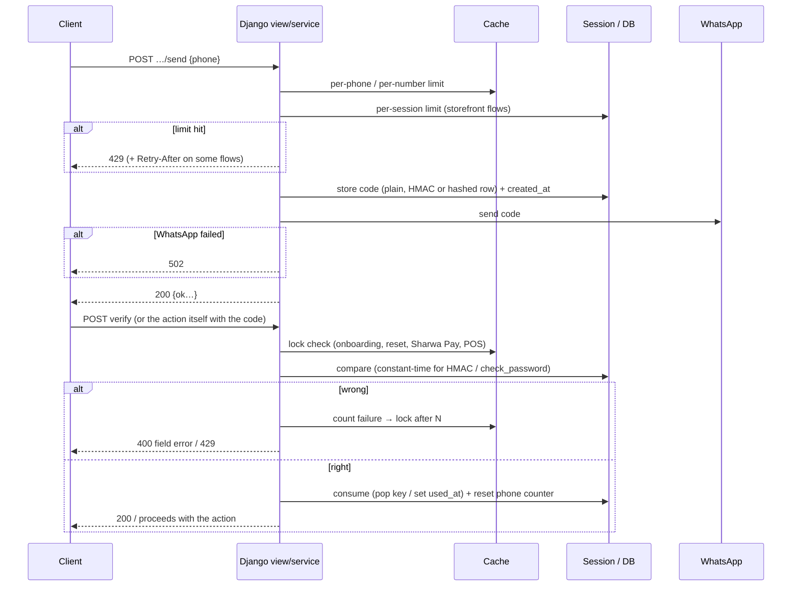
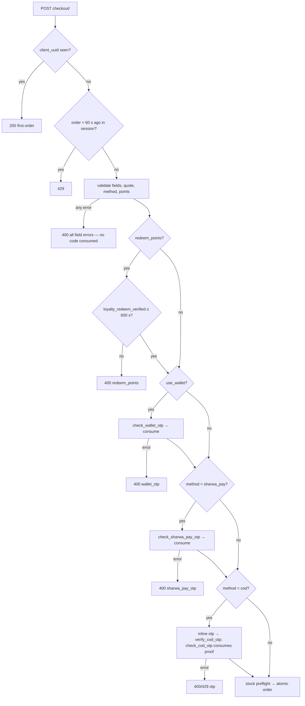

# OTP and code-verification design

> **Source**: DOC-469 · inventory A.4 · INT-003, INT-004, INT-014, INT-028, INT-029, INT-033, INT-048
> **Code**: `sharwa_saas/api/views_onboarding.py` · `api/views_auth.py` (owner reset) · `products/services/storefront_checkout_service.py` (COD, Sharwa Pay checkout, order placement order) · `products/services/checkout_service.py` (`check_wallet_otp`, `check_sharwa_pay_otp`, `check_cod_otp`) · `products/services/storefront_wallet_service.py` (wallet + loyalty) · `products/services/engagement_service.py` (buyer purposes) · `products/services/pos_service.py` + `products/models/staff_pos.py` (`OTPChallenge`) · `sharwapay/customer_api.py` + `api/views_sharwa_pay.py` (Sharwa Pay login) · `products/utils.py` (session keys, `rate_limit_attempt`, `phone_cache_rate_limited`, `cache_rate_limit`) · `core.models.OTPRequestTracker` (public schema)
> **Last verified against code**: 2026-10-27 (official Step 08)

## 1. Purpose

Every flow where Sharwa sends a one-time code and later checks it: what proves possession of a phone (or of the store's own number) before money, an account or a public review changes hands. This page is the **design view**: the one register table the roadmap requires (§3), the shared building blocks, the order in which checks run, and the failure modes. The per-route request and error tables are in the API cross-reference [`../api/overview/otp.md`](../api/overview/otp.md); the identity each flow establishes is in [`30-security.md#identities`](30-security.md#identities) and [`../api/overview/auth.md`](../api/overview/auth.md); rate limits that are not about codes are in [`34-rate-limits.md`](34-rate-limits.md).

Not in scope: legacy Django HTML screens (`products/views/auth_security.py`, `products/views/cart_checkout.py`, `tenants/views.py`, `tenants/sharwa_pay_views.py`) — they share the session keys and limits but are not part of the API contract.

## 2. Components

| Component | Location | Role |
|---|---|---|
| WhatsApp sender | `products.services.WhatsAppService.send_message` | the only delivery channel (no SMS, no e-mail). A `False`/exception is turned into `502` by every API flow (onboarding first send answers `400` on the phone field instead) |
| Code generator | `secrets.randbelow(900000) + 100000` (6 digits, first digit never `0`) everywhere except POS, which uses `f'{secrets.randbelow(10**6):06d}'` | cryptographic RNG; no flow uses `random` |
| Session bucket | `products.utils.rate_limit_attempt(request, key)` — default 3 per 600 s (`OTP_RATE_LIMIT_MAX`, `OTP_RATE_LIMIT_WINDOW`), stored in the session under `otp_rate_limit` | per browser; clearing cookies resets it, so it is always paired with a phone limit |
| Phone bucket | `products.utils.phone_cache_rate_limited(request, action, phone)` — 3 per 600 s, cache key `rl:<schema>:<action>:<phone>`, reset by `phone_cache_rate_limit_reset` on success | per store + phone, survives a new session |
| Generic cache bucket | `products.utils.cache_rate_limit(key, max, window)` — atomic `cache.add` then `cache.incr` | used by onboarding, owner reset, sign-in |
| Device tracker | `core.models.OTPRequestTracker` in the **public** schema, keyed by `client_uuid` | COD only; 3 sends, reset after 600 s of silence, `is_blocked` flag |
| Challenge row | `products.models.staff_pos.OTPChallenge` (`purpose`, `code_hash` = `make_password(code)`, `target_ref`, `expires_at`, `used_at`, `requested_by`) | POS large refund only — the only persisted, auditable challenge |
| HMAC digests | onboarding `salted_hmac("sharwa.onboarding.otp", "<token>:<code>")`; owner reset `salted_hmac("sharwa.dashboard.reset", "<schema>:<token>:<code>")`; Sharwa Pay `hmac.new(SECRET_KEY, "sharwa-pay-otp:<phone>:<code>", sha256)` | three separate implementations of one idea: the stored value cannot be turned back into the code; comparisons use `constant_time_compare` / `hmac.compare_digest` |
| `DEBUG` bypass | `DEBUG_STATIC_OTP = "123456"` (`api/views_onboarding.py:85`), reused by owner reset and POS refund; POS manager code `DEBUG_MANAGER_CODE = '2468'` while no hash is set | development only; with `DEBUG` the onboarding and POS flows **log** the code instead of sending WhatsApp |

## 3. Register — every OTP / code flow

All numbers below are constants in code on the review date. "Session" = the Django session of the caller on that host; "cache" = the shared cache (Redis in production).

| # | Flow | Route(s) under `/api/v1/` | Sent to (channel) | Code TTL | Send limit | Attempt limit | Lock | Storage | Responses | Test |
|---|---|---|---|---|---|---|---|---|---|---|
| 1 | Onboarding (new store) | `public/register/`, `public/register/resend-otp/`, `public/register/verify-otp/` | owner phone (WhatsApp) | 600 s (`OTP_TTL_SECONDS`); pending request 30 min (`PENDING_TTL_SECONDS`) | 30 s resend cooldown (`RESEND_COOLDOWN_SECONDS`); 3 / 600 s per phone (`rl:public:onboarding_send:phone:<phone>`); 1500 / 3600 s per IP (`ONBOARDING_SENDS_PER_IP_PER_HOUR`) | 3 wrong per phone (`VERIFY_FAILURES_PER_PHONE`) | 600 s per phone (`rl:public:onboarding_verify:lock:<phone>`) | cache `onboarding:pending:<token>` holding the **HMAC** | `410` «انتهت صلاحية الرمز» / «انتهت صلاحية الطلب، ابدأ من جديد.» · `400 {"code":["الرمز غير صحيح"]}` · `429` «محاولات كثيرة، حاول بعد N ثانية» + `Retry-After` · `502` on resend failure | `test_onboarding_api.py::OnboardingApiTests` (`test_send_limit_per_phone`, `test_wrong_code_then_lockout`, `test_resend_cooldown_then_new_code_replaces_the_old`), `DebugOtpBypassTests` |
| 2 | Owner forgot / reset password | `auth/forgot-password/`, `auth/reset-password/` | the **store** WhatsApp number | 600 s (`RESET_OTP_TTL_SECONDS`) | 3 / 600 s per phone (`rl:<schema>:merchant_reset_send:phone:<phone>`) | 3 wrong (`RESET_VERIFY_FAILURES`) | 600 s (`RESET_LOCK_SECONDS`); the pending reset is discarded | cache `auth:reset:<schema>:<token>` holding the **HMAC** | `400` «انتهت صلاحية الرمز، اطلب رمزاً جديداً.» / `{"code":["الرمز غير صحيح."]}` · `409 code=setup_required` · `429` + `Retry-After` · `502` «تعذّر إرسال رمز التحقق إلى رقم واتساب المتجر. حاول مرة أخرى.» | `test_dashboard_api.py::ForgotResetApiTests` |
| 3 | Checkout — cash on delivery | `checkout/cod-otp/send/`, `checkout/cod-otp/verify/`, or `otp` inside `checkout/` | buyer phone | 600 s (`COD_OTP_TTL_SECONDS`) | device tracker 3 per device (reset after 600 s idle; `is_blocked` refuses) **+** session 3 / 600 s **+** phone 3 / 600 s (`cod_otp_send`) | session 3 / 600 s **+** phone 3 / 600 s (`cod_otp_verify`) | window only (no separate lock) | **plain** code in the session (`cod_otp`, `cod_otp_phone`, `cod_otp_created_at`); proof `cod_otp_verified_phone`, consumed once at order time | `429` «تم حظر جهازك مؤقتاً بسبب طلبات متكررة. يرجى المحاولة لاحقاً.» / «تم تجاوز عدد محاولات إرسال الرمز (3 محاولات). يرجى المحاولة بعد قليل.» / «تم تجاوز عدد محاولات إرسال الرمز. يرجى المحاولة بعد قليل.» · `400` «انتهت صلاحية رمز التحقق. يرجى إعادة إرساله.» / «رمز التحقق غير صحيح.» · `502` | `test_storefront_checkout_api.py::StorefrontCheckoutTests::test_cod_otp_and_place_order` |
| 4 | Checkout — Sharwa Pay payment | `checkout/sharwa-pay/otp/send/`; code checked inside `checkout/` (`sharwa_pay_otp`) | buyer phone | 600 s (`SHARWA_PAY_OTP_TTL_SECONDS`) | session 3 / 600 s + phone 3 / 600 s (`sharwa_pay_otp_send`) | session + phone 3 / 600 s (`sharwa_pay_otp_verify`) | window only | **plain** in the session (`sharwa_pay_otp*`) | send: `400` «لا يوجد رصيد شروة باي متاح لهذا الرقم.», `429`, `502` · order: `400 {"sharwa_pay_otp":[…]}` (also when the limit trips — see §8) | `test_storefront_checkout_api.py` |
| 5a | Store wallet (spend balance at checkout) | `wallet/otp/send/`; code checked inside `checkout/` (`wallet_otp`) | buyer phone | 600 s (`WALLET_OTP_TTL_SECONDS`) | session + phone 3 / 600 s (`wallet_otp_send`) | session + phone 3 / 600 s (`wallet_otp_verify`) | window only | **plain** in the session (`wallet_checkout_otp*`) | send: `400` «لا يوجد رصيد متاح لهذا الرقم.», `429`, `502` · order: `400 {"wallet_otp":[…]}` | `test_wallets_api.py::StorefrontWalletLoyaltyTests::test_wallet_preview_and_otp` |
| 5b | Loyalty points redemption | `loyalty/otp/send/`, `loyalty/redeem/` | buyer phone | 600 s (same slot as 5a); verified mark `loyalty_redeem_verified` valid 600 s (`LOYALTY_VERIFIED_TTL_SECONDS`) | session + phone 3 / 600 s (`loyalty_otp_send`) | session + phone 3 / 600 s (`loyalty_otp_verify`) | window only | **plain** in the session — the **same keys as 5a** (`wallet_checkout_otp*`) | `404` «برنامج الولاء غير مفعّل في هذا المتجر.» · `400` «لا توجد نقاط متاحة لهذا الرقم.» · `429` «تم تجاوز عدد محاولات التحقق. يرجى المحاولة بعد قليل.» · order: `400 {"redeem_points":["أكّد استبدال النقاط برمز واتساب أولاً."]}` | `test_wallets_api.py::StorefrontWalletLoyaltyTests::test_loyalty_balance_otp_and_checkout_redemption` |
| 6 | Buyer actions (`purpose` = `review` · `auction` · `wishlist` · `back_in_stock`) | `customers/otp/send/`; consumed by `catalog/products/<id>/reviews/` (`otp`) | buyer phone | 600 s (`OTP_TTL_SECONDS`) | 60 s resend per session + purpose (`OTP_RESEND_SECONDS`) → `429` with `retry_after`; then session + phone 3 / 600 s (`buyer_otp_send_<purpose>`) | 5 wrong per code (`OTP_MAX_WRONG`) or phone 3 / 600 s (`buyer_otp_verify_<purpose>`) | until a new code is requested | **plain** in the session `buyer_otp:<purpose>` = `{phone, code, at, wrong, verified}` | `429` «حاول بعد N ثانية.» + `Retry-After` · `429` «محاولات كثيرة، اطلب رمزاً جديداً بعد قليل.» · `400 {"otp":[«اطلب رمز التأكيد أولاً.» \| «انتهت صلاحية الرمز، اطلب رمزاً جديداً.» \| «الرمز غير صحيح.»]}` · `502` | `test_engagement_api.py::EngagementApiTests::test_buyer_otp_and_product_review_moderation` |
| 7a | POS large refund | `pos/orders/<pk>/refund/` (above `StoreSetting.pos_refund_otp_threshold`) | the **store** WhatsApp number | 300 s (`OTP_TTL_SECONDS` in `pos_service.py`) | 3 / 600 s per receipt (`pos:refund_otp_sends:<schema>:<order_id>`) | 3 wrong per receipt (`OTP_MAX_ATTEMPTS`); the answer says how many are left | 900 s per receipt (`pos:refund_otp_fail:<schema>:<order_id>`) | `OTPChallenge(purpose='large_refund')`, **hashed** (`make_password`), bound to `target_ref = pos_refund:<order_id>:<amount>`; `used_at` set inside the refund transaction | `428 {"code":"otp_required","detail":"استرجاع كبير — أدخل رمز التحقق المرسل إلى جوال مالك المتجر.","challenge":"large_refund","sent_to":…}` · `400 {"otp_code":["رمز التحقق غير صحيح. المتبقي N …"]}` · `429` «أُرسلت رموز تحقق كثيرة لهذا الإيصال — انتظر 10 دقائق.» / lock message · `502` | `test_pos_api.py::PosApiTests::test_refund_and_otp`, `test_refund_otp_lock` |
| 7b | POS manager discount code (not an OTP — a standing secret) | `pos/orders/` sale with `manager_code` | — (typed by the manager) | — | — | 5 wrong per register (`MANAGER_CODE_MAX_FAILS`) | 900 s per register (`pos:manager_code:<schema>:<register_id>`) | `StoreSetting.pos_manager_code_hash` (`make_password`) | `400 {"manager_code":["رمز المدير غير صحيح."]}` · `429` «أُقفل رمز المدير مؤقتاً بعد 5 محاولات خاطئة. حاول بعد 15 دقيقة أو أرسل طلب اعتماد.» | `test_pos_api.py::PosApiTests::test_discount_ceiling_paths` |
| 8 | Sharwa Pay customer login (platform origin) | `sharwa-pay/otp/send/`, `sharwa-pay/otp/verify/` | customer phone (`967…`/`966…`) | 600 s (`OTP_TTL_SECONDS`), `expires_in: 600` in the send answer | 3 / 600 s **per number** in the cache (`rl:public:sharwa_pay_api_otp_send:<phone>`) | 5 wrong (`VERIFY_LIMIT`) per code record | 300 s **per number** in the cache (`rl:public:sharwa_pay_api_otp_lock:<phone>`) | session `sharwa_pay_api_otp` = `{phone, hash, at, attempts}` (**HMAC**); on success `cycle_key()` + `sharwa_pay_auth_phone` | `429 {"detail","retry_after"}` + `Retry-After` · `400` with `reason` `no_code` / `expired` / `invalid` · `502` «تعذّر إرسال رمز التحقق. حاول مرة أخرى.» | `test_sharwa_pay_api.py::LoginTests` (`test_send_limit_and_verify_lock`, `test_expired_code_and_whatsapp_failure`) |

> ⚠️ Discrepancy — roadmap says customer OTP purposes `review|auction|wishlist|back_in_stock` gate those actions / code does: only `review` is ever consumed (`engagement_service.py:255`, the single caller of `check_buyer_otp`). `auction`, `wishlist` and `back_in_stock` codes can be issued but no route checks them (auction bids take name + phone only, decision M37). Reported in official Step 08.

> ⚠️ Discrepancy — [`../api/overview/rate-limits.md`](../api/overview/rate-limits.md) §7 says the Sharwa Pay login counters are "kept in the shopper's session" / code does: the send counter and the verify lock are **per number in the cache** (`sharwapay/customer_api.py:144-163`, `:179-195`, comment «الحد على الرقم وحده (لا الجلسة) — مسح الكعكات لا يتجاوزه.»); only the code record and its attempt counter live in the session. The roadmap's "per NUMBER (cache)" is correct. Reported in official Step 08.

## 4. Flows

### 4.1 Generic send → verify → consume



### 4.2 Checkout: which proof is checked, in which order

`storefront_checkout_service.place_order` runs the checks in this fixed order (`storefront_checkout_service.py:649-737`):

1. `client_uuid` idempotency lookup (a retry returns the first order, `200`) — see [`41-idempotency.md`](41-idempotency.md).
2. One order per 60 s per session (`429`).
3. Cart, field validation, quote, geography, payment method, points request → **all field errors are collected and returned as one `400` before any code is looked at.** No OTP is consumed by a request that fails validation.
4. **Loyalty first**: if points are redeemed, `loyalty_redeem_verified` must match the phone and be under 600 s old (`[INT-028]: تأكيد استبدال النقاط أولاً — قبل استهلاك أي رمز آخر`).
5. Store wallet code (`check_wallet_otp`) when `use_wallet`.
6. Sharwa Pay code (`check_sharwa_pay_otp`) when the method is `sharwa_pay`.
7. COD: an inline `otp` is verified (`verify_cod_otp`), then the one-time proof `cod_otp_verified_phone` is consumed (`check_cod_otp`).
8. Supplier stock preflight, then the order transaction (points → wallet credit inside the same transaction).



Consequence: a code is consumed the moment its check passes (`نجاح التحقق: الرمز يُستهلك لمرة واحدة فوراً — قبل أي خطوة مالية لاحقة`). If a **later** step fails (for example the Sharwa Pay check after the wallet code was accepted), the earlier code is already gone and the buyer must request it again.

### 4.3 Wallet and loyalty share one slot

`send_wallet_otp` and `send_loyalty_otp` both write `wallet_checkout_otp*` (`storefront_wallet_service.py:52-57`). Sending one replaces the other. The UI sequence that works for a buyer who wants both is: send loyalty code → `loyalty/redeem/` (consumes the slot and sets `loyalty_redeem_verified`) → send wallet code → place the order with `wallet_otp`.

### 4.4 POS large refund

```mermaid
sequenceDiagram
  participant P as POS (cashier)
  participant D as Django pos_service
  participant W as WhatsApp (store number)
  P->>D: POST pos/orders/<pk>/refund/ {amount}
  D->>D: amount > pos_refund_otp_threshold and no otp_code
  D->>D: sends ≤ 3 / 600 s per receipt?
  D->>D: OTPChallenge.create(large_refund, make_password(code), target_ref=pos_refund:<order>:<amount>, 300 s)
  D->>W: code + cashier name + amount + receipt number
  D-->>P: 428 otp_required, sent_to = masked number
  P->>D: POST same body + otp_code
  D->>D: lock (3 fails / 900 s)? → 429
  D->>D: latest unused, unexpired challenge for the same receipt AND amount → check_password
  alt ok
    D->>D: atomic refund; challenge.used_at set (conditional update)
    D-->>P: 200 refund
  else wrong / expired
    D-->>P: 400 otp_code "… المتبقي N" (429 at 0)
  end
```

The code is bound to the **receipt and the exact amount**: it cannot authorise a larger refund or another receipt.

## 5. Invariants

| Invariant | Enforced where |
|---|---|
| A code is never sent anywhere except WhatsApp | every sender calls `WhatsAppService.send_message`; no SMS/e-mail path exists |
| A code is valid for one use | storefront: session key popped on success; Sharwa Pay: `OTP_KEY` popped; onboarding/reset: pending cache entry consumed; POS: `OTPChallenge.used_at` set with a conditional `UPDATE … WHERE used_at IS NULL` inside the refund transaction |
| Codes that guard an account or the platform are not stored readable | HMAC for onboarding, owner reset, Sharwa Pay login; `make_password` for POS refund and the manager code |
| A phone lock is not lifted by a new session | phone/number counters live in the cache (`rl:…`); only the storefront session bucket is per session |
| Validation never burns a code | checkout returns all field errors before the first code check (§4.2 step 3) |
| Loyalty proof precedes any other code at checkout | `place_order` order, `storefront_checkout_service.py:714-716` |
| Session fixation is impossible after Sharwa Pay login | `request.session.cycle_key()` before writing `sharwa_pay_auth_phone` |
| A wrong-code count cannot be reset by resending (POS, onboarding, reset, Sharwa Pay) | failure/lock keys are per phone/receipt in the cache, independent of the code |

## 6. Background work

None. Codes are sent synchronously in the request; a WhatsApp failure is answered at once (`502`). Expiry is lazy (checked on read); cache TTLs clean the keys.

## 7. Configuration

| Setting / constant | Default | Where |
|---|---|---|
| `DEBUG` | off in production | static code `123456` (onboarding, owner reset, POS refund) and manager code `2468` while unset; onboarding and POS **log** instead of sending |
| `ONBOARDING_SENDS_PER_IP_PER_HOUR` | 1500 | `api/views_onboarding.py` (`DEFAULT_SENDS_PER_IP_PER_HOUR`) |
| `StoreSetting.pos_refund_otp_threshold` | per store | above it a refund needs the code |
| `StoreSetting.whatsapp_number` | per store | destination of owner-reset and POS codes; missing ⇒ `400` «لا يوجد رقم واتساب مسجَّل للمتجر لإرسال رمز التحقق — راجع المالك.» |
| `SECRET_KEY` | — | key of the three HMACs; rotating it invalidates every pending onboarding, reset and Sharwa Pay code |
| WhatsApp provider credentials | — | see [`32-secrets.md`](32-secrets.md) |

## 8. Failure modes and fixes

| Failure | Symptom | Cause | Handling / fix |
|---|---|---|---|
| WhatsApp provider down | `502` (onboarding first send: `400` on `merchant_phone`) | provider error | the send still counts against the per-phone limit in onboarding and Sharwa Pay (counted before delivery); a buyer who retries three times quickly waits 10 min |
| Buyer clears cookies to get more sends | — | session bucket resets | phone bucket (`phone_cache_rate_limited`) and COD device tracker still apply |
| Device id missing from the COD send | — | the Next client does not send `client_uuid` | derived as `uuid5(NAMESPACE_URL, "sharwa-session:<session_key>")` (`storefront_checkout_service.py:424-432`), so the 3-send device cap still holds |
| Wallet/Sharwa Pay code limit reached at order time | `400 {"wallet_otp":[…]}` / `{"sharwa_pay_otp":[…]}` with the "too many" text | the check functions return a message string; `place_order` maps every message to `400` | clients must read the field error text, not wait for a `429` (see discrepancy below) |
| Loyalty and wallet codes requested together | the first code stops working | shared session slot (§4.3) | follow the §4.3 order |
| `SECRET_KEY` rotated | all pending HMAC codes fail | digest key changed | ask the user to request a new code |
| POS refund retried with a different amount | `400` "expired" style error and a failure counted | `target_ref` includes the amount | send without a code to get a new challenge for the new amount |

> ⚠️ Discrepancy — [`../api/overview/rate-limits.md`](../api/overview/rate-limits.md) §6 row "Wallet or Sharwa Pay code checked at checkout → `429` `{"otp": […]}`" and [`../api/overview/otp.md`](../api/overview/otp.md) row 5 "429 on verify" / code does: inside `checkout/` both checks answer **`400`** with the field `wallet_otp` or `sharwa_pay_otp`, including when their limit trips (`storefront_checkout_service.py:719-727`; messages from `checkout_service.py:257-258`, `:291-292`). Only the inline COD verification maps a limit to `429 {"otp": […]}`, and only `loyalty/redeem/` answers a plain `429`. Reported in official Step 08.

## 9. Open items

- **Plain-text storefront codes.** Families 3–6 keep the raw code in the tenant session table for up to 600 s (already raised in `otp.md` §3). Moving them to an HMAC like families 1, 2 and 8 is a code change; decision pending (fares).
- **Unused buyer purposes.** `auction`, `wishlist`, `back_in_stock` codes are sendable but never checked (§3 call-out). Either remove them from `OTP_PURPOSES` or wire the consumers.
- **No shared OTP helper.** Three HMAC implementations, three storage styles and two code formats. A single service (`issue`, `verify`, `consume`, uniform `429` + `Retry-After`) would remove the drift documented here and in `rate-limits.md`.
- **`Retry-After` is not uniform.** Present on onboarding, owner reset, buyer OTP and Sharwa Pay; absent on COD, Sharwa Pay checkout, wallet, loyalty and POS refund (see [`34-rate-limits.md`](34-rate-limits.md#retry-after)).

## 10. Related pages

- API cross-reference per family: [`../api/overview/otp.md`](../api/overview/otp.md) · sign-in and identities: [`../api/overview/auth.md`](../api/overview/auth.md), [`30-security.md#identities`](30-security.md#identities)
- Rate limits (all `429`s): [`34-rate-limits.md`](34-rate-limits.md) · [`../api/overview/rate-limits.md`](../api/overview/rate-limits.md)
- Secrets (WhatsApp provider, POS manager code hash): [`32-secrets.md`](32-secrets.md)
- Checkout idempotency: [`41-idempotency.md`](41-idempotency.md) · tenant schemas (why the COD device tracker is public): [`10-multi-tenancy.md#schemas`](10-multi-tenancy.md#schemas)
