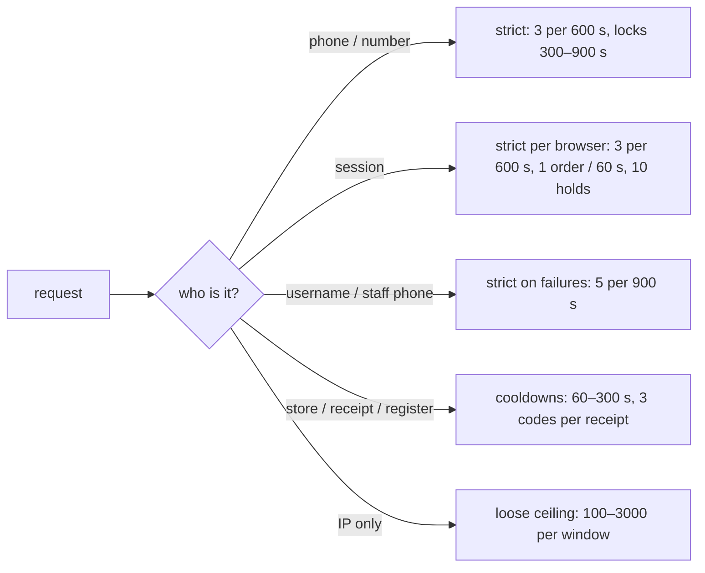

# Rate-limiting policy (CGNAT stance)

> **Source**: DOC-470 · inventory A.4, A.11 · INT-014, INT-016, INT-019, INT-029, INT-030, INT-036 · owner decision 2026-10-21 (CGNAT)
> **Code**: `sharwa_saas/products/utils.py` (`rate_limit_attempt`, `phone_cache_rate_limited`, `cache_rate_limit`) · `config/middleware.py` (`RealIpMiddleware`) · `config/settings.py` (`REAL_IP_TRUSTED_PROXIES`, `REAL_IP_PROXY_COUNT`, `REST_FRAMEWORK` throttles) · `django_ratelimit.is_ratelimited` in `api/views.py` and `api/views_product_extras.py` · `api/views_auth.py` · `api/views_onboarding.py` · `api/views_platform.py` · `api/views_push.py` · `api/views_customers.py` · `products/services/{storefront_checkout,storefront_wallet,checkout,engagement,booking,behavior,pos}_service.py` · `sharwapay/customer_api.py`
> **Last verified against code**: 2026-10-27 (official Step 08)

## 1. Purpose

Why and how Sharwa limits request rates, and the single register of every limit that can answer `429`. The per-route client guidance (body shapes, what to show, retry advice) is in the API page [`../api/overview/rate-limits.md`](../api/overview/rate-limits.md); OTP-specific attempt rules are in [`33-otp.md`](33-otp.md). Outbound limiters that keep **our** calls inside a marketplace's quota are not API limits and are only summarised in §8.

## 2. The stance — limit the person, not the network

Yemeni ISPs put thousands of legitimate users behind one public IPv4 address (carrier-grade NAT). A strict per-IP limit would lock a whole town out because of one abuser. The owner's decision (2026-10-21) therefore sets three rules:

1. **Anti-abuse limits key on the thing an attacker must change**: the phone number (per store or platform-wide), the session, the username, the device id, the receipt or the store.
2. **Per-IP limits exist only as very loose ceilings** against floods (hundreds per minute, thousands per hour). The only tight per-IP counters left count **failed sign-ins**, never successful traffic.
3. **A `429` is never proof of abuse.** Clients show the wait and let the person retry.

Concrete evidence of the stance in code:

- PWA install-event ceiling raised from 30/min to **300/min per IP** — the comment at `api/views.py:253` explains that 30/min dropped real events from shared addresses.
- Onboarding sends per IP **1500/h** and store creations per IP **500/h** (`DEFAULT_SENDS_PER_IP_PER_HOUR`, `DEFAULT_CREATIONS_PER_IP_PER_HOUR`), pinned by `test_onboarding_api.py::OnboardingApiTests::test_many_stores_from_one_cgnat_ip_are_not_blocked`; the per-phone cap stays at 3 / 600 s.
- Console sign-in: 5 failures per **username**, 100 per IP.

## 3. Components

| Component | Location | Counts by | Storage | Notes |
|---|---|---|---|---|
| `RealIpMiddleware` | `config/middleware.py`, the **first** entry of `MIDDLEWARE` (before `TenantMainMiddleware`) | — | — | replaces `REMOTE_ADDR` with the address **our** proxy appended to `X-Forwarded-For`, only when the connection comes from `REAL_IP_TRUSTED_PROXIES` (default `127.0.0.1,::1`), counting `REAL_IP_PROXY_COUNT` (default 1) from the right. Every per-IP counter depends on it |
| `rate_limit_attempt(request, key, max=3, window=600)` | `products/utils.py:191` | session + key | session (`otp_rate_limit`) | per browser only |
| `phone_cache_rate_limited(request, action, phone, 3, 600)` | `products/utils.py:232` | store schema + action + phone | cache `rl:<schema>:<action>:<phone>` | reset on successful verification |
| `cache_rate_limit(key, max, window)` | `products/utils.py:213` | any key | cache | atomic `add` then `incr` |
| `django_ratelimit.is_ratelimited(…, key='ip', rate=…)` | `api/views.py`, `api/views_product_extras.py` | IP | cache (library default) | used for the three anonymous beacons/bids |
| DRF `AnonRateThrottle` | `REST_FRAMEWORK['DEFAULT_THROTTLE_RATES']['anon'] = '120/minute'` (`config/settings.py:536-538`) | IP, anonymous callers only | cache | signed-in merchant/staff sessions are not anonymous and skip it; views with their own counters set `throttle_classes = []` |
| `behavior_service` | `products/services/behavior_service.py` | staff member + action + day | DB `StaffDailyUsage` (staff, action, day) + `BehaviorAlert` | daily hard limits and alert thresholds |
| `OTPRequestTracker` | `core.models` (public schema) | COD device id | DB | 3 sends per device, `is_blocked` |

## 4. Register — every inbound limit

Key legend: **phone** = per phone per store unless marked platform; **number** = Sharwa Pay phone (platform); **session** = Django session; **IP** = `REMOTE_ADDR` after `RealIpMiddleware`; **store** = tenant schema; **staff** = staff member; **receipt** / **register** = POS objects.

### 4.1 Sign-in and account recovery

| Action | Route (`/api/v1/…`) | Key | Limit / window | Lock | Response | Storage |
|---|---|---|---|---|---|---|
| Owner sign-in failures | `auth/merchant/login/` | phone **and** IP | 5 per phone, 20 per IP / 900 s (`MERCHANT_LOGIN_MAX_FAILURES_PER_*`, `products/views/auth_security.py:143-145`) | 900 s window | `429` «تم تجاوز عدد محاولات الدخول المسموح بها. يرجى المحاولة بعد 15 دقيقة.» + `Retry-After: 900` | cache `rl:<schema>:merchant_login:{phone,ip}:…` |
| Staff sign-in failures | `auth/staff/login/` | phone **and** IP | 5 / 20 per 900 s (`STAFF_LOGIN_MAX_FAILURES_PER_*`, `api/views_auth.py:220-221`) | 900 s | same message + `Retry-After: 900` | cache `rl:<schema>:staff_login:…` |
| Console sign-in failures | `platform/auth/login/` | username **and** IP | 5 per username, 100 per IP / 900 s (`LOGIN_MAX_FAILURES_PER_USER`, `_PER_IP`, `api/views_platform.py:78-81`) | 900 s | `429` + `Retry-After: 900` | cache `rl:public:console_login:{user,ip}:…` |
| First password (setup token) | `auth/merchant/setup-password/` | IP | 10 calls / 900 s | 900 s | `429` «محاولات كثيرة، حاول بعد 900 ثانية» + `Retry-After: 900` | cache `rl:<schema>:setup_password:ip:…` |
| Owner reset code send / wrong code | `auth/forgot-password/`, `auth/reset-password/` | store phone | 3 sends / 600 s; 3 wrong | 600 s | `429` + `Retry-After` | cache (see [`33-otp.md`](33-otp.md) row 2) |

### 4.2 Onboarding (public schema)

| Action | Key | Limit / window | Response |
|---|---|---|---|
| Resend cooldown | pending registration | 1 per 30 s | `429` + `Retry-After` (time left) |
| Code sends | phone | 3 / 600 s | `429` + `Retry-After: 600` |
| Code sends | IP | 1500 / 3600 s (`ONBOARDING_SENDS_PER_IP_PER_HOUR`) | `429` + `Retry-After: 3600` |
| Wrong codes | phone | 3 → lock 600 s | `429` + `Retry-After` |
| Store creations | IP | 500 / 3600 s (`ONBOARDING_CREATIONS_PER_IP_PER_HOUR`) | `429` «تم الوصول للحد الأقصى من عمليات إنشاء المتاجر خلال ساعة. يرجى المحاولة لاحقاً.» + `Retry-After: 3600` |
| Provisioning status poll | IP | 3000 / 60 s (`PROVISIONING_STATUS_POLLS_PER_IP_PER_MINUTE`) | `429 {"status": "throttled"}` |

### 4.3 Storefront and buyers

| Action | Route | Key | Limit / window | Response |
|---|---|---|---|---|
| Place an order | `POST checkout/` | session | 1 per 60 s (`last_order_time`), checked **after** the `client_uuid` idempotency lookup | `429` «لقد أرسلت طلباً قبل قليل. يرجى الانتظار دقيقة قبل إرسال طلب جديد.» (no header) |
| COD code send | `checkout/cod-otp/send/` | device + session + phone | 3 per device (reset after 600 s idle), 3 / 600 s per session, 3 / 600 s per phone | `429` (three texts, no header) |
| COD / wallet / loyalty / Sharwa Pay checkout codes | `checkout/cod-otp/verify/`, `wallet/otp/send/`, `loyalty/otp/send/`, `loyalty/redeem/`, `checkout/sharwa-pay/otp/send/` | session + phone | 3 / 600 s each | `429` (no header); inside `checkout/` wallet and Sharwa Pay limits surface as `400` field errors — see [`33-otp.md`](33-otp.md#8-failure-modes-and-fixes) |
| Buyer code resend | `customers/otp/send/` | session + purpose | 1 per 60 s | `429` «حاول بعد N ثانية.» + `Retry-After` |
| Buyer code sends | `customers/otp/send/` | session + phone + purpose | 3 / 600 s | `429` + `Retry-After: 60` |
| Store review | `POST store-reviews/` | session | 3 / 3600 s (`rate_limit_attempt(…, 'store_review_post', 3, 3600)`) | `429` «أرسلت تقييمات كثيرة، حاول لاحقاً.» |
| Booking slot holds | `catalog/products/<id>/slots/hold/` | session | 10 live holds (`MAX_LIVE_HOLDS_PER_SESSION`, `booking_service.py:40`); expired holds free room | `429` «احتجزت مواعيد كثيرة في الوقت نفسه — أكمل الطلب أو أزل بعضها من السلة أولاً.» |
| Auction bid | `catalog/products/<id>/auction/bids/` | IP | 300 / min (`api/views_product_extras.py:214`) | `429` «طلبات كثيرة جداً، حاول لاحقاً.» |
| PWA install event | `pwa/install-event/` | IP | 300 / min (was 30/min; `api/views.py:254`) | same text |
| Push subscription | `push/subscribe/` | IP | 120 / min (`api/views.py:305`) | same text |
| Anonymous DRF reads | e.g. `catalog/products/` | IP | 120 / min (`AnonRateThrottle`) | DRF English body `{"detail": "Request was throttled. Expected available in N seconds."}` + `Retry-After` |

### 4.4 Sharwa Pay (platform origin)

| Action | Key | Limit / window | Lock | Response |
|---|---|---|---|---|
| Login code send | number (cache `rl:public:sharwa_pay_api_otp_send:<phone>`) | 3 / 600 s | — | `429 {"detail":"طلبات كثيرة — حاول لاحقاً.","retry_after":N}` + `Retry-After` |
| Login code verify | number (cache `rl:public:sharwa_pay_api_otp_lock:<phone>`) | 5 wrong | 300 s | `429 {"detail":"محاولات كثيرة — أُقفل التحقق مؤقتاً.","retry_after":N}` + `Retry-After` |

### 4.5 Merchant dashboard and POS

| Action | Route | Key | Limit / window | Response |
|---|---|---|---|---|
| Refresh today's metrics | `dashboard/overview/refresh/`, `reports/refresh-today/` (one shared key) | store | 1 / 300 s | `429` + `Retry-After: 300` |
| Test push broadcast | `push/test/` | store (`push-test:<schema>`) | 1 / 60 s (`COOLDOWN`); a call with no subscriber answers `400` and does not start the cooldown | `429` + `Retry-After: 60` |
| Customer export | `customers/export.csv` | staff + day | hard limit 5000 rows/day (`HARD_LIMITS['customers.export']`); refused outright after a **critical** `export_volume` alert that day; alert at 1000 | `429` «تجاوزت حدّ التصدير اليومي، راجع مدير المتجر.» — owner sessions are not counted |
| POS large-refund codes | `pos/orders/<pk>/refund/` | receipt | 3 sends / 600 s; 3 wrong → 900 s | `429` (no header) |
| POS manager code | sale with `manager_code` | register | 5 wrong → 900 s | `429` |

### 4.6 Suppliers (answered to the dashboard)

| Situation | Key | Response |
|---|---|---|
| Dropshipping connect while the supplier asks to slow down | supplier answer | `429` `{"detail": "<supplier> يطلب الانتظار قليلاً قبل محاولة ربط جديدة — أعد المحاولة بعد دقائق."}` (no header) |
| Later supplier throttle | supplier answer | `429` «المورد يطلب الانتظار قليلاً — أعد المحاولة بعد لحظات.» |
| Feed added by URL while the per-store `fetch_url` bucket is empty | store | `429` «جلبٌ آخر جرى للتو — انتظر دقيقتين ثم أعد المحاولة.» |

These three rows were verified in run 04 (`rate-limits.md` §10) and were not re-read in this step.

## 5. Invariants

| Invariant | Where |
|---|---|
| No limit on a successful request keys on IP alone with a tight number | §4 — every IP key is ≥ 100 per window, or counts failures only |
| Per-IP counters see the real client, not the proxy | `RealIpMiddleware` + `REAL_IP_TRUSTED_PROXIES`; a client-sent `X-Forwarded-For` is ignored unless it arrives through a trusted proxy |
| A phone/number lock survives a new session or device | cache keys in §3 |
| An idempotent checkout retry is not refused by the 60 s order limit | idempotency lookup runs first (`storefront_checkout_service.py:655-664`) |
| Dashboard refresh cannot be used to hammer the aggregation | one 300 s key per store shared by both routes |
| Sign-in lockouts refuse the right password too | the counter is checked before the password |

## 6. The `Retry-After` convention

Intended convention: a `429` carries `Retry-After: <seconds>` and, where the client cannot read headers easily, the same number in the body as `retry_after`. The helpers that implement it:

- `api/views_onboarding.too_many(seconds)` — `{"detail": "محاولات كثيرة، حاول بعد N ثانية"}` + `Retry-After` (also used by owner reset).
- `sharwapay/customer_api._limited` — body `retry_after` and header, rounded up, minimum 1 s.
- `api/views_engagement.py` — moves the service's `retry_after` from the body into the header.

> ⚠️ Discrepancy — roadmap says "`Retry-After` header convention" (one convention) / code does: only sign-in, setup-password, owner reset, onboarding, dashboard/reports refresh, push test, buyer OTP and Sharwa Pay set it. COD, wallet, loyalty and Sharwa Pay checkout codes, the 60 s order limit, booking holds, customer export, POS, supplier limits and the three IP ceilings answer `429` with `detail` only (already recorded in `rate-limits.md` §2). Clients must treat the header as optional. Reported in official Step 08.

## 7. Configuration

| Setting | Default | Effect |
|---|---|---|
| `REAL_IP_TRUSTED_PROXIES` | `127.0.0.1,::1` | which hops may set the client address; must list the Nginx host in production ([`../ops/environment.md`](../ops/environment.md)) |
| `REAL_IP_PROXY_COUNT` | `1` | hops counted from the right of `X-Forwarded-For` |
| `ONBOARDING_SENDS_PER_IP_PER_HOUR` | 1500 | onboarding IP ceiling |
| `ONBOARDING_CREATIONS_PER_IP_PER_HOUR` | 500 | store-creation IP ceiling |
| `PROVISIONING_STATUS_POLLS_PER_IP_PER_MINUTE` | 3000 | status-poll ceiling |
| `REST_FRAMEWORK.DEFAULT_THROTTLE_RATES.anon` | `120/minute` | generic anonymous throttle |
| Cache backend | Redis in production | all `rl:*` keys; a per-process local cache would make every limit per worker |

## 8. Failure modes and fixes

| Failure | Symptom | Cause | Handling / fix |
|---|---|---|---|
| Whole city locked out of a beacon | install events dropped | 30/min per IP behind CGNAT | raised to 300/min (INT-016) |
| Every visitor shares one counter | all users hit IP limits together | `REAL_IP_TRUSTED_PROXIES` missing the proxy | set the trusted proxy list; the middleware then reads the real client |
| Limits differ per worker | limits looser than documented | cache not shared (local memory) | use the shared cache in every environment that runs more than one process |
| English `429` on storefront reads | "Request was throttled…" shown to a shopper | DRF `AnonRateThrottle` default body | client replaces it with its own wait text when `Retry-After` is present |
| `message.send` cap never fires | — | `HARD_LIMITS['message.send'] = 500` is defined but nothing records or checks it | documented as not enforced (`rate-limits.md` §8) |
| Marketplace quota exceeded | background job slower | **outbound** token bucket (`products/services/marketplaces/marketplace_rate_limit.py`) halves its ceiling for 10 min after a real marketplace `429` | no client action; jobs reschedule themselves |

## 9. Open items

- Uniform `429` envelope (`detail` + `retry_after` + `Retry-After`) for the routes listed in §6.
- `message.send` hard limit defined but unenforced.
- No automated test pins the 300/min and 120/min IP ceilings; they are read from code only.

## 10. Related pages

- Client guidance per route: [`../api/overview/rate-limits.md`](../api/overview/rate-limits.md) (anchor [`#cgnat`](../api/overview/rate-limits.md#cgnat))
- OTP attempt and lock rules: [`33-otp.md`](33-otp.md)
- Identities that sign-in limits protect: [`30-security.md#identities`](30-security.md#identities)
- Checkout idempotency vs the order limit: [`41-idempotency.md`](41-idempotency.md)
- Environment variables: [`../ops/environment.md`](../ops/environment.md)
