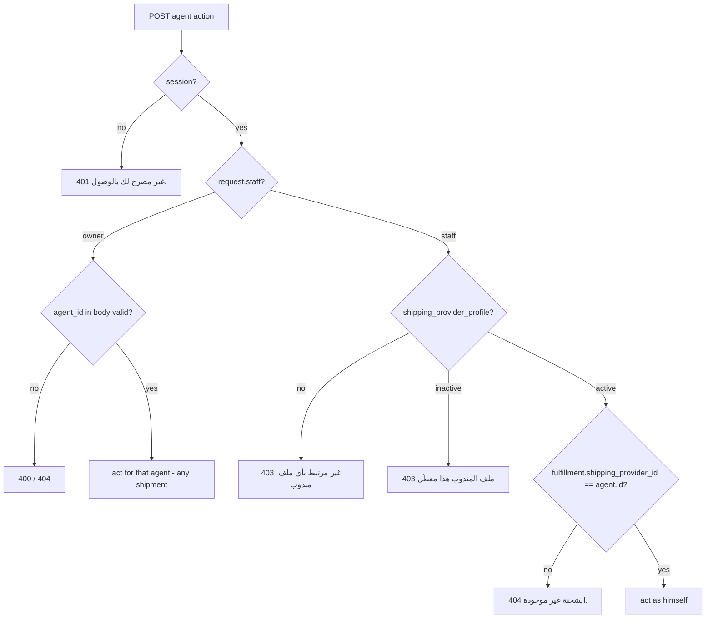
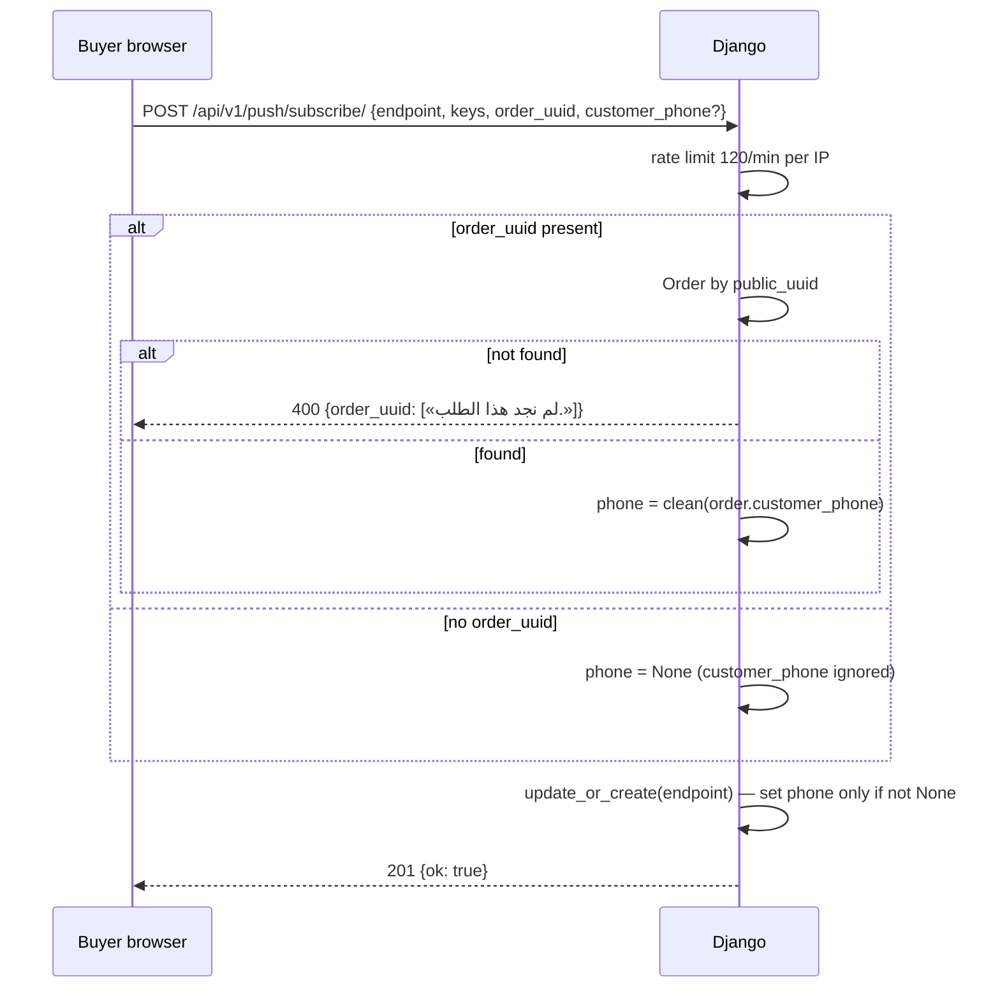

# Ownership and anti-impersonation checks

> **Source**: DOC-472 · inventory A.4, Domains 2, 5, 8, 11, 14 · INT-016, INT-046, INT-049, INT-031, INT-042 (plus the self-action rules of INT-022 and INT-035)
> **Code**: `sharwa_saas/api/views.py` (`PushSubscribeView`, `_resolve_agent`, `_agent_owns`, agent action views) · `api/views_courier.py` (`AgentReadMixin`) · `api/views_rollup.py` · `tenants/merchant_rollup.py` (`_account_for`) · `tenants/console_money_service.py` (`topup_action`) · `products/services/support_lock_service.py` (`staff_close`, `staff_takeover`, `staff_release`, `staff_reply`) · `products/services/staff_service.py` · `api/views_staff.py` · `products/services/procurement_service.py`
> **Last verified against code**: 2026-10-27 (official Step 08)

## 1. Purpose

An **authorisation** check answers "may this identity use this route?" (session → plan feature → permission key → owner-only; see [`31-authorization.md`](31-authorization.md)). An **ownership** check answers a narrower question: "is this particular row the caller's own?" Phase 002 closed several holes where the first answer was *yes* but the second was never asked:

- an identity was taken from the request body instead of the session (impersonation);
- a correctly identified caller could act on a row that belonged to somebody else (missing ownership filter);
- a lookup matched on a weak key (a phone number) instead of an explicit link.

This page lists each hole, the rule that replaced it, the response a violating caller now gets and the test that pins it. It does **not** repeat the identity model (see [`30-security.md`](30-security.md)) or the per-route gate tables (see [`../api/overview/auth.md`](../api/overview/auth.md) and [`../api/overview/permissions.md`](../api/overview/permissions.md)).

## 2. Components

| Component | Location | Role |
|---|---|---|
| `PushSubscribeView` | `sharwa_saas/api/views.py` | derives the targeting phone of a browser push subscription from an order, never from client input |
| `AgentReadMixin.agent_or_error` | `sharwa_saas/api/views_courier.py` | courier-app reads: caller must be a staff member with an active agent profile; the owner is refused |
| `_resolve_agent` | `sharwa_saas/api/views.py` | courier-app actions: the agent is the caller's own profile; `agent_id` from the body is accepted from the owner only |
| `_agent_owns` | `sharwa_saas/api/views.py` | courier-app actions: a staff agent may only touch a fulfillment assigned to him |
| `MerchantStoresView` + `_account_for` | `sharwa_saas/api/views_rollup.py` · `tenants/merchant_rollup.py` | multi-store rollup: the account is the one **linked** to the current store, not the one whose phone matches |
| `topup_action` | `sharwa_saas/tenants/console_money_service.py` | console approval of a Sharwa Pay top-up that matched no wallet: link only to an existing wallet of the claimed phone |
| `support_lock_service` | `sharwa_saas/products/services/support_lock_service.py` | support sessions: only the holder (or nobody) may close, release or reply |
| `StaffAPIMixin.check(target=…)`, `terminate_staff`, `resolve_approval`, PO approval | `api/views_staff.py` · `products/services/staff_service.py` · `products/services/procurement_service.py` | self-action rules: no self-approval, no self-termination, no editing one's own assignments or overrides |

## 3. Register of fixes

One row per hole. "Response" is what a violating caller receives today; Arabic bodies are copied from the code.

| # | Surface | Previous hole | New rule (where enforced) | Response on violation | Pinned by |
|---|---|---|---|---|---|
| 1 | Push subscribe `POST /api/v1/push/subscribe/` (INT-016) | The subscription stored the `customer_phone` typed by the client, so anyone could receive another number's order-status pushes (order number + tracking link). | The phone is read from the order whose `public_uuid` = `order_uuid` (`clean_phone_number(order.customer_phone)`). A body `customer_phone` is accepted by the serializer for compatibility and **ignored**. No `order_uuid` ⇒ anonymous subscription (broadcasts only). A later anonymous re-subscribe of the same `endpoint` keeps the phone already linked. (`api/views.py` `PushSubscribeView.post`) | unknown order: **400** `{"order_uuid": ["لم نجد هذا الطلب."]}` · free phone: **201** `{"ok": true}` with `customer_phone = null` | `api/test_pwa_push_api.py::PwaPushTests::test_subscribe_binds_phone_from_order_only`, `::test_free_phone_without_order_is_ignored`, `::test_unknown_order_uuid_is_400` |
| 2 | Courier app — identity (audit fix 2026-09-16, kept by INT-046) | The agent was taken from `agent_id` in the request body, so any signed-in merchant or staff member could act as any agent (collect COD, move shipments). | A staff caller acts **only** as his own `shipping_provider_profile`; a body `agent_id` is ignored for staff and accepted from the owner session only. (`api/views.py` `_resolve_agent`) | staff without profile: **403** `{"detail": "حساب الموظف هذا غير مرتبط بأي ملف مندوب شحن."}` · owner without/invalid `agent_id`: **400** `{"detail": "agent_id مطلوب وصحيح."}` · unknown agent: **404** `{"detail": "المندوب غير موجود."}` | `api/test_courier_api.py::AgentReadsTests::test_identity_gate` (reads) · actions via #3 tests |
| 3 | Courier app — resource ownership (INT-046) | Any agent could end or hand over **any** shift, move **any** shipment, scan or deliver **any** fulfillment of the store. | A staff agent may only touch a fulfillment whose `shipping_provider_id` is his own (`_agent_owns`, used by shipment status, scan-pickup, partial delivery) and only his own shift (`AgentShiftEndHandoverView`). The owner keeps acting for any agent. | foreign shipment/fulfillment: **404** `{"detail": "الشحنة غير موجودة."}` · foreign shift: **404** `{"detail": "المناوبة غير موجودة."}` | `api/test_courier_api.py::…::test_actions_refuse_shipments_of_another_agent`, `::test_end_and_handover_only_my_open_shift` |
| 4 | Courier app — state rules (INT-046) | A closed shift could be "ended" again; a shift could be handed to its own agent or to a disabled agent; a disabled agent profile could still act. | `AgentShiftEndHandoverView` checks `ended_at`, `new_agent.id != shift.agent_id`, `new_agent.is_active`; `_resolve_agent` and `agent_or_error` refuse an inactive profile. | closed: **400** `{"detail": "هذه المناوبة مغلقة مسبقاً."}` · self: **400** `{"detail": "اختر مندوباً آخر لتسليم المناوبة."}` · disabled target: **400** `{"detail": "المندوب الجديد معطّل."}` · disabled caller: **403** `{"detail": "ملف المندوب هذا معطّل. تواصل مع مالك المتجر."}` | `::test_end_and_handover_only_my_open_shift`, `::test_identity_gate` (disabled profile on reads). No test drives a disabled **target** agent. |
| 5 | Courier app — owner on reads (INT-046) | The four reads were served by the mock to any session. | The reads require a staff agent; the owner manages agents from the supervision screen (M39). | owner: **403** `{"detail": "هذا التطبيق لحسابات المندوبين. يدير مالك المتجر المندوبين من شاشة الإشراف في لوحة التحكم."}` | `::test_identity_gate` |
| 6 | Multi-store rollup `GET /api/v1/merchant/stores/` (INT-049) | The legacy HTML page picks the `MerchantAccount` whose `owner_phone` equals the store's `merchant_phone`, without checking that the account is **linked** to the store. | The account must be linked to the current store through `MerchantAccountClient`; among several linked accounts the one whose `owner_phone` matches `merchant_phone` (raw or cleaned) wins. Not linked ⇒ `has_account: false`, empty list, zero totals. Staff are refused; an owner session pinned to another store is refused. (`tenants/merchant_rollup.py` `_account_for`, `api/views_rollup.py`) | staff: **403** `{"detail": "هذه الصفحة لمالك المتجر فقط."}` · other store's owner: **401** `{"detail": "انتهت جلستك، سجّل الدخول مجدداً."}` · not linked: **200** `has_account: false` | `api/test_rollup_api.py::…::test_owner_only`, `::test_unavailable_and_no_account` |
| 7 | Sharwa Pay — unmatched top-up (INT-031) | A bank top-up whose sender phone matched no wallet could be approved into a wallet created on the spot for an unproven number. | On approval, a top-up with no wallet is linked **only** to an existing wallet of `claimed_phone` (cleaned); no wallet is ever created here. The approval runs under `select_for_update` and credits through `apply_credit_if_approved()` (the `credited_at` guard). (`tenants/console_money_service.py` `topup_action`) | no wallet: **400** `{"detail": "لا محفظة شروة باي بالرقم الوارد (…) — اطلب من العميل فتح محفظته ثم أعد القبول، أو اربط الطلب بمحفظته من لوحة Django.", "level": "error"}` | `api/test_platform_money_api.py::…::test_topup_approve_reject_and_unmatched` |
| 8 | Support — close (INT-042) | There was no close action in the API; the legacy flow let any member act on a session another member held. | `staff_close` refuses a session in `human_locked` whose holder is not the caller (the owner is "nobody" — `None` — and is refused too); also refuses an already closed session and a stale `version`. Takeover, release and reply apply the same holder rule. (`support_lock_service.py`) | other holder: **409** `{"detail": "يتولّاها <name>.", "session": {…}}` · already closed: **409** `{"detail": "الجلسة مغلقة مسبقاً.", …}` | `api/test_support_api.py::…::test_takeover_release_close_with_versions` (another member's `close` → 409) |
| 9 | Support — takeover / release / reply (pre-existing, kept) | — | Takeover refuses a session another member holds; release and reply only by the holder. | **409** «هذه الجلسة مستلَمة بالفعل من قِبل <name>.» · «لا يمكنك تحرير جلسة استلمها موظف آخر.» · reply: «استلم الجلسة أولاً لتتمكن من الردّ.» | `::test_takeover_release_close_with_versions`, `::test_staff_reply_dedup_and_lock` |
| 10 | Approvals — self-approval (INT-022, INT-035) | — (rule kept and exposed in the API) | `ApprovalRequest.resolve()` raises `PermissionError` when the resolver is the requester (`products/models/staff_approvals.py`); the M18 queue maps it in `staff_service.resolve_approval`, the M23 purchase-order decision in `procurement_service`. | **403** `{"detail": "لا يمكنك الموافقة على طلبك."}` · PO: **403** `{"detail": "لا يمكن الموافقة على طلبك الخاص."}` | `api/test_staff_api.py::…::test_approvals_resolve_rules` · `api/test_procurement_api.py::…::test_self_approval_refused` |
| 11 | Staff — self-edit (INT-022) | — | A member never edits his own assignments or permission overrides (`StaffAPIMixin.check(target=…)`). | **403** `{"detail": "لا يمكنك تعديل تعييناتك أو استثناءات صلاحياتك بنفسك."}` | `api/test_staff_api.py::…::test_feature_and_permissions` |
| 12 | Staff — self-termination (INT-022) | — | `terminate_staff` refuses `staff.pk == member.pk`. | **400** `{"detail": "لا يمكنك إنهاء خدمتك بنفسك."}` | no dedicated test found (the terminate test covers soft termination and a repeat, not self) |

Rules about **which store** a session may act on (a session pinned to store A cannot switch to store B through `X-Store-Domain`) are tenant-resolution rules: see [`10-multi-tenancy.md#resolution`](10-multi-tenancy.md#resolution). Domain claims (nobody can squat another store's hostname) are in [`12-custom-domains.md`](12-custom-domains.md).

### 3.1 Push subscriptions (row 1)

The order's `public_uuid` is the proof: it is known only to whoever completed the order (it is in the tracking link the buyer receives). The phone stored on the subscription is the order's phone in cleaned form, so a body like `{"order_uuid": "…", "customer_phone": "9677XXXXXXXX"}` stores the **order's** phone, whatever the client sent.

Residual risk worth knowing: targeted pushes are addressed **by phone** (`PushSubscription.filter(customer_phone=phone)` in `order_push_service.py`), not by order. A person who received someone's tracking link and subscribes with that `order_uuid` will also receive the pushes of that phone's **later** orders on the same store. This is a design limit, not a regression; see §6.

### 3.2 Courier app (rows 2–5)

Reads and actions use different gates on purpose: the four reads refuse the owner (the app is for agents), while the five actions let the owner act for any agent through `agent_id` (supervision). The full step table with every body is in [`../api/overview/auth.md#agent`](../api/overview/auth.md#agent); the route reference will be [`../api/domains/11-shipping/m38-courier-app.md`](../api/domains/11-shipping/m38-courier-app.md).

### 3.3 Multi-store rollup (row 6)

The link table, not the phone, decides which stores an owner sees. A store whose owner registered with a phone that also belongs to another `MerchantAccount` no longer exposes that account's stores, because the current store must appear in `MerchantAccountClient` for the account. See [`../api/domains/02-dashboard-shell/m43-multi-store.md`](../api/domains/02-dashboard-shell/m43-multi-store.md).

> ⚠️ Discrepancy — roadmap says the HTML page "matched phone only and could leak another account's stores" as a fixed hole (DOC-472 / DOC-059: "leak risk fixed") / code does: the fix is in the API only. The legacy HTML route `merchant/master-dashboard/` (`config/urls_tenant.py:292`) is still served by `tenants.views.merchant_master_dashboard`, which still picks `MerchantAccount.objects.filter(owner_phone=current_client.merchant_phone).first()` with no link check and no store-pin check (`tenants/views.py:329-332`). Reported in official Step 08.

### 3.4 Sharwa Pay top-ups (row 7)

The rule protects against a wallet being opened for a phone number that nobody proved. A Sharwa Pay wallet is created by the customer's own first top-up after a WhatsApp OTP login (see [`43-ledgers.md`](43-ledgers.md)); the console only ever links to a wallet that already exists. Duplicate bank transaction ids are refused in the same transaction (`bank_transaction_id` already used by an approved request). The credit itself happens once, behind the `credited_at` guard.

### 3.5 Support sessions (rows 8–9)

All four transitions (takeover, release, close, reply) take a row lock on the session (`select_for_update`) and compare `locked_by_staff_id` with the caller. Because the owner is represented as `None`, a session held by a staff member cannot be closed or released by the owner either; the owner can take over only a session nobody holds. The 409 body carries the current session so the screen can re-render without a second request (see [`42-concurrency.md`](42-concurrency.md)).

## 4. Flows

## 5. Invariants

- An identity is **never** read from the request body when a session can supply it (`_resolve_agent`, support `staff` = `request.staff`, console actor = the Django user of the session, rollup = the session's store).
- A staff agent touches only rows whose foreign key points at his own agent profile; a miss is answered as **404** (the row "does not exist" for him), never 403, so ids of other agents' work are not confirmed.
- A cross-store account view requires an explicit link row (`MerchantAccountClient`); a matching phone is only a tie-breaker.
- Money never lands in a wallet the console created on its own; top-up approval links to an existing wallet or fails.
- Self-actions that would let one person both request and approve, or change their own rights, are refused (rows 10–12).

## 6. Failure modes and open items

| Failure | Symptom | Cause | Handling |
|---|---|---|---|
| Legacy rollup page | an owner could see stores of an account he is not linked to | `merchant_master_dashboard` still matches by phone | open — fix candidate for Step 52 or retire the HTML page (the Next screen uses the API) |
| Push follow-up by phone | a person holding a buyer's tracking link keeps receiving that phone's later order pushes | targeting is by phone, subscription is per browser `endpoint` | accepted design; a per-order binding would change the M44 contract |
| Owner and staff-held support sessions | the owner cannot close or release a session a staff member holds | the owner is `None` in the holder comparison | by design (FR-31); a staff member must release first |
| Disabled hand-over target | not covered by a test | — | rule present in code (`المندوب الجديد معطّل.`) |
| Self-termination | not covered by a test | — | rule present in code (`staff_service.py`) |

## 7. Related pages

- Identities and sessions: [`30-security.md`](30-security.md) · authorisation model: [`31-authorization.md`](31-authorization.md)
- Courier identity table: [`../api/overview/auth.md#agent`](../api/overview/auth.md#agent)
- Multi-store API: [`../api/domains/02-dashboard-shell/m43-multi-store.md`](../api/domains/02-dashboard-shell/m43-multi-store.md)
- Ledgers (Sharwa Pay credit guard): [`43-ledgers.md`](43-ledgers.md) · concurrency (409 bodies): [`42-concurrency.md`](42-concurrency.md)
- Audit trail of these actions: [`37-audit.md`](37-audit.md)
- Planned route pages: [`../api/domains/05-storefront/m44-pwa.md`](../api/domains/05-storefront/m44-pwa.md) · [`../api/domains/11-shipping/m38-courier-app.md`](../api/domains/11-shipping/m38-courier-app.md) · [`../api/domains/14-apps-ai-support/m32-support.md`](../api/domains/14-apps-ai-support/m32-support.md) · [`../api/domains/16-platform-console/m45-dues-sharwa-pay-admin.md`](../api/domains/16-platform-console/m45-dues-sharwa-pay-admin.md) · [`../api/domains/12-settings-staff-integrations/m18-staff-permissions.md`](../api/domains/12-settings-staff-integrations/m18-staff-permissions.md)
