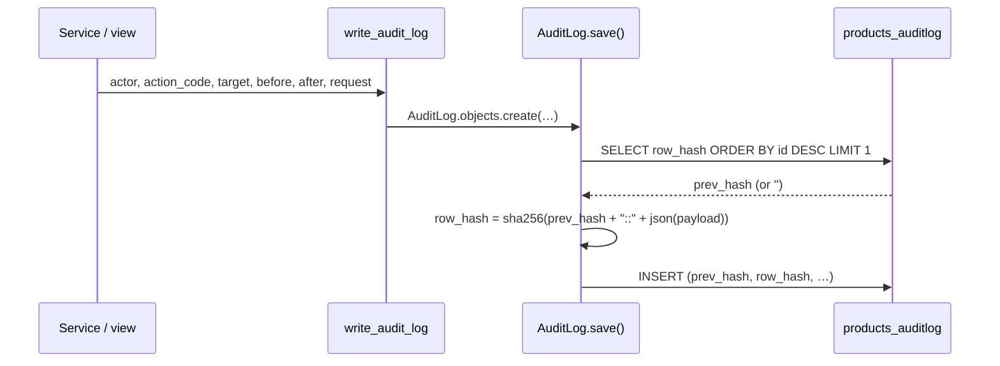

# Audit trails and data redaction

> **Source**: DOC-473 · inventory A.4, A.7 · INT-022, INT-030, INT-042, INT-007, INT-026, INT-035, INT-036, INT-017 (also INT-005, INT-024, INT-033, INT-034, INT-044, INT-045)
> **Code**: `sharwa_saas/products/models/audit.py` (`AuditLog`) · `products/services/audit_service.py` (`write_audit_log`) · `products/migrations/0148_auditlog.py`, `0149_auditlog_revoke.py` · `products/services/staff_service.py` (`list_audit`, `verify_audit`, `list_alerts`) · `api/views_staff.py` · `tenants/models.py` (`PlatformActionLog`) · `tenants/console_service.py` (`log_action`) · `tenants/admin.py` · `products/models/catalog.py` (`ProductChangeLog`) · `products/services/change_actor.py` · `products/services/behavior_service.py` · `products/models/behavior.py` · `products/models/support.py` (`BotToolCallLog`) · `products/services/support_api_service.py` (`_redact`)
> **Last verified against code**: 2026-10-27 (official Step 08)

## 1. Purpose

This page lists every place the platform records **who did what**, how each record is protected against change, how long it is kept, and where sensitive values are hidden or kept out of caches. It covers six stores:

1. `AuditLog` — the store's append-only, hash-chained log (staff, money, order, return, PO and other sensitive actions).
2. `PlatformActionLog` — what the platform owner or an operator did from the console.
3. `ProductChangeLog` — field-level product history, with the actor's name.
4. `StaffDailyUsage` + `BehaviorAlert` — usage counters and anomaly alerts per staff member.
5. `BotToolCallLog` — every tool call made by the support bot, shown to staff with secrets redacted.
6. Money ledgers (`MerchantWalletTransaction`, `WalletTransaction`, `SharwaPayWalletTransaction`) — they are the audit trail of money; their design is in [`43-ledgers.md`](43-ledgers.md) and is not repeated here.

How timelines are **built** from `AuditLog` (orders, returns, POs) is in [`46-timelines-and-notifications.md`](46-timelines-and-notifications.md). Secrets at rest are in [`32-secrets.md`](32-secrets.md).

## 2. Components

| Component | Location | Role |
|---|---|---|
| `AuditLog` | `sharwa_saas/products/models/audit.py` (store schema) | append-only row with before/after snapshots, IP, device fingerprint and a SHA-256 hash chain |
| `write_audit_log` | `sharwa_saas/products/services/audit_service.py` | the single write entry point (`AuditLog.objects.create`) |
| `REVOKE UPDATE, DELETE … FROM PUBLIC` | `sharwa_saas/products/migrations/0149_auditlog_revoke.py` | database-level guard (see §5 for its limit) |
| `GET audit-log/`, `POST audit-log/verify/` | `api/views_staff.py` (`AuditLogView`, `AuditVerifyView`) → `staff_service.list_audit`, `verify_audit` | read-only API and chain verification |
| Legacy audit screen | `products/views/staff_audit.py` (`audit_log_view`) | HTML list; `staff_rbac` feature + `reports.sales.view` |
| `PlatformActionLog` | `sharwa_saas/tenants/models.py` (public schema) | console action log (FR-20.07 «من نفّذ») |
| `log_action` | `sharwa_saas/tenants/console_service.py` | the only writer; failures are logged and swallowed |
| `PlatformActionLogAdmin` | `sharwa_saas/tenants/admin.py` | read-only Django admin (no add, change or delete) |
| `ProductChangeLog` + `acting_as` | `products/models/catalog.py` · `products/services/change_actor.py` | field diff written by `Product.save()`; actor from a context variable |
| `record_usage`, `_raise_alert_once` | `products/services/behavior_service.py` | daily usage counters and one alert per staff/action/day |
| `GET behavior-alerts/`, `POST behavior-alerts/<id>/read/`, `GET staff/counters/` | `api/views_staff.py` | alert list (with `value` / `limit`) and unread counter |
| `BotToolCallLog` | `products/models/support.py` | raw tool-call arguments and a 500-character result summary |
| `_redact`, `SECRET_KEYS` | `products/services/support_api_service.py` | key-based redaction when the timeline is served |

## 3. Data model

| Model | Schema | Key fields | Constraints / indexes | Added or changed by |
|---|---|---|---|---|
| `AuditLog` | store | `actor` (FK `StaffMember`, `SET_NULL`, null = owner or system), `action_code` (≤ 50), `target_model`, `target_id` (string), `before_snapshot`, `after_snapshot` (JSON), `ip_address`, `device_fingerprint`, `request_id`, `prev_hash`, `row_hash`, `created_at` | indexes on `action_code`, `created_at`, `(action_code, created_at)`, `(target_model, target_id)`; ordering `-id` | migrations `products/0148_auditlog`, `0149_auditlog_revoke` |
| `PlatformActionLog` | public | `client` (FK, `SET_NULL`), `schema_name` (kept as text), `actor_username`, `actor_role` (`superuser` «مالك المنصة» / `operator` «مشرف تشغيلي»), `action` (≤ 60), `detail`, `created_at` | indexes on `schema_name`, `action`, `created_at` | migration `tenants/0027_platform_console_api` |
| `ProductChangeLog` | store | `product` (FK, `CASCADE`), `field_name`, `old_value`, `new_value`, `actor` (≤ 150, `''` = automatic/legacy), `changed_at` | index on `changed_at` | `actor` added by `products/0212_productchangelog_actor` |
| `StaffDailyUsage` | store | `staff` (FK, `CASCADE`), `action`, `day`, `count`, `updated_at` | unique `(staff, action, day)` | `products/0150_behavior` |
| `BehaviorAlert` | store | `staff` (FK, `SET_NULL`), `staff_name` (snapshot), `alert_type`, `level` (`warning` / `critical`), `detail`, `value`, `limit`, `is_read`, `created_at` | index on `is_read` | `0150_behavior`; `value` / `limit` added by `0223_staff_api` (INT-022) |
| `BotToolCallLog` | store | `session` (FK `SupportSession`, `CASCADE`), `tool_name`, `arguments` (JSON, **unredacted**), `result_summary` (≤ 500), `created_at` | ordering `-created_at` | `products/0184_bottoolcalllog` |

Each store schema has its **own** `products_auditlog` table, so each store has its own hash chain; there is no cross-store chain.

## 4. Flows

### 4.1 `AuditLog` — write and hash chain

`write_audit_log(actor, action_code, target_model, target_id, before, after, request)` creates one row. `AuditLog.save()`:

1. refuses any save of an existing row (`pk is not None` → `ValueError`);
2. reads `prev_hash` = `row_hash` of the row with the highest `id` (or `''` for the first row);
3. computes `row_hash = sha256(prev_hash + "::" + json.dumps(payload, sort_keys=True, ensure_ascii=False))`, where `payload` = `actor_id`, `action_code`, `target_model`, `target_id`, `before_snapshot`, `after_snapshot`, `ip_address` (or `''`), `device_fingerprint`, `request_id` — **not** `created_at`;
4. inserts the row. `delete()` always raises `ValueError`.

`ip_address` is the first entry of `X-Forwarded-For`, else `REMOTE_ADDR`. `device_fingerprint` is the first 40 hex characters of `sha256(User-Agent)`. `request_id` is never filled by `write_audit_log` (always `''`).



### 4.2 `verify_chain()` and `broken_at`

`AuditLog.verify_chain()` walks every row in `id` order with a running `prev_hash` (starting at `''`) and collects a row id when either:

- the row's stored `prev_hash` is not the previous row's `row_hash` — a row was deleted, inserted out of order, or its `prev_hash` was edited; or
- recomputing the row's hash from its stored content does not give its stored `row_hash` — the content was edited.

It returns the list of broken ids (a row can appear twice). `POST /api/v1/audit-log/verify/` (`staff_service.verify_audit`) turns that into:

```json
{ "ok": false, "broken_at": 1, "rows": 42 }
```

`broken_at` is the **1-based position in insert order** of the lowest broken id (not the id itself); `null` when `ok` is `true`. `rows` is the total row count. A content edit breaks only the edited row (its `row_hash` is not rewritten, so the next row still links); a deleted row breaks the row after it. The test edits the first row directly in the database and expects `(False, 1)`: `api/test_staff_api.py::…::test_audit_verify_alerts_counters`.

### 4.3 Reading the log

`GET /api/v1/audit-log/?actor&action&q&from&to&page` (plan feature `staff_rbac`; any of `staff.view_sessions` or `reports.sales.view`) returns `{count, results[{id, action_code, actor, entity, before_snapshot, after_snapshot, prev_hash, row_hash, created_at}]}`, newest first. `actor` is the staff member's `full_name`, or «مالك المتجر» when `actor` is null. `entity` is a label such as «موظف #12» from `TARGET_LABELS`. `action` filters by prefix (`?action=staff.`). There is no write, edit or delete route. The legacy HTML screen (`products/views/staff_audit.py`) requires `staff_rbac` and `reports.sales.view`.

## 5. Audited actions register

Every `action_code` written in the code at the time of verification. "Actor null" rows are shown as «مالك المتجر» by the API (see §8).

| `action_code` | Written by | `target_model` | Snapshot content |
|---|---|---|---|
| `staff.create` · `staff.update` · `staff.terminate` · `staff.password_reset` | `staff_service` (API); `staff.terminate` also `products/views/staff_rbac.py` (HTML) | `StaffMember` | name/phone; changed fields; `token_version` + reason; `token_version` |
| `staff.sessions_ended` · `staff.session_ended` | `staff_service`; `products/views/staff_sessions.py` (HTML) | `StaffMember` | `token_version` / session id |
| `staff.assignments_change` · `staff.override` · `staff.override_removed` · `staff.roster_change` | `staff_service` | `StaffMember` | assignments, `{permission_code, allow}`, roster day count |
| `staff.token_created` · `staff.token_revoked` · `staff.device_removed` | `staff_service` | `StaffMember` | token name / device label (never the token) |
| `role.create` · `role.change` · `role.delete` | `staff_service`; `products/views/staff_rbac.py` (HTML) | `Role` | role name and permissions |
| `approval.resolve` | `staff_service.resolve_approval`; `products/views/staff_approvals.py` (HTML) | `ApprovalRequest` | `{status, version}` → `{status, note}` |
| `order.created` · `order.status` · `order.fulfillment` · `order.payment` · `order.refund` · `order.note` | `order_api_service.record_event` (called from orders, storefront checkout, POS, returns, shipping, chat-to-order) | `Order` | `{kind, text, actor, source, …}` — the order timeline |
| `return.created` · `return.approved` · `return.rejected` | `returns_api_service` | `ReturnRequest` | `{text, actor, note?}` |
| `rma.status` | `returns_api_service` | `ReturnAuthorization` | `{to_status, actor}` |
| `po.created` · `po.updated` · `po.submitted` · `po.approved` · `po.rejected` · `po.received` · `po.cancelled` | `purchase_order_service.record_po_event` (`procurement_service` for created/updated) | `PurchaseOrder` | `{kind, text, actor, quantities?}` |
| `customers.export` | `api/views_customers.py` | `Customer`, `*` | `{rows, filters, actor}` |
| `customers.cod_disabled` · `customers.cod_enabled` | `api/views_customers.py` | `Customer`, phone key | `cod_disabled` before/after + reason |
| `inventory.export` · `inventory.writeoff_request` | `api/views_inventory.py` | `Product` `*` / `ApprovalRequest` | rows + filters / product, quantity, note |
| `shipping.carrier_credentials` | `shipping_service` | `Carrier` | `{credential_source, changed_fields}` — field names only, no values |
| `shift.close` · `shift.variance_resolve` | `pos_service` | `Shift` | expected/actual; decision + note |
| `affiliate.payout` · `influencer.payout` | `partners_service.mark_paid` | `Affiliate` / `Influencer` | sale ids → `{payout_status, total_sar}` |
| `booking.cancel` | `booking_service` | `BookingSlot` | status before → `{status, product}` |

### 5.1 Console actions (`PlatformActionLog.action`)

Written only by `tenants.console_service.log_action` from the console services: `stores.reprovision`, `sharwa_ship.activate` / `sharwa_ship.deactivate`, `feature.update`, `feature_override.update` / `.bulk` / `.delete`, `domain.add`, `domain.primary`, `deactivation.<suspend|deactivate|close|reinstate>`, `webhook_event.retry` / `.discard`, `plan.create` / `.update` / `.delete`, `plan_feature.update`, `subscription.assign`, `billing_settings.update`, `app.create` / `.update`, `app_override.create` / `.delete`, `market_category.create` / `.update` / `.reorder` / `.delete`, `dues.<collect_commission|waive_commission|collect_charge|waive_charge|unwaive_charge|generate_charge|suspend_app|reactivate_app>`, `sharwa_pay.topup.<approve|reject>`, `sharwa_pay.withdrawal.<confirm|reject>`, `zone.create` / `.update` / `.delete`.

The actor is derived from the console session user (`Actor(user)`: username + role), never from the request. Rows with a store show in the store detail as the last 20 actions (`RECENT_ACTIONS`); rows without a store (plans, apps, zones, Sharwa Pay) are visible only in the read-only Django admin.

### 5.2 Product change log

`Product.save()` compares the tracked fields (`_TRACKED_FIELDS`: name, price, old price, cost price, stock, currency, availability, payment policy, deposit fields, description, serial/digital mode …) with the stored row and writes one `ProductChangeLog` per changed field. The actor comes from `change_actor.current_actor()`, a `ContextVar` set by the API with `acting_as(actor_label(staff))` — «مالك المتجر» for the owner, the staff member's `full_name` otherwise; `''` (shown «—») for automatic or pre-migration changes. Extras that do not go through `Product.save()` write their own rows under the same actor: tier prices (`b2b_api_service._log`, `field_name = 'tier_prices'`) and M37 extras (`product_extras_service._log`).

### 5.3 Staff usage tracking and behaviour alerts

| Action key | Recorded at | Daily alert threshold | Hard limit (blocks the action) | Alert type · level |
|---|---|---|---|---|
| `customers.export` | `CustomerExportView` (quantity = exported rows, min 1) | 1,000 | 5,000 | `export_volume` · `critical` |
| `customers.view` | `CustomerDetailView` (one per 200 response) | 5,000 | — | `view_volume` · `warning` |
| `message.send` | *no caller found* | 200 | 500 | `message_volume` · `warning` |

Only staff members are counted (the owner is not). When the day's count reaches the threshold, one `BehaviorAlert` is created per staff/alert type/day with `value` = the count, `limit` = the threshold and `staff_name` as a snapshot, plus the detail «رصد النظام نشاطاً غير طبيعي من الموظف «…»: … (… عملية اليوم).». A staff member with a `critical` export alert today, or at the hard limit, gets **429** `{"detail": "تجاوزت حدّ التصدير اليومي، راجع مدير المتجر."}` on the next export. The API (`GET behavior-alerts/?level&unread`, `staff.view`) lists only the three alert types and fills `value`/`limit` for legacy rows from the detail text and the thresholds; `GET staff/counters/` returns `{pending_approvals, unread_alerts}`. Rate limits as a policy are in [`34-rate-limits.md`](34-rate-limits.md).

## 6. Redaction and cache-control points

### 6.1 Support tool-call logs

`BotToolCallLog.arguments` and `result_summary` are stored **as the bot produced them**. Redaction happens when staff read a session timeline (`GET /api/v1/support/sessions/<id>/`, `support_api_service.tool_item`):

- `input_summary` = `json.dumps(_redact(arguments))`;
- `output_summary` = `_redact(json.loads(result_summary))` when the summary is JSON; a summary with an `error` key becomes `error`.

`_redact` walks dicts and lists and replaces the **value** of any key matching

```
token|secret|password|passwd|api[_-]?key|authorization|auth|otp|pin|cvv|card
```

(case-insensitive, `re.search`) with `"***"`. Pinned by `api/test_support_api.py::…::test_timeline_merges_redacts_and_follows_the_cursor` (`access_token` and `api_key` → `***`).

### 6.2 `Cache-Control: no-store` and related headers (Django)

| Response | Header(s) | Where |
|---|---|---|
| Order tracking `GET orders/track/<public_uuid>/` | `Cache-Control: no-store` · `X-Robots-Tag: noindex, nofollow` | `api/views_tracking.py` |
| Every Sharwa Pay customer API response | `Cache-Control: no-store` (in `finalize_response`) | `api/views_sharwa_pay.py` |
| WhatsApp connect URL `apps/whatsapp/connect-url/` | `no-store` | `api/views_apps.py` |
| Sharwa AI console token | `no-store` · `Referrer-Policy: no-referrer` | `api/views_sharwa_ai.py` |
| Dropshipping webhook rotate (URL + signing secret, once) | `no-store` | `api/views_dropshipping.py` |
| Customers CSV export · inventory CSV export · products CSV export | `no-store` (+ `X-Export-Rows` on customers) | `api/views_customers.py`, `views_inventory.py`, `views_product_extras.py` |
| CSRF token · dashboard overview and counters · multi-store rollup | `no-store` | `api/views_auth.py`, `views_dashboard.py`, `views_rollup.py` |
| Store still provisioning (503 page) | `no-store` + `Retry-After` | `tenants/middleware.py` |

Through the Next BFF every forwarded answer carries `Cache-Control: no-store` anyway ([`20-bff.md#liveormock`](20-bff.md#liveormock)); the Django headers matter for direct `/api/v1/` callers.

## 7. Invariants

- An `AuditLog` row is never updated or deleted by the application: `save()` on an existing row and `delete()` raise `ValueError`; bulk `QuerySet.update()`/`.delete()` bypass these methods, which is why the hash chain exists.
- Every chain link covers the actor, the action, the target and both snapshots; any later change to one of them is detected by `verify_chain()`.
- The audit API is read-only; its only "write" is the verification call.
- The console actor is the session user; a `PlatformActionLog` row cannot be added, edited or deleted from the Django admin.
- No secret value is ever written into an audit snapshot by the code paths listed in §5 (carrier credentials log field **names**; tokens log the token **name**).
- Tool-call arguments are never served to staff without `_redact`.

## 8. Retention

No pruning or archiving job touches any of these stores: the Celery Beat schedule (`config/settings.py`) has no such task, and the only purge job (`purge_supplier_webhook_payloads`) cleans supplier webhook payloads and sync logs.

| Store | Retention | What can remove rows |
|---|---|---|
| `AuditLog` | kept indefinitely — no pruning job found | nothing in application code; a database owner could (see §9) |
| `PlatformActionLog` | kept indefinitely — no pruning job found | nothing; deleting a store sets `client` to null and keeps `schema_name` |
| `ProductChangeLog` | kept indefinitely — no pruning job found | `CASCADE` when the product is hard-deleted (a product with orders is archived instead) |
| `StaffDailyUsage` | kept indefinitely — no pruning job found (one row per staff/action/day) | `CASCADE` if a staff row is hard-deleted (staff are terminated softly) |
| `BehaviorAlert` | kept indefinitely — no pruning job found | staff deletion sets `staff` to null; `staff_name` stays |
| `BotToolCallLog` | kept indefinitely — no pruning job found | `CASCADE` with its `SupportSession` (no code deletes sessions) |

## 9. Failure modes and limits

| Failure | Symptom | Cause | Handling |
|---|---|---|---|
| Concurrent audit writes | `verify_chain()` reports a break that is not tampering | `_last_row_hash()` reads the last row without a lock; two transactions inserting at the same time can both take the same `prev_hash`, so the second row does not link to the first | inferred from the code, not reproduced; a lock (or a sequence-ordered chain built at verify time) would remove it — open item |
| `REVOKE` without effect | the database user can still update/delete audit rows | `0149` revokes from `PUBLIC`; the table owner (the role that ran the migrations) keeps its rights, as the migration docstring says | effective only when the app runs under a role that does not own the table — an ops decision |
| Hard-deleting a staff member | old rows show «مالك المتجر» and the chain breaks at each of his rows | `actor` is `SET_NULL`, and `actor_id` is part of the hashed payload | the product only terminates staff softly; avoid deletes from the Django admin |
| System rows labelled as the owner | a buyer's receipt upload (`order.payment`, `source: system`) appears with actor «مالك المتجر» in `audit-log/` | `audit_view` maps every null actor to `OWNER_LABEL`; the `after_snapshot` keeps `actor: null` / `source` | display limit; the order timeline reads `after_snapshot` |
| Spoofed IP | `ip_address` shows a forged value | the first `X-Forwarded-For` entry is trusted | correct only if the edge proxy overwrites the header — ops |
| Console log write fails | the action succeeds with no `PlatformActionLog` row | `log_action` catches `DatabaseError` and only logs | by design («السجل لا يُسقط الإجراء نفسه») |
| Redaction over- or under-matches | keys like `shipping` or `author` are masked; a secret inside a free-text value, or a non-JSON `result_summary`, is shown as is | key-name regex only (`pin`, `auth`, `card` are substrings); non-JSON summaries skip `_redact` | stored data is raw; tighten the pattern or redact at write time — open item |
| Webhook endpoint secret responses | `whsec_…` returned on create and rotate without a Django `no-store` header | `WebhookEndpointListView` / `WebhookRotateSecretView` set none | covered through the BFF (always `no-store`); direct API callers are not |

> ⚠️ Discrepancy — roadmap says "Support tool-call logs redact token/secret/password/api-key/OTP/PIN/card values server-side (FR-31.07)" / code does: the redaction is server-side but only **when the timeline is read** (`support_api_service.py:214-230`, `:260`); `BotToolCallLog.arguments` and `result_summary` are stored unredacted (`products/models/support.py:124-127`), and a `result_summary` that is not JSON is returned without redaction (`_tool_result`). The pattern also covers `passwd`, `authorization`, `auth` and `cvv`. Reported in official Step 08.

## 10. Related pages

- Ownership checks behind several audited actions: [`36-ownership-checks.md`](36-ownership-checks.md)
- Timelines built from `AuditLog`: [`46-timelines-and-notifications.md`](46-timelines-and-notifications.md) · approvals: [`45-approvals.md`](45-approvals.md) · money ledgers: [`43-ledgers.md`](43-ledgers.md)
- Secrets at rest: [`32-secrets.md`](32-secrets.md) · rate limits: [`34-rate-limits.md`](34-rate-limits.md) · authorisation: [`31-authorization.md`](31-authorization.md)
- Console reads into store schemas: [`13-cross-schema-access.md`](13-cross-schema-access.md)
- Permission keys (`staff.view_sessions`, `reports.sales.view`): [`../api/overview/permissions.md`](../api/overview/permissions.md)
- Planned route pages: [`../api/domains/12-settings-staff-integrations/m18-staff-permissions.md`](../api/domains/12-settings-staff-integrations/m18-staff-permissions.md) · [`../api/domains/14-apps-ai-support/m32-support.md`](../api/domains/14-apps-ai-support/m32-support.md) · [`../api/domains/16-platform-console/m20-console.md`](../api/domains/16-platform-console/m20-console.md)
- Guide: [`../guides/merchant/12-settings-staff-integrations/audit-and-alerts.md`](../guides/merchant/12-settings-staff-integrations/audit-and-alerts.md)
