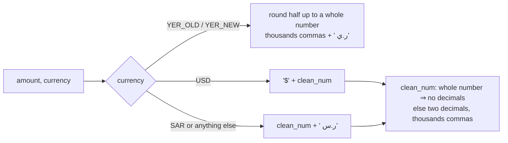
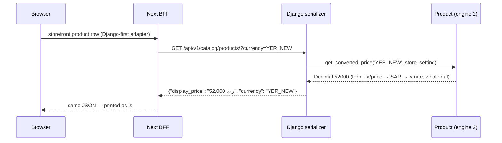

# Money representation, formatting and conversion

> **Source**: DOC-474 · inventory A.6 · INT-010, INT-012, INT-013, INT-017, INT-020, INT-028, INT-033, INT-034, INT-035, INT-037, INT-038, INT-039, INT-043, INT-044, INT-045, INT-048
> **Code**: `sharwa_saas/products/models/base.py` (`CURRENCY_CHOICES`, `convert_amount`, `format_money`) · `products/models/catalog.py` (`Product._convert_value_to_target`, `get_converted_price`, `get_formatted_price`) · `products/views/storefront.py` (`with_display_price`, SQL mirror) · `products/models/store_settings.py` (rates) · `products/models/wallets.py` (`WALLET_CURRENCY_CHOICES`, `wallet_balance_field`) · `products/pricing.py`, `products/services/messaging.py` · module services listed in §4.2 · `sharwa-frontend/src/features/*/schemas.ts` (`displayMoney = z.string()`)
> **Last verified against code**: 2026-10-27 (official Step 08)

The per-route rules (which `display_*` field is in which currency, request formats, error texts) are in the API page [`../api/overview/money.md`](../api/overview/money.md). This page is the design view: one formatter, three conversion engines, where each one runs, and what must never happen.

## 1. Purpose

Sharwa sells in four currencies whose exchange rates the merchant sets by hand. The design has three goals:

1. **The browser never does money arithmetic.** Every amount that is only shown crosses the API as a server-formatted string (`display_*`). The Zod type is `displayMoney = z.string()`, so the frontend cannot parse or sum it by accident.
2. **Every conversion goes through SAR**, with the store's three rates, and is rounded half up.
3. **Amounts in different currencies are never added together.** A total that mixes currencies is returned as one total per currency.

Out of scope here: ledgers and balances (see [`43-ledgers.md`](43-ledgers.md)), idempotent money writes (see [`41-idempotency.md`](41-idempotency.md)), row locks before a money decision (see [`42-concurrency.md`](42-concurrency.md)).

## 2. Components

| Component | Location | Role |
|---|---|---|
| `CURRENCY_CHOICES` | `products/models/base.py` | the four codes and their Django labels: `SAR` «ريال سعودي», `USD` «دولار أمريكي», `YER_OLD` «يمني صنعاء», `YER_NEW` «يمني عدن» |
| `WALLET_CURRENCY_CHOICES` + `wallet_balance_field(currency)` | `products/models/wallets.py` | same four codes for multi-currency balances (merchant wallet, Sharwa Pay); maps a code to `balance_<code>` and raises «عملة غير مدعومة في المحافظ: <code>» for anything else, so an unknown code can never credit the wrong balance |
| `format_money(amount, currency)` | `products/models/base.py` | **the** formatter for `display_*` fields |
| `convert_amount(amount, from, to, store_setting=None)` | `products/models/base.py` | engine 1 — totals that belong to no product |
| `Product._convert_value_to_target(value, target, store_setting=None)` | `products/models/catalog.py` | engine 2 — a product's own values (price, old price, deposit, tier prices, bids); honours `custom_sar_rate` and formula pricing (through `get_converted_price`) |
| `with_display_price(qs, target, store_setting)` | `products/views/storefront.py` | engine 3 — a SQL mirror of engine 2, used only to **filter and sort** storefront lists by converted price; display still goes through engine 2 |
| `StoreSetting.usd_to_sar`, `sar_to_yer_old`, `sar_to_yer_new` | `products/models/store_settings.py` | the three rates, `DecimalField(max_digits=12, decimal_places=4)` since migration `products/0217_storesetting_fx_rate_precision` (INT-010) |
| `fx_preview(s)` | `products/services/settings_service.py` | "100 SAR in each currency", already formatted, for the settings screen |
| Module-own formatters `_money(amount, currency)` | `products/services/marketplaces/api_service.py`, `products/services/suppliers/api_service.py` | a second formatter family for the marketplace and dropshipping screens — see §8 |

The labels the **frontend** shows for the Yemeni currencies are «ريال يمني (صنعاء)» and «ريال يمني (عدن)»; the code is what crosses the wire ([glossary §3](../glossary.md#3-currencies-and-money)).

## 3. Data model — precisions

| Field | Schema | Type | Notes |
|---|---|---|---|
| `Product.price`, `old_price`, `cost_price`; `ProductVariant.old_price`, `cost_price`, `extra_price`; tier prices (`ProductTierPrice.price`, template tiers) | store | `Decimal(10,2)` | in the product's own `currency` |
| `Product.formula_unit_price` | store | `Decimal(12,4)` | formula result is quantised to `0.01` |
| `Product.custom_sar_rate` | store | `Decimal(10,2)` | replaces the store rate of the product's own currency only |
| `StoreSetting.usd_to_sar`, `sar_to_yer_old`, `sar_to_yer_new` | store | `Decimal(12,4)` | defaults `3.75`, `140.00`, `520.00`; `0217` raised them from two to four places |
| `Order.subtotal`, `total_price` | store | `Decimal(10,2)` | stored in `Order.currency` (the buyer's currency for online orders, the store currency for POS, B2B, chat-to-order) |
| `Order.exchange_rate_locked`, `OrderItem.exchange_rate_locked` | store | `Decimal(12,6)` | see §9 — no writer found |
| `Wallet.balance`, `WalletTransaction.amount/balance_after` (customer wallet) | store | `Decimal(12,2)` | **always SAR** (FR-07.04) |
| `MerchantWallet.balance_sar/usd/yer_old/yer_new`, `MerchantWalletTransaction.amount` | store | `Decimal(12,2)` | one balance per currency |
| `SharwaPayWallet.balance_*` (4), `SharwaPayWalletTransaction.amount` | public | `Decimal(12,2)` | one balance per currency, never converted |
| `OperatingExpense.amount` | store | `Decimal(14,2)` | `currency` per row; totals per month **per currency** |
| `PosReceipt.subtotal/discount/total`, `Shift` cash fields | store | `Decimal(12,2)` | store currency |
| `PlatformCommissionRecord.amount` | store | `Decimal(12,2)` | `currency` = order currency |
| `MarketplaceSettings.fx_rate_from_sar` | store | `Decimal(12,6)` | SAR → marketplace currency factor (default `1`) |
| `PricingRule.fx_rate` (dropshipping, fixed rate) | store | `Decimal(12,6)` | SAR per supplier-currency unit |

## 4. Flows

### 4.1 The formatter

| Input | Output |
|---|---|
| `format_money(1250, 'SAR')` | «1,250 ر.س» |
| `format_money(12.5, 'SAR')` | «12.50 ر.س» |
| `format_money(1, 'USD')` · `(12.5, 'USD')` | «$1» · «$12.50» |
| `format_money(52000.5, 'YER_NEW')` | «52,001 ر.ي» |
| `format_money(None, 'SAR')` | «0 ر.س» |

The two Yemeni currencies share the suffix «ر.ي»; only the `currency` field next to the string tells Sana'a from Aden.

### 4.2 Every conversion site

All sites below call one of the three engines; none has its own rate arithmetic except the marketplace and dropshipping pricing (which apply a **second, explicit** factor after the SAR step) and `fx_preview`.

| # | Module (INT) | File : function | From → to | Engine | Rate source | Rounding | Formatter |
|---|---|---|---|---|---|---|---|
| 1 | Storefront cards and detail (INT-011/012) | `api/serializers.py` (`display_price`, `display_old_price`) | product currency → visitor currency (`?currency=`) | engine 2 via `get_converted_price` (formula aware) | store rates, `custom_sar_rate` | SAR/USD 0.01, YER whole | `format_money` |
| 2 | Storefront list filter/sort (INT-011) | `products/views/storefront.py` : `with_display_price` | product currency → visitor currency, in SQL | engine 3 | same, in SQL `CASE` | Postgres `round()` (half away from zero = half up for positives) | none (sort key only) |
| 3 | Storefront product page (INT-012) | `products/services/storefront_product_service.py` (`_convert`, `get_converted_price`) | product → visitor | engine 2 | store, `custom_sar_rate` | as engine 2 | `format_money` |
| 4 | Cart lines incl. variant extras and personalization fees (INT-013, INT-045) | `products/cart.py` (`_convert_value_to_target` of price and of each extra) | product → session currency `user_currency` | engine 2 | store, `custom_sar_rate` | as engine 2 | `format_money` |
| 5 | Tier (quantity) prices (INT-044) | `products/services/tier_pricing.py` : `unit_price` | product → cart currency | engine 2 | store, `custom_sar_rate` | as engine 2 | `format_money` |
| 6 | Free-shipping threshold in the cart summary (INT-013) | `products/services/storefront_cart_service.py` (threshold) | **dashboard currency** (`StoreSetting.currency`) → cart currency | engine 1 | store | 0.01 | `format_money` |
| 7 | Checkout invoice: free-shipping threshold and delivery fee (INT-013) | `products/pricing.py` : `build_order_invoice` | threshold: dashboard currency → cart; fee: `YER_NEW` → cart | engine 1 | store | 0.01 | `format_money` |
| 8 | Delivery-method list on the checkout screen | `products/services/storefront_checkout_service.py` (`yer_new`) · legacy `products/views/cart_checkout.py` | `YER_NEW` → cart | engine 1 | store | 0.01 | `format_money` |
| 9 | Coupon minimum order and fixed-value discount (INT-019) | `products/services/messaging.py` : `calculate_discount` | dashboard currency → cart | engine 1 | store | 0.01 | — (see §9 for the error text) |
| 10 | Customer wallet applied at checkout (INT-028) | `products/services/storefront_checkout_service.py` (wallet preview and quote), `checkout_service.reserve_and_create_order` | wallet SAR → cart for the cap; applied amount cart → SAR for the debit | engine 1 both ways | store | 0.01 | `format_money` |
| 11 | Loyalty redemption value (INT-028) | `storefront_checkout_service.py` (points → riyals → cart) · `products/services/storefront_wallet_service.py` | SAR → cart | engine 1 | store | points/riyals 0.01, then 0.01 | `format_money` |
| 12 | Direct gateway amount (INT-014) | `products/services/checkout_service.py` (`gateway_amount`) | cart → `gateway.settlement_currency` | engine 1 | store | 0.01 | none (sent to the bank) |
| 13 | Refundable deposit on the legacy storefront | `products/views/storefront.py` | product → session currency | engine 1 | store (no `custom_sar_rate`) | 0.01 | template |
| 14 | Auctions: shown minimum, next bid, buy-now (INT-045) | `products/services/storefront_auction_service.py` (`_money`, bid check) | product → **buyer** currency | engine 2 | store, `custom_sar_rate` | as engine 2 (bid compared with a half-cent tolerance) | `format_money` |
| 15 | Bundle total (INT-045) | `products/services/product_extras_service.py` (`bundle_view`) | component currency → bundle currency | engine 2 (component's own rates) | store, component `custom_sar_rate` | as engine 2 | `format_money` |
| 16 | Merchant order lines and delivery fee — manual/B2B drafts (INT-007, INT-044) | `products/services/order_api_service.py` (`line['unit']`, `delivery_fee`, delivery-method list) | product → draft currency; `YER_NEW` → draft currency | engine 1 | store (no `custom_sar_rate`, no formula) | 0.01 (`q2`) | `format_money` |
| 17 | POS line price and refund OTP threshold (INT-033) | `products/services/pos_service.py` : `_unit_price`, refund threshold | product (variant `effective_price`) → **store currency**; threshold store currency → receipt currency | engine 1 | store | 0.01 | `format_money` |
| 18 | Procurement unit cost (INT-035) | `products/services/procurement_service.py` (line picker) | `cost_price` currency → PO currency (= store currency at creation) | engine 1 | store | 0.01 | — |
| 19 | Chat to order (INT-037) | `products/services/social_channels/chat_to_order_service.py` : `unit_price` | product → **store currency** | engine 1 | store | 0.01 | `format_money` |
| 20 | Customer lifetime value (INT-017) | `products/services/customer_service.py` : `_convert` | order currency → store currency | engine 1 | store | 0.01 | `format_money` |
| 21 | Affiliate / influencer commission base (INT-034) | `products/affiliates.py`, `products/influencers.py` (subtotal − discounts − wallet, each → SAR) | order currency → SAR (stored SAR) | engine 1 | store | 0.01 | — |
| 22 | Affiliate / influencer totals shown (INT-034) | `products/services/partners_service.py` : `_display` · legacy `products/views/affiliates.py`, `influencers.py` | SAR → store currency | engine 1 | store | 0.01 | `format_money` |
| 23 | Loyalty points earned | `products/loyalty.py` (order net → SAR) | order currency → SAR | engine 1 | store | 0.01 | — |
| 24 | Merchant view of customer wallets (legacy screens) | `products/views/wallets.py` | wallet SAR ↔ store currency (display and manual top-up input) | engine 1 | store | 0.01 | template |
| 25 | Abandoned-cart detail in the dashboard (INT-019) | `products/services/marketing_service.py` : `cart_view` (`get_converted_price`) | product → the cart's currency | engine 2 | store, `custom_sar_rate` | as engine 2 | `format_money` |
| 26 | Settings preview (INT-010) | `products/services/settings_service.py` : `fx_preview` | 100 SAR → each currency | own arithmetic (no rounding before formatting) | store | by `format_money` | `format_money` |
| 27 | Marketplace push price (INT-038) | `products/services/marketplaces/listing_service.py` : `compute_effective_price` (+ `apply_markup_override`), `api_service.py` sample price | product → SAR (engine 2) → × `fx_rate_from_sar` → × (1 + `default_price_markup_percent`/100) | engine 2 then explicit factor | store + `MarketplaceSettings.fx_rate_from_sar` | 0.01 half up; `price_override` wins | module `_money` (§8) |
| 28 | Dropshipping sell price (INT-039) | `products/services/suppliers/pricing_engine.py` : `to_sar`, `compute_sell_price`, `apply_rounding` | supplier currency → SAR (`SAR` as is, `USD` × `usd_to_sar`, else fixed rule rate or `PricingError`) → markup, floor, rounding mode | own engine | `StoreSetting.usd_to_sar` («daily» in the contract) or `PricingRule.fx_rate` | 0.01 half up, then mode (`none`, `nearest_1`, `end_99`, `end_95`, `end_00`), never below the margin floor | module `_money` (§8) |

Totals that are **not converted** on purpose: Sharwa Pay balances and transactions (four rows, one per currency); merchant wallet balances; platform dues (one total per currency, for example «2.50 ر.س · $1»); expense month totals (`expenses_api_service.list_expenses`: one `display_total` per currency).

### 4.3 A storefront price, end to end

## 5. Invariants

| Invariant | Where enforced |
|---|---|
| A `display_*` string is produced by `format_money` (except the two module formatters of §8) | serializers and `_money` helpers that wrap `format_money` (`storefront_checkout_service`, `pos_service`, `order_tracking_service`, `marketing_service`, `customer_service`) |
| The browser never formats or sums money | Zod `displayMoney = z.string()` in `src/features/*/schemas.ts` |
| Every conversion pivots on SAR and rounds half up | engines 1–3 |
| A stored rate of `0` or less never divides by zero: the default (`3.75`, `140.00`, `520.00`) is used | `convert_amount`, `_convert_value_to_target`, `with_display_price` (`_positive_rate`), `pricing_engine.to_sar` (USD), `suppliers.api_service._daily_rate` |
| `custom_sar_rate` applies only to the product's **own** currency, and only in engines 2 and 3 | `catalog.py`, `storefront.py` |
| A multi-currency balance can only be touched through `wallet_balance_field` | `products/models/wallets.py`, `sharwapay/models.py` managers |
| Customer wallets hold SAR only | `Wallet.balance` "(SAR)"; every caller converts at the boundary (sites 10, 11, 24) |
| Order amounts are stored in `Order.currency` and never re-converted after placement | checkout, POS, B2B and chat-to-order write `currency` with the totals |

## 6. Background work

None of the engines runs in a job. Rates are never refreshed automatically: the merchant edits them in `PATCH settings/currency` (owner-only, plan feature `currency_settings`). The marketplace bulk sync and the dropshipping re-pricing jobs call engines 2 and the pricing engine with the rates current at run time (see [`50-background-jobs.md`](50-background-jobs.md)).

## 7. Configuration

| Setting | Where | Default |
|---|---|---|
| `usd_to_sar`, `sar_to_yer_old`, `sar_to_yer_new` | `StoreSetting` (per store) | `3.75`, `140.00`, `520.00` |
| `StoreSetting.currency` (dashboard currency) | per store | `SAR` |
| `free_shipping_threshold` | per store, in the dashboard currency | `0` = off |
| `default_delivery_fee` | per store, always `YER_NEW` | — |
| `pos_refund_otp_threshold` | per store, store currency (`0229`) | `200` |
| `MarketplaceSettings.fx_rate_from_sar`, `default_price_markup_percent` | per marketplace | `1`, `0` |
| `PricingRule.fx_source` / `fx_rate` | per dropshipping rule | `store_setting` (contract value `daily`) / empty |

## 8. Failure modes and fixes

| Failure | Symptom | Cause | Handling / fix |
|---|---|---|---|
| Yemeni card price without a unit | «52,000» with no «ر.ي» | legacy `Product.get_formatted_price` returns a bare integer for YER (templates add the unit) | API cards use `format_money` instead (INT-012) |
| Wrong YER amounts suffixed «ر.س» | totals in templates hard-coded the SAR symbol | — | `format_money` introduced for every total (docstring in `base.py`) |
| Bank charged tens of times the right amount | gateway received `total_price` in the buyer's currency | — | `convert_amount` to `settlement_currency`, and only the upfront part (site 12) |
| `NameError` on conversion without `store_setting` | `_convert_value_to_target` used `StoreSetting` without importing it | latent bug found 2026-10-10 | lazy import in the method; marketplaces always pass `store_setting` |
| Chat-to-order totals mixed currencies | order written as `SAR` with each product's own number | — | INT-037: store currency + `convert_amount` per unit (site 19) |
| Rates rounded to two places | `3.7525` stored as `3.75` | `DecimalField(…, 2)` | `products/0217_storesetting_fx_rate_precision` (INT-010) |

> ⚠️ Discrepancy — roadmap says every amount crosses the API as a `format_money` string / code does: the marketplace and dropshipping screens use their own `_money(amount, currency)` = `f'{amount:,.2f} {suffix}'` (`products/services/marketplaces/api_service.py:59-61`, `products/services/suppliers/api_service.py:94-96`). Output differs from `format_money`: always two decimals and the suffix after the number for every currency (`1,250.00 ر.س`, `12.50 $`, `52,000.00 ر.ي`), plus `د.إ` for AED marketplaces; dropshipping writes `'YER'` instead of the two Yemeni codes, and unknown codes print the raw code. Reported in official Step 08.

> ⚠️ Discrepancy — roadmap calls `StoreSetting.usd_to_sar` the dropshipping «daily» rate / code: «daily» is only the **contract value** of `fx_source` (`suppliers/api_service.py:395` maps model `store_setting` → `'daily'`); the rate is the stored `usd_to_sar` the merchant edits, and nothing refreshes it. Already noted in [`money.md`](../api/overview/money.md#conversion); repeated here because the glossary still says «daily». Reported in official Step 08.

> ⚠️ Discrepancy — [`money.md`](../api/overview/money.md) §5 says migration `0217_storesetting_fx_rate_precision` "is not in the review copy" / code: the migration exists (`products/migrations/0217_storesetting_fx_rate_precision.py`, depends on `0216_notifications`) and alters the three rates to `decimal_places=4`. The API page should drop that sentence. Reported in official Step 08.

## 9. Open items

- **Two engines, two prices for the same product.** Engine 1 ignores `custom_sar_rate` and formula pricing. POS (`pos_service._unit_price`), merchant/B2B order lines (`order_api_service`) and chat-to-order (`chat_to_order_service.unit_price`) convert `price`/`effective_price` with `convert_amount`, while the storefront uses engine 2. A product with a `custom_sar_rate` or `pricing_type='formula'` can therefore be priced differently at the POS, in a manual order or in a chat order than on the storefront. Whether that is intended was not found in the code; to be confirmed by fares.
- **`exchange_rate_locked` is never written.** `Order.exchange_rate_locked` ("written once at confirmation") and its line copy `OrderItem.exchange_rate_locked` are declared and copied (`checkout_service`, `chat_to_order_service`, `api/views.py`), but no assignment was found in the files read, so both stay `NULL`. Reports that would rely on it have nothing to read.
- **Fixed-rate dropshipping rule applies its rate to SAR costs too.** `pricing_engine.to_sar` multiplies by `rule.fx_rate` whenever `fx_source='fixed'`, before checking the currency. A fixed rule applied to a SAR supplier multiplies SAR by the rate.
- **Coupon minimum-order error** prints the raw stored amount and the currency **code**: «الحد الأدنى لتطبيق هذا الكوبون هو <min_order_amount> <StoreSetting.currency>», for example `… هو 50.00 SAR`, not a `format_money` string (`messaging.py`).
- **Dropshipping `display_current` / `display_after`** format `product.price` as `'SAR'` whatever `product.currency` is (`suppliers/api_service.py:570-571`); harmless while imported products are SAR, which the pricing engine assumes.

## 10. Related pages

- API: [`money.md`](../api/overview/money.md) (wire formats, per-module rules, examples) · [`conventions.md`](../api/overview/conventions.md)
- Architecture: [`43-ledgers.md`](43-ledgers.md) · [`41-idempotency.md`](41-idempotency.md) · [`42-concurrency.md`](42-concurrency.md) · [`20-bff.md`](20-bff.md) · [`92-inconsistencies.md`](92-inconsistencies.md)
- Glossary: [currencies and money](../glossary.md#3-currencies-and-money)
