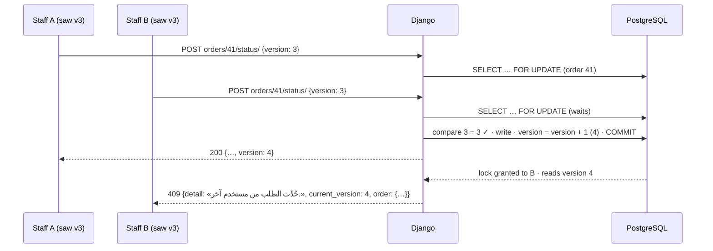

# Optimistic locking and row-lock conventions (409 register)

> **Source**: DOC-476 · inventory A.7 (optimistic locking) · INT-007, INT-018, INT-020, INT-021, INT-022, INT-026, INT-031, INT-033, INT-035, INT-042, INT-045, INT-047, INT-048
> **Code**: `sharwa_saas/products/services/product_api_errors.py` (`conflict`) · `order_api_service.py` (`lock_order`, `bump_version`, `OrderVersionConflict`) · `api/views_orders.py`, `api/views_shipping.py` · `design_service.py` · `returns_api_service.py`, `return_service.py` · `products/models/staff_approvals.py` (`ApprovalRequest.resolve`, `ConcurrencyError`) · `staff_service.py` · `pos_service.py` · `procurement_service.py` · `support_api_service.py`, `support_lock_service.py` · `sharwa_ship_api_service.py` · `payments_service.py` (`decide_withdrawal`) · `products/admin.py` · `tenants/console_money_service.py` · `sharwapay/models.py` · `booking_service.py`, `b2b_api_service.py`, `product_extras_service.py`, `product_import_service.py`
> **Last verified against code**: 2026-10-27 (official Step 08)

The client-side recovery rules (what to show, what to resend) are in the API page [`../api/overview/conflicts.md`](../api/overview/conflicts.md). This page is the single reference for **which resources carry a `version`, which 409 body each one returns, which rows are locked before a money or stock decision, and which database constraints settle races**.

## 1. Purpose

Two people (or a person and a job) can act on the same row at the same time. Sharwa uses three tools, from the most visible to the least:

1. **Optimistic version** — the client sends the `version` it saw; Django refuses a stale one with `409`. Used where a human edits or decides and must see the other person's change.
2. **Row lock** (`select_for_update()` inside `transaction.atomic()`) — the second writer waits for the first and then sees its result. Used before every money, stock or state decision. Invisible to the client.
3. **Database constraint** (unique, partial unique, one-to-one) — the last line of defence: when two inserts race, PostgreSQL refuses the second and the service maps the `IntegrityError` to a clear answer.

Retries of the **same** request are a different problem, handled by keys ([`41-idempotency.md`](41-idempotency.md)).

## 2. Components

| Component | Location | Role |
|---|---|---|
| `conflict(message, **extra)` | `products/services/product_api_errors.py` | builds `ProductApiError(409, {"detail": message, **extra})` — every 409 body is `{detail, …}` |
| `lock_order(order_id, version, *, version_required=True, check_marketplace=True)` / `bump_version(order)` / `OrderVersionConflict` | `products/services/order_api_service.py` | orders: lock the row, compare, then `F('version') + 1` |
| `ApprovalRequest.resolve(resolver, decision, expected_version)` / `ConcurrencyError` | `products/models/staff_approvals.py` | approvals: lock, compare `version` **and** `status == 'pending'`, bump; self-approval ⇒ `PermissionError` first |
| `ReturnConcurrencyError` | `products/services/return_service.py` | returns: compare under lock in `approve_return` |
| `SessionLockConflict` | `products/services/support_lock_service.py` | support sessions: every transition compares and bumps `version` |
| `_check_version(po, body, required)` | `products/services/procurement_service.py` | purchase orders |
| `ApiError.body` + `defaultMessage(409)` | `sharwa-frontend/src/lib/api-error.ts` | client side: the whole 409 body is kept for the screen |

## 3. The `version` reference table

| Resource | Column (migration) | Checked in | Request field | 409 body | Arabic `detail` (verbatim) | Version key in body |
|---|---|---|---|---|---|---|
| Order — edit, status, fulfilment status, payment actions, refunds (INT-007) | `Order.version` (`0151_order_snapshot_fields`) | `order_api_service.lock_order` → `api/views_orders.py` | `version`, **required** | `{detail, current_version, order}` (`order` = full current detail) | «حُدِّث الطلب من مستخدم آخر.» | `current_version` |
| Order — convert to pickup (INT-021) | `Order.version` | `shipping_service.convert_to_pickup` → `api/views_shipping.py` | `version` | `{detail, current_version, status}` (`status` = latest shipment status) | «حُدِّث الطلب من مستخدم آخر — أعد تحميل الصفحة.» | `current_version` |
| Storefront theme (INT-018) | `StoreSetting.theme_version` (`0219_theme_version_section_label`) | `design_service` (row locked first) | `version`, **optional** (absent ⇒ no check); non-numeric ⇒ `400` `{"version": ["قيمة غير صالحة."]}` | `{detail, current_version}` | «حُدِّث الثيم من جلسة أخرى. أعد التحميل لترى آخر نسخة منشورة.» | `current_version` |
| Return request decision (INT-026) | `ReturnRequest.version` | `returns_api_service` (pre-check, then compare-and-set `UPDATE … WHERE version=…`) · `return_service.approve_return` (under lock) | `version`, **optional** | `{detail, current_version}` | stale: «حُدِّث طلب الإرجاع من مستخدم آخر.» · already decided: «حُسم هذا الإرجاع من قبل (<status>).» | `current_version` |
| Approval request (INT-022, and every kind that resolves through it) | `ApprovalRequest.version` (`0147_staff_approvals`) | `ApprovalRequest.resolve`; API `staff_service` | `version`, **required** | `{detail, version}` (+ `status` when already decided) | «حُسم الطلب من مستخدم آخر.» | `version` |
| POS shift variance (INT-033) | `Shift.version` (`0229_pos_api`) | `pos_service.resolve_variance` (row locked) | `version` | `{detail, version}` | stale: «تغيّرت الوردية، أعد التحميل.» · already settled: «حُسم فرق هذه الوردية من مستخدم آخر.» | `version` |
| Purchase order (INT-035) | `PurchaseOrder.version` (`0230_procurement_api`) | `procurement_service._check_version` | `version`: optional on `update_po` and `submit_po`; **required** on `resolve_po`, `receive_po`, `cancel_po` | `{detail, version}` | stale: «حُدِّث الأمر من مستخدم آخر.» · approval decided elsewhere: «تم حسم هذا الاعتماد بالفعل من طرف آخر.» | `version` |
| Support session (INT-042) | `SupportSession.version` (`0234_support_api`) | `support_lock_service` (takeover, release, close, reply) | `version`, **required**: `400` `{"version": ["أرسل رقم نسخة الجلسة كما رأيتها."]}` | `{detail, session}` (`session` = current session view) | stale: «تغيّرت الجلسة منذ فتحتها — حُدّثت.»; state messages such as «هذه الجلسة مستلَمة بالفعل من قِبل <name>.» | inside `session` |
| Sharwa Ship shipment (INT-047) | none — `version` = accepted events + 1 (`sharwa_ship_api_service`, 211) | — | — | no 409 | — | read-only |

Notes:

- The version key has **three spellings**: `current_version` (orders, theme, returns), `version` (approvals, shifts, purchase orders), and nested in `session` (support). [`conflicts.md`](../api/overview/conflicts.md) already flags this for client helpers.
- Every check runs **after** the row lock, so the compare-and-bump cannot interleave.
- Fields called `version` that are **not** optimistic locks: `FeedMapping.version` / `approved_version` (dropshipping — the approved mapping revision), `StaffMember.token_version` (bumped to revoke tokens on termination), the `version` returned by the Sharwa AI commerce API (stock snapshot marker).
- Resources with **no** version (last write wins): products, categories, brands, tags, collections, badges, most settings sections, customers, coupons, offers. Screens that need protection there must re-read before saving.

## 4. Row-lock register

Every money or stock decision locks the rows it will change **before** it reads the value it decides on.

| Area | Locked row(s) | File : function | Guarded decision |
|---|---|---|---|
| Customer wallet | `Wallet` | `products/models/wallets.py` : `WalletManager.credit/debit` | balance check + transaction row in one step |
| Merchant wallet | `MerchantWallet` (single row `pk=1`) | `products/models/wallets.py` : `MerchantWalletManager.credit/debit`; `payments_service.create_withdrawal` | available balance before a withdrawal debit |
| Merchant withdrawal decision | `MerchantWithdrawalRequest` | `payments_service.decide_withdrawal` (API, and the store admin actions in `products/admin.py`) | `status == 'pending'`, then approve or refund once |
| Sharwa Pay wallet | `SharwaPayWallet` | `sharwapay/models.py` : `SharwaPayWalletManager.credit/debit` (+ audit row in the same transaction) | per-currency balance |
| Sharwa Pay top-up approval | `SharwaPayTopupRequest` | `sharwapay/models.py` : `apply_credit_if_approved`; `tenants/console_money_service.py` : `topup_action` | `credited_at` empty ⇒ credit once |
| Sharwa Pay withdrawal decision | `SharwaPayWithdrawalRequest` | `console_money_service.withdrawal_action` | `pending` ⇒ confirm, or reject + `withdrawal_reversal` credit in the same transaction |
| Platform dues | `PlatformCommissionRecord` (`status='pending'`), `AppBillingCharge` | `console_money_service._commission_action`, `_charge_action` | collect / waive once; a lost race answers «<item> غير موجود أو تم التعامل معه مسبقاً.» |
| Merchant credit and platform commission per order | `Order` | `merchant_credit_service.process_order_merchant_credit`, `commission_service._record_platform_commission`, `refund_service.process_order_refund` | `is_merchant_credited` / existing record / refund amount |
| Orders (all writes) | `Order` | `order_api_service.lock_order` | version + state machine |
| Checkout reservation | `Product`, `ProductVariant`, `BookingSlot`, `Wallet` | `checkout_service.reserve_and_create_order` | stock, held slots and wallet cap in one short transaction |
| Stock reservations and movements | `ProductVariant`/`Product`, `InventoryReservation`, `LocationInventory` | `inventory_reservation_service`, `inventory_service.adjust`, `apply_writeoff`, `Order.release_reserved_stock`, `Order.cancel_order`, `return_service.restock_to_location`, `returns_api_service.qa_decision` | no negative stock, single release |
| POS | `Shift`, `CashRegister`, `Product`/`ProductVariant`, `InventoryItem`, `ApprovalRequest` | `pos_service` (`_live_shift`, `open_shift`, `price_cart`, `_deduct`, `_discount_approval`, `resolve_variance`, `settle_shift_for_approval`) | one open shift per register, stock, discount approval use |
| Approvals | `ApprovalRequest` | `ApprovalRequest.resolve` | one decision |
| Purchase orders | `PurchaseOrder` and lines | `purchase_order_service`, `procurement_service` | receive / cancel once |
| Returns | `ReturnRequest` | `return_service.approve_return` | one refund |
| Auctions | `Auction` | `product_extras_service.auction_row(lock=True)` from `storefront_auction_service` | bid ≥ current minimum; no two bids accepted against the same minimum |
| Bookings | `BookingSlot` | `booking_service.hold`, `cancel_slot` | one live hold per (product, start) |
| Product import | `ProductImportJob` | `product_import_service._locked` | rows processed in chunks of `CHUNK = 200` under the job lock at each poll |
| Campaign send | `MarketingCampaign` | `marketing_service.dispatch_campaign` | status flip before dispatch |
| Support sessions | `SupportSession` | `support_lock_service` | takeover / reply / close |
| Partner payouts | affiliate / influencer and their sales | `partners_service._get`, `mark_paid` | payout within the net allowance, oldest first |
| Platform settings | `PlatformBillingSettings`, `TenantDeactivationRecord` | `console_billing_service.patch_billing_settings`, `console_service.deactivation_action` | plans switch, lifecycle transition |
| Marketplaces / dropshipping jobs | job and stock rows | `marketplaces/order_pull_service`, `suppliers/stock_service`, `suppliers/order_forward_service`, `suppliers/import_service`, `suppliers/connection_service` | single job runner, one supplier order |

About 60 files call `select_for_update`; the table lists the groups that guard a decision. Lock order for product rows is **ascending id** where several are locked together (`chat_to_order_service`, legacy cart checkout), which avoids deadlocks between two conversions locking the same products.

## 5. Constraints that settle races

| Constraint | Model (schema) | Race it settles | Mapped answer |
|---|---|---|---|
| `uniq_active_booking_slot_per_product_time` — unique (`product`, `start_datetime`) where `status in ('held','booked')` | `BookingSlot` (store) | two buyers hold the same slot | `409` «لم يعد هذا الموعد متاحاً.» (`booking_service.hold`, `IntegrityError` branch) |
| `unique_product_tier_quantity` (`product`, `min_quantity`) | `ProductTierPrice` | two adds of the same threshold | `400` `{"min_quantity": ["يوجد سعر لهذه الكمية مسبقاً."]}` — the same text as the pre-check (`b2b_api_service`) |
| `unique_bundle_component` (`bundle`, `component`) | `BundleComponent` | two adds of the same component | `400` `{"component_id": ["هذا المنتج مكوّن في الحزمة مسبقاً."]}` |
| `unique_inventory_item_code_per_product` | `InventoryItem` | two adds of the same serial | `400` `{"codes": ["أكواد مكررة."], "duplicates": []}` |
| `unique_open_shift_per_register` — unique (`register`) where `status='open'` | `Shift` | two cashiers open the same register | refused by the index (the service also locks the register) |
| `one_active_support_session_per_customer` — unique (`customer_phone`) where status active | `SupportSession` | two inbound messages open two sessions | one session |
| `ConversationKeywordTrigger.keyword` `unique=True` | store | two triggers with the same keyword | pre-check is case-insensitive («يوجد محفّز بالكلمة نفسها.»); the race itself is **not** mapped — see §7 |
| Idempotency columns (`Order.idempotency_key`, `PosIdempotencyKey.key`, `Message.client_id`, …) | various | duplicate submissions | see [`41-idempotency.md`](41-idempotency.md) |
| `unique_custom_domain_per_client`, `unique_tenant_stats_day`, `unique_daily_store_metrics_date`, `unique_app_charge_per_period` | public / store | double creation by jobs or concurrent verify | see [`12-custom-domains.md`](12-custom-domains.md), [`13-cross-schema-access.md`](13-cross-schema-access.md) |

## 6. Invariants

| Invariant | Where enforced |
|---|---|
| A version only grows: compare, then `+1` in the same locked transaction | `bump_version` (`F('version') + 1`), `ApprovalRequest.resolve`, PO, shift, support, returns |
| A decided approval cannot be decided again, even with the right version | `resolve` checks `status == 'pending'` together with the version |
| No money decision reads a balance without holding the balance row | wallet managers (§4) |
| A refund of a rejected withdrawal happens once | `decide_withdrawal`: lock + `status != 'pending'` ⇒ `409` «تم البتّ في هذا الطلب مسبقاً.» |
| Internal callers that bypass the client version still bump it | `lock_order(..., version_required=False)` from shipping and convert-to-pickup |

## 7. Failure modes and fixes

| Failure | Symptom | Cause | Handling / fix |
|---|---|---|---|
| Rejected merchant withdrawal refunded twice | two concurrent «رفض» clicks credited the amount twice | the old Django-admin action looped over the queryset and credited without locking the request | INT-020: the admin actions call `payments_service.decide_withdrawal` (row lock + `pending` guard), the same function as the API (`products/admin.py` `_decide`) |
| Two staff changing one order's status | the later write silently overwrote the earlier | no version | `Order.version` (solution #18, migration `0151_order_snapshot_fields`, before Phase 002) + `lock_order`; exposed to the API in INT-007 |
| Two approvers both approving | two effects (e.g. two write-offs) | no lock on the request | `ApprovalRequest.resolve` lock + version (#9/#50) |
| Two buyers booking the same slot | double booking | check-then-insert | partial unique constraint + `IntegrityError` ⇒ 409 (INT-036) |
| Two bids accepted at the same minimum | auction accepts both | no lock | auction row lock (INT-045) |
| Import job processed twice by two polls | duplicate products | no job lock | job row lock per poll, 200-row chunks (INT-045) |
| `TransactionManagementError` after a caught `IntegrityError` | console request failed after a duplicate charge | `IntegrityError` caught without a savepoint | `atomic()` around the insert (INT-031; see [`13-cross-schema-access.md`](13-cross-schema-access.md)) |

> **Note — optional versions.** For the theme save (`design_service.py:181-189`) and the return decision (`returns_api_service.py:356-361`) the `version` is optional: with no `version` in the body the check is skipped, and the return decision's compare-and-set uses the row's current version, so the write wins silently. Already flagged in [`conflicts.md`](../api/overview/conflicts.md); kept here as a design rule.

> **Note — support 409s.** The stale-version sentence is «تغيّرت الجلسة منذ فتحتها — حُدّثت.» (`support_lock_service.py:17`). The other 409 sentences of the same routes are state conflicts that do not depend on the version (for example «هذه الجلسة مستلَمة بالفعل من قِبل <name>.», «الجلسة مغلقة مسبقاً.»). All carry the current `session`, which is what the client should read.

> ⚠️ Discrepancy — roadmap lists "keyword uniqueness" among the constraints that settle races / code: `ConversationKeywordTrigger.keyword` is `unique=True`, but `save_keyword` only pre-checks case-insensitively and then calls `save()` without catching `IntegrityError` (`products/services/social_channels/channels_api_service.py:252-277`). A race between two identical creates ends in a `500` for the loser, not the `400` «يوجد محفّز بالكلمة نفسها.», and because the index is case-sensitive, two keywords that differ only in letter case can both be created by a race. Reported in official Step 08.

## 8. Open items

- **Keyword trigger race** — see the discrepancy above; a fix would catch `IntegrityError` in `save_keyword` and map it to the same `400`.
- **Notification upsert** has no `IntegrityError` guard (see [`41-idempotency.md`](41-idempotency.md) §8).
- **Version required vs optional is per resource** (table §3). A future resource should make it required, like orders and approvals.
- **No version on catalogue and settings edits.** Accepted for the MVP; listed for the inconsistencies register ([`92-inconsistencies.md`](92-inconsistencies.md)).

## 9. Related pages

- API: [`conflicts.md`](../api/overview/conflicts.md) (client recovery) · [`errors.md`](../api/overview/errors.md) · [`idempotency.md`](../api/overview/idempotency.md)
- Architecture: [`41-idempotency.md`](41-idempotency.md) · [`43-ledgers.md`](43-ledgers.md) · [`44-stock-ledger.md`](44-stock-ledger.md) · [`45-approvals.md`](45-approvals.md) · [`13-cross-schema-access.md`](13-cross-schema-access.md)
