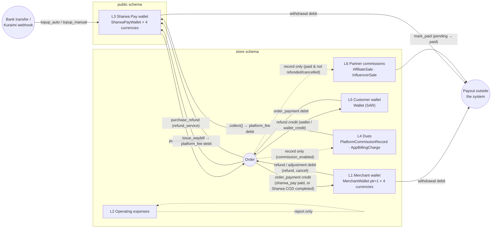

# Money ledgers — merchant wallet, expenses, Sharwa Pay, dues, customer wallet, partner commissions

> **Source**: DOC-477 · inventory Domain 8 relationship · INT-020, INT-028, INT-031, INT-048, INT-026 (+ INT-034, INT-047 for partner commissions and the Sharwa Ship fee)
> **Code**: `sharwa_saas/products/models/wallets.py` (`WalletManager`, `MerchantWalletManager`, `MerchantWithdrawalRequest`) · `sharwa_saas/sharwapay/models.py` (`SharwaPayWalletManager`, `SharwaPayTopupRequest.apply_credit_if_approved`) · `sharwa_saas/products/models/billing.py` (`PlatformCommissionRecord`, `AppBillingCharge`, `.collect()`) · `sharwa_saas/tenants/merchant_billing.py` · `sharwa_saas/products/services/{merchant_credit_service,refund_service,payments_service,wallet_service,commission_service,shipping_billing_service,partners_service,expenses_api_service,checkout_service,storefront_checkout_service}.py` · `sharwa_saas/products/loyalty.py` · `sharwa_saas/sharwapay/customer_api.py` · `sharwa_saas/tenants/{console_money_service,webhooks,sharwa_pay_views}.py`
> **Last verified against code**: 2026-10-27 (official Step 08)

## 1. Purpose

Sharwa keeps money in **six independent records**. Each one has a single write path (a manager or one service function), a row lock, and an audit row written in the same transaction as the balance change. No record converts into another automatically; money moves between them only through the explicit calls listed in §4.

This page is the design reference: which record lives in which schema, **who writes it** (every writer, file and function), which invariants hold and where they are enforced, and **how each movement is reversed**. Per-route request and response shapes are on the API pages (§10). How amounts are formatted is in [`40-money.md`](40-money.md); idempotency keys are in [`41-idempotency.md`](41-idempotency.md); the `version` / 409 conventions are in [`42-concurrency.md`](42-concurrency.md).

Out of scope: the POS cash drawer (`ShiftCashMovement`) and the courier COD custody (`CourierCustodyLedger`). They are cash-handling records, not balances, and are covered with POS and the courier app.

## 2. Components

| # | Ledger | Schema | Balance holder | Movement row | Single write path |
|---|---|---|---|---|---|
| L1 | Merchant wallet («محفظة المتجر») | store | `MerchantWallet` (one row, `pk=1`, four balances) | `MerchantWalletTransaction` | `MerchantWallet.objects.credit/debit` (`products/models/wallets.py:159`, `:183`) |
| L2 | Operating expenses | store | none (append-only list) | `OperatingExpense` | `expenses_api_service.create_expense` (`:138`) |
| L3 | Sharwa Pay wallet («شروة باي») | **public** | `SharwaPayWallet` (per phone, four balances) | `SharwaPayWalletTransaction` | `SharwaPayWallet.objects.credit/debit` (`sharwapay/models.py:39`, `:55`) |
| L4 | Platform dues | store (records) → public (debit) | none (each record is one due) | `PlatformCommissionRecord`, `AppBillingCharge` | `.collect()` → `tenants/merchant_billing.collect_platform_fee_from_merchant` |
| L5 | Customer wallet («محفظة العميل») | store | `Wallet` (per phone, SAR only) | `WalletTransaction` | `Wallet.objects.credit/debit` (`products/models/wallets.py:43`, `:60`) |
| L6 | Affiliate / influencer commissions | store | none (owed is computed) | `AffiliateSale`, `InfluencerSale` | `create_affiliate_sale` / `create_influencer_sale` (write), `partners_service.mark_paid` (settle) |

The Sharwa Ship waybill fee is not a ledger of its own: it is a debit on **L3** made through the same function as L4 (§4.4).

Dotted arrows create a record without moving money. Solid arrows move a balance.

## 3. Data model

| Model | Schema | Key fields | Constraints / indexes | Added or changed by |
|---|---|---|---|---|
| `MerchantWallet` | store | `balance_sar`, `balance_usd`, `balance_yer_old`, `balance_yer_new` (`Decimal(12,2)`), `updated_at` | `save()` forces `pk=1`; `load()` = `get_or_create(pk=1)`; created by the `StoreSetting` post-save signal (`products/signals.py:21`) | migrations `0087`, `0090` (multi-currency) |
| `MerchantWalletTransaction` | store | `transaction_type` (`credit`/`debit`), `currency`, `amount`, `balance_after`, `description`, `kind` (`order_payment` · `refund` · `commission` · `withdrawal` · `adjustment`), `reference_kind` (`order` · `commission` · `withdrawal`), `reference_id` | `kind` indexed | `kind` / `reference_*`: migration `products/0221_merchant_wallet_api` (INT-020) |
| `MerchantWithdrawalRequest` | store | `amount` (≥ 0.01), `currency`, `payout_account` (FK, `SET_NULL`), `payout_destination` (text snapshot), `idempotency_key` (unique, nullable), `status` (`pending` · `approved` · `rejected`), `rejection_reason`, `reviewed_at` | unique `idempotency_key` | `payout_account`, `idempotency_key`: `0221` |
| `OperatingExpense` | store | `category`, `amount` (`Decimal(14,2)`, ≥ 0), `currency`, `expense_date`, `note`, `created_by` | — | migration `0175`; permission `expenses.manage` seeded by `0235` |
| `SharwaPayWallet` | public (`db_table='tenants_sharwapaywallet'`) | `customer_phone` (unique, normalised on every `save()`), four balances, `is_active` | unique phone | moved from `tenants` to the `sharwapay` app with state-only migration |
| `SharwaPayWalletTransaction` | public | `reason` (`topup_manual` · `topup_auto` · `purchase` · `purchase_refund` · `withdrawal` · `withdrawal_reversal` · `platform_fee`), `currency`, `amount`, `balance_after`, `description`, `source_tenant_schema`, `source_order_id` (no FK — cross-schema) | both source fields indexed | — |
| `SharwaPayTopupRequest` | public | `wallet` (nullable), `bank_transaction_id` (**unique**, nullable), `amount`, `currency`, `receipt_image`, `status`, `bank_name`, `claimed_phone`, `reviewed_by`, `credited_at` | unique `bank_transaction_id` | `bank_name` / `claimed_phone` / `reviewed_by`: INT-031 |
| `SharwaPayWithdrawalRequest` | public | `wallet`, `amount`, `currency`, `payout_destination`, `status`, `rejection_reason`, `reviewed_by` | — | `reviewed_by`: INT-031 |
| `PlatformCommissionRecord` | store | `order` (**one-to-one**), `plan_name_snapshot`, `commission_type`, `commission_value`, `amount`, `currency`, `status` (`pending` · `collected` · `waived`), `collected_at` | one record per order | migration `0101` |
| `AppBillingCharge` | store | `installation`, `app_name_snapshot`, `period_label`, `price_snapshot`, `currency`, `status`, `collected_at` | unique (`installation`, `period_label`) | migration `0102` |
| `Wallet` | store | `customer_phone` (unique), `balance` (SAR), `is_active` | unique phone | migration `0062` |
| `WalletTransaction` | store | `transaction_type`, `reason` (`manual_topup` · `refund` · `reward` · `order_payment` · `adjustment` · `loyalty_redeem`), `amount` (SAR), `balance_after`, `order`, `actor`, `idempotency_key` (unique, nullable) | unique `idempotency_key` | `actor`, `idempotency_key`: migration `products/0227_wallets_api` (INT-028) |
| `AffiliateSale` / `InfluencerSale` | store | `order` (affiliate: **one-to-one**; influencer: FK), `order_total_at_sale` (SAR), `commission_amount`, `commission_currency`, `payout_status` (`pending` · `paid`), `paid_at` | `AffiliateSale.order` one-to-one | migrations `0056`, `0067` |

## 4. Flows — writers, invariants and reversal per ledger

### 4.1 L1 — Merchant wallet

**Writers** (every call of `MerchantWallet.objects.credit/debit` in the code):

| Movement | Writer | `kind` · reference | When |
|---|---|---|---|
| credit `order_payment` | `merchant_credit_service.process_order_merchant_credit` (`:14`) | `order_payment` · (`order`, id) | only two cases: `payment_method='sharwa_pay'` **and** `payment_status='paid'`; or manual COD with `amount_on_delivery > 0` through an official Sharwa delivery method (`is_sharwa_official`) **and** `status='completed'`. Direct gateways (Kuraimi / Jeeb) and manual transfers are never credited |
| debit `refund` | `refund_service.process_order_refund` (`:181`) | `refund` · (`order`, id) | any refund of an order with `is_merchant_credited=True` |
| debit `adjustment` | `Order.cancel_order` (`products/models/orders.py:541`) | `adjustment` · (`order`, id) | cancelling a credited order |
| debit `withdrawal` | `payments_service.create_withdrawal` (`:503`, API) · `views/merchant_wallet.merchant_withdrawal_request_view` (legacy HTML) | `withdrawal` · (`withdrawal`, id) | at request time |
| credit `withdrawal` | `payments_service.decide_withdrawal` (`:556`) — called by the Django admin action on `MerchantWithdrawalRequest` (`products/admin.py:263`) | `withdrawal` · (`withdrawal`, id) | rejection returns the amount |

`process_order_merchant_credit` is called from three places only (its docstring): a successful Sharwa Pay checkout, `Order.set_fulfillment_status` when a `marks_completed` status turns the order `completed`, and the legacy `update_order_status` when a cancelled order is re-activated. It also calls `record_platform_commission_if_enabled` first (L4).

**Invariants**

- One credit per order: the order row is locked (`select_for_update`) and `Order.is_merchant_credited` is checked and set in the same transaction.
- Each balance is per currency; `wallet_balance_field(currency)` raises on an unknown code, so an amount can never land in the wrong balance. No conversion between the four balances.
- A debit larger than the balance raises `InsufficientMerchantWalletBalanceError` («الرصيد غير كافٍ (…): المتاح …، المطلوب …»).
- `kind='commission'` exists in the choices but **no code writes it**: platform commission is collected from the merchant's Sharwa Pay wallet (L3), not from this wallet (model comment, `wallets.py:253`).

**Reversal paths**

| Movement | Reversed by |
|---|---|
| `order_payment` credit | `refund` debit (per refund, partial or full) or `adjustment` debit (cancel). Both **swallow** `InsufficientMerchantWalletBalanceError` (`refund_service.py:187`, `orders.py:547`): the refund or cancel completes even when the merchant already withdrew the money, and no debt is recorded — see §9. On a full refund `is_merchant_credited` returns to `False` |
| `withdrawal` debit | `withdrawal` credit on rejection (`decide_withdrawal`) |
| `withdrawal` credit | none — `decide_withdrawal` refuses a decided request: 409 «تم البتّ في هذا الطلب مسبقاً.» |

**Derived figures** (`payments_service.read_wallet`, `:395`): per currency, `available` = the stored balance (pending withdrawals are already debited); `display_reserved` = sum of `pending` withdrawals in that currency; `display_balance` = available + reserved. Details: [`m14-payments-wallet.md`](../api/domains/08-finance/m14-payments-wallet.md).

### 4.2 L2 — Operating expenses

**Writer**: `expenses_api_service.create_expense` (`POST expenses/`, key `expenses.manage`). The only other way in is the Django admin.

**Invariants**: amount ≥ 0.01, `Decimal(14,2)` (`MAX_AMOUNT = 10^12`); a row is never edited or deleted through the API — `expenses/<id>/` answers `405` «تعديل المصروفات وحذفها غير متاحَين بعد.» for every method (`api/views_expenses.py:58`). Expenses never touch L1 or any order; they are read by the expenses report and optionally by net revenue.

**Reversal**: none in the API (FR-33.06). Month totals are per currency and never summed across currencies. Details: [`m33-expenses.md`](../api/domains/08-finance/m33-expenses.md).

### 4.3 L3 — Sharwa Pay wallet (public)

**Manager**: `SharwaPayWalletManager.credit/debit` — `transaction.atomic` + `select_for_update` on the wallet + one `SharwaPayWalletTransaction` row with `balance_after`, all in one transaction. `currency` is mandatory (no default). `debit` returns `(wallet, txn)` so callers can link the row.

**Writers**:

| `reason` | Direction | Writer | Notes |
|---|---|---|---|
| `topup_auto` | credit | `tenants/webhooks.kuraimi_topup_webhook` (`:39`) | phone known: the request is created `approved` with `credited_at` set **and** credited in the same transaction. Phone unknown: a `pending` request with `wallet=None`, `claimed_phone` and the note «رقم الهاتف غير مسجَّل — يتطلب مراجعة يدوية وربط بمحفظة صحيحة.» |
| `topup_auto` / `topup_manual` | credit | `SharwaPayTopupRequest.apply_credit_if_approved` (`sharwapay/models.py:208`), called by the console `topup_action` (`console_money_service.py:485`) and the Django admin (`sharwapay/admin.py:65`, `:84`) | `topup_auto` only when the request has a bank transaction id **and no receipt**; a customer request (id + receipt) credits as `topup_manual` — shown as «شحن بمراجعة» (`sharwa-frontend/src/features/sharwa-pay/schemas.ts:16`) |
| `purchase` | debit | `checkout_service` (`:539`) | the outstanding amount after the store wallet, in the cart currency; `source_tenant_schema` at debit time, `source_order_id` set after the order exists (`:676-679`) |
| `purchase_refund` | credit | `refund_service.process_order_refund` (`:142`) | capped by the original `purchase` rows of that order minus earlier Sharwa Pay refunds; credited in the **currency of the original row** |
| `withdrawal` | debit | `sharwapay/customer_api.create_withdrawal` (`:401`) · legacy `tenants/sharwa_pay_views.sharwa_pay_withdrawal_request_view` (`:170`) | request and debit in one transaction; the API description carries the request id («طلب سحب رصيد #<id> — قيد المراجعة») |
| `withdrawal_reversal` | credit | console `withdrawal_action` reject (`console_money_service.py:569`) · Django admin `reject_withdrawal` (`sharwapay/admin.py:117`) | the console locks the request row, credits and changes the status in one transaction |
| `platform_fee` | debit | `tenants/merchant_billing.collect_platform_fee_from_merchant` (`:29`) | the merchant's own wallet (`Client.merchant_phone`); used by L4 `.collect()` and by `issue_waybill` (§4.4) |

**Invariants**

- **Never credit a top-up twice.** `apply_credit_if_approved` re-reads the request with `select_for_update`, and returns without crediting unless `status='approved'`, `credited_at` is empty and a wallet is linked; it sets `credited_at` in the same transaction. `credited_at` — not `status` — is the guard, so saving the request again, bulk actions, the webhook and the console cannot double-credit.
- **`bank_transaction_id` is unique at database level**; even a rejected request's id cannot be reused (`customer_api.py:379` answers «رقم العملية مستخدم مسبقاً.»; an `IntegrityError` race gives the same 400). The webhook answers `{"ok": true, "status": "duplicate_ignored"}` for a repeat.
- **Logging in never creates a wallet.** `_wallet(phone)` only reads (`customer_api.py:218`); the **first top-up request** creates it (`get_or_create`, `:391`). A withdrawal without a wallet answers «الرصيد غير كافٍ.».
- **An unproven phone never receives money.** A webhook transfer whose phone has no wallet stays `pending`; on approval the console links it only to an *existing* wallet of the cleaned `claimed_phone`, and otherwise refuses (`console_money_service.py:514-523`).
- A suspended wallet (`is_active=False`) cannot request a top-up or a withdrawal: 403 «المحفظة موقوفة — تواصل مع الدعم.».

**Reversal paths**: `purchase` → `purchase_refund` (refund service only, capped per order); `withdrawal` → `withdrawal_reversal` (on rejection); `topup_*` → none (an approved top-up is final); `platform_fee` → none (no code credits a fee back).

### 4.4 L4 — Platform dues and the Sharwa Ship fee

**Records** (store schema, no money moved):

- `PlatformCommissionRecord` — written only by `commission_service._record_platform_commission` (`:33`), called from `process_order_merchant_credit` for every order that reaches it. It writes nothing unless `PlatformBillingSettings.commission_enabled` is on, the store's current plan has a commission, and the amount is > 0. The order row is locked and an existing record for the order stops it (one per order, also one-to-one in the schema). Values are snapshots of the plan at sale time. Any exception is logged and swallowed, so a commission failure never blocks the merchant credit.
- `AppBillingCharge` — written by `app_marketplace_service.generate_billing_charge` (`:232`), from the console `generate_charge` action or the Django admin; one per installation and period (unique constraint). No Celery job generates them.

**The only debit**: `.collect()` on either record (`billing.py:57`, `:132`, both `@atomic`) → `collect_platform_fee_from_merchant`, which, inside `schema_context('public')`, finds the store's `Client.merchant_phone`, its Sharwa Pay wallet, and debits `platform_fee` with `source_tenant_schema` / `source_order_id`. It never raises: it returns `(False, message)` when there is no merchant phone, no wallet («لا توجد محفظة شروة باي مسجَّلة برقم التاجر (…) بعد — اطلب منه شحنها أولاً بتحويل بنكي لحساب المنصة قبل إعادة محاولة التحصيل.») or not enough balance. On success the record becomes `collected` with `collected_at`.

Callers of `.collect()`: the console dues actions (`console_money_service._commission_action` / `_charge_action`, which lock the record and select it by expected status, so a second click answers 409 with `HANDLED` = «{} غير موجود أو تم التعامل معه مسبقاً.», filled with «سجل العمولة» or «فاتورة التطبيق») and the Django admin bulk actions.

**Sharwa Ship waybill fee**: `shipping_billing_service.issue_waybill` (`@atomic`) creates the `ShipmentOrder` with `billing_status='pending'`, calls the same `collect_platform_fee_from_merchant` with the zone price, and on failure raises `WaybillError` («رصيدك في شروة باي غير كافٍ لإصدار هذه البوليصة — اشحن محفظتك أولاً.») so the whole transaction — shipment row and registry row included — rolls back. On success `billing_status='collected'`. A split shipment is charged once per waybill.

> ⚠️ Discrepancy — roadmap says `.collect()` is "the only debit" / code does: the only debit **function** is `collect_platform_fee_from_merchant` (`tenants/merchant_billing.py:29`); it is called by both `.collect()` methods **and** by `issue_waybill` (`shipping_billing_service.py:142`), which debits without any due record. Reported in official Step 08.

**Reversal paths**: a `pending` due → `waived` (console or admin, no money); a waived `AppBillingCharge` → `pending` again (`unwaive_charge`); a `collected` due or a collected waybill fee → **no reversal path in code**.

### 4.5 L5 — Customer wallet

**Manager**: `WalletManager.credit/debit` — wallet row locked, balance and `WalletTransaction` written together, `actor` = the passed name, else the `acting_as` context, else «النظام» (`_wallet_actor`, `wallets.py:29`). Amounts are always SAR; the storefront converts for display.

**Writers**:

| `reason` | Direction | Writer |
|---|---|---|
| `manual_topup` · `reward` · `adjustment` | credit / debit | `wallet_service.topup` (`:203`, `POST customers/wallets/<pk>/topup/`); a negative amount is only allowed with `adjustment` and a note. Legacy HTML: `views/wallets.py` |
| `order_payment` | debit | `checkout_service` (`:705`), inside the order transaction, after converting the applied amount to SAR |
| `refund` | credit | `refund_service.process_order_refund` — method `wallet` (capped by what this order actually paid from the wallet) or `wallet_credit` (merchant chooses wallet credit instead of cash; capped only by the order's refundable amount) |
| `loyalty_redeem` | credit | `products/loyalty.redeem_points_to_wallet` (`:52`) — points debited and wallet credited in one transaction, then the points row is linked to the wallet row |

**Invariants**

- **Redeem inside the order transaction.** The storefront checkout runs `redeem_points_to_wallet` inside the same `transaction.atomic` as `reserve_and_create_order` (`storefront_checkout_service.py:755-786`), so a failed order gives the points back. The redeem and debit rows are then linked to the order.
- **Never spend an existing balance without consent.** When the buyer redeems points but did not tick "use wallet", `OrderDraft.wallet_cap_sar` is set to the redeemed amount (`:765`); `checkout_service` then spends at most that cap (`:456-457`). With "use wallet" ticked the cap is `None` (the whole balance may be used).
- One movement per `idempotency_key` (unique); a replayed top-up returns the first transaction.
- A debit larger than the balance raises `InsufficientWalletBalanceError` («الرصيد غير كافٍ: المتاح …، المطلوب …»).

**Reversal paths**: `order_payment` → `refund` (method `wallet`); `manual_topup` / `reward` → `adjustment` debit; `loyalty_redeem` → none as a wallet move (a full order refund claws back *earned* points, `loyalty_service.claw_back_loyalty_points`).

**Returns roll back as a whole.** `returns_api_service` approves a return in one transaction: stock goes back (`return_service.approve_return`), then `process_order_refund(method='wallet_credit')` for `wallet` / `store_credit` refunds (`:396-406`). Any `RefundError` aborts the transaction, so neither the stock nor the status changes.

### 4.6 L6 — Affiliate and influencer commissions

**Writers**: `create_affiliate_sale(order, aff_code)` and `create_influencer_sale(order)` (`products/affiliates.py:21`, `products/influencers.py:22`), inside the checkout transaction (`checkout_service.py:713-718`); a failure aborts the order. Amounts are SAR.

**Owed** (`partners_service._totals`, `:100`): eligible = `pending` sales whose order is `payment_status='paid'` and not `refunded` / `cancelled` (`_eligible_q`, `:61`); **clawback** = sales already `paid` whose order was later `refunded` (`_clawback_q`, `:66`); owed = eligible − clawback (can be negative).

**Settle** (`mark_paid`, `:266`, owner only): locks the partner and its eligible sales, walks the selected sales **oldest first**, and stops before the running total exceeds the net allowance (eligible − clawback); a sale is never split. `dry_run: true` returns the same `{updated, display_total}` without writing. A real run sets `payout_status='paid'`, `paid_at`, and writes an `AuditLog` row `affiliate.payout` / `influencer.payout`.

**Reversal**: none — `pending → paid` only. A refund after payment is absorbed by the clawback in the next settlement. Details: [`m17-affiliates-influencers.md`](../api/domains/07-marketing-design-partners/m17-affiliates-influencers.md).

## 5. Invariants (all ledgers)

| Invariant | Enforced by |
|---|---|
| A balance changes only with a movement row written in the same transaction | the three managers (`WalletManager`, `MerchantWalletManager`, `SharwaPayWalletManager`) — `transaction.atomic` + `select_for_update` on the balance row |
| Amount > 0 on every credit / debit | `ValueError` in each manager |
| No balance goes below zero | each `debit` raises its own `Insufficient…Error` before writing |
| No conversion between currencies inside a wallet | `wallet_balance_field(currency)`; totals are shown per currency ([`40-money.md`](40-money.md)) |
| A pending withdrawal is already debited | request row and debit in one transaction (merchant, Sharwa Pay API and legacy views) |
| A decided withdrawal cannot be decided again | row lock + `status='pending'` check (`decide_withdrawal`, console `withdrawal_action`) |
| A due is collected at most once | `status='pending'` checked under the record's row lock (console) or before `.collect()` (admin) |
| An order is credited to L1 at most once, and gets at most one commission record | order row lock + `is_merchant_credited` / existence check |

## 6. Background work

None of these ledgers is written by a Celery job. Dues are generated and collected by hand from the console or the Django admin; top-ups arrive through the Kuraimi webhook or the console. See [`50-background-jobs.md`](50-background-jobs.md) for the job register.

## 7. Configuration

| Setting | Effect |
|---|---|
| `PlatformBillingSettings.commission_enabled` (public, default `False`) | turns commission **recording** on; collection stays manual |
| `Client.merchant_phone` | identifies the merchant's Sharwa Pay wallet for dues and waybill fees |
| `SHARWA_ESCROW_ACCOUNT` (env → `ESCROW_ACCOUNT_NUMBER`, `tenants/webhooks.py:34`) | the Kuraimi webhook accepts only this escrow account |
| feature `merchantwallet` | gates the legacy merchant-wallet screen (`@require_feature`) |

## 8. Failure modes and fixes

| Failure | Symptom | Cause | Handling / fix |
|---|---|---|---|
| Double refund of a rejected merchant withdrawal | two concurrent «رفض» clicks credited twice | the old admin loop did not lock the request | `decide_withdrawal` locks and checks `pending` (INT-020) |
| Top-up approved but never credited | «مقبول» with balance unchanged | crediting lived only in one admin action | `apply_credit_if_approved` on every approval path, guarded by `credited_at` |
| Customer top-ups labelled automatic | every request with a bank id shown as `topup_auto` | label decided on the id alone | `topup_auto` = id **and no receipt** (INT-048) |
| Sharwa Pay charged the full order total | buyer paid the store-wallet part twice | debit used `total_price` | debit only the outstanding amount after L5 |
| Concurrent duplicate commission | two commission rows for one order | no lock | order row lock + existence check |

## 9. Open items

- **Merchant-wallet reversals that cannot be covered are dropped silently.** `refund_service` and `Order.cancel_order` catch `InsufficientMerchantWalletBalanceError` and continue; no debt or negative entry is recorded, so the platform loses track of the amount (`refund_service.py:187`, `orders.py:547`).
- **Django admin `reject_withdrawal` for Sharwa Pay has no row lock.** It loops over `pending` requests, credits `withdrawal_reversal`, then saves the status, without `select_for_update` or a transaction around the pair (`sharwapay/admin.py:117-127`). Two concurrent admin rejections could credit twice — the same race fixed for merchant withdrawals. The console path is safe. Read from code, not reproduced.
- **The legacy Sharwa Pay withdrawal view** writes the description «طلب سحب رصيد — قيد المراجعة» without the request id (`sharwa_pay_views.py:209`), so its rows cannot be linked to their request the way API rows are.
- **No reversal for collected dues or waybill fees.** Cancelling a Sharwa Ship shipment or reversing a collected due has no credit path.
- **The waybill registry row is written with the wrong schema.** `issue_waybill` reads `connection.schema_name` inside `schema_context('public')` (`shipping_billing_service.py:110-114`), so `WaybillRegistry.tenant_schema_name` is `public` — the bug class described in [`10-multi-tenancy.md`](10-multi-tenancy.md) §3.3.
- `MerchantWalletTransaction.kind='commission'` and `reference_kind='commission'` are defined but never written.

## 10. Related pages

- API: [`m14-payments-wallet.md`](../api/domains/08-finance/m14-payments-wallet.md) · [`m33-expenses.md`](../api/domains/08-finance/m33-expenses.md) · [`m40-sharwa-pay.md`](../api/domains/08-finance/m40-sharwa-pay.md) · [`m35-wallets-loyalty.md`](../api/domains/06-customers-wallets/m35-wallets-loyalty.md) · [`m24-returns.md`](../api/domains/04-orders-returns/m24-returns.md) · [`m17-affiliates-influencers.md`](../api/domains/07-marketing-design-partners/m17-affiliates-influencers.md) · [`m45-dues-sharwa-pay-admin.md`](../api/domains/16-platform-console/m45-dues-sharwa-pay-admin.md) · [`m39-sharwa-ship.md`](../api/domains/11-shipping/m39-sharwa-ship.md)
- Overview: [`money.md`](../api/overview/money.md) · [`idempotency.md`](../api/overview/idempotency.md) · [`conflicts.md`](../api/overview/conflicts.md)
- Architecture: [`40-money.md`](40-money.md) · [`41-idempotency.md`](41-idempotency.md) · [`42-concurrency.md`](42-concurrency.md) · [`13-cross-schema-access.md`](13-cross-schema-access.md) · [`15-plans-and-features.md`](15-plans-and-features.md) · [`37-audit.md`](37-audit.md) · [`44-stock-ledger.md`](44-stock-ledger.md)
- Data model: [`data-model/08-finance.md`](data-model/08-finance.md)
