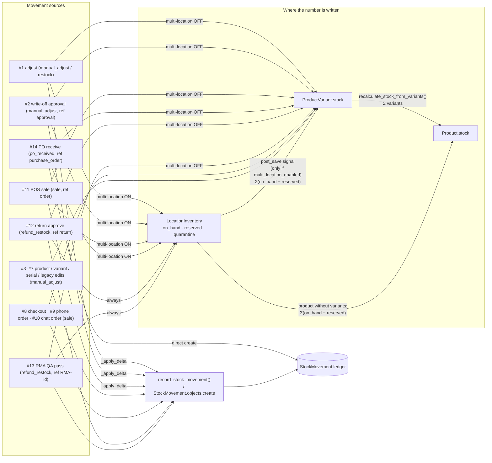

# Stock ledger and the multi-location stock model

> **Source**: DOC-478 · inventory Domain 10 relationship · INT-024, INT-025, INT-026, INT-033, INT-035, INT-045, INT-005
> **Code**: `sharwa_saas/products/models/stock.py` (`StockMovement`, `InventoryItem`, `InventoryReservation`) · `sharwa_saas/products/models/locations.py` (`LocationInventory`, `recalculate_stock_from_locations`) · `sharwa_saas/products/signals.py` (`mirror_location_inventory_to_product_stock`) · `sharwa_saas/products/services/stock_movement.py` (`record_stock_movement`) · `sharwa_saas/products/services/{inventory_service,product_service,variant_service,product_extras_service,checkout_service,order_api_service,pos_service,return_service,returns_api_service,reverse_logistics_service,purchase_order_service,location_service,location_routing_service,settings_service,inventory_reservation_service}.py` · `sharwa_saas/products/services/suppliers/stock_service.py` · `sharwa_saas/products/models/orders.py` (`cancel_order`, `release_reserved_stock`) · `sharwa_saas/products/models/catalog.py` (`Product.save`, `recalculate_stock_from_variants`)
> **Last verified against code**: 2026-10-27 (official Step 08)

## 1. Purpose

Every change to what a store has on hand should leave one read-only row in a single ledger, `StockMovement`, the same way every wallet change leaves a wallet transaction ([`43-ledgers.md`](43-ledgers.md)). The model docstring states the rule: stock never changes silently.

This page explains:

- which fields the ledger carries;
- every code path that writes it (and the paths that change stock **without** writing it);
- where the *number* lives — product, variant or location row — depending on whether the store has multi-location turned on;
- the reservations, serial units and dropship holds that sit beside the ledger.

The per-route contracts are on the inventory and products API pages (§10). Movement history as the merchant sees it is in the guide [`movements-and-reservations.md`](../guides/merchant/10-inventory-locations-procurement/movements-and-reservations.md).

## 2. Components

| Component | Location | Role |
|---|---|---|
| `StockMovement` | `products/models/stock.py:12` | the ledger — one row per change, never edited |
| `record_stock_movement()` | `products/services/stock_movement.py:20` | the shared writer: creates the row only, never touches stock (the caller saves stock first) |
| `inventory_service._apply_delta()` | `products/services/inventory_service.py:273` | applies a signed delta to the right source of truth (location row or product/variant) **and** records the movement, inside the caller's transaction and locks |
| `Product.stock` / `ProductVariant.stock` | `products/models/catalog.py` | what the storefront and checkout read |
| `Product.recalculate_stock_from_variants()` | `catalog.py:746` | product stock = sum of its variants; a product without variants is left alone |
| `LocationInventory` | `products/models/locations.py:375` | per (location, product, variant): `quantity_on_hand`, `quantity_reserved`, `quarantine_quantity`, `reorder_point` |
| `mirror_location_inventory_to_product_stock` | `products/signals.py:27` | post-save signal on `LocationInventory`; runs only when `StoreSetting.multi_location_enabled` |
| `recalculate_stock_from_locations()` | `locations.py:429` | rewrites the variant/product mirror from the location rows |
| `InventoryReservation` | `stock.py:110` | time-limited hold (`active` / `consumed` / `released`, `expires_at`) |
| `InventoryItem` | `stock.py:65` | one serial or digital unit (`available` / `reserved` / `sold`) with `location` and `order` |
| `DropshipStockHold` | `products/models/suppliers_dropship.py:567` | quantity sold from a supplier's product that the supplier has not deducted yet |

## 3. Data model

| Model | Schema | Key fields | Constraints / indexes | Added or changed by |
|---|---|---|---|---|
| `StockMovement` | store | `product`, `variant` (nullable), `quantity_change` (`Decimal(12,3)`, signed), `reason`, `note` (≤ 255), `location` (nullable), **`actor`** (≤ 150), **`quantity_after`** (`Decimal(12,3)`, nullable), **`reference_type`** (`order` · `return` · `purchase_order` · `approval`), **`reference_id`** (≤ 64), `created_at` (indexed) | ordering `-created_at` | table: `0115_stockmovement`; `location`: multi-location migrations; `po_received` reason: suppliers migrations; **`actor`, `quantity_after`, `reference_type`, `reference_id`: `products/0225_inventory_api` (INT-024)** |
| `LocationInventory` | store | `location`, `product`, `variant`, `quantity_on_hand`, `quantity_reserved`, `quarantine_quantity`, `reorder_point` (nullable), `updated_at` | unique (`location`, `product`, `variant`) | `0138_location_inventory`; `quarantine_quantity`: `0165` |
| `InventoryReservation` | store | `session_or_order_ref`, `location`, `product`, `variant`, `quantity`, `status`, `expires_at` | index (`status`, `expires_at`) | `0153_inventory_reservation` |
| `InventoryItem` | store | `product`, `variant`, `code`, `status`, `meta` (JSON), **`location`**, **`order`** | unique (`product`, `code`) | `0131`; `location` / `order`: `0225` |
| `DropshipStockHold` | store | `order`, `product`, `variant`, `location`, `supplier_code`, `quantity`, `released_at`, `release_reason` | index (`product`, `variant`, `released_at`) | `0204_dropship_phase4` |

`StockMovement.reason` choices are `sale`, `cancel_restock`, `refund_restock`, `manual_adjust`, `restock`, `po_received`. There is no separate reason for write-offs, serial units or RMA — they use the reasons in §4.1.

**Actor rule.** `record_stock_movement` stores the passed `actor`, else the current `acting_as` context (`change_actor.current_actor()`), else the constant `SYSTEM_ACTOR = 'النظام'` — shown as «النظام». The API views either pass the actor explicitly (for example `views_inventory.py:94`, `actor=self.actor(request)`) or wrap the write in `acting_as(...)`; the name is «مالك المتجر» for the owner or the staff member's name (`change_actor.actor_label`). `quantity_after` defaults to the balance read from the database at write time, which is why every caller records **after** saving stock. Rows written before `0225` have no `quantity_after`; the movements API rebuilds it backwards from the current stock (`inventory_service._later_sum`, `:411`), and derives their reference from the note («طلب #N», «أمر شراء #N», «إرجاع #N») (`NOTE_REFS`, `:380`).

## 4. Flows

### 4.1 Every movement source

| # | Source | Writer (file:function) | `reason` | `note` | Reference | Stock written to |
|---|---|---|---|---|---|---|
| 1 | Inventory adjustment (US-21.2) | `inventory_service.adjust` → `_apply_delta` | `manual_adjust` or `restock` | merchant note (required when decreasing) | — | location row (multi-location) or product/variant |
| 2 | Write-off approved | `inventory_service.apply_writeoff` (`:671`) → `_apply_delta` | `manual_adjust` | «إعدام مخزون: <note>» | (`approval`, id) | same as #1 |
| 3 | Products list quick stock edit | `product_service.set_stock` (`:467`) | `manual_adjust` | «تعديل سريع من قائمة المنتجات» | — | product |
| 4 | Product editor, `stock` changed | `product_service` update (`:447`) | `manual_adjust` | «تعديل من محرر المنتج» | — | product |
| 5 | Variant stock in `variants/bulk/` | `variant_service` (`:576`) | `manual_adjust` | «تعديل مخزون متغيّر من محرر المنتج» | — | variant (product re-summed) |
| 6 | Serial codes added | `product_extras_service.add_serials` (`:491`) | `manual_adjust` | «أرقام تسلسلية مضافة» | — | product stock = count of `available` units (queryset `.update()`) |
| 7 | Legacy HTML quick edit | `products/views/inventory.update_product_stock` (`:186`) | `manual_adjust` | — | — | product |
| 8 | Online checkout | `checkout_service.reserve_and_create_order` (`:756`) | `sale` | «طلب #<id>» | — (derived from the note) | product/variant; **no row for dropship products** (§4.4); bookable products are skipped |
| 9 | Phone order (dashboard) | `order_api_service` create (`:743`) | `sale` | «طلب #<id>» | — (derived) | product/variant |
| 10 | Chat converted to order | `social_channels/chat_to_order_service` (`:154`) | `sale` | «تحويل محادثة #<conv> (<channel>) لطلب #<id>» | — | product |
| 11 | POS sale | `pos_service._deduct` (`:1035`) → `_apply_delta` | `sale` | «إيصال <number>» | (`order`, id) | location row of the register (multi-location) or product/variant; a serialized unit is marked `sold` with its order |
| 12 | Return approved (restock lines) | `return_service.restock_to_location` (`:56`) | `refund_restock` | «إرجاع #<return id>» | (`return`, id) | location row **always**, plus product/variant when multi-location is off |
| 13 | RMA passed QA | `returns_api_service.qa_decision` (`:566`) | `refund_restock` | «RMA-<id> — اجتاز الفحص» | (`return`, `RMA-<id>`) | location row (quarantine → on hand), plus product/variant when multi-location is off |
| 14 | Purchase order received | `purchase_order_service.receive_purchase_order` (`:93`), via `procurement_service.receive_po` | `po_received` | «أمر شراء #<id>» | (`purchase_order`, id), `actor` = staff name or «النظام» | location row of the PO (multi-location) or product/variant; the product is re-summed from its variants in flat mode (INT-035 fix) |

**Stock changes that write no movement** (by design or by gap — see §9):

| Path | Effect | File |
|---|---|---|
| `Order.cancel_order` | `+quantity` per line (F-expression) | `products/models/orders.py:554-564` |
| `Order.release_reserved_stock` (payment failed, or a fulfillment status with `releases_stock`) | `+quantity` per line | `orders.py:513-524` |
| Re-activating a cancelled order (API and legacy) | `−quantity` per line | `order_api_service._deduct_order_stock` (`:395`), `views/merchant_dashboard.py:1406-1417` |
| Supplier stock sync | product/variant = supplier stock − holds − buffer | `suppliers/stock_service.refresh_product_stock` (`:163`) — supplier stock is not owned stock |
| Auction products | `Product.save()` forces `stock = 1` and `allow_backorder = False` | `catalog.py:517-519` |
| Mirror recalculation | product/variant rewritten from variants or location rows | §4.2 |



### 4.2 Multi-location on / off

**Off** (`StoreSetting.multi_location_enabled = False`, the default):

- `Product.stock` / `ProductVariant.stock` are the source. A product with variants is their mirror: every writer that changes a variant calls `product.recalculate_stock_from_variants()` in the same transaction.
- The mirror signal returns immediately, so `LocationInventory` rows never change product stock.
- PO receiving in flat mode used to update the variant but not the product mirror; INT-035 added the `recalculate_stock_from_variants()` call (`purchase_order_service.py:158-159`).
- Returns: `restock_to_location` still increments the location row (the item goes back to its branch) **and** writes the product/variant directly, because the signal skips such stores (`return_service.py:59-61`, `:76-88`). The RMA QA path does the same (`returns_api_service.py:591-603`).

**On**:

- `LocationInventory` rows are the source. Adjustments, write-offs, POS sales and PO receiving change `quantity_on_hand` on the row (`_apply_delta` refuses a unit with no row in that location: «لا مخزون لهذا المنتج في الموقع — عيّنه من صفحة الموقع.»).
- Every `save()` of a row fires the mirror signal, which calls `recalculate_stock_from_locations`:
  - for a variant: variant stock = Σ over all locations of (`on_hand − reserved`), then the product is re-summed from its variants;
  - for a product without variants: product stock = Σ (`on_hand − reserved`) over its rows with no variant.
- **Quarantine** must fit in what is physically there: `PATCH locations/<pk>/inventory/<unit>/` refuses when `on_hand − reserved − quarantine < 0` with «الحجر يتجاوز الكمية الفعلية.» (`location_service.py:557-558`).
- **Reorder point** falls back to the product's `low_stock_threshold`, then to the module default (`_reorder_point`, `location_service.py:470-474`); a row is "below reorder" when its available quantity is under it.
- Fulfilment routing (`location_routing_service.route_order`) adds the routed quantity to `quantity_reserved` on the chosen location row (`_reserve_inventory`, `:120`); the signal then rewrites the mirror.

> ⚠️ Discrepancy — code comments say the mirror is the sum of `quantity_available` (`signals.py:29-30`, `LocationInventory` docstring `locations.py:376-379`) / code does: `recalculate_stock_from_locations` sums `quantity_on_hand − quantity_reserved` and **ignores `quarantine_quantity`** (`locations.py:450`, `:468`), while the inventory and location screens subtract quarantine (`inventory_service._available`, `location_service.location_row`). A quantity quarantined by hand (`PATCH … {quarantine_quantity}`) therefore still counts in `Product.stock`. RMA quarantine is not affected, because RMA quantities are kept out of `on_hand` until QA passes (`reverse_logistics_service.py:86`, `:106-107`). Reported in official Step 08.

**Switching multi-location off** (`settings_service.set_multi_location`, `:348`): when more than one location still holds stock and the body does not carry `merge: true`, the request answers `409`:

```json
{
  "detail": "يوجد مخزون في أكثر من موقع؛ الإيقاف يجعل مخزون كل منتج رقماً واحداً (مجموع المواقع).",
  "conflicts": [
    { "location": "المستودع الرئيسي", "products_with_stock": 12 },
    { "location": "فرع الحي", "products_with_stock": 4 }
  ]
}
```

No quantity is moved by a merge: `Product.stock` already holds the sum of the locations, so turning the flag off simply makes that number the source (`settings_service.py:14-16`). Example names are illustrative.

### 4.3 Reservations, serial units and holds

**`InventoryReservation`** — a hold with a 15-minute default TTL (`inventory_reservation_service.RESERVATION_TTL_MINUTES`), taken under a row lock on the product or variant, consumed when the order is confirmed and released on cancel or expiry.

- **Self-healing (#33):** every read ignores expired holds in the query itself (`active_quantity` filters `expires_at > now()`), so a hold that was never released stops holding stock the moment it expires.
- The reservations screen shows an `active` row past its expiry as `released` (`inventory_service._reservation_status`, `:521`; the `released` filter includes it).
- References are parsed for display (`_reservation_reference`, `:508`): `order:N` / `#N` / `N` → order; `b2b:N` / `b2b_draft:N` → «مسودة جملة #N»; anything else → «سلة (جلسة دفع)».

**`InventoryItem`** — serial / digital units.

- For a serialized product, `Product.stock` = the number of `available` units: adding codes recounts and writes a `manual_adjust` movement (#6).
- Direct stock edits are refused: «مخزون هذا المنتج يُدار بالأرقام التسلسلية.» (product routes) and «المنتجات المسلسلة تُدار بالوحدات.» (inventory adjustments).
- A POS sale marks one unit `sold` and links its `order`.
- The serial list reads the order from `order`, else from `meta.order_id` for units sold before `0225` (`inventory_service._order_of`, `:474`).

**`DropshipStockHold`** — quantity sold from a supplier's product before the supplier knows.

- Checkout creates the holds and records **no** `StockMovement`, because supplier stock is not owned stock (`stock_service.py:9`).
- Holds are mirrored into `LocationInventory.quantity_reserved` of the dropship location with queryset `.update()`, so the mirror signal does not fire. The product and variant stock is written directly by `refresh_product_stock` = max(0, supplier stock − holds − safety buffer).
- Holds are released by `cancel_order` / `release_reserved_stock` (`release_order_holds`, idempotent) and consumed when the supplier accepts the order (`consume_order_holds`).

### 4.4 Product-side rules (INT-005, INT-045)

| Rule | Where |
|---|---|
| Product stock with variants = sum of variant stock | `Product.recalculate_stock_from_variants` (`catalog.py:746`); called by every variant writer |
| New variants get unique SKUs `<product sku>-<n>` (or `P<id>-<n>` when the product has no SKU) and stock 0 | `variant_service._unique_variant_sku` (`:422`) |
| Auction products have stock 1 and no backorder | `Product.save` (`catalog.py:517`) and `product_service` (`:300-303`); direct edits refused while an auction is active: «المخزون محجوب أثناء مزاد نشط.» |
| Serialized products: stock = available units | §4.3 |
| A product with variants, or with location stock of its own, refuses a direct stock edit | `product_service._stock_guard` (`:306`): «المخزون يُدار على المتغيرات.» · «مخزون هذا المنتج يُدار حسب المواقع — عدّله من شاشة المخزون.» |
| The editor sends `stock` only when the merchant changed it | frontend fix in `product-editor.tsx` (INT-005 live QA) — echoing the loaded value reset backorders to 0 and was refused for variant / serial / location products; see [`m04-products.md#stock-route`](../api/domains/03-catalog/m04-products.md#stock-route) |

The stock route itself (`POST products/<id>/stock/`, key `inventory.adjust`) and its guard order are documented in [`m04-products.md#images-stock`](../api/domains/03-catalog/m04-products.md#images-stock).

## 5. Invariants

| Invariant | Enforced by |
|---|---|
| A ledger row is never edited | no update path in the code; the model has no writer other than `create` |
| The movement is written after the stock it describes | callers save stock first; `quantity_after` reads the saved balance |
| Stock does not go negative unless the product allows backorder | `_apply_delta` refuses with «الكمية لا يمكن أن تصبح سالبة.» unless `allow_negative=product.allow_backorder` |
| A decrease by hand carries a reason | adjustments: «الملاحظة مطلوبة عند تخفيض الكمية.»; write-off requests: «الملاحظة مطلوبة لطلب الإعدام.» |
| Nothing is deducted for a write-off until it is approved, and approval re-checks the quantity | `request_writeoff` only creates the `ApprovalRequest`; `apply_writeoff` runs inside the approval transaction and refuses with «الكمية المطلوب إعدامها تتجاوز المخزون الحالي — ارفض الطلب أو عدّل المخزون أولاً.», which rolls the approval back so it stays pending |
| Concurrent writers on the same unit are serialised | `select_for_update` on product / variant / location row in every writer of §4.1 |
| Received quantity never exceeds what was ordered | row lock on PO lines + remaining check (`purchase_order_service.py:135-139`) + `CheckConstraint` |
| One location row per (location, product, variant) | unique constraint `unique_location_product_variant_stock` |

## 6. Background work

| Job | Schedule | Why it exists |
|---|---|---|
| `products.tasks.dispatch_low_stock_webhooks` → `dispatch_low_stock_webhooks_for_tenant` → `webhook_service.low_stock_scan` | Celery Beat `crontab(minute='*/15')` (`config/settings.py:650-653`) | emits `inventory.low_stock` once per product entering the low range; previous set kept in cache for 30 days. Only runs when an active endpoint subscribes to the event |
| `products.tasks.release_expired_inventory_reservations` (fan-out per tenant) | **not scheduled** in `CELERY_BEAT_SCHEDULE` | housekeeping only — reads already ignore expired holds (§4.3) |

> ⚠️ Discrepancy — roadmap says "stock moves via `F()` never hit `save()`" (the same wording is in the Beat comment, `config/settings.py:649`, and `tasks/operations.py:197`) / code does: the `F()` writers call `save(update_fields=['stock'])` (`orders.py:517-518`, `order_api_service.py:400-401`). The real reasons a scan is needed are:
> - no `post_save` receiver on `Product` emits the low-stock event;
> - some writers bypass `save()` entirely with queryset `.update()` (serial recount `product_extras_service.py:520`, dropship holds `suppliers/stock_service.py:57-59`, `:230-232`).
>
> Reported in official Step 08.

See [`50-background-jobs.md`](50-background-jobs.md).

## 7. Configuration

| Setting | Effect |
|---|---|
| `StoreSetting.multi_location_enabled` | selects the source of truth (§4.2); plan feature `multi_location` gates the settings section |
| `Product.low_stock_threshold` (default 3 in the inventory screen) | low-stock status and reorder-point fallback |
| `Product.allow_backorder` | allows negative stock in adjustments and POS; status shows `backorder` |
| `SupplierConnection.stock_buffer`, `hide_when_out_of_stock` | dropship available stock and auto-hide |

## 8. Failure modes and fixes

| Failure | Symptom | Cause | Handling / fix |
|---|---|---|---|
| Stale product stock after receiving a PO in flat mode | variant correct, product total wrong | product mirror not recomputed | `recalculate_stock_from_variants()` after the variant update (INT-035) |
| Returned items not back in stock for single-location stores | location row up, product stock unchanged | the mirror signal skips stores without multi-location | `restock_to_location` / `qa_decision` also write product/variant when the flag is off (INT-024/026) |
| Saving a product reset backorders to 0 | editor echoed the loaded (clamped) value | contract allows only non-negative stock | editor sends `stock` only when edited (INT-005) |
| Expired holds blocking sales | stock looked reserved forever | release job not run | reads exclude expired holds (#33) |
| Supplier sync "giving back" a sold item | item resold before the supplier knew | sync wrote the raw supplier number | `DropshipStockHold` subtracted under the same lock order as checkout |

## 9. Open items

- **Cancellations and re-activations write no movement.** `cancel_order`, `release_reserved_stock` and the re-activation paths change stock without a `StockMovement`. `cancel_restock` exists in the reason choices but nothing writes it, so the ledger does not explain these changes.
- **Online and chat orders carry no reference.** Paths #8–#10 pass only a note; the reference is rebuilt from «طلب #N» at read time. They also write no `actor` beyond the request context.
- **Returns create location rows in single-location stores.** `restock_to_location` creates a `LocationInventory` row even when multi-location is off. After that, `product_service._stock_guard` sees a location row for the product and refuses list and editor stock edits with «مخزون هذا المنتج يُدار حسب المواقع — عدّله من شاشة المخزون.», although the store has no locations mode. Read from code, not reproduced.
- **Online sales with multi-location on.** Checkout decrements `Product.stock` / `ProductVariant.stock` directly and not the location row. The location row only reflects the sale once routing adds it to `quantity_reserved`. Any other save of that location row before routing recomputes the mirror from the rows and adds the sold quantity back. The callers of `route_order` were not traced in this step.
- **No production caller of `reserve_inventory` was found** in the files read (checkout, storefront checkout, orders, POS, B2B). `InventoryReservation` rows may only come from other paths or tests, and the release job is not scheduled.
- Manual quarantine is counted in the mirror (discrepancy in §4.2).

## 10. Related pages

- API: [`m21-inventory.md`](../api/domains/10-inventory-locations-procurement/m21-inventory.md) · [`m22-locations.md`](../api/domains/10-inventory-locations-procurement/m22-locations.md) · [`m23-procurement.md`](../api/domains/10-inventory-locations-procurement/m23-procurement.md) · [`m04-products.md#images-stock`](../api/domains/03-catalog/m04-products.md#images-stock) · [`m37-advanced-products.md`](../api/domains/03-catalog/m37-advanced-products.md) · [`m24-returns.md`](../api/domains/04-orders-returns/m24-returns.md)
- Guides: [`inventory-hub.md`](../guides/merchant/10-inventory-locations-procurement/inventory-hub.md) · [`adjust-stock.md`](../guides/merchant/10-inventory-locations-procurement/adjust-stock.md) · [`movements-and-reservations.md`](../guides/merchant/10-inventory-locations-procurement/movements-and-reservations.md) · [`multi-location-mode.md`](../guides/merchant/10-inventory-locations-procurement/multi-location-mode.md)
- Architecture: [`43-ledgers.md`](43-ledgers.md) · [`42-concurrency.md`](42-concurrency.md) · [`45-approvals.md`](45-approvals.md) · [`46-timelines-and-notifications.md`](46-timelines-and-notifications.md) · [`50-background-jobs.md`](50-background-jobs.md)
- Data model: [`data-model/10-inventory-locations-procurement.md`](data-model/10-inventory-locations-procurement.md)
