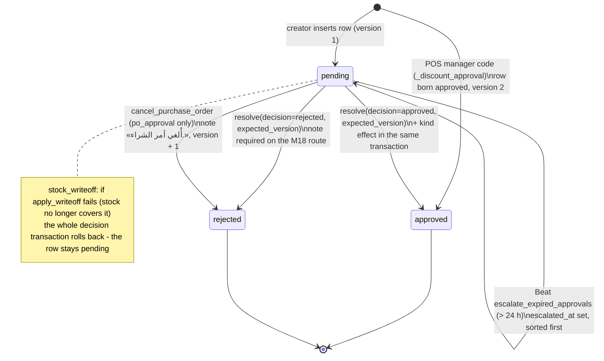
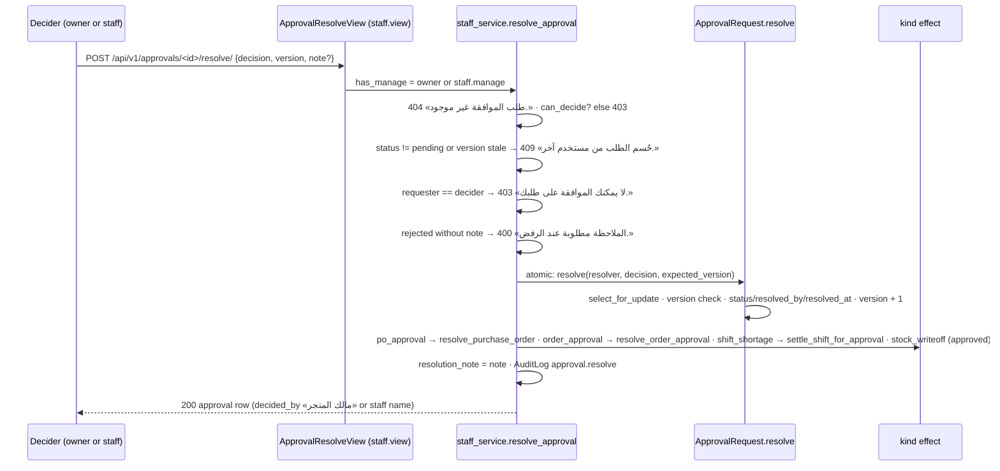

# Approvals queue

> **Source**: DOC-479 · inventory A.7 / Domains 4, 9, 10, 12, 13 · INT-022 (M18), INT-024 (M21), INT-033 (M16), INT-035 (M23), INT-044 (M36), INT-007 (M06)
> **Code**: `sharwa_saas/products/models/staff_approvals.py` (`ApprovalRequest`, `ConcurrencyError`) · `products/services/staff_service.py` (`approval_view`, `_approval_context`, `can_decide`, `resolve_approval`) · `products/services/inventory_service.py` (`request_writeoff`, `writeoff_snapshot`, `apply_writeoff`) · `products/services/purchase_order_service.py` (`submit_purchase_order`, `resolve_purchase_order`, `cancel_purchase_order`, `_default_approver_role`) · `products/services/procurement_service.py` (`submit_po`, `resolve_po`) · `products/services/order_approval_service.py` (`create_b2b_draft_order`, `resolve_order_approval`) · `products/services/order_api_service.py` (`create_order`) · `products/services/pos_service.py` (`close_shift`, `settle_shift_for_approval`, `resolve_variance`, `request_discount_approval`, `_discount_approval`, `approver_role`, `can_resolve`) · `products/tasks/operations.py` (`escalate_expired_approvals[_for_tenant]`) · `products/services/notification_service.py` (`_approvals`, `visible`) · `api/views_staff.py` (`ApprovalListView`, `ApprovalResolveView`) · `api/views.py` (`B2BDraftCreateView`, `B2BDraftListView`, `B2BDraftResolveView`) · legacy `products/views/staff_approvals.py`
> **Last verified against code**: 2026-10-27 (official Step 08)

## 1. Purpose

Some writes in a store must not take effect on one person's say-so: writing stock off, committing money to a supplier, letting a wholesale draft into fulfilment, closing a cash drawer that is short, or giving a POS discount above a role's ceiling. Sharwa routes all of them through **one** queue, `ApprovalRequest`, instead of a separate approval cycle per module. Every kind inherits the same four guarantees from the model:

1. **Assigned to a role, not a person** (`approver_role`) — a request is never orphaned when someone leaves (design note #8).
2. **Optimistic lock + row lock** (`version` + `select_for_update`) — two deciders racing on the same request: exactly one wins (#9 / #50).
3. **No self-approval** — enforced as the first line of `ApprovalRequest.resolve()` (#16).
4. **Escalation, not expiry** — a request left pending for 24 hours is flagged `escalated_at` and sorted first; it never times out on its own.

The queue is **not** responsible for: the money ledger of the effect (see [`43-ledgers.md`](43-ledgers.md)), the stock ledger row written on approval (see [`44-stock-ledger.md`](44-stock-ledger.md)), the M18 permission model in general (see [`31-authorization.md`](31-authorization.md)), or the per-route API contract (see the planned [`m18-staff-permissions.md`](../api/domains/12-settings-staff-integrations/m18-staff-permissions.md)).

## 2. Components

| Component | Location | Role |
|---|---|---|
| `ApprovalRequest` | `sharwa_saas/products/models/staff_approvals.py` | the single queue row; `resolve()` holds the self-approval check, the row lock and the version bump |
| `ConcurrencyError` | same file | raised by `resolve()` on a stale `version` or an already-decided row — «تم حسم هذا الطلب بالفعل من طرف آخر.» |
| M18 queue API | `api/views_staff.py` → `staff_service.list_approvals` / `resolve_approval` | `GET /api/v1/approvals/` and `POST /api/v1/approvals/<id>/resolve/` — the generic decision point for **every** kind; dispatches the kind-specific effect |
| Kind creators | `inventory_service.request_writeoff`, `purchase_order_service.submit_purchase_order`, `order_approval_service.create_b2b_draft_order`, `pos_service.close_shift`, `pos_service.request_discount_approval`, `pos_service._discount_approval` | insert a `pending` (or, for the POS manager code, an already-`approved`) row |
| Kind effects | `inventory_service.apply_writeoff`, `purchase_order_service.resolve_purchase_order`, `order_approval_service.resolve_order_approval`, `pos_service.settle_shift_for_approval` | run **inside** the decision transaction |
| Module-side decision routes | `procurement_service.resolve_po` (M23), `B2BDraftResolveView` (M36), `pos_service.resolve_variance` (M16) | second doors into the same row for their own kind (§4.3) |
| Escalation job | `products/tasks/operations.py` — Beat `escalate-expired-approvals`, `crontab(minute=15)` (`config/settings.py:639-642`) | fans out per store; sets `escalated_at` on rows pending > `APPROVAL_ESCALATION_HOURS = 24` |
| Notification source | `notification_service._approvals` | one `approval_pending` notification per pending row ([`m49-notifications.md#model`](../api/domains/02-dashboard-shell/m49-notifications.md#model)) |
| Legacy HTML queue | `products/views/staff_approvals.py` (`/dashboard/approvals/`, `/dashboard/approvals/resolve/`) | owner-session screen kept from Phase 1; see §8 |

## 3. Data model

| Model | Schema | Key fields | Constraints / indexes | Added or changed by |
|---|---|---|---|---|
| `ApprovalRequest` | store | `request_type` (6 choices, §4.1) · `location` FK `Location` **nullable** · `requested_by` FK `StaffMember` **nullable** (null = «مالك المتجر») · `approver_role` FK `Role` (**not null**, `PROTECT`) · `target_ref` (≤ 100, free text: `product:<id>`, `po:<id>`, `<order id>`, `shift:<id>`, `pos:pending` → `order:<id>`) · `amount` Decimal(12,2) nullable · `payload` JSON (default `{}`) · `status` `pending`/`approved`/`rejected` · `resolved_by` FK `StaffMember` nullable (null on a decided row = the owner) · `resolved_at` · `resolution_note` (≤ 255) · `version` (default 1) · `escalated_at` · `created_at` | index on `status`; default ordering `-created_at` | `products/0147_staff_approvals` (table, `location` not null) · `0178_po_approval` + `0179_alter_approvalrequest_request_type_and_more` (`po_approval` / `order_approval` kinds, `requested_by` nullable) · `0225_inventory_api` (`payload` JSON added, `location` made nullable — INT-024) |
| `Order.pending_approval` | store | FK → `ApprovalRequest` (`SET_NULL`) | — | B2B drafts (#65) |
| `Shift.approval` | store | FK → `ApprovalRequest` (`SET_NULL`) | — | POS shortage (`products/models/staff_pos.py`) |
| `PosReceipt.discount_approval` | store | FK → `ApprovalRequest` (`SET_NULL`) | — | POS discount exception |
| `ReturnRequest.approval` | store | FK → `ApprovalRequest` (`SET_NULL`) | — | declared for large refunds; **never written** (§4.1, row `refund`) |

**Derived fields, not stored.** The API row (`staff_service.approval_view`) adds `payload`, `summary` and `entity` built by `_approval_context(a)` from `target_ref` + `amount` (+ the stored `payload` for write-offs and POS): `entity = {kind, id, label, available}`, where `available = false` when the target is gone or cancelled (purchase order `cancelled`, order `cancelled`, shift or product deleted). `display_amount` is formatted with `format_money` in the target's currency (PO currency, order currency) or the store currency. `decided_by` is the resolver's `full_name`, or «مالك المتجر» (`OWNER_LABEL`) when `resolved_by` is null; `requester_name` follows the same rule.

> Prose note — the docstring of `_approval_context` still says «لا حقل لقطة في ApprovalRequest» (no snapshot field). Since `0225` there is one (`payload`); the function itself reads it for `stock_writeoff` and POS rows. Comment-only.

## 4. Flows

### 4.1 Approval kinds — creator, approver, effect

| Kind (`request_type`) | Created by (route → function) | `approver_role` / `location` / `target_ref` / `amount` | Effect on **approve** | Effect on **reject** | Decided from |
|---|---|---|---|---|---|
| `stock_writeoff` «إتلاف مخزون» | `POST /api/v1/inventory/writeoffs/` (`inventory.writeoff`) → `inventory_service.request_writeoff`; the view also writes `AuditLog inventory.writeoff_request` | `_default_approver_role()` = system role «مدير المتجر», else the first active role (none ⇒ 400 «لا يوجد دور معتمِد متاح — أنشئ دوراً أولاً.») · location = chosen location when multi-location is on, else `null` · `product:<id>` · no amount · `payload {product_id, product_name, variant_id, variant_label, location_id, quantity, note}` | `apply_writeoff(approval, actor=actor_label(staff))` **in the same transaction**: stock re-checked under `select_for_update`, then `_apply_delta(…, reason='manual_adjust', note='إعدام مخزون: <note>', reference=('approval', id))` | nothing is deducted | M18 queue only |
| `po_approval` «موافقة أمر شراء» | `POST /api/v1/purchase-orders/<id>/submit/` (`suppliers.manage`) → `procurement_service.submit_po` → `purchase_order_service.submit_purchase_order`; legacy supplier screen calls the same function | `_default_approver_role()` · `po.location` · `po:<id>` · `po.order_total()` · `requested_by` may be null (owner) | `resolve_purchase_order`: PO `pending_approval → approved` (stock untouched), `version + 1`, timeline `po.approved` «اعتُمد الأمر.» | PO `pending_approval → draft` (editable, can be re-submitted), timeline `po.rejected` «رُفض الأمر وأُعيد مسودة.» | M18 queue · M23 `POST purchase-orders/<id>/resolve/` (`suppliers.approve`) · legacy HTML |
| `order_approval` «موافقة طلب جملة» | `POST /api/v1/orders/b2b-draft/` (`orders.create_b2b`) → `B2BDraftCreateView` → `order_approval_service.create_b2b_draft_order`; also M06 `POST /api/v1/orders/` with `sales_channel: "b2b_draft"` → `order_api_service.create_order` | body `approver_role_id`, else system «مدير المتجر» · chosen branch (multi-location stores must send `location_id`) · `<order id>` · no amount; sets `Order.sales_channel = 'b2b_draft'` and `Order.pending_approval` | `resolve_order_approval`: order `status = 'new'` (enters fulfilment) | order `status = 'cancelled'` | M18 queue · M36 `POST orders/b2b-draft/<id>/resolve/` (`orders.approve_b2b`) · legacy HTML |
| `shift_shortage` «عجز وردية» | `POST /api/v1/pos/shifts/<id>/close/` → `pos_service.close_shift` when `actual_closing < expected` (shift → `pending_manager_approval`) | `pos_service.approver_role()` = «مدير الفرع», then «مدير المتجر» (none ⇒ «لا يوجد دور «مدير الفرع» لاعتماد الطلب — أعده من صفحة الأدوار.») · register's location · `shift:<id>` · shortage `expected − actual` · `payload {source: "pos", shift_id, register}` | shift closed (`_settle`: `status='closed'`, `approved_by`, `version + 1`) via `settle_shift_for_approval` | **also** closes the shift — the decision records the manager's verdict, the drawer is closed either way (M16 §5) | M18 queue · M16 `POST pos/shifts/<id>/resolve-variance/` · legacy HTML |
| `discount_exception` «استثناء خصم» | (a) `POST /api/v1/pos/discount-approvals/` → `pos_service.request_discount_approval` — `pending`, reply «أُرسل طلب الاعتماد إلى المدير.»; (b) the sale itself with a valid `manager_code` → `_discount_approval` inserts an **already approved** row (`status='approved'`, `version=2`, note «اعتُمد برمز المدير على جهاز الكاشير.», `payload.via = "manager_code"`) | `pos_service.approver_role()` · shift / register location · `pos:pending` · no amount · `payload {source: "pos", discount_percent, max_discount_percent, display_total, register}` | no immediate effect; the cashier's next sale passes `approval_id` and is allowed up to `payload.discount_percent`; on the sale the row is consumed: `target_ref = order:<id>`, `amount = discount` | the sale is refused 403 «رفض المدير هذا الخصم.» | M18 queue (plain `resolve()`) |
| `refund` «استرجاع مبلغ» | **no creator in the current code** | — | — | — | — |

The same kind can therefore be decided from two or three doors. Every door ends in `ApprovalRequest.resolve()`, so the lock and the self-approval rule are shared; the **approver check is not** (§4.3).

### 4.2 Lifecycle

### 4.3 Deciding — the M18 route and the module doors

**Decider rules (M18 route).**

| Rule | Where | Answer |
|---|---|---|
| The owner may always decide | `can_decide(approval, staff=None, …)` | — |
| A staff member needs `staff.view` to reach the route, **and** either `staff.manage` or an active `StaffLocationRole` with `role = approver_role` **at the request's location** (any location when `location` is null — single-location write-offs) | `ApprovalResolveView` (`has_manage`), `staff_service.can_decide` | 403 «الحسم لحامل دور «<role>» في هذا الموقع أو للمالك.» |
| Optimistic lock | `resolve_approval` (pre-check) + `ApprovalRequest.resolve` (`select_for_update`) | 409 `{detail: «حُسم الطلب من مستخدم آخر.», version[, status]}` |
| No self-approval | `resolve_approval` (pre-check) + `resolve()` first line (`PermissionError` «لا يمكن للموظف الموافقة على طلبه الخاص.») | 403 «لا يمكنك الموافقة على طلبك.» |
| `decision` ∈ `approved` / `rejected` | `resolve_approval` | 400 `{decision: [«القرار يجب أن يكون approved أو rejected.»]}` |
| A rejection needs a note (≤ 255) | `resolve_approval` | 400 `{note: [«الملاحظة مطلوبة عند الرفض.»]}` / `{note: [«255 حرفاً على الأكثر.»]}` |
| The owner shows as «مالك المتجر» | `approval_view` (`OWNER_LABEL`) | `decided_by` / `requester_name` |

**Module doors and what they check instead.**

| Door | Gate | Approver check | Self-approval | Lock answer |
|---|---|---|---|---|
| M23 `POST /api/v1/purchase-orders/<id>/resolve/` `{decision: approve\|reject, version}` → `procurement_service.resolve_po` | `suppliers.approve` (403 «الاعتماد لمن يحمل صلاحية اعتماد المشتريات.») + the PO `version` | **none** — any holder of `suppliers.approve` decides, whatever `approver_role` says | 403 «لا يمكن الموافقة على طلبك الخاص.» | PO stale → 409 (PO `version`); approval raced → 409 «تم حسم هذا الاعتماد بالفعل من طرف آخر.» |
| M36 `POST /api/v1/orders/b2b-draft/<id>/resolve/` `{decision, version}` → `resolve_order_approval` | `orders.approve_b2b` via `MerchantAPIMixin.check_merchant` | **none** | 403 `str(PermissionError)` = «لا يمكن للموظف الموافقة على طلبه الخاص.» | 409 `str(ConcurrencyError)`; missing/invalid `version` → 400 «قيمة الإصدار (version) مطلوبة وصحيحة.»; success 200 «حُسمت الموافقة بنجاح.» |
| M16 `POST /api/v1/pos/shifts/<id>/resolve-variance/` → `pos_service.resolve_variance` | `can_resolve`: owner, `staff.manage`, or «مدير الفرع» / «مدير المتجر» at one of the actor's POS locations (403 «حلّ فرق الوردية لمدير الفرع أو مالك المتجر.»); shift must be at one of the actor's locations | **yes** — `can_decide` on the linked approval | 403 «لا يمكنك اعتماد عجز ورديتك.» (own shift) | 409 «حُسم فرق هذه الوردية من مستخدم آخر.» / «تغيّرت الوردية، أعد التحميل.» |

> ⚠️ Discrepancy — roadmap says the staff decider must hold `approver_role` at the location or `staff.manage` / code applies that rule only on the M18 route and on the POS variance route. The M23 purchase-order door (`procurement_service.resolve_po`, `views_procurement.py:110`) and the M36 B2B door (`B2BDraftResolveView`, `api/views.py:545-578`) call the same `resolve()` with **no** `can_decide` check: a staff member holding `suppliers.approve` or `orders.approve_b2b` decides a request assigned to a role they do not hold. Self-approval and the lock still apply. Reported in official Step 08.

The M36 door uses `MerchantAPIMixin.check_merchant`; whether a staff member logged in through the JSON staff login passes it is the open item recorded in [`23-ready-api-v1-audit.md`](23-ready-api-v1-audit.md) (B2B rows #19–#21).

### 4.4 Escalation

`escalate_expired_approvals` (Beat, minute 15 of every hour) fans out per store; `escalate_expired_approvals_for_tenant` sets `escalated_at = now` on every `pending` row with `escalated_at` null and `created_at` older than 24 hours. Nothing else changes: `approver_role` stays the same, no notification is created, and the owner could already decide everything. The flag only drives ordering — `list_approvals` and `B2BDraftListView` both sort `escalated_at DESC NULLS LAST`, then newest first — and is exposed as `escalated_at` on both lists.

### 4.5 `approval_pending` notifications — who sees them

`notification_service._approvals` upserts `approval:<id>` (kind `approval_pending`, severity `warning`, title «طلب موافقة: <type label>», link `/dashboard/staff/approvals`) for every pending row, with `audience_role = approver_role`, **no** permission key and `merchant_only = false`; the row resolves as soon as the request leaves `pending` (`resolve_missing`). `visible(viewer)` then decides:

| Viewer | Sees the notification when… |
|---|---|
| Owner | always (the owner sees every row not reserved to one staff member) |
| Staff member | they hold `approver_role` through **any active** `StaffLocationRole`, at **any** location |
| Staff member with `staff.manage` but not the role | never — although `can_decide` lets them decide |

> ⚠️ Discrepancy — roadmap says `approval_pending` goes "to the approver role only" / code adds the owner (all rows), ignores the request's `location` (a «مدير الفرع» of branch A is notified about branch B, but cannot decide it there), and leaves out `staff.manage` holders who can decide (`notification_service.py:121-133`, `:289-302`). Reported in official Step 08.

> ⚠️ Discrepancy — [`m49-notifications.md`](../api/domains/02-dashboard-shell/m49-notifications.md) (call-out under the kinds table, written in run 07) says "a request whose `approver_role` is empty creates a row with no role restriction … so every staff member sees it" / code: `ApprovalRequest.approver_role` is a non-nullable FK (`staff_approvals.py:54`, `PROTECT`, no `null=True`), so every approval notification carries a role restriction and that case cannot occur. The owner-sees-all part of that call-out is correct. Reported in official Step 08.

## 5. Invariants

| Invariant | Enforced by |
|---|---|
| A decided row is never decided again | `resolve()`: `select_for_update` + `version` and `status == 'pending'` checks, `version += 1` |
| The requester never decides their own request (staff) | `resolve()` first line; pre-checks on the M18, M23, M36 and M16 doors |
| A write-off deducts stock only when approved, and only if stock still covers it | `request_writeoff` deducts nothing; `apply_writeoff` runs inside the decision `atomic()` and raises 400 «الكمية المطلوب إعدامها تتجاوز المخزون الحالي — ارفض الطلب أو عدّل المخزون أولاً.» (also «المنتج لم يعد موجوداً — ارفض الطلب.», «المتغيّر لم يعد موجوداً — ارفض الطلب.», «المتجر أصبح متعدد المواقع والطلب بلا موقع — ارفضه واطلب من جديد.») — the decision rolls back and the request stays pending |
| PO approval never touches stock | `resolve_purchase_order`; stock changes only on `receive_purchase_order` |
| A PO cancelled while pending leaves no pending approval behind | `cancel_purchase_order` closes it `rejected` with «أُلغي أمر الشراء.» in the same transaction; `resolve_purchase_order` ignores a PO no longer `pending_approval` |
| One POS discount approval covers one receipt, up to the granted percent | `_discount_approval`: own `approval_id` only (`requested_by = actor.staff`), `pending` → 409 «طلب الاعتماد ما زال بانتظار المدير.», `rejected` → 403, already bound (`order:`) → 409 «استُخدم هذا الاعتماد لإيصال سابق — أرسل طلباً جديداً.», over the grant → 403 «الاعتماد يغطي خصماً حتى <n>% فقط — أرسل طلباً جديداً.» |
| A role referenced by an approval cannot be deleted | `staff_service` role delete answers 409 «الدور معتمِد في طلبات موافقة سابقة — لا يُحذف حفاظاً على سجلها.» when `ApprovalRequest.objects.filter(approver_role=role).exists()`; FK is `PROTECT` |
| Every M18 decision is audited | `AuditLog approval.resolve` (before `{status: pending, version}`, after `{status, note}`) — see [`37-audit.md`](37-audit.md) |

## 6. Background work

| Task | Schedule | Effect | Idempotency |
|---|---|---|---|
| `products.tasks.escalate_expired_approvals` → `escalate_expired_approvals_for_tenant(schema)` | Beat `escalate-expired-approvals`, `crontab(minute=15)` | sets `escalated_at` on pending rows older than 24 h | only rows with `escalated_at IS NULL` are touched |
| notification `sync()` | on every bell read, at most once per 20 s per store | upserts / resolves `approval_pending` | `dedupe_key = approval:<id>` |

Job register: [`50-background-jobs.md`](50-background-jobs.md).

## 7. Configuration

| Setting | Where | Value |
|---|---|---|
| `APPROVAL_ESCALATION_HOURS` | `products/tasks/operations.py` | 24 |
| Beat entry `escalate-expired-approvals` | `config/settings.py` `CELERY_BEAT_SCHEDULE` | `crontab(minute=15)` |
| Default approver role (write-off, PO) | `purchase_order_service._default_approver_role` | system «مدير المتجر», else first active role |
| Default approver role (B2B) | `order_api_service.B2B_DEFAULT_APPROVER_ROLE`, `B2BDraftCreateView` | «مدير المتجر» |
| POS approver roles | `pos_service.APPROVER_ROLE_NAMES` | («مدير الفرع», «مدير المتجر»), in that order |

## 8. Failure modes and fixes

| Failure | Symptom | Cause | Handling / fix |
|---|---|---|---|
| Two managers click "approve" together | second gets 409 | expected | lock + `version` (#9 / #50) |
| Write-off approved after the stock was sold | 400, request stays pending | stock re-check in `apply_writeoff` | reject the request or adjust stock first (INT-024) |
| Write-off requested before INT-024 | snapshot missing | old rows had no `payload` | `writeoff_snapshot` falls back to `target_ref = product:<id>` |
| PO rejected used to be final | merchant had to rebuild the PO | old rule `cancelled` | INT-035: reject → `draft` (M23 §5) |
| Legacy HTML queue approves without the effect | an approved `stock_writeoff`, `order_approval` or `shift_shortage` leaves stock, order and shift unchanged | `resolve_approval_view` (`products/views/staff_approvals.py:58-66`) calls `resolve_purchase_order` for `po_approval` and a bare `resolve()` for every other kind | see the call-out below |

> ⚠️ Discrepancy — roadmap describes each kind's effect as running when the request is approved / code runs the effect only on the API doors. The legacy HTML queue `/dashboard/approvals/resolve/` (`products/views/staff_approvals.py:58-66`, owner session, plan feature `staff_rbac`) dispatches `po_approval` only; deciding a write-off there marks it approved **without** deducting stock, a B2B draft stays `b2b_draft` with its old status, and a short shift stays `pending_manager_approval` with its approval already closed (the M16 door then skips the approval and settles the shift). Reported in official Step 08 — candidate for the legacy-surfaces register ([`91-legacy-surfaces.md`](91-legacy-surfaces.md)).

## 9. Open items

- **`refund` kind has no creator.** The choice `('refund', 'استرجاع مبلغ')` and `ReturnRequest.approval` exist, and `_approval_context` can render one, but no code inserts a `refund` request: M24 returns are decided directly (`returns_api_service.decide_return`) and POS large refunds use an OTP challenge instead ([`33-otp.md`](33-otp.md)). Keep, remove or wire is a product decision.
- **Approver check only on two of four doors** (§4.3 call-out).
- **Notification audience vs decider set** (§4.5 call-out).
- **Escalation is a flag only.** The model comment says the request is escalated "to the «مالك المتجر» role", but `approver_role` is not changed and nothing is sent; the owner already sees and may decide every row.
- **Stale comments.** `order_api_service.create_order` and `B2BDraftCreateView` say `requested_by` is mandatory; since `0179` it is nullable (B2B still requires a staff session by design: «يتطلب إنشاء طلب الجملة تسجيل دخول موظف.» / «يتطلب إنشاء مسودة الجملة تسجيل دخول موظف.»).
- **Tests.** `api/test_staff_api.py::test_approvals_resolve_rules` (403 self, 400 note, 409 stale, B2B effect `new`, owner label), `api/test_inventory_api.py::test_writeoff_is_an_approval_and_deducts_on_approval`, `api/test_procurement_api.py` (`test_submit_resolve_reject_returns_draft`, `test_self_approval_refused`, `test_cancel_pending_closes_approval`, `test_resolved_from_approvals_queue`), `api/test_pos_api.py::test_discount_ceiling_paths`, `api/test_b2b_api.py::test_list_for_approver_with_creator_and_escalation`, `products/test_staff_approvals.py` (self-approval, version bump, concurrent resolve). No test pins the `approval_pending` audience or the legacy HTML queue.

## 10. Related pages

- [`46-timelines-and-notifications.md`](46-timelines-and-notifications.md) — the PO timeline events and the `approval_pending` notification source.
- [`42-concurrency.md`](42-concurrency.md) — the `version` / 409 register.
- [`31-authorization.md`](31-authorization.md) — permission keys `staff.view`, `staff.manage`, `inventory.writeoff`, `suppliers.approve`, `orders.approve_b2b`.
- [`44-stock-ledger.md`](44-stock-ledger.md) — the `manual_adjust` movement written by an approved write-off.
- API pages (planned): [`m18-staff-permissions.md`](../api/domains/12-settings-staff-integrations/m18-staff-permissions.md) · [`m21-inventory.md`](../api/domains/10-inventory-locations-procurement/m21-inventory.md) · [`m23-procurement.md`](../api/domains/10-inventory-locations-procurement/m23-procurement.md) · [`m36-b2b-wholesale.md`](../api/domains/09-b2b/m36-b2b-wholesale.md) · [`m16-pos.md`](../api/domains/13-channels-operations/m16-pos.md); written: [`m49-notifications.md`](../api/domains/02-dashboard-shell/m49-notifications.md) · [`conflicts.md`](../api/overview/conflicts.md) · [`permissions.md`](../api/overview/permissions.md).
- Guide (planned): [`approvals.md`](../guides/merchant/12-settings-staff-integrations/approvals.md).
