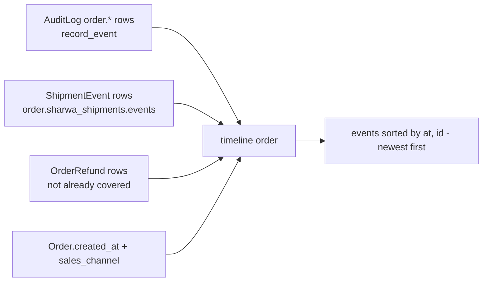
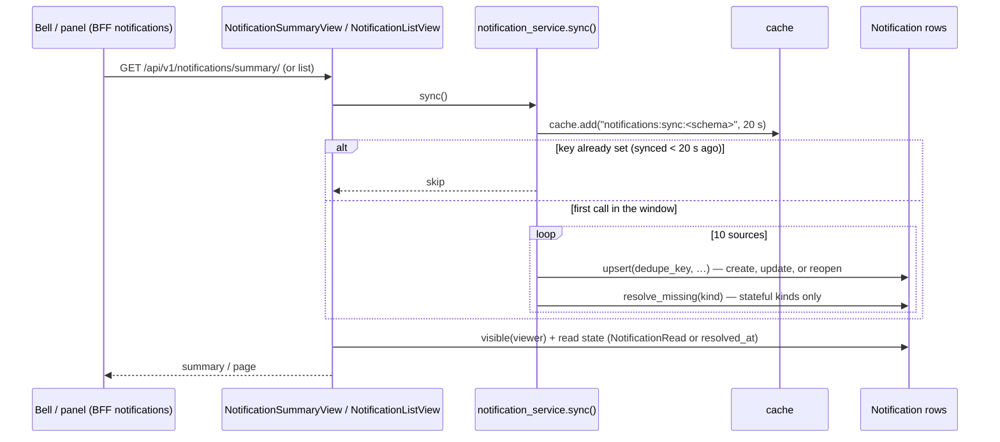

# Timelines, change logs and notification generation

> **Source**: DOC-480 · inventory A.7 / Domains 2, 3, 4, 10 · INT-007 (M06), INT-026 (M24), INT-035 (M23), INT-009 (M49), INT-005 (M04), INT-044 (M36), INT-045 (M37)
> **Code**: `sharwa_saas/products/models/audit.py` (`AuditLog`) · `products/services/audit_service.py` (`write_audit_log`) · `products/services/order_api_service.py` (`record_event`, `audit_rows`, `timeline`, `TIMELINE_KINDS`) · `products/services/returns_api_service.py` (`_audit`, `_order_event`, `return_detail`, `_rma_events`, `_rma_event`) · `products/services/purchase_order_service.py` (`record_po_event`) · `products/services/procurement_service.py` (`_timeline`) · `products/models/shipping.py` (`ShipmentEvent`) · `products/services/shipment_state_service.py` (`apply_shipment_transition`, `_create_event`) · `products/services/refund_service.py` (`process_order_refund`) · `products/models/catalog.py` (`Product._TRACKED_FIELDS`, `_log_field_changes`, `ProductChangeLog`) · `products/services/change_actor.py` (`acting_as`, `actor_label`) · `products/services/product_extras_service.py` / `b2b_api_service.py` (`_log`) · `products/models/notifications.py` · `products/services/notification_service.py` · `api/views_notifications.py`
> **Last verified against code**: 2026-10-27 (official Step 08)

## 1. Purpose

Merchants ask "what happened to this order / return / purchase order / product, and who did it?" and "what needs my attention now?". Sharwa answers both **without a dedicated event table per module**:

- **Timelines** are *composed at read time* from records that already exist for other reasons — the append-only `AuditLog`, the shipment state log `ShipmentEvent`, the refund rows `OrderRefund`, and the row's own timestamps for records that predate the audit rows.
- **Change logs** for products are written by `Product.save()` itself, plus explicit rows for the M36/M37 extras.
- **Notifications** are *derived*: a sync pass reads the same live sources (orders, approvals, stock…) and upserts one `Notification` per source item, so the bell can never disagree with the sidebar counters.

This page traces every timeline entry and every notification kind to the function that writes it. It does not cover the tamper-evidence of `AuditLog` (hash chain, revoked `UPDATE`/`DELETE`) — see [`37-audit.md`](37-audit.md) — nor the per-route notification API — see [`m49-notifications.md`](../api/domains/02-dashboard-shell/m49-notifications.md).

## 2. Components

| Component | Location | Role |
|---|---|---|
| `AuditLog` | `products/models/audit.py` (store schema) | append-only row `{actor, action_code, target_model, target_id, before_snapshot, after_snapshot, ip_address, device_fingerprint, prev_hash, row_hash}`; the event store for orders, returns, RMAs and purchase orders |
| `write_audit_log` | `products/services/audit_service.py` | the only insert path; IP from `X-Forwarded-For` / `REMOTE_ADDR`, device fingerprint = SHA-256 of the user agent (40 chars) |
| `record_event(order, kind, text, …)` | `order_api_service.py` | order timeline writer → `AuditLog(action_code='order.<kind>', target_model='Order', after={kind, text, actor, source='merchant_manual', …extra})` |
| `record_po_event(po, kind, text, …)` | `purchase_order_service.py` | PO timeline writer → `AuditLog('po.<kind>', 'PurchaseOrder', after={kind, text, actor[, quantities]})` |
| `_audit` / `_order_event` / `_rma_event` | `returns_api_service.py` | return (`return.*`), RMA (`rma.status`) rows, and the mirror line on the order timeline |
| `ShipmentEvent` | `products/models/shipping.py` | immutable log of every shipment transition (accepted and rejected); written only through `shipment_state_service._create_event` and two address-edit helpers |
| `OrderRefund` | `products/models/orders.py`, written by `refund_service.process_order_refund` | refund rows; the order timeline shows any that no audit row already covers |
| `ProductChangeLog` | `products/models/catalog.py` | field diffs `{field_name, old_value, new_value, actor, changed_at}` |
| `acting_as` / `current_actor` | `products/services/change_actor.py` | `ContextVar` carrying "who" into `Product.save()` |
| `Notification` / `NotificationRead` | `products/models/notifications.py` (migration `products/0216_notifications`) | derived notification rows and per-reader read marks |
| `notification_service.sync()` | `products/services/notification_service.py` | runs the 10 source functions; called by the summary and list views |

## 3. Data model

| Model | Schema | Key fields | Constraints / indexes | Added or changed by |
|---|---|---|---|---|
| `AuditLog` | store | see §2 | indexes `(action_code, created_at)`, `(target_model, target_id)`; app-level refusal of update/delete + DB `REVOKE` | `products/0148_auditlog`, `0149_auditlog_revoke` |
| `ShipmentEvent` | store | `shipment` FK (`related_name='events'`), `event_time` (source clock), `received_at`, `from_status`, `to_status`, `source` ∈ `webhook`/`agent_app`/`merchant_manual`/`system`, `is_rejected`, `idempotency_key` | `is_rejected`, `source` indexed | `products/0160_shipmentevent` |
| `ProductChangeLog` | store | `product`, `field_name`, `old_value`, `new_value`, `actor` (≤ 150, `''` = automatic/old), `changed_at` | `changed_at` indexed | `actor` added by `products/0212_productchangelog_actor` |
| `Notification` | store | `kind`, `severity` (`info`/`warning`/`critical`), `title`, `body`, `link`, `group_key`, `count`, `source_type`, `source_id`, `dedupe_key` (unique), `permission`, `merchant_only`, `audience_role` FK `Role`, `audience_staff` FK `StaffMember`, `created_at`, `resolved_at` | `dedupe_key` unique; index `(resolved_at, created_at)` | `products/0216_notifications` |
| `NotificationRead` | store | `notification`, `reader` (`owner` \| `staff:<id>`), `read_at` | unique `(notification, reader)` | `products/0216_notifications` |

No timeline table was added by Phase 002: INT-007, INT-026 and INT-035 each chose "no new model" and write `AuditLog` rows instead.

## 4. Flows

### 4.1 Order timeline (M06)

`GET /api/v1/orders/<id>/` returns `timeline`, built by `order_api_service.timeline(order, audit_rows(order))`:

| Entry | `id` scheme | Built from | `source` | `actor` |
|---|---|---|---|---|
| audit event | `AuditLog.pk × 10 + 1` | every `AuditLog` with `target_model='Order'`, `action_code` starting `order.`, **except** `kind = created`; unknown kinds shown as `note` | `after.source` if one of `webhook`/`agent_app`/`merchant_manual`/`system`, else `merchant_manual` | `after.actor`, else the actor's label |
| shipment event | `ShipmentEvent.pk × 10 + 2` | every event of every `ShipmentOrder` of the order — text «البوليصة <waybill>: <from> ← <to>» | the event's `source` (else `system`) | none |
| refund | `OrderRefund.pk × 10 + 3` | every `OrderRefund` whose id is **not** in any audit row's `after.refund_id` — text «استرجاع <amount> — <reason>» | `merchant_manual` | none |
| created | `0` | the order itself: `CHANNEL_CREATED_TEXT[sales_channel]` (`online` «أُنشئ الطلب من المتجر الإلكتروني.», `pos` «أُنشئ الطلب من نقطة البيع.», `b2b_draft` «أُنشئت مسودة جملة بانتظار الموافقة.», `phone` «أُنشئ طلب هاتفي يدوياً.», else «أُنشئ الطلب.») | `system` for `online`, else `merchant_manual` | `created_by_staff` label; «مالك المتجر» for non-online orders without a staff creator; none for online |

The `created` entry is always derived from the order, so orders that predate INT-007 still start with one; a `created` audit row (written by `create_order` and the POS sale) is skipped to avoid a duplicate. The `kind` vocabulary is `TIMELINE_KINDS = (created, status, fulfillment, payment, shipment, approval, refund, note)`.

**Writers of `order.*` rows (code trace).**

| `kind` | Text (verbatim, abbreviated where it carries values) | Writer (file:function) |
|---|---|---|
| `created` | `CHANNEL_CREATED_TEXT[channel]` | `order_api_service.create_order` (phone / B2B draft) |
| `created` | «أُنشئ الطلب من نقطة البيع (<register>) بواسطة <cashier>.» | `pos_service.create_order` |
| `fulfillment` | «تغيّرت حالة التنفيذ من «…» إلى «…».» | `order_api_service.set_fulfillment` |
| `status` | «تغيّرت الحالة من «…» إلى «…».» | `order_api_service.change_status` |
| `payment` | «قُبلت مراجعة الدفع وتحوّل الطلب للتجهيز.» · «تأكّد استلام الدفع.» · «رُفض الدفع وأُلغي الطلب وأُعيد مخزونه.» · «رُفض إيصال التحويل؛ بانتظار دفع جديد من العميل.» | `order_api_service.payment_action` |
| `payment` (`source: system`, no actor) | «أرفق العميل إيصال التحويل مع الطلب.» / «أرفق العميل إيصال التحويل.» | `storefront_checkout_service.place_order` / `attach_receipt` |
| `refund` (+ `refund_id`) | «استرجاع <amount> — <reason>» | `order_api_service.refund` |
| `refund` | «استرجاع <amount> من نقطة البيع (<register>) بواسطة <cashier>.» | `pos_service.refund` |
| `refund` (+ `refund_id` on approval) | «طلب إرجاع #<id> (<n> سطر) — <reason>» · «إرجاع #<id>: رُفض» · «إرجاع #<id>: اعتُمد — <amount>» | `returns_api_service._order_event` from `create_return` / `decide_return` |
| `note` | «حُوِّل الطلب إلى استلام من «<location>»…» · «عُدِّلت رسالة الهدية.» | `order_api_service.patch_order` |
| `note` | «أُكِّد عنوان التوصيل بعد مراجعة المنطقة.» · «أُلغي شحن الطلب بعد مراجعة المنطقة…» | `shipping_service.resolve_review` |
| `note` | «عُدِّل عنوان التوصيل أثناء النقل (بوليصة <waybill>).» | `shipping_service.update_shipment_address` |

**Writers of the other sources.** `ShipmentEvent`: `shipment_state_service._create_event`, called only from `apply_shipment_transition` (carrier webhooks, the agent app, merchant actions, system jobs — accepted or rejected), plus `shipping_service.update_shipment_address` and `shipment_operations_service.update_address_in_transit`. `OrderRefund`: `refund_service.process_order_refund` (M06 refund, M24 return approval, POS refund) and the legacy refund screen.

> ⚠️ Discrepancy — roadmap lists "approval" among the order timeline sources (via the kind list) / no code writes an `order.approval` row: `resolve_order_approval` (B2B draft approve/reject) only changes `Order.status`, and the M18 decision is audited as `approval.resolve` on the `ApprovalRequest`, not on the order. A wholesale draft's approval therefore appears on its timeline only indirectly (status, never as an approval event) (`order_approval_service.py:29-46`). Reported in official Step 08.

> ⚠️ Discrepancy — roadmap says refunds join the timeline from `OrderRefund` without duplicates / the POS refund writes `record_event(…, 'refund', …)` **without** `extra={'refund_id': …}` (`pos_service.py:1306-1310`) after `process_order_refund` has created the `OrderRefund`, so the de-duplication by `refund_id` does not apply and a POS refund is shown twice (once from the audit row, once from the refund row). Read from the code, not reproduced. Reported in official Step 08.

> Prose note — the timeline includes rejected shipment events (`is_rejected = True`, kept for audit by design); the text does not mark them as rejected.

### 4.2 Return and RMA timelines (M24)

**Returns.** `return_detail(r)` reads `AuditLog` rows with `target_model='ReturnRequest'`, newest first, each `{id, at, text = after.text, actor = after.actor}`:

| `action_code` | Text | Writer |
|---|---|---|
| `return.created` | «أُنشئ طلب الإرجاع.» | `returns_api_service.create_return` |
| `return.rejected` (`after.note` = decision note) | «رُفض الإرجاع: <note>» | `returns_api_service.decide_return` |
| `return.approved` | «اعتُمد الإرجاع.» | `returns_api_service.decide_return` (same transaction as the restock and the refund) |

**Pre-INT-026 derivation.** When a return has **no** audit rows (created by the legacy screens before INT-026), the timeline is synthesised from the row: `{id: -1}` «أُنشئ طلب الإرجاع.» at `created_at`, plus `{id: -2}` at `resolved_at` — «رُفض الإرجاع.» or «اعتُمد الإرجاع.» by `status` — with `actor: null`. `decision_note` is taken from the `return.rejected` row (null for old rows).

**RMAs.** `rma_view` → `_rma_events(rma, rows)` reads `AuditLog('rma.status', 'ReturnAuthorization')` rows written by `_rma_event` (`after = {to_status, actor}`) in time order and keeps those whose `to_status` is a valid RMA status. With no rows (pre-INT-026), it derives `requested` at `created_at` plus the current `status` at `updated_at`. The restock movement is linked by `StockMovement.reference_type='return'`, `reference_id='RMA-<id>'` (`_rma_ref`).

### 4.3 Purchase-order timeline (M23)

`procurement_service._timeline(po)` reads `AuditLog('po.*', 'PurchaseOrder')` in time order and keeps the kinds `created, updated, submitted, approved, rejected, received, cancelled`; `received` carries `quantities [{sku, quantity}]`. If no `created` row exists (POs from before INT-035 or from the legacy supplier screen), it inserts `{id: 0}` «أُنشئ أمر الشراء كمسودة.» with the creator's name. The list is returned newest first.

| `kind` | Text | Writer |
|---|---|---|
| `created` | «أُنشئ أمر الشراء كمسودة.» | `procurement_service.create_po` |
| `updated` | «عُدّلت المسودة.» | `procurement_service.update_po` |
| `submitted` | «أُرسل للموافقة (طلب #<approval>).» | `purchase_order_service.submit_purchase_order` |
| `approved` / `rejected` | «اعتُمد الأمر.» / «رُفض الأمر وأُعيد مسودة.» | `purchase_order_service.resolve_purchase_order` |
| `received` | «استُلمت كل الكميات.» / «استلام جزئي.» | `purchase_order_service.receive_purchase_order` |
| `cancelled` | «أُلغي الأمر.» | `purchase_order_service.cancel_purchase_order` |

`actor` is `staff.full_name`, or «مالك المتجر» (`actor_name(None)`).

### 4.4 Product change log (M04 / M36 / M37)

Two writers feed `ProductChangeLog`, read by `GET /api/v1/products/<id>/changes/` (`product_service.change_log`, newest first; an empty `actor` is shown «—»):

| Writer | When | Fields | Actor |
|---|---|---|---|
| `Product._log_field_changes()` (called from `Product.save()`) | any save that changes one of `_TRACKED_FIELDS`: `name, price, old_price, cost_price, stock, currency, is_available, payment_policy, deposit_required, description, has_refundable_deposit, refundable_deposit_amount, refundable_deposit_refund_rule, refundable_deposit_return_event, is_serialized, is_bundle, bundle_build_fee, is_auction` | one row per changed field (string compare) | `current_actor()`: set by `with acting_as(name)` in `product_service.create_product / update_product / set_stock / quick_add / bulk`, `inventory_service._apply_delta`, `product_import_service._create`; `''` for admin, tasks and other callers |
| `product_extras_service._log` (M37) | explicit, per write | `bundle_components`, `compatibility_rules`, `personalization_fields`, `auction_status`, `serial_codes` | the request actor (`actor_label(staff)`) |
| `b2b_api_service._log` (M36) | explicit, per write | `tier_prices` (`<min>+ → <price>` / removal) | the request actor |

A non-stock field change also emits the `product.updated` webhook from the same hook. Stock changed through `F()` updates or `.update()` never runs `save()`, so it is not logged here — the stock ledger (`StockMovement`, [`44-stock-ledger.md`](44-stock-ledger.md)) is the record for quantities. Gaps already recorded: bundle `PATCH` writes no row ([`m37-advanced-products.md#bundle-changelog`](../api/domains/03-catalog/m37-advanced-products.md#bundle-changelog)).

### 4.5 Notification generation (M49)

Per-kind texts, links and examples are in [`m49-notifications.md#model`](../api/domains/02-dashboard-shell/m49-notifications.md#model); this section is the design and the code trace.

**Upsert rules (`_Sync.upsert`).** One row per `dedupe_key` (unique). A new key creates a row; an existing key updates only the fields that changed. A row whose `resolved_at` is set and whose source is active again is **reopened**: `resolved_at = null`, `created_at = now`, every `NotificationRead` deleted (unread for everyone, at the top). `inbox_unread` also reopens when a newer message arrives (`reopen_if_newer`, `created_at = last_message_at`). After each **stateful** kind, `resolve_missing(kind)` stamps `resolved_at = now` on every open row of that kind whose key was not seen in this pass — a resolved row counts as read for everyone (FR-49.11). **Event** kinds (`stateful=False`: `sync_failed`, `export_ready`, `provisioning_notice`) are never auto-resolved; they stay until read. One failing source is logged and skipped (FR-49.09).

**Audience (`visible`).** Owner: every row except those reserved to a staff member (`audience_staff` set). Staff: not `merchant_only`, `audience_staff` null or self, `permission` empty or held, `audience_role` null or held through any active `StaffLocationRole`. **Read state** is per reader (`owner` / `staff:<id>`): `effective_read_at = own NotificationRead.read_at`, else `resolved_at`.

**Window.** The list shows the last 30 days (`PANEL_DAYS`) unless `history=1`; unread `billing_notice` / `provisioning_notice` are pinned first. Page size 30 by default, 50 max.

**Kinds — code trace.**

| Kind | `dedupe_key` | Stateful | Notification writer | Source rows and who writes them | Resolves when | Audience |
|---|---|---|---|---|---|---|
| `order_new` | `order_new:<order>` | yes | `notification_service._orders` | `Order` with `status='new'` created in the last 72 h (`ORDER_NEW_WINDOW`) — written by storefront checkout (`checkout_service` / `storefront_checkout_service.place_order`), `order_api_service.create_order` (phone), `order_approval_service.resolve_order_approval` (B2B approved) | status leaves `new` (`order_api_service.change_status`, …) or the order ages past 72 h | `orders.view` |
| `payment_review` | `payment_review:<order>:<status>` | yes | `_orders` | `Order.status ∈ {awaiting_payment, payment_review}` — set by storefront checkout (`checkout_service`, `storefront_checkout_service`) | status changes (`order_api_service.payment_action`) | `orders.view` |
| `approval_pending` | `approval:<id>` | yes | `_approvals` | pending `ApprovalRequest` — creators in [`45-approvals.md`](45-approvals.md) §4.1 | the request is decided or cancelled | `audience_role = approver_role` (owner sees all; see [`45-approvals.md`](45-approvals.md) §4.5) |
| `behavior_alert` | `behavior:<id>` | yes | `_behavior` | unread `BehaviorAlert` of level `warning`/`critical` in the last 30 days — `behavior_service._raise_alert_once` (via `record_usage`), `fraud_service`, `products/tasks/support.py` | the alert is marked read (`staff_service` alerts) or ages past 30 days | `staff.view` |
| `inbox_unread` | `inbox:<conversation>` | yes, reopens on newer messages | `_inbox` | `Conversation.unread_count > 0` — incremented by `products/tasks/channels.py:process_inbound_channel_message` | unread count back to 0 | `channels.inbox.access` |
| `low_stock` | `low_stock:<product>` | yes | `_low_stock` | non-archived products matching `product_service._low_q()` — any stock writer | stock back above threshold | `inventory.view` |
| `sync_failed` | `sync_failed:marketplace:<job>` / `sync_failed:supplier:<job>` | no (event) | `_sync_jobs` | `MarketplaceSyncJob` / `SupplierSyncJob` with `status ∈ {failed, completed_with_errors}` in the last 30 days — `products/tasks/marketplaces.py`, `products/tasks/suppliers.py` | read only | `channels.marketplaces.manage` / `channels.dropshipping.manage` |
| `awb_failed` | `awb_failed:<pending>` | yes | `_awb` | `PendingAWBQueue.status='failed'` — `products/tasks/shipping.py:retry_pending_awb_issuance_for_tenant` | the queue item leaves `failed` | `orders.view` |
| `export_ready` | `export:<job>:<status>` | no (event) | `_exports` | `ReportExportJob.status ∈ {ready, failed}` in the last 30 days — `export_service.run_export` (task `run_report_export`) | read only | requester only (`audience_staff`), or owner only when the owner requested it (`merchant_only`); `reports.export` |
| `billing_notice` | `billing:suspended:<app>` / `billing:expiring:<app>:<date>` | yes | `_billing` | `StoreAppInstallation.suspended_by_platform`, or active with `subscription_expires_at` within 7 days (`EXPIRY_WARNING`) — set from the platform console (app billing) | suspension lifted / renewed | owner only |
| `provisioning_notice` | `provisioning:ready` | no (event), created once | `_provisioning` | the tenant is `ready` and has no product yet | read only | owner only |

## 5. Invariants

| Invariant | Enforced by |
|---|---|
| Timeline sources are never edited or deleted | `AuditLog.save()` / `delete()` raise on existing rows + DB `REVOKE` (`0149`); `ShipmentEvent` keeps rejected events |
| Every order timeline starts with exactly one `created` entry | derived from the order; `created` audit rows skipped |
| A refund recorded with `refund_id` is shown once | `covered_refunds` (but see the POS call-out in §4.1) |
| One notification per source item | `Notification.dedupe_key` unique |
| A reader marks a notification read once | unique `(notification, reader)`; `bulk_create(ignore_conflicts=True)` |
| The bell equals the sidebar for stateful kinds | resolved rows count as read for everyone (`effective_read_at = coalesce(own read, resolved_at)`) |
| Sync never runs more than once per 20 s per store | `cache.add` on `notifications:sync:<schema>` |
| A staff member never sees or marks another reader's or another audience's row | `visible()` on summary, list, read and read-all (404 on a hidden id) |

## 6. Background work

Notifications have **no** Celery job: `sync()` runs inline on the first summary/list request of each 20-second window. The source rows they read are produced by background jobs listed in [`50-background-jobs.md`](50-background-jobs.md) (AWB retries, marketplace/supplier sync, report exports, inbound channel messages). Timelines and change logs are written synchronously inside the request (or task) that performs the action, in the same transaction where the service opens one (`decide_return`, `resolve_purchase_order`, `receive_purchase_order`, `cancel_purchase_order`).

## 7. Configuration

| Constant | Where | Value |
|---|---|---|
| `SYNC_INTERVAL` | `notification_service.py` | 20 s |
| `PANEL_DAYS` | same | 30 |
| `ORDER_NEW_WINDOW` | same | 72 h |
| `EVENT_WINDOW` | same | 30 days (behaviour alerts, sync jobs, exports) |
| `EXPIRY_WARNING` | same | 7 days |
| `DEFAULT_PAGE_SIZE` / `MAX_PAGE_SIZE` | same | 30 / 50 |
| Per-source scan cap | same | 200 rows (`order_new`, `payment_review`, approvals, behaviour, inbox, low stock, AWB); 50 (sync jobs, exports) |

The 20-second throttle uses the Django cache; whether it is shared across workers depends on the cache backend configured for the deployment (see [`../ops/environment.md`](../ops/environment.md)).

## 8. Failure modes and fixes

| Failure | Symptom | Cause | Handling / fix |
|---|---|---|---|
| A source raises (missing table, bad row) | that kind stops updating; others continue | exception in one source | caught and logged per source (FR-49.09) |
| A source has more than 200 open items | the oldest beyond the cap are resolved | `resolve_missing` only sees the keys of this pass | design limit; sources are ordered newest first |
| Old returns, RMAs or POs have no events | empty timelines | written before INT-026 / INT-035 | derived entries from timestamps (§4.2, §4.3) |
| Old product changes have no actor | «—» in the change log | rows before migration `0212` or automatic changes | expected |
| POS refund shown twice | duplicate refund line | no `refund_id` on the POS audit row | §4.1 call-out |

## 9. Open items

- `order.approval` is in `TIMELINE_KINDS` but never written (§4.1 call-out).
- POS refund duplicate on the order timeline (§4.1 call-out).
- Rejected shipment events are listed without a "rejected" mark.
- Bundle `PATCH` and catalog-organization deletes write no change-log row (recorded with the M37 and M05 pages).
- Tests: `api/test_orders_api.py::test_fulfillment_status_bumps_version_and_records_timeline`, `api/test_returns_api.py` (`test_reject_note_version_and_finality`, `test_rma_lifecycle`, `test_legacy_rma_without_audit_has_events`), `api/test_procurement_api.py`, `api/test_products_api.py` (change log actor), `api/test_notifications_api.py` (`test_sources_summary_and_list_shape`, `test_read_and_read_all`, `test_resolution_and_reopen`, `test_old_orders_and_panel_window`, `test_staff_trimming_and_independent_reads`, `test_provisioning_notice_for_an_empty_store`). No test covers the POS refund timeline or the `approval_pending` audience.

## 10. Related pages

- [`37-audit.md`](37-audit.md) — `AuditLog` integrity (hash chain, `verify_chain`), every audited action code, redaction.
- [`45-approvals.md`](45-approvals.md) — approval kinds and the `approval_pending` audience.
- [`44-stock-ledger.md`](44-stock-ledger.md) — `StockMovement` as the quantity history.
- API pages: [`m49-notifications.md`](../api/domains/02-dashboard-shell/m49-notifications.md) (written) · [`m04-products.md`](../api/domains/03-catalog/m04-products.md) (change log route) · planned [`m06-orders.md`](../api/domains/04-orders-returns/m06-orders.md), [`m24-returns.md`](../api/domains/04-orders-returns/m24-returns.md), [`m23-procurement.md`](../api/domains/10-inventory-locations-procurement/m23-procurement.md).
