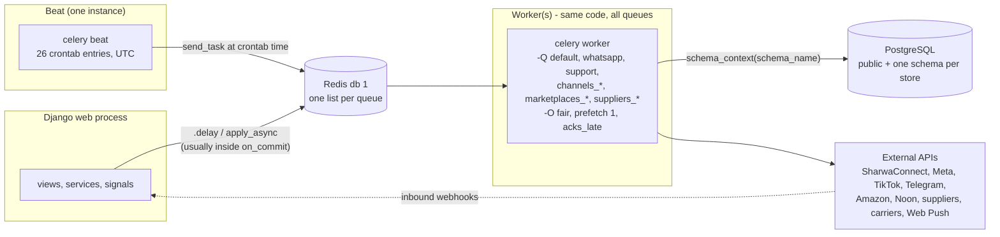
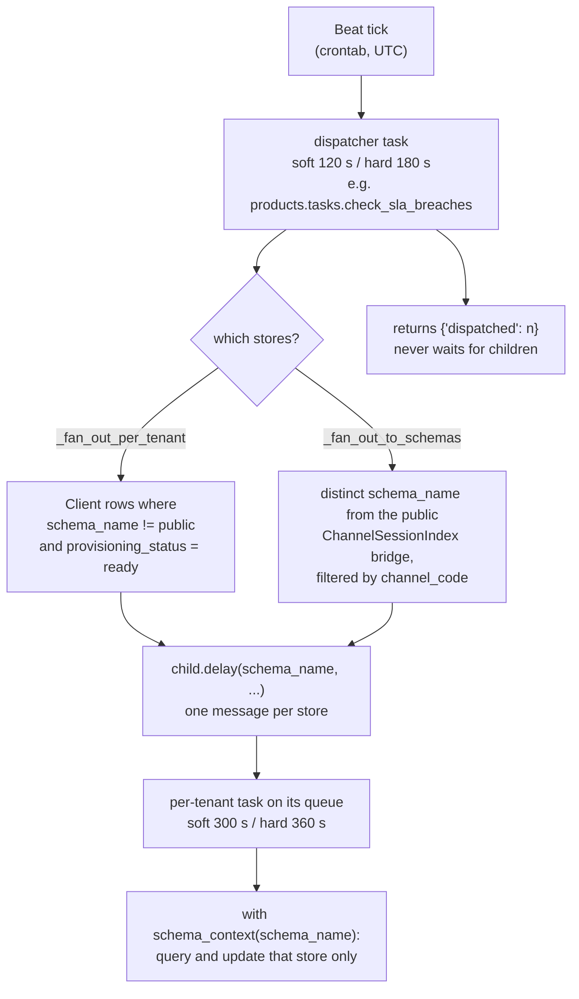
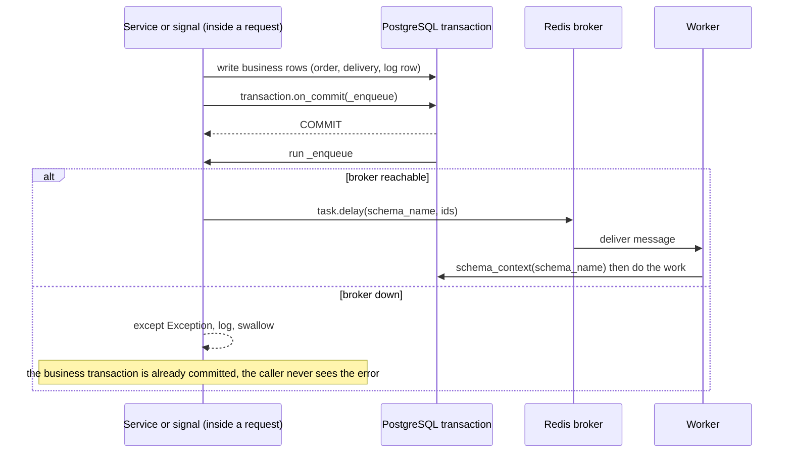
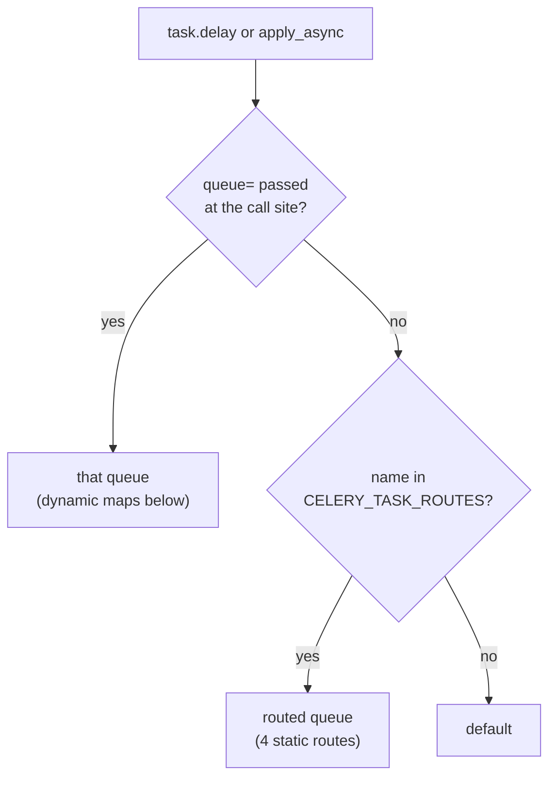

# Background jobs — Celery architecture and job register

> **Source**: DOC-497 · inventory A.8 (full table)
> **Code**: `sharwa_saas/config/celery.py` · `sharwa_saas/config/settings.py` (`CELERY_*`, lines 562–596, `CELERY_BEAT_SCHEDULE` 622–764, eager mode 769–771) · `sharwa_saas/products/tasks/` (package, 8 task modules) · `sharwa_saas/tenants/tasks.py` · `sharwa_saas/deploy/{celery.env,check_celery_queues.py,systemd/,docker-compose.prod.yml}`
> **Last verified against code**: 2026-10-28 (step 38)

## 1. Purpose

This is the **register** of everything that runs outside the HTTP request in Sharwa: the Celery app, its queues, the Beat schedule, the per-tenant dispatch pattern, the rules every enqueue site follows (or should follow), and one row for **every** registered task. The per-family pages under [`jobs/`](jobs/README.md) go deeper (state machines, endpoints, tests); this page is the one place where all jobs, queues and schedules can be compared side by side.

It is **not** the operations guide: starting, restarting and unsticking the processes is in [Runbook — operating Celery workers and Beat](../ops/runbooks/celery.md). Environment variables are in [`../ops/environment.md`](../ops/environment.md); scheduler-less management commands are in [`../ops/management-commands.md`](../ops/management-commands.md).

Counts verified in this step (by scanning every `@shared_task` in the tree; no `@app.task` exists anywhere):

| What | Count | Where |
|---|---|---|
| Registered tasks | **110** | 105 in `products/tasks/*.py` (all named `products.tasks.<function>`), 5 in `tenants/tasks.py` (named `tenants.tasks.<function>`) |
| `CELERY_BEAT_SCHEDULE` entries | **26** | 25 `products.tasks.*` dispatchers + 1 `tenants.tasks.retry_stalled_tenant_provisioning` |
| Per-tenant child tasks started by those dispatchers | 25 | `*_for_tenant` plus `compute_daily_store_metrics` |
| Tasks documented as "Celery Beat" but **not scheduled** | 10 | [§6.7](#67-tasks-that-exist-but-are-never-scheduled) |
| `CELERY_TASK_ROUTES` static routes | 4 | [§6.3](#63-queues-and-routing) |
| Queues consumed by the worker (`deploy/celery.env`) | 11 | 10 used by code, `support` declared but unused |
| Work that deliberately does **not** use Celery | CSV product import, console DLQ replay, webhook redeliver | [§6.8](#68-work-that-deliberately-does-not-use-celery) |

## 2. Components

| Component | Location | Role |
|---|---|---|
| Celery app `sharwa` | `config/celery.py` (8 lines) | `Celery('sharwa')`, `config_from_object('django.conf:settings', namespace='CELERY')`, `autodiscover_tasks()`; exported as `celery_app` from `config/__init__.py` |
| Settings block | `config/settings.py:562-596` | broker, ack/prefetch policy, default queue, static routes |
| Beat schedule | `config/settings.py:622-764` | the 26 periodic entries; a static dict (no database scheduler, see [§7](#7-configuration)) |
| Task package | `products/tasks/` | `__init__.py` re-exports every task and helper so `from products.tasks import X` keeps working; modules `operations`, `shipping`, `reports`, `whatsapp`, `sharwa_ai`, `support`, `channels`, `marketplaces`, `suppliers`, plus `_common` (fan-out helpers, time limits, base classes) and `_testing` (`patch_everywhere`) |
| Tenant tasks | `tenants/tasks.py` | provisioning task + sweeper, Sharwa Ship bulk switch, nightly-stats task |
| Fan-out helpers | `products/tasks/_common.py:34-70` | `_fan_out_per_tenant`, `_fan_out_to_schemas` |
| Time limits | `products/tasks/_common.py:28,31` | `TENANT_TASK_LIMITS`, `DISPATCHER_TASK_LIMITS` |
| Failure bases | `_common.py` `_LoggingFailureTask`; `shipping.py:38` `_WebhookDLQTask`; `sharwa_ai.py` `_CartWebhookFailureTask` | what is persisted when retries are exhausted |
| Worker process | `deploy/systemd/celery-sharwa.service`; compose service `worker` | `celery -A config worker -Q ${CELERY_QUEUES} ... -O fair` |
| Beat process | `deploy/systemd/celery-sharwa-beat.service`; compose service `beat` | `celery -A config beat --schedule <file>` — **exactly one** instance |
| Queue list (single source of truth) | `deploy/celery.env` line 16 | read by systemd, compose and the CI guard |
| CI guard | `deploy/check_celery_queues.py` | static scan: a queue used by code but missing from `celery.env` fails the build |
| Broker | Redis, database 1 (`CELERY_BROKER_URL`); cache is database 0 | `redis:7-alpine --appendonly yes --maxmemory-policy noeviction` in compose |

## 3. State fields touched

This page owns no models. Each job writes into models owned by the data-model and job pages; the register (§6) names the fields per job. The Celery layer itself holds **no result state**: `CELERY_TASK_IGNORE_RESULT = True` (`settings.py:563`) and there is **no `CELERY_RESULT_BACKEND`**. A job's outcome is therefore always a database row (job tables, `AppUsageLog`, `Message.status`, `PendingWebhookEvent`, …) or a cache key, never a Celery result.

Cross-schema tables used by dispatchers (public schema): `Client` (`provisioning_status`), `ChannelSessionIndex` (which stores have a connected channel / marketplace / supplier), `PendingWebhookEvent` (carrier DLQ) — see [`13-cross-schema-access.md`](13-cross-schema-access.md) and [`jobs/provisioning-and-carrier-webhooks.md`](jobs/provisioning-and-carrier-webhooks.md).

## 4. Flows

### 4.1 Per-tenant dispatch (Beat -> dispatcher -> per-tenant task)

Beat never loops over stores itself. A **dispatcher** task does one public-schema query and sends one `.delay(schema_name, ...)` per target store; each **per-tenant task** enters `schema_context(schema_name)` on its first logical line and carries its own time limit. A slow or hung store therefore blocks one pool slot for at most 360 s, not the whole sweep.

Rules enforced by tests (`products/test_beat_fanout.py`, 8 tests): every Beat dispatcher uses a fan-out helper, none calls `schema_context` inside a loop, every dispatcher carries `DISPATCHER_TASK_LIMITS`, and `_fan_out_to_schemas` only calls `.delay`. `products/test_tasks.py::BeatFanOutDispatchTests` checks one child per tenant and the limits on children.

Fan-out target sets (verified in the dispatcher bodies):

| Dispatcher group | Target set | Source |
|---|---|---|
| operations, reports, shipping dispatchers (all except those below) | every `Client` with `schema_name != 'public'` **and** `provisioning_status == READY` | `_common.py:34-53` |
| `flag_orders_in_deactivated_zones` | same, but only if the public `SharwaShipZone` table has inactive zones; the zone names are passed as an argument. Otherwise returns `{'flagged': 0, 'dispatched': 0}` | `shipping.py:171-186` |
| `check_channel_connection_health` | `ChannelSessionIndex` distinct schemas (all channel codes) | `channels.py:66-68` |
| marketplace dispatchers (`check_marketplace_connection_health`, `poll_marketplace_orders`, `poll_fba_inventory`) | `ChannelSessionIndex` filtered to `MARKETPLACES.keys()` | `marketplaces.py:81-85,502-506,647-651` |
| `check_supplier_connection_health`, `schedule_supplier_catalog_refresh`, `schedule_supplier_inventory_sync`, `purge_supplier_webhook_payloads` | `ChannelSessionIndex` filtered to `SUPPLIERS.keys()` | `suppliers.py:59-63,301-304,610-613,652-655` |
| `fetch_scheduled_feeds` | `ChannelSessionIndex` with `channel_code='flat_feed'` | `suppliers.py:442-444` |
| `poll_supplier_orders` | `ChannelSessionIndex` with `channel_code` in `cj`, `makhazen`, `knawat` | `suppliers.py:827-830` |

### 4.2 The enqueue convention

Two enqueue styles exist in the code. Event hooks (something happened in a request or signal) follow the **on_commit + never-raise** rule; operator-triggered job starts call `.delay()`/`.apply_async()` directly after writing their job row.

| Style | Where it is used (file:line) | Behaviour when the broker is down |
|---|---|---|
| **A. `on_commit` + `try/except`** (rule from the roadmap) | `order_events.py:170` (`notify_sharwaconnect_of_order_event`), `whatsapp_service.py:104` (`send_whatsapp_notification_async`, no caller today), `order_push_service.py:81`, `webhook_service.py:358` and `:334-337` (`emit`/`_enqueue`; `emit_order` at `:401-405` swallows too), `sharwa_ai_cart_publisher.py:235`, `shipment_confirm_service.py:126,143`, `sharwa_ship_api_service.py:387` (`retry_awb`'s `kick`), `suppliers/order_forward_service.py:78,515,559`, `suppliers/import_service.py:180`, `support_api_service.py:342`, `social_channels/inbox_api_service.py:311`, `tenants/registration.py:68-71` | The enqueue error is logged/ignored, the committed data stays. Recovery depends on the job: provisioning is recovered by the Beat sweeper, AWB by Beat `retry-pending-awb-issuance`, scheduled campaigns by Beat, most others are **not** recovered automatically |
| **B. direct `.delay()` after the job row is written** | `export_service.py:183` (`run_report_export`), `channels_api_service.py:419,453` (`sync_channel_catalog`, `sync_channel_product`), `push_service.py:105` (`send_push_broadcast`), `support_lock_service.py:167` (`notify_staff_of_escalation`), `signals_social_channels.py:49,51` (stock shield), `suppliers/api_service.py` and `views/dropshipping_*.py` (`enqueue_supplier_*`), `views/marketplace_listings.py:295-305,410`, `marketplaces/api_service.py:399,409` | No `try/except` at the enqueue site; an exception propagates to the caller. The one explicit handling is the console Sharwa Ship switch, which catches it and answers 503 (`console_service.py:478-483`) |
| **C. plain helper that never raises** | `tenants/provisioning.py:116-125` `queue_provisioning` returns True/False | Returns `False`; the stalled-store sweeper re-queues the store |

> ⚠️ Discrepancy — roadmap says tasks "must never raise into the caller" as a universal convention / code does: the rule holds for the event-hook sites in style A and for `queue_provisioning`, but operator-triggered starts (style B) call `.delay()` bare (`products/services/export_service.py:183`, `products/services/social_channels/channels_api_service.py:419`, `products/services/push_service.py:105`, `products/services/support_lock_service.py:167`). Reported in step 38.

### 4.3 Queue routing

Routing is decided in one of four ways; a task with none of them goes to `default` (`CELERY_TASK_DEFAULT_QUEUE`, `settings.py:568`).

## 5. Invariants

| Invariant | Enforced by |
|---|---|
| A task that touches store data receives `schema_name` as its **first** argument and enters `schema_context(schema_name)` before any query; the worker never inherits the requester's schema | convention in every module; guarded for Beat dispatchers by `test_beat_fanout.py` |
| Exceptions with no `schema_context` are intentional: `send_sharwa_ai_cart_events` (envelope is self-contained), `dispatch_platform_event` (platform event, no store), `archive_stale_conversations` (**bug**, see [§9](#9-open-items)) | docstrings in `sharwa_ai.py:50`, `whatsapp.py:140` |
| A queue used in code must be consumed by the worker | `deploy/check_celery_queues.py` in `deploy.sh` pre-flight (`deploy/deploy.sh:36`) and CI |
| Exactly one Beat instance cluster-wide | `deploy/systemd/celery-sharwa-beat.service` comment, `docker-compose.prod.yml` (never scale `beat`) |
| Registered task names never change (messages already in Redis and Beat entries depend on them) | `products/test_tasks_package.py` (8 tests; see [§9](#9-open-items) for what it pins) |
| Redelivery of a killed task is expected, so every task is idempotent by a lock, a row status, a unique key or a cache key | per-job column "Idempotency" in §6.4 |
| Self-chaining jobs reschedule with `apply_async(countdown=...)` (back of the queue, no `max_retries` consumed), not `self.retry`, except the rate-limit branch of `dispatch_channel_message` (`channels.py:379`) and the marketplace rate-limit branches | `suppliers.py`, `marketplaces.py` |
| Dispatcher tasks never wait for children and return `{'dispatched': n}` | `_common.py:34-70` |

## 6. Background work

### 6.1 How to read the register

* **Queue**: `default` means no route and no `queue=`. Dynamic queues are explained in §6.3.
* **Limits**: `T` = `TENANT_TASK_LIMITS` (soft 300 s, hard 360 s). `D` = `DISPATCHER_TASK_LIMITS` (soft 120 s, hard 180 s). A blank means the task has **no** time limit.
* **Retry**: `none` means the task has no `autoretry_for`/`max_retries`; the global `acks_late` + `reject_on_worker_lost` still re-deliver it if the worker process is killed. `backoff` = `retry_backoff=True`, `retry_jitter=True` with the stated cap.
* **Trigger** cites the real caller (file:line). "Beat" means a `CELERY_BEAT_SCHEDULE` entry.
* Dispatcher + child pairs share one row: `X` / `X_for_tenant`.

### 6.2 Beat schedule (26 entries, all UTC)

`celery.py` and `settings.py` set no `CELERY_TIMEZONE`/`timezone`, and the settings comment at `settings.py:743-744` reads the midnight entries as "after midnight UTC". `TIME_ZONE = 'Asia/Riyadh'` (`settings.py:371`) is the **Django** zone and is not applied to crontabs unless Celery picks it up; the effective value is listed as unverified in [§9](#9-open-items). Times below assume UTC.

| # | Entry name (`settings.py` line) | Task | Crontab | Fires at | Fan-out set | Detail page |
|---|---|---|---|---|---|---|
| 1 | `retry-stalled-tenant-provisioning` (625) | `tenants.tasks.retry_stalled_tenant_provisioning` | `minute='2-59/5'` | :02 :07 ... :57 | `Client` rows, itself (no child) | [provisioning](jobs/provisioning-and-carrier-webhooks.md) |
| 2 | `check-expired-app-subscriptions-hourly` (629) | `check_expired_subscriptions` | `minute=0` | every hour :00 | ready stores | this page |
| 3 | `force-close-expired-shifts` (634) | `force_close_expired_shifts` | `*/30` | :00 :30 | ready stores | [pos-support-awb](jobs/pos-support-awb.md) |
| 4 | `escalate-expired-approvals` (639) | `escalate_expired_approvals` | `minute=15` | every hour :15 | ready stores | this page |
| 5 | `dispatch-scheduled-campaigns` (645) | `dispatch_scheduled_campaigns` | `*/5` | every 5 min from :00 | ready stores | [campaigns](jobs/campaigns.md) |
| 6 | `dispatch-low-stock-webhooks` (650) | `dispatch_low_stock_webhooks` | `*/15` | :00 :15 :30 :45 | ready stores | [webhooks](jobs/webhooks.md) |
| 7 | `expire-stale-active-carts` (654) | `expire_stale_active_carts` | `*/30` | :00 :30 | ready stores | this page |
| 8 | `flag-orders-in-deactivated-zones` (659) | `flag_orders_in_deactivated_zones` | `minute=30` | every hour :30 | ready stores, only when an inactive zone exists | [pos-support-awb](jobs/pos-support-awb.md) |
| 9 | `check-sla-breaches` (663) | `check_sla_breaches` | `*/30` | :00 :30 | ready stores | this page |
| 10 | `retry-pending-awb-issuance` (668) | `retry_pending_awb_issuance` | `*/15` | :00 :15 :30 :45 | ready stores | [pos-support-awb](jobs/pos-support-awb.md) |
| 11 | `verify-label-availability` (672) | `verify_label_availability` | `*/10` | :00 :10 ... :50 | ready stores | [pos-support-awb](jobs/pos-support-awb.md) |
| 12 | `check-channel-connection-health` (677) | `check_channel_connection_health` | `*/15` | :00 :15 :30 :45 | bridge, all channels | [channels](jobs/channels.md) |
| 13 | `check-marketplace-connection-health` (683) | `check_marketplace_connection_health` | `minute='7,22,37,52'` | :07 :22 :37 :52 | bridge, marketplaces | [marketplaces](jobs/marketplaces.md) |
| 14 | `poll-marketplace-orders` (689) | `poll_marketplace_orders` | `minute='1-59/5'` | :01 :06 ... :56 | bridge, marketplaces | [marketplaces](jobs/marketplaces.md) |
| 15 | `poll-fba-inventory` (695) | `poll_fba_inventory` | `minute=41` | every hour :41 | bridge, marketplaces | [marketplaces](jobs/marketplaces.md) |
| 16 | `check-supplier-connection-health` (701) | `check_supplier_connection_health` | `minute='11,26,41,56'` | :11 :26 :41 :56 | bridge, suppliers | [dropshipping](jobs/dropshipping.md) |
| 17 | `schedule-supplier-catalog-refresh` (706) | `schedule_supplier_catalog_refresh` | `minute='23'` | every hour :23 | bridge, suppliers | [dropshipping](jobs/dropshipping.md) |
| 18 | `fetch-scheduled-feeds` (711) | `fetch_scheduled_feeds` | `minute='37'` | every hour :37 | bridge, `flat_feed` | [dropshipping](jobs/dropshipping.md) |
| 19 | `schedule-supplier-inventory-sync` (717) | `schedule_supplier_inventory_sync` | `minute='3-59/5'` | :03 :08 ... :58 | bridge, suppliers | [dropshipping](jobs/dropshipping.md) |
| 20 | `poll-supplier-orders` (722) | `poll_supplier_orders` | `minute='9,39'` | :09 :39 | bridge, `cj`/`makhazen`/`knawat` | [dropshipping](jobs/dropshipping.md) |
| 21 | `purge-supplier-webhook-payloads` (727) | `purge_supplier_webhook_payloads` | `hour=3, minute=17` | 03:17 daily | bridge, suppliers | [dropshipping](jobs/dropshipping.md) |
| 22 | `suggest-order-merges` (733) | `suggest_order_merges` | `minute=45` | every hour :45 | ready stores | this page |
| 23 | `compute-all-tenants-daily-metrics` (745) | `compute_all_tenants_daily_metrics` | `hour=0, minute=10` | 00:10 daily | ready stores | this page |
| 24 | `populate-tenant-stats-snapshot` (750) | `populate_tenant_stats_snapshot` | `hour=0, minute=40` | 00:40 daily | ready stores | this page |
| 25 | `cleanup-expired-report-exports` (755) | `cleanup_expired_report_exports` | `hour=2, minute=0` | 02:00 daily | ready stores | this page |
| 26 | `send-scheduled-report-emails` (760) | `send_scheduled_report_emails` | `hour=3, minute=0` | 03:00 daily | ready stores | this page |

Offsets are deliberate ("shifted so they do not land on the same worker", comments at `settings.py:683,689`), except that nine dispatchers still share the :00 tick every hour (rows 2, 3, 5, 6, 7, 9, 10, 11, 12). Beat is the only thing that fires these entries; if Beat is down, **none** of them run and nothing queues up to catch up later (Celery Beat does not backfill missed ticks).

### 6.3 Queues and routing

Static routes, `CELERY_TASK_ROUTES` (`settings.py:569-596`):

| Task | Queue | Line |
|---|---|---|
| `dispatch_whatsapp_message` | `whatsapp` | 573 |
| `process_inbound_channel_message` | `default` | 577 |
| `upload_inbound_channel_media_task` | `default` | 578 |
| `dispatch_broadcast_campaign_chunk` | `channels_broadcast` | 586 |

Dynamic routes (`queue=` at the call site; **not** in `CELERY_TASK_ROUTES`):

| Map | Defined | Values | Used by |
|---|---|---|---|
| `CHANNEL_DISPATCH_QUEUE_MAP` | `products/tasks/channels.py:264` | `whatsapp` -> `whatsapp`, `meta_social_commerce` -> `channels_meta`, `tiktok_shop` -> `channels_tiktok`, `telegram_bot` -> `channels_telegram`; call-site fallback is `channels_meta` (inbox) or `whatsapp` (campaigns, cart reminders) | every `dispatch_channel_message` call (`channels.py:496,559`, `campaigns.py:297`, `abandoned_cart_service.py:219`, `inbox_api_service.py:315`, `views/social_channels_inbox.py:189,312`) |
| `MARKETPLACE_QUEUE_MAP` | `products/tasks/marketplaces.py:29` | `amazon` -> `marketplaces_amazon`, `noon` -> `marketplaces_noon`, fallback `default` | listing push, bulk push, feed poll, order pull, shipment confirmation, FBA refresh, barcode match, price/quantity update |
| `SUPPLIER_QUEUES` | `products/tasks/suppliers.py:21` | `sync` -> `suppliers_sync`, `orders` -> `suppliers_orders` | catalog pull, import, reprice, inventory sync, feed import/fetch, image download (`sync`); webhook processing and the four supplier-order tasks (`orders`) |
| literal | `products/campaigns.py:243` | `channels_broadcast` | broadcast chunks (also in the static route) |

Everything else runs on `default`: every Beat dispatcher and per-tenant child, provisioning, order push, outgoing webhooks, `dispatch_order_event`, `dispatch_platform_event`, support tasks, report tasks, carrier webhooks.

The `support` queue is declared in `deploy/celery.env` but **no code uses it** (the file says so, lines 14-15). Order events and support replies therefore do not use `whatsapp`; only `dispatch_whatsapp_message` is routed there.

> ⚠️ Discrepancy — roadmap lists `dispatch_whatsapp_message`, `send_whatsapp_notification_async` and `order_events.notify_sharwaconnect_of_order_event` as three jobs on the WhatsApp path / code does: `dispatch_whatsapp_message` is the only task routed to `whatsapp` (`settings.py:573`); `send_whatsapp_notification_async` (`products/whatsapp_service.py:44`) and `notify_sharwaconnect_of_order_event` (`products/order_events.py:85`) are plain functions that enqueue `dispatch_whatsapp_message` and `dispatch_order_event` (the latter on `default`) via `on_commit`. In addition, `send_whatsapp_notification_async` has no caller outside tests, so `dispatch_whatsapp_message` is never enqueued in production today (grep of `sharwa_saas`; see [`jobs/whatsapp.md`](jobs/whatsapp.md)). Reported in step 38.

### 6.4 Task register (all 110 tasks)

Sections follow the task modules. Pairs "dispatcher / child" are one row. "Sibling" pages hold the state machines.

#### A. Tenant lifecycle (`tenants/tasks.py`) — sibling: [provisioning-and-carrier-webhooks](jobs/provisioning-and-carrier-webhooks.md)

| Job | Kind | Trigger | Queue | Schedule | Retry | Idempotency | Failure handling |
|---|---|---|---|---|---|---|---|
| `tenants.tasks.provision_tenant_schema` (`tasks.py:175`) | task | `queue_provisioning` (`provisioning.py:116`), from registration `on_commit` (`registration.py:71`), the sweeper, console `reprovision` (`console_service.py:450`), admin action | `default` | on demand | `bind`, `acks_late`, `max_retries=3`, `default_retry_delay=60`, `self.retry(exc=exc)`; soft 900 s / hard 960 s | cache lock `tenant-provisioning-lock:<client_id>` (20 min, `cache.add`); resumable (`migrate_schemas` if the schema exists); `ready` stores skipped | lock held -> returns `locked`; last failure -> `mark_failed` (`provisioning_status='failed'`, `provisioning_error[:2000]`, schema never dropped) |
| `tenants.tasks.retry_stalled_tenant_provisioning` (`tasks.py:207`) | Beat sweeper | Beat #1 | `default` | `2-59/5` | none (next tick is the retry) | re-queue is harmless (lock + `ready` skip) | stalled = `pending` older than 5 min since `created_on`, or `provisioning` older than 20 min since `provisioning_started_at`; `failed` stores are **not** re-queued, they need console re-provision |
| `tenants.tasks.activate_sharwa_ship_task` (`tasks.py:19`) / `deactivate_sharwa_ship_task` (`:87`) | task | console `toggle_sharwa_ship` (`console_service.py:479`), Django admin (`admin.py:182,203`) | `default` | on demand | none | `get_or_create` / `UPDATE is_active=False` | per-store `try/except`; console marker `platform:sharwa-ship-job:<SCHEMA>` (10 min) hides the buttons meanwhile |
| `tenants.tasks.aggregate_tenant_stats` (`tasks.py:120`) | task, **unscheduled** | none (docstring says "Celery Beat nightly"; only a comment at `tenants/views.py:391`) | `default` | none | none | `update_or_create(client, date)` | see [§6.7](#67-tasks-that-exist-but-are-never-scheduled) |

#### B. Operations, housekeeping, push (`products/tasks/operations.py`)

| Job | Kind | Trigger | Queue | Schedule | Retry | Idempotency | Failure handling |
|---|---|---|---|---|---|---|---|
| `check_expired_subscriptions` (45) / `_for_tenant` (15) | Beat + child | Beat #2 | `default` | hourly :00 | none; D / T | filter `is_active=True and subscription_expires_at < now`; second run finds nothing | sets `StoreAppInstallation.is_active=False`, writes `AppInstallationEvent(event='subscription_expired')`; returns counts, errors surface in the worker log |
| `force_close_expired_shifts` (90) / `_for_tenant` (66) | Beat + child | Beat #3 | `default` | `*/30` | none; D / T | filter `status='open' and opened_at < now-12h` (`SHIFT_MAX_DURATION_HOURS`) | `Shift.status='force_closed'`, `closed_at`, `version+=1`, `force_close_notice_seen=False` (cashier sees a notice) — see [pos-support-awb](jobs/pos-support-awb.md) |
| `escalate_expired_approvals` (122) / `_for_tenant` (103) | Beat + child | Beat #4 | `default` | hourly :15 | none; D / T | filter `status='pending' and escalated_at is null and created_at < now-24h` (`APPROVAL_ESCALATION_HOURS`) | sets `ApprovalRequest.escalated_at` only (no notification is sent by this task) |
| `expire_stale_active_carts` (153) / `_for_tenant` (137) | Beat + child | Beat #7 | `default` | `*/30` | none; D / T | status filter, 24 h (`DRAFT_CART_TTL_HOURS`) | active carts older than the TTL -> status `abandoned` |
| `dispatch_scheduled_campaigns` (170) / `_for_tenant` (161) | Beat + child | Beat #5 | `default` | `*/5` | none; D / T | `marketing_service.dispatch_due_campaigns` takes `scheduled_at <= now` and flips status to `sent` under `select_for_update` | a campaign flipped to `sent` is not sent twice; per-recipient work goes to `channels_broadcast` — [campaigns](jobs/campaigns.md) |
| `dispatch_low_stock_webhooks` (195) / `_for_tenant` (186) | Beat + child | Beat #6 | `default` | `*/15` | none; D / T | `webhook_service.low_stock_scan` emits once per entry into the low range; cache key `webhook_low_stock:<schema>`; runs only if an active endpoint subscribes `inventory.low_stock` | emit never raises — [webhooks](jobs/webhooks.md) |
| `deliver_webhook` (176) | task | `webhook_service._enqueue` (`webhook_service.py:334-337`) with `apply_async(countdown=...)` | `default` | on demand | **no Celery retry**: the service re-enqueues a *new* `WebhookDelivery` row (`AUTO_RETRIES=3`, `RETRY_DELAYS=(60, 300)`, timeout `(3, 10)` s); T | one `WebhookDelivery` row per attempt | endpoint auto-disabled after `AUTO_DISABLE_AFTER` failures; operator uses `webhooks/deliveries/<id>/redeliver/` — [webhooks](jobs/webhooks.md) |
| `send_order_push` (201) | task | `order_push_service` `on_commit` (`order_push_service.py:77-81`) | `default` | on demand | none | cache key `order-push:<schema>:<order_id>:<kind>` via `cache.add`, TTL 6 h (`DEDUPE_TTL`); no subscribers -> no task | enqueue wrapped in `try/except`; push errors are swallowed per subscription — [order-push](jobs/order-push.md) |
| `send_push_broadcast` (211) | task | `push_service.send_push_to_all_subscribers` (`push_service.py:105`), called by `PushTestView` for route `push/test/` (`api/views_push.py:70`, `api/urls.py:113`) | `default` | on demand | none | not idempotent (a re-run re-sends); owner-only route throttled by `cache.add('push-test:<schema>')` (429 + `Retry-After`; 400 when there are no subscribers) | one bad subscription does not stop the loop — [order-push](jobs/order-push.md) |

> ⚠️ Discrepancy — roadmap says `send_campaign` is a Celery job / code does: `send_campaign` is a plain function (`products/campaigns.py:196-247`) called from `CampaignSendView`; it bulk-creates `CampaignRecipient` rows and enqueues `dispatch_broadcast_campaign_chunk` on `channels_broadcast` (`campaigns.py:241-244`, route `settings.py:586`). The Celery job is the chunk task. Reported in step 38.

> ⚠️ Discrepancy — roadmap says "`deliver_webhook` + Beat `dispatch-low-stock-webhooks`" with Celery-style retry / code does: `deliver_webhook` has no `autoretry_for`; failed deliveries are retried by re-enqueueing a new delivery row with a countdown (`products/services/webhook_service.py:316-331`). Reported in step 38.

#### C. Shipping, AWB, carrier webhooks (`products/tasks/shipping.py`) — sibling: [pos-support-awb](jobs/pos-support-awb.md), [provisioning-and-carrier-webhooks](jobs/provisioning-and-carrier-webhooks.md)

| Job | Kind | Trigger | Queue | Schedule | Retry | Idempotency | Failure handling |
|---|---|---|---|---|---|---|---|
| `process_carrier_webhook_event` (64) | task | `CarrierWebhookView` `.delay` (`api/views.py:729`, route `webhooks/carrier/<carrier_code>/`, answers 202); console DLQ retry calls it **synchronously** (`console_service.py:985`) | `default` | on demand | `base=_WebhookDLQTask`, `bind`, `autoretry_for=(CarrierWebhookTransientError,)`, backoff cap 120 s, `max_retries=8` | unique `ShipmentEvent.idempotency_key` (`wh:<carrier>:<event_id>` or `wh:<carrier>:<waybill>:<to_status>:<event_time>`, `shipping.py:28`) | permanent error (unknown waybill) or exhausted retries -> public `PendingWebhookEvent(status='pending', attempts=max_retries)`; operator retries/discards in the console |
| `trigger_delivered_return_review` (124) | task | `shipment_state_service.py:287` on `delivered -> returned` | `default` | on demand | none | log-only | enqueue failure is logged and does not roll back the transition |
| `flag_orders_in_deactivated_zones` (171) / `_for_tenant` (151) | Beat + child | Beat #8 | `default` | hourly :30 | none; D / T | `update(zone_deactivated_flag=True)` filtered on `False` | sets `Order.zone_deactivated_flag` |
| `check_sla_breaches` (214) / `_for_tenant` (189) | Beat + child | Beat #9 | `default` | `*/30` | none; D / T | read-only | **log-only** (`logger.warning` per overdue `Fulfillment`, default 72 h); nothing is persisted or notified |
| `retry_pending_awb_issuance` (252) / `_for_tenant` (227) | Beat + child | Beat #10; also `retry_awb` kick (`sharwa_ship_api_service.py:381-387`) | `default` | `*/15` | none; D / T | iterates `PendingAWBQueue.status='pending'`; `attempts += 1`; -> `issued` / `failed` / stays `pending` | `failed` rows wait for the operator (`shipping/awb-queue/<pk>/retry/`) |
| `verify_label_availability` (292) / `_for_tenant` (260) | Beat + child | Beat #11 | `default` | `*/10` | none; D / T | `apply_shipment_transition(..., idempotency_key='verify-label-<id>')` | carrier lookup errors are swallowed (label treated as not ready, retried next tick) |
| `suggest_order_merges` (320) / `_for_tenant` (304) | Beat + child | Beat #22 | `default` | hourly :45 | none; D / T | read-only, window 3 h | **log-only** (`[Merge suggestion]`); no row is written |

#### D. Reports (`products/tasks/reports.py`)

| Job | Kind | Trigger | Queue | Schedule | Retry | Idempotency | Failure handling |
|---|---|---|---|---|---|---|---|
| `compute_all_tenants_daily_metrics` (50) / `compute_daily_store_metrics` (20) | Beat + child | Beat #23 | `default` | 00:10 daily | none; D / T | `save_daily_metrics(target_date)` upserts; default date = yesterday in the store's `StoreSetting.timezone` | writes `DailyStoreMetrics` |
| `populate_tenant_stats_snapshot` (100) / `_for_tenant` (62) | Beat + child | Beat #24 | `default` | 00:40 daily | none; D / T | upsert per store/day | writes public `TenantStatsSnapshot` (feeds the console overview) |
| `run_report_export` (118) | task | `export_service.enqueue_export` -> `.delay` (`export_service.py:183`), routes `reports/exports/` and `reports/<code>/exports/` | `default` | on demand | none | job row `status` (`queued` -> ...) written by `run_export` | no time limit on this task |
| `cleanup_expired_report_exports` (147) / `_for_tenant` (130) | Beat + child | Beat #25 | `default` | 02:00 daily | none; D / T | marks exports with `expires_at` in the past as expired | — |
| `send_scheduled_report_emails` (208) / `_for_tenant` (162) | Beat + child | Beat #26 | `default` | 03:00 daily | none; D / T | due when `last_sent_at` is empty or older than 1 / 7 / 30 days for daily / weekly / monthly; sets `last_sent_at` after enqueueing the export and mailing the link | per-subscription `try/except`; mail uses `fail_silently=True` |

#### E. WhatsApp and SharwaConnect (`whatsapp.py`, `sharwa_ai.py`) — sibling: [whatsapp](jobs/whatsapp.md)

| Job | Kind | Trigger | Queue | Schedule | Retry | Idempotency | Failure handling |
|---|---|---|---|---|---|---|---|
| `dispatch_whatsapp_message` (22) | task, **orphaned** | only `send_whatsapp_notification_async` -> `on_commit` (`whatsapp_service.py:102-104`), which has **no caller outside tests** ([whatsapp page](jobs/whatsapp.md)) | **`whatsapp`** (static route) | none today | `base=_LoggingFailureTask`, `bind`, `autoretry_for=(SharwaConnectTransientError,)`, backoff cap 300 s, `max_retries=5` | `AppUsageLog` row id is `args[1]` | final failure -> `AppUsageLog.status='failed'` via `on_failure` |
| `dispatch_order_event` (78) | task | `order_events.notify_sharwaconnect_of_order_event` -> `on_commit` (`order_events.py:166-170`) | `default` | on demand | same policy as above | event id `order-<id>-<type>` is the receiver's dedupe key | same `on_failure` |
| `dispatch_platform_event` (129) | task | `tenants/platform_events.py:80`, once per provisioned store (`tenants/provisioning.py:153-163`) | `default` | on demand | `autoretry_for=(SharwaConnectTransientError,)`, backoff cap 300 s, `max_retries=5`; **no base class, no `schema_context`** | caller-supplied `event_id` | permanent error -> `logger.error`; exhausted retries only in worker log. The merchant webhook secret travels as a task argument ([§9](#9-open-items)) |
| `send_sharwa_ai_cart_events` (37) | task | `sharwa_ai_cart_publisher.py:229`, enqueued `on_commit` at `:235` | `default` | on demand | `base=_CartWebhookFailureTask`, `autoretry_for=(CartWebhookTransientError,)`, backoff cap 300 s, `max_retries=5`; permanent 401/413/422 are logged, not retried | envelope idempotent at the receiver; signature and timestamp regenerated on every attempt | `_CartWebhookFailureTask.on_failure` logs an ERROR (no table) |

#### F. Support (`products/tasks/support.py`) — sibling: [pos-support-awb](jobs/pos-support-awb.md)

All four tasks use `ignore_result=True`, queue `default` (the `support` queue is not used).

| Job | Kind | Trigger | Queue | Schedule | Retry | Idempotency | Failure handling |
|---|---|---|---|---|---|---|---|
| `process_support_inbound_message` (29) | task | `signals_support.py:38` | `default` | on demand | none | unique `gateway_message_id`; `IntegrityError` = already stored | — |
| `notify_staff_of_escalation` (233) | task | `support_lock_service.py:167` (direct `.delay`) | `default` | on demand | none | — | — |
| `send_staff_reply_message` (299) | task (legacy dashboard path) | `support_session_reply_view` `.delay` (`products/views/support_hub.py:131-132`), route `POST /dashboard/support-sessions/<id>/reply/` (`config/urls_tenant.py:464`) | `default` | on demand | none | none: each call writes a new message; `SessionLockConflict` rejects stale replies quietly | gateway errors are logged only, the saved message stays |
| `deliver_staff_reply` (341) | task (API path) | `support_api_service.py:342` (`on_commit`), route `POST /api/v1/support/sessions/<id>/messages/` | `default` | on demand | none | message row pk | delivery of the message created by the API |

Both reply tasks are live: `deliver_staff_reply` serves the API screen, `send_staff_reply_message` serves the older server-rendered dashboard page. Roadmap and code agree here.

#### G. Social channels, inbox, broadcast (`products/tasks/channels.py`) — sibling: [channels](jobs/channels.md), [campaigns](jobs/campaigns.md)

| Job | Kind | Trigger | Queue | Schedule | Retry | Idempotency | Failure handling |
|---|---|---|---|---|---|---|---|
| `check_channel_connection_health` (47) / `_for_tenant` (17) | Beat + child | Beat #12 | `default` | `*/15` | none; D / T | writes `connection_health` into the installation config | — |
| `sync_channel_catalog` (71) | task | `channels_api_service.run_sync` (`:419`), route `channels/<code>/catalog-sync/run/` | `default` | on demand | none | `ChannelCatalogSync` row | report refreshes when the task ends |
| `sync_channel_product` (85) | task | `channels_api_service.py:453`, route `channels/<code>/products/<product_id>/resync/` | `default` | on demand | none | same sync routine as the batch | — |
| `hide_channel_product_out_of_stock` (93) / `show_channel_product_back_in_stock` (101) | task | `signals_social_channels.py:49,51` (stock shield, direct `.delay`) | `default` | on demand | none | decision guarded by `link.sync_status` (`synced` / `hidden_out_of_stock`) | — |
| `dispatch_instagram_comment_auto_reply` (109) | task | `tenants/webhooks_channels.py:98` | `default` | on demand | `autoretry_for=(ChannelClientError,)`, backoff cap 300 s, `max_retries=5` | — | — |
| `dispatch_telegram_start` (146) / `dispatch_telegram_callback` (186) | task | `webhooks_channels.py:171` / `:163` | `default` | on demand | same policy | — | — |
| `ingest_channel_order_task` (223) | task | `webhooks_channels.py:108,394` | `default` | on demand | none (pure DB work) | unique `ChannelOrderLink` inside `ingest_channel_order` | `ChannelOrderIngestionError` caught |
| `upload_inbound_channel_media_task` (310) | task | `process_inbound_channel_message` | `default` (static route) | on demand | none | `Message.media_object_key` update | text message already delivered; failure only loses the media |
| `process_inbound_channel_message` (409) | task | `signals_channels.py:76` | `default` (static route) | on demand | none | per-message external id; inactive installation -> `AppUsageLog(status='skipped')` | — |
| `dispatch_channel_message` (327) | task | `channels.py:493,555`, `campaigns.py:294`, `abandoned_cart_service.py:217`, `inbox_api_service.py:311`, `views/social_channels_inbox.py:178,294` | **dynamic** `CHANNEL_DISPATCH_QUEUE_MAP` | on demand | `base=_LoggingFailureTask`, `autoretry_for=(SharwaConnectTransientError,)`, backoff cap 300 s, `max_retries=5`; rate-limited -> `self.retry(countdown=min(2**retries, 60))` (`:379`) | `Message` row `queued` -> `sent` / `failed` by `message_id` | `on_failure` marks only the `AppUsageLog` failed; a reply stuck `queued` means either the channel queue has no consumer or the task gave up without touching the `Message` row ([channels §9](jobs/channels.md)) |
| `dispatch_broadcast_campaign_chunk` (625) | task | `campaigns.py:241-244` | **`channels_broadcast`** (static) | on demand | none; per-recipient `try/except` | only `CampaignRecipient.status='pending'` rows are processed | an exception for one recipient does not stop the chunk; chunk size `SHARWA_CAMPAIGN_CHUNK_SIZE` (default 50) |
| `archive_stale_conversations` (584) | task, **unscheduled** | none | `default` | none | none | moves `resolved` conversations idle for `days` (default 90) to `ArchivedConversation`/`ArchivedMessage` | **no `schema_context`** — [§9](#9-open-items) |

#### H. Marketplaces (`products/tasks/marketplaces.py`) — sibling: [marketplaces](jobs/marketplaces.md)

All user-visible work runs on `marketplaces_amazon` or `marketplaces_noon` (queue picked from the marketplace code, fallback `default`). Constants: `BULK_FEED_THRESHOLD = 20` (`bulk_sync_service.py:46`; a push of **more than** 20 listings on a marketplace that `supports_bulk_feed` uses the Feeds job, otherwise one task per listing, `api_service.py:392-410`), `MARKETPLACE_MATCH_CHUNK = 25`, `MAX_FEED_POLLS = 14`, `FEED_POLL_FIRST = 120`, `FEED_POLL_CAP = 1800`, `MAX_PAGES_PER_RUN = 20`.

| Job | Kind | Trigger | Queue | Schedule | Retry | Idempotency | Failure handling |
|---|---|---|---|---|---|---|---|
| `check_marketplace_connection_health` (61) / `_for_tenant` (35) | Beat + child | Beat #13 | `default` (kept light, `settings.py:620`) | `7,22,37,52` | none; D / T | — | — |
| `push_marketplace_listing_task` (154) | task | `views/marketplace_listings.py:295-298`, `api_service.py:409` | marketplace queue | on demand | `autoretry_for=(MarketplaceTransientError,)`, `retry_backoff`, jitter, `max_retries=5`; rate limit -> `self.retry(countdown=retry_after)` | listing row state, job row | error codes on the `MarketplaceSyncJob` |
| `update_marketplace_price_quantity_task` (193) | task | `signals_marketplaces.py:58-61` | marketplace queue | on demand | same policy | listing row | — |
| `match_marketplace_listings_by_barcode_task` (223) | task | `views/marketplace_listings.py:408-410`; self-chains in chunks of 25 | marketplace queue | on demand | same policy | job row progress | — |
| `bulk_push_marketplace_listings_task` (350) | task | `api_service.py:399`, `marketplace_listings.py:303-305`; self-chains | marketplace queue | on demand | none; Redis job lock `catalog_push`, reschedule `countdown=15` | one active push job per marketplace (409 otherwise) | `NO-ID` errors recorded on the same job |
| `poll_marketplace_feed_result_task` (393) | task | `_enqueue_feed_poll` (self-scheduled) | marketplace queue | exponential from 120 s up to 1800 s, 14 polls | none | feed row | gives up after `MAX_FEED_POLLS` |
| `poll_marketplace_orders` (491) / `_for_tenant` (464) | Beat + child | Beat #14 (`start_order_pull_job(triggered_by='beat')`) | `default` (children enqueue the pull on the market queue) | `1-59/5` | none; D / T | one running pull job per market | — |
| `pull_marketplace_orders_task` (509) | task | `_enqueue_order_pull`; route `marketplaces/<market>/jobs/` | marketplace queue | on demand | none; lock `order_pull` 300 s, `MAX_PAGES_PER_RUN=20` | job row | — |
| `confirm_marketplace_shipment_task` (561) | task | `_enqueue_shipment_confirmation` from `shipment_confirm_service.py:122-143` (`on_commit`) | marketplace queue | on demand | none; lock `ship:<pk>` 120 s | requires `shipment_confirm_status == 'queued'` | operator re-queues with `marketplaces/orders/<order_id>/confirm-shipment/` |
| `poll_fba_inventory` (637) / `_for_tenant` (609) | Beat + child | Beat #15 | `default` | hourly :41 | none; D / T | one running inventory job per market | — |
| `refresh_fba_inventory_task` (654) | task | `_enqueue_fba_inventory`; route `marketplaces/<market>/jobs/` | marketplace queue | on demand | none; lock `fba_inventory` 300 s | job row | — |

> ⚠️ Discrepancy — roadmap lists `retry_failed_confirmation` as a job / code does: it is a plain function (`products/services/marketplaces/shipment_confirm_service.py:130`) that flips a `failed` confirmation back to `queued` and enqueues `confirm_marketplace_shipment_task` on commit. The Celery job is `confirm_marketplace_shipment_task` (`products/tasks/marketplaces.py:561`). Reported in step 38.

#### I. Dropshipping (`products/tasks/suppliers.py`) — sibling: [dropshipping](jobs/dropshipping.md)

Queues: `suppliers_sync` for catalog, import, reprice, inventory, feeds and image download; `suppliers_orders` for webhook processing and supplier orders. Self-chaining jobs re-enqueue themselves with `apply_async(countdown=...)`. Constants: `SUPPLIER_CATALOG_REFRESH_HOURS = 6`, `WEBHOOK_MAX_ATTEMPTS = 5`, `WEBHOOK_PAYLOAD_KEEP_DAYS = 7`, `WEBHOOK_ROW_KEEP_DAYS = 90`, `SUPPLIER_ORDER_POLL_STALE_MINUTES = 25`.

| Job | Kind | Trigger | Queue | Schedule | Retry | Idempotency | Failure handling |
|---|---|---|---|---|---|---|---|
| `check_supplier_connection_health` (48) / `_for_tenant` (24) | Beat + child | Beat #16 | `default` | `11,26,41,56` | none; D / T | — | `mark_health(..., 'reauth_required')` opens the rate-limit circuit |
| `schedule_supplier_catalog_refresh` (290) / `_for_tenant` (213) | Beat + child | Beat #17 | `default` | hourly :23 | none; D / T | honours `catalog_sync_interval_min` and `price_sync_interval_min` / `last_price_sync_at`; first pass sets the baseline only; default refresh `SUPPLIER_CATALOG_REFRESH_HOURS=6` | starts jobs on `suppliers_sync` |
| `pull_supplier_catalog_task` (150) | task | `enqueue_supplier_catalog` | `suppliers_sync` | on demand | none; reschedule by countdown | job row (`SupplierSyncJob`), chunk lock | `fail_job(job_id, 'AUTH', ...)` on auth errors |
| `import_supplier_products_task` (163) | task | `enqueue_supplier_import` | `suppliers_sync` | on demand | none | job row | — |
| `reprice_supplier_products_task` (176) | task | `enqueue_supplier_reprice` | `suppliers_sync` | on demand | none; lock `suppliers:reprice` 600 s | job row | — |
| `download_supplier_images_task` (204) | task | `import_service.py:180,236` (`on_commit`) | `suppliers_sync` | on demand | none | per product | — |
| `fetch_scheduled_feeds` (433) / `_for_tenant` (391) | Beat + child | Beat #18 | `default` | hourly :37 | none; D / T | due when `schedule_interval_min` (hourly or daily) elapsed, with 5 min slack (`max(60, interval) - 5`) | enqueues `fetch_feed_url_task` |
| `fetch_feed_url_task` (354) / `import_feed_task` (321) | task | `enqueue_feed_fetch` / `enqueue_feed_import`; `FEED_CHUNK` rows per run | `suppliers_sync` | on demand | none; lock `feed:<id>` 900 s | byte/row cursor, never re-reads from the start | job row errors, CSV via `dropshipping/jobs/<pk>/errors.csv/` |
| `sync_supplier_inventory_task` (473) | task | `enqueue_supplier_inventory` | `suppliers_sync` | on demand | none | job row | — |
| `schedule_supplier_inventory_sync` (598) / `_for_tenant` (546) | Beat + child | Beat #19 | `default` | `3-59/5` | none; D / T | starts an inventory job for each supplier whose interval is due (floor 15 min), revives a stale chain, re-queues unprocessed signed supplier webhooks received 5 min to 1 day ago (limit 200 per store per tick) | — |
| `process_supplier_webhook_task` (486) | task | `webhooks_suppliers.py:97-100` via `enqueue_supplier_webhook` | `suppliers_orders` | on demand | `WEBHOOK_MAX_ATTEMPTS=5` (own counter, `attempt` kwarg) | event row | re-queued by the sweeper above |
| `purge_supplier_webhook_payloads` (641) / `_for_tenant` (616) | Beat + child | Beat #21 | `default` | 03:17 daily | none; D / T | payload kept 7 days, row 90 days | — |
| `route_supplier_order_task` (689), `forward_supplier_order_task` (735), `poll_supplier_order_task` (746), `cancel_supplier_order_task` (756) | task | `order_forward_service.py:78,95,515,559-565` (`on_commit`), `views/dropshipping_orders.py:114-125` | `suppliers_orders` | on demand | none; lock `so:<id>` 300 s; waits re-enqueue with countdown | `SupplierOrder` row state | operator uses `dropshipping/jobs/<pk>/retry/` or order actions |
| `poll_supplier_orders` (816) / `_for_tenant` (766) | Beat + child | Beat #20 | `default` | `9,39` | none; D / T | polls only orders not synced for 25 min; also re-queues stuck `queued` orders and routes ready orders that were never routed | exceptions logged; the next sweep retries |

> ⚠️ Discrepancy — roadmap says "hourly catalog beat" for dropshipping with an interval setting / code does: the Beat entry is hourly at :23 (`settings.py:706-709`) and `catalog_sync_interval_min` below 60 minutes is effectively rounded up to the next hourly tick. Not a defect; noted for the operator. Reported in step 38.

### 6.5 Roadmap names that are not tasks

| Roadmap name | What it is in code | Real task |
|---|---|---|
| `send_campaign` | plain function, `products/campaigns.py:196` | `dispatch_broadcast_campaign_chunk` |
| `queue_provisioning` | plain helper that never raises, `tenants/provisioning.py:116` | `provision_tenant_schema` |
| `send_whatsapp_notification_async` | plain function, `products/whatsapp_service.py:44` | `dispatch_whatsapp_message` |
| `order_events.notify_sharwaconnect_of_order_event` | plain function, `products/order_events.py:85` | `dispatch_order_event` |
| `retry_failed_confirmation` | plain function, `shipment_confirm_service.py:130` | `confirm_marketplace_shipment_task` |
| "POS force-close" | Beat entry `force-close-expired-shifts` (`settings.py:634`) | `force_close_expired_shifts` -> `force_close_expired_shifts_for_tenant` |

### 6.6 Management commands that act as schedulers

Neither command has a Beat entry; an external scheduler (cron on Linux, Task Scheduler on Windows) must run them. See [`../ops/management-commands.md`](../ops/management-commands.md) and the cron lines in the [runbook](../ops/runbooks/celery.md#8-commands-that-need-an-external-scheduler).

| Command | File | What it does | Scheduler today |
|---|---|---|---|
| `send_abandoned_cart_reminders` | `products/management/commands/send_abandoned_cart_reminders.py` | loops over every `Client` except `public` and sends reminders through `dispatch_channel_message` | **none**; the module docstring says "Cron/Celery Beat" but no Beat entry exists |
| `release_stuck_orders` | `products/management/commands/release_stuck_orders.py` | cancels `pending_payment` orders older than `--minutes` (default 60), `--dry-run` supported; never touches `payment_review` | **none** |

> ⚠️ Discrepancy — module docstring of `send_abandoned_cart_reminders` says it runs from "Cron/Celery Beat" / code does: `CELERY_BEAT_SCHEDULE` has no entry for it (`config/settings.py:622-764`), and the command iterates all non-public clients without filtering `provisioning_status='ready'` (`send_abandoned_cart_reminders.py`). Reported in step 38.

### 6.7 Tasks that exist but are never scheduled

Ten tasks are documented in their docstrings as "Celery Beat" (daily or periodic) but have **no** `CELERY_BEAT_SCHEDULE` entry and no caller anywhere in the tree (searched `products`, `tenants`, `api`, `config`, tests excluded):

| Task | File:line | Docstring claim | Consequence of never running |
|---|---|---|---|
| `release_expired_inventory_reservations` (+ `_for_tenant`) | `operations.py:242` (`:232`) | Beat, "row housekeeping only" | none for correctness: reads already ignore expired reservations (docstring `:245`) |
| `reconcile_stale_payment_intents` (+ child) | `operations.py:261` (`:251`) | Beat | stale payment intents are never marked |
| `escalate_stale_manual_transfers` (+ child) | `operations.py:293` (`:269`) | Beat; cancels `awaiting_payment` orders older than 72 h, marketplace orders excluded | unpaid bank-transfer orders are never auto-cancelled |
| `archive_old_orders` (+ child) | `operations.py:335` (`:304`) | Beat; archives orders older than 365 days (`ArchivedOrder.get_or_create`) | `Order` table never shrinks |
| `archive_stale_conversations` | `channels.py:584` | Beat daily | hot conversation tables never shrink; also not tenant-safe |
| `tenants.tasks.aggregate_tenant_stats` | `tenants/tasks.py:120` | Beat nightly | superseded in practice by `populate_tenant_stats_snapshot` (Beat #24) |

The four dispatchers among them also lack `DISPATCHER_TASK_LIMITS` (`operations.py:242,261,293,335`), so they would run with no time limit if scheduled. They are included in the task total of 110.

### 6.8 Work that deliberately does not use Celery

| Work | Mechanism | Why it is safe | Code |
|---|---|---|---|
| **CSV product import** | `ProductImportJob` row; `run` and every `status` poll call `_advance`, which processes up to `CHUNK = 200` rows under `select_for_update` on the job row | progress only advances while the client polls (no worker involved); `MAX_ROWS = 20_000`; `run` on a started job answers 409 «نُفِّذت هذه المهمة مسبقاً.» | `products/services/product_import_service.py:38-39,148,177,183,202`; routes `products/import/`, `products/import/<token>/`, `products/import/<token>/run/` (`api/urls.py:296-298`) |
| Console DLQ **retry** | `process_carrier_webhook_event` is called inline inside `transaction.atomic()` with the same idempotency key, so the operator gets an immediate result and a double apply is impossible | success -> `status='resolved'`; failure -> `attempts+1`, `error_detail`, event stays `pending` | `tenants/console_service.py:953-1000` |
| Webhook **redeliver** | `webhook_service.redeliver` creates the next attempt for a `failed` delivery and sends it inline | other states answer 400 «إعادة الإرسال للتسليمات الفاشلة فقط.» | `products/services/webhook_service.py:373-381` |
| Stock reservation reads, provisioning state, campaign status flip | pure DB, no job | — | — |

## 7. Configuration

| Setting / variable | Value in code | Meaning | File:line |
|---|---|---|---|
| `CELERY_BROKER_URL` | env, default `redis://localhost:6379/1` | broker (Redis db 1; Django cache is db 0) | `settings.py:562` |
| `CELERY_TASK_IGNORE_RESULT` | `True` | results are never stored; there is no result backend | `:563` |
| `CELERY_TASK_ACKS_LATE` | `True` | the message is acknowledged after the task finishes, so a crash re-delivers it | `:564` |
| `CELERY_TASK_REJECT_ON_WORKER_LOST` | `True` | a SIGKILLed child re-queues its task explicitly | `:565` |
| `CELERY_BROKER_CONNECTION_RETRY_ON_STARTUP` | `True` | workers wait for Redis at boot instead of exiting | `:566` |
| `CELERY_WORKER_PREFETCH_MULTIPLIER` | `1` | a worker reserves one message per child; combined with `-O fair` this stops one long task hiding a backlog | `:567` |
| `CELERY_TASK_DEFAULT_QUEUE` | `'default'` | queue for tasks with no route | `:568` |
| `CELERY_WORKER_HIJACK_ROOT_LOGGER` | `False` | Django logging config stays in charge | `:467` |
| `CELERY_TASK_ALWAYS_EAGER` / `CELERY_TASK_EAGER_PROPAGATES` | `True` / `True` only when env `DJANGO_TESTING == '1'` | tests run `.delay()` inline with no Redis or worker; exceptions propagate to the test | `:769-771` |
| `CELERY_BEAT_SCHEDULE` | 26 entries | static dict; Beat reads it **only at start-up** | `:622` |
| `CELERY_TIMEZONE` | **not set** | crontab zone not set explicitly | — |
| `django_celery_beat` / `CELERY_RESULT_BACKEND` | **not present** (`requirements.txt` has only `celery>=5.3,<6` and `redis>=5.2,<6`) | schedule lives in code, not in the database | `requirements.txt` |
| Sentry | `CeleryIntegration` when `SENTRY_DSN` is set | task exceptions reach Sentry | `settings.py` ~476 |
| `CELERY_QUEUES`, `CELERY_WORKER_CONCURRENCY=4`, `CELERY_MAX_TASKS_PER_CHILD=200`, `CELERY_LOG_LEVEL=info` | `deploy/celery.env` lines 16-19 | worker command line (not Django settings) | `deploy/celery.env` |
| `SHARWA_CAMPAIGN_CHUNK_SIZE` | env, default `50` | recipients per broadcast chunk | `products/campaigns.py` (`CAMPAIGN_CHUNK_SIZE`), [`../ops/environment.md`](../ops/environment.md) |

Worker flags used in both systemd and compose: `-O fair` (scheduling), `-c 4`, `--max-tasks-per-child 200` (child recycled after 200 tasks to bound memory), warm shutdown on `SIGTERM` (systemd `TimeoutStopSec=600`, compose `stop_grace_period: 10m`). Details and restart rules: [runbook](../ops/runbooks/celery.md).

Eager mode caveat for test authors: because `ALWAYS_EAGER` is on, a test that calls a dispatcher runs every child inline (`BeatFanOutDispatchTests.test_masters_execute_subtasks_inline_under_eager_mode`). Queue routing and `countdown` are **not** exercised in tests; the queue guard is `check_celery_queues.py`.

## 8. Failure modes and fixes

| Failure | Symptom | Cause | Handling / fix |
|---|---|---|---|
| Queue not consumed | tasks accepted, never run (silent) | a `queue=` value missing from `deploy/celery.env` (a copy/paste once dropped `support`) | `check_celery_queues.py` fails CI and `deploy.sh` pre-flight; add the queue to `celery.env` in the same PR |
| Beat down | every Beat entry silent: scheduled campaigns not sent, no low-stock webhooks, no feed refresh, no marketplace polling, stalled stores stay stalled | Beat unit stopped, or deploy did not restart it | see [runbook §4.1](../ops/runbooks/celery.md#41-symptoms-when-beat-is-down); there is no catch-up for missed ticks |
| Two Beats | every periodic task fires twice | manual `celery beat` left running next to the unit | stop the extra one; fan-out jobs are mostly idempotent but double-send risks exist for report e-mails |
| Worker killed mid-task | task runs again | `acks_late` + `reject_on_worker_lost` | rely on per-job idempotency (§6.4) |
| Broker down at enqueue | style A: swallowed silently; style B: exception to caller | Redis unavailable | style A jobs without a sweeper are lost (see §4.2 table); restart Redis (AOF is on) and re-trigger |
| `soft_time_limit` reached | `SoftTimeLimitExceeded` in the child, then hard kill after 60 s | one store too slow | affects that store only |
| Carrier webhook cannot be applied | `PendingWebhookEvent` rows `pending` | permanent error or 8 transient retries exhausted | console DLQ retry/discard |
| Sweeper cannot recover | store stays `failed` | provisioning failed 3 times | console re-provision (`platform/stores/reprovision/`) |

## 9. Open items

1. **`archive_stale_conversations` is not tenant-safe** (`products/tasks/channels.py:584-622`): it takes `days` only, has no `schema_context` and no fan-out, yet queries the tenant model `Conversation` on the connection it inherits (public schema in a worker). With no Beat entry it never runs today; scheduling it as written would not archive any store's data. Code-vs-code gap.
2. **Ten "Beat" tasks have no schedule** ([§6.7](#67-tasks-that-exist-but-are-never-scheduled)). Of these `reconcile_stale_payment_intents`, `escalate_stale_manual_transfers` and `archive_old_orders` change business state, so their absence is a product decision to confirm.
3. **Two parallel staff-reply paths** (`deliver_staff_reply` for the API, `send_staff_reply_message` for the legacy dashboard view) do the same job with different idempotency: only the API path creates the message once with a client id. Decide whether the legacy path stays.
4. **Beat timezone is unverified**: no `CELERY_TIMEZONE` is set. Run `python manage.py shell -c "from config.celery import app; print(app.conf.timezone, app.conf.enable_utc)"` on the target environment before relying on the "00:10 / 02:00 / 03:00" wall-clock times.
5. **Test pin is stale**: `products/test_tasks_package.py` pins 87 task names (`test_task_count_unchanged`, line 275) from the pre-split monolith, while the package registers 105. The 18 newer tasks (`*_connection_health_for_tenant` x3, `deliver_staff_reply`, `deliver_webhook`, `dispatch_low_stock_webhooks` + child, `dispatch_scheduled_campaigns` + child, `fetch_scheduled_feeds_for_tenant`, `poll_fba_inventory_for_tenant`, `poll_marketplace_orders_for_tenant`, `poll_supplier_orders_for_tenant`, `purge_supplier_webhook_payloads_for_tenant`, `schedule_supplier_catalog_refresh_for_tenant`, `schedule_supplier_inventory_sync_for_tenant`, `send_order_push`, `sync_channel_product`) are not name-pinned, although renaming them would orphan Beat entries and queued messages.
6. **Secret in a task argument**: `dispatch_platform_event(store_slug, webhook_secret, ...)` (`products/tasks/whatsapp.py:138`) passes the SharwaConnect webhook secret through Redis. Redis is private and has AOF persistence, so the secret is stored on disk in the broker. Consider passing a reference instead.
7. **`check_sla_breaches` and `suggest_order_merges` are log-only**: nothing is persisted or sent to the merchant, so the "proactive alert" wording in their docstrings is not met.
8. **`retry_pending_awb_issuance_for_tenant`** increments `attempts` without a visible cap; a row stays `pending` as long as `issue_external_waybill` reports "queued" (cap, if any, lives inside that service; not traced).
9. **Windows**: the repo ships only Linux units. `sharwa.bat` starts `python manage.py runserver` and nothing else — no worker, no Beat. Windows worker/Beat commands in the runbook are not code-verified.
10. **No result backend and no Celery inspect UI** (no Flower in `requirements.txt`): task state can only be seen through logs, Redis and the database rows listed in §6.4.
11. Not traced in this step: the Celery version actually installed (requirements allow `>=5.3,<6`; a settings comment mentions 5.6.3) and Redis `visibility_timeout` (default one hour is assumed; the longest countdown found is 1800 s, `FEED_POLL_CAP`).

## 10. Related pages

* Runbook: [Operating Celery workers and Beat](../ops/runbooks/celery.md)
* Job pages: [`jobs/README.md`](jobs/README.md), [order-push](jobs/order-push.md), [campaigns](jobs/campaigns.md), [webhooks](jobs/webhooks.md), [provisioning-and-carrier-webhooks](jobs/provisioning-and-carrier-webhooks.md), [pos-support-awb](jobs/pos-support-awb.md), [channels](jobs/channels.md), [marketplaces](jobs/marketplaces.md), [dropshipping](jobs/dropshipping.md), [whatsapp](jobs/whatsapp.md)
* Architecture: [`00-system-overview`](00-system-overview.md), [`01-domain-map`](01-domain-map.md), [`10-multi-tenancy`](10-multi-tenancy.md), [`11-provisioning`](11-provisioning.md), [`13-cross-schema-access`](13-cross-schema-access.md), [`41-idempotency`](41-idempotency.md), [`42-concurrency`](42-concurrency.md), [`46-timelines-and-notifications`](46-timelines-and-notifications.md)
* Ops: [`../ops/environment.md`](../ops/environment.md), [`../ops/management-commands.md`](../ops/management-commands.md)
* Tests: `products/test_beat_fanout.py` (8), `products/test_tasks_package.py` (8), `products/test_tasks.py` (10); family tests are listed in each job page
