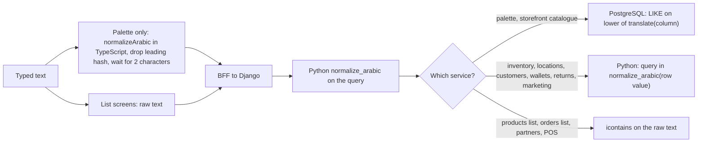

# Shared Arabic search normalisation (TypeScript, Python, PostgreSQL)

> **Source**: DOC-523 · inventory A.11 · INT-008, INT-011, INT-024, INT-025, INT-017, INT-028 · FR-48.05
> **Code**: `sharwa-frontend/src/lib/i18n/normalize.ts` · `sharwa_saas/products/services/search_service.py` (`normalize_arabic`, `normalized`) · consumers in `sharwa_saas/products/services/*.py`
> **Last verified against code**: 2026-10-28 (step 39)

> **Acceptance status (DOC-523 "Done when")**: the rules table below is **not** identical across the three implementations. Letters, diacritics, tatweel and lower-casing agree; the PostgreSQL expression does **not** map digits and does **not** collapse or trim whitespace, and the TypeScript and Python whitespace sets differ at the edges. There is **no test that compares the implementations with each other**: the Python function is pinned by three assertions and several API tests, and the TypeScript function has no test at all (section 11). The tables on this page were produced by running the real functions (method in section 3.1); that comparison is not stored in the repository.

## 1. Purpose

A merchant who types one spelling of an Arabic word must find records stored with another spelling: one search for an electronics word finds the product whose name starts with the hamza-on-alef form, and the same for names of people, SKUs typed in Arabic digits and so on. Arabic writes the same word with or without hamza, with or without diacritics, with stretched letters (tatweel), and with two digit systems, so every search path folds those differences away on **both** the query and the stored value.

This page documents that fold: the one rule set, the three places it is implemented, which search paths use which implementation, where the three disagree, and which tests pin it. It is not the API contract of the search endpoints (see the domain pages in section 10) and not the phone rule set (see [`61-phone-normalization.md`](61-phone-normalization.md)).

The roadmap describes "three implementations": the TypeScript module, a Python port, and a PostgreSQL `lower(translate(...))` expression for columns. The code has exactly those three, but the PostgreSQL one is used by **two** services only (command-palette search and the storefront catalogue search). Inventory, locations, customers, wallets, returns and marketing filter **in Python**: they normalise the query and each stored value with `normalize_arabic` after loading the rows (section 5).

## 2. Components

| Component | Location | Role |
|---|---|---|
| `normalizeArabic(input)` | `sharwa-frontend/src/lib/i18n/normalize.ts:12-26` (regexes at `:9-10`) | Reference rule set. Used by the command palette query (`features/command-palette/use-palette-search.ts:27`, `palette-index.ts:96`) and by mock handlers through `includesNormalized`. |
| `includesNormalized(text, query)` | `normalize.ts:88-93` | "Every whitespace-separated token of the query is contained in the normalised text". Used by the mock handlers for catalogue, customers, inventory and the storefront catalogue (`src/mocks/catalog/products.ts:232`, `mocks/customers/state.ts:338`, `mocks/inventory/state.ts:448`, `mocks/storefront/catalog.ts:159`). |
| `matchScore(query, haystacks)` | `normalize.ts:56-85` | Client-side ranking for palette pages and actions only (word start 30, substring 18, fuzzy 8; the article `ال` is stripped from tokens longer than 3 characters, `:29-31`). Not part of the server rule set. |
| `normalize_arabic(text)` | `sharwa_saas/products/services/search_service.py:44-51` (constants `:30-41`) | Python port. Normalises every query string, and the stored value too in the in-memory filters. |
| `normalized(field)` | `search_service.py:54-59` | Django expression `Lower(Func(F(field), Value(_FROM), Value(_TO), function='translate'))`, i.e. `LOWER(translate(column, _FROM, _TO))` in PostgreSQL. `_FROM` is 66 characters (8 letters, tatweel, 57 diacritics), `_TO` is 8 characters (`:38-39`); characters in `_FROM` beyond the length of `_TO` are **deleted** by `translate`. |
| `parse_query`, `is_searchable` | `search_service.py:62-70` | Palette only: normalise, drop a leading `#`, derive digits; refuse queries shorter than `MIN_QUERY_CHARS = 2` (`:25`). |

Two inline variants exist in **mock-only** code and do not follow the rule set:

| Variant | Location | What it does |
|---|---|---|
| `nameMatches` | `src/mocks/wallets/state.ts:231-234` | Folds only `أ إ آ` to `ا`, `ة` to `ه`, `ى` to `ي` and collapses spaces. No `ٱ`, `ؤ`, `ئ`, diacritics, tatweel, digits or lower-casing. |
| locations list filter | `src/mocks/locations/state.ts:222-227` | `toLowerCase()` and `includes` only; no Arabic folding at all, while Django (`location_service.py:205-211`) folds. |

## 3. The rules

One table, one row per rule, with the answer for each implementation. "Yes" means the implementation applies the rule to the code points shown.

| # | Rule | Code points | TypeScript | Python | PostgreSQL `lower(translate(...))` |
|---|---|---|---|---|---|
| 1 | Remove diacritics (tashkeel, 57 code points in four ranges) | U+0610-U+061A, U+064B-U+065F, U+0670, U+06D6-U+06ED | Yes (`TASHKEEL`, `normalize.ts:9`) | Yes (`_TASHKEEL`, `search_service.py:30-35`, applied `:47`) | Yes (deleted: the 57 marks beyond `_TO`'s 8 characters, `:38`) |
| 2 | Remove tatweel | U+0640 | Yes (`:10`) | Yes (`:36`, `:47`) | Yes (deleted, `:38`) |
| 3 | Alef forms to bare alef | أ U+0623, إ U+0625, آ U+0622, ٱ U+0671 to ا U+0627 | Yes (`:16`) | Yes (`:48`) | Yes (positions 1-4 of `_FROM`/`_TO`) |
| 4 | Teh marbuta | ة U+0629 to ه U+0647 | Yes (`:17`) | Yes (`:49`) | Yes (position 5) |
| 5 | Alef maksura | ى U+0649 to ي U+064A | Yes (`:18`) | Yes (`:49`) | Yes (position 6) |
| 6 | Hamza on waw | ؤ U+0624 to و U+0648 | Yes (`:19`) | Yes (`:49`) | Yes (position 7) |
| 7 | Hamza on yeh | ئ U+0626 to ي U+064A | Yes (`:20`) | Yes (`:49`) | Yes (position 8) |
| 8 | Arabic-Indic digits to `0-9` | U+0660-U+0669 | Yes (`:21`) | Yes (`_ARABIC_DIGITS`, `:40`, applied `:50`) | **No** (not in `_FROM`) |
| 9 | Persian digits to `0-9` | U+06F0-U+06F9 | Yes (`:22`) | Yes (`:41`, `:50`) | **No** |
| 10 | Lower-case | Latin and other cased scripts | Yes (`toLowerCase`, `:23`) | Yes (`.lower()`, `:50`) | Yes (`Lower(...)`, `:56`); see edge cases below |
| 11 | Collapse runs of whitespace to one space | `\s+` | Yes (`:24`) | Yes (`re.sub(r'\s+', ' ', ...)`, `:51`) | **No** |
| 12 | Trim | leading and trailing whitespace | Yes (`.trim()`, `:25`) | Yes (`.strip()`, `:51`) | **No** |
| 13 | Not folded by any implementation | U+0621 (standalone hamza), U+06A9 (Persian kaf), U+06CC (Persian yeh), presentation forms (U+FB50-U+FEFC, e.g. U+FEFB), U+0672-U+0673 | - | - | - |
| 14 | Minimum query length | - | Palette: 2 non-space characters (`use-palette-search.ts:31`); no minimum in `normalizeArabic` | Palette endpoint: 2 characters after removing `#` and whitespace (`is_searchable`, `:69-70`); no minimum in `normalize_arabic` or in the list filters | - |
| 15 | Index | - | - | - | None: the expression is evaluated per row (see 3.2) |

Rules 1-7 and 10 are the "letters" part of the rule set; they are identical in all three implementations for every code point tested. The differences are rows 8, 9, 11 and 12 (PostgreSQL) and the edge cases in 3.1.

> ⚠️ Discrepancy — roadmap says the rules table is identical across the three implementations / code does: the PostgreSQL expression `lower(translate(...))` maps letters, diacritics and tatweel only. It leaves Arabic-Indic and Persian digits unchanged and does not collapse or trim whitespace (`search_service.py:38-39`, `:54-59`), while TypeScript and Python do both (`normalize.ts:21-25`, `search_service.py:50-51`). The module docstring (`search_service.py:6-10`) lists only the letter/diacritic rules for the column side, so the code is internally honest; the roadmap and inventory wording ("same rules and code-point ranges") is wider than the code. Reported in step 39.

### 3.1 How the comparison was made

- **All of the Basic Multilingual Plane**: every code point U+0001-U+FFFF except surrogates (63,487 characters) was passed alone through the three implementations and the results compared. TypeScript: `normalizeArabic` imported from `normalize.ts` and run with Node 22 (which strips the type annotations). Python: lines 30-51 of `search_service.py` executed with `python3 -I`, without the Django project. PostgreSQL: a scratch PostgreSQL 16 cluster (UTF-8, `C.UTF-8` collation) running `lower(translate(chr(cp), _FROM, _TO))` with `_FROM`/`_TO` taken from the Python constants. The Django ORM wrapper was **not** run; the SQL is the expression the wrapper builds.
- **Result**: in U+0600-U+06FF (all 256 Arabic-block code points) the three agree on every code point except the 20 digit code points U+0660-U+0669 and U+06F0-U+06F9, which PostgreSQL leaves unchanged.
- **Edge cases outside the Arabic block** (all other differences found):
  - Whitespace: PostgreSQL never changes whitespace (rows 11-12). Python also treats U+001C-U+001F and U+0085 as whitespace (collapses and trims them) and TypeScript does not; TypeScript trims U+FEFF and Python does not.
  - Lower-casing of U+0130 (capital I with dot): TypeScript and Python give `i` plus U+0307, PostgreSQL gives `i`. Eight code points added in recent Unicode versions (U+1C89, U+A7CB, U+A7CC, U+A7CE, U+A7D2, U+A7D4, U+A7DA, U+A7DC) lower-case in Node but not in Python 3.13. None of these affects Arabic text.
  - PostgreSQL `lower()` of non-ASCII letters depends on the database's `LC_CTYPE`; the production setting is not in the repository (unverified). Arabic letters have no case, so Arabic search is unaffected.

### 3.2 No index

The expression is not indexed. The search for a palette query scans the table (`n_name__contains` becomes `LIKE '%...%'` on `lower(translate(...))` of every row, then `LIMIT`); the in-memory filters load all matching rows of their base queryset. A search of the 157 `products` migration files copied for this step (of 238 on disk) found no trigram, GIN or expression index and no `RunSQL` for these columns; the 81 files not copied (mostly 0001-0188) are unverified. FR-48.05's "no index, no migration" is therefore the documented decision and matches the code that was read.

## 4. Real outputs

Inputs are shown between «...»; invisible characters are written as `\t`, `\n`, `\uXXXX`. Columns are the real output of each implementation as described in 3.1. "SQL" is `lower(translate(value, _FROM, _TO))`, which is what the column side computes before the `LIKE`.

| Case | Input | TypeScript | Python | SQL | Note |
|---|---|---|---|---|---|
| test_search_api.py:45 | «إلكترونيّات» | «الكترونيات» | «الكترونيات» | «الكترونيات» | pinned by `test_normalizer_matches_frontend_rules` (Python only) |
| test_search_api.py:46 | «مكتبةٌ  ى» | «مكتبه ي» | «مكتبه ي» | «مكتبه  ي» | double space: SQL keeps both spaces |
| test_search_api.py:47 | «٠٧٧١» | «0771» | «0771» | «٠٧٧١» | SQL leaves the digits unchanged |
| hamza on alef: أحمد | «أحمد» | «احمد» | «احمد» | «احمد» | hamza forms fold to bare alef |
| bare alef: احمد | «احمد» | «احمد» | «احمد» | «احمد» |  |
| alef wasla U+0671 | «ٱلله» | «الله» | «الله» | «الله» | U+0671 folds to U+0627 |
| teh marbuta U+0629 | «مدرسة» | «مدرسه» | «مدرسه» | «مدرسه» | ة to ه |
| alef maqsura U+0649 | «على» | «علي» | «علي» | «علي» | ى to ي |
| hamza on waw U+0624 | «مؤمن» | «مومن» | «مومن» | «مومن» | ؤ to و |
| hamza on yeh U+0626 | «رئيس» | «رييس» | «رييس» | «رييس» | ئ to ي |
| harakat + shadda | «مُحَمَّد» | «محمد» | «محمد» | «محمد» | U+064F U+064E U+0651 removed |
| tatweel U+0640 | «محـــمد» | «محمد» | «محمد» | «محمد» | U+0640 removed |
| dagger alef U+0670 | «الرحمٰن» | «الرحمن» | «الرحمن» | «الرحمن» | U+0670 removed |
| Quranic mark U+06D6 | «بۖد» | «بد» | «بد» | «بد» | U+06D6 removed |
| Persian digits U+06F0.. | «۰۷۷۱» | «0771» | «0771» | «۰۷۷۱» | U+06F0-U+06F9 mapped by TS and Python only |
| mixed Latin + Arabic-Indic digits | «iPhone ١٢» | «iphone 12» | «iphone 12» | «iphone ١٢» | lower-case + digits |
| upper-case Latin, runs of spaces | «  Phone    CASE  » | «phone case» | «phone case» | «  phone    case  » | SQL: lower-case only, spaces kept |
| tab and newline | «\tأحمد\nعلي» | «احمد علي» | «احمد علي» | «\tاحمد\nعلي» | SQL keeps tab and newline |
| Persian kaf U+06A9 (not folded) | «کتاب» | «کتاب» | «کتاب» | «کتاب» | U+06A9 is not mapped to U+0643 |
| Persian yeh U+06CC (not folded) | «علی» | «علی» | «علی» | «علی» | U+06CC is not mapped to U+064A |
| standalone hamza U+0621 (not folded) | «جزء» | «جزء» | «جزء» | «جزء» | U+0621 is kept |
| lam-alef ligature U+FEFB (not folded) | «ﻻ» | «ﻻ» | «ﻻ» | «ﻻ» | presentation forms are kept |
| BOM U+FEFF before text | «\uFEFFأحمد» | «احمد» | «\uFEFFاحمد» | «\uFEFFاحمد» | TS trims U+FEFF; Python does not |
| U+001F before text | «\u001Fأحمد» | «\u001Fاحمد» | «احمد» | «\u001Fاحمد» | Python treats U+001F as whitespace; TS does not |
| İ U+0130 | «İ» | «i̇» | «i̇» | «i» | SQL gives plain i; TS and Python give i + U+0307 |

The first three rows are the strings asserted by `api/test_search_api.py:45-47`; every other input on this page (here and in 4.1) is a test word built from code points for this page, not a string copied from the repository. The Python and TypeScript columns are identical in every row except the two edge rows at the bottom.

### 4.1 What the SQL gaps mean for a search

The palette query is always normalised in Python first (`parse_query`, `search_service.py:62-66`), then compared with the SQL-normalised column using `LIKE '%query%'` (`n_name__contains`). The table shows the outcome for stored values and typed queries (SQL side = `lower(translate(col)) LIKE '%' || normalize_arabic(typed) || '%'` run in the scratch PostgreSQL; Python side = `normalize_arabic(typed) in normalize_arabic(col)`, which is what the in-memory filters do):

| Case | Stored column | Typed | Normalised query | SQL path (palette, storefront catalogue) | Python path (inventory, locations, customers, wallets, returns, marketing) |
|---|---|---|---|---|---|
| two spaces stored | «أحمد  علي» | «احمد علي» | «احمد علي» | no match | match |
| one space stored | «أحمد علي» | «احمد علي» | «احمد علي» | match | match |
| Arabic-Indic digit stored, ASCII typed | «منتج ٣» | «3» | «3» | no match | match |
| Arabic-Indic digit stored, same digit typed | «منتج ٣» | «٣» | «3» | no match | match |
| ASCII digit stored, Arabic-Indic typed | «منتج 3» | «٣» | «3» | match | match |
| hamza stored, bare typed | «إلكترونيات» | «الكترونيات» | «الكترونيات» | match | match |
| mixed-case Latin stored, lower typed | «Home Electronics» | «electronics» | «electronics» | match | match |

So a name stored with two spaces between words cannot be found by a multi-word query on the SQL path, and a name that contains an Arabic-Indic digit cannot be found by a query typed with the ASCII digit on the SQL path; both are found on the Python path.

## 5. Where each search path applies the rules

"SQL" means the column is normalised by `normalized(field)` inside PostgreSQL. "Python" means the rows are loaded and both sides pass through `normalize_arabic`.

| Search path (endpoint) | Fields searched | Column side | Code | Test that exercises it |
|---|---|---|---|---|
| Palette `GET /api/v1/search/` orders | `customer_name`; also order id (`q.isdigit()`), `customer_phone` when the query has 4+ digits | SQL | `search_service.py:88-99` (`:96`, `:90-93`) | `api/test_search_api.py:62-64` (a bare-alef query finds the hamza-spelled order name) |
| Palette products | `name`, `name_en` (SQL); `sku`, `barcode` by `icontains` | SQL | `search_service.py:103-115` (`:106-110`) | `test_search_api.py:67-70` |
| Palette customers (derived from orders) | `customer_name` (SQL) when fewer than 3 phone digits, else `customer_phone` | SQL | `search_service.py:119-141` (`:121-124`) | `test_search_api.py:62-64` (customers group) |
| Storefront catalogue `GET /api/v1/storefront/products/?search=` | `name`, `name_en` (SQL); `description` by raw `icontains(search)` (not normalised) | SQL | `storefront_catalog_service.py:63-68` | `api/test_storefront_catalog_api.py:64-69` |
| Inventory list `?q=` | product name, SKU, barcode, variant SKUs | Python | `inventory_service.py:187`, `:214-217`; sort key `:221` | `api/test_inventory_api.py:96-98` |
| Locations list `?q=` | `name`, `code`, `city` | Python | `location_service.py:205-211` | none with Arabic (`test_locations_api.py:143` uses a Latin code) |
| Location inventory `?q=` | row name (Python-normalised); SKU by `lower()` only | Python | `location_service.py:502-514` | `test_locations_api.py:172` (Latin SKU) |
| Customers list `?q=` | name and `other_names` (Python); phone by `_phone_query` | Python | `customer_service.py:351-358`, sort `:375` | `api/test_customers_api.py:115-116` |
| Wallets list and points list `?q=` | `customer_name` and the display name (Python); phone by `_search` | Python | `wallet_service.py:70-79`, `:123-124`, `:260`, `:274-275` | `api/test_wallets_api.py:101-102` (plain name, no folding case) |
| Returns, RMAs, order refunds `?q=` | customer name (and reason for refunds) | Python | `returns_api_service.py:93-109`, `:213`, `:484`, `:632` | `api/test_returns_api.py:103` |
| Marketing: coupons, offers, abandoned carts, campaigns `?q=` | coupon code and influencer name, offer name, cart customer name, campaign name | Python | `marketing_service.py:221-229`, `:387-396`, `:593-615`, `:763-770` | `api/test_marketing_api.py:110` (substring query, no folding case) |

Search paths that do **not** use the fold (plain `icontains`, so a bare-alef query does not find the hamza spelling): products list (M04) `product_service.py:118-120`; orders list (M06) `order_api_service.py:168-176`; partners `partners_service.py:178-181`; suppliers `procurement_service.py:121-123`; purchase orders `procurement_service.py:256-262`; POS product search `pos_service.py:729-736`; support sessions `support_api_service.py:188-194`; audit log `staff_service.py:961-963`; staff list `staff_service.py:209-215` (maps Arabic-Indic and Persian digits for the phone part, but the name part is `icontains`); inventory serial items `inventory_service.py:489-491`.

> ⚠️ Discrepancy — roadmap says storefront catalogue search, inventory `q`, locations `q` and customers/wallets name search use PostgreSQL `lower(translate(...))` for the columns / code does: only the palette search and the storefront catalogue search use the SQL expression (`search_service.py:96,106,124`, `storefront_catalog_service.py:66`). Inventory, locations, customers, wallets, returns and marketing normalise each loaded row in Python (`inventory_service.py:216`, `location_service.py:211,509`, `customer_service.py:358`, `wallet_service.py:124,275`). Reported in step 39.

> ⚠️ Discrepancy — the TypeScript module comment says `normalizeArabic` is "shared by the command palette and every list search box (M04, M05, M06)" (`normalize.ts:2-4`) / code does: with Django live, the products list and orders list `q` are plain `icontains` (`product_service.py:118-120`, `order_api_service.py:168-176`). The mock handler for the catalogue uses `includesNormalized` (`src/mocks/catalog/products.ts:232`), so a bare-alef query finds the hamza spelling in mock mode but not against Django. Reported in step 39.

> ⚠️ Discrepancy — `description` in the storefront catalogue search is matched with raw `icontains(search)` while `name` and `name_en` are folded (`storefront_catalog_service.py:67`). The roadmap's "plus `description` as before" is accurate; a folded query will not match a description that uses another spelling. Reported in step 39.

## 6. Flow

## 7. Invariants

- **One rule set, three copies.** A change to the letter rules must be made in `normalize.ts:16-20`, `search_service.py:48-49` and the positional pair `_FROM`/`_TO` (`:38-39`). In `_TO`, character *n* replaces character *n* of `_FROM`; everything after the eighth character of `_FROM` is deleted, so a new fold must be inserted before the tatweel in `_FROM` and appended to `_TO`, and a new deletion goes after it.
- **The query is always normalised in Python before it reaches SQL or the in-memory comparison.** The column side is normalised by SQL (two services) or by Python (the rest). Nothing normalises the stored value on write; stored text keeps the merchant's spelling.
- **Search text is not logged** (FR-48.12; `api/views_search.py:8-9`).
- **Limits**: palette `limit` defaults to 5 and is capped at 10 (`DEFAULT_LIMIT`, `MAX_LIMIT`, `search_service.py:26-27`, `parse_limit` `:73-78`); the minimum is 2 characters on both sides (row 14).

## 8. Background work

None. Search is synchronous and nothing is cached or pre-computed.

## 9. Configuration

No settings or environment variables. The constants are `MIN_QUERY_CHARS = 2`, `DEFAULT_LIMIT = 5`, `MAX_LIMIT = 10`, `TYPES = ('orders', 'products', 'customers')` in `search_service.py:25-28`, and the client debounce of 150 ms in `use-palette-search.ts:23`. PostgreSQL `LC_CTYPE` of the production database affects only non-Arabic `lower()` (section 3.1).

## 10. Failure modes and fixes

| Failure | Symptom | Cause | Handling / fix |
|---|---|---|---|
| Palette or storefront search misses a name with a double space | A multi-word query returns nothing although the name is on screen | The SQL side does not collapse whitespace, the query is collapsed (section 4.1) | Open. Collapse spaces on write or add a `regexp_replace` to `normalized()`; neither is done. |
| Palette or storefront search misses a name written with Arabic-Indic digits | A query with the ASCII digit does not match | The SQL side does not map digits (also noted in [`../api/overview/conventions.md`](../api/overview/conventions.md#arabic-text)) | Open. Digits could be added to `_FROM`/`_TO`; not done. |
| Bare-alef query finds the hamza spelling in the palette but not in the products or orders list | Same word, different result by screen | List `q` for products and orders is plain `icontains` (section 5) | Open (see discrepancy above). |
| Hamza-spelled word found in mock mode but not live | Mock and live disagree | Mock handlers fold through `includesNormalized`; Django `icontains` does not for products and orders | Open. |
| Wallet or location search folds differently in mock mode | Mock result differs from live | Inline mock variants (section 2) | Open. |
| Query shorter than 2 characters returns empty groups | Palette shows nothing | `is_searchable` (`search_service.py:69-70`); pinned by `test_short_query_returns_empty_groups` | By design. |

## 11. Tests that pin the rules

| Test | What it pins | Implementation |
|---|---|---|
| `api/test_search_api.py:44-47` `test_normalizer_matches_frontend_rules` | Three assertions on `normalize_arabic`: a hamza/diacritic word, a double space with teh marbuta and alef maksura, Arabic-Indic digits | Python only; the expected values are literals, not computed by the TypeScript function |
| `api/test_search_api.py:58-71` `test_groups_shape_and_arabic_normalization` | A bare-alef name query finds the hamza-spelled order name and a bare-alef product query finds the hamza-spelled product name through the database | SQL expression (via the API) |
| `api/test_storefront_catalog_api.py:64-69` | Bare-alef `search` finds the hamza-spelled product; Latin `name_en` search | SQL expression |
| `api/test_inventory_api.py:96-98` | A query with teh marbuta replaced by heh finds the product; a SKU-style query finds variants | Python filter |
| `api/test_customers_api.py:115-116` | Bare-alef name query finds the hamza-spelled customer | Python filter |
| `api/test_returns_api.py:103` | Normalised customer-name search | Python filter |
| `api/test_wallets_api.py:101-102` | Local-phone search and plain name search (no folding case) | Python filter |
| Frontend | **No test** references `normalizeArabic`, `includesNormalized` or `matchScore`. The repository has no unit-test runner (`package.json` has no vitest or jest; checks are Playwright scripts in `scripts/*-check.ts`), and none of the 43 check scripts copied for this page types an Arabic spelling variant. | TypeScript |

**Cross-implementation parity**: no test compares TypeScript with Python, or Python with SQL. `test_normalizer_matches_frontend_rules` has "frontend" in its name but compares against hard-coded strings.

## 12. Open items

1. Add a parity fixture (one list of inputs and expected outputs) consumed by a TypeScript check, a Python test and a SQL test, so the next change to the rules cannot drift.
2. Decide whether the SQL side should map digits and collapse whitespace, or document the limitation in the API pages (the digit gap is already in `docs/api/overview/conventions.md`).
3. Decide whether products-list and orders-list `q` should use the fold (live and mock currently disagree).
4. Production PostgreSQL `LC_CTYPE`/collation: not in the repository, unverified.
5. Frontend consumers were found by searching the files copied for this step (palette, mocks, customers, staff, checkout, Sharwa Pay, onboarding); a full-tree search of `src/` was not possible, so consumers in other feature folders are unverified.
6. The comparison in 3.1 and the tables in section 4 were run once in step 39 and are not repeatable from the repository.

## 13. Related pages

- [`61-phone-normalization.md`](61-phone-normalization.md): phone rules (the other half of "normalisation").
- [`../api/overview/conventions.md`](../api/overview/conventions.md#arabic-search-and-phone-normalisation): client-facing summary of the same rules.
- [`data-model/06-customers-wallets.md`](data-model/06-customers-wallets.md): customers and wallets search.
- API domain pages: [`../api/domains/02-dashboard-shell/m48-search.md`](../api/domains/02-dashboard-shell/m48-search.md), [`m07-customers.md`](../api/domains/06-customers-wallets/m07-customers.md), [`m35-wallets-loyalty.md`](../api/domains/06-customers-wallets/m35-wallets-loyalty.md), [`m21-inventory.md`](../api/domains/10-inventory-locations-procurement/m21-inventory.md), [`m22-locations.md`](../api/domains/10-inventory-locations-procurement/m22-locations.md), [`m09-storefront-home-catalog.md`](../api/domains/05-storefront/m09-storefront-home-catalog.md).
- [`62-infra-fixes.md`](62-infra-fixes.md): lists shared normalisation among the cross-cutting fixes.
