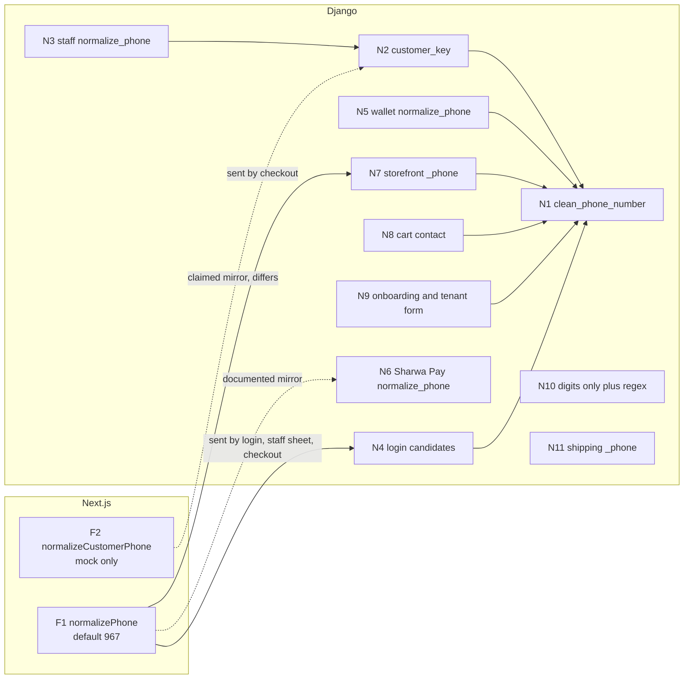
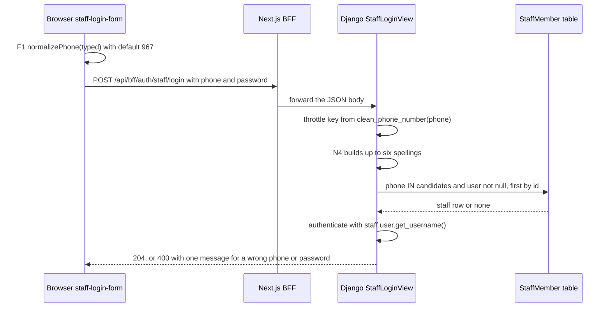

# Phone number normalisation (Yemen 967, Saudi Arabia 966)

> **Source**: DOC-524 · inventory A.11 · INT-003, INT-016, INT-017, INT-022, INT-028, INT-030, INT-031, INT-034, INT-048
> **Code**: `sharwa_saas/products/utils.py` (`clean_phone_number`) · `products/services/customer_service.py` (`customer_key`) · `products/services/staff_service.py` · `api/views_auth.py` · `sharwapay/customer_api.py` · `sharwa-frontend/src/lib/format.ts` (`normalizePhone`) · `sharwa-frontend/src/features/customers/schemas.ts` (`normalizeCustomerPhone`) · the other files named in section 2
> **Last verified against code**: 2026-10-28 (step 39)

> **Acceptance status (DOC-524 "Done when: every normalizer has examples and the modules using it")**: met for every normaliser that could be executed. The Python functions (N1 to N16, N17 as the console search, and the matchers of N18) were extracted from the staged source with `ast` and run on the 19 inputs of section 4 under `python3 -I`; the two TypeScript functions F1 and F2 were run with Node 22 on the same inputs (method in section 4.1). F3 (a mock helper) is not run on its own: it is F1 followed by a regex, so its row is derived. N19 and N20 are not normalisers (they compare or store text unchanged) and have no examples. The backend files were a **subset** of the repository and the frontend `src/` was searched only in the files copied for this step, so the lists of "modules using it" are complete for the copied files and **unverified** for the rest (section 12). The tables were produced once in step 39 and are not stored in the repository.

> ⚠️ Discrepancy — roadmap says phone normalisation has named, consistent rules (`clean_phone_number`, `customer_key`, Sharwa Pay mirrors the frontend `normalizePhone`) / code has **twenty backend entries and four frontend entries** (section 2) that turn a typed phone into a stored or compared value, with different rules for punctuation, digit systems, the `0`/`00` prefix, the country prefix and the length gate; the four-function summary in [`../api/overview/conventions.md`](../api/overview/conventions.md#arabic-search-and-phone-normalisation) is a subset (section 2). Reported in step 39.

## 1. Purpose

A phone number is the identity of almost everything that is not a store: the shopper (orders, wallet, points, wishlist, reviews, notes), the staff member (login name), the merchant (store uniqueness and owner login), the affiliate, the Sharwa Pay wallet. Sharwa has **no customer table** and no phone type, so each module turns what a person typed into a string with its own small function, and the strings are compared as text. Yemen (`967`, mobile numbers of nine digits starting with `7`) is the default country; Saudi Arabia (`966`, mobile numbers of nine digits starting with `5`) is accepted but is a second-class citizen in most functions.

This page lists **every** function that normalises, validates or matches a phone, with its location, accepted inputs, output and users; the rules side by side; real outputs for 19 inputs; which writer stores which form; and every place where two functions disagree. It does not repeat the `customer_key` worked examples of [`data-model/06-customers-wallets.md`](data-model/06-customers-wallets.md) (section 2.2) and does not describe the OTP flows ([`33-otp.md`](33-otp.md), [`34-rate-limits.md`](34-rate-limits.md)) or the Arabic text fold ([`60-arabic-normalization.md`](60-arabic-normalization.md)).

Terms: **canonical form** is `967` or `966` followed by the nine digits, no `+`, no spaces (for example `967771234567`). **Local form** is the number as dialled inside the country (`0771234567`, `771234567`, `0501234567`). All numbers on this page are fake; the Yemeni sample is `771234567` and the Saudi sample is `501234567`.

## 2. Components: the normaliser register

IDs are used throughout the page. "N" is Django, "F" is Next.js. Line numbers were re-read in step 39.

| ID | Function | Location | Accepts | Returns | Used by |
|---|---|---|---|---|---|
| N1 | `clean_phone_number(p, default_country_code='967')` | `products/utils.py:111-130` | Text in Western digits. Removes `+`, space and `-` (only those); removes a leading `00`, or else one leading `0`; leaves every other character | The cleaned string. A string of exactly 9 characters starting with `7` gets the default country code; nothing else is added, so `5…` stays 9 digits. `''` for empty or `None` | 85 call sites in 43 files (list below the table) |
| N2 | `customer_key(raw)` with `_digits` | `products/services/customer_service.py:61-71`; digit maps `:51-52` | Any text. Maps Arabic-Indic and Persian digits to ASCII, runs N1, then keeps only characters for which `str.isdigit` is true | Digits. 9 digits starting with `5` get `966`. `''` when no digit is left | Every customer list, profile, tab and note in `customer_service.py` (`_matching_raw :74`, `_keyed :83`, `cod_disabled_for :250-254`, segment count `:439`); N3; review author phone `engagement_service.py:259` |
| N3 | Staff `normalize_phone` plus `PHONE_RE` | `products/services/staff_service.py:106-108` (regex `:42`) | As N2 | N2 output. Gate: `967` or `966` then 8 or 9 digits (`:237`) | `_staff_values :227-246` (create and update), duplicate check `_phone_tail_matches :111-116` (database `phone__endswith` the last 9 digits, then compares N3 of each row), `User.username` writes `:255-257,288,345-347` |
| N4 | `_phone_candidates(raw)` | `api/views_auth.py:233-244` | The login text, stripped | A set of up to six spellings: the raw text, its N1, and for each of those that starts with `967` or `966` the local tail with and without a leading `0` | `StaffLoginView.post :285-309` (`StaffMember.phone IN (...)`); the throttle key is `clean_phone_number(phone) or phone` (`:297`) |
| N5 | Wallet `normalize_phone` plus `PHONE_RE` | `products/services/wallet_service.py:65-67` (regex `:36`) | Text. Maps Arabic-Indic digits only (`U+0660` to `U+0669`), removes every non-digit, then N1 | N1 output. Gate: `9` then `66` or `67` then 8 or 9 digits (`create_wallet :141-147`) | `create_wallet :141`, `list_points_transactions :293`. The wallet and points search uses its own matcher (N18) |
| N6 | Sharwa Pay `normalize_phone` plus `PHONE_RE` | `sharwapay/customer_api.py:85-96` (regex `:59`, digit map `:61`) | Text. Maps Arabic-Indic and Persian digits, removes every non-digit, removes `00`, and for anything that does not start with `967` or `966` removes **all** leading zeros and prefixes `967` | The canonical string, or `None` unless it has the gate shape: `967` or `966` then 8 or 9 digits | `send_otp :153-168`, `verify_otp :171-`; the phone is then the session identity (`:202`), the OTP cache keys (`:148-149,167`), the wallet lookup (`_wallet :218-220`), the wallet `get_or_create` (`:391`) and the transaction filters (`:309-314`) |
| N7 | Storefront `_phone` plus `PHONE_RE` | `products/services/storefront_checkout_service.py:109-113` (regex `:65`) | Text; N1 only | N1 output when it has the gate shape `967` or `966` then exactly 9 digits, else `None` | Checkout steps (`:334,442,487,519,572,584`), shopper phone in the session and wishlist (`engagement_service.py:57-70`), the wallet and loyalty APIs (`storefront_wallet_service.py:31,62,86,115,131,152`) |
| N8 | Cart `save_contact` | `products/services/storefront_cart_service.py:281-292` (regex `:30`) | Text; N1 | Same gate as N7; stored through `attach_cart_customer` | `POST` cart contact capture (abandoned carts) |
| N9 | Onboarding and tenant form | `api/views_onboarding.py:172-178` (regex `:79`); `tenants/forms.py:65-78` | Text; N1 | API: N1 output that matches `967` or `966` then exactly 9 digits. Django form: N1 output only, empty is refused, **no length check**; then a uniqueness check on `Client.merchant_phone` | `public/register`; the HTML tenant registration form |
| N10 | Digits-only gates | `partners_service.py:355-357` (regex `:37`); `order_api_service.py:653-655` (regex `:61`); `settings_service.py:194-198` (regex `:38`) | Text. Removes every character that is not an ASCII digit and applies nothing else: no `00`, no `0`, no country code | The digit string when it is `967` or `966` then exactly 9 digits, else a field error. Settings clears the value when the text has no digit | Affiliate phone (affiliates only, not influencers); dashboard order creation (channels `b2b_draft` and others); store WhatsApp number |
| N11 | Shipping `_phone` and `_phone_ok` | `products/services/shipping_service.py:124-130` (digit map `:47`, message `:46`) | Text. Maps Arabic-Indic and Persian digits, removes spaces, removes leading `+` characters | The string, valid when it is all digits, starts with `967` or `966` and has 11 or 12 characters | Pickup point phone (optional, `:309-312`), shipping provider phone (required, `:424-427`) |
| N12 | Supplier phone | `products/services/procurement_service.py:34,161-162` | Trimmed text, **no** digit mapping, no stripping | Accepted when it matches 9 to 15 ASCII-style digits (`\d{9,15}`), stored as typed | Supplier create and update |
| N13 | Auction bidder phone | `products/services/storefront_auction_service.py:27,63-70` | Text; removes every non-digit | Accepted when 9 to 15 digits, stored digits only | Storefront `place_bid` |
| N14 | Payout account `_squash` | `products/services/payments_service.py:263-264`; use `:286-302` (character gate `:48`) | Account or wallet number: Arabic and Persian digits mapped, spaces collapsed, then only letters, digits, space and dash allowed | The **stored** value is the mapped text; the **duplicate key** is that text without spaces or dashes, upper-cased | Payout accounts create and update (a wallet number such as a mobile-wallet account is the "phone" case) |
| N15 | AI cart publisher `normalize_customer` | `products/services/sharwa_ai_cart_publisher.py:104-115` (bounds `:51-52`) | Text; N1 | `{wa_id, phone_e164}` when the result passes `str.isdigit` and has 8 to 15 characters, else `None` | Sharwa AI cart payload |
| N16 | Support ticket phone | `products/services/support_api_service.py:442-446` | Text; keeps only digits and `+` | The kept characters; refused when longer than 20 | Support ticket create and update. Sessions and conversation lists search with plain digits (N18) |
| N17 | Console lookups | `tenants/console_service.py:267-277`; `tenants/console_money_service.py:58-60`, uses `:83,89,475,517`; `console_service.py:790-792` | Text. Store search: the digits of the query when there are at least six; money screens: N1 of the typed text | N1 of the digits (`0777…` becomes `967777…`) used as a substring against `Client.merchant_phone`, or an equality on `SharwaPayWallet.customer_phone` | Platform console store search and money screens (topups, wallets, claimed phone on tickets) |
| N18 | Search matchers (filters, not normalisers) | Section 4.5 lists each with its line | A typed query | A substring or prefix test against the stored text | Palette, orders list, customers, wallets and points, returns, conversations, AI sessions, console |
| N19 | Owner login comparison | `api/views_auth.py:123-125`; `products/views/auth_security.py:174-176,225-226` | The typed phone and the store's `whatsapp_number` | N1 of **both** sides compared for equality; also the throttle key `_merchant_login_rate_keys(request, input_phone)` | Owner (merchant) login, API and HTML |
| N20 | Raw writers (no normaliser) | `products/views/cart_checkout.py:578` (stored at `:671,715`); `products/views/staff_rbac.py:58,67,73`; `products/views/staff_sessions.py:44-46`; `social_channels/chat_to_order_service.py:60-64`; `marketplaces/order_pull_service.py:323,459`, `amazon_adapter.py:575`, `noon_adapter.py:214`; `products/forms.py:845-863` | Whatever was typed or supplied | Stored unchanged | Legacy HTML checkout, legacy HTML staff screens and login, conversation-to-order, marketplace pulls, the legacy contact settings form |
| F1 | `normalizePhone(input, defaultCountry = "967")`, with `toWesternDigits`, `prettyPhone`, `maskPhone` | `src/lib/format.ts:59-86` | Text. Maps Arabic-Indic and Persian digits, removes every non-digit, removes `00`, keeps a number that starts with `967` or `966`, otherwise removes **one** leading `0` and prefixes the default country | A string that always starts with the prefix, even for empty input (`967`). No length check | Staff and owner login (`staff-login-form.tsx:43`, `merchant-login-form.tsx:48`), staff sheet (`staff-form-sheet.tsx:39-44`), checkout (`checkout/schemas.ts:97,124`, `checkout-screen.tsx:157-158,259,277,300,304,719`), onboarding schema (`onboarding/schemas.ts:31`), Sharwa Pay login preview (`sharwa-pay/components/login.tsx:52`); mocks `mocks/staff/state.ts:325,356,408`, `mocks/storefront/checkout.ts:605`, `mocks/sharwa-pay/state.ts:53` |
| F2 | `normalizeCustomerPhone(raw)` | `src/features/customers/schemas.ts:192-199` | Text. Maps Arabic-Indic digits only, removes every non-digit, removes `00`; keeps `967…` and `966…`; `05…` becomes `966…`; any other leading `0` becomes `967…`; anything else is **returned unchanged** | The key used by the customer mock | `mocks/customers/state.ts:14,398,450,460,474,533,586,603` only. No live-mode caller in the copied files |
| F3 | `normalizePayPhone(raw)` | `src/mocks/sharwa-pay/state.ts:50-55` | Text; F1 | F1 output when it matches `967` or `966` then 8 or 9 digits, else `null` | Sharwa Pay mock |
| F4 | Inline frontend gates | `checkout/schemas.ts:97,124`; `checkout-screen.tsx:158`; `onboarding/schemas.ts:19`; `affiliates/schemas.ts:132-135`; `mocks/wallets/state.ts:154`; `mocks/staff/state.ts:357,409`; `mocks/storefront/checkout.ts:605`; `mocks/sharwa-pay/state.ts:54` | F1 output (not for affiliates) | Pass or a field message | The matching forms and mocks |

**Modules that call N1** (85 call sites in 43 files of the staged subset, found with `grep "clean_phone_number("`):

- Login and onboarding: `api/views_auth.py:123-124,297,406`, `products/views/auth_security.py:39,78,174-175,225-226`, `api/views_onboarding.py:174`, `tenants/forms.py:69`, `tenants/merchant_rollup.py:55`, `tenants/management/commands/migrate_merchant_phone.py:25`, `tenants/platform_events.py:68`.
- Checkout and payment: `checkout_service.py:238,273,306,452,532,773` (OTP throttle keys, wallet lookups, gateway request), `storefront_checkout_service.py:112,836`, `storefront_cart_service.py:285`, `views/cart_checkout.py:368,443`, `views/storefront.py:337,504`, `views/customer_engagement.py:35,37,73,75,136`, `views/wallets.py:76,187,227,249`, `views/loyalty.py:31,70`.
- CRM, wallet and loyalty: `customer_service.py:68` (inside N2), `wallet_service.py:67` (inside N5), `refund_service.py:113,137,155`, `products/loyalty.py:41,58`, `loyalty_service.py:53`, `products/utils.py:137,146` (platform trust), `affiliates.py:34` (self-referral guard compares N1 of both phones), `serializers_orders.py:126`, `views/merchant_dashboard.py:164`, `api/views.py:321`.
- Outbound messages and campaigns: `services/messaging.py:32`, `order_events.py:65,130,144,153`, `order_push_service.py:57`, `order_tracking_service.py:80,179`, `abandoned_cart_service.py:171`, `campaigns.py:80,97,107,119,127`, `views/marketing.py:160`, `views/customer_report.py:76`, `pos_service.py:1189`, `models/store_settings.py:371`, `sharwa_ai_commerce_api.py:267,274`, `tasks/channels.py:470`.
- Sharwa Pay and console: `sharwapay/models.py:111-113`, `tenants/sharwa_pay_views.py:70,96,140,172`, `tenants/console_money_service.py:60`, `tenants/console_service.py:276,792`, `tenants/webhooks.py` (listed by the grep, not read).

`default_country_code` is a parameter of N1 with a default of `'967'`; its docstring says the notification centre passes it from the WhatsApp settings (`utils.py:116-118`), but **no call in the staged files passes it** (the `default_country_code` found in `products/test_dropshipping_phase5.py` and the dropshipping API is an unrelated supplier-connection field).

## 3. The rules side by side

"Yes" means the function applies the rule to the characters shown. This is the table to read when two modules disagree.

| Rule | N1 clean | N2 customer_key | N5 wallet | N6 Sharwa Pay | N11 shipping | N10 digits-only | F1 normalizePhone | F2 normalizeCustomerPhone |
|---|---|---|---|---|---|---|---|---|
| Drop `+`, space, `-` | Yes (only these) | Yes, through N1 | Yes (any non-digit) | Yes (any non-digit) | Space and leading `+` only | Yes (any non-digit) | Yes (any non-digit) | Yes (any non-digit) |
| Drop other punctuation (parentheses, dot) | No | Yes, but **after** N1, so N1 sees the punctuation and misses the `0` | Yes, before N1 | Yes | No, the text is refused | Yes | Yes | Yes |
| Arabic-Indic digits `U+0660` to `U+0669` | No | Yes | Yes | Yes | Yes | No | Yes | Yes |
| Persian digits `U+06F0` to `U+06F9` | No | Yes | **No** | Yes | Yes | No | Yes | **No** (dropped as non-digits) |
| Remove `00` | Yes | Yes | Yes | Yes | No | No | Yes | Yes |
| Remove one leading `0` | Yes | Yes | Yes | Removes **all** leading zeros, only when the number does not start with `967`/`966` | No | No | Yes, only when the number does not start with `967`/`966` | Yes (`05` gives `966`, other `0` gives `967`) |
| 9 digits starting `7` get `967` | Yes | Yes | Yes | Yes (as part of the next rule) | No | No | Yes (as part of the next rule) | Only after a leading `0` |
| 9 digits starting `5` get `966` | No | Yes | No | No (gets `967`) | No | No | No (gets `967` unless the caller passes `"966"`) | Only after `05` |
| Any other number not starting `967`/`966` gets `967` | No | No | No | Yes | No | No | Yes | Only after a leading `0` |
| Length or prefix gate inside the function | None | None | None (the caller checks) | Yes: `967` or `966` then 8 or 9 digits, else `None` | `_phone_ok`: all digits, `967`/`966`, 11 or 12 characters | The caller's regex | None | None |
| Empty input | `''` | `''` | `''` | `None` | `''` | Rejected | `967` | `''` |
| Idempotent on the 19 inputs of section 4 | Yes | 18 of 19 (not C15) | not checked | not checked | not checked | not checked | not checked | not checked |

Gate patterns after the function (exact patterns are in the code block; the table shows the shape):

| Where | Prefix | Digits after the prefix | Anchored |
|---|---|---|---|
| N7, N8, N9 (API), N10 (partners, order API, settings), F4 (checkout, onboarding, affiliates) | `967` or `966` | exactly 9 | yes |
| N3 staff, N6 Sharwa Pay, N11 shipping, F3, mocks for staff and Sharwa Pay | `967` or `966` | 8 or 9 | yes |
| N5 wallet, mocks for wallets and staff | `966` or `967` (the pattern is a `9` followed by a group of `66` or `67`) | 8 or 9 | yes |
| N12 supplier, N13 auction | none required | the whole text is 9 to 15 digits | yes |
| N15 AI cart | none required | the whole text is 8 to 15 characters, `str.isdigit` | no regex |

```text
partners_service.py:37        ^(967|966)\d{9}$
order_api_service.py:61       ^(967|966)\d{9}$
settings_service.py:38        ^(967|966)\d{9}$
storefront_checkout_service.py:65   ^(967|966)\d{9}$
storefront_cart_service.py:30       ^(967|966)\d{9}$
api/views_onboarding.py:79          ^(967|966)\d{9}$
staff_service.py:42           ^(967|966)\d{8,9}$
sharwapay/customer_api.py:59  ^(967|966)\d{8,9}$
wallet_service.py:36          ^9(66|67)\d{8,9}$
procurement_service.py:34     ^\d{9,15}$
storefront_auction_service.py:27    ^\d{9,15}$
```

The Next.js side repeats the `{9}` pattern in `checkout/schemas.ts:97,124`, `checkout-screen.tsx:158`, `onboarding/schemas.ts:19` and `affiliates/schemas.ts:135`, and the `{8,9}` pattern in `mocks/sharwa-pay/state.ts:54`.

> ⚠️ Discrepancy — roadmap says affiliate phone `^(967|966)\d{9}$` and that Sharwa Pay "mirrors frontend `normalizePhone` (local Yemeni to 967…, 966/967 kept)" / the affiliate pattern is right (`partners_service.py:37`) but is applied to the digits **as typed**, so a local `0771234567` is refused by both the form (`affiliates/schemas.ts:132-135`) and the API (`partners_service.py:355-357`), while staff, customers and checkout accept local numbers. For Sharwa Pay the Yemeni and `966`/`967` cases mirror F1, but a local Saudi `0501234567` becomes `967501234567`, which passes the Sharwa Pay gate; the F1 comment at `format.ts:64-67` promises `966501234567` (also recorded in [`../api/overview/conventions.md`](../api/overview/conventions.md#arabic-search-and-phone-normalisation)). Reported in step 39.

## 4. Real outputs

### 4.1 Method

The Python functions were taken verbatim from the staged source with `ast.get_source_segment` and executed with `python3 -I` (no repository import, no database); constants such as `PHONE_RE` came from the same files. Where a gate is an inline expression inside a larger function (N8, N9, N10, N12, N13, N15, N17) the expression was copied into the harness unchanged. `_query_filter` (returns) and the palette `parse_query` were run the same way with a stub for Django's `Q`. F1 was imported from the staged `src/lib/format.ts` and run with Node 22; F2 was copied unchanged from `schemas.ts:192-199` into a script (the file imports other modules). The inputs are fake numbers. `—` means the module refuses the text (a field error) or, in the search table, that it does no phone search for that text. The run is not stored in the repository.

Inputs (C-numbers are used in the next tables): C1 `771234567`, C2 `0771234567`, C3 `967771234567`, C4 `+967 771234567`, C5 `+967 771-234-567`, C6 `00967771234567`, C7 Arabic-Indic digits of C2, C8 Persian digits of C2, C9 Arabic-Indic digits of C3, C10 `501234567`, C11 `0501234567`, C12 `966501234567`, C13 `+966 50 123 4567`, C14 `00966501234567`, C15 `(0771) 234.567`, C16 `77123456`, C17 `abc`, C18 empty, C19 C2 wrapped in spaces.

### 4.2 Canonicalisers

| Case | N1 `clean_phone_number` | N2 `customer_key` (N3 staff `normalize_phone` is identical) | N5 wallet `normalize_phone` | N6 Sharwa Pay `normalize_phone` | F1 `normalizePhone(x)` | F1 `normalizePhone(x, "966")` | F2 `normalizeCustomerPhone` |
|---|---|---|---|---|---|---|---|
| C1 `771234567` (Yemeni mobile, 9 digits) | `967771234567` | `967771234567` | `967771234567` | `967771234567` | `967771234567` | `966771234567` | `771234567` |
| C2 `0771234567` (with one leading 0) | `967771234567` | `967771234567` | `967771234567` | `967771234567` | `967771234567` | `966771234567` | `967771234567` |
| C3 `967771234567` (international, no plus) | `967771234567` | `967771234567` | `967771234567` | `967771234567` | `967771234567` | `967771234567` | `967771234567` |
| C4 `+967 771234567` (plus and a space) | `967771234567` | `967771234567` | `967771234567` | `967771234567` | `967771234567` | `967771234567` | `967771234567` |
| C5 `+967 771-234-567` (plus, space and dashes) | `967771234567` | `967771234567` | `967771234567` | `967771234567` | `967771234567` | `967771234567` | `967771234567` |
| C6 `00967771234567` (00 international prefix) | `967771234567` | `967771234567` | `967771234567` | `967771234567` | `967771234567` | `967771234567` | `967771234567` |
| C7 `٠٧٧١٢٣٤٥٦٧` (Arabic-Indic digits of C2) | `٠٧٧١٢٣٤٥٦٧` | `967771234567` | `967771234567` | `967771234567` | `967771234567` | `966771234567` | `967771234567` |
| C8 `۰۷۷۱۲۳۴۵۶۷` (Persian digits of C2) | `۰۷۷۱۲۳۴۵۶۷` | `967771234567` | `۰۷۷۱۲۳۴۵۶۷` | `967771234567` | `967771234567` | `966771234567` | (empty) |
| C9 `٩٦٧٧٧١٢٣٤٥٦٧` (Arabic-Indic digits of C3) | `٩٦٧٧٧١٢٣٤٥٦٧` | `967771234567` | `967771234567` | `967771234567` | `967771234567` | `967771234567` | `967771234567` |
| C10 `501234567` (Saudi mobile, 9 digits) | `501234567` | `966501234567` | `501234567` | `967501234567` | `967501234567` | `966501234567` | `501234567` |
| C11 `0501234567` (Saudi with one leading 0) | `501234567` | `966501234567` | `501234567` | `967501234567` | `967501234567` | `966501234567` | `966501234567` |
| C12 `966501234567` (Saudi international) | `966501234567` | `966501234567` | `966501234567` | `966501234567` | `966501234567` | `966501234567` | `966501234567` |
| C13 `+966 50 123 4567` (Saudi, plus and spaces) | `966501234567` | `966501234567` | `966501234567` | `966501234567` | `966501234567` | `966501234567` | `966501234567` |
| C14 `00966501234567` (Saudi, 00 prefix) | `966501234567` | `966501234567` | `966501234567` | `966501234567` | `966501234567` | `966501234567` | `966501234567` |
| C15 `(0771) 234.567` (parentheses, space and dot) | `(0771)234.567` | `0771234567` | `967771234567` | `967771234567` | `967771234567` | `966771234567` | `967771234567` |
| C16 `77123456` (8 digits (too short)) | `77123456` | `77123456` | `77123456` | `96777123456` | `96777123456` | `96677123456` | `77123456` |
| C17 `abc` (letters only) | `abc` | (empty) | (empty) | — (rejected) | `967` | `966` | (empty) |
| C18 (empty) (empty string) | (empty) | (empty) | (empty) | — (rejected) | `967` | `966` | (empty) |
| C19 `0771234567` plus spaces around (C2 wrapped in spaces) | `967771234567` | `967771234567` | `967771234567` | `967771234567` | `967771234567` | `966771234567` | `967771234567` |

Reading the table:

- **N1 does not touch Saudi local numbers or Arabic digits.** `0501234567` becomes `501234567` (9 digits, no prefix); only `customer_key` turns it into `966501234567`.
- **N2 and N1 disagree on C15** (`(0771) 234.567`): N1 sees the parenthesis and does not strip the `0`, so N2 returns `0771234567`, which is not the canonical `967771234567` that C2 gives.
- **N6 and F1 add `967` to anything**, including the 8-digit C16 (`96777123456`) and the Saudi local numbers C10 and C11 (`967501234567`). N1 and N5 leave C16 as it is.
- **F2 differs from N2 on four inputs**: the bare `77…` and `5…` forms (C1 and C10 are returned unchanged by F2 and canonical in N2), Persian digits (C8: empty in F2) and the punctuation case (C15: `967771234567` in F2, `0771234567` in N2). F2 and N2 agree on the other fifteen, including `05…` (C11).
- **F1 and F2 differ on seven inputs** (C1, C8, C10, C11, C16, C17, C18): F1 prefixes `967` to bare numbers and to Saudi local numbers where F2 leaves them or gives `966`.
- **N6 equals F1 on 17 of the 19 inputs** (the documented mirror holds; only empty and letters-only input differ: N6 refuses, F1 returns `967`), which is why the Saudi local number goes wrong identically in both.
- **N2 differs from F1 on the Saudi local forms** (C10, C11: `966…` against `967…`), the 8-digit C16, letters and empty input, and the punctuation case C15.
- **F1 returns the bare prefix for empty and letters-only input** (`967`); every Python function returns an empty string or refuses.

### 4.3 Gates

A cell shows what the module would store; `—` is a refusal. N3 and N5 show the N2 and N5 output only when the module's regex accepts it.

| Case | N7/N8/N9 storefront, cart, onboarding | N10 partners, order API, settings | N3 staff | N5 wallet | N11 shipping | N12 procurement | N13 auction |
|---|---|---|---|---|---|---|---|
| C1 `771234567` (Yemeni mobile, 9 digits) | `967771234567` | — | `967771234567` | `967771234567` | — | `771234567` | `771234567` |
| C2 `0771234567` (with one leading 0) | `967771234567` | — | `967771234567` | `967771234567` | — | `0771234567` | `0771234567` |
| C3 `967771234567` (international, no plus) | `967771234567` | `967771234567` | `967771234567` | `967771234567` | `967771234567` | `967771234567` | `967771234567` |
| C4 `+967 771234567` (plus and a space) | `967771234567` | `967771234567` | `967771234567` | `967771234567` | `967771234567` | — | `967771234567` |
| C5 `+967 771-234-567` (plus, space and dashes) | `967771234567` | `967771234567` | `967771234567` | `967771234567` | — | — | `967771234567` |
| C6 `00967771234567` (00 international prefix) | `967771234567` | — | `967771234567` | `967771234567` | — | `00967771234567` | `00967771234567` |
| C7 `٠٧٧١٢٣٤٥٦٧` (Arabic-Indic digits of C2) | — | — | `967771234567` | `967771234567` | — | `٠٧٧١٢٣٤٥٦٧` | `٠٧٧١٢٣٤٥٦٧` |
| C8 `۰۷۷۱۲۳۴۵۶۷` (Persian digits of C2) | — | — | `967771234567` | — | — | `۰۷۷۱۲۳۴۵۶۷` | `۰۷۷۱۲۳۴۵۶۷` |
| C9 `٩٦٧٧٧١٢٣٤٥٦٧` (Arabic-Indic digits of C3) | — | — | `967771234567` | `967771234567` | `967771234567` | `٩٦٧٧٧١٢٣٤٥٦٧` | `٩٦٧٧٧١٢٣٤٥٦٧` |
| C10 `501234567` (Saudi mobile, 9 digits) | — | — | `966501234567` | — | — | `501234567` | `501234567` |
| C11 `0501234567` (Saudi with one leading 0) | — | — | `966501234567` | — | — | `0501234567` | `0501234567` |
| C12 `966501234567` (Saudi international) | `966501234567` | `966501234567` | `966501234567` | `966501234567` | `966501234567` | `966501234567` | `966501234567` |
| C13 `+966 50 123 4567` (Saudi, plus and spaces) | `966501234567` | `966501234567` | `966501234567` | `966501234567` | `966501234567` | — | `966501234567` |
| C14 `00966501234567` (Saudi, 00 prefix) | `966501234567` | — | `966501234567` | `966501234567` | — | `00966501234567` | `00966501234567` |
| C15 `(0771) 234.567` (parentheses, space and dot) | — | — | — | `967771234567` | — | — | `0771234567` |
| C16 `77123456` (8 digits (too short)) | — | — | — | — | — | — | — |
| C17 `abc` (letters only) | — | — | — | — | — | — | — |
| C18 (empty) (empty string) | — | — | — | — | — | — | — |
| C19 `0771234567` plus spaces around (C2 wrapped in spaces) | `967771234567` | — | `967771234567` | `967771234567` | — | `0771234567` | `0771234567` |

Reading the table:

- **Only the canonical text (C3, C12) is accepted by all seven columns.** The `+` and space forms (C4, C13) fail only N12; the dashed form C5 fails N11 and N12.
- **N10 (partners, order API, settings) refuses every local and `00` form** (C1, C2, C6, C10, C11, C14, C19) because it applies no normalisation. **N7, N8, N9 accept the Yemeni local forms and `00` forms** (C1, C2, C6, C14, C19) and refuse the Saudi local forms (C10, C11) because N1 does not add `966`.
- **N3 staff accepts the Saudi local forms** (C10 and C11 give `966501234567`) where N7 and N10 refuse them. It refuses C15 because N2 returns `0771234567` there.
- **N11 shipping** accepts the canonical text, a leading `+`, spaces and Arabic or Persian digits (C3, C4, C9, C12, C13) and refuses everything else: dashes (C5), `00` (C6, C14) and every local form.
- **N12 supplier and N13 auction accept 9 to 15 digits with any prefix**, including `0771234567` and `00967771234567`, and store the text as typed. N12 refuses `+` and spaces (C4, C5, C13); N13 strips them. Both accept Arabic-Indic and Persian digits (C7, C8, C9) **without mapping them**, because Python `\d` matches them, so those columns would store Arabic digits.
- **Arabic digits**: N3 accepts C7, C8, C9 and N5 accepts C7 and C9 (N5 refuses the Persian C8); N11 accepts only C9, which carries the `967` prefix; N7, N8, N9 and N10 refuse all three.

> ⚠️ Discrepancy — roadmap says one rule set / code accepts a given number in some modules and refuses it in others: for the same Saudi text `0501234567` staff creation stores `966501234567` (`staff_service.py:106-108`), the storefront cart and checkout refuse it (`storefront_checkout_service.py:109-113`), the dashboard order API refuses it (`order_api_service.py:653-655`) and the Sharwa Pay API stores `967501234567` (`customer_api.py:85-96`). Reported in step 39.

Two normalisers that do not fit the gate table, on the same inputs:

| Case | N15 AI cart `normalize_customer` | N16 support ticket phone |
|---|---|---|
| C1 `771234567` (Yemeni mobile, 9 digits) | `967771234567` | `771234567` |
| C2 `0771234567` (with one leading 0) | `967771234567` | `0771234567` |
| C3 `967771234567` (international, no plus) | `967771234567` | `967771234567` |
| C4 `+967 771234567` (plus and a space) | `967771234567` | `+967771234567` |
| C5 `+967 771-234-567` (plus, space and dashes) | `967771234567` | `+967771234567` |
| C6 `00967771234567` (00 international prefix) | `967771234567` | `00967771234567` |
| C7 `٠٧٧١٢٣٤٥٦٧` (Arabic-Indic digits of C2) | `٠٧٧١٢٣٤٥٦٧` | `٠٧٧١٢٣٤٥٦٧` |
| C8 `۰۷۷۱۲۳۴۵۶۷` (Persian digits of C2) | `۰۷۷۱۲۳۴۵۶۷` | `۰۷۷۱۲۳۴۵۶۷` |
| C9 `٩٦٧٧٧١٢٣٤٥٦٧` (Arabic-Indic digits of C3) | `٩٦٧٧٧١٢٣٤٥٦٧` | `٩٦٧٧٧١٢٣٤٥٦٧` |
| C10 `501234567` (Saudi mobile, 9 digits) | `501234567` | `501234567` |
| C11 `0501234567` (Saudi with one leading 0) | `501234567` | `0501234567` |
| C12 `966501234567` (Saudi international) | `966501234567` | `966501234567` |
| C13 `+966 50 123 4567` (Saudi, plus and spaces) | `966501234567` | `+966501234567` |
| C14 `00966501234567` (Saudi, 00 prefix) | `966501234567` | `00966501234567` |
| C15 `(0771) 234.567` (parentheses, space and dot) | — | `0771234567` |
| C16 `77123456` (8 digits (too short)) | `77123456` | `77123456` |
| C17 `abc` (letters only) | — | (empty) |
| C18 (empty) (empty string) | — | (empty) |
| C19 `0771234567` plus spaces around (C2 wrapped in spaces) | `967771234567` | `0771234567` |

N15 keeps the digits of N1 and refuses anything that is not all digits or is outside 8 to 15 characters, so C15 is refused (parentheses survive N1) and the Arabic-Indic inputs C7 and C9 are **accepted unchanged** (`str.isdigit` is true for them). N16 keeps digits and `+` only and never adds a prefix: it is storage cleaning for a free contact field, not a canonical form.

### 4.4 Python `\d` accepts non-ASCII digits (constructed input)

Python's `\d` matches every Unicode decimal digit, and `\D` does **not** remove them. The text `967٧٧١٢٣٤٥٦٧` (`967` followed by Arabic-Indic digits) is not something a person types, because the frontend converts digits before it posts (F1), but a direct API client can send it:

| Module | Result for the mixed text |
|---|---|
| storefront `_phone`, cart `save_contact`, onboarding (N7, N8, N9) | `967٧٧١٢٣٤٥٦٧` (kept as typed, Arabic-Indic tail kept) |
| partners, order API, settings (N10) | `967٧٧١٢٣٤٥٦٧` (kept as typed, Arabic-Indic tail kept) |
| N2 `customer_key` | `967771234567` |
| N5 wallet `normalize_phone` | `967771234567` |
| N6 Sharwa Pay `normalize_phone` | `967771234567` |
| N11 shipping | `967771234567` |
| N15 AI cart publisher | `967٧٧١٢٣٤٥٦٧` (kept as typed, Arabic-Indic tail kept) |

The gates of N7, N8, N9 and N10 accept it because the prefix is ASCII and `\d{9}` matches the Arabic-Indic tail; the value is then stored with Arabic-Indic digits and would not equal the same number typed in ASCII. N15 accepts it because `str.isdigit` is true for Arabic-Indic digits. N2, N5, N6 and N11 map the digits and store the canonical text.

### 4.5 Staff login: which spellings find which stored row

Staff log in with their phone, and `auth.User.username` is the stored `StaffMember.phone` as it was written (`staff_service.py:257,288,347`; the legacy HTML create uses the typed text, `staff_rbac.py:67`). The login view therefore cannot compare canonical forms: it builds the spellings that could refer to the same number (N4) and queries `phone IN (...)`.

Stored rows used below:

- **S1** `967771234567`: API-created Yemeni.
- **S2** `0771234567`: legacy HTML screen, as typed.
- **S3** `771234567`: legacy HTML screen, as typed.
- **S4** `966501234567`: API-created Saudi (N2 adds 966).
- **S5** `0501234567`: legacy HTML screen, as typed.
- **S6** `967501234567`: created from the dashboard sheet with local Saudi digits.

**Typed text sent straight to the API** (the candidate set is N4 applied to the text):

| Typed text | Candidate set sent to `phone IN (...)` | S1 `967771234567` | S2 `0771234567` | S3 `771234567` | S4 `966501234567` | S5 `0501234567` | S6 `967501234567` |
|---|---|---|---|---|---|---|---|
| `771234567` | `0771234567`, `771234567`, `967771234567` | yes | yes | yes | no | no | no |
| `0771234567` | `0771234567`, `771234567`, `967771234567` | yes | yes | yes | no | no | no |
| `+967 771234567` | `+967 771234567`, `0771234567`, `771234567`, `967771234567` | yes | yes | yes | no | no | no |
| `967771234567` | `0771234567`, `771234567`, `967771234567` | yes | yes | yes | no | no | no |
| `501234567` | `501234567` | no | no | no | no | no | no |
| `0501234567` | `0501234567`, `501234567` | no | no | no | no | yes | no |
| `966501234567` | `0501234567`, `501234567`, `966501234567` | no | no | no | yes | yes | no |
| `+966 50 123 4567` | `+966 50 123 4567`, `0501234567`, `501234567`, `966501234567` | no | no | no | yes | yes | no |

**Typed in the browser**: the form sends `normalizePhone(typed)` (F1, default `967`), then N4 runs on that:

| Typed in the browser | `normalizePhone` sends | Candidate set | S1 | S2 | S3 | S4 | S5 | S6 |
|---|---|---|---|---|---|---|---|---|
| `771234567` | `967771234567` | `0771234567`, `771234567`, `967771234567` | yes | yes | yes | no | no | no |
| `0771234567` | `967771234567` | `0771234567`, `771234567`, `967771234567` | yes | yes | yes | no | no | no |
| `+967 771234567` | `967771234567` | `0771234567`, `771234567`, `967771234567` | yes | yes | yes | no | no | no |
| `967771234567` | `967771234567` | `0771234567`, `771234567`, `967771234567` | yes | yes | yes | no | no | no |
| `501234567` | `967501234567` | `0501234567`, `501234567`, `967501234567` | no | no | no | no | yes | yes |
| `0501234567` | `967501234567` | `0501234567`, `501234567`, `967501234567` | no | no | no | no | yes | yes |
| `966501234567` | `966501234567` | `0501234567`, `501234567`, `966501234567` | no | no | no | yes | yes | no |
| `+966 50 123 4567` | `966501234567` | `0501234567`, `501234567`, `966501234567` | no | no | no | yes | yes | no |

Reading the tables:

- Every Yemeni spelling finds every stored Yemeni spelling (S1, S2, S3), from either path.
- A Saudi staff member stored as **S4** (`966501234567`, what the API stores for `0501234567` and for `501234567`) can log in by typing `966…` or `+966 …` but **not** by typing `0501234567` or `501234567`: in the browser F1 turns those into `967501234567`, which has no `966` candidate; direct API calls do not either, because N4 never adds `966`.
- A Saudi staff member created from the dashboard sheet with local digits is stored as **S6** (`967501234567`, F1 default country) and can log in again only with an input that F1 maps to `967501234567`.
- A legacy Saudi row stored as typed (S5, `0501234567`) is found by every Saudi spelling, including local digits in the browser, because N4 derives `0501234567` and `501234567` from F1's `967501234567`. The browser input `0501234567` therefore finds S5 and S6 but never S4.

> ⚠️ Discrepancy — roadmap says staff login matches "967…/0…/local forms" / it does for the Yemeni forms; for Saudi numbers it matches only a stored `966…` row typed in international form, and the browser maps a typed `0501234567` to `967501234567` before the request (`format.ts:68-74`, `staff-login-form.tsx:43`), so a Saudi staff row stored as `966501234567` cannot be reached with local digits (`views_auth.py:233-244`). Reported in step 39.

### 4.6 Search by phone (N18)

How the typed text is turned into the substring that is looked up in the stored phone column. All of these are `contains`/`startswith` tests on the raw text of the column, which holds several spellings (section 5), so a match depends on the spelling that was stored.

| Matcher | `771234567` | `0771234567` | `+967 771234567` | `٠٧٧١٢٣٤٥٦٧` | `0501234567` |
|---|---|---|---|---|---|
| Palette orders (`search_service.py:88-99`) | `771234567` | `771234567` | `967771234567` | `771234567` | `501234567` |
| Palette customers (`search_service.py:119-124`) | `771234567` | `771234567` | `967771234567` | `771234567` | `501234567` |
| Orders list `q` (`order_api_service.py:168-176`) | `771234567` | `771234567` | `967771234567` | `٠٧٧١٢٣٤٥٦٧` | `501234567` |
| Customers list (`customer_service.py:288-294`) | `771234567` | `771234567` | `967771234567` | `771234567` | `501234567` |
| Wallets and points (`wallet_service.py:70-79`) | `771234567` | `771234567` | `967771234567` | `771234567` | `501234567` |
| Returns (`returns_api_service.py:93-109`): `contains` / `startswith` conditions | `contains=771234567` | `contains=0771234567`<br>`contains=771234567`<br>`startswith=967771234567`<br>`startswith=966771234567` | no phone search (falls to a name search) | `contains=٠٧٧١٢٣٤٥٦٧` | `contains=0501234567`<br>`contains=501234567`<br>`startswith=967501234567`<br>`startswith=966501234567` |
| Conversations (`inbox_api_service.py:167-173`) and AI sessions (`support_api_service.py:188-194`): digits only | `771234567` | `0771234567` | `967771234567` | `٠٧٧١٢٣٤٥٦٧` | `0501234567` |
| Console store search (`console_service.py:267-277`, 6 digits or more) | `967771234567` | `967771234567` | `967771234567` | `٠٧٧١٢٣٤٥٦٧` | `501234567` |

Reading the table:

- **Arabic digits**: the palette (through `parse_query :62-66`, which first runs the Arabic text fold of [`60-arabic-normalization.md`](60-arabic-normalization.md)), the customers list (`_digits`) and wallets (`_search`) map them. The orders list, the conversation and AI-session lists, the returns filter and the console use `\D` or no mapping, which **keeps** Arabic-Indic digits, so a query typed in Arabic digits searches for Arabic digits and finds nothing.
- **Leading `0`**: removed by the palette, the orders list, the customers list and wallets; widened to stored prefixes by returns; kept by conversations and AI sessions; replaced by the country code through N1 in the console.
- The orders list, palette and wallets search `771234567` for both `771234567` and `0771234567`, which matches rows stored as `771234567`, `0771234567` and `967771234567` (substring), but a query typed `+967 771234567` searches `967771234567` and misses rows stored without the prefix.
- The returns filter (`returns_api_service.py:93-109`) is the only matcher that widens a `0…` query to the stored prefixes (`967…`/`966…` with `startswith`). It treats a text with `+` or spaces as a name search.
- Conversations and AI sessions search the digits as typed: a `0771234567` query does not match a row stored as `967771234567`.
- The console store search takes N1 of the digits, so `0777…` finds the canonical `Client.merchant_phone` (the roadmap's console example).

### 4.7 Payout account numbers (N14)

The roadmap says payout duplicates ignore spaces, dashes and Arabic digits. The code does, and also upper-cases and maps Persian digits; it does **not** treat `0777410225` as the same account as `777410225` or `967777410225`, and it refuses `+` altogether.

| Typed account number | Value stored (`:287`) | Duplicate key (`_squash`, `:263-264`) | Result |
|---|---|---|---|
| `777 410 225` | `777 410 225` | `777410225` | accepted |
| `٧٧٧-٤١٠-٢٢٥` | `777-410-225` | `777410225` | accepted |
| `777410225` | `777410225` | `777410225` | accepted |
| `0777410225` | `0777410225` | `0777410225` | accepted |
| `+967 777 410 225` | — | — | refused: characters outside A-Z, a-z, 0-9, space and dash |
| `967777410225` | `967777410225` | `967777410225` | accepted |
| `SA44 8000 0204` | `SA44 8000 0204` | `SA4480000204` | accepted |
| `sa448000 0204` | `sa448000 0204` | `SA4480000204` | accepted |
| `۷۷۷۴۱۰۲۲۵` | `777410225` | `777410225` | accepted |

A duplicate is reported with «هذا الرقم مضاف مسبقاً.» (`payments_service.py:300`); a text with other characters is refused with «أرقام وحروف لاتينية فقط.» (`payments_service.py:293`).

### 4.8 Saudi local number `0501234567`, end to end

| Path | Function chain | Stored or result |
|---|---|---|
| Dashboard staff sheet | F1 with default `967` (`staff-form-sheet.tsx:44`), then N3 | `967501234567`; the sheet's preview shows `+967 501 234 567` (`:39-40,81`) |
| Staff API called directly | N3 | `966501234567` (pinned by `api/test_staff_api.py:96-97` for `0551234567`) |
| Storefront checkout form | F1, then N7 | `967501234567` accepted and stored on `Order.customer_phone` |
| Storefront API called directly | N7 | Refused with «رقم واتساب غير صحيح.» (`storefront_wallet_service.py:34`, `storefront_cart_service.py:287`) |
| Onboarding | F1 validates the draft (`onboarding/schemas.ts:31`); the API applies N1 and a `{9}` gate | The API refuses with «رقم واتساب غير صحيح» (`views_onboarding.py:90,177-178`) unless the form posts the F1 output (the register form is not in the copied files) |
| Owner login | F1 (`merchant-login-form.tsx:48`), then N1 on both sides (N19) | `967501234567` against a stored `966…` or `0501234567` never matches |
| Customers (CRM) | N2 | `966501234567`, a different customer from `967501234567` |
| Sharwa Pay | N6 in the customer API (`customer_api.py:154,218-220,391`); N1 at checkout (`checkout_service.py:532`) and in the console (`console_money_service.py:83,89`) | `967501234567` for the customer API against `501234567` for checkout and console: two different wallet keys for one number |

## 5. Data model: which writer stores which form

Phones are `CharField(max_length=20)` columns holding plain text; no column has a database-level format check. Uniqueness and equality are therefore **per string**: the same person in two spellings is two rows wherever the column is unique.

| Column | Unique | Writer | Form stored | Evidence |
|---|---|---|---|---|
| `Order.customer_phone` (`models/orders.py:280`) | no | Storefront API checkout | Canonical (N7) | `storefront_checkout_service.py:572,742` |
| | | Legacy HTML checkout | As typed, trimmed | `views/cart_checkout.py:578,671,715` |
| | | Dashboard order API | Digits only, canonical shape (N10) | `order_api_service.py:653-655,703-705` |
| | | Conversation to order | The phone text given by the operator, trimmed (API: digits only) | `chat_to_order_service.py:60-64,117`; `inbox_api_service.py:405` |
| | | Marketplace pull | The provider's string | `order_pull_service.py:323,459`, `amazon_adapter.py:575`, `noon_adapter.py:214` |
| | | POS sale | Empty | `pos_service.py:1099` |
| `Wallet.customer_phone` (`models/wallets.py:93`) | yes | Merchant API `create_wallet` | N5 canonical | `wallet_service.py:141-147` |
| | | Checkout, refunds, legacy views | N1 (so `501234567` for a Saudi local number) | `refund_service.py:113,137,155`, `views/wallets.py:76,187,249` |
| `CustomerPoints.customer_phone` (`models/loyalty.py:85`) | yes | Loyalty paths | N1 | `products/loyalty.py:41,58`, `loyalty_service.py:53` |
| `SharwaPayWallet.customer_phone` (`sharwapay/models.py:83`) | yes | Every `save()` | N1, always (idempotent on canonical text) | `sharwapay/models.py:111-113` |
| | | Lookups | Customer API: N6; checkout: N1; console: N1 | `customer_api.py:154,172`, `checkout_service.py:532`, `console_money_service.py:83,89` |
| `StaffMember.phone` (`models/locations.py:191`) and `auth.User.username` | yes (phone) | Staff API | N3 (Saudi local gets `966`; the browser sends `967`) | `staff_service.py:236-241,255-257,288,347` |
| | | Legacy HTML create | As typed | `views/staff_rbac.py:58,67,73` |
| `Affiliate.phone` (`models/marketing.py:294`) | no | Partners API | Digits only, canonical shape (N10) | `partners_service.py:354-361` |
| `Client.merchant_phone` (`tenants/models.py:30`) | yes | Onboarding API, tenant form, management command | N1 | `views_onboarding.py:174`, `forms.py:69,75`, `migrate_merchant_phone.py:25` |
| `MerchantAccount.owner_phone` (`tenants/models.py:125`) | yes | Created from the client's `merchant_phone` | N1 form | `tenants/views.py:331` |
| `StoreSetting.whatsapp_number` | no | Settings API | Digits only, canonical shape, or `None` (N10) | `settings_service.py:194-198` |
| | | Legacy contact form | As typed (placeholder `96777xxxxxxx`) | `products/forms.py:845-863` |
| `Conversation.customer_phone` (`models/social_channels_inbox.py:50`) | no | WhatsApp channel task | N1 of the contact id; other channels `None` | `tasks/channels.py:470`; set from the order at `inbox_api_service.py:410-411` |
| `Supplier.phone` (`models/suppliers.py:25`) | no | Procurement API | As typed, digits only (N12) | `procurement_service.py:161-162` |
| `AuctionBid.bidder_phone` (`models/catalog.py:1556`) | no | Storefront bid | Digits only (N13) | `storefront_auction_service.py:63-98` |
| `SupportTicket.customer_phone` (`models/operations.py:118`) | no | Support API | Digits and `+` only, 20 characters at most (N16) | `support_api_service.py:442-446` |
| `AbandonedCart.customer_phone` (`models/carts_recovery.py:32`) | no | Storefront cart API; legacy cart | N8 canonical; legacy: as typed | `storefront_cart_service.py:285-292`; `views/cart_checkout.py:598` |
| `WishlistItem`, `BackInStockNotification` | no | Storefront API; legacy views | N7 canonical; legacy: N1 | `engagement_service.py:57-70`; `views/customer_engagement.py:35,73,136` |
| `ProductReview`, `CustomerNote` | no | Customers and review APIs | N2 | `engagement_service.py:259`; see [`data-model/06-customers-wallets.md`](data-model/06-customers-wallets.md) |
| `CustomerReliabilityRecord.customer_phone` (`models/reverse_logistics.py:70`) | yes | Automatic update; `set_cod` | Raw `order.customer_phone`; N2 | `reverse_logistics_service.py:143-144`; `customer_service.py:518` |

Consequences:

- **`Order.customer_phone` holds at least five spellings** (the comment at `order_events.py:56-65` records one: orders stored locally as `773514352`), so every reader either applies N1 (outbound messages, `order_events.py:65`) or N2 (CRM) before using the value. WhatsApp senders must apply N1; `order_events.py:56-65` documents the 2026-09-08 critical fix after messages were accepted by the provider with a local number and never delivered.
- **Unique columns are keyed by the writer's function.** A wallet created by the merchant API for `0501234567` is refused by N5's gate (`501234567` does not match `9(66|67)…`), while checkout or a legacy view can create a `Wallet` row keyed `501234567`. [`data-model/06-customers-wallets.md`](data-model/06-customers-wallets.md) (section 9) describes the resulting duplicate-wallet case.
- **Merchant uniqueness works across spellings** because every writer of `Client.merchant_phone` applies N1 first (pinned by `tenants/tests.py:66-81`).

## 6. Flows

Lineage of the functions: which one calls which, and the two claimed mirrors.



Staff login, from the browser to the stored row:



## 7. Invariants

1. **Canonical form is `967` or `966` plus nine digits**, no `+`. Every gate that accepts a number from a person ends in that shape (section 3), except N12 and N13 (9 to 15 digits, any prefix) and the four `{8,9}` gates (N3, N5, N6, N11), which also allow 8-digit tails (11-character numbers).
2. **N1 is idempotent** on all 19 inputs of section 4 (checked as `clean(clean(x)) == clean(x)`), which `SharwaPayWallet.save()` relies on (`sharwapay/models.py:102-110`). **N2 is idempotent on 18 of the 19**: for C15, `customer_key` returns `0771234567` and `customer_key` of that is `967771234567`.
3. **Customers are matched by N2, never by equality** ([`data-model/06-customers-wallets.md`](data-model/06-customers-wallets.md) invariant 1): readers fold, most writers do not.
4. **The staff login name is the stored phone text** (`StaffMember.phone` equals `auth.User.username`, `staff_service.py:255-257,288`), so changing the stored spelling changes the login name; N4 exists to bridge spellings and cannot reach a stored `966…` row from a local Saudi input.
5. **Merchant phone uniqueness is spelling-independent**: `Client.merchant_phone` is unique and always written through N1 (`forms.py:69`, `views_onboarding.py:174`).
6. **Owner login compares N1 of both sides** (`views_auth.py:123-125`), so a store whose `whatsapp_number` was saved as `0771234567` and one saved as `967771234567` both accept `+967 771 234 567`.
7. **Throttle and OTP keys use N1 of the phone**: the staff login (`views_auth.py:297`), the owner login (`:125`) and the wallet OTP (`checkout_service.py:238-247`) share one counter for `0771234567` and `+967771234567`, and a different one for the same number typed in Arabic digits (N1 does not map them). See [`34-rate-limits.md`](34-rate-limits.md).

## 8. Configuration

No settings or environment variables. The only tunable is the argument `default_country_code` of N1 (default `'967'`), which no caller in the staged files overrides (section 2). The constants are in the code: `PHONE_RE` patterns (section 3), `_PHONE_MIN_DIGITS = 8` and `_PHONE_MAX_DIGITS = 15` (`sharwa_ai_cart_publisher.py:51-52`), the 20-character limit of the support ticket phone (`support_api_service.py:444`) and of every `CharField` listed in section 5.

## 9. Failure modes and fixes

| Failure | Symptom | Cause | Handling / fix |
|---|---|---|---|
| Saudi staff cannot log in with local digits | The login form answers with the single wrong-credentials message although the number and password are right | The row is stored as `966501234567` (N3) or `0501234567` and the browser sends `967501234567` (F1); N4 never adds `966` | Open. Type the `966…` form. A fix is a Saudi-aware F1 or an N4 that also tries the other country prefix |
| Saudi shopper's number stored with the Yemeni prefix | A checkout with a local Saudi number is accepted and stored as `967501234567`; WhatsApp messages cannot reach a Yemeni-prefixed Saudi mobile | F1 prefixes `967` to everything that is not `966`/`967` and the `{9}` gate accepts the result (`format.ts:68-74`, `checkout-screen.tsx:259`) | Open (also recorded in [`../api/overview/conventions.md`](../api/overview/conventions.md#arabic-search-and-phone-normalisation)). A Saudi shopper must type `966…` or `+966…` |
| Saudi onboarding refused although the form shows a valid preview | The register call is answered «رقم واتساب غير صحيح» | The form validates F1 output (`967501234567`) but the API applies N1 and a `{9}` gate to what was posted; the register form is not in the copied files, so what it posts is unverified | Open |
| Customer split in two | A Saudi customer appears as `966501234567` in the CRM and `967501234567` in orders created from the storefront form | N2 and F1 disagree on the country of `05…` | Open |
| Affiliate form refuses a local number | The merchant types `0771234567` and gets «رقم هاتف بصيغة دولية (967… أو 966…).» | N10 and F4 apply the gate with no normalisation (`partners_service.py:355-357`, `affiliates/schemas.ts:135`) | By design today; every other phone field accepts the local form |
| `customer_key` misses the `0` of a punctuated number | `(0771) 234.567` becomes `0771234567`, a different customer from `967771234567` | N2 runs N1 before `_digits` (`customer_service.py:68`). Only text with punctuation other than `+`, space and `-` is affected, which the browser forms never send; legacy checkout stores the raw text (`cart_checkout.py:578`) | Open |
| Phone search typed in Arabic digits finds nothing in some lists | The same query finds rows in the palette, customers and wallets, but returns nothing in the orders list, the conversation and AI-session lists, the returns list and the console | Those matchers use `\D`, which keeps Arabic-Indic digits, and do not map them (section 4.6) | Open |
| Duplicate affiliate/staff/payout not detected across spellings | Two rows for one person | N10 stores digits as typed; N14 compares only after removing spaces and dashes | Staff: `_phone_tail_matches` compares by the last nine digits and N3 (`staff_service.py:111-116`). Affiliates and payouts: open |
| Outbound WhatsApp "sent" but never delivered | Provider accepts the message, nothing arrives | A local number reached the sender without N1 | Fixed 2026-09-08 by applying N1 in `order_events.py:65` (comment at `:56-65`); the same call is at every sender listed in section 2 |
| A mixed-script phone passes the gates | A direct API call stores `967` plus Arabic-Indic digits | Python `\d` is Unicode-aware (section 4.4) | Open; the browser forms convert digits first |

## 10. Tests that pin the rules

| Test | What it pins | Function |
|---|---|---|
| `api/test_customers_api.py:79-82` `test_customer_key` | `771234567`, `0771234567`, `967771234567`, `+967 771234567` and Arabic-Indic `0771234567` give `967771234567`; `0501234567` gives `966501234567` | N2 |
| `api/test_customers_api.py:85-102` | Orders stored as `0771234567`, `967771234567`, `771234567` and a wallet stored as `771234567` fold into one customer | N2 in the list |
| `api/test_staff_api.py:86-102` | `0770841802` is stored as `967770841802` (and as the user name); `770841802` is refused as a duplicate; `0551234567` is stored as `966551234567`; `?q=0770841802` finds the row; login with `0770841802` returns 204 | N3, N4 |
| `api/test_auth_api.py:50-52` `test_local_phone_format_is_accepted` | Owner login with `0771234567` | N19 |
| `api/test_onboarding_api.py:102-105` | `0771234567` is normalised before the OTP is sent | N9 |
| `tenants/tests.py:66-81` | Duplicate merchant phone refused in the forms `967770000000` and `00967770000000` | N9 (Django form) |
| `api/test_wallets_api.py:63-70` | `0771234567` creates a wallet stored as the canonical form; `12` is refused with «رقم الهاتف غير صالح.» | N5 |
| `api/test_sharwa_pay_api.py:62-76` | The default `0770000111` is returned as `967770000111` by `otp/send`; `12` returns 400 | N6 |
| `api/test_storefront_cart_api.py:137-138`, `test_storefront_checkout_api.py:119` | `123` and `12` refused with «رقم واتساب غير صحيح.»; `0771234567` accepted for the cart contact | N7, N8 |
| `api/test_partners_api.py:76` | `+967 771 111 111` accepted for an affiliate | N10 |
| `api/test_procurement_api.py:74,81` | `966551234502` accepted; `+967` refused | N12 |
| `api/test_payments_api.py:114-122` | `777 410 225` then `٧٧٧-٤١٠-٢٢٥` is a duplicate | N14 |
| `api/test_search_api.py:75-81`, `test_orders_api.py:128`, `test_platform_money_api.py:186,227` | Local-number searches in the palette, orders and console | N18, N17 |
| Frontend | `scripts/staff-check.ts:77-91` (a local number is stored as `967…`), `customers-check.ts:87-90,124-129`, `onboarding-check.ts:109-148`, `sharwa-pay-check.ts:105-107`. They run against the mock backend through Playwright; none of them runs F1 or F2 directly. | F1, F2 (through the UI, mock mode) |

**Gaps.** No test pins `customer_key` against `normalizeCustomerPhone` or `normalizePhone` against `normalize_phone` (no parity test; the repository has no frontend unit-test runner). No test runs `_phone_candidates` with a Saudi number, N11, N13, N15, N16, N18 with Arabic digits, or the Persian-digit and punctuation cases of N2.

## 11. Reconciliation with `data-model/06-customers-wallets.md`

[`data-model/06-customers-wallets.md`](data-model/06-customers-wallets.md) (section 2.2) owns the `customer_key` rules and worked examples; this page does not repeat them. Running the same functions in step 39 gave **no difference** in the rows of that table (for example `0501234567` gives `501234567` in N1 and `966501234567` in N2; `(771) 234-567` gives `771234567` in N2). Two statements there are now settled:

| Statement on the data-model page | Result of step 39 |
|---|---|
| The comment says `customer_key` is the same rule as `normalizeCustomerPhone` in the Next.js dashboard, "which was not available in the code copy and is therefore not verified here" (`customer_service.py:6-7`; page section 2.2.1 step 4 and the open item that says parity is unverified) | The function exists at `src/features/customers/schemas.ts:192-199` and is **not** the same rule: bare `77…` and `5…` are returned unchanged, Persian digits are dropped, and punctuation is handled differently (section 4.2). It is used only by the customers mock. |
| `Wallet`/`CustomerPoints` rows keyed `501234567` (legacy) and `966501234567` fold under one customer | Confirmed: N1 stores `501234567` for a Saudi local number (section 4.2) and `Wallet.customer_phone` is unique per string (section 5). |

> ⚠️ Discrepancy — roadmap says `customer_key` handles "966 for 9-digit Saudi mobiles, Arabic digits" for the CRM and staff / it does (`customer_service.py:66-71`), but the Next.js function the code comment names as its mirror (`customers/schemas.ts:192-199`) gives a different key for four of the 19 inputs (C1, C8, C10, C15), and the browser forms use F1 (`967` for `05…`) rather than F2, so the CRM key and the key the browser puts in a stored order can differ for the same Saudi number. Reported in step 39.

## 12. Open items

1. **Decide the country of a local Saudi number once.** F1 (`967`), N6 (`967`), N2 (`966` for 9 digits starting `5`), N7 (refuses) and N10 (refuses) all differ (section 4.8). The smallest consistent change is one shared function in the frontend and one in Django with the same table, plus a parity fixture (one list of inputs and expected outputs consumed by a Playwright check, a Django test and a TypeScript run).
2. **Make N4 Saudi-aware** or store staff in the form the browser will send; add tests for Saudi staff login (none exist).
3. **Fix the order of operations in N2** (remove non-digits before N1) and map Persian digits in N5 and Arabic digits in N10, N12 and N17.
4. **Decide whether affiliate, supplier and auction phones should accept local forms** like staff and customers do.
5. **Add `inbox` and `support` phone searches to the same leading-zero handling** as the palette (section 4.6).
6. **`default_country_code` of N1** has no caller; either wire it to the WhatsApp settings as its docstring says or remove it.
7. **Unverified**: the register form of onboarding (what is posted); `tenants/webhooks.py` (uses N1, not read); callers of N1 and N2 outside the staged backend subset and outside the copied frontend files; the production data (which spellings actually exist in `Order.customer_phone`, `Wallet.customer_phone` and `StaffMember.phone`).
8. The outputs in section 4 were produced once in step 39 and are not stored in the repository.

## 13. Related pages

- [`data-model/06-customers-wallets.md`](data-model/06-customers-wallets.md): `customer_key` rules, worked examples, the duplicate-wallet case.
- [`60-arabic-normalization.md`](60-arabic-normalization.md): the Arabic text fold (digits are mapped there too).
- [`33-otp.md`](33-otp.md) and [`34-rate-limits.md`](34-rate-limits.md): OTP and throttle keys built from the cleaned phone.
- [`../api/overview/conventions.md`](../api/overview/conventions.md#arabic-search-and-phone-normalisation): the client-facing summary and the first record of the `normalizePhone` comment discrepancy.
- API domain pages: [`m07-customers.md`](../api/domains/06-customers-wallets/m07-customers.md), [`m35-wallets-loyalty.md`](../api/domains/06-customers-wallets/m35-wallets-loyalty.md), [`m40-sharwa-pay.md`](../api/domains/08-finance/m40-sharwa-pay.md), [`m14-payments-wallet.md`](../api/domains/08-finance/m14-payments-wallet.md), [`m18-staff-permissions.md`](../api/domains/12-settings-staff-integrations/m18-staff-permissions.md), [`m17-affiliates-influencers.md`](../api/domains/07-marketing-design-partners/m17-affiliates-influencers.md), [`m02-onboarding.md`](../api/domains/01-public-onboarding/m02-onboarding.md), [`m12-checkout.md`](../api/domains/05-storefront/m12-checkout.md), [`m03-auth.md`](../api/domains/02-dashboard-shell/m03-auth.md), [`m34-store-settings.md`](../api/domains/12-settings-staff-integrations/m34-store-settings.md), [`m23-procurement.md`](../api/domains/10-inventory-locations-procurement/m23-procurement.md), [`m15-shipping.md`](../api/domains/11-shipping/m15-shipping.md).
- [`62-infra-fixes.md`](62-infra-fixes.md): lists the shared phone normalisation among the cross-cutting fixes.
