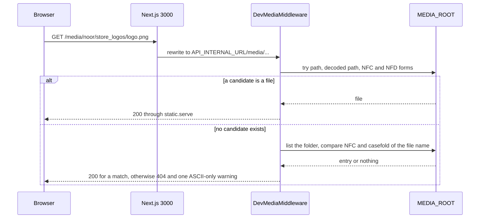
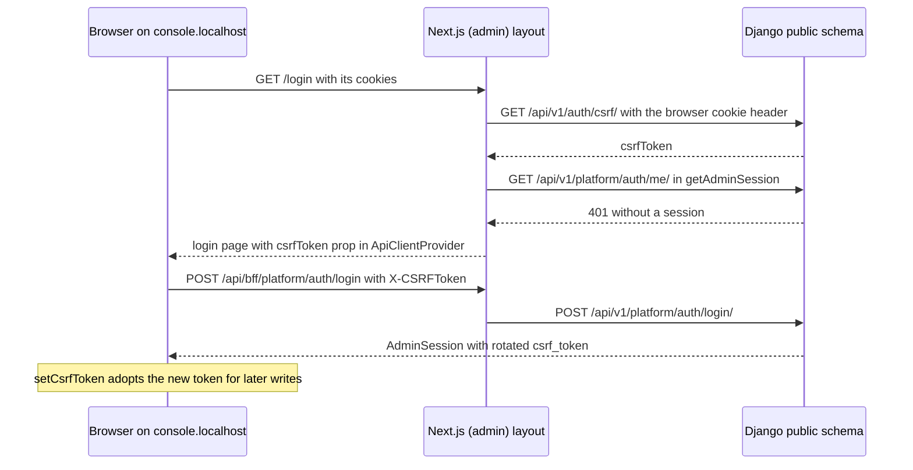
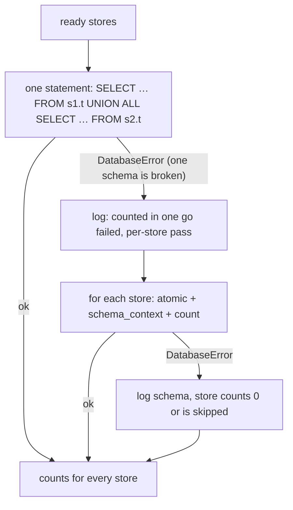

# Cross-cutting infrastructure fixes

> **Source**: DOC-525 · inventory A.11 · INT-017 (M07), INT-030 (M20), INT-031 (M45), INT-032 (M46)
> **Code**: `sharwa-frontend/src/lib/bff/upstream.ts` · `src/lib/bff/live-route.ts` · `src/lib/csrf.ts` · `src/app/(admin)/%5Fa/layout.tsx` · `src/features/platform-admin/api/session.ts` · `sharwa_saas/config/middleware.py` · `config/urls_public.py` · `core/uploads.py` · `products/management/commands/normalize_media_filenames.py` · `api/views_customers.py` · `api/views_inventory.py` · `api/views_platform.py` · `tenants/console_service.py` · `tenants/console_billing_service.py` · `tenants/console_money_service.py`
> **Last verified against code**: 2026-10-28 (step 39)

## 1. Purpose

Phase 002 integrated 49 modules and, on the way, fixed a handful of defects that belong to no single module: they live in the shared plumbing between the browser, the Next.js BFF and Django, or in the console's cross-store reads. Each fix is small, but each one is the reason a whole class of screens works, and each can silently regress. This page records, per fix: **cause**, **fix**, **file paths** and how to check it. It is the "remaining fixes" page of inventory A.11; the bigger A.11 topics have their own pages (BFF, tenant resolution, provisioning).

Not covered here: the rules of Arabic and phone normalization (pages [60](60-arabic-normalization.md) and [61](61-phone-normalization.md)), and the upload size ladder ([`../ops/upload-limits.md`](../ops/upload-limits.md)).

## 2. Components

| # | Fix (A.11 bullet) | Where | Ticket |
|---|---|---|---|
| 4.1 | Request body buffering | `src/lib/bff/upstream.ts`, `src/lib/bff/live-route.ts` | INT-016, INT-044, INT-046 (see [`20-bff.md`](20-bff.md#body-buffering)) |
| 4.2 | Local media on Windows | `config/middleware.py`, `config/settings.py`, `config/urls_public.py`, `core/uploads.py`, `normalize_media_filenames` | 2026-10-24 fix |
| 4.3 | `x-export-rows` forwarded | `src/lib/bff/upstream.ts`, `api/views_customers.py`, `api/views_inventory.py` | INT-017 |
| 4.4 | CSRF bootstrap in `(admin)` and `getAdminSession()` | `src/app/(admin)/%5Fa/layout.tsx`, `src/lib/csrf.ts`, `src/features/platform-admin/api/session.ts` | INT-030 |
| 4.5 | Console savepoints and `UNION ALL` counts | `tenants/console_service.py`, `console_money_service.py`, `console_billing_service.py` | INT-030, INT-031, INT-032 |
| 4.6 | Shared Arabic and phone normalization | pages 60 and 61 | A.11 |

## 3. Data model

No table, field or migration is added by these fixes. The only persisted artefact is a file layout: uploads live at `MEDIA_ROOT/<schema>/<folder>/<name>` ([4.2](#42-local-media-on-windows)).

## 4. The fixes

### 4.1 Request body buffering

**Cause.** `upstreamFetch` used to hand the incoming request body to `fetch` as a stream. Node's `fetch` (undici) then sends `Transfer-Encoding: chunked` with no `Content-Length`. Django — `runserver` and Gunicorn alike — takes the body length from `CONTENT_LENGTH`, so it saw an **empty body**: every write through the `/api/v1/*` passthrough (PWA install events, push subscribe, storefront writes, later B2B drafts and courier actions) answered `400` "required field" on every field, while reads were fine.

**Fix.** Both entry points send bytes, so `fetch` computes `Content-Length`:

| Where | Rule | Lines |
|---|---|---|
| `src/lib/bff/upstream.ts` `upstreamFetch` | for any method except `GET`/`HEAD`: use the caller's body, else `bufferedBody(request)` | 137-144 |
| `src/lib/bff/upstream.ts` `bufferedBody` | `request.arrayBuffer()`; `null` when there is no body, it was already read, or it is zero bytes | 161-166 |
| `src/lib/bff/live-route.ts` `forwardLive` | for a write (not `GET`/`HEAD`/`OPTIONS`) reads `arrayBuffer()` itself and passes `{ body }` | 48-53, 66-68 |
| `duplex: "half"` | added only if a caller passes an explicit `ReadableStream` | `upstream.ts:153-154` |

Full design, the features that depend on it, the regression recipe and the size-bound discussion: [`20-bff.md` §7](20-bff.md#body-buffering). Both code comments say "8MB max (`DATA_UPLOAD_MAX_MEMORY_SIZE`)" (`upstream.ts:143`, `live-route.ts:50`); the BFF itself enforces no cap, as [`20-bff.md` §7.4](20-bff.md#body-buffering) explains.

**Check.** A passthrough `POST` with a JSON body must reach Django with `Content-Length` and without `Transfer-Encoding: chunked` (recipe in `20-bff.md` §7.5).

### 4.2 Local media on Windows

**Cause.** On a Windows development machine four things combined to make every uploaded logo and gallery image return `404` or break the console:

1. The API builds absolute image URLs on the origin the request arrived at — for the BFF that is `http://localhost:8000/media/<schema>/…` (`API_INTERNAL_URL`). That origin resolves to the `public` schema, whose URL conf did not serve `/media/` (only `urls_tenant` did, under `DEBUG`) (docstring, `config/middleware.py:72-84`).
2. A proxy or rewrite can encode a link twice (`%25D9%2584…` arrives as `%D9%84…`).
3. Windows and macOS file systems may return an Arabic name in a different Unicode normalization form (NFC or NFD) from the one stored in the database.
4. A legacy console code page (cp1252, cp1256) crashed the logging call when the message contained Arabic: `--- Logging error ---` instead of the line (comment, `config/middleware.py:104-105`).

Arabic screenshot names such as «لقطة_شاشة_….png» triggered all four.

**Fix — three layers.**

| Layer | Behaviour | Files |
|---|---|---|
| Prevent | `tenant_upload_path(base_path, filename, allowed_extensions, *, randomize_name, default_ext)` returns `<schema>/<base_path>/<name>`. An extension outside `allowed_extensions` raises `ValidationError` «امتداد الملف «%(ext)s» «غير مسموح. الامتدادات المسموحة: »%(allowed)s.» before anything is written. If `randomize_name` is set **or the file name is not pure ASCII** the name becomes `<uuid4 hex>.<ext>` (32 hex characters). `TenantUploadTo` is the serialisable `upload_to` wrapper. | `core/uploads.py:62-88`, `91-114` |
| Serve | `DevMediaMiddleware` serves `MEDIA_URL` for any host before the tenant is chosen: `GET`/`HEAD` only; candidates = path and `unquote(path)` each as written, NFC and NFD; each candidate passes `_inside` (backslash to `/`, no `..`, no absolute path or drive letter, real path under `MEDIA_ROOT`); first existing file wins; otherwise the final file name is matched against the folder's entries after NFC + `casefold()`; served by `django.views.static.serve`. A miss answers `404` «الملف غير موجود.» and logs one ASCII-only line (`%a`). Installed **only while `DEBUG`**, as the second middleware after `RealIpMiddleware`. | `config/middleware.py:72-157`, `config/settings.py:282-283` |
| Serve, second line | `urls_public` maps `MEDIA_URL` to `MEDIA_ROOT` under `DEBUG` ("a second line of defence if the middleware is removed"); `urls_tenant` does the same for store hosts. | `config/urls_public.py:98-101`, `config/urls_tenant.py:739-740` |
| Browser path | `/media/:path*` is rewritten to `${API_PROXY_URL ?? API_INTERNAL_URL}/media/:path*`; the Next proxy skips `/media/`. | `next.config.ts:16-19`, `src/proxy.ts:118` |
| Repair | `normalize_media_filenames` renames pre-2026-10-24 files with a non-ASCII stored name to a uuid name in the same folder and updates every `FileField`/`ImageField` row, in each store schema and in `public`. Preview by default, `--apply` to execute, `--schema <SCHEMA>` for one store. | `products/management/commands/normalize_media_filenames.py` (usage: [`../ops/management-commands.md`](../ops/management-commands.md#normalize_media_filenames)) |

> ⚠️ Discrepancy — roadmap says `DevMediaMiddleware` resolves "case variants" of Arabic names / code compares the **final file name** after NFC + `casefold()` only (`config/middleware.py:153-156`); folder segments must match as written, and Arabic letters have no case, so `casefold()` only matters for the Latin part of a name. `api/test_dev_media.py` has no case-difference test. Reported in step 39.

**Files that carry the behaviour in tests.** `api/test_dev_media.py` (`DevMediaMiddlewareTests`: serves on any host, missing file and `..` give 404, other paths and writes pass through, single and double-encoded Arabic name, NFD stored vs NFC requested, ASCII-only 404 log; `NonAsciiUploadNameTests`: Arabic name becomes `uuid.png`, 36 characters) and `api/test_normalize_media.py` (`NormalizeMediaFilenamesTests`: preview changes nothing, `--apply` renames file and row, second run reports «ملفات 0»). Not run in step 39.

**Check.** On a Windows machine with `DEBUG=True`: upload a logo named in Arabic; the stored name is 32 hex characters plus the extension, and `http://localhost:8000/media/<schema>/store_logos/<name>` answers `200`. Setup steps: [`../ops/dev-setup-windows.md`](../ops/dev-setup-windows.md).

### 4.3 Forwarded headers: `x-export-rows` (INT-017)

**Cause.** `forwardResponse` copies back to the browser only the response headers named in `FORWARD_RESPONSE_HEADERS`. A header Django sets but the list lacks never reaches the page. The customers CSV export reports how many rows it wrote in `X-Export-Rows`, and the export button reads that header for its toast: `Number(res.headers.get("x-export-rows") ?? count ?? 0)`. Without the header the toast fell back to the list's own count, which can differ from what the (filtered) export actually wrote.

**Fix.** `"x-export-rows"` is in the response allow-list, with the comment "M07 export (INT-017): the row count the export toast reports".

| What | File and lines |
|---|---|
| Allow-list `FORWARD_RESPONSE_HEADERS`: `content-type`, `content-disposition`, `content-language`, `retry-after`, `etag`, `location`, `x-sharwa-mock`, `x-export-rows` | `src/lib/bff/upstream.ts:22-32` (copy loop 171-174) |
| Request allow-list, for contrast: `cookie`, `content-type`, `accept`, `accept-language`, `x-csrftoken`, `idempotency-key`, `if-none-match` | `src/lib/bff/upstream.ts:12-20` |
| Django sets `X-Export-Rows` on the customers export | `api/views_customers.py:99` |
| Django also sets it on the inventory export (INT-024) | `api/views_inventory.py:87` |
| Consumer (toast «صُدِّر N عميلاً — سُجِّل في سجل التدقيق») | `src/features/customers/components/export-button.tsx:45` |
| Mock handler sets the header for customers only | `src/app/api/bff/customers/export.csv/route.ts:41` (the inventory mock, `inventory/export.csv/route.ts:56-59`, sets none) |
| Tests | `api/test_customers_api.py:235`, `api/test_inventory_api.py:228` |

> ⚠️ Discrepancy — roadmap attributes the header to INT-017 / code: the allow-list entry is for M07 (INT-017), but Django also sets `X-Export-Rows` on `inventory/export.csv` (`api/views_inventory.py:87`, INT-024), which therefore also crosses the BFF. Reported in step 39.

The header is readable only same-origin: `config/settings.py` defines no `CORS_EXPOSE_HEADERS`, so a cross-origin API client would not see `X-Export-Rows` in a browser *(general browser behaviour, not tested)*. Adding another response header to the BFF means adding it to the allow-list; the full list is also in [`../api/overview/conventions.md`](../api/overview/conventions.md) and [`20-bff.md` §3.5](20-bff.md#35-response-headers).

### 4.4 CSRF bootstrap in `(admin)` and `getAdminSession()` (INT-030)

**Cause.** The platform console (`console.<base>`) is a separate Next.js route group, `(admin)`, served from the `/_a/*` rewrite (on disk the segment is `%5Fa`, because a literal `_a` folder is private to Next). Django enforces CSRF on the console login and on every write (`ConsoleLoginView.post` calls `SessionAuthentication().enforce_csrf(request)`, `api/views_platform.py:140`), and `CSRF_COOKIE_HTTPONLY = True` (`config/settings.py:382`) means browser JavaScript cannot read the `csrftoken` cookie. The merchant dashboard already solved this with a server component that fetches the token and passes it down as a prop; the console had no equivalent, so its first `POST` (the login) had no `X-CSRFToken`. Separately, the console's server-side session check could not ask Django who the user is: with mocks on it only knew a development marker cookie.

**Fix.**

1. **CSRF bootstrap.** `(admin)/%5Fa/layout.tsx` renders `<CsrfBootstrap />` inside `<Suspense fallback={null}>` (lines 29-31, 46-51). It awaits `connection()` (request-time only), reads the browser's cookies and calls `getCsrfToken(null, cookieStore.toString() || null)` — `null` store host, because the console is on the platform origin: no `X-Store-Domain`, so Django answers on the `public` schema. The token goes to the browser as a prop of `ApiClientProvider`, which keeps it in a module variable (never `document.cookie`, never storage). The cookie header **must** travel: the token is derived from the browser's own `csrftoken`; without it Django mints a pair whose cookie never reaches the browser and every write fails with «CSRF token incorrect» (`src/lib/csrf.ts:80-87`). `getCsrfToken` tries `GET /api/v1/auth/csrf/` first (`CsrfTokenView`, `api/views_auth.py`) and the legacy `GET /dashboard/login/` `Set-Cookie` second (`csrf.ts:19-20,72-78`).
2. **Rotated token on login.** Django's `login()` rotates the token, so `ConsoleLoginView` returns `csrf_token` in the answer (`views_platform.py:171-172`) and `useAdminLogin` adopts it with `setCsrfToken` in `onSuccess` (`src/features/platform-admin/api/hooks.ts:101-107`). `ConsoleMeView` returns a fresh `csrf_token` as well (`views_platform.py:189-193`; the field is optional in `adminSessionSchema`, `schemas/auth.ts:16`).
3. **`getAdminSession()`** (`src/features/platform-admin/api/session.ts:19-40`): when the module key `platform` is live (`isModuleLive("platform")`, true for `SHARWA_MOCKS=off` or `platform` in `SHARWA_LIVE_MODULES`) it calls Django `GET ${UPSTREAM_ORIGIN}/api/v1/platform/auth/me/` with the browser's cookie header (`cache: "no-store"`, `redirect: "manual"`). Not `ok`, unparsable by `adminSessionSchema`, no cookie, or a network error all mean "no session" and the console stays on its login screen. When `platform` is not live and mocks are on, the dev marker cookie `sharwa_mock_admin` resolves to a fixture user (lines 37-39); mocks off and not live gives no session. `requireAdminSession()` (42-46) redirects to `/login`; the console layout awaits it with no `<Suspense>`, so an unauthenticated request gets a real redirect, never a flushed 200 (`(console)/layout.tsx:16-18`); the login page redirects to `/` when a session already exists (`login/page.tsx:15`).

> ⚠️ Discrepancy — roadmap says `getAdminSession()` "reads Django `auth/me/` when live" / code reads **`/api/v1/platform/auth/me/`** (`src/features/platform-admin/api/session.ts:25`); `/api/v1/auth/me/` is the merchant endpoint (`api/urls.py:218`), the console route is `api/urls.py:475`. The roadmap's `(admin)` layout path also omits that the folder is `%5Fa` on disk. Reported in step 39.

**Files.**

| What | File |
|---|---|
| `(admin)` group layout, `CsrfBootstrap` | `src/app/(admin)/%5Fa/layout.tsx` |
| Console gate (`requireAdminSession`) | `src/app/(admin)/%5Fa/(console)/layout.tsx` |
| Token fetch (`fetchCsrf`, `getCsrfToken`) | `src/lib/csrf.ts` |
| Token holder | `src/components/providers/api-client-provider.tsx` |
| Session read | `src/features/platform-admin/api/session.ts` |
| Dashboard twin (same pattern, with the store host) | `src/app/(dashboard)/%5Fd/[store]/dashboard/layout.tsx:44-53` |
| Django: login, logout, me | `api/views_platform.py:133-193`, routes `api/urls.py:473-475` |

Contract detail: [`../api/overview/csrf.md`](../api/overview/csrf.md), [`../api/domains/16-platform-console/auth.md`](../api/domains/16-platform-console/auth.md).

### 4.5 Savepoints around console tenant reads; `UNION ALL` counts (INT-031, INT-032)

**Cause.** The console runs on the `public` schema and has to look into store schemas (Sharwa Ship state, installed apps, custody before deactivation, pending dues, installation counts). A store that is `ready` in `public` can have a missing or half-migrated schema (dropped by hand, interrupted provisioning). On PostgreSQL one failed statement (`relation … does not exist`) aborts the surrounding transaction: every later query fails until rollback, so one broken store used to take down a whole console page. Counting per store by entering each schema in turn also costs one round trip per store (code comment: "performance, Task 2.4", `console_money_service.py:123`).

**Fix.**

*Guarded reads.* Every guarded tenant read has the same shape — `with transaction.atomic(), schema_context(schema)` inside `try … except DatabaseError`, then log with `schema=%s` and return the read's safe default:

| Read | Safe default on failure | File and lines |
|---|---|---|
| `sharwa_ship_active` (Sharwa Ship state) | `False` | `tenants/console_service.py:224-233` |
| `_installations` (store detail) | `[]` | `console_service.py:386-397` |
| `tenant_custody_blocker` (deactivation) | the message «تعذّر فحص عهدة المتجر الآن — حاول مجدداً.» — it **blocks** deactivation rather than allowing it | `console_service.py:761-780` |
| `_installation_counts` per-store fallback | skip that store, log «تعذّر عدّ تثبيتات المتجر» | `console_billing_service.py:361-367` |
| `_pending_counts` per-store fallback | that store counts `0`, log «تعذّر عدّ مستحقات المتجر» | `console_money_service.py:144-152` |

`transaction.atomic()` is a **savepoint** whenever a transaction is already open (a service's own `atomic()`, a test's wrapping transaction) and an ordinary transaction otherwise — `ATOMIC_REQUESTS` is not set in `config/settings.py`. Either way the failed statement is rolled back to the start of the block and the connection stays usable. `schema_context` restores the previous schema on exit, also after an exception.

*One statement for many stores.* The two cross-store counts build one `SELECT … UNION ALL SELECT …` over all `ready` store schemas (identifiers quoted with `connection.ops.quote_name`; names come from `Client.schema_name`, never from the request):

| Function | Statement per store | Used by | File and lines |
|---|---|---|---|
| `_pending_counts(clients)` | for each of `PlatformCommissionRecord` and `AppBillingCharge`: `SELECT %s AS s, COUNT(*) AS n FROM "<schema>"."<table>" WHERE status = 'pending'` (schema name bound as a parameter) | `GET platform/dues/overview/` → `pending_count` | `console_money_service.py:121-153` |
| `_installation_counts()` | `SELECT app_code, COUNT(*) FROM "<schema>"."<table>" GROUP BY app_code` | `GET platform/apps/` and app detail → `installations` | `console_billing_service.py:341-368` |

If any schema lacks the table, PostgreSQL rejects the whole statement. The function logs «تعذّر عدّ المستحقات دفعة واحدة — مرور لكل متجر» (or «تعذّر عدّ التثبيتات دفعة واحدة — مرور لكل متجر») and falls back to one guarded read per store; a store that still fails counts `0` (dues) or is skipped (apps). The answer is therefore exact for healthy stores and never an error.

> ⚠️ Discrepancy — roadmap says savepoints wrap **every** console tenant read / code leaves two entries into a store schema unguarded: `dues_detail` (`tenants/console_money_service.py:254`) and `due_action` (`:334`) use a bare `with schema_context(client.schema_name):`, protected only by the `ready` check in `_ready_client`. A `ready` store with a missing schema makes `GET platform/dues/<schema>/` and the due actions fail with a server error. Also reported in step 06 ([`13-cross-schema-access.md`](13-cross-schema-access.md)); re-verified in step 39.

**Tests.** `api/test_platform_console_api.py:400-411` (`MissingSchemaTests`: a `ready` client `ghost` with no schema — `sharwa_ship_state` is `inactive`, `store_detail(...)['installations']` is `[]`, `custody(...)` does not block wrongly, and the surrounding transaction survives); `api/test_platform_money_api.py:98` (`pending_count == 2` from the store schema through the `UNION`); `api/test_platform_billing_api.py:194-205` (`InstallationCountTests`). **No test forces the `UNION ALL` to fail**, so the per-schema fallback of `_pending_counts` and `_installation_counts` is exercised only by code reading. Not run in step 39.

Design of the whole cross-schema layer and the rules for new reads: [`13-cross-schema-access.md`](13-cross-schema-access.md).

### 4.6 Shared Arabic and phone normalization

These two are cross-cutting fixes with their own pages, written for DOC-523 and DOC-524:

- [`60-arabic-normalization.md`](60-arabic-normalization.md) — Arabic search normalization shared by the command palette and every list search box.
- [`61-phone-normalization.md`](61-phone-normalization.md) — phone number normalization.

Entry points found in code (for orientation only; the rules, rationale and tests are on those pages): frontend `normalizeArabic`, `matchScore`, `includesNormalized` in `src/lib/i18n/normalize.ts`; Django `normalize_arabic` in `products/services/search_service.py:44`, documented there as "the Python copy of `normalizeArabic` (the UI), character for character"; phone `normalize_phone` in `products/services/wallet_service.py:65` and `sharwapay/customer_api.py:85` (the latter documented as the same as `normalizePhone` in the UI).

## 5. Invariants

| Invariant | Enforced by |
|---|---|
| Every BFF write reaches Django with a `Content-Length` | `bufferedBody` / `forwardLive` (`upstream.ts:144,161-166`, `live-route.ts:51-53`) |
| Only allow-listed response headers cross the BFF | `FORWARD_RESPONSE_HEADERS` (`upstream.ts:22-32`) |
| The console's CSRF token is derived from the browser's own `csrftoken` cookie | `getCsrfToken(null, cookie)` is always passed the request's cookie header (`(admin)/%5Fa/layout.tsx:47-49`) |
| The console has no session unless Django confirms it (live) or the dev marker cookie exists (mock) | `getAdminSession` (`session.ts:19-40`); the console layout awaits `requireAdminSession` |
| Local media is served only under `DEBUG`, only `GET`/`HEAD`, and never outside `MEDIA_ROOT` | `settings.py:282-283`, `middleware.py:90-93,126-134` |
| A non-ASCII upload name is never stored | `tenant_upload_path` (`core/uploads.py:83-84`) |
| A failed store-schema read never poisons the request's transaction | `atomic()` + `schema_context` + `DatabaseError` (4.5) |
| Raw SQL interpolates only quoted `Client.schema_name` values | `connection.ops.quote_name` (`console_money_service.py:128,133`, `console_billing_service.py:350-352`) |

## 6. Background work

None of these fixes adds a Celery task or Beat entry. `normalize_media_filenames` is a manual management command (not scheduled, not run by `deploy.sh`). Task behaviour in general: [`50-background-jobs.md`](50-background-jobs.md).

## 7. Configuration

| Setting | Value | Used by |
|---|---|---|
| `DEBUG` | `False` unless the text is `True` (`settings.py:21`) | `DevMediaMiddleware` (282-283), `MEDIA_URL` static routes |
| `MEDIA_URL`, `MEDIA_ROOT` | `/media/`, `<BASE_DIR>/media` (`settings.py:361-362`) | 4.2 |
| `DATA_UPLOAD_MAX_MEMORY_SIZE` | 8 MB (`settings.py:368`) | 4.1 (non-file request data) |
| `API_INTERNAL_URL`, `API_PROXY_URL` (Next.js) | Django origin; `UPSTREAM_ORIGIN = API_PROXY_URL ?? API_INTERNAL_URL` (`src/env.ts:17-18`, `upstream.ts:10`) | all fixes; media rewrite `next.config.ts:17` |
| `CSRF_COOKIE_HTTPONLY` | `True` (`settings.py:382`) | 4.4 |
| `ATOMIC_REQUESTS` | not set | 4.5 |
| `SHARWA_MOCKS`, `SHARWA_LIVE_MODULES` key `platform` | decide live vs mock `getAdminSession()` (`src/mocks/runtime.ts:7-12,48-55`) | 4.4; [`22-live-module-keys.md`](22-live-module-keys.md) |
| `FORWARD_RESPONSE_HEADERS`, `FORWARD_REQUEST_HEADERS` | constants in code, no setting | 4.3 |

Environment reference: [`../ops/environment.md`](../ops/environment.md).

## 8. Failure modes and fixes

| Failure | Symptom | Cause | Handling / fix |
|---|---|---|---|
| Writes through the passthrough arrive empty | `400` "required field" on every field, reads fine | streamed body sent chunked without `Content-Length` | buffering, 4.1 (INT-016, INT-044, INT-046) |
| Logo or gallery image `404` on a dev machine | broken images in dashboard and storefront | `localhost:8000` is the `public` schema; `/media/` not in its URL conf | `DevMediaMiddleware`, `urls_public` media, 4.2 |
| Image `404` for an Arabic file name only | works for ASCII names | double-encoded link, or NFC/NFD mismatch with the file system | candidate list in `resolve_media_path`; new uploads get uuid names |
| `--- Logging error ---` instead of a log line | Windows console | Arabic in a message on cp1252/cp1256 | `%a` in the 404 log; `chcp 65001` and `PYTHONUTF8=1` in `sharwa.bat` |
| Export toast shows the list total, not the exported rows | wrong number | `x-export-rows` dropped by the BFF | allow-list, 4.3 (INT-017) |
| Console login `403` «CSRF …» | first console write fails | no token handed to the browser, or a token minted without the browser's cookie | `CsrfBootstrap` with the cookie header, 4.4 (INT-030) |
| Console always shows the login screen though Django has a session | redirect loop to `/login` | `platform` not live: the mock marker cookie is used instead of Django | add `platform` to `SHARWA_LIVE_MODULES` or set `SHARWA_MOCKS=off` |
| One broken store breaks a console page | "current transaction is aborted" or a server error | unguarded tenant read in an open transaction | guarded reads, 4.5 (INT-030) |
| Dues or apps overview fails because one schema lacks a table | whole overview fails | the single `UNION ALL` statement is rejected | per-store fallback, 4.5 (INT-031, INT-032) |
| `GET platform/dues/<schema>/` fails for a `ready` store without schema | server error | unguarded `schema_context` | open item, 4.5 discrepancy |

## 9. Open items

- Guard `dues_detail` and `due_action` (`console_money_service.py:254,334`) with the standard `atomic()` + `DatabaseError` pattern, or document why they are exempt.
- Add a test that makes the `UNION ALL` fail (a client with a missing schema in the list) so the per-store fallback is covered.
- Add a case-difference test to `api/test_dev_media.py`, or drop "case variants" from the task description.
- `X-Export-Rows` is invisible to cross-origin browser clients (no `CORS_EXPOSE_HEADERS`); irrelevant to the same-origin BFF.
- The acceptance of the Windows setup that exercises 4.1-4.2 together has not been run ([`../ops/dev-setup-windows.md`](../ops/dev-setup-windows.md)).
- Pages 60 and 61 are written in the same step by another agent; the links in 4.6 resolve once they are merged.

## 10. Related pages

- [`20-bff.md`](20-bff.md) — BFF design; body buffering §7 (`#body-buffering`); response headers §3.5.
- [`13-cross-schema-access.md`](13-cross-schema-access.md) — guarded tenant reads and `UNION ALL` counts in full.
- [`10-multi-tenancy.md`](10-multi-tenancy.md), [`11-provisioning.md`](11-provisioning.md), [`21-mock-runtime.md`](21-mock-runtime.md), [`22-live-module-keys.md`](22-live-module-keys.md).
- [`60-arabic-normalization.md`](60-arabic-normalization.md), [`61-phone-normalization.md`](61-phone-normalization.md).
- [`../ops/dev-setup-windows.md`](../ops/dev-setup-windows.md), [`../ops/management-commands.md`](../ops/management-commands.md), [`../ops/upload-limits.md`](../ops/upload-limits.md), [`../ops/environment.md`](../ops/environment.md).
- [`../api/overview/csrf.md`](../api/overview/csrf.md), [`../api/domains/16-platform-console/auth.md`](../api/domains/16-platform-console/auth.md), [`../api/overview/conventions.md`](../api/overview/conventions.md).
