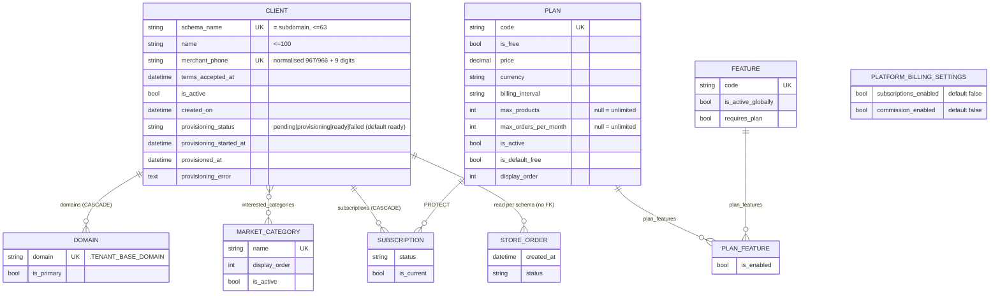
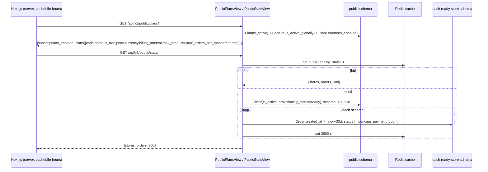
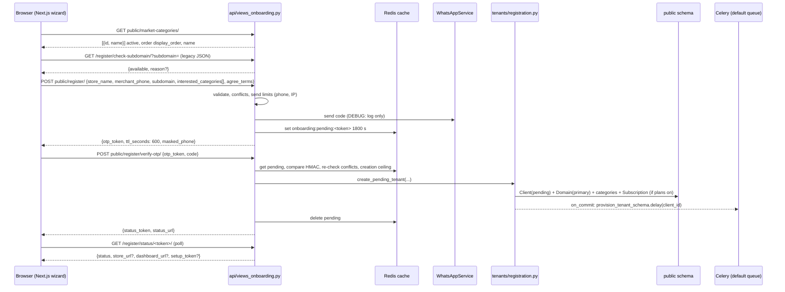
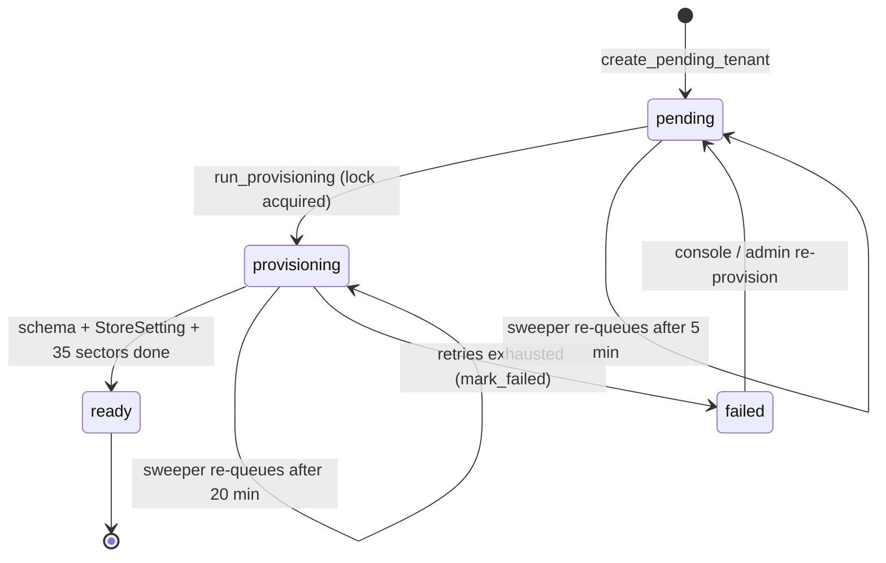

# Data model — Domain 1: public site, onboarding and tenant resolution

> **Source**: DOC-481 · inventory Domain 1 · INT-001 (M01), INT-002 (M47), INT-004 (M02)
> **Code**: `sharwa_saas/api/views_public.py` · `api/views_onboarding.py` · `api/middleware.py` (`TenantHeaderOverrideMiddleware`) · `tenants/middleware.py` (`TenantProvisioningGuardMiddleware`) · `tenants/models.py` (`Client`, `Domain`) · `tenants/registration.py` · `tenants/provisioning.py` · `tenants/validators.py` · `tenants/tasks.py` · `tenants/views.py` (legacy HTML and JSON screens) · `marketing/models.py` (`MarketCategory`) · `billing/models.py` (`Plan`, `Feature`, `PlanFeature`, `PlatformBillingSettings`, `Subscription`) · `config/settings.py` (`SHARED_APPS`, `MIDDLEWARE`, `CACHES`) · `sharwa-frontend/src/features/landing/**` · `src/features/onboarding/**`
> **Last verified against code**: 2026-10-28 (step 37)

## 1. Purpose

Domain 1 is everything a visitor touches **before** they own a store, plus the two guards that decide which store a request belongs to:

- the **public landing contract**: `GET /api/v1/public/plans/` (the pricing section) and `GET /api/v1/public/stats/` (the proof bar);
- the **registration API**: market categories, `register`, `register/resend-otp`, `register/verify-otp`, and the two legacy JSON routes the wizard still uses (`/register/check-subdomain/`, `/register/status/<token>/`);
- **tenant resolution and the store guard** (M47): `TenantHeaderOverrideMiddleware` and `TenantProvisioningGuardMiddleware`, probed by the frontend with `GET /api/v1/config/`.

This page lists the **models these endpoints read and write**, which schema each lives in, which provider (file) owns each rule, the constants and limits, the legacy Django HTML views that were kept, the tests, and the migrations. It does not repeat what other pages already own:

- how a request is routed to a schema and every status the guards return: [`10-multi-tenancy.md`](../10-multi-tenancy.md);
- the Celery build of the schema, the sweeper and re-provisioning: [`11-provisioning.md`](../11-provisioning.md);
- how the public site reads store schemas for the stats: [`13-cross-schema-access.md`](../13-cross-schema-access.md);
- the plan system and the feature decision order: [`15-plans-and-features.md`](../15-plans-and-features.md).

There are **no new migrations** for INT-001, INT-002 or INT-004 in the files read (§7). The only data that is neither a model row nor a migration is the **pending registration**, which lives in the cache (§3.2).

## 2. Components

### 2.1 Provider table (file → what it owns)

| File | Owns |
|---|---|
| `api/views_public.py` | `PublicPlansView` (`GET /api/v1/public/plans/`) and `PublicStatsView` (`GET /api/v1/public/stats/`); `public_plans_payload()`, `public_stats_payload()`, `_orders_since()`; constants `STATS_CACHE_KEY = "public:landing_stats:v1"`, `STATS_CACHE_SECONDS = 3600`, `STATS_WINDOW_DAYS = 30`, `EXCLUDED_ORDER_STATUSES = ("pending_payment",)` (`views_public.py:41-46`) |
| `api/views_onboarding.py` | `PublicOnlyMixin` (no authentication, `public` schema only), `MarketCategoryListView`, `RegisterView`, `ResendOtpView`, `VerifyOtpView`; the OTP and rate-limit constants (`:173-188`); all server messages `MSG_*` (`:207-219`); `_validate_registration`, `registration_conflicts`, `_send_code`, `_code_hash`, `mask_phone`, `too_many` |
| `api/urls.py` | the six routes (`:231-236`): `public/market-categories/`, `public/register/`, `public/register/verify-otp/`, `public/register/resend-otp/`, `public/plans/`, `public/stats/` |
| `tenants/registration.py` | `create_pending_tenant(...)`: the **single** creation path used by the API and by the legacy Django screen (`Client` `pending` + primary `Domain` + interested categories + default free plan + `on_commit` queue) |
| `tenants/validators.py` | subdomain rules shared by every path: `RESERVED_SUBDOMAINS`, `SUBDOMAIN_RE`, `SUBDOMAIN_MIN_LENGTH = 3`, `SUBDOMAIN_MAX_LENGTH = 50`, `subdomain_reason()` (short reasons), `store_subdomain_error()` (long messages), `store_domain()`, `validate_domain_not_reserved()` |
| `tenants/provisioning.py` | `queue_provisioning`, `run_provisioning`, `mark_failed`; status token (`make_status_token` / `read_status_token`, salt `tenants.provisioning.status`, 3600 s) and setup token (`make_setup_token` / `setup_token_matches`, salt `tenants.setup_password`, 3600 s); `build_store_urls_for_request` (`provisioning.py:32-34, 96-97`) |
| `tenants/tasks.py` | `provision_tenant_schema` (`:175-200`), `retry_stalled_tenant_provisioning` (`:207`); constants `PROVISIONING_SOFT_TIME_LIMIT = 900`, `PROVISIONING_TIME_LIMIT = 960`, `PROVISIONING_MAX_RETRIES = 3`, `STALLED_PENDING_AFTER_MINUTES = 5`, `STALLED_IN_PROGRESS_AFTER_MINUTES = 20` (`:170-172, 203-204`) |
| `tenants/models.py` | `Client` (the tenant row, provisioning status fields), `Domain` |
| `marketing/models.py` | `MarketCategory` (public schema; table `tenants_marketcategory`) |
| `billing/models.py` | `Plan`, `Feature`, `PlanFeature`, `PlatformBillingSettings`, `Subscription.assign_plan`, and the decision order that `public_plans_payload()` mirrors |
| `api/middleware.py` | `TenantHeaderOverrideMiddleware` (`X-Store-Domain` on `/api/` paths) |
| `tenants/middleware.py` | `TenantProvisioningGuardMiddleware` (`503` + `Retry-After: 10` for a store that is not `ready`) |
| `api/views.py` | `StoreConfigView` (`GET /api/v1/config/`, `api/views.py:75`; route `api/urls.py:58`): the store probe the frontend runs behind the two middlewares |
| `tenants/views.py` | legacy Django screens kept (§2.3): `home_view`, `register_tenant`, `check_subdomain_availability`, `verify_tenant_otp`, `tenant_provisioning_status` |
| `config/urls_public.py` | legacy routes `register/`, `register/check-subdomain/`, `register/verify-otp/`, `register/status/<str:token>/` (`:36-40`); includes `api.urls` at `api/v1/` (`:84`) |
| `config/settings.py` | `SHARED_APPS` / `TENANT_APPS` (`:121`, `:152`), `TENANT_MODEL` / `TENANT_DOMAIN_MODEL` (`:209-210`), `CACHES` (`:231`), `MIDDLEWARE` (`:259-278`), `TENANT_BASE_DOMAIN` (`:30`), `CELERY_BEAT_SCHEDULE` entry `retry-stalled-tenant-provisioning` (`:625-628`) |
| `sharwa-frontend/src/features/landing/api/{plans,stats}.ts` | fetch `public/plans/` and `public/stats/` with `cacheLife("hours")`, parse with Zod, fall back to local state |
| `sharwa-frontend/src/features/landing/components/pricing.tsx` | `freePlanHighlights` fallback when the plan has no features (`pricing.tsx:43`) |
| `sharwa-frontend/src/features/onboarding/components/otp-form.tsx` | OTP panel: the 410 handling of `resend()` (`:196-201`) |

### 2.2 Middleware placement

`MIDDLEWARE` in `config/settings.py:259-278`, in order (the full chain is in [`10-multi-tenancy.md`](../10-multi-tenancy.md#resolution)):

| # | Middleware | Why it sits here |
|---|---|---|
| 1 | `config.middleware.RealIpMiddleware` | first, so every rate limit below sees the real client IP (`REAL_IP_TRUSTED_PROXIES`, `REAL_IP_PROXY_COUNT`) |
| 2 | `django_tenants.middleware.main.TenantMainMiddleware` | resolves the schema from `Host` |
| 3 | `django.contrib.sessions.middleware.SessionMiddleware` | moved above the override so `request.session` exists (comment at `settings.py:265-266`, entry at `:267`) |
| 4 | `api.middleware.TenantHeaderOverrideMiddleware` | directly after tenant resolution and before any ORM query: only paths starting with `/api/` and carrying `X-Store-Domain` are switched (`api/middleware.py:40-55`) |
| 5 | `tenants.middleware.TenantProvisioningGuardMiddleware` | after the store is known (by host or header), before any middleware that touches store tables |

Consequences for Domain 1:

- The public endpoints are routed under `/api/v1/public/...`. A request that carries `X-Store-Domain` is switched to that store by middleware 4, and `PublicOnlyMixin.initial()` then answers `404` `{"detail": "«غير موجود.»"}` because `connection.schema_name != get_public_schema_name()` (`views_onboarding.py:338-341`). Test: `test_not_available_on_a_store_host`.
- `api` is a **tenant app only** (`TENANT_APPS`, `settings.py:152-160`) and has no models. Its routes are reachable on the platform host because `config/urls_public.py:84` includes `api.urls` under `api/v1/` (comment `:76-83`: a client with one fixed domain and `X-Store-Domain`), and on a store host through `config/urls_tenant.py:726`.
- The guard builds its page with `render_to_string` and **no request**, because the project's context processors query store tables that do not exist yet (`tenants/middleware.py:1-14`).

### 2.3 Legacy HTML views kept

Nothing was removed when the API providers were added. The Django screens and their JSON helpers still work on the platform host (`config/urls_public.py`):

| Route | View (`tenants/views.py`) | Template | Status |
|---|---|---|---|
| `/` | `home_view` (`:45`) | `tenants/home.html` | kept; the public marketing page of the Django era |
| `/register/` | `register_tenant` (`:63`) | `tenants/register.html` | kept; stores the draft **in the session** (key `pending_tenant_registration`), not in the cache |
| `/register/verify-otp/` | `verify_tenant_otp` (`:133`) | `tenants/verify_otp.html`, then `tenants/provisioning.html` | kept; calls the same `create_pending_tenant` |
| `/register/check-subdomain/` | `check_subdomain_availability` (`:115`) | JSON `{available, reason?}` | **still used by the Next.js wizard** (live availability) |
| `/register/status/<token>/` | `tenant_provisioning_status` (`:235`) | JSON `{status, store_url, dashboard_url, setup_token, message}` | **still used by the Next.js wizard and the Django wait page** |
| (store hosts, status 503) | `TenantProvisioningGuardMiddleware` | `tenants/store_provisioning_wait.html` | kept; the wait page the guard renders |

Differences between the legacy screen and the API (both create the store through `create_pending_tenant`):

| Aspect | Legacy HTML (`tenants/views.py`) | API (`api/views_onboarding.py`) |
|---|---|---|
| Pending state | `request.session['pending_tenant_registration']` with the **plain OTP** and `created_at` | cache entry `onboarding:pending:<token>` with an **HMAC of the code**; no session |
| OTP lifetime | `OTP_TTL_SECONDS = 600` (`views.py:43`) | `OTP_TTL_SECONDS = 600` (`views_onboarding.py:173`) |
| Draft lifetime | the OTP lifetime (`views.py:138`) | `PENDING_TTL_SECONDS = 30 * 60` (`:174`) |
| Send limit | `rate_limit_attempt(request, 'otp_send_reg:<phone>')` | `SENDS_PER_PHONE = 3` per `SEND_WINDOW_SECONDS = 600` per phone, plus a per-IP ceiling |
| Wrong-code lock | `rate_limit_attempt` + `phone_cache_rate_limited` | 3 failures per phone, lock `VERIFY_LOCK_SECONDS = 600` |
| Creation ceiling | `session_creation_rate_limited(request, 'tenant_creation')` | `cache_rate_limit("rl:public:tenant_creation:ip:<ip>", creations_per_ip(), 3600)` |
| Resend | none (user re-submits the form) | `ResendOtpView`, 30 s cooldown |
| Errors | rendered into `register.html` | `{field: [message]}` JSON |

### 2.4 Tests

Counts are the number of `def test_` methods in each file as staged on 2026-10-28.

| File | Tests | Covers |
|---|---|---|
| `api/test_public_api.py` | 7 | `test_plans_match_the_frontend_contract`, `test_subscriptions_off_every_plan_lists_every_active_feature`, `test_subscriptions_on_gated_feature_only_where_granted`, `test_no_plans_returns_an_empty_list`, `test_stats_count_ready_active_stores_only`, `test_stats_are_cached`, `test_stats_sum_orders_from_every_store` (class `PublicLandingApiTests`; the unreadable-schema case is covered inside `test_stats_count_ready_active_stores_only`: test schemas are not created, so order counts are `0`) |
| `api/test_tenant_guard_api.py` | 5 | class `TenantGuardProbeTests` (`TenantTestCase`): `test_ready_store_returns_the_config_contract` (nine required fields), `test_unknown_domain_is_404`, `test_inactive_store_is_403`, `test_store_still_provisioning_is_503_with_retry_after` (`pending`, `provisioning`, `failed` with `Retry-After: 10`), `test_head_answers_like_get_for_the_visitor_poll` |
| `api/test_onboarding_api.py` | 28 | `OnboardingApiTests` (18): categories active and ordered, register contract and one code sent, local phone normalised, field errors in the frontend texts, reserved/invalid subdomains, taken phone/subdomain/store name, WhatsApp failure on the phone field, per-phone send limit, many stores behind one CGNAT IP, configurable IP ceiling, 404 on a store host, verify creates a pending store and queues provisioning, wrong code then lockout, 410 for unknown/expired token, number taken while waiting, resend cooldown then new code replaces old, resend 410; `SubdomainRuleTests` (2); `StatusLinkTests` (2: forwarded host/proto, old behaviour without them); `SetupPasswordApiTests` (4); `DebugOtpBypassTests` (2) |
| `tenants/test_provisioning.py` | 18 | signup, `run_provisioning`, task failure and limits, sweeper, status endpoint, guard middleware, fan-out skips unready stores |
| `tenants/test_reserved_names.py` | 13 | reserved names and length rules across the form, live check and admin |
| `tenants/tests.py` | 10 | class `TenantRegistrationFormTestCase`: duplicate phone (also with different formatting), unique phone, duplicate/reserved/invalid-character subdomain, duplicate store name, fully valid form, form does not create a `Client` until saved — the legacy `TenantRegistrationForm` |

The three files named in the roadmap exist (`api/test_public_api.py`, `api/test_tenant_guard_api.py`, `api/test_onboarding_api.py`; 7 + 5 + 28 = 40 tests).

## 3. Data model

### 3.1 Models

Schema placement evidence: `SHARED_APPS` contains `tenants`, `billing`, `sharwapay`, `appstore`, `marketing` (`config/settings.py:121-143`) and `TENANT_APPS` contains `products` and `api` (`:152-160`), so everything below is in the **`public`** schema. The tenant resolution models are also named by `TENANT_MODEL = "tenants.Client"` and `TENANT_DOMAIN_MODEL = "tenants.Domain"` (`:209-210`).

| Model | Schema (public/store) | Key fields | Constraints / indexes | Added or changed by |
|---|---|---|---|---|
| `tenants.Client` (`TenantMixin`) | public | `schema_name` (unique, ≤ 63; the subdomain), `name` (≤ 100), `merchant_phone` (≤ 20, null/blank), `terms_accepted_at`, `is_active` (default `True`), `created_on` (`DateTimeField`, auto), `interested_categories` (M2M), `auto_create_schema = True` (class attribute) | `schema_name` unique + indexed; `merchant_phone` **unique** + indexed (one store per phone); index `(is_active, created_on)`; `Meta.verbose_name` «متجر (تينانت)» | `tenants/0001_initial` (created); `0002_alter_client_options_alter_domain_options_and_more` (`is_active`, index `(is_active, created_on)`); `0003_alter_client_options_alter_domain_options_and_more` (`merchant_phone` added; `created_on` → datetime); `0011_marketcategory_and_client_interests` (`terms_accepted_at`, `interested_categories`) |
| `tenants.Client` — provisioning fields | public | `provisioning_status` (≤ 15, choices `pending` «بانتظار التجهيز», `provisioning` «قيد التجهيز», `ready` «جاهز», `failed` «فشل التجهيز»; **default `ready`**), `provisioning_started_at`, `provisioned_at`, `provisioning_error` (text; the writer truncates to 2000 chars, `provisioning.py:218`) | `provisioning_status` indexed; default `ready` makes every pre-existing store ready without a data migration; properties `is_provisioned`, `current_subscription`, `current_plan` | `tenants/0025_client_provisioning_status` |
| `tenants.Domain` (`DomainMixin`) | public | `domain` (≤ 253), `tenant` FK → `Client` (`related_name='domains'`, `CASCADE`), `is_primary` (default `True`) | `domain` **unique** + indexed; `is_primary` indexed | `tenants/0001_initial`; later `tenants/0026_customdomain` adds the separate `CustomDomain` model (Domain 12, not covered here) |
| `Client.interested_categories` through table | public | table `tenants_client_interested_categories` (auto through model; `db_table` pinned in `tenants/models.py:40-44`) | M2M, `blank=True`, `related_name='interested_clients'` | `tenants/0011`; moved to point at `marketing.marketcategory` by `tenants/0016_move_models_to_new_apps` (state only) |
| `marketing.MarketCategory` | public | `name` (≤ 100, unique), `display_order` (`PositiveIntegerField`, default 0, indexed), `is_active` (default `True`, indexed) | ordering `['display_order', 'name']`; `db_table = 'tenants_marketcategory'` | created by `tenants/0011_marketcategory_and_client_interests` (25 seeded names, ends with «أخرى»); ownership moved to the `marketing` app by `marketing/0001_initial` + `tenants/0016_move_models_to_new_apps` (both `SeparateDatabaseAndState`, no SQL) |
| `billing.Plan` | public | `code` (slug, unique, ≤ 50), `name`, `is_free`, `price` (`Decimal(10,2)`), `currency` (`SAR`/`USD`/`YER_OLD`/`YER_NEW`), `billing_interval` (`monthly`/`yearly`/`lifetime`), `max_products`, `max_orders_per_month` (both nullable = unlimited), `is_active`, `is_default_free`, `display_order`, commission fields | `db_table = 'tenants_plan'`; ordering `['display_order', 'price']`; `save()` clears `is_default_free` on every other plan | created by `tenants/0012_plan_subscription_platformbillingsettings`; moved by `billing/0001_initial` (state only) |
| `billing.PlatformBillingSettings` | public | `subscriptions_enabled` (default `False`), `commission_enabled` (default `False`) | singleton: `save()` forces `pk=1`, `delete()` is a no-op, `load()` = `get_or_create(pk=1)`; `db_table = 'tenants_platformbillingsettings'` | `tenants/0012`; moved by `billing/0001_initial` |
| `billing.Feature` | public | `code` (slug, unique), `name`, `module_group`, `is_active_globally` (default `True`), `requires_plan` (default `False`) | ordering `['module_group', 'name']` | `billing/0002_feature_toggling` (codes seeded by `0003`–`0011`, `0013`) |
| `billing.PlanFeature` | public | `plan` FK, `feature` FK, `is_enabled` (default `True`) | unique `(plan, feature)` `unique_plan_feature` | `billing/0002_feature_toggling` |
| `billing.Subscription` | public | `client` FK (`CASCADE`), `plan` FK (`PROTECT`), `status`, `is_current`, `current_period_end` | index `(client, is_current)` `tenants_sub_client__df4c1a_idx`; `db_table = 'tenants_subscription'` | `tenants/0012`; moved by `billing/0001_initial` |
| `products.Order` (read only) | **store** (each store schema) | `created_at`, `status` | read by `_orders_since()` inside `schema_context(schema_name)` for the proof bar; no write | not a Domain 1 model; see [`13-cross-schema-access.md`](../13-cross-schema-access.md) |

Notes:

- The model table does **not** include a table for the draft registration or for the OTP: see §3.2.
- `Plan` and `Feature` are the "public listing" the roadmap refers to: `public/plans/` returns active plans only (`is_active=True`) in the order `display_order, price, id` (`views_public.py:51`), and feature names for features that are globally active (`is_active_globally=True`, ordered `module_group, name`, `:52`).
- `MarketCategory` rows are read in two places: the public listing (active only) and the registration validator (`interested_categories` must all be active ids, `views_onboarding.py:316-318`). The platform console reads the same rows with a per-category store count (§9).
- `Client.merchant_phone` stores the **normalised** phone (`967XXXXXXXXX` or `966XXXXXXXXX`: `NORMALIZED_PHONE_RE = ^(967|966)\d{9}$`, `views_onboarding.py:199`), produced by `products.utils.clean_phone_number`.

### 3.2 Pending registration (cache entry, not a model)

> ⚠️ Discrepancy — roadmap lists "pending registration (30-min lifetime)" under **Models** / code does: there is no model or table for it. The draft is a Redis cache entry written by `RegisterView` (`api/views_onboarding.py:385-390`). The 30-minute lifetime is correct (`PENDING_TTL_SECONDS = 30 * 60`, `:174`). Reported in step 37.

| Item | Value | Where |
|---|---|---|
| Cache key | `onboarding:pending:<otp_token>` (`CACHES` `KEY_PREFIX = 'sharwa'`, Redis DB 0; `LocMemCache` only when `DJANGO_TESTING=1`) | `_pending_key()` `:234`; `settings.py:231-257` |
| `otp_token` | `secrets.token_urlsafe(32)` | `:379` |
| Stored value | `store_name`, `merchant_phone` (normalised), `subdomain`, `interested_category_ids` (sorted, de-duplicated), `code_hash`, `code_expires_at` (epoch), `last_sent_at` (epoch) | `:323-328, 385-390` |
| Code | six digits `secrets.randbelow(900000) + 100000`; stored only as `salted_hmac("sharwa.onboarding.otp", f"{token}:{code}")` | `_new_code` `:267`, `_code_hash` `:238` |
| Draft lifetime | 1800 s, **renewed** on every successful resend (`cache.set(..., PENDING_TTL_SECONDS)`) | `:419` |
| Code lifetime | `OTP_TTL_SECONDS = 600` | `:173` |
| Deleted when | the store is created; a conflict is found at verify time; an `IntegrityError` | `:465, 485, 492` |
| After expiry | `verify-otp` → `410` «انتهت صلاحية الرمز»; `resend-otp` → `410` «انتهت صلاحية الطلب، ابدأ من جديد.» | `:432, 404` |

Other cache keys written by this domain (counters, not entities):

| Key | Purpose | Limit |
|---|---|---|
| `rl:public:onboarding_send:phone:<phone>` | sends per phone | `SENDS_PER_PHONE = 3` per `SEND_WINDOW_SECONDS = 600` |
| `rl:public:onboarding_send:ip:<ip>` | sends per IP | `ONBOARDING_SENDS_PER_IP_PER_HOUR` (default `1500`) per 3600 s |
| `rl:public:onboarding_verify:fail:<phone>` / `...:lock:<phone>` | wrong codes / lock | `VERIFY_FAILURES_PER_PHONE = 3`, `VERIFY_LOCK_SECONDS = 600` |
| `rl:public:tenant_creation:ip:<ip>` | stores created per IP (counted only after a correct code) | `ONBOARDING_CREATIONS_PER_IP_PER_HOUR` (default `500`) per 3600 s |
| `rl:public:provisioning_status:<ip>` | polls of `/register/status/<token>/` | `PROVISIONING_STATUS_POLLS_PER_IP_PER_MINUTE` (default `3000`) per 60 s (`tenants/views.py:231, 242-244`) |
| `public:landing_stats:v1` | cached proof-bar payload | 3600 s |
| `tenant-provisioning-lock:<client_id>` | one build per store | `PROVISIONING_LOCK_TTL_SECONDS = 20 * 60` (`provisioning.py:32, 41-42`) |

### 3.3 ER sketch

`STORE_ORDER` is `products.Order` in the **store** schema; it is drawn only to show that the proof bar reads it by schema name, not by a foreign key. The pending registration is not drawn: it is a cache entry (§3.2).

## 4. Flows

### 4.1 Public landing contract

Rules, all in `api/views_public.py`:

- **Plans** (`public_plans_payload`, `:49-79`): `price` is `str(Decimal(plan.price).quantize(Decimal("0.01")))`. `features` for a plan is the list of **names** of the features the plan actually grants. A feature is listed when `grants(plan, feature)` is true: it does not require a plan, **or** the plan system is off, **or** a `PlanFeature(plan, feature, is_enabled=True)` row exists (`:57-61`). A globally disabled feature is never listed (it is filtered out in the query, `:52`). This is `resolve_feature_decision` steps 2–5 with no store override ([`15-plans-and-features.md`](../15-plans-and-features.md)). With `subscriptions_enabled = False` (the default), every active plan lists every active feature: the page's «free now — all features» state.
- **Stats** (`public_stats_payload`, `:93-108`): `stores` = number of `Client` rows other than the `public` tenant with `is_active=True` and `provisioning_status = "ready"`; `orders_30d` = sum over those schemas of `Order` rows created in the last `STATS_WINDOW_DAYS = 30` days, **excluding `pending_payment`** ("a payment that has not completed is not an order yet", `:44`). One schema that cannot be read (`DatabaseError`, for example an incomplete schema) is skipped, counted as `0` and logged as a warning inside its own `transaction.atomic()` (`_orders_since`, `:82-90`).
- **Scope**: both views use `PublicOnlyMixin` (no authentication, no permission classes, `404` on a store host).

> ⚠️ Discrepancy — roadmap says "`public/plans/`, `public/stats/`, cached 1 h" / code does: only `public/stats/` is cached server-side, in Redis for 3600 s (`api/views_public.py:41-42, 107`). `public/plans/` is computed on every request (no `cache`, no `cache_page` in `views_public.py` or `api/urls.py:235`). The one-hour caching of both responses is done by Next.js: `cacheLife("hours")` in `src/features/landing/api/plans.ts:16` and `stats.ts:15`. Reported in step 37.

Frontend fallbacks (not Django behaviour): if the plans call fails or does not match the Zod contract, `getPublicPlans()` returns `{ subscriptions_enabled: false, plans: [] }` (or the plans mock when mocks are on, `plans.ts:27`); `Pricing` then renders one free column and, when `plan.features` is empty or the plan is missing, uses `freePlanHighlights` from `landing.content.ts` (`pricing.tsx:43`). If the stats call fails, `getProofStats()` serves the static `proofStats` (`stats.ts:21-39`).

### 4.2 Registration and provisioning

Request validation (`_validate_registration`, `views_onboarding.py:283-329`):

| Field | Rule | Message on failure |
|---|---|---|
| `store_name` | stripped, 3–100 characters (`STORE_NAME_MIN, STORE_NAME_MAX = 3, 100`) | «اسم المتجر من 3 إلى 100 حرف» |
| `merchant_phone` | required; `clean_phone_number` then `^(967|966)\d{9}$` | «أدخل رقم الواتساب» / «رقم واتساب غير صحيح» |
| `subdomain` | `subdomain_reason()`: empty → format `[a-z0-9]+` → reserved → length 3–50 | «فارغ», «أحرف إنجليزية وأرقام فقط», «محجوز للنظام», «يجب أن يكون بين 3 و50 حرفاً» |
| `interested_categories` | list of integers (booleans refused), every id an **active** `MarketCategory`; empty list allowed | «اختر من الأقسام المتاحة.» |
| `agree_terms` | must be exactly `true` | «يجب الموافقة على الشروط» |

Conflicts (`registration_conflicts`, `:271-280`), checked at `register` and again at `verify-otp` (a parallel registration can win the race): `Client.merchant_phone` exists → «هذا الرقم مرتبط بمتجر»; `Client.schema_name == subdomain` → «مستخدم بالفعل»; `Client.name__iexact` (only at `register`) → «اسم المتجر مستخدم بالفعل. يرجى اختيار اسم مختلف.».

Answers:

| Endpoint | Status | Body |
|---|---|---|
| `register` | 200 | `{otp_token, ttl_seconds: 600, masked_phone}` (`mask_phone` → `967•••••802`) |
| `register` | 400 | `{field: [message]}`; a WhatsApp failure lands on `merchant_phone`: «تعذّر إرسال رمز التحقق إلى هذا الرقم على واتساب. تأكد من الرقم وحاول مرة أخرى.» |
| `register` / `resend` / `verify` | 429 | `{"detail": "«محاولات كثيرة، حاول بعد N ثانية»"}` + `Retry-After` (`too_many`, `:222-227`) |
| `resend-otp` | 200 | `{ttl_seconds: 600}`; 30 s cooldown (`RESEND_COOLDOWN_SECONDS`); a new code replaces the old one |
| `resend-otp` | 410 / 502 | unknown or expired draft → 410; WhatsApp failure → 502 `{detail}` |
| `verify-otp` | 200 | `{status_token, status_url}` (`reverse("tenant_provisioning_status", args=[token])`) |
| `verify-otp` | 400 | `{code: ["«الرمز غير صحيح»"]}`, or `{subdomain: [...]}` / `{merchant_phone: [...]}` when a conflict appears |
| `verify-otp` | 410 | «انتهت صلاحية الرمز» |
| `verify-otp` | 429 | wrong-code lock, or «تم الوصول للحد الأقصى من عمليات إنشاء المتاجر خلال ساعة. يرجى المحاولة لاحقاً.» with `Retry-After: 3600` |
| `verify-otp` | 500 | «حدث خطأ غير متوقع أثناء إعداد متجرك. يرجى المحاولة مرة أخرى لاحقاً أو التواصل مع الدعم الفني.» |

Development-only behaviour: when `settings.DEBUG` is true, the code is **not** sent on WhatsApp (it is logged with the masked phone) and the static code `DEBUG_STATIC_OTP = "123456"` is accepted (`views_onboarding.py:205, 249-255, 441-442`). Both branches are inside `if settings.DEBUG`. Tests: `DebugOtpBypassTests`.

`create_pending_tenant` (`tenants/registration.py:175-219`) runs in one `transaction.atomic()`:

1. `Client(schema_name=subdomain, name, merchant_phone, terms_accepted_at=now, provisioning_status="pending")` with `auto_create_schema = False` **on the instance** (the class attribute stays `True` for tests, the admin and `seed_tenants`);
2. `Domain(domain=f"{subdomain}.{TENANT_BASE_DOMAIN}", tenant=client, is_primary=True)` (`store_domain`, `validators.py:305-307`);
3. `client.interested_categories.set(...)` when ids were given;
4. `Subscription.assign_plan(client, default_plan)` only when `PlatformBillingSettings.load().subscriptions_enabled` and a `Plan(is_default_free=True, is_active=True)` exists; with plans on but no default plan it logs a warning and assigns nothing;
5. `transaction.on_commit(lambda: queue(client_id))`: the worker never sees an uncommitted row; a dead broker leaves the store `pending` for the sweeper.

### 4.3 Provisioning state diagram

`stalled` is not a stored status. The status field is the only thing the legacy status route and the guard read; the full build is in [`11-provisioning.md`](../11-provisioning.md). The task decorators are `bind=True, acks_late=True, max_retries=3, default_retry_delay=60, soft_time_limit=900, time_limit=960` (`tenants/tasks.py:175-182`). The `failed → pending` edge is the console / admin re-provision action documented in [`11-provisioning.md`](../11-provisioning.md); it is drawn from that page and was not re-read in `console_service.py` for this page. A task retry does not reset the status: `run_provisioning` leaves `provisioning` in place when it raises, and only `mark_failed` changes it (`provisioning.py:167-220`).

### 4.4 Store probe and guard

The frontend decides "store exists / suspended / still building" from one request, `GET /api/v1/config/` with `X-Store-Domain` (`HEAD` is answered like `GET`). Behind middlewares 4 and 5 the view is `StoreConfigView` (`permission_classes = [HasTenantContext]`):

| Result | Cause | Raised by |
|---|---|---|
| 200 + config | store `ready` | `StoreConfigView` |
| 404 `{"detail": ...}` | no `Domain` row equals the header value | `TenantHeaderOverrideMiddleware` (`api/middleware.py:62-67`) |
| 403 `{"detail": "«هذا المتجر غير نشط حالياً.»"}` | `Client.is_active` false | `TenantHeaderOverrideMiddleware` (`:70-71`) |
| 403 | session pinned (`auth_tenant_schema`) to another store | `TenantHeaderOverrideMiddleware` (`:93-99`) |
| 503 + `Retry-After: 10` | `provisioning_status` is `pending`, `provisioning` or `failed` | `TenantProvisioningGuardMiddleware` (`tenants/middleware.py:128-145`) |

The guard sets `Cache-Control: no-store` and renders `tenants/store_provisioning_wait.html` with `failed = (provisioning_status == 'failed')`. It lets the `public` tenant and every `ready` store pass (`getattr(tenant, 'provisioning_status', READY) != READY`).

## 5. Invariants

| Invariant | Enforced by |
|---|---|
| One store per phone | `Client.merchant_phone` unique; pre-check in `registration_conflicts`; `IntegrityError` at create time is mapped back to a field error (`views_onboarding.py:483-487`) |
| One store per subdomain | `Client.schema_name` unique; `Domain.domain` unique; pre-check at `register` and `verify-otp` |
| Subdomain is `[a-z0-9]{3,50}`, not reserved | `tenants/validators.py` — one source for the API, the legacy form (`TenantRegistrationForm.clean_subdomain`), the live check and the admin; the order is empty → format → reserved → length so a short reserved name such as `ai` is always «محجوز للنظام» (`validators.py:283-295`) |
| Reserved names | `RESERVED_SUBDOMAINS` = `www, admin, administrator, root, api, dashboard, mail, email, support, help, app, sharwa, sharrwah, static, media, test, demo, staging, public, localhost, ai, console` (`validators.py:236-241`); `ai` and `console` added by owner decision OQ-P4-22 (2026-10-09) because an explicit DNS record shadows `*.sharwaah.com` |
| Only the public schema serves these endpoints | `PublicOnlyMixin.initial()` → `404` on a store schema |
| The OTP is never stored in clear text (API path) | only `code_hash` is cached; comparison with `constant_time_compare` (`:440`) |
| Wrong codes are counted per phone, not per session or IP | key `rl:public:onboarding_verify:fail:<phone>`; the lock survives a cookie reset |
| Per-IP limits are wide ceilings, not the protection | owner decision 2026-10-21 (CGNAT): many Yemeni users share one public IP; defaults `500` creations and `1500` sends per hour, configurable with `ONBOARDING_CREATIONS_PER_IP_PER_HOUR` and `ONBOARDING_SENDS_PER_IP_PER_HOUR` (`:186-196`) |
| A store row is never visible to the worker before commit | `transaction.on_commit` in `create_pending_tenant` |
| No store table is queried before the schema exists | `TenantProvisioningGuardMiddleware`; `public_stats_payload` and `aggregate_tenant_stats` filter on `provisioning_status = ready` |
| A session pinned to store A cannot act in store B through the header | `TenantHeaderOverrideMiddleware` (security fix 2026-09-16, `api/middleware.py:27-38`) |
| Proof-bar numbers exclude unpaid orders | `EXCLUDED_ORDER_STATUSES = ("pending_payment",)` |
| First password only for the registering browser | setup token bound to the schema, returned only with `ready` and a valid status token (`provisioning.py:90-112`) |

## 6. Background work

| Job | Trigger | Where | Notes |
|---|---|---|---|
| `tenants.tasks.provision_tenant_schema` | `queue_provisioning(client_id)` after commit | default queue; `acks_late`, 3 retries, 60 s delay, soft/hard limit 900/960 s | builds the schema; see [`11-provisioning.md`](../11-provisioning.md) |
| `tenants.tasks.retry_stalled_tenant_provisioning` | Beat `retry-stalled-tenant-provisioning`, `crontab(minute='2-59/5')` (`settings.py:625-628`) | re-queues `pending` older than 5 min (by `created_on`) and `provisioning` older than 20 min (by `provisioning_started_at`) | `failed` is never re-queued automatically |
| none for the landing contract | | | plans are computed per request; stats are cached on demand, not refreshed by a task |

## 7. Configuration

| Setting / constant | Default | Effect |
|---|---|---|
| `TENANT_BASE_DOMAIN` (env) | `localhost` | suffix of every new store domain; validated as a bare host name (`settings.py:30-39`) |
| `ONBOARDING_CREATIONS_PER_IP_PER_HOUR` | `500` | per-IP ceiling for stores created after a correct code (`getattr(settings, ...)`; not defined in `settings.py`, so the default applies unless set) |
| `ONBOARDING_SENDS_PER_IP_PER_HOUR` | `1500` | per-IP ceiling for code sends |
| `PROVISIONING_STATUS_POLLS_PER_IP_PER_MINUTE` | `3000` | per-IP ceiling for status polls |
| `DEBUG` | `False` | `True` enables the static code `123456` and skips the WhatsApp send |
| `REAL_IP_TRUSTED_PROXIES`, `REAL_IP_PROXY_COUNT` | `127.0.0.1,::1`, `1` | decide which `REMOTE_ADDR` the limits above see |
| `REDIS_CACHE_URL` | `redis://localhost:6379/0` | cache for pending drafts, counters and the stats payload |
| `REST_FRAMEWORK['DEFAULT_THROTTLE_RATES']['anon']` | `120/minute` | DRF `AnonRateThrottle` is a default throttle class (`settings.py:535-539`); the onboarding views do not override `throttle_classes` |

Migrations touching Domain 1 models, with exact file names:

| App | Files |
|---|---|
| `tenants/migrations/` | `0001_initial.py` · `0002_alter_client_options_alter_domain_options_and_more.py` · `0003_alter_client_options_alter_domain_options_and_more.py` · `0011_marketcategory_and_client_interests.py` · `0012_plan_subscription_platformbillingsettings.py` · `0016_move_models_to_new_apps.py` · `0025_client_provisioning_status.py` · (`0026_customdomain.py` adds `CustomDomain`, Domain 12) |
| `marketing/migrations/` | `0001_initial.py` (state-only move of `MarketCategory`, `database_operations=[]`) |
| `billing/migrations/` | `0001_initial.py` (state-only move of `Plan`, `Subscription`, `PlatformBillingSettings`) · `0002_feature_toggling.py` (`Feature`, `PlanFeature`, `TenantFeatureOverride`) · `0003`–`0011`, `0013` (feature seeds) · `0012_tenantfeatureoverride_updated_at.py` |

No migration was added for INT-001, INT-002 or INT-004: none of the models used by the endpoints in §2.1 changed after `tenants/0025_client_provisioning_status` (Phase 1 Task 2.1, before the API providers). The two later `tenants` migrations in the folder (`0026_customdomain`, `0027_platform_console_api`) add `CustomDomain`, `PlatformActionLog` and fields on `PendingWebhookEvent` / `TenantDeactivationRecord`, which belong to other domains. This was checked on file contents, not on the INT-task labels of the commits.

## 8. Failure modes and fixes

| Failure | Symptom | Cause | Handling / fix |
|---|---|---|---|
| Draft or code expired | `410` on `verify-otp` / `resend-otp` | the cache entry is gone (30 min) or the code is older than 10 min | UX gap fixed in `otp-form.tsx` (INT-004): a `410` from **resend** now returns the merchant to panel 01 with every draft value kept, because the token is gone and no resend can revive it (`router.replace("/register")` after `returnToDetails({})`, `otp-form.tsx:196-201`); a `410` from **verify** shows the expired panel and the merchant can resend while the draft lives (`:156-158`) |
| Phone or subdomain taken while waiting | `400` `{merchant_phone}` / `{subdomain}` on verify | a parallel registration won | the pending entry is deleted; the wizard returns to the field with the message (`:464-466`, `otp-form.tsx:160-168`) |
| Too many attempts | `429` + `Retry-After` | send/verify/creation limits | `Retry-After` drives the countdown; the wrong-code lock is 600 s |
| WhatsApp send fails | `400` `{merchant_phone: [...]}` on register; `502` on resend | `WhatsAppService.send_message` returned false | the draft is **not** stored on a failed first send (`:381-382`) |
| Broker down at registration | store stays `pending` | `queue_provisioning` never raises | sweeper after 5 minutes |
| Worker killed mid-build | store stuck in `provisioning` | | sweeper after 20 minutes; `migrate_schemas` resumes a half-built schema |
| Retries exhausted | store `failed`, guard shows the "failed" wait page | `mark_failed` | manual re-provision from the console or admin; the error text is never exposed (`message` is a fixed sentence) |
| Landing API down | pricing shows the free column; proof bar shows static numbers | Django unreachable or contract mismatch | frontend fallbacks (§4.1) |
| One store schema unreadable for stats | `orders_30d` slightly low | `DatabaseError` in `_orders_since` | skipped with a warning; counted `0` |
| Stats look stale | `stores` / `orders_30d` do not move for up to an hour | server cache 3600 s plus Next.js `cacheLife("hours")` | by design (comment `views_public.py:16-19`); `cache.delete("public:landing_stats:v1")` refreshes the Django side |

## 9. Open items

- **Market categories in the public listing carry no counts.** `GET /api/v1/public/market-categories/` returns `[{id, name}]` only (`views_onboarding.py:355-358`).

  > ⚠️ Discrepancy — roadmap says market categories have `stores_count` "from registration" / code does: `stores_count` exists only in the platform console listing, computed with `Count('interested_clients', distinct=True)` (`tenants/console_billing_service.py:512-514`). The public endpoint exposes `id` and `name` only. Reported in step 37.

- **Default DRF throttle on public endpoints.** `AnonRateThrottle` at `120/minute` is the project default (`settings.py:536-539`) and the onboarding and landing views (all DRF `APIView`s) do not override `throttle_classes`, so every anonymous request from one IP shares a 120-per-minute burst budget, independent of the hourly CGNAT ceilings of §3.2 (500 creations, 1500 sends). A registration takes about five requests (categories, availability checks, register, verify, status polls), so many merchants behind one shared IP could hit this limit first. The legacy routes `/register/check-subdomain/` and `/register/status/<token>/` are plain Django views and are not under the DRF throttle. Not run against a server: derived from `settings.py` and from the views declaring no throttle. Needs an owner decision whether the burst budget is intended.
- **`aggregate_tenant_stats` is not scheduled.** `tenants/tasks.py:120-121` defines it, but no `CELERY_BEAT_SCHEDULE` entry names it; `TenantStatsSnapshot` is fed by `products.tasks.populate_tenant_stats_snapshot` (`settings.py:750-753`). See [`02-dashboard-shell.md`](02-dashboard-shell.md).
- **`failed → pending` edge** in §4.3 is taken from [`11-provisioning.md`](../11-provisioning.md) and not re-verified in `tenants/console_service.py` for this page.
- **Frontend tests.** The directory listing of `src/features/onboarding` and `src/features/landing` shows no co-located test files for `freePlanHighlights` or the `otp-form` 410 path; other test folders of the frontend repo were not searched. Only the Django tests in §2.4 were verified.
- **Inactive store reached by host only.** The `is_active` check exists only on the header path (`api/middleware.py:70-71`); see the open item in [`10-multi-tenancy.md`](../10-multi-tenancy.md).

## 10. Related pages

- [`10-multi-tenancy.md`](../10-multi-tenancy.md) — resolution chain, header override, guard statuses.
- [`11-provisioning.md`](../11-provisioning.md) — schema build, sweeper, re-provisioning, first password.
- [`13-cross-schema-access.md`](../13-cross-schema-access.md) — reading store schemas from the platform (the stats loop).
- [`15-plans-and-features.md`](../15-plans-and-features.md) — plans, `PlanFeature`, `resolve_feature_decision`.
- [`01-domain-map.md`](../01-domain-map.md) — INT-001/002/004 rows.
- [`40-money.md`](../40-money.md) — currency codes on `Plan` (`SAR`, `USD`, `YER_OLD`, `YER_NEW`); the landing contract sends `price` as a string and never converts.
- Sibling data-model pages: [`02-dashboard-shell.md`](02-dashboard-shell.md) (next domain), [`12-settings-staff-integrations.md`](12-settings-staff-integrations.md) (`CustomDomain`), [`16-platform-console.md`](16-platform-console.md) (market-category management, re-provision).
- [Glossary](../../glossary.md).
