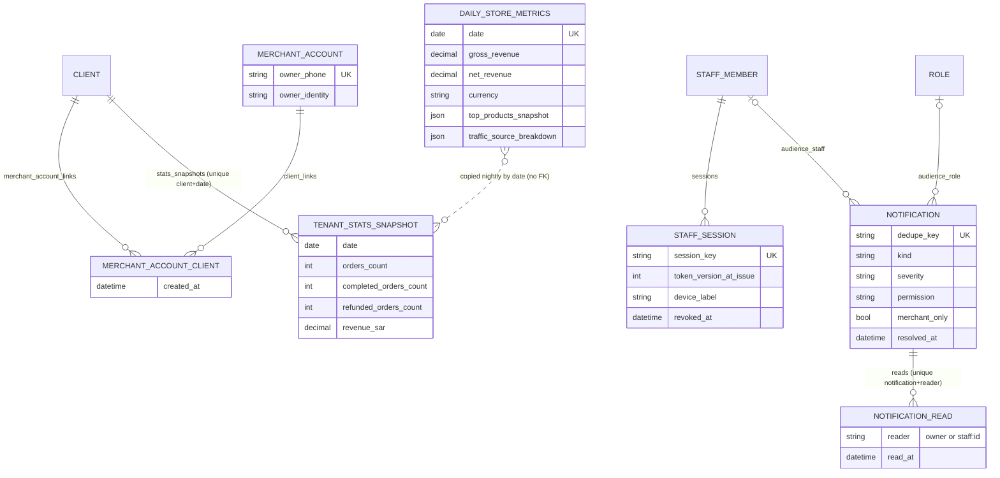
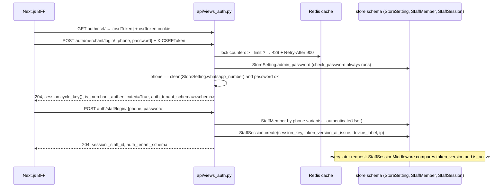

# Data model — Domain 2: dashboard shell, auth, search, notifications and multi-store

> **Source**: DOC-482 · inventory Domain 2 · INT-003 (M03), INT-008 (M48), INT-009 (M49), INT-049 (M43)
> **Code**: `sharwa_saas/api/views_auth.py` · `api/views_dashboard.py` · `api/views_search.py` · `api/views_notifications.py` · `api/views_rollup.py` · `products/services/dashboard_service.py` · `products/services/search_service.py` · `products/services/notification_service.py` · `products/models/notifications.py` · `products/models/staff_sessions.py` · `products/models/reports.py` (`DailyStoreMetrics`) · `tenants/models.py` (`MerchantAccount`, `MerchantAccountClient`, `TenantStatsSnapshot`) · `tenants/merchant_rollup.py` · `products/middleware.py` (`StaffSessionMiddleware`) · `api/authentication.py` · `sharwa-frontend/src/features/{dashboard-shell,command-palette,notifications,stores-rollup}/`
> **Last verified against code**: 2026-10-28 (step 37)

## 1. Purpose

Domain 2 is the frame around every merchant screen: how the owner or a staff member signs in, what the top bar and side bar show (counters, notification bell, ⌘K search, store switcher), and the first screen a merchant sees (the overview). It owns:

- **Auth** (M03): owner login, first password, password recovery by WhatsApp code, staff login with a `StaffSession` row, logout, `GET /api/v1/auth/me/`, CSRF token.
- **Overview and counters** (M03): `GET /api/v1/dashboard/overview/`, `POST .../overview/refresh/`, `GET .../counters/`.
- **Command palette search** (M48): `GET /api/v1/search/`.
- **Notification centre** (M49): `GET /api/v1/notifications/`, `.../summary/`, `POST .../<id>/read/`, `.../read-all/`.
- **Multi-store roll-up** (M43): `GET /api/v1/merchant/stores/`.

This page lists the models these routes read and write, the schema each lives in, the rules each provider enforces, the legacy HTML views kept, the tests and the migrations. It does not describe the permission catalogue ([`31-authorization.md`](../31-authorization.md)), the store resolution chain ([`10-multi-tenancy.md`](../10-multi-tenancy.md)), or the registration flow ([`01-public-onboarding.md`](01-public-onboarding.md)).

Two facts shape the whole domain:

1. **The owner has no user row.** Owner login checks `StoreSetting.admin_password` and sets two session keys; only staff have a Django `User` and a `StaffSession`.
2. **There is no search index, no customer model and no notification writer outside `sync()`.** Search is `lower(translate(...))` over live tables, customers are phone groups of orders, and notifications are derived rows created by a throttled synchronisation.

## 2. Components

### 2.1 Provider table (file → what it owns)

| File | Owns |
|---|---|
| `api/views_auth.py` | `CsrfTokenView`, `MerchantLoginView`, `MerchantSetupPasswordView`, `StaffLoginView`, `MerchantForgotPasswordView`, `MerchantResetPasswordView`, `LogoutView`, `MeView`; helpers `rotate_staff_session`, `_phone_candidates`, `_staff_login_rate_keys`, `_enabled_features`, `_staff_context`; staff-login constants (`:220-223`) and reset constants (`:355-363`) |
| `api/views_dashboard.py` | `DashboardAPIMixin.viewer()` (owner pinned to this store, or `request.staff`, else `401`), `DashboardOverviewView`, `DashboardOverviewRefreshView`, `DashboardCountersView`; imports `REFRESH_COOLDOWN_SECONDS` and `REFRESH_PERMISSION` from `api/views_reports.py` |
| `products/services/dashboard_service.py` | `Viewer`, `overview()`, `counters()`, `attention()`, `today_row()`, `today_payload()`, `refresh_today()`, `top_products()`, `traffic_sources()`, `new_orders()`, `pending_approvals()`, `unread_alerts()`, `unread_conversations()`, `low_stock()`; limits `NEW_ORDERS_LIMIT = 8`, `TOP_PRODUCTS_LIMIT = 5`, the nine `TRAFFIC_SOURCES` (`:44-49`) |
| `products/services/reports_aggregation.py` | `save_daily_metrics(date)` (upsert of `DailyStoreMetrics`), `compute_day_metrics`, `_day_bounds` (`:27`) — shared with the reports screen (M25) |
| `products/services/product_service.py` | `low_stock_count()` (`:159-162`): non-archived products matching `_low_q()`; the same number as the products strip |
| `api/views_search.py` + `products/services/search_service.py` | `PaletteSearchView`; `normalize_arabic`, `normalized()`, `parse_query`, `is_searchable`, `parse_limit`, `parse_types`, `search_orders`, `search_products`, `search_customers` |
| `products/models/notifications.py` | `Notification`, `NotificationRead` |
| `products/services/notification_service.py` | `sync()`, the ten source functions (`SOURCES`, `:270`), `visible()`, `with_read_state()`, `summary()`, `list_notifications()`, `serialize()`, `mark_read()`, `mark_all_read()`, `reader_key()` |
| `api/views_notifications.py` | `NotificationSummaryView`, `NotificationListView`, `NotificationReadView`, `NotificationReadAllView` |
| `tenants/merchant_rollup.py` | `rollup(schema_name, params)`, `date_range()`, `_account_for()` |
| `api/views_rollup.py` | `MerchantStoresView` (owner only, `Cache-Control: no-store`) |
| `tenants/models.py` | `MerchantAccount`, `MerchantAccountClient`, `TenantStatsSnapshot` |
| `products/models/staff_sessions.py` | `StaffSession` (and `PersonalAccessToken`, `TrustedDevice`, `RosterSchedule` of the same file, used by staff login only through `roster_allows`) |
| `products/models/reports.py` | `DailyStoreMetrics` (and `ReportExportJob`, used by the `export_ready` notification) |
| `products/middleware.py` | `StaffSessionMiddleware`: fills `request.staff` or flushes a ghost session |
| `api/authentication.py` | `MerchantSessionAuthentication` + `MerchantSessionUser`: recognises an owner or staff session and enforces CSRF |
| `api/permissions.py` | `HasTenantContext`: `403` on the `public` schema |
| `products/views/auth_security.py` | legacy `merchant_login`, `merchant_logout`, `setup_admin_password`, `forgot_password`, `reset_password`; the shared lockout constants `MERCHANT_LOGIN_MAX_FAILURES_PER_PHONE = 5`, `..._PER_IP = 20`, `MERCHANT_LOGIN_LOCKOUT_WINDOW_SECONDS = 900` (`:143-145`) |
| `tenants/provisioning.py` | `setup_token_matches` (used by `MerchantSetupPasswordView`) |
| `products/tasks/reports.py` | `compute_daily_store_metrics`, `compute_all_tenants_daily_metrics`, `populate_tenant_stats_snapshot_for_tenant`, `populate_tenant_stats_snapshot` — the writers of the two metric tables |
| `config/settings.py` | `CELERY_BEAT_SCHEDULE` entries `compute-all-tenants-daily-metrics` (`crontab(hour=0, minute=10)`) and `populate-tenant-stats-snapshot` (`crontab(hour=0, minute=40)`) (`:744-753`); `TIME_ZONE = 'Asia/Riyadh'` (`:371`) |
| `api/urls.py` | routes `auth/*` (`:216-223`), `dashboard/*` (`:226-228`), `search/` (`:177`), `notifications/*` (`:180-183`), `merchant/stores/` (`:215`) |

### 2.2 Authorisation model per route

| Route | Authentication | Who may call | Failure |
|---|---|---|---|
| `GET auth/csrf/` | none | anyone | — |
| `POST auth/merchant/login/`, `auth/staff/login/`, `auth/merchant/setup-password/`, `auth/merchant/forgot-password/`, `auth/merchant/reset-password/` | none (CSRF enforced by `_enforce_csrf`, `throttle_classes = []`) | any visitor on a store host | `403` CSRF; `HasTenantContext` → `403` on the `public` schema |
| `POST auth/logout/`, `GET auth/me/` | `MerchantSessionAuthentication` | owner or staff session | `me` → `401` «انتهت جلستك، سجّل الدخول مجدداً.»; `logout` answers `204` even without a session |
| `dashboard/overview/`, `dashboard/counters/` | `MerchantSessionAuthentication` | owner pinned to this store (`is_merchant_authenticated` and `auth_tenant_schema` in `(None, this schema)`) or staff | `401` |
| `POST dashboard/overview/refresh/` | same | owner, or staff with `reports.sales.view` | `403` «ليست لديك صلاحية لهذا الإجراء.»; `429` «يمكنك التحديث مرة كل 5 دقائق فقط للحفاظ على الأداء.» |
| `GET search/`, `notifications/*` | `MerchantSessionAuthentication` + `ProductsAPIMixin.gate()` | owner or any active staff session; groups and rows are then trimmed by permission | `401` |
| `GET merchant/stores/` | same | **owner only**; staff → `403` «هذه الصفحة لمالك المتجر فقط.» | `401` without a pinned owner session |

Note: `ProductsAPIMixin.gate()` (`api/views_products.py:72-79`) checks `session.get('is_merchant_authenticated')` or `request.staff`, whereas `DashboardAPIMixin.viewer()` and `MeView` also require `auth_tenant_schema` to be unset or equal to the current schema. Sessions live in a per-store `django_session` table (`django.contrib.sessions` is in both `SHARED_APPS` and `TENANT_APPS`), so a session cookie from store A has no row in store B.

### 2.3 Legacy HTML views kept

None of the Django screens were removed. They share state with the API (same session keys, same lockout counters, same `StaffSession` table):

| Route (store host) | View | Status |
|---|---|---|
| `/dashboard/login/` | `merchant_login` (`products/views/auth_security.py:162`) | kept; the API login is the JSON twin and shares the cache counters `rl:<schema>:merchant_login:phone:<phone>` / `...:ip:<ip>`, so the lock cannot be bypassed by switching between screens |
| `/dashboard/setup-password/`, `/dashboard/forgot-password/`, `/dashboard/reset-password/`, `/dashboard/logout/` | `setup_admin_password`, `forgot_password`, `reset_password`, `merchant_logout` | kept; the API versions keep the Arabic message and the WhatsApp text of the Django ones |
| `/dashboard/staff/login/`, `/dashboard/staff/logout/` | `staff_login_view`, `staff_logout_view` | kept; the API adds CSRF, the 15-minute lock and `auth_tenant_schema` pinning that the old screen lacked (docstring of `StaffLoginView`) |
| `/dashboard/` | `dashboard_home` | kept; the Django-era overview |
| `/merchant/master-dashboard/` | `merchant_master_dashboard` (`tenants/views.py:313`, route `config/urls_tenant.py:292`) | **kept untouched**; the API roll-up reads the same table (see §4.5) |

### 2.4 Tests

Counts are the number of `def test_` methods in each file as staged on 2026-10-28; the four files named in the roadmap exist (22 + 7 + 7 + 4 = 40 tests).

| File | Tests | Covers |
|---|---|---|
| `api/test_dashboard_api.py` | 22 | `StaffLoginApiTests` (8): normalised phone logs in and opens a `StaffSession`; local formats; re-login rotates the session; wrong password and unknown phone share one message; missing fields; inactive staff `403` only with the right password; lockout blocks even the right password; a previous owner flag is not inherited. `ForgotResetApiTests` (8): forgot matches the contract; reset with the right code sets the password and signs in; unknown token is expired; wrong code is a field error then locks; weak password keeps the code usable; mismatched confirmation; send limit and send failure; store without a password is `setup_required`. `DashboardApiTests` (6): anonymous `401`; owner overview matches the contract; today's snapshot feeds top products and traffic; new orders block and counter agree; refresh returns `today` and shares the reports cooldown (`429`, `Retry-After: 300`); staff without permissions sees empty blocks |
| `api/test_search_api.py` | 7 | `PaletteSearchTests`: normaliser matches the frontend rules; anonymous `401`; short query returns empty groups; groups shape and Arabic normalisation; phone search and limit; `types` limits groups; groups are trimmed by permission |
| `api/test_notifications_api.py` | 7 | `NotificationApiTests`: anonymous `401`; sources, summary and list shape; read and read-all; resolution and reopen; old orders and the panel window; staff trimming and independent reads; provisioning notice for an empty store |
| `api/test_rollup_api.py` | 4 | `RollupTests` (`TenantTestCase`): owner only (`401`, staff `403`, another store's session refused); contract with the default range (order by revenue, stranger store excluded, display strings, totals); reversed and invalid range; unavailable store keeps numbers, and a store without a link gives `has_account: false` |

Related tests elsewhere: `api/test_onboarding_api.py::SetupPasswordApiTests` (first password: valid token, second use refused, forged or foreign token `403`, password rules); the reports screen tests for the shared refresh endpoint are on the reports page.

## 3. Data model

### 3.1 Models

Schema placement evidence: `SHARED_APPS` includes `tenants` (so `MerchantAccount`, `MerchantAccountClient`, `TenantStatsSnapshot` are in `public`); `TENANT_APPS` includes `products` and `api` (so every `products` model below is created in **each store schema**) (`config/settings.py:121-160`).

| Model | Schema (public/store) | Key fields | Constraints / indexes | Added or changed by |
|---|---|---|---|---|
| `products.StaffSession` | store | `staff` FK → `StaffMember` (`CASCADE`, `related_name='sessions'`), `session_key` (≤ 64), `token_version_at_issue` (copy of `StaffMember.token_version`), `device_fingerprint` (≤ 100, SHA-256 of the user agent cut to 40 chars), `device_label` (≤ 100, default `''`), `ip_address`, `created_at`, `last_seen_at` (`auto_now`), `revoked_at` | `session_key` **unique**; ordering `-created_at`; one row per successful staff login | `products/0145_staff_sessions` (created); `products/0223_staff_api` (`device_label`) |
| `products.DailyStoreMetrics` | store | `date`, `orders_count`, `completed_orders_count`, `cancelled_orders_count`, `refunded_orders_count`, `gross_revenue` and `net_revenue` (`Decimal(14,2)`), `currency` (default `SAR`), `top_products_snapshot` (JSON list `{product_name, total_sold, revenue}`), `traffic_source_breakdown` (JSON dict `{source: orders}`), `computed_at` (`auto_now`) | **unique `date`** (`unique_daily_store_metrics_date`); `date` indexed; ordering `-date` | `products/0168_dailystoremetrics` |
| `tenants.MerchantAccount` | public | `owner_phone` (≤ 20), `owner_identity` (free text), `created_at` | `owner_phone` **unique** + indexed | `tenants/0023_merchantaccount_merchantaccountclient` |
| `tenants.MerchantAccountClient` | public | `account` FK (`CASCADE`, `related_name='client_links'`), `client` FK → `Client` (`CASCADE`, `related_name='merchant_account_links'`), `created_at` | unique `(account, client)` `unique_merchant_account_client` | `tenants/0023_merchantaccount_merchantaccountclient` |
| `tenants.TenantStatsSnapshot` | public | `client` FK (`CASCADE`, `related_name='stats_snapshots'`), `date`, `orders_count`, `completed_orders_count`, `refunded_orders_count`, `revenue_sar` (`Decimal(14,2)`), `created_at` | unique `(client, date)` `unique_tenant_stats_day`; `date` indexed | `tenants/0019_tenant_stats_snapshot` |
| `products.Notification` | store | `kind` (≤ 40), `severity` (`info`/`warning`/`critical`), `title` (≤ 200), `body` (≤ 500), `link` (≤ 300, a `/dashboard/...` path), `group_key` (≤ 120), `count` (default 1), `source_type`, `source_id`, `dedupe_key` (≤ 160), `permission` (≤ 80, empty = any member), `merchant_only`, `audience_role` FK → `Role` (`CASCADE`, null), `audience_staff` FK → `StaffMember` (`CASCADE`, null), `created_at` (default now), `resolved_at` | `dedupe_key` **unique**; indexes on `kind`, `group_key`, `created_at`, `resolved_at`; composite `notif_resolved_created_idx` `(resolved_at, created_at)`; ordering `-created_at, -id` | `products/0216_notifications` |
| `products.NotificationRead` | store | `notification` FK (`CASCADE`, `related_name='reads'`), `reader` (≤ 40: `owner` or `staff:<id>`), `read_at` | unique `(notification, reader)` `notification_read_once_per_reader` | `products/0216_notifications` |

Models read (and sometimes written) by this domain but owned by other domains:

| Model | Schema | Used for |
|---|---|---|
| `products.StoreSetting` | store | owner credential and recovery: `admin_password` (hashed, null until set), `whatsapp_number` (the number that receives the recovery code and is compared at login), `store_name`; `timezone` (default `Asia/Aden`, `products/0170_storesetting_timezone_storesetting_week_start_day`) for day bounds |
| `products.StaffMember`, `Role`, `StaffLocationRole`, `RosterSchedule` | store | staff login (`phone`, `user`, `is_active`, `token_version`, `enforce_roster_schedule`), roles for the approval audience, roster check `roster_allows` |
| `django.contrib.auth.User` (staff only) | store (auth is in both app lists) | `authenticate()` for staff; the owner never has one (`MerchantSessionUser` docstring, `api/authentication.py:22-28`) |
| `django.contrib.sessions.Session` | store (and public) | the cookie session carrying `is_merchant_authenticated`, `auth_tenant_schema`, `_staff_id` |
| `products.Order`, `Product`, `ApprovalRequest`, `BehaviorAlert`, `Conversation` | store | overview, counters, search and notification sources |
| `tenants.Client`, `Domain` | public | roll-up rows (name, schema, primary domain, availability) — see [`01-public-onboarding.md`](01-public-onboarding.md) |

### 3.2 ER sketch



`CLIENT` (public) and `STAFF_MEMBER` / `ROLE` (store) belong to other pages; the dotted line between `DAILY_STORE_METRICS` (store schema) and `TENANT_STATS_SNAPSHOT` (public schema) is a data copy by date, not a foreign key (a foreign key across schemas is not possible, see [`13-cross-schema-access.md`](../13-cross-schema-access.md)).

## 4. Flows

### 4.1 Owner and staff sign-in, session state



Owner login (`MerchantLoginView`, `views_auth.py:91-152`):

- Missing fields → `400` `{phone: [«أدخل رقم الهاتف.»], password: [«أدخل كلمة المرور.»]}`.
- No `StoreSetting.admin_password` yet → `409` with `code: "setup_required"` and the message `SETUP_REQUIRED_ERROR` (`:61`).
- The lock is checked **before** the password, so a right password is refused during a lock: `429` «تم تجاوز عدد محاولات الدخول المسموح بها. يرجى المحاولة بعد 15 دقيقة.» + `Retry-After: 900`. Limits: 5 failures per phone, 20 per IP, window 900 s (shared with the Django screen).
- Wrong phone or password → one message for both: `400` «رقم الهاتف أو كلمة المرور غير صحيحة.» (`check_password` always runs to keep timing equal).
- Success → `204`, `session.cycle_key()` (no session fixation), `is_merchant_authenticated = True`, `auth_tenant_schema = connection.schema_name`.

Staff login (`StaffLoginView`, `:272-350`):

- The phone is matched against equivalent forms (`_phone_candidates`: as typed, cleaned `967…`, local `7…` and `07…`) on `StaffMember.phone` with a linked `User`.
- Counters `rl:<schema>:staff_login:phone:<phone>` (5) and `...:ip:<ip>` (20), window 900 s; unknown phone runs a dummy hash check for equal timing.
- A wrong password or unknown phone → `400` with the same text as the owner. An inactive account → `403` «هذا الحساب غير مفعّل، تواصل مع مدير المتجر.» only **after** a correct password (no account enumeration). Outside the roster (`roster_allows`, store timezone) → `403` «الدخول خارج أوقات جدول عملك غير مسموح — تواصل مع مدير المتجر.».
- On success: a previous owner flag in the same browser is removed, `rotate_staff_session()` revokes the `StaffSession` bound to the old key and cycles the key, `login()` runs, `_staff_id` and `auth_tenant_schema` are stored and a `StaffSession` is created with `token_version_at_issue = staff.token_version`.
- Every later request: `StaffSessionMiddleware` (`products/middleware.py`) finds the unrevoked `StaffSession` for the key and sets `request.staff` only if `staff.is_active` and `token_version_at_issue == staff.token_version`; otherwise it flushes the session. This is how a role change or a deactivation ends a session without a block list.

First password (`MerchantSetupPasswordView`, `:155-217`): `409` `already_set` once `admin_password` exists; limit 10 attempts per IP per 900 s; `403` `setup_token_invalid` unless `setup_token_matches(token, schema)`; password rules from `validate_password_strength`; mismatch → `password_confirm` error; success → `204` and an owner session. The token comes from the registration status route (see [`11-provisioning.md`](../11-provisioning.md)).

Password recovery (`:355-490`), all keys prefixed with the schema:

| Constant | Value |
|---|---|
| `RESET_OTP_TTL_SECONDS` | 600 (cache entry `auth:reset:<schema>:<token>` holds `code_hash`, `expires_at`, `phone`) |
| `RESET_SENDS_PER_PHONE` / `RESET_SEND_WINDOW_SECONDS` | 3 per 600 s (`429` via `too_many`) |
| `RESET_VERIFY_FAILURES` / `RESET_LOCK_SECONDS` | 3 wrong codes → lock 600 s and the request is invalidated |
| Messages | «انتهت صلاحية الرمز، اطلب رمزاً جديداً.» · «الرمز غير صحيح.» · «تعذّر إرسال رمز التحقق إلى رقم واتساب المتجر. حاول مرة أخرى.» · «لا يوجد رقم واتساب مسجَّل لهذا المتجر. تواصل مع الدعم.» |

The code always goes to the store's registered WhatsApp number, so the UI never sends a phone. A weak password does not consume the code. In `DEBUG`, the code is logged instead of sent and `DEBUG_STATIC_OTP` is accepted (same rule as registration).

`GET auth/me/` returns `{kind: "merchant" | "staff", store_name, store_host, features[], staff?}` where `features` are the codes for which the plan engine says enabled (`FeatureFlags`, see [`15-plans-and-features.md`](../15-plans-and-features.md)) and `staff = {full_name, roles[], permissions[] (sorted), locations[{id, name}]}` from active `StaffLocationRole` rows.

`LogoutView` marks the staff's `StaffSession` for that key `revoked_at = now` and calls `session.flush()`.

### 4.2 Overview, counters and refresh

`overview(viewer, request)` (`dashboard_service.py:225-234`) returns `{today, new_orders, attention, top_products, traffic_sources}`:

| Block | Source | Permission for staff (owner sees all) | Without the permission |
|---|---|---|---|
| `today` | the `DailyStoreMetrics` row of `timezone.localdate()`; computed once on first open of the day with `save_daily_metrics` (the only live-computation exception; failure is logged and the block is zeros) | `reports.sales.view` | zero counts, `display_*` = `format_money(0, "SAR")`, `refreshed_at: null` |
| `top_products` | `row.top_products_snapshot[:5]`, id/image looked up by exact product name; a deleted or renamed product shows a negative id (`-(index+1)`) | `reports.sales.view` | `[]` |
| `traffic_sources` | `row.traffic_source_breakdown` merged into the nine keys `tiktok, whatsapp, instagram, snapchat, facebook, telegram, amazon, noon, direct` (all default 0) | `reports.sales.view` | all zeros |
| `new_orders` | `Order.status == "new"`, newest first, **8** rows | `orders.view` | `[]` |
| `attention.pending_approvals` | `ApprovalRequest.status == "pending"`; for staff only those whose `approver_role` the staff holds through an active `StaffLocationRole` | role-based (no permission key) | 0 |
| `attention.unread_behavior_alerts` | unread `BehaviorAlert` split `{warning, critical}` | `staff.view` | `{warning: 0, critical: 0}` |
| `attention.low_stock_products` | `product_service.low_stock_count()` | `inventory.view` | 0 |
| `attention.unread_conversations` | `Conversation.unread_count > 0` (count of conversations) | `channels.inbox.access` | 0 |

`counters(viewer)` returns `{new_orders, unread_conversations, pending_approvals, unread_behavior_alerts}` with the same rules; `unread_behavior_alerts` is `warning + critical` (a number, unlike the object in `attention`). Both `GET`s answer `Cache-Control: no-store`.

`POST dashboard/overview/refresh/` (`views_dashboard.py:58-74`):

- needs `reports.sales.view` for staff (the owner always passes);
- takes `cache.add("reports:refresh-today:<schema>", now, 300)`: the **same key and 300 s window** as `ReportRefreshTodayView` (`api/views_reports.py:134-135`, `REFRESH_COOLDOWN_SECONDS = 300`), so opening both screens does not double the load; a second call inside the window → `429` + `Retry-After: 300`;
- recomputes today's row with `save_daily_metrics(timezone.localdate())` and returns only the `today` block with the new `refreshed_at` (`computed_at`).

The cooldown key is taken before the computation, so a refresh that fails still consumes the window.

### 4.3 Command palette search

`GET /api/v1/search/?q=&types=orders,products,customers&limit=5` returns `{orders, products, customers, pages, actions}`; `pages` and `actions` are always `[]` (the frontend owns that index).

| Rule | Value | Code |
|---|---|---|
| Minimum query | ≥ 2 characters after removing `#` and spaces; shorter → five empty groups, no query | `MIN_QUERY_CHARS = 2`, `is_searchable` (`search_service.py:25, 69-70`) |
| Limit | default 5, clamped to 1..10 | `DEFAULT_LIMIT = 5`, `MAX_LIMIT = 10`, `parse_limit` |
| Types | `orders`, `products`, `customers`; absent = all; unknown names ignored | `TYPES`, `parse_types` |
| Normalisation | input normalised in Python (`normalize_arabic`: أ/إ/آ/ٱ→ا, ة→ه, ى→ي, ؤ→و, ئ→ي, diacritics and tatweel removed, Arabic-Indic digits → Western, lower-case); the column is normalised inside PostgreSQL with `lower(translate(col, FROM, TO))` | `normalized()` (`:54-59`) |
| Index / migration | none; results are bounded by `limit` | module docstring (`:9-10`) |
| Orders | needs `orders.view`; match on normalised `customer_name`, or exact `id` when the query is all digits, or `customer_phone` contains the digits (≥ 4 digits, leading zeros stripped); newest first | `search_orders` |
| Products | any active member (no permission key in this contract); normalised `name`/`name_en`, or `sku`/`barcode` `icontains`; **archived products last** (`archived_at ASC NULLS FIRST`, then `-updated_at`, `-id`) | `search_products` |
| Customers | needs `customers.view`; there is no customer model here: groups of `Order.customer_phone` with `orders_count` and name from the latest order; phone search when ≥ 3 digits (leading zeros stripped), otherwise by normalised name | `search_customers` |
| Logging | the query text is not logged (FR-48.12) | `views_search.py` docstring |

### 4.4 Notification centre

```mermaid
sequenceDiagram
  participant B as Bell / notifications page
  participant V as views_notifications.py
  participant C as Redis cache
  participant N as notification_service
  participant DB as store schema

  B->>V: GET notifications/summary/ (or list)
  V->>N: sync()
  N->>C: cache.add notifications:sync:<schema> (20 s)
  alt window free
    loop 10 source functions
      N->>DB: upsert Notification by dedupe_key; resolve_missing(kind)
    end
  else inside 20 s
    N-->>V: skip
  end
  V->>N: summary(viewer) / list_notifications(viewer, params)
  N->>DB: visible(viewer) + NotificationRead of this reader
  V-->>B: {unread_total, by_kind, has_critical} / {count, next, previous, results[]}
```

**Generation** (`sync()`, `:273-286`): at most once per `SYNC_INTERVAL = 20` seconds per store (cache key `notifications:sync:<schema>`), and only when a summary or a list is read. Each source function is wrapped in `try/except`: one failing source is logged and does not stop the others. Every row is an `upsert` keyed by `dedupe_key`; a changed field is updated in place.

The ten source functions create these `kind` values (windows: new orders `ORDER_NEW_WINDOW = 72 h`, events `EVENT_WINDOW = 30 days`, expiry warning `EXPIRY_WARNING = 7 days`; each query reads at most 200 rows, sync jobs and exports 50):

| Function | `kind` / severity | `dedupe_key` | Audience | State |
|---|---|---|---|---|
| `_orders` | `order_new` / info | `order_new:<order id>` | permission `orders.view` | stateful: resolved when the order is no longer `new` or is older than 72 h |
| `_orders` | `payment_review` / warning | `payment_review:<order id>:<status>` (`awaiting_payment`, `payment_review`) | `orders.view` | stateful |
| `_approvals` | `approval_pending` / warning | `approval:<id>` | `audience_role` = the approver role | stateful |
| `_behavior` | `behavior_alert` / `warning` or `critical` | `behavior:<id>` | `staff.view` | stateful |
| `_inbox` | `inbox_unread` / info | `inbox:<conversation id>` | `channels.inbox.access` | stateful, `reopen_if_newer` |
| `_low_stock` | `low_stock` / warning | `low_stock:<product id>` | `inventory.view` | stateful |
| `_sync_jobs` | `sync_failed` / warning | `sync_failed:marketplace:<job>` / `sync_failed:supplier:<job>` | `channels.marketplaces.manage` / `channels.dropshipping.manage` | event (not resolved) |
| `_awb` | `awb_failed` / warning | `awb_failed:<queue id>` | `orders.view` | stateful |
| `_exports` | `export_ready` / info or warning | `export:<job id>:<status>` | `reports.export`; `audience_staff` = the requester; owner-only when `requested_by` is empty | event |
| `_billing` | `billing_notice` / critical or warning | `billing:suspended:<app>` / `billing:expiring:<app>:<date>` | `merchant_only` | stateful |
| `_provisioning` | `provisioning_notice` / info | `provisioning:ready` | `merchant_only` | event; only for a `ready` store with no product and no previous notice |

Eleven `kind` values come from ten functions (`_orders` writes two). The code-level tracing of each kind to its writer is also the subject of the timelines and notifications architecture page ([`../46-timelines-and-notifications.md`](../46-timelines-and-notifications.md)).

**State rules**: a stateful kind whose source disappears gets `resolved_at = now` (`resolve_missing`); a resolved row whose source becomes active again is **reopened**: `resolved_at = None`, `created_at` reset, and all its `NotificationRead` rows deleted, so it is unread again for everyone (FR-49.11). `inbox_unread` also reopens when a newer message arrives.

**Reading** is per reader: `reader_key(staff)` is `owner` or `staff:<id>`; `NotificationRead` is unique per `(notification, reader)`. A row counts as read when this reader has a read row **or** `resolved_at` is set (`Coalesce(own_read_at, resolved_at)`).

**Visibility** (`visible(viewer)`): the owner sees everything except rows addressed to one staff member (`audience_staff` set). A staff member sees rows that are not `merchant_only`, whose `audience_staff` is empty or themselves, whose `permission` is empty or held, and whose `audience_role` is empty or one of their active roles. A hidden row marked read returns `404` «الإشعار غير موجود.».

**Responses**: `summary` → `{unread_total, by_kind, has_critical}`, where `by_kind` sums the `count` column (grouped rows count their `count`), not the number of rows. `list` → `{count, next, previous, results[{id, kind, severity, title, body, link, group_key, count, created_at, read_at, source_ref}]}`; default window **30 days** (`PANEL_DAYS`), `history=1` removes the window, `unread=1` and `kind=a,b` filter, page size default 30, max 50; unread `billing_notice` and `provisioning_notice` rows are pinned first (`SYSTEM_KINDS`). `POST .../read/` → `{read_at}` (idempotent `get_or_create`); `POST .../read-all/` `{kind?}` → `{updated}` through one `bulk_create(..., ignore_conflicts=True)`.

### 4.5 Multi-store roll-up (M43)

`GET /api/v1/merchant/stores/?from=YYYY-MM-DD&to=YYYY-MM-DD` (`MerchantStoresView`) → `{has_account, current_schema, from, to, stores[{name, schema, domain, orders, completed, refunded, display_revenue_sar, last_snapshot_date, is_available}], totals{orders, completed, refunded, display_revenue_sar}}`.

Computation (`tenants/merchant_rollup.py:74-143`), all inside `schema_context('public')`:

1. **Range** (`date_range`, `:43-47`): `to` = parsed `to` or `timezone.localdate()`; `from` = parsed `from` or `to - 29 days` (default **last 30 days inclusive**); an invalid date falls back to the default; a **reversed** range is swapped; the applied range is echoed back in `from`/`to`.
2. **Account** (`_account_for`, `:50-60`): the `MerchantAccount` linked to the current `Client` through `MerchantAccountClient`; if several, the one whose `owner_phone` equals the store's `merchant_phone` (raw or cleaned) is preferred, else the lowest id. No account → `has_account: false`, empty `stores`, zero totals (`_empty`).
3. **Stores**: every `Client` linked to that account (`distinct`, domains prefetched).
4. **Per store, in range**: one grouped query sums `orders_count`, `completed_orders_count`, `refunded_orders_count`, `revenue_sar` of `TenantStatsSnapshot` rows with `date` between `from` and `to`; one more query gets `Max(date)` over **all** the store's snapshots as `last_snapshot_date` (so it can fall outside the range). The number of queries does not grow with the number of stores.
5. **Row**: `domain` = primary domain, else the first, else `"#"`; `is_available` = `is_active` **and** `provisioning_status == "ready"`; an unavailable store keeps its numbers visible.
6. **Sort**: revenue descending, then name.
7. **Totals** are summed by the server; money is `format_money(Decimal, 'SAR')` (e.g. `100.50 ر.س`), so the response carries display strings, not numbers.

> ⚠️ Discrepancy — roadmap says "range default last 30 days **in store timezone**" / code does: `date_range()` calls `timezone.localdate()` with no store lookup, so "today" is the Django active time zone, which is `TIME_ZONE = 'Asia/Riyadh'` (`config/settings.py:371`) — nothing in the codebase calls `timezone.activate` (searched under `sharwa_saas/`) and `StoreSetting.timezone` (default `Asia/Aden`) is not read here (`tenants/merchant_rollup.py:43-47`). Both zones are UTC+3, so the dates agree today. Reported in step 37.

Legacy HTML `merchant/master-dashboard/` (`tenants/views.py:313-376`) was left untouched. Differences from the API:

| Aspect | Legacy HTML | API |
|---|---|---|
| Auth | session flag `is_merchant_authenticated`, else redirect to `merchant_login` | owner pinned to this store; staff `403`; no session `401` |
| Account lookup | `MerchantAccount.owner_phone == Client.merchant_phone` (exact) | link table first, phone match preferred |
| Period | all snapshots, no range | date range, default 30 days |
| Per store | orders and revenue | + completed, refunded, last snapshot date, availability |
| Totals | orders, revenue, completed | orders, completed, refunded, revenue |

### 4.6 Who writes the metric tables

| Table | Writer | Schedule / trigger | Notes |
|---|---|---|---|
| `DailyStoreMetrics` | `compute_all_tenants_daily_metrics` → one `compute_daily_store_metrics(schema_name)` per ready store (`_fan_out_per_tenant` skips `public` and non-`ready` stores) | Beat `crontab(hour=0, minute=10)` | computes **yesterday** in the store's own timezone (`ZoneInfo(StoreSetting.timezone)`), day bounds from `_day_bounds` |
| `DailyStoreMetrics` | `save_daily_metrics(today)` | first overview of the day; `POST dashboard/overview/refresh/`; `POST reports/refresh-today/` | upsert by `date` |
| `TenantStatsSnapshot` | `populate_tenant_stats_snapshot` → `populate_tenant_stats_snapshot_for_tenant(schema_name)` | Beat `crontab(hour=0, minute=40)` (30 minutes after the metrics) | copies **every** `DailyStoreMetrics` row of the store: `orders_count`, `completed_orders_count`, `refunded_orders_count` and `revenue_sar = convert_amount(gross_revenue, currency, "SAR", store_setting)`; `update_or_create(client, date)` |
| `MerchantAccount`, `MerchantAccountClient` | none found | see §9 | no view, admin registration or management command in the files read creates them |

Task limits: per-store tasks `TENANT_TASK_LIMITS = {'soft_time_limit': 300, 'time_limit': 360}`; dispatchers `DISPATCHER_TASK_LIMITS = {'soft_time_limit': 120, 'time_limit': 180}` (`products/tasks/_common.py:28, 31`).

## 5. Invariants

| Invariant | Enforced by |
|---|---|
| The owner has no `User`; the owner session is `is_merchant_authenticated` + `auth_tenant_schema` | `MerchantLoginView`, `MerchantSetupPasswordView`, `MerchantResetPasswordView` |
| A session is rotated at every sign-in (no fixation) | `session.cycle_key()`; `rotate_staff_session()` also revokes the old `StaffSession` |
| One `StaffSession` per session key | `StaffSession.session_key` unique; the 2026-10-24 fix in `rotate_staff_session` prevents a duplicate-key `500` on re-login from an authenticated browser |
| A staff session dies when the staff is deactivated or their `token_version` changes | `StaffSessionMiddleware` compares both on every request, flushes otherwise |
| Owner and staff lockouts are counted in the cache, shared with the Django screens | `rl:<schema>:merchant_login:*` and `rl:<schema>:staff_login:*`, 900 s; the lock is checked before the password |
| Login errors do not reveal whether the phone exists | one message for wrong phone/password; inactive-account `403` only after a correct password; dummy hash for unknown staff |
| CSRF is enforced on sign-in, logout and every authenticated unsafe request | `_enforce_csrf` in login views; `MerchantSessionAuthentication.enforce_csrf` elsewhere |
| One `DailyStoreMetrics` row per date | unique constraint + `update_or_create` |
| One `TenantStatsSnapshot` per store per day | unique `(client, date)` |
| One link per account and store | unique `(account, client)` |
| One `Notification` per source event | unique `dedupe_key`; `upsert` |
| One read mark per reader and notification | unique `(notification, reader)`; `get_or_create`; `bulk_create(ignore_conflicts=True)` |
| A resolved notification counts as read for everyone; a reopened one is unread again | `Coalesce(own_read_at, resolved_at)`; `upsert` deletes `reads` on reopen |
| A staff member never sees a notification, count or block they cannot open | `visible()`; `Viewer.can()` in `dashboard_service`; permission checks in `views_search.py` |
| The refresh limit is per store, not per session | cache key `reports:refresh-today:<schema>` shared with M25 |
| Roll-up shows only stores of the current account and only to the owner | `_account_for` + link table; `OWNER_ONLY` `403` for staff |
| Roll-up query count does not grow with the number of stores | grouped `values('client').annotate(...)` queries |

## 6. Background work

| Job | Trigger | Queue / limits | Effect |
|---|---|---|---|
| `products.tasks.compute_all_tenants_daily_metrics` → `compute_daily_store_metrics` | Beat `compute-all-tenants-daily-metrics`, `crontab(hour=0, minute=10)` | dispatcher 120/180 s, per store 300/360 s | writes yesterday's `DailyStoreMetrics` row for each ready store |
| `products.tasks.populate_tenant_stats_snapshot` → `..._for_tenant` | Beat `populate-tenant-stats-snapshot`, `crontab(hour=0, minute=40)` | same limits | refreshes `TenantStatsSnapshot` from all `DailyStoreMetrics` rows |
| none for notifications | read-driven `sync()` | | no Celery task creates a `Notification` |

This page names the schedule entries only; the task bodies are in `products/tasks/reports.py`.

## 7. Configuration

| Setting / constant | Value | Where |
|---|---|---|
| `TIME_ZONE` | `Asia/Riyadh` (`USE_TZ = True`) | `config/settings.py:371-373` |
| `StoreSetting.timezone` | default `Asia/Aden` | `products/0170_storesetting_timezone_storesetting_week_start_day` |
| `SESSION_EXPIRE_AT_BROWSER_CLOSE` | `True`; `SESSION_COOKIE_HTTPONLY = True`; `SESSION_COOKIE_SAMESITE` env, default `Lax` | `settings.py:380-391` |
| Lockout (owner and staff) | 5 per phone, 20 per IP, 900 s | `auth_security.py:143-145`, `views_auth.py:220-221` |
| Reset code | 600 s, 3 sends per 600 s, 3 wrong codes → 600 s lock | `views_auth.py:355-359` |
| Refresh cooldown | 300 s (`REFRESH_COOLDOWN_SECONDS`), permission `reports.sales.view` | `api/views_reports.py:45-46` |
| Overview limits | 8 new orders, 5 top products, 9 traffic sources | `dashboard_service.py:44-49` |
| Search limits | min 2 characters, default 5, max 10 | `search_service.py:25-27` |
| Notification sync | `SYNC_INTERVAL = 20` s; `PANEL_DAYS = 30`; `ORDER_NEW_WINDOW = 72 h`; `EVENT_WINDOW = 30 d`; `EXPIRY_WARNING = 7 d`; page size 30 (max 50) | `notification_service.py:36-43` |
| Roll-up default range | 30 days (`DEFAULT_DAYS`), placeholder domain `NO_DOMAIN = '#'` | `merchant_rollup.py:27-28` |
| Cache | Redis DB 0, `KEY_PREFIX = 'sharwa'`; `LocMemCache` only when `DJANGO_TESTING=1` | `settings.py:231-257` |

Migrations of this domain (exact file names):

| App | File | Adds |
|---|---|---|
| `products` | `0145_staff_sessions.py` | `StaffSession`, `PersonalAccessToken`, `TrustedDevice`, `RosterSchedule` |
| `products` | `0168_dailystoremetrics.py` | `DailyStoreMetrics` |
| `products` | `0170_storesetting_timezone_storesetting_week_start_day.py` | `StoreSetting.timezone`, `week_start_day` (day bounds) |
| `products` | `0216_notifications.py` | `Notification`, `NotificationRead` (INT-009) |
| `products` | `0223_staff_api.py` | `StaffSession.device_label` and other staff-API fields (INT-022) |
| `tenants` | `0019_tenant_stats_snapshot.py` | `TenantStatsSnapshot` |
| `tenants` | `0023_merchantaccount_merchantaccountclient.py` | `MerchantAccount`, `MerchantAccountClient` |

No migration for INT-003, INT-008 or INT-049 beyond the above: search has none by design, the overview reads existing tables, and the roll-up reads existing `tenants` tables. INT-009 is `0216_notifications` (the migration number in the roadmap is correct: `products/migrations/0216_notifications.py` depends on `0215_product_main_image_to_gallery`).

## 8. Failure modes and fixes

| Failure | Symptom | Cause | Handling / fix |
|---|---|---|---|
| Owner locked out | `429` + `Retry-After: 900` even with the right password | 5 failures per phone or 20 per IP in 900 s | wait; counters are shared with the Django login |
| New store without a password | `409` `setup_required` on login / forgot | `admin_password` is null | first-password flow with the setup token |
| Staff re-logs in from an authenticated browser | used to be `500` (duplicate `session_key`) | `login()` did not rotate the key | fixed 2026-10-24: `rotate_staff_session()` revokes the old row and cycles the key |
| Ghost staff session | next request flushed | staff deactivated or `token_version` changed | `StaffSessionMiddleware`; the UI treats any non-2xx on `auth/me` as signed out |
| Today's numbers missing | zeros with `refreshed_at: null` | first compute failed (logged) or the staff lacks `reports.sales.view` | `POST .../refresh/` (once per 5 min per store) |
| Refresh refused | `429` | another refresh (overview or reports) in the last 300 s | wait for `Retry-After` |
| Palette finds nothing for a short word | five empty groups | query < 2 characters | by design |
| Customers in search look incomplete | only people who ordered | there is no customer model in the store schema; groups are by phone from orders | by design (`search_service` docstring) |
| Bell number differs from the sidebar | brief mismatch | `sync()` throttled to 20 s | next read after the window; resolved rows count as read so the numbers converge |
| One notification source breaks | other kinds still appear | `try/except` per source; logged `«تعذّرت مزامنة مصدر إشعارات»` | fix the source; no row is lost |
| Roll-up empty | `has_account: false` | the store has no `MerchantAccountClient` link | link rows are created outside the application code (§9) |
| Roll-up numbers lag by a day | yesterday missing until 00:40 | snapshots are copied by Beat | by design |

## 9. Open items

- **No in-code creator for `MerchantAccount` / `MerchantAccountClient`.** A search of the whole staged tree (`api`, `billing`, `marketing`, `products`, `sharwapay`, `tenants`, including `tenants/admin.py`, `tenants/console_service.py` and the `tenants/management/commands/seed_tenants.py` and `migrate_merchant_phone.py` commands) found them only in `tenants/models.py`, `tenants/merchant_rollup.py`, `tenants/views.py` and tests. `tenants/admin.py` registers `Client`, `Domain`, `WhatsAppSessionIndex`, `ChannelSessionIndex`, `WaybillRegistry`, `PendingWebhookEvent` and `PlatformActionLog` but not these models. Until an operator creates the rows by hand (shell or SQL), every store gets `has_account: false`. Needs an owner decision on how accounts are created. Other `tenants/management/commands` files (`migrate_passwords.py`, `generate_sharwa_pay_icons.py`, `sharwa_ai_engine_status.py`) were not read.
- **`aggregate_tenant_stats` is dead code.** `tenants/tasks.py:120-148` still defines an order-based task that writes `TenantStatsSnapshot` (counts and revenue of **completed** orders' `total_price` for today); no `CELERY_BEAT_SCHEDULE` entry names it, and `populate_tenant_stats_snapshot` is the live writer. The two would disagree on revenue basis: the live task uses `DailyStoreMetrics.gross_revenue` converted to SAR (`gross` is "price × quantity of completed order items", `products/models/reports.py`), the dead one `Sum('total_price')`.
- **"Today" key mismatch risk.** The overview reads and writes the row dated `timezone.localdate()` (server time zone `Asia/Riyadh`), while the nightly job and `compute_day_metrics` bound a day by `StoreSetting.timezone` (default `Asia/Aden`). Both are UTC+3 today; a store configured in another zone would see its "today" row keyed by the server date but computed over its own day. Not run; derived from `dashboard_service.today_row` (`:68-78`) and `reports_aggregation._day_bounds` (`:27-40`).
- **`revenue_sar` is gross revenue.** The roll-up's "revenue" is `DailyStoreMetrics.gross_revenue` converted at the store's current exchange rates when the snapshot is refreshed, and every run re-copies all history (`DailyStoreMetrics.objects.order_by("date")`, no date filter), so old days are re-converted with the current rates. Needs an owner decision whether history should be frozen.
- **Different session checks.** `ProductsAPIMixin.gate()` (search, notifications) accepts any session with `is_merchant_authenticated`, whereas the dashboard and `me` also compare `auth_tenant_schema`. Per-store session tables make this safe in practice (§2.2); not tested across stores.
- **Notification `count` semantics.** `unread_total` sums the `count` column; every source function in this file writes `count=1` except where passed otherwise (the default), so the sum equals the row count today. Only `upsert(count=...)` callers could change that; none in the file passes it.
- **Frontend fixtures** for the four features (`src/features/dashboard-shell`, `command-palette`, `notifications`, `stores-rollup`) and their Zod schemas were not opened for this page; the Django docstrings state the contracts are copied literally from them.
- **Legacy `/dashboard/` HTML views** other than login/logout/master dashboard were not enumerated.

## 10. Related pages

- [`10-multi-tenancy.md`](../10-multi-tenancy.md) — schema resolution, `auth_tenant_schema` pinning in the header middleware.
- [`31-authorization.md`](../31-authorization.md) — permission keys used here (`reports.sales.view`, `orders.view`, `inventory.view`, `customers.view`, `channels.inbox.access`, `staff.view`) and `StaffSessionMiddleware`.
- [`13-cross-schema-access.md`](../13-cross-schema-access.md) — why the roll-up reads a public snapshot table instead of looping over store schemas.
- [`15-plans-and-features.md`](../15-plans-and-features.md) — `features[]` in `auth/me`.
- [`40-money.md`](../40-money.md) — `format_money` and the SAR display strings.
- [`42-concurrency.md`](../42-concurrency.md) — cache-based locks and counters.
- Sibling data-model pages: [`01-public-onboarding.md`](01-public-onboarding.md), [`04-orders-returns.md`](04-orders-returns.md) (`Order`), [`12-settings-staff-integrations.md`](12-settings-staff-integrations.md) (`StaffMember`, roles), [`15-reports.md`](15-reports.md) (`DailyStoreMetrics` readers), [`16-platform-console.md`](16-platform-console.md).
- [Glossary](../../glossary.md).
