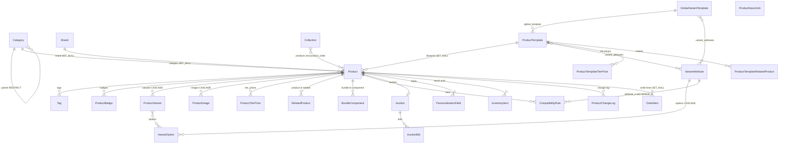
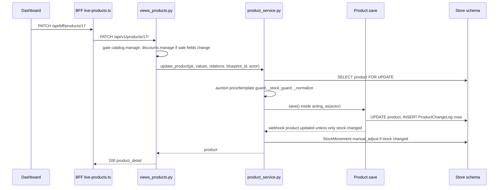
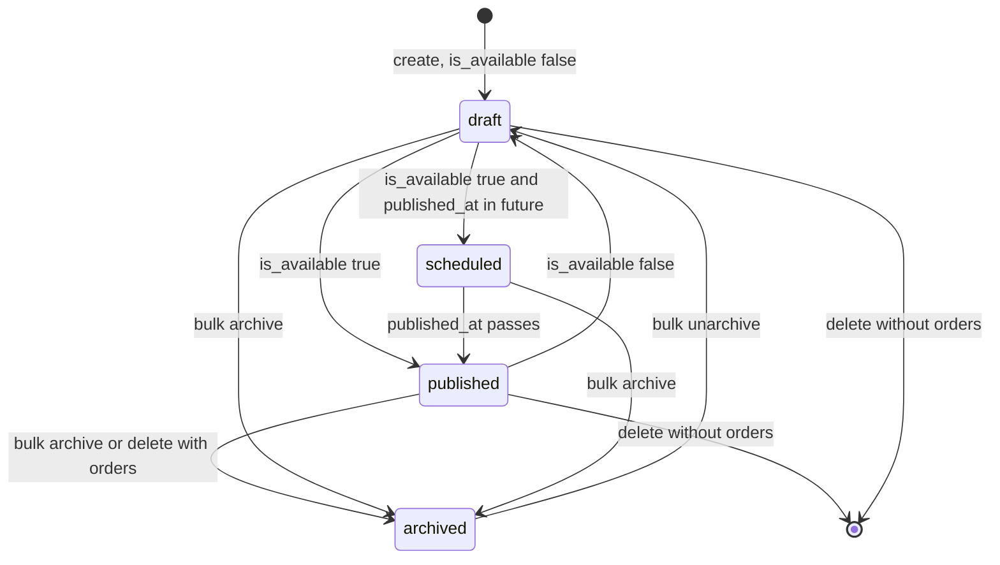
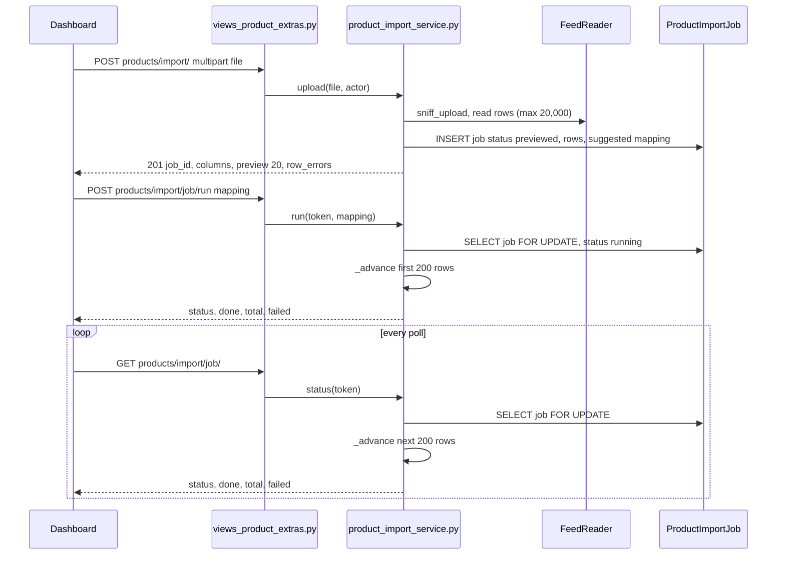
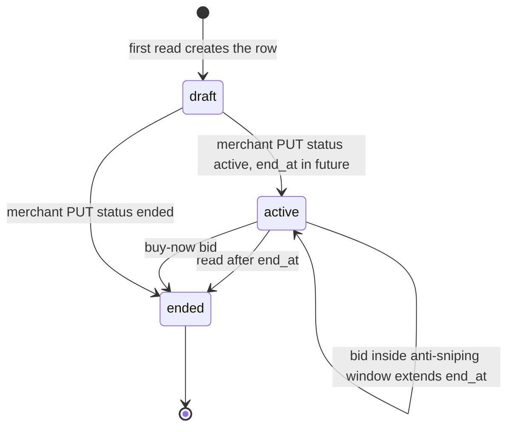

# Data model — Domain 3: catalog, products and advanced products

> **Source**: DOC-483 · inventory Domain 3 · INT-005 (M04), INT-006 (M05), INT-045 (M37)
> **Code**: `sharwa_saas/products/models/catalog.py` · `products/models/stock.py` (`InventoryItem`) · `products/models/imports.py` · `products/blueprint.py` · `products/sector_catalog.py` · `products/services/{product_service,variant_service,product_template_service,catalog_org_service,product_extras_service,product_import_service,storefront_auction_service,tier_pricing,sector_seed_service}.py` · `products/services/suppliers/feed_reader.py` · `api/{views_products,serializers_products,views_catalog,serializers_catalog,views_product_extras}.py` · `api/urls.py` · `sharwa-frontend/src/lib/bff/live-products.ts` · `src/app/api/bff/README.md`
> **Last verified against code**: 2026-10-28 (step 37)

## 1. Purpose

Domain 3 is everything a merchant sells and how it is organised: the product record and its gallery, variants and the variant dictionary, product templates and the sector catalogue, categories, brands, tags, collections and badges, and the "advanced product" features of M37 (bundles, compatibility rules, personalization fields, auctions, serial units, CSV import and export).

This page lists every model of the domain with its schema, constraints and the migration that created or changed it, the files that provide each part, the three BFF switches that route the dashboard to Django, and the engines that are easy to get wrong (import, auction, personalization surcharge, template blueprint).

It does not cover stock quantities and the stock ledger ([`../44-stock-ledger.md`](../44-stock-ledger.md)), tier prices as a B2B feature (Domain 9, [`09-b2b.md`](09-b2b.md)), the storefront read side of the catalog (Domain 5, [`05-storefront.md`](05-storefront.md)) or the locations that hold stock (Domain 10, [`10-inventory-locations-procurement.md`](10-inventory-locations-procurement.md)). Route-by-route request and response shapes are Track 1 material; this page only names the routes.

## 2. Components

### 2.1 Provider table (file → what it owns)

| File | Owns |
|---|---|
| `products/models/catalog.py` (1718 lines) | all catalog models: `Category` (`:79`), `Brand` (`:128`), `Tag` (`:149`), `Collection` (`:172`), `ProductBadge` (`:207`), `Product` (`:246`, manager `ProductManager.visible()` `:242`), `VariantAttribute` (`:906`), `VariantOption` (`:1037`), `VariantTemplate` (`:1084`), `GlobalVariantTemplate` (`:1116`), `ProductTemplate` (`:1150`), `ProductVariant` (`:1298`), `ProductImage` (`:1343`), `ProductTierPrice` (`:1366`), `RelatedProduct` (`:1390`), `BundleComponent` (`:1419`), `CompatibilityRule` (`:1461`), `Auction` (`:1503`), `AuctionBid` (`:1546`), `PersonalizationField` (`:1569`), `ProductTemplateTierPrice` (`:1632`), `ProductTemplateRelatedProduct` (`:1657`), `ProductChangeLog` (`:1683`), `StoreReview` (`:1708`) |
| `products/models/stock.py` | `InventoryItem` (`:65`) — one serial or digital unit; `StockMovement` (`:12`) is the ledger written by the stock paths of this domain |
| `products/models/imports.py` | `ProductImportJob` — the persisted state of a CSV import |
| `products/blueprint.py` | the template "blueprint": `BLUEPRINT_FIELDS` (33 legacy columns `:29` + 13 extra `:41`), defaults `DEFAULT_SECTOR_BLUEPRINT` (`:56`) and `DEFAULT_SCRATCH_BLUEPRINT` (`:75`), `coerce_value`, `validate_fields`, `apply_fields`, `from_legacy_columns` |
| `products/sector_catalog.py`, `products/services/sector_seed_service.py` | the 35-sector seed data (`SECTORS`) and the idempotent `seed_sectors()` |
| `products/services/product_service.py` (696 lines) | list/filter/summary, status derivation (`status_of` `:64`), create/update/delete/quick-add/bulk/stock/formula preview, gallery operations |
| `products/services/variant_service.py` (580 lines) | variant dictionary (attributes, options), `generate_variants` (`:434`), `bulk_patch_variants` (`:500`) |
| `products/services/product_template_service.py` | template CRUD, `apply_global`, `global_templates` |
| `products/services/catalog_org_service.py` | category delete/reorder, brand/tag/badge delete, tag merge, collection membership and order |
| `products/services/product_extras_service.py` (526 lines) | bundle components, compatibility rules, personalization fields, merchant side of the auction, serial units |
| `products/services/product_import_service.py` (232 lines) | CSV import in three stages and the CSV export |
| `products/services/suppliers/feed_reader.py` | `FeedReader` (csv/tsv/txt/xlsx reader shared with dropshipping), `sniff_upload`, encoding and delimiter detection |
| `products/services/storefront_auction_service.py` (109 lines) | the buyer view of an auction and `place_bid` |
| `products/services/tier_pricing.py` | `tier_base_price`, `unit_price`, `personalization_extra` (`:47`) |
| `api/views_products.py` (576 lines), `api/serializers_products.py` (682 lines) | M04 routes (products, images, variants, dictionary, templates, sectors) and their JSON shape |
| `api/views_catalog.py`, `api/serializers_catalog.py` | M05 routes (categories, brands, tags, collections, badges) and the shared `Base64ImageField` |
| `api/views_product_extras.py` | M37 routes (extras, import/export) and the two **public** storefront auction routes |
| `api/urls.py:252-307` | the merchant routes; `:77-79` the storefront auction routes |
| `sharwa-frontend/src/lib/bff/live-products.ts` | the three product rule tables (`PRODUCTS_LIVE_RULES` `:41`, `B2B_LIVE_RULES` `:75`, `ADVANCED_LIVE_RULES` `:85`) and `dispatchLiveProducts` (`:104`) |

### 2.2 The three BFF switches

The dashboard talks to the Next.js BFF; each switch decides whether a group of routes goes to Django or to the fixture. Keys are values of `SHARWA_LIVE_MODULES` (or `SHARWA_MOCKS=off` for all). The full rule table is in [`../20-bff.md`](../20-bff.md) §4; this page only records which Django code each switch reaches.

| Switch | Task | BFF rows | Django provider |
|---|---|---|---|
| `catalog` (M05) | INT-006 | `categories/**`, `brands/**`, `tags/**` (+`merge`), `collections/**` (+`products`, `products/[pid]`, `products/reorder`), `badges/**` — `liveOrMock(request, "catalog", "/api/v1/categories/", …)` in each `route.ts` (e.g. `src/app/api/bff/categories/route.ts:17`) | `api/views_catalog.py` |
| `products` (M04) | INT-005 | `PRODUCTS_LIVE_RULES`, 21 rows: products, quick, bulk, formula-preview, detail, changes, stock, gallery ×3, variants ×2, dictionary ×4, templates ×4 + `apply`, global templates | `api/views_products.py` |
| `advanced_products` (M37) | INT-045 | `ADVANCED_LIVE_RULES`, 14 rows: `<id>/extras/{bundle-components,compatibility-rules,personalization-fields,auction,serials}` (+ sub-paths), `import`, `import/<job>`, `import/<job>/run`, `export.csv` | `api/views_product_extras.py` |

Two more facts belong to the same routing:

- Quantity (tier) prices from the product editor have their own switch, `b2b` (`B2B_LIVE_RULES`, 2 rows, INT-044), which maps `<id>/extras/tier-prices[/<tier_id>]` to `/api/v1/products/<id>/tier-prices/[<tier_id>/]` (`api/urls.py:283-284`, served by `views_b2b`, Domain 9). `dispatchLiveProducts` tests `b2b`, then `advanced_products`, then `products`, so the three can be switched independently.
- «تطبيق على منتجات» (apply a template to many products) has **no Django route** by decision D7: `applyTemplateLive` in `live-products.ts` reads the template and sends one `PATCH /api/v1/products/<id>/` per product with the template's `fields` plus `blueprint_id`. It is not transactional across products.

> ⚠️ Discrepancy — roadmap/README say the `products/export.csv`, `products/import/**` and `products/[id]/extras/**` rows are "mock — Phase B, not in the live table yet" / code does route them to Django through `ADVANCED_LIVE_RULES` and `B2B_LIVE_RULES` (`sharwa-frontend/src/lib/bff/live-products.ts:75-102`; stale text in `src/app/api/bff/README.md:26`). The same stale statement is in the module docstring of `api/views_products.py:19-21` ("remain on the mock"); the extras are served by `api/views_product_extras.py` (`api/urls.py:286-299`). Reported in step 37.

### 2.3 Authorisation per route group

All merchant routes use `MerchantSessionAuthentication` and `HasTenantContext`. The gate is a merchant session (owner) or a staff session, otherwise `401` «انتهت جلستك، سجّل الدخول مجدداً.»; then the permission key, otherwise `403` «ليست لديك صلاحية لهذا الإجراء.» (`api/views_products.py:73-83`). The owner holds every key implicitly (`can()` returns true when there is no staff).

| Routes | Key | Notes |
|---|---|---|
| read products, change log, extras, export | `inventory.view` (`views_products.py:51`) | the import **status** GET is the exception, see below |
| write products, gallery, variants, dictionary, templates, extras, import upload and run | `catalog.manage` (`:53`) | seeded for «مدير المتجر» and «مدير الفرع» by `0210_seed_catalog_manage_permission` |
| `POST products/<id>/stock/` | `inventory.adjust` (`:52`) | |
| `old_price`, `sale_start_at`, `sale_end_at` changes | `discounts.manage` (`:54`) | checked **only when one of the three actually changes** (`changed_discount_fields`); denial text «ليست لديك صلاحية تعديل الخصومات (السعر القديم وفترة التخفيض).» |
| dictionary / templates / sectors reads | any signed-in session | read by the product editor and the templates screen (`views_products.py:12-13`) |
| categories, brands, tags, collections, badges | reads: any session; writes `catalog.manage` (`views_catalog.py:45`) | no pagination |
| storefront `catalog/products/<id>/auction/…` | none (public, no session) | `authentication_classes = []`, `HasTenantContext` only |

> ⚠️ Discrepancy — inventory/README say the import progress poll is a read / code gates `GET products/import/<job>/` with **`catalog.manage`**, because the poll advances a 200-row chunk (`api/views_product_extras.py:159-162`, `self.run(request, imports.status, token, write=True)`). A user with only `inventory.view` can start nothing and cannot poll. Reported in step 37.

### 2.4 Legacy HTML views kept

The server-rendered dashboard screens still exist and still write the same tables. They were not changed by INT-005/006/045 (URL names in `config/urls_tenant.py`).

| Screen | View (path:line) | URL name / path |
|---|---|---|
| Add / edit product (add = Rapid Data Entry quick form, edit = full `ProductForm`) | `products/views/merchant_dashboard.py:676` `manage_product`; forms `products/forms.py:72` `ProductForm`, `:401` `ProductQuickAddForm` | `add_product`, `edit_product` (`urls_tenant.py:323-324`) |
| Delete product (archives when the product has orders) | `merchant_dashboard.py:1342` `delete_product` | `delete_product` (`:325`) |
| Auction sync, bundle, compatibility, tier price, related | `merchant_dashboard.py:486` `_sync_auction`, `:970` `add_bundle_component`, `:1015` `add_compatibility_rule`, `:896` `add_product_tier_price`, `:933` `add_related_product`, `:865` `template_attributes_api` | `urls_tenant.py:333`, `:344` and neighbours |
| Add category | `merchant_dashboard.py:1361` `add_category` | `add_category` (`:318`) |
| Products hub | `products/views/product_hub.py:27` `product_list_hub` | `product_list_hub` (`:322`) |
| Product templates (list, form, duplicate, delete, attributes, tier price, related) | `products/views/product_templates.py:34-266`; form `products/forms.py:590` `ProductTemplateForm` | `product_template_*` (`:327-341`) |
| Variant hub (attribute/option add, edit, delete, duplicate, apply template) | `products/views/global_variants.py:38-270`; form `products/forms.py:710` `VariantAttributeForm` | `variant_hub` (`:419`), `apply_variant_template` (`:431`) |
| Organization (brands, tags, collections) | `products/views/organization.py:14` `organization_view` | `organization` (`:353`) |
| One-step CSV import / export | `products/views/csv_io.py:47` `import_products_csv`, `:20` `export_products_csv` | `import_products_csv`, `export_products_csv` (`:382-383`) |
| Quick stock edit | `products/views/inventory.py` `update_product_stock` | `update_product_stock` (`:386`) |

The HTML CSV import is a single request with no preview or job; the API import is the three-stage engine of §4.3. They do not share code.

### 2.5 Tests

| File | `def test_` | Covers |
|---|---|---|
| `api/test_products_api.py` | 30 | `ProductApiTests`, `ProductImagesApiTests`, `VariantApiTests`, `TemplateApiTests`, `MinimumPayloadTests` |
| `api/test_catalog_api.py` | 16 | `AuthTests`, `CategoryApiTests`, `BrandTagBadgeApiTests`, `CollectionApiTests` |
| `api/test_catalog_serializers.py` | 21 | category, brand, tag, collection and badge serializers (name and SEO limits, `Base64ImageField`) |
| `api/test_product_extras_api.py` | 10 | `BundleRulesFieldsTests` (4), `AuctionTests` (3), `SerialsImportCartTests` (3) |
| `products/test_product_auction.py` | 11 | model guards and the legacy auction sync |
| `products/test_product_personalization.py` | 12 | `PersonalizationField` model, validation, save |
| `products/test_product_templates.py` | 23 | quick add view, template model and legacy management |
| `products/test_catalog_org_models.py` | 15 | category ordering, tag `last_used_at`, collection order, `catalog.manage` seed |
| `products/test_product_commerce.py` | 7 | pricing and commerce fields |
| `products/test_product_lifecycle.py` | 6 | publish, schedule, archive |
| `products/test_product_specs.py` | 3 | physical specs |
| `products/test_variant_hierarchy.py` | 7 | variant hub factory |

## 3. Data model

### 3.1 Which schema

Every model on this page lives in the **store schema** (one PostgreSQL schema per store, created by django-tenants). The evidence is `config/settings.py`: `products` and `api` are listed only in `TENANT_APPS` (`:152-161`), while `tenants`, `core`, `billing`, `sharwapay`, `appstore`, `marketing` and `sharwa_ship` are `SHARED_APPS` (`:121-143`, public schema). `TENANT_MODEL = "tenants.Client"` (`:209`) and `DATABASE_ROUTERS = ('django_tenants.routers.TenantSyncRouter',)` (`:117`). See [`../10-multi-tenancy.md`](../10-multi-tenancy.md).

Two consequences worth stating:

- `GlobalVariantTemplate` ("central sector") is **not** a public-schema table. Each store gets its own 35 rows, seeded at provisioning (§3.5).
- There are no foreign keys from these tables to the public schema. Money and exchange rates come from the store's `StoreSetting`.

### 3.2 Model table

Schema is "store" for every row. Field names are the Django names; "migration" names are file names in `products/migrations/`. File names are taken from the device listing; contents were read where the row says so.

| Model | Schema | Key fields | Constraints / indexes | Added or changed by |
|---|---|---|---|---|
| `Category` | store | `name` (100, indexed), `parent` (FK self, **RESTRICT**, null), `image`, `sort_order`, SEO mixin (`meta_title` 70, `meta_description` 160, `meta_keywords` 255, `og_image`) | index `products_cat_parent_sort_idx` (`parent`, `sort_order`); ordering `sort_order, name, id`; `save()` appends a new category after its last sibling (`catalog.py:107-115`) | `0034_category_parent`; `0045_category_image_productvariant_productimage`; `0068_category_meta_description_category_meta_keywords_and_more`; `0208_catalog_org_contract` (read: `sort_order`, index, parent CASCADE→RESTRICT); `0209_backfill_catalog_org`; `0206_alter_brand_logo_alter_category_image_and_more` |
| `Brand` | store | `name` (100, **unique**), `slug` (120, indexed), `logo` | ordering `name` | `0111_brand_tag_collection`; `0206` |
| `Tag` | store | `name` (60, **unique**), `slug` (80, indexed), `last_used_at` (null) | ordering by name; "unused" = 0 products and 30 days (`catalog.py:152-155`); `last_used_at` set by `products/signals_catalog.py` | `0111_brand_tag_collection`; `last_used_at`: `0208_catalog_org_contract` |
| `Collection` | store | `name` (100, **unique**), `slug`, `description`, `products` (M2M), `product_order` (JSON list of product ids) | membership lives only in the M2M; `product_order` is for ordering and is cleaned on every operation (`ordered_products()` `:194`) | `0111_brand_tag_collection`; `product_order`: `0208_catalog_org_contract` |
| `ProductBadge` | store | `name` (50, **unique**), `color` (hex, default `#64748b`) | ordering by name | `0111_brand_tag_collection` (by file name; the model docstring is at `catalog.py:207`) |
| `Product` | store | identity: `name` (200, indexed), `name_en`, `slug` (255, unicode), `sku` (100), `barcode` (64); price: `price`, `old_price`, `sale_start_at`, `sale_end_at`, `cost_price`, `currency` (`SAR`/`USD`/`YER_OLD`…), `custom_sar_rate`, `payment_policy` (`cod`/`deposit`/`full`), `deposit_required`, `pricing_type` (`fixed`/`formula`) + `formula_unit_price`, `formula_coefficient`, `formula_fixed_extra`, `live_rate_ref`; deposit: `has_refundable_deposit` + 3 fields; modes: `is_serialized`, `is_bundle` + `bundle_build_fee`, `is_auction`, `is_personalizable`, `is_bookable` + `booking_duration_minutes`, `product_type`; tax: `is_taxable`, `tax_rate`; stock: `stock` Decimal(12,3) default 10, `unit`, `low_stock_threshold` (3), `allow_backorder`, `min_quantity` Decimal(12,3) default 1, `max_quantity` Decimal(12,3) null, `allow_variable_quantity`; media: `image`, `image_url`, `video_url`; lifecycle: `is_available`, `published_at`, `archived_at`; shipping: `is_free_shipping`, `weight`, `length`, `width`, `height`, `is_hazardous`, `hazard_class`, `delivery_duration`; display: `is_featured`, `views_count`, `add_to_cart_count`, `variant_display_style`, `product_template`, `sizes`, `colors`; links: `category`, `brand` (both SET_NULL), `tags`, `badges`, `blueprint` (FK `ProductTemplate`, SET_NULL); `created_at`, `updated_at` | **no DB unique on `slug` or `sku`** — uniqueness is by `_generate_unique_slug` / `_generate_unique_sku` (`SHW-XXXXXXXX`) and `product_service._unique_slug`; ordering `-created_at`; `visible()` = available, not archived, `published_at` null or ≤ now (`catalog.py:222-244`); `save()` forces `stock = 1` and `allow_backorder = False` for an auction (`:517-519`) and writes `ProductChangeLog` rows (`:572`); tracked fields `_TRACKED_FIELDS` (`:555`) | `0002`…`0010` (initial fields, by file name); `0077_product_booking_duration_minutes_product_is_bookable_and_more`; `0083_product_delivery_duration`; `0107_product_image_url`; `0108_product_slug_sku_lifecycle`; `0109_product_sale_stock_limits`; `0110_product_type_shipping_tax`; `0113_product_display`; `0114_product_cost_price`; `0116_product_add_to_cart_count_product_product_template_and_more`; `0117_product_barcode_product_description_en_and_more`; `0118_alter_product_slug`; `0119_producttemplate_product_blueprint`; `0128_product_allow_variable_quantity_product_unit_and_more` (read: Decimal(12,3) `stock`, `min_quantity`, `max_quantity`, on `Product` **and** `ProductTemplate`); `0129_product_formula_coefficient_and_more`; `0130_product_has_refundable_deposit_and_more`; `0131`–`0134` (serialized, bundle, auction, personalizable flags); `0161_product_hazard_class_product_is_hazardous_and_more`; **`0211_product_updated_at`** |
| `VariantAttribute` | store | `name` (100, **unique**), `field_type` (`select`, `radio`, `multi_select`, `swatches`, `text`, `numeric`, `date`), `data_type` (`text`, `number`, `unit`, `bool`, `date`, `file`, `image`), `unit`, `min_value`, `max_value` (Decimal(12,3)), `is_required`, `sort_order` | name normalised by `variant_service.normalize_attribute_name` (`:53`); delete → 409 when used (decision D5) | `0051_variantattribute_variantoption`; `0120_variantattribute_field_type`; `0126_variantattribute_data_type_and_more`; `0127_backfill_variantattribute_data_type` |
| `VariantOption` | store | `attribute` (FK CASCADE), `value` (255), typed columns `text_value`, `numeric_value`, `unit_value`, `boolean_value`, `date_value`, `file`, `image`, **`color`** (hex, optional) | `unique_together (attribute, value)` (`catalog.py:1072`) | `0051`; `0126`; **`0213_variantoption_color`** |
| `VariantTemplate` | store | legacy seed of four "variant templates" | kept for the legacy screens only | `0081_varianttemplate`, `0082_seed_variant_templates` |
| `GlobalVariantTemplate` | store | `name` (unique), `variant_attributes` (M2M), `is_active` | one row per sector, seeded per store (§3.5) | `0123_globalvarianttemplate_and_more`; `0122_seed_sector_templates` |
| `ProductTemplate` | store | `name` (unique), **`blueprint_fields`** (JSON dict), the 33 legacy scalar columns (`BLUEPRINT_SCALAR_FIELDS` `:1157`, kept as a mirror), `global_template` (FK), `variant_attributes` (M2M), tags, badges, collections | `apply_to(product)` (`:1265`) copies only the keys present in `blueprint_fields` plus category and brand; `apply_relations` (`:1278`) copies M2M, tier prices and related products; `save()` builds `blueprint_fields` from the legacy columns for a new row (`:1255-1263`) | `0119_producttemplate_product_blueprint`; `0121_producttemplate_variant_attributes`; `0124_seed_product_templates`; `0128`; **`0214_producttemplate_blueprint_fields`** (read: one JSON field plus a one-time data migration; null and `""` dropped; quantities as text without trailing zeros) |
| `ProductVariant` | store | `product` (FK CASCADE, `related_name='variants'`), `options` (M2M `VariantOption`), `extra_price`, `stock` Decimal(12,3), `sku` (100, indexed), `image`, `created_at`; `effective_price` = product price + `extra_price` | ordering `id`; no model-level constraint. The old index `product_variant_combo_idx` (`product`, `color`, `size`) was **removed** together with the `color`/`size` columns | `0045_category_image_productvariant_productimage`; `0050_productvariant_product_combo_idx`; `0052_productvariant_options_data_migration` (read: moves `color`/`size` into the dictionary under «اللون» and «المقاس», then `RemoveIndex` + `RemoveField`); `0091_orderitem_variant_orderitem_variant_label` (the order side) |
| `ProductImage` | store | `product` (FK CASCADE, `related_name='images'`), `image`, `sort_order` | ordering `sort_order, id`; the gallery is the single list (decision D2); `Product.image` mirrors the first image via `product_service.sync_main_image` (`:622`) | `0045`; **`0215_product_main_image_to_gallery`** (data migration, idempotent: puts the old main image into the gallery) |
| `ProductTierPrice` | store | `product`, `min_quantity` (**PositiveInteger**), `price` | `UniqueConstraint unique_product_tier_quantity` (`product`, `min_quantity`) | by file name `0110`-era commerce migrations; B2B screens: Domain 9 |
| `RelatedProduct` | store | `product`, `related`, `relation_type` (`cross_sell`, `upsell`, `related`), `sort_order` | `UniqueConstraint unique_product_related` (`product`, `related`, `relation_type`) | `0111`-era; not re-read |
| `BundleComponent` | store | `bundle`, `component` (both FK `Product`), `quantity` Decimal(12,3), `is_optional`, `sort_order` | `UniqueConstraint unique_bundle_component` (`bundle`, `component`) | `0132_product_is_bundle_bundlecomponent_compatibilityrule` |
| `CompatibilityRule` | store | `product`, `attribute_a` (FK), `operator` (`equals`, `not_equals`, `in`), `attribute_b` (FK, null), `value` (255), `note` | one of `attribute_b` / `value` required; `in` with `attribute_b` invalid (service rule) | `0132` |
| `Auction` | store | `product` (OneToOne, `related_name='auction'`), `status` (`draft`, `active`, `ended`), `start_bid`, `bid_step`, `reserve`, `buy_now`, `end_at` (indexed), `anti_sniping_seconds` | one auction row per product | `0133_product_is_auction_auction_auctionbid` |
| `AuctionBid` | store | `auction` (FK), `bidder_name` (100), `bidder_phone` (30), `amount` | ordering `-amount, -created_at`; amount stored in the **product's** currency | `0133` |
| `PersonalizationField` | store | `product`, `name` (100, the label), `field_type` (**9**: `text`, `textarea`, `number`, `select`, `multi_select`, `date`, `checkbox`, `file`, `image`), `applies_to_order`, `price_add`, `is_required`, `placeholder`, `help_text`, `max_length`, `options_csv` (500), `sort_order` | `select`/`multi_select` require `options_csv` (service rule) | `0134_product_is_personalizable_personalizationfield` |
| `ProductTemplateTierPrice` | store | `template`, `min_quantity`, `price` | `UniqueConstraint unique_template_tier_quantity` | `0125_producttemplaterelatedproduct_and_more` |
| `ProductTemplateRelatedProduct` | store | `template`, `related`, `relation_type`, `sort_order` | `UniqueConstraint unique_template_related_product` | `0125` |
| `ProductChangeLog` | store | `product`, `field_name` (50), `old_value`, `new_value`, **`actor`** (150), `changed_at` | append-style log; written by `Product._log_field_changes` (not on `update_fields` saves) and by `product_extras_service._log` | `0116`-era for the table; **`0212_productchangelog_actor`** |
| `InventoryItem` | store | `product`, `variant`, `code` (255), `status` (`available`, `reserved`, `sold`), `meta` (JSON), `location`, `order` | `UniqueConstraint unique_inventory_item_code_per_product` (`product`, `code`) | `0131_product_is_serialized_inventoryitem`; `location`, `order`: `0225_inventory_api` |
| `ProductImportJob` | store | `token` (40, **unique**, `imp-<hex16>`), `file_name`, `columns` / `rows` / `mapping` / `failed` (JSON), `status` (`previewed`, `running`, `done`, `failed`), `done`, `created_by`, timestamps | `rows` holds the whole parsed file (≤ 20,000 rows) | **`0236_advanced_products_api`** |
| `OrderItem.personalization` | store | JSON dict `{field_id: value}` captured at checkout | not a model; a field of `OrderItem` (Domain 4) | **`0236_advanced_products_api`** |
| `StockMovement` | store | the stock ledger written by `set_stock`, `variants/bulk`, `serials` | see [`../44-stock-ledger.md`](../44-stock-ledger.md) | `0115_stockmovement`; `0225_inventory_api` |
| `StoreReview` | store | storefront review, `rating` nullable | documented with the storefront | `0016_storereview`; see [`05-storefront.md`](05-storefront.md) |

Models documented in detail: **25** (every row from `Category` to `ProductImportJob`); `StockMovement` and `StoreReview` are pointers to other pages, and `OrderItem.personalization` is a field, not a model. Migration cells marked "-era" or "by file name" were attributed from file names only (contents not read), see §9.

> ⚠️ Discrepancy — roadmap says migrations `0211`–`0215` contain "decimal min/max quantities" / code does not: none of the five touches `min_quantity` or `max_quantity`. Decimal(12,3) came from `products/migrations/0128_product_allow_variable_quantity_product_unit_and_more.py:34-64` (`AlterField` on `product` and `producttemplate`); `0214` only stores the two values as text without trailing zeros (`QUANTITIES`, `0214_…:24-33`). The five migrations are: `0211_product_updated_at` (adds `Product.updated_at`, indexed, backfilled from `created_at`), `0212_productchangelog_actor`, `0213_variantoption_color`, `0214_producttemplate_blueprint_fields`, `0215_product_main_image_to_gallery`. Reported in step 37.

> ⚠️ Discrepancy — roadmap says `ProductTierPrice` is part of "decimal" quantity handling / code: `ProductTierPrice.min_quantity` is a `PositiveIntegerField` (`catalog.py:1366-1383`), while `Product.min_quantity`, `max_quantity`, `stock`, `BundleComponent.quantity` and `ProductVariant.stock` are `Decimal(12,3)`. A fractional quantity (for example 2.5 kg) therefore selects a tier by its integer threshold only. Reported in step 37.

### 3.3 ER sketch

`OrderItem` is Domain 4 ([`04-orders-returns.md`](04-orders-returns.md)). `ProductImportJob` has no relation: it stores rows as JSON and creates `Product` rows through `Product.save()`.

### 3.4 Phase 002 changes at a glance

| Migration | Task | What it did to this domain |
|---|---|---|
| `0206_alter_brand_logo_alter_category_image_and_more` | INT-006 | image fields moved to `TenantUploadTo` paths (by file name) |
| `0208_catalog_org_contract` | INT-006 | `Category.sort_order` + index `products_cat_parent_sort_idx`; `Category.parent` CASCADE → **RESTRICT**; `Tag.last_used_at`; `Collection.product_order` |
| `0209_backfill_catalog_org` | INT-006 | data: initial `sort_order` for existing categories |
| `0210_seed_catalog_manage_permission` | INT-005/006 | permission `catalog.manage` for «مدير المتجر» and «مدير الفرع» |
| `0211_product_updated_at` | INT-005 | `Product.updated_at` (`auto_now`, indexed), backfilled |
| `0212_productchangelog_actor` | INT-005 | `ProductChangeLog.actor` (150) — who made the change |
| `0213_variantoption_color` | INT-005 | `VariantOption.color` — swatch colour |
| `0214_producttemplate_blueprint_fields` | INT-005 | `ProductTemplate.blueprint_fields` JSON + data migration |
| `0215_product_main_image_to_gallery` | INT-005 | gallery unification, data migration |
| `0225_inventory_api` | INT-024 | `InventoryItem.location`, `InventoryItem.order` |
| `0236_advanced_products_api` | INT-045 | `ProductImportJob`, `OrderItem.personalization` |

### 3.5 Sectors, templates and the blueprint

**Sector seed.** `products/sector_catalog.py` defines `SECTORS`: **35** sectors, **190** sector-variant entries and **177** distinct attribute names (counted by importing the module). `seed_sectors()` (`sector_seed_service.py:22`) is idempotent (`get_or_create` on every row): for each sector it creates a `GlobalVariantTemplate`, its `VariantAttribute` rows (with `data_type` derived from `field_type`), the closed option values, and a `ProductTemplate` with the same name whose `blueprint_fields` start from `DEFAULT_SECTOR_BLUEPRINT`. Attributes are attached to the product template only when it is created, so a merchant's later edit is never reset. It runs in two places: store provisioning (`tenants/provisioning.py:138-148`, `_seed_catalog`, inside `schema_context(client.schema_name)`) and the management command `seed_variant_templates`.

> ⚠️ Discrepancy — roadmap says "`ProductTemplate` (35 central sectors/templates/attributes)" / code: the 35 sectors are "central" only by name (the `sector_seed_service.py` docstring says «القطاعات المركزية الـ35»). `GlobalVariantTemplate`, `VariantAttribute`, `VariantOption` and `ProductTemplate` are tenant-schema tables seeded per store (`products` is `TENANT_APPS` only, `config/settings.py:152-161`); there is no shared copy. Each new store therefore starts with 35 `GlobalVariantTemplate` + 35 `ProductTemplate` rows. Reported in step 37.

**Blueprint.** `blueprint_fields` is the only source of truth for what a template copies into a product (`products/blueprint.py`): `BLUEPRINT_FIELDS` is 33 legacy columns + 13 extra fields = 46 keys. `validate_fields` rejects unknown keys; `coerce_value` turns text into the field's type; `apply_fields` sets only the keys present. The 33 legacy columns on the model stay as a mirror for the old Django screen. `quantity_text` writes `min_quantity` / `max_quantity` without trailing zeros.

**Apply flows.**

- `POST product-templates/<id>/apply-global/` (`product_template_service.apply_global`, `:157`) links a template to a sector and attaches its attributes.
- Creating a product with `blueprint_id` applies the template first, then lets the merchant's values win, then copies tier prices and related products for anything not sent (`product_service.create_product` `:390`).
- Patching a product with `blueprint_id` links it; an **active auction** refuses both a price change and a template change (`update_product` `:416`).

## 4. Flows

### 4.1 Product write path

Rules that shape the write:

- `create_product` and `update_product` run in `transaction.atomic()` plus `acting_as(actor)` (`product_service.py:390-450`). `actor` comes from `change_actor.actor_label` — «مالك المتجر» for the owner, or the staff member's name — and ends up in `ProductChangeLog.actor` and `StockMovement.actor`.
- `_normalize` (`:272`) zeroes dependent fields: deposit when the policy is not `deposit`; hazard class when not hazardous; tax rate when not taxable; formula fields when `pricing_type != 'formula'`; refundable deposit amount; bundle fee when not a bundle; free shipping unless `product_type == 'physical'`; and for an auction it sets `stock = 1` and `allow_backorder = False`.
- `_stock_guard` (`:306`) refuses a direct stock edit in four cases, each with its own text: an active auction «المخزون محجوب أثناء مزاد نشط.», a serialized product «مخزون هذا المنتج يُدار بالأرقام التسلسلية.», a product with variants «المخزون يُدار على المتغيرات.», and a product whose stock lives in location rows «مخزون هذا المنتج يُدار حسب المواقع — عدّله من شاشة المخزون.».
- `set_stock` (`:467`) accepts `^\d{1,9}(\.\d{1,3})?$` and writes a `manual_adjust` movement.
- `delete_product` (`:452`) **archives** (sets `archived_at`) when the product has orders and returns `{archived: true}`; an active auction gives `409` «لا يمكن حذف منتج في مزاد نشط.».
- `_TRACKED_FIELDS` has 18 entries (name, price, old_price, cost_price, stock, currency, is_available, payment_policy, deposit_required, description, the four refundable-deposit fields, is_serialized, is_bundle, bundle_build_fee, is_auction). A change in any except `stock` alone emits the webhook `product.updated` with `changed_fields`.

**Status is derived, not stored.** `status_of` (`:64`): `archived_at` set → `archived`; not `is_available` → `draft`; `published_at` in the future → `scheduled`; otherwise `published`. The same rule is the SQL filter `_status_q` (`:75`). `Product.objects.visible()` is the storefront rule.

`bulk` (`:530`) supports `publish`, `archive`, `unarchive`, `delete`, `set_category`, `add_tag`, `remove_tag`, one transaction per product, and reports a reason per failed id.

### 4.2 Variants

`generate_variants(product_id, attribute_ids, option_ids, exclude)` (`variant_service.py:434`) builds the cross product of the chosen options and **keeps** combinations that already exist. It refuses to remove a variant that has an active reservation, serial units, location stock or an open order (`OPEN_ORDER_STATUSES = ('pending_payment', 'new', 'awaiting_payment', 'payment_review')`, `:388`; `_refuse_removal` `:406`). `bulk_patch_variants` (`:500`) is all-or-nothing and names errors as `variants.<id>.<field>`. Deleting a dictionary attribute or option that is used by variants, or referenced by a `CompatibilityRule`, returns `409` with a count (decision D5, `:208-220`, `:324-330`).

### 4.3 CSV import (three stages, no Celery)

- **Upload.** Extensions `csv`, `tsv`, `txt`, `xlsx` only, otherwise «الصيغ المسموحة: csv, tsv, txt, xlsx». `FeedReader` detects the encoding (UTF-8 with or without BOM, otherwise Windows-1256) and the delimiter from the first line, and rejects legacy `.xls`; its own limits are 50 MB, 200,000 rows, 200 columns, 10,000 characters per cell (`feed_reader.py`). The import adds the stricter `MAX_ROWS = 20_000` (`product_import_service.py:38`): more gives `400` «الملف أكبر من 20,000 صف — قسّمه إلى ملفات أصغر.». The request body is capped by `DATA_UPLOAD_MAX_MEMORY_SIZE = 8 MB` (`config/settings.py:368`) for non-file data; file size is checked by `sniff_upload`.
- **Mapping.** `TARGET_FIELDS` = `name`, `name_en`, `sku`, `barcode`, `price`, `old_price`, `stock`, `category`, `description`. Header aliases (`KNOWN`, `:30`) include English and Arabic names. `run` needs at least `name` and `price` mapped, else `400` «طابِق عمودَي الاسم والسعر على الأقل.».
- **Run.** `run` locks the job row, refuses a second run with `409` «نُفِّذت هذه المهمة مسبقاً.», sets `running` and processes the first chunk at once. Every poll locks the row again and advances **one chunk of `CHUNK = 200`** rows. Each row is saved in its own savepoint, so a bad row fails alone and is listed in `failed` as `{row, msg}`; a duplicate SKU gives «SKU مستخدم مسبقاً «…»».
- **Result.** Imported products are drafts (`is_available = False`), `stock` defaults to 0, the category is matched by **exact name** (no match = no category; categories are never created), and `Product.save()` generates slug and SKU. The job `status` goes `previewed → running → done`; the model also defines `failed`, which this service never assigns.
- **Export.** `GET products/export/` (`inventory.view`) uses the list filters and ordering (`filter_products` + `ORDERINGS`), writes the columns `id, name, sku, price, stock, unit, category, status, updated_at` (price as the server-formatted `format_money` string, stock with 3 decimals), starts with a BOM so Excel opens Arabic, and answers `text/csv; charset=utf-8`, filename `products.csv`, `Cache-Control: no-store`.

### 4.4 Auction engine

- **Creation on read.** `auction_row()` (`product_extras_service.py:336`) creates a `draft` row for an `is_auction` product on first read (`start_bid` = product price, `bid_step` 10.00, `anti_sniping_seconds` 120).
- **Close on read.** If the status is `active` and `end_at` is past, the row is saved as `ended` — there is no scheduled job. Any read or bid goes through this function.
- **Merchant `PUT`** (`put_auction` `:411`): `anti_sniping_seconds` 0–3600; `buy_now` must exceed `start_bid`; `reserve` must not be below `start_bid`; `start_bid` is locked after the first bid; an `active` auction needs `end_at` in the future. It calls `product.save()` to re-apply `stock = 1`. The merchant view returns `reserve` and `reserve_met`.
- **Buyer bid** (`storefront_auction_service.place_bid` `:60`): name ≤ 100, phone `^\d{9,15}$`; the row is locked (`auction_row(lock=True)`); `draft` → `409` «المزاد لم يبدأ بعد.», `ended` → `409` «انتهى المزاد.»; the amount is compared in the **buyer's currency** using the product's own conversion with a `HALF_CENT` tolerance, and stored in the **product's** currency. A bid in the last `anti_sniping_seconds` moves `end_at` to now + that many seconds; a bid at or above `buy_now` sets `ended`. The route is rate-limited to `300/m` per IP (`views_product_extras.py:~209`), answer «طلبات كثيرة جداً، حاول لاحقاً.», and only `Product.objects.visible()` products accept bids.
- **`reserve` is never exposed to buyers.** `buyer_view` omits it and returns `reserve_met` only when the status is `ended` and a reserve exists.
- **Guards elsewhere:** an active auction blocks price change, template change, stock edit and delete (§4.1).

### 4.5 Personalization surcharge

`PersonalizationField.price_add` is charged **per unit** at cart time: `tier_pricing.personalization_extra(product, values)` (`tier_pricing.py:47`) sums `price_add` for each filled field, and `products/cart.py` adds it to the unit price. The cart copies the values to `OrderItem.personalization` (`products/services/checkout_service.py:739`), so the surcharge is inside `OrderItem.price` and the values travel with the order line.

> ⚠️ Discrepancy — code comment vs code: `products/services/storefront_cart_service.py:15` says personalization "is not priced here / checkout does not charge it yet", but `products/cart.py` (around line 147) adds `personalization_extra` to every unit. The surcharge is real. Reported in step 37.

### 4.6 Catalog organization (M05)

- `delete_category(category_id, reassign_to, children)` (`catalog_org_service.py:42`): a category with products and no decision returns `409`; `reassign_to` must be another existing category (`400` «اختر تصنيفاً آخر.» / «التصنيف المختار غير موجود.»); `children` is `grandparent` or `root` and moves the subcategories before the delete, because `parent` is RESTRICT.
- `reorder_categories(moves)` (`:97`) takes a global `sort_order` per parent and rejects cycles with `400` «الترتيب يُنشئ دورة: لا يمكن وضع تصنيف داخل أحد فروعه.».
- Tags: `merge_tags(from_id, into_id)` (`:150`), `last_used_at` maintained by `signals_catalog.py`. Collections: add (max 500 ids), reorder (max 2000), remove — each locks the collection row and cleans `product_order`.
- Name limits (serializers): Category 100, Brand 100, Tag 60, Collection 100, Badge 50; SEO 70 / 160 / 255. Images arrive as base64 data URLs ≤ 5 MB and ≤ 40,000,000 pixels (`serializers_catalog.py:44-45`); an existing URL round-trips as `UNCHANGED`.
- The product gallery is a different upload path: **one file per request**, ≤ 5 MB (`views_products.py:59`, «حجم الصورة أكبر من 5MB.»), extensions jpg, jpeg, png, webp, gif («الصيغ المسموحة: jpg, jpeg, png, webp, gif»), verified with Pillow.

### 4.7 Bundles, compatibility rules, serial units

- `add_component` rejects a bundle added to itself, a bundle nested inside a bundle, a duplicate component and a non-bundle target. `bundle_view` returns `display_bundle_total` (mandatory components + `bundle_build_fee`).
- A compatibility rule needs exactly one of `attribute_b` and `value`; the operators are `equals`, `not_equals`, `in`.
- Personalization labels ≤ 100, `select`/`multi_select` require `options_csv` (≤ 500).
- `add_serials` stores codes (≤ 255), rejects duplicates inside the product with `400` and a `duplicates` list, and sets `Product.stock` to the count of `available` units with a `manual_adjust` movement.
- Every extras change writes a `ProductChangeLog` row with field names `bundle_components`, `compatibility_rules`, `personalization_fields`, `auction_status`, `serial_codes`.

## 5. Invariants

| Invariant | Enforced by |
|---|---|
| A product's `stock` is never edited directly while an auction is active, the product is serialized, has variants or has location stock | `product_service._stock_guard` (`:306`) |
| An auction product always has `stock = 1` and no backorder | `Product.save()` (`catalog.py:517-519`), `_normalize`, `put_auction` |
| A product with orders is archived, never deleted | `product_service.delete_product` (`:452`) |
| `slug` and `sku` are unique per store, but only by application code | `Product._generate_unique_slug` / `_generate_unique_sku`; **no** DB constraint (concurrent writers could collide; the import reports «SKU مستخدم مسبقاً «…»» only when an `IntegrityError` happens) |
| A category with children cannot be hard-deleted | `Category.parent` RESTRICT + `catalog_org_service.delete_category` |
| No two tier prices, bundle components, related rows or serial codes collide | the `UniqueConstraint`s of §3.2 |
| A dictionary attribute or option in use cannot be deleted | `variant_service` (decision D5) |
| One import run per job; one chunk per lock | `product_import_service.run` / `_locked` (`select_for_update`) |
| Concurrent bids serialise | `auction_row(lock=True)` row lock |
| Buyers never see `reserve` | `storefront_auction_service.buyer_view` |
| Tracked field changes are logged with the actor | `Product._log_field_changes` + `change_actor.acting_as` |
| Catalog writes require `catalog.manage` | `ProductsAPIMixin.gate`, `CatalogAPIMixin` |

## 6. Background work

None for Domain 3. There is **no Celery task and no Beat entry** for products: imports advance on the poll, auctions close on read, status is derived from `archived_at` / `is_available` / `published_at` at query time (a scheduled product becomes `published` without any job). The only automatic population is `seed_sectors()` during store provisioning (a provisioning task, see [`../11-provisioning.md`](../11-provisioning.md)).

## 7. Configuration

| Setting / constant | Value | Where |
|---|---|---|
| `DATA_UPLOAD_MAX_MEMORY_SIZE` | 8 MB | `config/settings.py:368` |
| Gallery file / M05 base64 image | 5 MB; 40,000,000 pixels | `views_products.py:59`, `serializers_catalog.py:44-45` |
| `PAGE_SIZE_DEFAULT` / `PAGE_SIZE_MAX` / `CHANGES_PAGE_SIZE` | 50 / 100 / 20 | `product_service.py:36-38` |
| `ORDERINGS` for the list | name, price, stock, updated_at, sku | `product_service.py:42` |
| Import `MAX_ROWS` / `CHUNK` / `PREVIEW` | 20,000 / 200 / 20 | `product_import_service.py:38-40` |
| `FeedReader` limits | 50 MB, 200,000 rows, 200 columns, 10,000 chars per cell | `feed_reader.py` |
| Money / quantity patterns | `^\d+(\.\d{1,2})?$`, `^\d+(\.\d{1,3})?$`; `MAX_MONEY` 100,000,000; `MAX_QTY` 1,000,000,000 | `product_extras_service.py:29-32` |
| Auction defaults | `bid_step` 10.00, `anti_sniping_seconds` 120, range 0–3600 | `product_extras_service.py:336-352`, `put_auction` |
| Bid rate limit | `300/m` per IP, group `auction_bid` | `views_product_extras.py:~209` |
| BFF switches | `SHARWA_LIVE_MODULES=…,catalog,products,advanced_products,b2b`; `SHARWA_MOCKS=off` for all | `sharwa-frontend/.env.example` |

## 8. Failure modes and fixes

| Failure | Symptom | Cause | Handling / fix |
|---|---|---|---|
| Stock edit refused | `400` with one of the four stock-guard texts | auction, serialized, variants or location stock owns the number | edit the owning screen (§4.1) |
| Delete does nothing visible | `{archived: true}` | product has orders | by design (M04 §8) |
| Delete category `409` | decision required | category has products or children | send `reassign_to` and `children` |
| Import `409` «نُفِّذت هذه المهمة مسبقاً.» | second `run` | job already `running` or `done` | upload again |
| Import row failures | `failed: [{row, msg}]` | price / stock pattern, duplicate SKU, other exception (`«تعذّر حفظ المنتج: …»`, truncated to 300) | fix the row and re-import; imported rows stay |
| Import poll `403` for a viewer | `403` «ليست لديك صلاحية لهذا الإجراء.» | poll needs `catalog.manage` | give the key or let the owner poll |
| Bid `409` | «المزاد لم يبدأ بعد.» / «انتهى المزاد.» / minimum-bid text | status draft/ended or bid below minimum | UI shows the `auction` object returned with the `409` |
| Bid `429` | «طلبات كثيرة جداً، حاول لاحقاً.» | IP rate limit | wait |
| Duplicate slug or SKU | two products share one | no DB constraint | see §9 |
| Stale doc claims | README row 26 says mock | stale text | §2.2 |

## 9. Open items

- Decide whether `Product.slug` and `Product.sku` need a partial unique index; today uniqueness is only application-level.
- `ProductImportJob.status = 'failed'` and `ProductTemplate`'s legacy mirror columns exist but are never used by the new engine; decide whether to drop them.
- `ProductWriteSerializer.sku` is limited to **64** characters (`api/serializers_products.py`, `sku = _text_field(64)`) while `Product.sku` allows 100 and import/legacy forms can store 100. A longer legacy SKU cannot be re-saved through the API editor unchanged. (code-vs-code; reported in step 37)
- A winning bid is stored but no code in the files read for this page turns it into an order or notifies the winner; the buy-now bid only ends the auction. Not verified in the storefront checkout (Domain 5).
- Migration contents were read only for `0052`, `0115`, `0128`, `0208`, `0214` and `0236`; every other file name in §3.2 and §3.4 is a pointer by name, and rows marked "-era" are approximate.
- Not read for this page: `api/views_b2b.py` (tier-price routes, Domain 9), `products/signals_catalog.py` internals, `0116`/`0111`/`0110`/`0113` migration contents (named by file only), the BFF route files nested deeper than the staging limit (the extras catch-all).
- The BFF README rows 25–26 should be updated (see §2.2).

## 10. Related pages

- [`../20-bff.md`](../20-bff.md) — the BFF rule tables and the live/mock switch
- [`../10-multi-tenancy.md`](../10-multi-tenancy.md) — store schema vs public schema
- [`../40-money.md`](../40-money.md) — money precision and conversion
- [`../44-stock-ledger.md`](../44-stock-ledger.md) — `StockMovement`, serial units and location stock
- [`../31-authorization.md`](../31-authorization.md) — permission keys and gate order
- [`../11-provisioning.md`](../11-provisioning.md) — store provisioning (sector seed)
- [`../15-plans-and-features.md`](../15-plans-and-features.md) — plan features
- [`04-orders-returns.md`](04-orders-returns.md) — `OrderItem`, snapshots and `personalization`
- [`05-storefront.md`](05-storefront.md), [`09-b2b.md`](09-b2b.md), [`10-inventory-locations-procurement.md`](10-inventory-locations-procurement.md) — neighbouring domains
