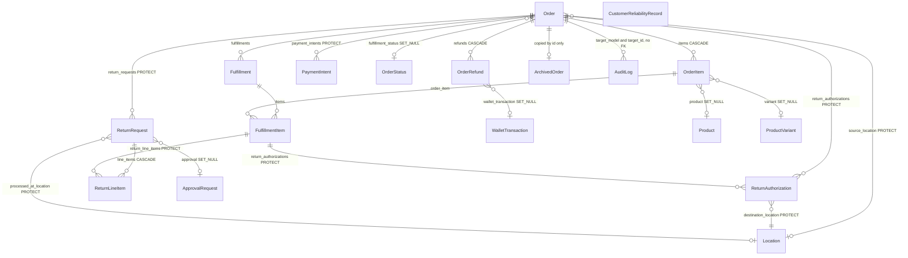
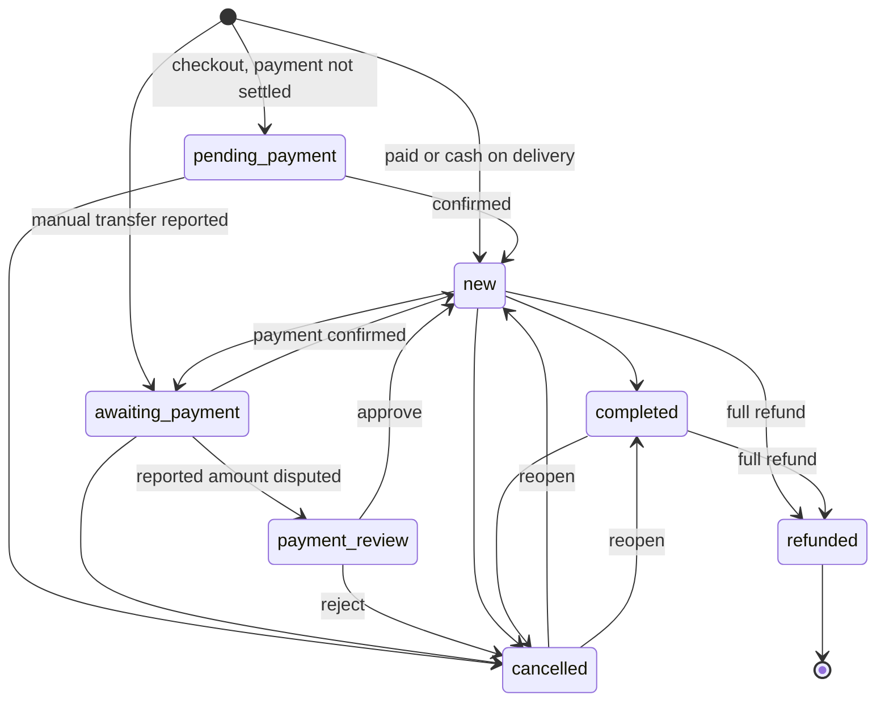
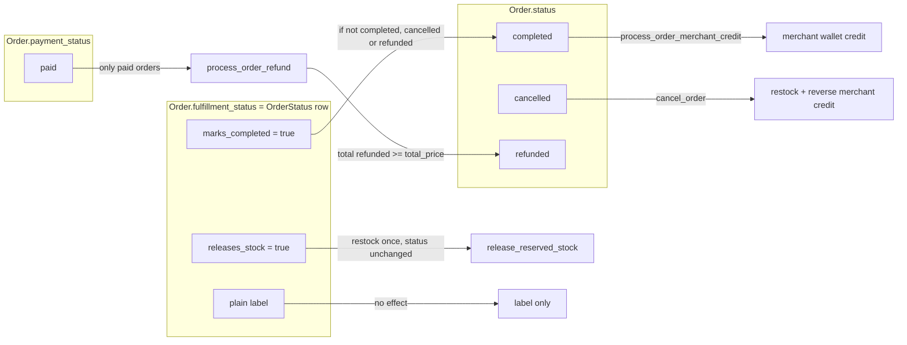
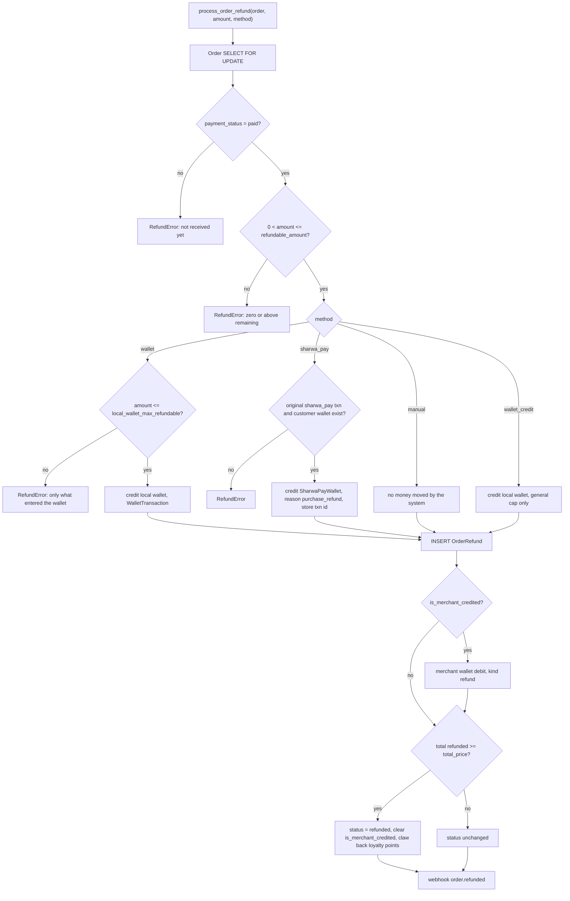
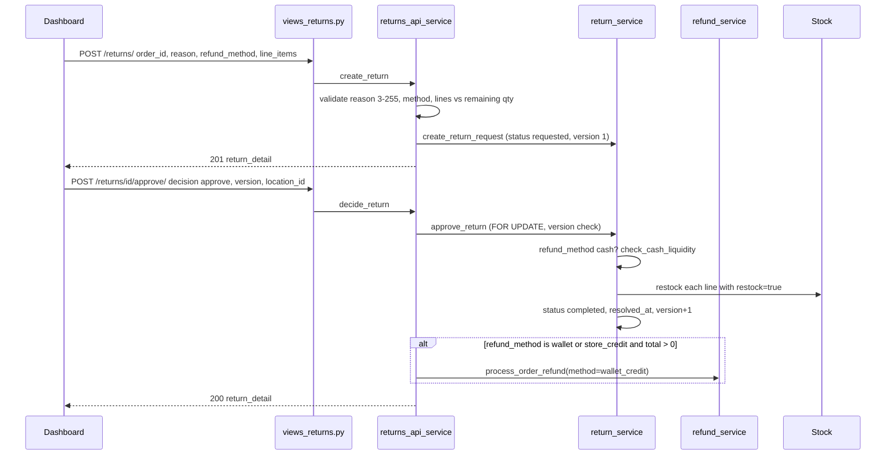
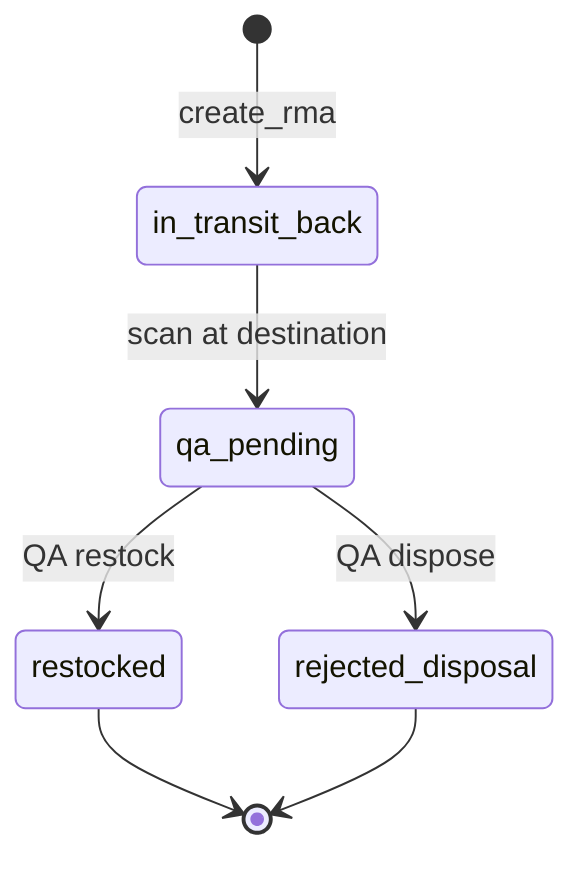

# Data model — Domain 4: orders, returns and RMA

> **Source**: DOC-484 · inventory Domain 4 · INT-007 (M06 orders), INT-026 (M24 returns and RMA)
> **Code**: `sharwa_saas/products/models/{orders,returns,reverse_logistics,audit,locations}.py` · `products/services/{order_api_service,order_approval_service,returns_api_service,return_service,reverse_logistics_service,refund_service,payment_intent_service,order_state_machine}.py` · `api/{views_orders,serializers_orders,views_returns}.py` · `api/urls.py` · `sharwa-frontend/src/app/api/bff/{orders,returns}/**`
> **Last verified against code**: 2026-10-28 (step 37)

## 1. Purpose

Domain 4 is the order and everything that undoes an order. It holds the order record and its lines, the merchant-defined fulfilment statuses, refunds, return requests, return authorisations (RMA) and the append-only audit log that feeds the order timeline.

The point of this page is the **order state model**. An order is not one state machine. It is a financial `status`, a `payment_status`, and a merchant-defined `fulfillment_status`, with different rules and different side effects on each. Section 4.1 diagrams that model; sections 4.4–4.6 diagram the refund flow, the return flow and the RMA flow.

Out of scope: how an order is created from a storefront cart (Domain 5, [`05-storefront.md`](05-storefront.md)), shipments and waybills ([`11-shipping.md`](11-shipping.md)), the locations and stock rows that returns restock into ([`10-inventory-locations-procurement.md`](10-inventory-locations-procurement.md)), wallets ([`06-customers-wallets.md`](06-customers-wallets.md)) and the merchant ledger ([`08-finance.md`](08-finance.md)). Request and response shapes are Track 1 material.

## 2. Components

### 2.1 Provider table (file → what it owns)

| File | Owns |
|---|---|
| `products/models/orders.py` (833 lines) | `OrderStatus` (`:12`), `PickupLocation` (`:104`), `DeliveryMethod` (`:137`), `ShippingProvider` (`:169`), `Order` (`:212`), `OrderItem` (`:669`), `OrderRefund` (`:728`), `PaymentIntent` (`:771`), `ArchivedOrder` (`:813`); the order methods `release_reserved_stock` (`:498`), `cancel_order` (`:529`), `set_fulfillment_status` (`:577`) |
| `products/models/returns.py` | `ReturnRequest` (`:15`), `ReturnLineItem` (`:59`) |
| `products/models/reverse_logistics.py` | `ReturnAuthorization` (`:13`), `CustomerReliabilityRecord` (`:65`) |
| `products/models/audit.py` | `AuditLog` (`:20`): append-only, hash-chained (`prev_hash`, `row_hash`); the source of the order timeline |
| `products/models/locations.py` | `Fulfillment` (`:476`), `FulfillmentItem` (`:534`), `LocationInventory` (`:375`) — referenced by returns, owned by Domain 10 |
| `products/services/order_api_service.py` (≈840 lines) | order list, counters, form options, timeline, optimistic lock (`lock_order` `:372`, `bump_version` `:391`), financial transitions (`change_status` `:432`), payment actions (`payment_action` `:465`), refund wrapper (`refund` `:523`), patch (`patch_order` `:556`), create (`create_order` `:638`), fulfilment-status CRUD (`:756-839`) |
| `products/services/order_approval_service.py` | B2B draft approval: `create_b2b_draft_order` (`:11`), `resolve_order_approval` (`:29`), `is_pending_approval` (`:49`) |
| `products/services/refund_service.py` | the money side of every refund: `refundable_amount` (`:27`), `local_wallet_max_refundable` (`:33`), `sharwa_pay_max_refundable` (`:45`), `process_order_refund` (`:67-204`), `RefundError` (`:22`) |
| `products/services/returns_api_service.py` (653 lines) | return and RMA use cases for the API: `create_return` (`:285`), `decide_return` (`:348`), `create_rma` (`:506`), `scan_rma` (`:538`), `qa_decision` (`:566`), `list_order_refunds` (`:616`), `return_options` (`:652`) |
| `products/services/return_service.py` | the return engine: `create_return_request` (`:35`), `approve_return` (`:106`), `check_cash_liquidity` (`:23`), `restock_to_location` (`:56`), `CashLiquidityError` (`:15`) |
| `products/services/reverse_logistics_service.py` | RMA engine: `create_return_authorization` (`:28`), `scan_return_receipt` (`:61`), `approve_qa_and_restock` (`:96`), `reject_qa_and_dispose` (`:115`), `update_customer_reliability` (`:133`) |
| `products/services/payment_intent_service.py` | `PaymentIntent` helpers, signature check, `reconcile_stale_payment_intents` (`:66`) |
| `products/services/order_state_machine.py` | a **separate, unwired** state table (see the discrepancy in §4.1) |
| `products/tasks/operations.py` | `archive_old_orders` (`:336`) and `reconcile_stale_payment_intents` (`:261`) |
| `api/views_orders.py` | the order routes and the optimistic-lock wrapper `OrdersAPIMixin.write` (`:49`) |
| `api/serializers_orders.py` | `order_list_item`, `order_detail`, `status_def`; reads `CentralCustomerTrust` (public schema) in `_trust` |
| `api/views_returns.py` | return, RMA and refund-log routes (`:64-129`) |
| `api/urls.py` | order routes `:164-174`, `:157-161`, `:389`; return and refund routes `:144-153`, `:209-211` |
| `sharwa-frontend/src/app/api/bff/orders/**`, `returns/**` | the BFF switch: `liveOrMock(request, "orders", …)` and `liveOrMock(request, "returns", …)` |

### 2.2 The two BFF switches

| Switch | Task | BFF files | Django provider |
|---|---|---|---|
| `orders` | INT-007 | `src/app/api/bff/orders/route.ts` and its children | `api/views_orders.py` |
| `returns` | INT-026 | `returns/rma/route.ts`, `orders/refunds/route.ts`, `returns/options/route.ts` use `liveOrMock(request, "returns", …)`; `/api/v1/returns/*` (create, list, detail, approve) goes through the transparent `/api/v1/[...path]` passthrough | `api/views_returns.py` |

The generic rules are in [`../20-bff.md`](../20-bff.md).

> ⚠️ Discrepancy — the BFF README says `returns/rma`, `returns/[id]`, `orders/refunds` and `returns/options` are "mock `[NEEDS BACKEND]`" / code routes all four to Django through `liveOrMock(request, "returns", …)` (route files above; stale text at `sharwa-frontend/src/app/api/bff/README.md:61`). Reported in step 37.

### 2.3 Authorisation

All routes use `MerchantSessionAuthentication` + `HasTenantContext`; the owner holds every key implicitly. See [`../31-authorization.md`](../31-authorization.md).

| Route group | Key | Source |
|---|---|---|
| read orders, timeline, counters | `orders.view` | `views_orders.py:29` |
| change status, payment actions, patch, order statuses | `orders.update_status` | `:30` |
| refund an order | `orders.refund` | `:31` |
| create a B2B draft | `orders.create_b2b` **and a staff session** | `:32`; `order_api_service.py:645` → 403 «يتطلب إنشاء مسودة الجملة تسجيل دخول موظف.» |
| create / approve a return | `orders.process_returns` | `views_returns.py:35` |
| RMA scan and QA decision | `orders.process_returns` **or** `inventory.adjust` | `views_returns.py` |
| refund log | `orders.refund` | `views_returns.py:35` |
| all return routes | plan feature `refunds` | `views_returns.py` (`FEATURE='refunds'`), 403 «ميزة المرتجعات غير مفعّلة في خطتك.» |

`0159_seed_returns_b2b_permissions` seeded `orders.process_returns`, `orders.create_b2b` and `orders.approve_b2b`.

### 2.4 Legacy HTML views kept

The server-rendered dashboard still serves these screens, with the same tables behind them (URL names in `config/urls_tenant.py`).

| Screen | View (path:line) | URL name (`urls_tenant.py` line) |
|---|---|---|
| Orders list | `products/views/merchant_dashboard.py:92` `order_list` | `order_list` (`:284`) |
| Create order (phone) | `merchant_dashboard.py:68` `create_order_view` | `create_order_view` (`:286`) |
| Order detail JSON | `merchant_dashboard.py:246` `order_detail_api` | `:646` |
| Change status | `merchant_dashboard.py:1382` `update_order_status` | `:432` |
| Change fulfilment status | `merchant_dashboard.py:190` `update_order_fulfillment_status` | `:435` |
| Confirm payment received | `merchant_dashboard.py:1457` `confirm_payment_received` | `:438` |
| Approve / reject a payment under review | `merchant_dashboard.py:1501` `adjudicate_payment_approve`, `:1533` `adjudicate_payment_reject` | `:440-441` |
| Refund log, return list, refund form | `products/views/refunds.py:21` `order_refunds_list_view`, `:39` `return_requests_list_view`, `:56` `order_refund_form_view` (`@require_feature('refunds')`) | `:444`, `:447`, `:448` |
| Gift notice, shipping assignment, waybill | gift / shipping views | `:449`, `:452`, `:453` |
| Reverse logistics hub, RMA create, scan, QA | `products/views/reverse_logistics.py:18/44/73/87` | `:694-697` |
| Convert to pickup | `shipment_operations_service.convert_order_to_pickup` | `:711`; API `orders/<pk>/convert-to-pickup/` (`api/urls.py:389`) |
| Order statuses (list, add, delete, set default) | status views | `:720-723` |
| B2B draft resolve | `api/views.py:544` `B2BDraftResolveView` (legacy, re-exported at `api/views.py:379-388`) | — |

> ⚠️ Discrepancy — roadmap says the API transition table was "copied from the legacy `update_order_status`" / code: the legacy view has **no transition table**. It only refuses `refunded` with «الاسترجاع له مسار مخصص — لا يمكن تعيينه كحالة عادية.» (`merchant_dashboard.py:1382-1390`). The table `FINANCIAL_TRANSITIONS` exists only in the API service (`order_api_service.py:49-57`), so the dashboard and the API accept different transitions. Reported in step 37.

### 2.5 Tests

| File | `def test_` | Covers |
|---|---|---|
| `api/test_orders_api.py` | 18 | `OrderReadTests` (5), `OrderWriteTests` (8), `OrderCreateTests` (4), `OrderStatusDefTests` (1) |
| `api/test_returns_api.py` | 8 | return create, approve, reject, RMA, refund log (matches the roadmap count) |
| `products/test_returns_b2b_api.py` | 8 | legacy-shape `ReturnApiTests` (4, with `settings_feature_enabled` patched) and `B2BDraftApiTests` (4) |
| `products/test_refund_service.py` | 14 | caps, four methods, loyalty clawback, merchant-wallet debit |
| `products/test_reverse_logistics.py` | 6 | RMA create, scan, QA, fee payer, reliability |
| `api/tests.py` | 8 | CSRF tests; **not** returns despite the name |

## 3. Data model

### 3.1 Which schema

All models on this page live in the **store schema**: `products` is in `TENANT_APPS` only (`config/settings.py:152-161`). The cross-schema touches are by value, never by foreign key:

- `OrderRefund.sharwa_pay_transaction_id` is a plain `PositiveIntegerField` (`orders.py:756`) because the credited `SharwaPayWallet` (app `sharwapay`, public schema, `SHARED_APPS` `config/settings.py:121-143`) cannot be the target of a tenant-schema foreign key. See [`../13-cross-schema-access.md`](../13-cross-schema-access.md).
- `serializers_orders._trust` reads `CentralCustomerTrust` (public schema) at serialisation time to show customer trust on the order.

### 3.2 Model table

| Model | Schema | Key fields | Constraints / indexes | Added or changed by |
|---|---|---|---|---|
| `Order` | store | `status` (7 values), `payment_status` (6 values), `fulfillment_status` (FK `OrderStatus`, SET_NULL), `total_price` Decimal(10,2), `currency`, `payment_method`, `amount_on_delivery`, `wallet_amount_used`, `coupon_code`, `is_merchant_credited`, `idempotency_key` (UUID), `public_uuid`, `version`, `sales_channel` (incl. `phone`, `b2b_draft`, `pos_*`), `source_location` (FK `Location`, PROTECT), `created_by_staff`, `pending_approval`, `pickup_location`, `delivery_method`, `shipping_provider`, `sales_rep`, `gift_message` (TextField, 300), `delivery_latitude/longitude`, `zone_review_resolved_at`, `exchange_rate_locked`, `fraud_score`, `is_anonymized`, `is_backordered`, UTM fields, `created_at` | `CheckConstraint order_total_non_negative`; index (`status`, `created_at`); ordering `-created_at`; `idempotency_key` **unique**; `public_uuid` **unique** | `0004_order_orderitem`; `0009_order_payment_method_and_more`; `0017_coupon_order_coupon_code_order_discount_amount_and_more`; `0020_order_device_type_order_traffic_source`; `0030_order_gateway_amount_order_gateway_currency_and_more` (read: `idempotency_key` added nullable, filled by RunPython, then unique); `0032_order_amount_on_delivery_order_upfront_required_and_more`; `0044_orderstatus_pickuplocation_and_more` (`fulfillment_status`, `pickup_location`); `0064_alter_order_status_orderrefund`; `0070_order_gift_message_order_is_gift_and_more` (read: `gift_message` max_length 300); `0089_order_delivery_method_order_is_merchant_credited`; `0092_alter_order_payment_status`; `0094_shippingprovider_order_shipped_at_and_more`; `0096_order_reported_transfer_amount`; `0151_order_snapshot_fields` (read: `version`, `public_uuid`, `sales_channel`, `source_location`, `created_by_staff`, `pending_approval`, `exchange_rate_locked`, `fraud_score`, `is_anonymized`, address and attribution locks); `0152_order_public_uuid_unique`; `0158_fix_duplicate_order_public_uuid` (intentionally empty); `0174_utm_and_staff_performance`; `0189_order_is_backordered_channelorderroutingsettings_and_more`; `0193_alter_order_sales_channel_alter_order_traffic_source`; `0198_alter_order_traffic_source_marketplaceorderdetail`; `0222_shipping_api` (read: delivery coordinates and zone review) |
| `OrderStatus` | store | `name` (60), `color` (hex), `sort_order`, `is_default`, `releases_stock`, `marks_completed`, `created_at` | ordering `sort_order, id`; the service forbids `releases_stock` together with `marks_completed`, forbids unsetting or deleting the default; five rows seeded lazily by `get_or_seed_defaults` (`orders.py:~72-100`) | `0044_orderstatus_pickuplocation_and_more`; `0066_orderstatus_marks_completed`; `0067_affiliate_alter_orderstatus_marks_completed_and_more` |
| `OrderItem` | store | `order` (FK CASCADE, `items`), `product` (FK SET_NULL), `product_name`, `price` Decimal(10,2), `currency`, `quantity` (**PositiveInteger**), `selected_size`, `variant` (FK SET_NULL), `variant_label`, `booking_slot`, `source_location` (FK SET_NULL), snapshots (`product_image_snapshot`, `sku_snapshot`, `tax_rate_snapshot`, `tax_amount`, `discount_allocated`), `personalization` (JSON), `exchange_rate_locked` | no constraint | `0004`; `0091_orderitem_variant_orderitem_variant_label`; `0139_fulfillment` (`source_location`); `0151_order_snapshot_fields` (snapshots); `0169_orderitem_exchange_rate_locked`; `0236_advanced_products_api` (`personalization`) |
| `OrderRefund` | store | `order` (FK CASCADE, `refunds`), `amount` Decimal(10,2), `method` (`wallet`, `sharwa_pay`, `manual`, `wallet_credit`; max_length 20), `reason` (255), `wallet_transaction` (FK SET_NULL), `sharwa_pay_transaction_id` (plain integer, no FK), `loyalty_points_clawed_back`, `created_at` (indexed) | ordering `-created_at` | `0064_alter_order_status_orderrefund`; `0093_orderrefund_loyalty_points_clawed_back_and_more`; `0095_alter_orderrefund_method` |
| `PaymentIntent` | store | `order` (FK PROTECT), `method` (`wallet`, `gateway`, `cod`, `gift_card`), `amount` Decimal(12,2), `status` (`pending`, `completed`, `failed`, `refunded`), `gateway_transaction_id` (150), `gateway_signature_verified`, `last_reconciliation_check_at` | `CheckConstraint payment_intent_amount_positive`; `gateway_transaction_id` **unique** (null allowed) | `0154_payment_intent` |
| `ArchivedOrder` | store | `original_order_id` (**unique**), `customer_name`, `customer_phone`, `total_price`, `currency`, `status`, `original_created_at`, `archived_at` | ordering `-original_created_at` | `0157_archived_order` |
| `ReturnRequest` | store | `order` (FK PROTECT, `return_requests`), `status` (`requested`, `approved`, `rejected`, `processing`, `completed`), `reason` (255), `approval` (FK `ApprovalRequest`, SET_NULL), `refund_method` (`original_payment`, `cash`, `wallet`, `store_credit`), `processed_at_location` (FK PROTECT), `processed_by_staff` (FK SET_NULL), `version` (starts at 1), `created_at`, `resolved_at` | index on `status`; ordering `-created_at`; **no `decision_note` column** | `0155_returns` |
| `ReturnLineItem` | store | `return_request` (FK CASCADE, `line_items`), `fulfillment_item` (FK `FulfillmentItem`, PROTECT), `quantity_returned` Decimal(10,3), `refund_amount_allocated` Decimal(12,2), `restock` | `CheckConstraint return_qty_positive` | `0155_returns` |
| `ReturnAuthorization` (RMA) | store | `order` (PROTECT), `fulfillment_item` (PROTECT), `quantity` Decimal(10,3), `reason` (`customer_rejected`, `damaged`, `wrong_item`, `bundle_partial_return`), `status` (7 values), `destination_location` (PROTECT, locked at creation), `return_fee_payer` (`customer`, `merchant`, `platform`), `hop_count`, timestamps | index on `status`; ordering `-created_at` | `0165_locationinventory_quarantine_quantity_and_more` |
| `CustomerReliabilityRecord` | store | `customer_phone` (**unique**), `cod_refusals_count`, `last_refusal_reason`, `cod_disabled` (indexed), `cod_status_reason`, `cod_status_updated_at`, `cod_status_updated_by` | ordering `-updated_at` | `0166_customerreliabilityrecord_alter_shipmentorder_status`; manual COD fields: INT-017 (Domain 6) |
| `AuditLog` | store | `actor` (FK `StaffMember`, SET_NULL), `action_code` (50), `target_model`, `target_id` (50, text), `before_snapshot`, `after_snapshot`, `ip_address`, `device_fingerprint`, `request_id`, `prev_hash` (64), `row_hash` (64), `created_at` | indexes (`action_code`, `created_at`) and (`target_model`, `target_id`); `save()` chains the hash (`audit.py:51-56`), `delete()` is blocked (`:59`); **REVOKE UPDATE, DELETE** in the DB | `0148_auditlog`; `0149_auditlog_revoke` (read: the REVOKE statement) |
| `Fulfillment`, `FulfillmentItem` | store | the shipment split of an order (`fulfillment.location`, `order_item`, `quantity`) | owned by Domain 10 | `0139_fulfillment` |
| `LocationInventory` | store | per-location stock, `quarantine_quantity` | `UniqueConstraint unique_location_product_variant_stock` | `0138_location_inventory`; `quarantine_quantity`: `0165` |
| `StockMovement` | store | the stock ledger; types used here: `sale`, `refund_restock`, `manual_adjust` | see [`../44-stock-ledger.md`](../44-stock-ledger.md) | `0115_stockmovement` |

Documented in detail: **11** models (`Order`, `OrderStatus`, `OrderItem`, `OrderRefund`, `PaymentIntent`, `ArchivedOrder`, `ReturnRequest`, `ReturnLineItem`, `ReturnAuthorization`, `CustomerReliabilityRecord`, `AuditLog`). Four more are referenced and owned by other pages.

Migration cells were attributed from the file names in `products/migrations/`; contents were read only where the cell says "read". Migrations whose contents were not read: `0004`, `0009`, `0017`, `0020`, `0032`, `0064`–`0067`, `0089`, `0091`–`0093`, `0095`, `0096`, `0153`–`0157`, `0165`, `0166`.

**There is no new migration in INT-007 or INT-026.** Both tasks work on tables that already existed; this matches the roadmap. (The only Phase 002 migrations that touch order tables are `0222_shipping_api` (INT-021) and `0236_advanced_products_api` (INT-045).)

> ⚠️ Discrepancy — roadmap lists `ReturnRequest (decision_note)` / code: there is no `decision_note` column on `ReturnRequest` (`products/models/returns.py:15-56`). The rejection note is stored in the `after_snapshot.note` of the `AuditLog` row `return.rejected`, and `return_detail` derives `decision_note` from it when it builds the JSON (`returns_api_service.py:165-176`). Reported in step 37.

### 3.3 ER sketch

`AuditLog` and `ArchivedOrder` point at an order by number, not by foreign key, so that neither can block a delete and the log can never be cascaded away. `CustomerReliabilityRecord` is keyed by phone number.

## 4. Flows

### 4.1 The order state model: financial `status` × `fulfillment_status`

An order carries three independent fields. The roadmap speaks of two axes; the code has these.

| Axis | Field | Values | Who changes it | What it drives |
|---|---|---|---|---|
| Financial / lifecycle | `Order.status` (`orders.py:333`) | `pending_payment`, `new`, `awaiting_payment`, `payment_review`, `completed`, `cancelled`, `refunded` | `change_status` (table-checked), `payment_action`, `cancel_order`, `process_order_refund` (sets `refunded`), `marks_completed` | stock, merchant credit, COD flow |
| Payment | `Order.payment_status` (`:337`) | `unpaid`, `pending`, `partial`, `paid`, `failed`, `indeterminate` | `payment_action`, checkout, gateway webhook | whether a refund is allowed (`paid` only) |
| Operational (fulfilment) | `Order.fulfillment_status` (`:362`) | a row of `OrderStatus` that the merchant defines | `set_fulfillment` (`order_api_service.py:417`), `Order.set_fulfillment_status` (`orders.py:577`) | optional flags `releases_stock` and `marks_completed` |

> ⚠️ Discrepancy — roadmap says "financial `status` + `fulfillment_status`" (two axes) / code has three fields and `fulfillment_status` is not an enum but a foreign key to the merchant-defined `OrderStatus` (`orders.py:362`). The model docstring (`orders.py:12-30`) says the two layers are separate on purpose: free merchant labels must never trigger stock or wallet logic by their name. Only the two flags on the status row carry meaning. Reported in step 37.

> ⚠️ Discrepancy — `products/services/order_state_machine.py` defines a richer table (`draft`, `pending_approval`, `confirmed`, `processing`, `partially_fulfilled`, `fulfilled`, `delivered`, … `ALLOWED_TRANSITIONS`) / nothing outside the file imports it, and its own docstring says it is "not yet wired" to `Order.status` (`order_state_machine.py:1-10`). The live transition table is `FINANCIAL_TRANSITIONS` in `order_api_service.py:49-57`. Reported in step 37.

**Financial transitions the API allows** (`FINANCIAL_TRANSITIONS`, `order_api_service.py:49-57`; the comment says it mirrors `enums.ts FINANCIAL_TRANSITIONS` in the UI). `refunded` is not a manual target: `change_status` refuses it (use the refund path).

Notes on the diagram:

- `refunded` is reached only by `process_order_refund` when the total refunded reaches `total_price`. The code does not restrict the source status, only `payment_status == 'paid'` (§4.4); the diagram shows the two common sources.
- Reopening a cancelled order (`cancelled → new` or `completed`) re-deducts stock and, for a sharwa_pay order, re-credits the merchant. Cancelling does the reverse (`Order.cancel_order`, `orders.py:529`).
- `completed → cancelled` is allowed by the table. The fulfilment-status path refuses it: `set_fulfillment` rejects a `releases_stock` target on a completed order with «لا يمكن إلغاء طلب مكتمل؛ استخدم مسار الاسترجاع.» (`order_api_service.py:424`).
- `payment_action` (`:465`) moves the payment axis together with the status: `approve` needs `payment_review`, then sets `new` and `paid`; `confirm` from `awaiting_payment` or `pending_payment` sets `paid`, `amount_on_delivery = 0` and `new`; `reject` from `payment_review` releases the reservation, sets `cancelled` and `payment_status = 'failed'`; `reject` from `awaiting_payment` / `pending_payment` returns the order to `pending_payment` with `failed`.

**How the axes interact.** The side effects belong to different fields:

- `set_fulfillment_status` (`orders.py:577`) restocks only when the **new** status has `releases_stock` and the old one did not, and it does **not** change `Order.status`. This differs from `cancel_order`, which also reverses the merchant credit and sets `cancelled` (`orders.py:529`).
- A status with `marks_completed` sets `status = 'completed'` unless the order is already completed, cancelled or refunded, then calls `process_order_merchant_credit`.
- Each fulfilment change emits the webhook `order.fulfillment_changed`.
- A new order enters the default status (`is_default`) only when it reaches the processing stage; `change_status` to `new` assigns it if `fulfillment_status` is still null.
- Deleting an `OrderStatus` moves its orders to the default status and bumps their `version` (`order_api_service.py` status CRUD `:756-839`).
- A B2B approval sets `status = 'new'` (approved) or `'cancelled'` and leaves `fulfillment_status` null (`order_approval_service.py:29`). Whether anything assigns it later was not verified.

**The default seed.** `OrderStatus.get_or_seed_defaults` creates five rows on first use: «قيد الانتظار» (default), «قيد التجهيز», «قيد التوصيل», «مكتمل», «ملغي» (the last one has `releases_stock`). The seeded «مكتمل» does **not** have `marks_completed` set (`orders.py:68-74` gives only the `releases_stock` flag per row).

### 4.2 Concurrency on an order

Every order write goes through `OrdersAPIMixin.write` (`views_orders.py:49`), in one atomic block: lock the row (`lock_order`, `select_for_update`), compare the client `version` with the row, run the operation, `bump_version`. A stale version returns `409` with body `{detail, current_version, order}` and the text «حُدِّث الطلب من مستخدم آخر.» (`views_orders.py:34`). The refund view is the exception (`version_required=False`, `check_marketplace=False`): refunds are guarded by the row lock and the caps, not by the client version. `marketplace_lock_reason` (`order_api_service.py:355`) refuses edits to orders owned by a marketplace channel. See [`../42-concurrency.md`](../42-concurrency.md).

Return requests have their own `version` (starts at 1). `decide_return` checks it twice: against the client's value and, for a reject, with a compare-and-set `UPDATE … WHERE version = … AND status = 'requested'`; for an approve, `approve_return` re-reads the row `FOR UPDATE` and raises `ReturnConcurrencyError` on a mismatch.

### 4.3 Order timeline

There is no order-event table. `timeline()` (`order_api_service.py:290`) merges three sources:

1. `AuditLog` rows whose `action_code` is `order.<kind>` for this order (`record_event` `:267` writes them, `audit_rows` `:283` reads them);
2. `ShipmentEvent` rows (Domain 11);
3. `OrderRefund` rows.

`AuditLog` is append-only twice over: the model refuses `delete()` and the migration `0149_auditlog_revoke` revokes `UPDATE` and `DELETE` from the application role; each row stores `prev_hash` and `row_hash` (sha256 of the previous hash and the sorted JSON payload, `audit.py:79-81`) and `verify_chain()` replays them.

### 4.4 Refund flow

All money-out paths converge on `process_order_refund(order, amount, method, reason)` (`refund_service.py:67-204`). It is also called by `decide_return` for wallet-type return methods.

Rules that are easy to miss:

- **Only `paid` orders can be refunded.** A `partial` or `unpaid` order gets «لا يمكن استرجاع مبلغ لم يُؤكَّد استلامه بعد. …» (`refund_service.py:87-91`), with a hint to use «تأكيد استلام المبلغ» first.
- **The cap is the unrefunded remainder** (`refundable_amount`, `:27`), checked inside the row lock so two parallel refunds cannot exceed it.
- **`wallet`** reverses only what actually entered the customer's local wallet for this order (`local_wallet_max_refundable` `:33`). **`wallet_credit`** is a goodwill credit with only the general cap. **`sharwa_pay`** needs the original sharwa_pay transaction and the customer's wallet (`sharwa_pay_max_refundable` `:45`). **`manual`** records a transfer made outside the platform.
- **A refund never restocks inventory.** Stock comes back only through cancel, `releases_stock`, a return with `restock`, or an RMA QA decision.
- **The merchant wallet is debited on every refund**, not only the last one, when the order had credited the merchant (kind `refund`); the flag is cleared on the full refund.
- **Loyalty points are clawed back only on a full refund.**
- **Partial refunds keep the order's `status`.** Only the full refund writes `refunded`, which then has no outgoing transitions.

`GET orders/refunds/` (`list_order_refunds`, `returns_api_service.py:616`) is the refund log; it needs `orders.refund`.

### 4.5 Return request flow (M24)

Same transaction: the whole `approve_return` + `process_order_refund` block is one `transaction.atomic()` (`returns_api_service.py:396`), so a `RefundError` (for example the order is not `paid`) rolls back the status change and the restock and answers `400`.

Rules:

- **Creation** (`create_return`, `:285`): reason 3–255 characters; `refund_method` in `original_payment`, `cash`, `wallet`, `store_credit`; at least one line; each line must be a `FulfillmentItem` of this order, an integer quantity ≥ 1 within the **remaining** quantity (ordered − already returned − claimed in this request); a `refunded` order is refused. The allocated refund per line is `_unit_refund(order_item) × quantity` (discount-aware, from `OrderItem.discount_allocated`). `restock` defaults to true.
- **Reject**: needs a note of at least 3 characters and does a compare-and-set update to `rejected`; the note is saved only in the audit row (see the discrepancy in §3.2).
- **Approve**: only from `requested`, otherwise `409` «حُسم هذا الإرجاع من قبل (…)». The restock location is the explicit `location_id` or the location of the fulfilment; if a restock line has none, `400` «حدد موقع إعادة المخزون.».
- **Cash liquidity** (`check_cash_liquidity`, `return_service.py:23`) is checked **only when `refund_method == 'cash'`**: it needs the processing location and an open `Shift` on an active `CashRegister` there whose `compute_expected_closing()` covers the total. Failure is `400` with `CashLiquidityError: …`.
- **Money**: `MONEY_BY_METHOD` maps `wallet` and `store_credit` to the refund method `wallet_credit`. `original_payment` and `cash` move **no money in the system**: they restock and record, and the cash is paid out at the counter.
- **An approved return does not change `Order.status`.** The order becomes `refunded` only if the wallet-credit refund pushes the refunded total to `total_price`.
- After approval `recompute_order_shipping_eligibility` re-evaluates free-shipping eligibility on the net order value.
- Audit codes written: `return.created`, `return.rejected`, `return.approved`; each also adds an `order.<kind>` timeline event.

> ⚠️ Discrepancy — `ReturnRequest.status` defines `approved` and `processing`, but `approve_return` writes `completed` directly (`return_service.py:132`) while the audit code is `return.approved`. Neither `approved` nor `processing` is assigned anywhere in the files read for this page, and `ReturnRequest.approval` (the manager-approval FK) is never set. They are reserved values. Reported in step 37.

### 4.6 RMA flow (reverse logistics)

An RMA (`ReturnAuthorization`) is a one-line return of a physical item through a warehouse, separate from `ReturnRequest`. Its destination is locked at creation.

- `requested` and `closed` exist in `STATUS_CHOICES` but no code path assigns them in the files read. `create_return_authorization` sets `in_transit_back` directly (`reverse_logistics_service.py:41`), so the API logs both a `requested` and an `in_transit_back` event for one call, and the `requested` branch of `scan_rma` cannot be reached from the API.
- **Create** (`create_rma`, `returns_api_service.py:506`): reason from `RMA_REASONS`; `determine_return_fee_payer` (`reverse_logistics_service.py:20`) gives `merchant` for `damaged` and `wrong_item`, `customer` otherwise.
- **Scan** (`scan_rma`, `:538`; `scan_return_receipt`, `:61`): accepts «RMA-12» or `12`; the scanning location must equal `destination_location`; the quantity goes into `LocationInventory.quarantine_quantity` (not into on-hand stock); status `qa_pending`. `hop_count` has a limit `MAX_HOPS = 2`, but exceeding it only logs a warning.
- **QA decision** (`qa_decision`, `:566`): `restocked` moves quarantine to on-hand (`approve_qa_and_restock`, `:96`), updates the product or variant stock when multi-location is off, and writes a `refund_restock` `StockMovement` with reference `('return', 'RMA-<id>')`; `rejected_disposal` releases the quarantine (`reject_qa_and_dispose`, `:115`).
- **Reliability**: refusals update `CustomerReliabilityRecord`; when the count reaches `COD_REFUSAL_THRESHOLD` (default 3) COD is switched off for the phone (`update_customer_reliability` `:133`, `is_cod_disabled` `:154`).

> ⚠️ Discrepancy — `getattr(settings, 'COD_REFUSAL_THRESHOLD', 3)` (`reverse_logistics_service.py:147`, also `customer_service.py:236`) reads a setting that `config/settings.py` does not define, so the threshold is always the code default 3 and cannot be changed through configuration. Reported in step 37.

### 4.7 Creating an order from the dashboard

`create_order` (`order_api_service.py:638`) handles the two dashboard channels, `phone` and `b2b_draft`; storefront checkout is Domain 5.

- **Phone**: stock is deducted per line with `sale` movements (`_deduct_order_stock` `:395`), the default fulfilment status is assigned, `amount_on_delivery = total`. Phone numbers must match `^(967|966)\d{9}$` (`PHONE_RE`, fake example `9677XXXXXXXX`). `gift_message` is capped at 300 (`GIFT_MESSAGE_MAX`).
- **B2B draft**: needs `orders.create_b2b`, a staff session, a location and an approver role (default «مدير المتجر», `B2B_DEFAULT_APPROVER_ROLE`). `create_b2b_draft_order` creates an `ApprovalRequest` (`request_type='order_approval'`) and sets `Order.pending_approval`; `resolve_order_approval` approves (`status = 'new'`) or rejects (`'cancelled'`).
- **Idempotency**: the order carries a unique `idempotency_key` (UUID) so a double submit cannot create two orders; see [`../41-idempotency.md`](../41-idempotency.md).

## 5. Invariants

| Invariant | Enforced by |
|---|---|
| An order total is never negative | `CheckConstraint order_total_non_negative` |
| One order per idempotency key; one `public_uuid` per order | unique `idempotency_key`, unique `public_uuid` |
| Concurrent edits to one order cannot both win | `lock_order` + `version` compare + `bump_version` in one atomic block; `409` with `current_version` |
| Manual status changes follow the table; `refunded` is never set manually | `FINANCIAL_TRANSITIONS`, `change_status` refusal (API only; the legacy view refuses only `refunded`) |
| A refund needs a `paid` order and cannot exceed the unrefunded remainder | `process_order_refund` under `select_for_update` |
| A refund through `wallet` cannot exceed what entered the local wallet | `local_wallet_max_refundable` |
| A payment intent is positive and a gateway transaction is processed once | `payment_intent_amount_positive`, unique `gateway_transaction_id` |
| A returned quantity is positive and never exceeds what was shipped | `return_qty_positive`; `create_return` remaining-quantity check |
| A return is decided once | status must be `requested`; `version` compare-and-set |
| A cash return needs cash in an open drawer at the processing location | `check_cash_liquidity` |
| An RMA is scanned only at its locked destination | `scan_return_receipt` |
| Audit rows cannot be edited or removed, and tampering is detectable | `AuditLog.delete` blocked, `0149_auditlog_revoke`, hash chain + `verify_chain()` |
| A tenant order never references another store's data | schema isolation ([`../10-multi-tenancy.md`](../10-multi-tenancy.md)); no cross-schema FK |
| Money is Decimal(10,2); quantities Decimal(10,3) or Decimal(12,3) | model fields; see [`../40-money.md`](../40-money.md) |

`OrderItem.quantity` is a `PositiveIntegerField` while `ReturnLineItem.quantity_returned` and `Product.stock` are decimals; `create_return` therefore accepts integer return quantities only (≥ 1, whole numbers).

## 6. Background work

| Task | Where | What | Schedule |
|---|---|---|---|
| `products.tasks.archive_old_orders` | `products/tasks/operations.py:336` (per store: `archive_old_orders_for_tenant` `:305`) | copies `completed`, `cancelled`, `refunded` orders older than 365 days into `ArchivedOrder` (`get_or_create` by `original_order_id`); it does **not** delete the source rows | docstring says Celery Beat; no schedule entry found in `config/celery.py` or `config/settings.py` |
| `products.tasks.reconcile_stale_payment_intents` | `operations.py:261` | checks stuck `PaymentIntent` rows | same: no Beat entry found in the config files read |
| `products.tasks.escalate_stale_manual_transfers` | `operations.py:294` | cancels manual transfers still `awaiting_payment` after the timeout and releases their stock (the reminder message is not built yet) | same |

Orders, refunds and returns themselves have no background step: the order timeline, return approval and RMA scan are all synchronous requests.

## 7. Configuration

| Setting / constant | Value | Where |
|---|---|---|
| Orders page size | 50 default, 100 max | `order_api_service.py` `DEFAULT_PAGE_SIZE`, `MAX_PAGE_SIZE` |
| Order list orderings | `created_at`, `total`, `id` | `ORDERINGS` (`:180`) |
| Returns page size | 20 | `returns_api_service.py` `RETURNS_PAGE` |
| Phone pattern | `^(967|966)\d{9}$` | `order_api_service.py` `PHONE_RE` |
| Gift message limit | 300 | `GIFT_MESSAGE_MAX`; column `max_length=300` |
| B2B approver role | «مدير المتجر» | `B2B_DEFAULT_APPROVER_ROLE` |
| Closed statuses | `completed`, `cancelled`, `refunded` | `CLOSED_STATUSES` |
| Awaiting payment | `awaiting_payment`, `pending_payment` | `AWAITING_PAYMENT` |
| Return money mapping | `wallet`, `store_credit` → `wallet_credit` | `MONEY_BY_METHOD` |
| COD refusal threshold | 3 (code default; setting not defined) | `reverse_logistics_service.py` |
| RMA hop limit | 2 (logs only) | `MAX_HOPS` |
| Archive age | 365 days | `operations.py:310` |
| Plan feature for returns | `refunds` | `views_returns.py` `FEATURE` |
| BFF switches | `SHARWA_LIVE_MODULES=…,orders,returns` or `SHARWA_MOCKS=off` | `sharwa-frontend/.env.example` |

## 8. Failure modes and fixes

| Failure | Symptom | Cause | Fix |
|---|---|---|---|
| Stale edit | `409` «حُدِّث الطلب من مستخدم آخر.» with `current_version` and the order | another user changed the order | reload the order and retry with the new `version` |
| Manual status refused | `400` on `refunded` or a transition outside the table | table in `change_status` | use the refund path, or the allowed target |
| Cancel of a completed order | «لا يمكن إلغاء طلب مكتمل؛ استخدم مسار الاسترجاع.» | `releases_stock` target on a `completed` order | create a return |
| Refund refused | «لا يمكن استرجاع مبلغ لم يُؤكَّد استلامه بعد. …» | `payment_status` is not `paid` | confirm receipt first |
| Refund above the cap | «لا يمكن استرجاع أكثر من … — هذا هو المتبقي القابل للاسترجاع.» | amount greater than the remainder | lower the amount |
| Wallet refund above what the wallet received | message names the wallet maximum | order was paid partly in cash or by gateway | split: `wallet` for the wallet part, `manual` for the rest |
| Return approval `409` | «حُسم هذا الإرجاع من قبل (…)» | already decided | reload |
| Return approval `400` `CashLiquidityError: …` | no open drawer or too little cash | cash return | open a shift, top up the drawer, or choose another method |
| Return approval `400` from `RefundError` | wallet-type return on an unpaid order | `process_order_refund` needs `paid`; the whole approval rolls back | confirm payment, then approve |
| Return create `400` | «الكمية تتجاوز المتبقي (n).» / «أُرجع هذا العنصر بالكامل.» | quantity above what is left | lower the quantity |
| RMA scan at the wrong place | rejected by `scan_return_receipt` | scanning location ≠ `destination_location` | scan at the destination |
| B2B draft `403` | «يتطلب إنشاء مسودة الجملة تسجيل دخول موظف.» | owner session used | sign in as staff with `orders.create_b2b` |
| Returns screens `403` | «ميزة المرتجعات غير مفعّلة في خطتك.» | plan without `refunds` | upgrade the plan ([`../15-plans-and-features.md`](../15-plans-and-features.md)) |

## 9. Open items

- `resolve_order_approval` leaves `fulfillment_status` null after a B2B approval; confirm whether a later step assigns the default status (not found in the files read).
- The RMA `MAX_HOPS` escalation only logs a warning; there is no review queue.
- `ReturnRequest.approval`, `ReturnRequest` statuses `approved` and `processing`, and RMA status `closed` are reserved but unused (see the discrepancies).
- `ReturnLineItem.quantity_returned` is Decimal(10,3), but the API accepts whole numbers only because `OrderItem.quantity` is an integer.
- `original_payment` and `cash` returns record and restock but move no money in the platform; the payout is manual. Decide whether `original_payment` should call a gateway refund.
- No Beat schedule was found for `archive_old_orders`, `reconcile_stale_payment_intents` and `escalate_stale_manual_transfers` in `config/celery.py` or `config/settings.py`. If they are scheduled elsewhere (for example a database scheduler), say so in [`../43-ledgers.md`](../43-ledgers.md) or the operations page. Not verified.
- The API and the legacy dashboard accept different status transitions (§2.4). The legacy screen can set a transition the API refuses.
- Not read for this page: `order_events.py`, `fulfillment_service.py`, `shipment_operations_service.convert_order_to_pickup`, `products/cart.py` and `checkout_service.py` (storefront order creation), the BFF route files for `orders/[id]/payment/[action]` and `orders/[id]/refunds`, and the contents of the migrations listed in §3.2 as not read.

## 10. Related pages

- [`../42-concurrency.md`](../42-concurrency.md) — optimistic lock and row locks
- [`../43-ledgers.md`](../43-ledgers.md) — merchant wallet and ledgers touched by refunds and cancellations
- [`../44-stock-ledger.md`](../44-stock-ledger.md) — `StockMovement` types written by sales, restocks and QA
- [`../40-money.md`](../40-money.md) — money precision and currency
- [`../41-idempotency.md`](../41-idempotency.md) — `Order.idempotency_key`
- [`../31-authorization.md`](../31-authorization.md) — permission keys and plan feature gate
- [`../20-bff.md`](../20-bff.md) — `orders` and `returns` switches
- [`../13-cross-schema-access.md`](../13-cross-schema-access.md) — why `sharwa_pay_transaction_id` is a plain integer
- [`../10-multi-tenancy.md`](../10-multi-tenancy.md) — schema isolation
- [`03-catalog.md`](03-catalog.md) — `OrderItem.personalization`, product and variant references
- [`05-storefront.md`](05-storefront.md), [`06-customers-wallets.md`](06-customers-wallets.md), [`08-finance.md`](08-finance.md), [`09-b2b.md`](09-b2b.md), [`10-inventory-locations-procurement.md`](10-inventory-locations-procurement.md), [`11-shipping.md`](11-shipping.md) — neighbouring domains
