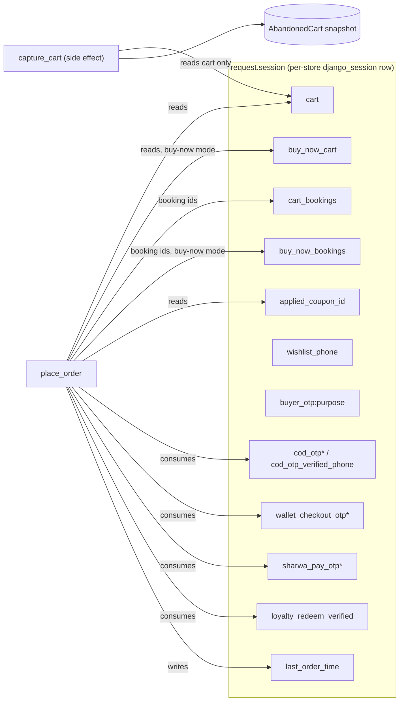
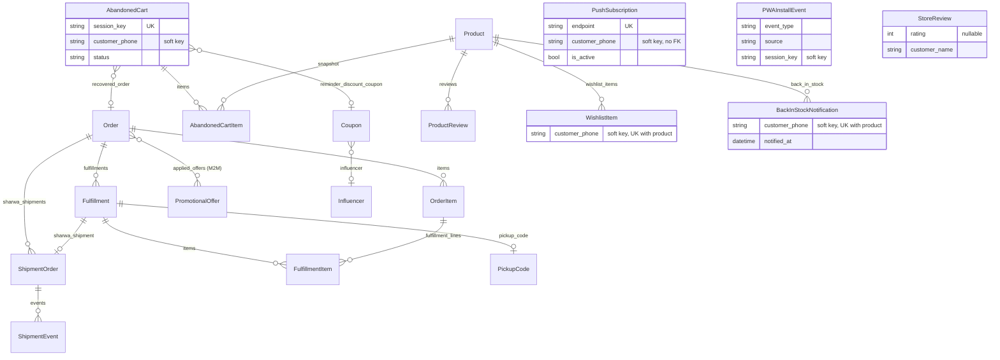
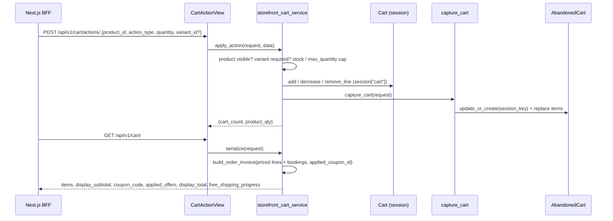
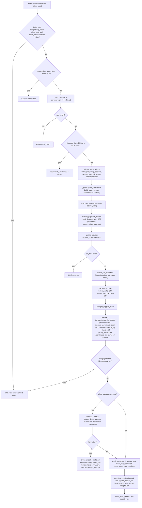
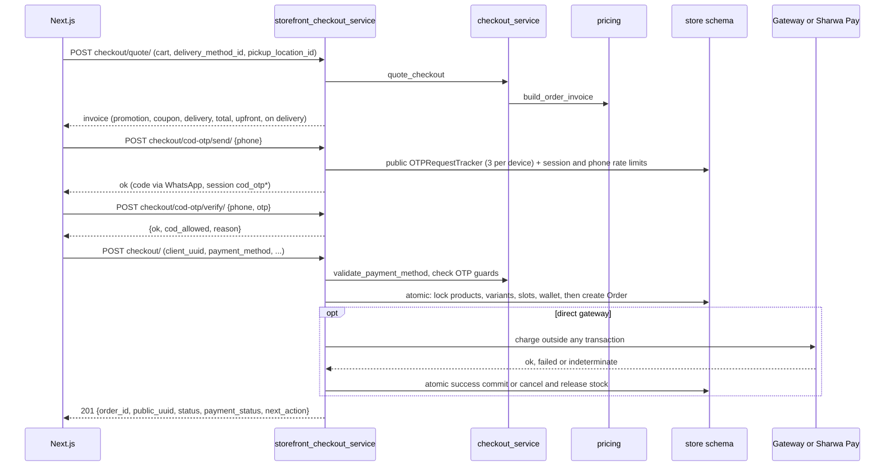
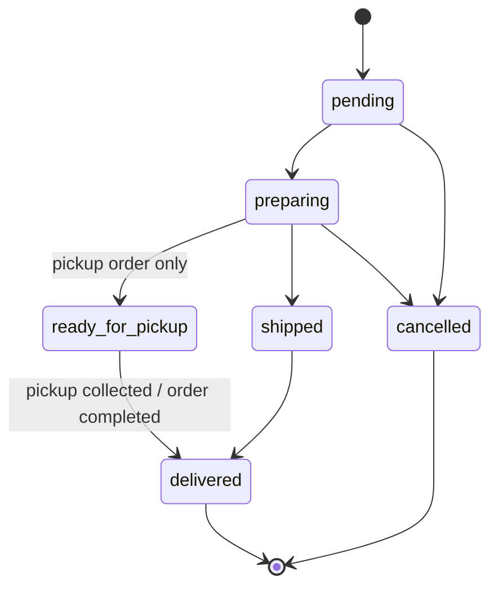
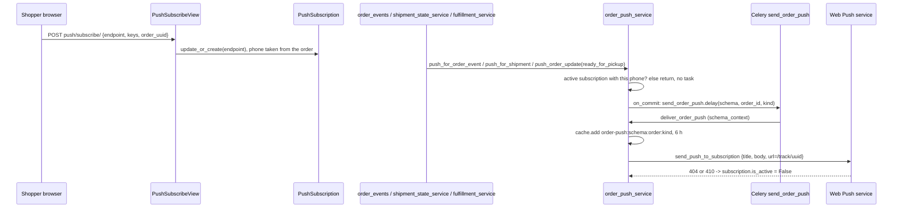

# Data model — Domain 5: storefront, cart, checkout, tracking, PWA and shopper engagement

> **Source**: DOC-485 · inventory Domain 5 · INT-011 (M09), INT-012 (M10), INT-013 (M11), INT-014 (M12), INT-015 (M41), INT-016 (M44), INT-029 (M42)
> **Code**: `sharwa_saas/products/services/{storefront_catalog_service,storefront_product_service,storefront_cart_service,storefront_checkout_service,checkout_service,order_tracking_service,order_push_service,push_service,engagement_service,fulfillment_service,booking_service}.py` · `sharwa_saas/api/{views,views_storefront,views_checkout,views_tracking,views_push,views_engagement,urls}.py` · `sharwa_saas/products/{cart,pricing,abandoned_carts,abandoned_cart_service,utils,forms}.py` · `sharwa_saas/products/models/{marketing,carts_recovery,locations,shipping,pwa,customer_interactions,catalog}.py` · `sharwa_saas/products/tasks/operations.py` · `sharwa_saas/products/views/{cart_checkout,customer_engagement,pwa,push,storefront}.py`
> **Last verified against code**: 2026-10-28 (step 37)

## 1. Purpose

Domain 5 is everything an **anonymous shopper** touches on the Next.js storefront: browsing the catalog, the cart, coupons and offers, checkout, the public order page and tracking page, installing the store as a PWA, browser push, and light engagement (wishlist, back-in-stock, reviews).

Three facts shape the whole domain:

1. **There are no customer accounts.** The shopper identity is the Django session (a row in the per-store `django_session` table) plus, when the shopper volunteers it, a phone number. The cart, applied coupon, OTP proofs, holds and the shopper phone all live in `request.session` (section 2.3).
2. **There is no permanent cart table.** The cart is a dict in the session (`products/cart.py`). `AbandonedCart` is only a *side-effect snapshot* taken for recovery (`products/abandoned_carts.py:71`).
3. **The JSON checkout reuses the legacy HTML checkout core.** `storefront_checkout_service` is a thin JSON orchestrator over `checkout_service` (the code that used to live inside the `checkout` view) and over the same `pricing.build_order_invoice`. There is no second pricing engine and no second stock reservation (`storefront_checkout_service.py:1-8`, `checkout_service.py:1-27`).

This page documents the providers, the session state, the models and migrations, the checkout pipeline, the mapping rules between UI payment methods and Django payment methods, tracking, PWA/push and engagement. The customer/wallet/loyalty side of the same checkout is on [`06-customers-wallets.md`](06-customers-wallets.md). Order storage itself (the `Order` row) is on [`04-orders-returns.md`](04-orders-returns.md); catalog models on [`03-catalog.md`](03-catalog.md). Money formatting is in [`../40-money.md`](../40-money.md), idempotency keys in [`../41-idempotency.md`](../41-idempotency.md), locks in [`../42-concurrency.md`](../42-concurrency.md).

Out of scope: wallet and loyalty OTP endpoints (`wallet/*`, `loyalty/*`) which are provider-side in Domain 6; booking slots (`BookingSlot`, Domain 13, only the session keys are listed here); auctions (`StorefrontAuctionView`, Domain 3).

## 2. Components

### 2.1 Provider table (file → what it owns)

| File | Owns |
|---|---|
| `products/services/storefront_catalog_service.py` | Public list rules shared by `catalog/products/` and `catalog/facets/`: visibility via `Product.objects.visible()`, category-with-descendants, Arabic-normalised search, orderings (`ORDERINGS`), faceted counts, `active_offers()` (limit `OFFERS_LIMIT = 6`). |
| `api/views_storefront.py` | `CatalogFacetsView`, `CatalogOffersView`, `ProductReviewsView`, `ProductQuoteView`, `CartCouponView`, `CartContactView`, `CartRestoreView`. |
| `products/services/storefront_product_service.py` | Product page extensions. `ProductDetailSerializer.to_representation` (`api/serializers.py:199-215`) calls `detail_extensions()` (`storefront_product_service.py:242`) to add images, variants, bundle, personalization, related products, reviews summary, JSON-LD values. `reviews_page()` (`:302`), `formula_quote()` (`:327`). |
| `products/services/storefront_cart_service.py` | Cart JSON: `serialize()` (`:62`), `apply_action()` (`:139`), `clear()` (`:239`), `apply_coupon()` (`:248`), `save_contact()` (`:281`), `restore()` (`:296`). Uses `products/cart.py` for lines and `pricing.build_order_invoice` for totals. |
| `products/cart.py` | `Cart(request, session_key='cart')`: session dict, line key `"{product_id}_v{variant_id}"` or `"{product_id}_{size}_{color}"` (`cart.py:15-18`). The same class serves `buy_now_cart`. |
| `products/pricing.py` | `build_order_invoice` (`:105`): promotions, coupon, free shipping, delivery fee, total, upfront split. `calculate_upfront` (`:54`). |
| `products/services/storefront_checkout_service.py` | JSON checkout: `quote` (`:327`), `delivery_options` (`:343`), `payment_options` (`:383`), `send_cod_otp` (`:435`), `verify_cod_otp` (`:485`), `send_sharwa_pay_otp` (`:514`), `place_order` (`:649`), `attach_receipt` (`:878`), `public_order_view` (`:840`). |
| `products/services/checkout_service.py` | The shared core: `quote_checkout` (`:124`), `validate_payment_method` (`:186`), `prepare_direct_payment` (`:208`), `check_wallet_otp` (`:235`), `check_sharwa_pay_otp` (`:271`), `check_cod_otp` (`:303`), `preflight_supplier_stock` (`:314`), `reserve_and_create_order` (`:321`, phase 1), `charge_direct_payment` (`:763`, phases 2-3), `credit_merchant_if_sharwa_pay` (`:823`), `notify_order_created` (`:831`). |
| `api/views_checkout.py` | Thin public views over the service: `CheckoutView`, `CheckoutQuoteView`, `CheckoutDeliveryOptionsView`, `CheckoutPaymentOptionsView`, `CodOtpSendView`, `CodOtpVerifyView`, `SharwaPayOtpSendView`, `PublicOrderView`, `PublicOrderReceiptView`. All `authentication_classes = []`, `HasTenantContext`. |
| `products/views/cart_checkout.py` | Legacy HTML cart and checkout (kept): `cart_detail`, `add_to_cart`, `checkout` (`:479`), `send_cod_otp`/`verify_cod_otp`, `restore_abandoned_cart` (`:274`), `checkout_cart_items` (`:52`, **also imported by the JSON service** at `storefront_checkout_service.py:173`). |
| `products/services/order_tracking_service.py` + `api/views_tracking.py` | Public tracking JSON (`track_order`, `tracking_view`), the derived public state (`_public_state`), pickup code issue (`ensure_pickup_code`, `:130`), carrier name lookup (`_carrier_name`, `:88`). |
| `api/views.py` (PWA rows) | `PWAInstallEventView` (`:246`), `PushVapidPublicKeyView` (`:281`), `PushSubscribeView` (`:299`), `PushUnsubscribeView`; `StoreConfigView` (`:75`, the `/config/` payload). |
| `products/services/order_push_service.py` | Targeted order-status push: message table `MESSAGES`, event → kind maps, `push_order_update` (enqueue on commit), `deliver_order_push` (inside Celery), `active_subscribers`. |
| `products/services/push_service.py` | `send_push_to_subscription` (pywebpush; deactivates on 404/410), `send_push_to_all_subscribers` (enqueues `send_push_broadcast`). |
| `api/views_push.py` | Merchant side: `PushStatsView` (`push/stats/`), `PushTestView` (`push/test/`). |
| `products/services/engagement_service.py` + `api/views_engagement.py` | Shopper phone (`wishlist_phone`), wishlist, back-in-stock, store reviews, buyer OTP (`buyer_otp:<purpose>`), product review submission. |
| `products/services/fulfillment_service.py` | `mark_fulfillment_prepared` (`:42`): sets `ready_for_pickup`, calls `ensure_pickup_code` and pushes for pickup orders (`:62-66`). |
| `products/services/booking_service.py` | Session keys `cart_bookings` / `buy_now_bookings` (`:44-45`), `hold()`, `set_buy_now()`, `release_cart()`. Domain 13 owns the rules. |
| `products/abandoned_carts.py`, `products/abandoned_cart_service.py` | Capture (`capture_cart`), attach phone (`attach_cart_customer`), recover (`mark_cart_recovered`), lazy promotion (`promote_abandoned_carts`), signed restore token (`build_cart_restore_token`), reminder runner (`run_abandoned_cart_reminders`). |
| `products/utils.py` | Session key constants and OTP rate limits (`:168-188`, `rate_limit_attempt`, `phone_cache_rate_limited`), `clean_phone_number` (`:111`). |

### 2.2 Next-owned assets

The roadmap states that the PWA manifest, the `/icon` route and `/sw.js` are Next.js-owned and built from the `/config/` payload (`StoreConfigView`), and that the service-worker push payload is `{title, body, url}`.

- **Verified on the Django side**: `GET /api/v1/config/` exists (`api/urls.py:58`, `api/views.py:75-85`) and the Django push payload is built in `push_service.py:66-68`.
- **Not verifiable from the code copy**: the Next.js assets themselves. The `sharwa-frontend/src` copy used for this step holds only landing, onboarding, BFF and `lib/bff` files, so the manifest, `/icon` and `sw.js` sources were not read. Treated as roadmap-stated, not code-verified.

> ⚠️ Discrepancy — roadmap says the service-worker push payload is `{title, body, url}` / code does: the payload is `{title, body, url}` plus an **optional `icon`** key added only when the caller passes one (`products/services/push_service.py:66-68`; `send_push_broadcast(schema_name, title, body, url=None, icon=None)` at `products/tasks/operations.py:211`). The legacy Django service worker reads `data.title`, `data.body`, `data.icon` (fallback `/static/pwa/icons/icon-192x192.png`) and `data.url` (`products/views/pwa.py:180-195`). Reported in step 37.

The Django app also still serves its **own** manifest and service worker for the legacy HTML storefront (`manifest.webmanifest` and `sw.js` routes, `config/urls_tenant.py:245-246`, views `manifest_view` / `service_worker_view` in `products/views/pwa.py:29,201`). These are separate from the Next-owned assets.

### 2.3 Session state (the anonymous identity)

Sessions are Django database sessions in each store's schema: `django.contrib.sessions` is in `TENANT_APPS` (`config/settings.py:152-158`), no `SESSION_ENGINE` override exists, and `SESSION_EXPIRE_AT_BROWSER_CLOSE = True` (`config/settings.py:380`). Cache-based counters (per-phone rate limits) use the Redis/LocMem cache with the key `rl:<schema>:<action>:<phone>` (`products/utils.py:245`).

| Session key | Written by | Value / TTL | Consumed or cleared by |
|---|---|---|---|
| `cart` | `Cart.add/decrease/remove` (`storefront_cart_service.apply_action`, legacy `add_to_cart`), `storefront_cart_service.restore` | dict of lines keyed `"{pid}_v{vid}"` or `"{pid}_{size}_{color}"`: `{product_id, quantity, size, color, variant_id, ...}` | `Cart.clear()` after a placed order (`storefront_checkout_service.py:816`) or `storefront_cart_service.clear` |
| `buy_now_cart` | `_fill_buy_now` (`storefront_checkout_service.py:125`) via `Cart(request, session_key='buy_now_cart')` | single-line cart, cleared and refilled on each buy-now checkout | `cart.clear()` after the order (`:816`); never captured by `capture_cart` |
| `cart_bookings` | `booking_service.add_to_session` (`:305`) | list of `BookingSlot` ids held for this session | `booking_service.release_cart` (`:330`), `storefront_cart_service.clear` |
| `buy_now_bookings` | `booking_service.set_buy_now` (`:313`) | `[slot.pk]` or `[]` | replaced on each buy-now; hold TTL `HOLD_MINUTES = 15` (`booking_service.py:36`) |
| `applied_coupon_id` | `storefront_cart_service.apply_coupon` (`:259`), `restore` (`:323`) | `Coupon.pk` | popped by `remove_coupon`, `clear`, an invalid-coupon check in `serialize` (`:108`), and after a placed order (`storefront_checkout_service.py:819`) |
| `user_currency` | `?currency=` on legacy pages, `api/views.py:193` | cart display currency (default `SAR`) | read by `Cart.target_currency` |
| `wishlist_phone` | `engagement_service.set_shopper_phone` (`:65`), legacy `customer_engagement.py:49` | normalised phone (`^(967\|966)\d{9}$`) | read by wishlist, back-in-stock, `session_phone` |
| `buyer_otp:<purpose>` | `engagement_service.send_buyer_otp` (`:178`) | `{phone, code, at, wrong, verified}`, TTL 600 s, resend gap 60 s, max 5 wrong; `purpose` in `review`, `auction`, `wishlist`, `back_in_stock` | `check_buyer_otp` (`:210`, consumed on success) |
| `cod_otp`, `cod_otp_phone`, `cod_otp_created_at` | `send_cod_otp` (`storefront_checkout_service.py:435`) | 6-digit code, phone, epoch seconds; TTL `COD_OTP_TTL_SECONDS = 600` | cleared by `_clear_cod_code` on verify success or expiry |
| `cod_otp_verified_phone` | `verify_cod_otp` (`:485`), only when COD is allowed | the verified phone | consumed once by `check_cod_otp` (`checkout_service.py:303`) |
| `wallet_checkout_otp`, `wallet_checkout_otp_phone`, `wallet_checkout_otp_created_at` | Domain 6 (`storefront_wallet_service._issue_otp`) | 6-digit code, TTL 600 s | `checkout_service.check_wallet_otp` |
| `sharwa_pay_otp`, `sharwa_pay_otp_phone`, `sharwa_pay_otp_created_at` | `send_sharwa_pay_otp` (`:514`) | 6-digit code, TTL 600 s | `checkout_service.check_sharwa_pay_otp` |
| `loyalty_redeem_verified` | `storefront_wallet_service.verify_loyalty_otp` | `{phone, at}`, TTL `LOYALTY_VERIFIED_TTL_SECONDS = 600` | popped after the order (`storefront_checkout_service.py:817`) |
| `last_order_time` | `place_order` (`:818`) | epoch seconds | checked at `:663`: a second order within 60 s is refused with 429 «لقد أرسلت طلباً قبل قليل. يرجى الانتظار دقيقة قبل إرسال طلب جديد.» |
| `otp_rate_limit` | `rate_limit_attempt` (`products/utils.py:207`) | per-key attempt timestamps, 3 attempts per 600 s (`OTP_RATE_LIMIT_MAX`, `OTP_RATE_LIMIT_WINDOW`) | self-pruning window |
| `traffic_source`, `device_type`, `utm_source`, `utm_medium`, `utm_campaign`, `pending_aff_cookie` | legacy storefront middleware/views (`products/views/storefront.py:35,166-179`) | attribution | read by `place_order` into the `OrderDraft` (`:749-752`) |

## 3. Data model

All models below live in the `products` app, which is in `TENANT_APPS` only (`config/settings.py:152-158`), so each store gets its own copy in its schema. The one public-schema dependency is `core.OTPRequestTracker` (`core` is in `SHARED_APPS`, `config/settings.py:121-125`). Evidence for each model's schema is the owning app. The shopper's phone number is a **soft key**: `WishlistItem`, `BackInStockNotification`, `PushSubscription`, `ProductReview`, `AbandonedCart` store `customer_phone` as plain text with no foreign key (see [`06-customers-wallets.md`](06-customers-wallets.md) for how these are joined).

### 3.1 Model table

| Model | Schema (public/store) | Key fields | Constraints / indexes | Added or changed by (migration) |
|---|---|---|---|---|
| `Coupon` (`models/marketing.py:46`) | store | `code`, `discount_type` (`percent`/`fixed`), `discount_value`, `min_order_amount`, `apply_to` (`all`/`category`/`product`), `category`, `product`, `influencer`, `start_date`, `expires_at`, `is_active`, `max_uses`, `used_count` | `code` unique + indexed; `is_active` indexed; FKs `SET_NULL`; `is_valid()` is the single validity check (`:86-101`); `used_count` bumped with `F()` in the order transaction (`checkout_service.py:686`) | `products/0017_coupon_order_coupon_code_order_discount_amount_and_more.py` (create), `0023_alter_coupon_min_order_amount_and_more.py`, `0026_coupon_apply_to_coupon_category_coupon_product.py`, `0056_influencer_influencersale_coupon.py` (`influencer`, `expires_at`), `0074_coupon_start_date_alter_giftsettings_id.py`, `0076_abandonedcartsettings_and_more.py` (`max_uses`, `used_count`), `0106_alter_coupon_options.py` |
| `PromotionalOffer` (`models/marketing.py:110`) | store | `offer_type` (`discount`/`free_shipping`/`buy_x_get_y`), `condition_type` (`all`/`category`/`product`/`min_items`), `discount_type`, `discount_value`, `min_order_amount`, `category`, `product`, `buy_*`, `get_*`, `min_total_items`, `priority`, `valid_from`, `valid_until`, `is_active`, `image`, `cta_text` | no unique constraint; ordering `-priority`, `-created_at`; applied automatically, no FK to `Coupon`; attached to the order via `order.applied_offers` (M2M, `checkout_service.py:697`) | `products/0057_promotionaloffer_order.py` (create), `0071_promotionaloffer_condition_type.py`, `0072_promotionaloffer_feedback_fixes.py`, `0080_promotionaloffer_buy_condition_type_and_more.py`, `0084_promotionaloffer_cta_text_promotionaloffer_image_and_more.py`, `0206_alter_brand_logo_alter_category_image_and_more.py`, `0220_marketing_api.py` (`buy_condition_type` choice `min_items`) |
| `AbandonedCart` (`models/carts_recovery.py:6`) | store | `session_key`, `customer_phone`, `customer_name`, `total_amount`, `currency`, `items_count`, `status` (`active`/`abandoned`/`recovered`), `last_interaction_at`, `recovered_order`, `reminder_step`, `last_reminder_sent_at`, `reminder_discount_coupon` | `session_key` **unique** (race guard for `update_or_create`, comment at `:21-30`); `customer_phone` and `status` indexed; `recovered_order` and `reminder_discount_coupon` are `SET_NULL`; ordering `-last_interaction_at` | `products/0053_abandonedcart_abandonedcartitem.py` (create), `0054_abandonedcart_session_key_unique.py`, `0063_abandonedcart_recovered_order.py`, `0076_abandonedcartsettings_and_more.py` (`reminder_step`, `last_reminder_sent_at`, `reminder_discount_coupon`) |
| `AbandonedCartItem` (`:70`) | store | `cart`, `product`, `product_name` (snapshot), `quantity`, `size`, `color` | `cart` FK `CASCADE`; `product` FK `SET_NULL`; no variant column | `products/0053_abandonedcart_abandonedcartitem.py` |
| `PickupCode` (`models/locations.py`) | store | `fulfillment` (one-to-one), `code` (max 12), `compartment_number`, `expires_at`, `picked_up_at` | `code` unique; `fulfillment` `OneToOne CASCADE` | `products/0139_fulfillment.py` |
| `Fulfillment` (`models/locations.py:476`) | store | `order`, `location` (`PROTECT`), `status`, `tracking_number`, `requires_reassignment`, `shipping_provider`, `shipped_at`, `delivered_at`, `prepared_by_staff`, `prepared_at` | `status` indexed (choices `pending`, `preparing`, `ready_for_pickup`, `shipped`, `delivered`, `forwarded_to_supplier`, `cancelled`); ordering `created_at` | `products/0139_fulfillment.py` (create), `0162_restrictedzonepolygon_and_more.py` (`requires_reassignment`), `0174_utm_and_staff_performance.py` (`prepared_by_staff`, `prepared_at`) |
| `FulfillmentItem` (`:534`) | store | `fulfillment`, `order_item`, `quantity`, `delivered_quantity`, `rejection_reason`, `is_backordered`, `prepared_by_staff`, `awb_locked_at` | both FKs `CASCADE`; no unique pair (an order line can be split across fulfillments) | `products/0139_fulfillment.py` (create), `0140_routing_rule.py` (`is_backordered`), `0155_returns.py` (`prepared_by_staff`, `awb_locked_at`), `0163_fulfillmentitem_delivered_quantity_and_more.py` (`delivered_quantity`, `rejection_reason`) |
| `ShipmentOrder` (`models/shipping.py:20`) | store | `order`, `fulfillment` (one-to-one, nullable), `waybill_number`, `carrier_code` (default `sharwa_ship`), `zone_name_snapshot`, `cost_snapshot`, `currency`, `status`, `billing_status`, weight snapshots, `master_waybill_number`, `parent_shipment`, `collected_at`, `delivered_at` | `waybill_number` unique; `status`, `billing_status`, `carrier_code`, `created_at` indexed; `order` FK `CASCADE` (`related_name='sharwa_shipments'`) | `products/0103_sharwa_shipment_order.py` (create), `0141_shipment_order_multi_fulfillment.py` (`fulfillment`, `order` becomes FK), `0161_product_hazard_class_product_is_hazardous_and_more.py` (weights, master waybill, `parent_shipment`), `0164_shippingprovider_carrier_code_and_more.py`, `0166_customerreliabilityrecord_alter_shipmentorder_status.py` (adds `compensated_lost`), `0176_phase_c.py` (`carrier_code`) |
| `ShipmentEvent` (`:107`) | store | `shipment`, `event_time`, `received_at`, `from_status`, `to_status`, `source` (`webhook`/`agent_app`/`merchant_manual`/`system`), `actor_type`, `actor_id`, `idempotency_key`, `raw_payload`, geo fields, `is_rejected`, `rejection_reason`, `out_of_order`, `flagged_for_review` | `idempotency_key` unique (max 200); `source` and `is_rejected` indexed; composite index `(shipment, event_time)`; rejected events are kept, never deleted | `products/0160_shipmentevent.py` |
| `PWAInstallEvent` (`models/pwa.py:18`) | store | `event_type` (`prompt_shown`, `ios_hint_shown`, `accepted`, `dismissed`, `installed`), `session_key`, `user_agent`, `source` (`django_storefront`, `nextjs_app`) | index `pwa_event_type_created_idx` on `(event_type, created_at)`; ordering `-created_at` | `products/0135_pushsubscription_pwainstallevent.py` |
| `PushSubscription` (`models/pwa.py:64`) | store | `endpoint`, `p256dh`, `auth`, `user_agent`, `customer_phone` (nullable), `is_active` | `endpoint` unique (`URLField` max 500) so `update_or_create` is the upsert; disabled, not deleted, on 404/410 | `products/0135_pushsubscription_pwainstallevent.py` |
| `StoreReview` (`models/catalog.py:1708`) | store | `customer_name`, `rating` (**nullable**, 1-5), `comment`, `admin_reply`, `created_at` | `created_at` indexed; legacy comments keep `rating = NULL` and are excluded from the average and the Next.js list (`engagement_service.store_reviews`, `:140`) | `products/0016_storereview.py` (create), `0228_engagement_api.py` (`rating`) |
| `ProductReview` (`models/customer_interactions.py:12`) | store | `product`, `customer_name`, `rating` (1-5 validators), `comment`, `customer_phone` (`customer_key` form, default `''`), `admin_reply`, `is_approved` (default `True`), `created_at` | `customer_phone`, `is_approved`, `created_at` indexed; Next.js reviews are saved with `is_approved=False` until the merchant approves | `products/0112_customer_interactions.py` (create), `0218_customer_crm.py` (`customer_phone`), `0228_engagement_api.py` (`is_approved`) |
| `WishlistItem` (`:39`) | store | `customer_phone`, `product` | `UniqueConstraint(customer_phone, product)` named `unique_wishlist_item`; `customer_phone` indexed | `products/0112_customer_interactions.py` |
| `BackInStockNotification` (`:80`) | store | `customer_phone`, `product`, `created_at`, `notified_at` | `UniqueConstraint(customer_phone, product)` named `unique_back_in_stock`; `customer_phone` indexed | `products/0112_customer_interactions.py` |
| `OTPRequestTracker` (`core/models.py:81`) — referenced, not owned here | **public** | `client_uuid`, `phone_number`, `request_count`, `last_request_time`, `is_blocked` | device-level OTP flood guard used by COD OTP send (`storefront_checkout_service.py:441-457`: 3 requests per device, counter reset after 600 s) | `core/0001_initial.py` |

That is **16 models**: 15 store-schema models plus the one public model the COD OTP path writes. `Order` (owner of `idempotency_key`, `public_uuid`, `pickup_location`, `sales_channel`) is documented in [`04-orders-returns.md`](04-orders-returns.md); `AbandonedCartSettings` (reminder delays, enable switch) in [`07-marketing-design-partners.md`](07-marketing-design-partners.md).

The `Order` columns this domain relies on, for orientation: `idempotency_key` is `UUIDField(default=uuid4, unique=True)` (`models/orders.py:339`) and `place_order` overwrites it with the client's `client_uuid` (section 4.2); `public_uuid` is `UUIDField(unique=True, db_index=True)` (`:398`) and is the only key of the public order and tracking pages.

### 3.2 ER sketch

`PushSubscription`, `PWAInstallEvent` and `StoreReview` have no relations by design. The `customer_phone` columns join to `Order.customer_phone` only through the Python key derivation in [`06-customers-wallets.md`](06-customers-wallets.md).

### 3.3 Model notes

**Coupons and offers in the storefront.** A coupon is chosen by the shopper (`applied_coupon_id`), an offer applies automatically. The pricing order is fixed in `pricing.build_order_invoice` (`pricing.py:105-177`): (1) promotions first, capped by the subtotal, (2) coupon on the remainder `subtotal - promotion_discount_amount` (not the raw subtotal), (3) free shipping (product flag, store threshold converted with `convert_amount`, or a `free_shipping` offer), (4) delivery fee (zero for free shipping, an empty cart, or a cart of only bookable services; `delivery_fee_override` for pickup), (5) `total_price = max(0, subtotal - promotion - discount + delivery_fee)`, (6) upfront split by `calculate_upfront`. The wallet never enters this function. `_effective_payment_policy` (`pricing.py:39-51`) treats `cod` and `deposit` as `full` when the store has `enable_manual_payment = False`.

**Abandoned cart.** `capture_cart` (`abandoned_carts.py:71`) runs after each cart change and snapshots **only `session['cart']`** (`_snapshot_session_cart`, `:30-68`); `buy_now_cart`, `cart_bookings` and `buy_now_bookings` are never captured (comment at `views/cart_checkout.py:725`). An empty cart deletes the snapshot. `attach_cart_customer` (`:127`) writes name and phone once the shopper reaches checkout (`place_order` calls it at `storefront_checkout_service.py:712`) or posts `cart/contact/`. `mark_cart_recovered` (`:148`): a cart whose status is `abandoned` becomes `recovered` and gets `recovered_order`; a still-`active` cart is **deleted**, so a fast buyer is not counted as recovered. Statuses move `active` -> `abandoned` lazily (`promote_abandoned_carts`, `ABANDON_THRESHOLD_HOURS = 2`, `abandoned_carts.py:27,195`) or by the Beat task `expire_stale_active_carts` (24 h, section 6).

**Restore token.** `build_cart_restore_token` signs `{'cart_id': <id>}` with `django.core.signing` and salt `abandoned-cart-restore` (`abandoned_cart_service.py:26-30`). `storefront_cart_service.restore` accepts it with `max_age = 7 * 24 * 3600` (`RESTORE_MAX_AGE`, `:31,302`); a bad or expired token returns 404 «رابط استرداد السلة غير صالح أو انتهت صلاحيته.». Restoring merges the snapshot lines into `session['cart']` with `variant_id = None` (the snapshot has no variant column, so variant lines come back as plain size/colour lines), and applies `reminder_discount_coupon` only if `Coupon.is_valid()` still passes.

**Fulfillment and pickup code.** A simple order has no `Fulfillment` rows (they are created only with location routing or dropshipping); tracking then derives one virtual fulfillment from the order (`_fulfillments`, `order_tracking_service.py:229-243`). `ensure_pickup_code` (`:130`) is a service function, not a model method: it creates a `PickupCode` with a 6-digit code (`secrets.randbelow(1_000_000)` zero-padded), expiry `PICKUP_CODE_TTL = 30 days`, retries up to 8 times on a unique collision, and returns the existing row if another request created it first. It is called from `mark_fulfillment_prepared` (`fulfillment_service.py:62-66`) for pickup orders and lazily from tracking for fulfillments prepared before the feature shipped. The code is hidden after `picked_up_at` is set (`_pickup_code`, `:149-154`). Orders without a `Fulfillment` row can never show a code (`'pickup_code': None  # PickupCode «يحتاج صف Fulfillment»`, `:240`).

**Push.** One VAPID key pair for the whole platform (`settings.VAPID_PUBLIC_KEY`, `VAPID_PRIVATE_KEY`, `VAPID_CLAIMS_EMAIL`, `config/settings.py:97-99`); there is no per-store key and no field for one (`models/pwa.py:11-14`). `PushSubscribeView` stores the phone **from the order identified by `order_uuid`**, never from the request body; a subscription without `order_uuid` is anonymous and receives broadcasts only (`api/views.py:316-332`).

**Reviews.** The Next.js product review needs a WhatsApp OTP (`purpose=review`) and is stored `is_approved=False` with `customer_phone = customer_key(phone)`; the merchant approves or hides it with `PATCH reviews/<id>/ {approved}` (Domain 6, `customer_service.reply_to_review`, `:666`). The legacy HTML review form keeps the `is_approved=True` default. Store reviews are published at once, rate-limited to 3 per hour per session (`engagement_service.add_store_review`, `:155-175`).

### 3.4 Migration list (exact file names, `sharwa_saas/products/migrations/`)

| Migration | What it does for this domain |
|---|---|
| `0016_storereview.py` | creates `StoreReview` |
| `0017_coupon_order_coupon_code_order_discount_amount_and_more.py` | creates `Coupon`; adds order coupon fields |
| `0023_alter_coupon_min_order_amount_and_more.py` | `Coupon.min_order_amount` nullable |
| `0026_coupon_apply_to_coupon_category_coupon_product.py` | `Coupon.apply_to`, `category`, `product` |
| `0053_abandonedcart_abandonedcartitem.py` | creates `AbandonedCart`, `AbandonedCartItem` |
| `0054_abandonedcart_session_key_unique.py` | makes `AbandonedCart.session_key` unique |
| `0056_influencer_influencersale_coupon.py` | `Coupon.influencer`, `Coupon.expires_at` |
| `0057_promotionaloffer_order.py` | creates `PromotionalOffer`; order offer link |
| `0063_abandonedcart_recovered_order.py` | `AbandonedCart.recovered_order` |
| `0071_promotionaloffer_condition_type.py`, `0072_promotionaloffer_feedback_fixes.py`, `0080_promotionaloffer_buy_condition_type_and_more.py`, `0084_promotionaloffer_cta_text_promotionaloffer_image_and_more.py`, `0206_alter_brand_logo_alter_category_image_and_more.py`, `0220_marketing_api.py` | `PromotionalOffer` evolution |
| `0074_coupon_start_date_alter_giftsettings_id.py`, `0076_abandonedcartsettings_and_more.py`, `0106_alter_coupon_options.py` | `Coupon` start date, `max_uses`/`used_count`, options; reminder fields on `AbandonedCart` |
| `0103_sharwa_shipment_order.py`, `0141_shipment_order_multi_fulfillment.py`, `0161_product_hazard_class_product_is_hazardous_and_more.py`, `0164_shippingprovider_carrier_code_and_more.py`, `0166_customerreliabilityrecord_alter_shipmentorder_status.py`, `0176_phase_c.py` | `ShipmentOrder` creation and evolution |
| `0112_customer_interactions.py` | creates `ProductReview`, `WishlistItem`, `BackInStockNotification` |
| `0135_pushsubscription_pwainstallevent.py` | creates `PushSubscription`, `PWAInstallEvent` |
| `0139_fulfillment.py`, `0140_routing_rule.py`, `0155_returns.py`, `0162_restrictedzonepolygon_and_more.py`, `0163_fulfillmentitem_delivered_quantity_and_more.py`, `0174_utm_and_staff_performance.py` | `Fulfillment`, `FulfillmentItem`, `PickupCode` creation and evolution |
| `0160_shipmentevent.py` | creates `ShipmentEvent` |
| `0218_customer_crm.py` | `ProductReview.customer_phone` |
| `0228_engagement_api.py` | `StoreReview.rating` (nullable), `ProductReview.is_approved` |
| `core/migrations/0001_initial.py` | `OTPRequestTracker` (public) |

The only Phase 002 storefront migration is `0228_engagement_api.py` (plus `0218_customer_crm.py` for `ProductReview.customer_phone`). INT-011 to INT-016 added **no** migration: catalog, cart, checkout, tracking and push run on pre-existing tables (`order_tracking_service.py:5-6` states "«قراءة فقط فوق نماذج قائمة — لا هجرة»" and the checkout reuses `Order.idempotency_key`).

> The staged migration directory is a partial copy. Migration numbers above were read from the files that exist on the development machine listing (`products/migrations/`, 0001-0236); the exact content was verified for each file cited, but fields added by files not staged would not appear here (see section 9).

## 4. Flows

### 4.1 Cart

Rules in `apply_action` (`storefront_cart_service.py:139-206`): only visible products; a product with variants needs a `variant_id` that belongs to it; quantity is clamped by stock (unless backorder is allowed) and `max_quantity`; an auction product is one piece; a bookable service is added with `start_datetime`, which creates a live session hold in `cart_bookings` (quantity 1). `serialize` drops `applied_coupon_id` from the session when the invoice reports `coupon_error` (`:104-108`).

### 4.2 Checkout pipeline

The orchestration is `storefront_checkout_service.place_order` (`:649-824`). The numbers match the code order.

Notes on the pipeline:

1. **Idempotency is two-layered.** A fast pre-check on `Order.idempotency_key` (`:660`) returns the first order for a repeated `client_uuid` (HTTP 200 instead of 201). The authoritative guard is the unique column: the key is written by an `Order.objects.filter(pk=...).update(idempotency_key=client_uuid)` **inside the same atomic block** as the reservation (`:767-777`), so a concurrent duplicate fails with `IntegrityError` and rolls back its whole reservation (stock, wallet debit, Sharwa Pay debit, coupon use, booking slots, commissions); the handler then returns the first order (`:787-791`). A hard gateway failure frees the key by assigning a fresh `uuid4` (`:808`) so the shopper can retry with the same `client_uuid`.
2. **Three-phase protocol** (documented at `checkout_service.py:11-16`): phase 1 is the short atomic block with `select_for_update` on products, then variants ordered by id (deadlock avoidance), booking slots and the customer wallet, plus stock decrement and `Order` creation; phase 2 is the bank call **outside** any transaction (`charge_direct_payment`, `:763`); phase 3 is the short atomic success commit. The COD OTP gate (`check_cod_otp`) runs before any lock. See [`../42-concurrency.md`](../42-concurrency.md).
3. **Initial order state** is decided in phase 1 (`checkout_service.py:566-588`): direct gateway -> `pending_payment` / `pending`; Sharwa Pay charged -> `new` / `paid`; wallet covered everything -> `new` / `paid`; receipt attached -> `awaiting_payment` / `unpaid`; wallet covered part -> `new` / `partial`; otherwise `new` / `unpaid`. A gateway result that cannot be decided leaves `payment_review` with `payment_status = 'indeterminate'` (`:789`), and `place_order` carries on (the money may have moved).
4. **Inside the phase-1 transaction** the order also gets: `applied_offers.set(...)`, the wallet debit with reason `order_payment` (`:705`), `create_influencer_sale`, `create_affiliate_sale`, `award_points_for_order` (`:713-719`), and `Coupon.used_count` increment with `F()` (`:686`). Any `ValueError` (including `CheckoutRejected`) rolls everything back; `place_order` turns it into HTTP 400.
5. **Order of guards**: field validation runs **before** any OTP is consumed ("so that an incomplete request does not burn a code", `_validate` docstring `:564`), then loyalty confirmation, wallet OTP, Sharwa Pay OTP, COD OTP.
6. **Pickup orders**: `pickup_location_id` forces `delivery_fee_override = 0` through `build_order_invoice` (`_quote`, `:234-238`) and sets `Order.pickup_location` in the reservation transaction; the stored address becomes «استلام من الفرع: <name>» (the string is built at `:743`).

### 4.3 Payment-method mapping (UI vs Django)

Django stores both "cash on delivery" and "bank transfer" as `payment_method = 'manual'` (`storefront_checkout_service.py:11-23`, `core_method = 'manual' if method in ('manual','cod') else method`, `:687`).

| UI value (`payment_method` in the request) | Django `Order.payment_method` | Required inputs | Extra rules | Public reading of the stored order |
|---|---|---|---|---|
| `cod` | `manual`, **no receipt** | `otp` (or a prior `cod_otp_verified_phone` for the same phone) | allowed only when `invoice.upfront_required == 0` (otherwise 400 with «هذا الطلب يتطلب دفع … مقدماً — اختر التحويل أو الدفع الإلكتروني.»); refused when `cod_disabled_for(phone)` (`COD_REFUSED`); passes the same `check_cod_otp` WhatsApp gate as the legacy checkout | `cod` (no receipt and no `reported_transfer_amount`) |
| `manual` | `manual`, **with** receipt and reported amount | `receipt_image` (JPEG or PNG, at most 5 MB via `validate_receipt_image`, `forms.py:30-36`) and `transfer_amount_reported` (regex `^\d+(\.\d{1,2})?$`) | the receipt replaces the OTP; both fields are mandatory because a transfer without proof is a COD order and has its own option; initial state `awaiting_payment` / `unpaid` | `manual` (`public_method`, `:545-548`) |
| `sharwa_pay` | `sharwa_pay` | `sharwa_pay_otp` | balance debited in phase 1 from the public `SharwaPayWallet`; order `new` / `paid`; merchant credited by `credit_merchant_if_sharwa_pay` | `sharwa_pay` |
| gateway code (`jeeb`, `kuraimi`, any `GATEWAY_REGISTRY` key) | same code | gateway fields such as `purchase_code` / `pin` (`GATEWAY_FIELDS`, `:79`) - never stored | direct charge outside the transaction (phases 2-3); order starts `pending_payment` | gateway code, label from `get_gateway_display_name` |

`validate_receipt_image` messages (exact): «صيغة الملف غير مدعومة. يُسمح فقط بصور JPEG أو PNG.» and «حجم الملف كبير جداً. الحد الأقصى المسموح به 5MB.» (`forms.py:34,36`). A receipt can be attached later through `POST orders/<uuid>/receipt/` (`attach_receipt`, `:878-911`) only while `public_method(order) == 'manual'` and the status is `awaiting_payment` or `payment_review`; it bumps the order version and records a `payment` event.

### 4.4 COD OTP and the guard chain

`send_cod_otp` (`:435-477`): normalise the phone, derive `device = uuid5(NAMESPACE_URL, 'sharwa-session:<session_key>')` when the client sends no `client_uuid` (`_device_uuid`, `:424-432`), check `OTPRequestTracker` in the **public** schema (blocked device or 3 requests inside 600 s -> 429), then `rate_limit_attempt` (session, 3/600 s) and `phone_cache_rate_limited` (cache, phone only, survives cookie clearing), generate `secrets.randbelow(900000) + 100000`, store the three `cod_otp*` keys and send through `WhatsAppService`. A failed WhatsApp send returns 502.

`verify_cod_otp` (`:485-511`): compare with the saved code, expire after `COD_OTP_TTL_SECONDS` (600), clear the code, then `cod_disabled_for(phone)` (`:507-508`): when the store disabled COD for this phone the response is `{ok: true, cod_allowed: false, reason: COD_REFUSED}` and **no** `cod_otp_verified_phone` is set. The enforcement chain and the auto-disable rule are on [`06-customers-wallets.md`](06-customers-wallets.md).

### 4.5 Public tracking and the derived state

`GET orders/track/<public_uuid>/` has no authentication; `public_uuid` is the only key, and an unknown uuid or one from another store returns the same 404 «لم نجد هذا الطلب.» (`views_tracking.py` docstring, `order_tracking_service.NOT_FOUND`). Two independent axes are returned and never merged: `status` (system financial states, `STATUS_LABELS`) and the merchant-defined `fulfillment_status` (name and colour only).

`ready_for_pickup` in Django means "ready for pickup **or** shipping". `_public_state` (`order_tracking_service.py:203-213`) maps it:

| Order condition | Raw fulfillment state | Public state and label |
|---|---|---|
| `status = cancelled` | any | `cancelled` |
| `status` in `completed`, `refunded` | any | `delivered` (order-level override) |
| pickup order (`pickup_location_id` set) | `ready_for_pickup` or `shipped` | `ready_for_pickup` («جاهز للاستلام») plus the pickup code |
| delivery order | `ready_for_pickup` | `preparing` with label «جاهز للشحن» (so the page keeps "we will tell you when it ships") |
| any other | as stored | stored value and its label |

For an order with no `Fulfillment` rows, `_derived_state` (`:216-226`) derives a single state from the latest non-cancelled `ShipmentOrder` (`delivered` -> delivered; `label_pending` / `pending_pickup` -> ready; other -> shipped) or `Order.shipped_at`. The shipment block exposes `carrier_code`, `carrier_name` and a courier name and phone **only** while the shipment is `picked_up` or `in_transit` and the carrier is the internal fleet (`COURIER_VISIBLE`, `INTERNAL_CARRIER = 'sharwa_ship'`, `_courier`, `:166-180`). `carrier_name` is «شروة شيب» for the internal fleet, otherwise `products.carriers.registry.get_carrier_class(code).display_name` (the 3PL registry, `_carrier_name`, `:88-94`). Zero-leak rules: masked phone (`_mask`, first 3 and last 3 digits), no coordinates, no staff, no waybill cost, no internal location names; for a gift order, no amounts and no buyer data (`tracking_view`, `:296-333`).

### 4.6 Browser push

Event mapping (`order_push_service.py:46-61`): `ORDER_SHIPPED` -> `shipped`, `ORDER_DELIVERED` -> `delivered`, `ORDER_CANCELLED` -> `cancelled`, `PAYMENT_RECEIVED` -> `payment_received` (`ORDER_CREATED` is deliberately silent); shipment transitions `picked_up` -> `shipped`, `in_transit` -> `in_transit`, `delivered` -> `delivered`, `returned` -> `returned`; plus `ready_for_pickup` from `mark_fulfillment_prepared`. The body uses the order id `{n}`; the title is prefixed with `StoreSetting.store_name`.

### 4.7 Engagement (shopper phone, wishlist, back-in-stock, reviews)

Shopper identity for lists is the **session phone** (`wishlist_phone`) without OTP: "identifies a list, not a payment" (`engagement_service.py:11`). Actions that need proof of ownership use `buyer_otp:<purpose>` via `customers/otp/send/` (`BuyerOtpSendView`, which is mounted under `customers/` but lives in `views_engagement.py`; the route is registered before `customers/<str:phone>/` in `api/urls.py`). `back-in-stock` upserts with `get_or_create`; a row already notified is re-armed by setting `notified_at = None` (`engagement_service.py:131-137`) and the response is 201 or 200 with `{subscribed: true, already}`.

## 5. Invariants

1. **One session, one cart snapshot.** `AbandonedCart.session_key` is unique, so concurrent captures for one session cannot create duplicates (`models/carts_recovery.py:31`, migration `0054_abandonedcart_session_key_unique.py`). Enforced by the database, not by `transaction.atomic()`.
2. **Capture never breaks the cart or checkout.** Every function in `abandoned_carts.py` swallows and logs exceptions (module docstring); a failing capture returns `None`.
3. **Idempotent order placement.** `Order.idempotency_key` is unique and is set inside the reservation transaction; the same `client_uuid` yields one order (section 4.2). Related: [`../41-idempotency.md`](../41-idempotency.md).
4. **Server price is binding.** The invoice is recomputed server-side at placement from locked product rows (`product_resolver` in `calculate_upfront`, `pricing.py:54-63`); client totals are ignored.
5. **Field validation precedes OTP consumption** (`_validate` runs before the OTP guards in `place_order`), so an incomplete form never burns a code.
6. **COD needs a verified phone and no upfront amount**, and the verified-phone flag is consumed exactly once (`check_cod_otp` pops `cod_otp_verified_phone`, `checkout_service.py:303-311`).
7. **A disabled-COD phone can neither verify nor place a COD order** (`verify_cod_otp` returns `cod_allowed: false`, `place_order` returns 400 on `payment_method`).
8. **A receipt is required for a transfer** and must be JPEG or PNG up to 5 MB (`validate_receipt_image`).
9. **Public order and tracking pages are read-only and keyed by `public_uuid` alone**, with masked phone and no internal data; gift orders hide amounts and buyer.
10. **A push subscription's phone comes from an order, never from client input** (`PushSubscribeView`, `api/views.py:316-332`), which prevents reading another buyer's order status.
11. **Push is never blocking and never duplicated.** No subscribers -> no task; enqueue is `transaction.on_commit`; any error is logged and swallowed; one notification per order and kind every 6 hours (`DEDUPE_TTL = 6 * 3600`).
12. **`PushSubscription.endpoint` is unique**; expired subscriptions are deactivated (404 or 410 from the push service), never deleted.
13. **A pickup code is issued at most once per fulfillment** (`OneToOne` + `unique` code + race handling in `ensure_pickup_code`).
14. **Hidden or archived products never reach the shopper.** All storefront queries go through `Product.objects.visible()` (`models/catalog.py:225`); `_changed_lines` returns 409 for lines that vanished or ran out of stock before any reservation.
15. **Product reviews from Next.js stay hidden until approved** (`is_approved=False`), store reviews with `rating IS NULL` never enter the average.

## 6. Background work

| Task / schedule | Where | What it does |
|---|---|---|
| `products.tasks.expire_stale_active_carts` (Beat `expire-stale-active-carts`, every 30 min, `config/settings.py:654-657`) | `products/tasks/operations.py:153`; per-store `expire_stale_active_carts_for_tenant` (`:137`) | Marks `AbandonedCart` rows with status `active` and `last_interaction_at` older than `DRAFT_CART_TTL_HOURS = 24` as `abandoned`. Fan-out per tenant with `schema_context`. |
| `products.tasks.send_order_push` | `operations.py:201` | One order-status push. Runs `deliver_order_push` inside `schema_context(schema_name)`. Enqueued with `on_commit`. |
| `products.tasks.send_push_broadcast` | `operations.py:211` | Broadcast to every active `PushSubscription` of the store (merchant test push). Failure of one subscription does not stop the rest. |
| `manage.py send_abandoned_cart_reminders` | `products/management/commands/send_abandoned_cart_reminders.py` -> `abandoned_cart_service.run_abandoned_cart_reminders` | Runs `promote_abandoned_carts`, then reminder step 1 and 2 (delays and minimum value from `AbandonedCartSettings`). Management command, not a Beat entry. |
| Lazy promotion | `promote_abandoned_carts` (`abandoned_carts.py:195`) | `active` -> `abandoned` after `ABANDON_THRESHOLD_HOURS = 2`; called when the merchant opens the abandoned-carts page, from the marketing service and from the reminder runner. |

The two promotion thresholds differ on purpose-looking but undocumented terms: 2 hours (lazy, merchant view and reminders) versus 24 hours (Beat). A cart can therefore be `abandoned` in the merchant view after 2 hours even though the Beat task would only mark it after 24 hours.

## 7. Configuration

| Setting / constant | Default | Where |
|---|---|---|
| `VAPID_PUBLIC_KEY`, `VAPID_PRIVATE_KEY` | empty string (env) | `config/settings.py:97-98` |
| `VAPID_CLAIMS_EMAIL` | `admin@sharwaah.com` (env override) | `config/settings.py:99` |
| `RESTORE_MAX_AGE` | 7 days | `storefront_cart_service.py:31` |
| `CART_RESTORE_SALT` | `abandoned-cart-restore` | `abandoned_cart_service.py:26` |
| `ABANDON_THRESHOLD_HOURS` | 2 | `abandoned_carts.py:27` |
| `DRAFT_CART_TTL_HOURS` | 24 | `tasks/operations.py:134` |
| `COD_OTP_TTL_SECONDS`, `WALLET_OTP_TTL_SECONDS`, `SHARWA_PAY_OTP_TTL_SECONDS` | 600 | `products/utils.py:187`, `:171`, `:179` |
| `OTP_RATE_LIMIT_MAX` / `OTP_RATE_LIMIT_WINDOW` | 3 / 600 s | `products/utils.py:161-162` |
| `OTP_TTL_SECONDS`, `OTP_RESEND_SECONDS`, `OTP_MAX_WRONG` (buyer OTP) | 600 / 60 / 5 | `engagement_service.py:37-39` |
| `LOYALTY_VERIFIED_TTL_SECONDS` | 600 | `storefront_checkout_service.py:64` |
| Order throttle | 60 s per session (`last_order_time`) | `storefront_checkout_service.py:663` |
| `PICKUP_CODE_TTL` | 30 days | `order_tracking_service.py:74` |
| `DEDUPE_TTL` (order push) | 6 h | `order_push_service.py:32` |
| PWA install event rate limit | 300 per minute per IP | `api/views.py:254` |
| Push subscribe rate limit | 120 per minute per IP | `api/views.py:305` |
| Merchant test-push cooldown | 60 s per schema; title at most 60, body at most 200 characters | `api/views_push.py` (`COOLDOWN`, `TITLE_MAX`, `BODY_MAX`) |
| Store review rate limit | 3 per 3600 s per session | `engagement_service.py:171` |
| `SESSION_EXPIRE_AT_BROWSER_CLOSE` | `True` | `config/settings.py:380` |

## 8. Failure modes and fixes

| Failure | Symptom | Cause | Handling / fix |
|---|---|---|---|
| Double submit of checkout | Second request returns the first order, HTTP 200 | same `client_uuid` | pre-check plus unique `Order.idempotency_key` (INT-014, FR-12.04) |
| Cart changed between cart page and pay | 409 `CART_CHANGED` with product names | product hidden, archived or out of stock | `_changed_lines` before any reservation (FR-12.13) |
| Hard gateway failure | 400 on `payment_method`; order cancelled, stock released | gateway rejected the charge | `idempotency_key` replaced by a new uuid so a retry with the same `client_uuid` works (`:808`) |
| Indeterminate gateway result | Order exists in `payment_review`, `payment_status = indeterminate` | timeout or unknown answer after money may have moved | order kept for manual review; `place_order` continues and returns 201 |
| COD for a blocked phone | `verify` answers `cod_allowed: false`; `checkout` 400 | `CustomerReliabilityRecord.cod_disabled` (manual or auto) | INT-017; see `06-customers-wallets.md` |
| COD with an upfront amount | 400 on `payment_method` | policy says deposit or upfront > 0 | message with the amount; choose transfer or online |
| OTP flood | 429 | per-device tracker (public), per-session and per-phone limits | three layers in `send_cod_otp` |
| WhatsApp send failed | 502 | `WhatsAppService.send_message` false | code is not kept for buyer OTP (`request.session.pop(key)`); retry |
| Restore link stale | 404 | older than 7 days or tampered | shopper re-adds items |
| Restore loses variant | variant line returns without `variant_id` | `AbandonedCartItem` has no variant | known limit (section 9) |
| Duplicate cart snapshots | none in practice | unique `session_key` | migration `0054` |
| Push to a stale browser | subscription goes inactive | push service 404 or 410 | `is_active = False`, history kept |
| Push broker down | no push, order flow unaffected | Celery or Redis unavailable | `push_order_update` swallows exceptions |
| Pickup order shows no code | `pickup_code: null` | order has no `Fulfillment` row | code needs a fulfillment; created on `mark_fulfillment_prepared` |

## 9. Open items

> ⚠️ Discrepancy — roadmap says the SW push payload is `{title, body, url}` / code does: adds optional `icon` (`products/services/push_service.py:66-68`). Reported in step 37. (Repeated here for the list; full text in section 2.2.)

- **No back-in-stock sender was found.** `BackInStockNotification.notified_at` is only read (`engagement_service.py:132-135`, `customer_service.py:624`, admin list) and reset to `None`; nothing in `products/` or `api/` sets it or sends a message when stock returns. The subscription is recorded and shown in the customer profile tab, but no notification job exists in the staged code. Reported in step 37 as an unverified/absent behaviour.
- **Stale docstring**: `storefront_cart_service.py:12-16` says personalization fields "are not priced here — the current checkout does not price them yet". Whether `Cart.__iter__` or the checkout prices personalization was not traced in this step.
- **Two promotion thresholds** for abandoned carts (2 h lazy versus 24 h Beat) are not reconciled (section 6).
- **Restore drops variants** (`variant_id = None`) because `AbandonedCartItem` stores no variant.
- **Migration coverage is partial for some columns.** The migration directory staged for this step is a subset; every migration cited was read, but additional files (for example later `ShipmentOrder` or `Fulfillment` alterations) were not all staged. Fields on `ShipmentOrder` not traced to a migration here: `zone_name_snapshot`, `cost_snapshot`, `billing_status` choices beyond `0103`.
- **Next-owned assets** (manifest, `/icon`, `sw.js`) not verified (section 2.2).
- **`ensure_pickup_code()`** is a function in `order_tracking_service.py:130`, not a `PickupCode` method as the roadmap wording "`PickupCode` with `ensure_pickup_code()`" might suggest.
- The legacy HTML storefront and the JSON storefront both stay live; attribution session keys (`traffic_source`, `device_type`, `utm_*`) are written only by the legacy HTML views, so a pure Next.js session places orders with the defaults `direct` / `mobile` (`storefront_checkout_service.py:749-750`).

## 10. Related pages

- [`../40-money.md`](../40-money.md) - `display_*` formatting, `convert_amount`
- [`../41-idempotency.md`](../41-idempotency.md) - `client_uuid`, `Idempotency-Key`
- [`../42-concurrency.md`](../42-concurrency.md) - `select_for_update` ordering, the three-phase protocol
- [`../43-ledgers.md`](../43-ledgers.md) - customer wallet debit at checkout, Sharwa Pay debit
- [`../44-stock-ledger.md`](../44-stock-ledger.md) - stock decrement inside the reservation
- [`../10-multi-tenancy.md`](../10-multi-tenancy.md) and [`../13-cross-schema-access.md`](../13-cross-schema-access.md) - per-store sessions, `schema_context('public')` for `OTPRequestTracker`
- [`../20-bff.md`](../20-bff.md) - how the Next.js BFF reaches `/api/v1/`
- [`../15-plans-and-features.md`](../15-plans-and-features.md) - feature gates (bookings, wallets)
- [`03-catalog.md`](03-catalog.md), [`04-orders-returns.md`](04-orders-returns.md), [`06-customers-wallets.md`](06-customers-wallets.md), [`07-marketing-design-partners.md`](07-marketing-design-partners.md), [`08-finance.md`](08-finance.md), [`11-shipping.md`](11-shipping.md), [`13-channels-operations.md`](13-channels-operations.md)

## Appendix A. Legacy HTML views kept

These Django template views and routes are not removed; the JSON providers above are their Next.js counterparts. Routes are in `config/urls_tenant.py`.

| Legacy view | Route name / path | Notes |
|---|---|---|
| `order_status_public_view` (`products/views/storefront.py:644`) | `order_status_public`, `orders/track/<uuid:public_uuid>/` (`urls_tenant.py:239`) | read-only HTML twin of the tracking JSON; same `public_uuid` key |
| `cart_detail`, `add_to_cart`, `apply_coupon`, `remove_coupon`, `clear_cart`, `calculate_shipping`, `restore_abandoned_cart` (`views/cart_checkout.py`) | `cart/`, `cart/add/<id>/`, `cart/restore/<token>/` (`urls_tenant.py:247-253`) | `checkout_cart_items` is reused by the JSON service |
| `checkout`, `send_cod_otp`, `verify_cod_otp` (`views/cart_checkout.py:479,362,440`) | `checkout/`, `checkout/cod-otp/send/`, `checkout/cod-otp/verify/` (`urls_tenant.py:254-260`) | HTML checkout; the core functions live in `checkout_service` |
| `gift_checkout` (`views/gift_checkout.py:113`) | `checkout/gift/<uuid:cart_id>` | gift flow, HTML only |
| `toggle_wishlist`, `wishlist_view`, `submit_review`, `subscribe_back_in_stock` (`views/customer_engagement.py:23,68,106,133`) | `product/<id>/wishlist/`, `wishlist/`, `product/<id>/review/`, `product/<id>/notify/` (`urls_tenant.py:232-235`) | write the same `WishlistItem`, `ProductReview` (approved by default), `BackInStockNotification` |
| `about_us_view` store-review form (`views/storefront.py:629-640`) | `about_us` | creates `StoreReview(customer_name, comment)` with `rating = NULL` |
| `manifest_view`, `service_worker_view` (`views/pwa.py:29,201`) | `manifest.webmanifest`, `sw.js` (`urls_tenant.py:245-246`) | Django-owned PWA files for the HTML storefront |
| `send_test_push_notification` (`views/push.py:17`) | `dashboard/reports/send-test-push/` (`urls_tenant.py:299`) | HTML button replaced by `push/test/` |
| wallet/loyalty OTP views (`views/wallets.py`, `views/loyalty.py`) | `wallet/otp/send/`, `loyalty/redeem/` | covered in `06-customers-wallets.md` |

## Appendix B. Tests

Verified present in the staged backend copy, with `def test_` counts:

| File | Tests | Covers |
|---|---|---|
| `api/test_storefront_catalog_api.py` | 6 | facets, offers, list rules (INT-011) |
| `api/test_storefront_product_api.py` | 5 | product detail extensions, reviews page, formula quote (INT-012) |
| `api/test_storefront_cart_api.py` | 8 | add and shape, stock cap, variants, clear, coupon messages and minimum, free-shipping progress, contact capture, restore with coupon (INT-013) |
| `api/test_storefront_checkout_api.py` | 10 | options, quote and pickup, COD OTP and place, COD needs verified phone, COD refused with upfront, transfer needs receipt then attach later, receipt refused for COD and paid, changed-cart 409, buy-now isolation, pickup links location (INT-014) |
| `api/test_order_tracking_api.py` | 12 | contract and headers, unknown uuid 404, shipment timeline and courier, returned explanation, pending-pickup reads "ready to ship", finished and cancelled orders, split-order rollup, pickup code issued once, lazy code, delivery order has no code, gift hides amounts, deposit split (INT-015) |
| `api/test_pwa_push_api.py` | 11 | install event, subscribe binds phone from order only, free phone ignored, unknown order 400, unsubscribe, one push per phone per event, no subscribers no task, accepted shipment transition, ready-for-pickup, merchant stats and test push, staff cannot broadcast (INT-016) |
| `api/test_engagement_api.py` | 4 | shopper phone and wishlist, back-in-stock idempotent, store reviews, buyer OTP and product review moderation (INT-029) |
| `products/test_push_notifications.py` | 10 | legacy push models and sending |
| `products/test_pwa_install_tracking.py` | 6 | legacy install-event tracking |
| `products/test_customer_engagement.py` | 12 | legacy HTML wishlist, review, back-in-stock |

Also exercising this domain: `api/test_catalog_api.py` (16) and `api/test_catalog_serializers.py` (21) for the catalog list and detail serializers.
