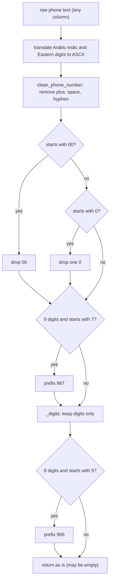
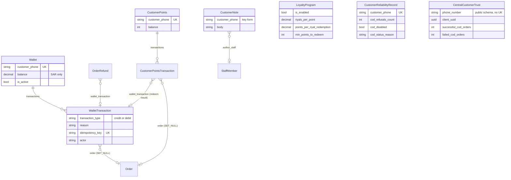
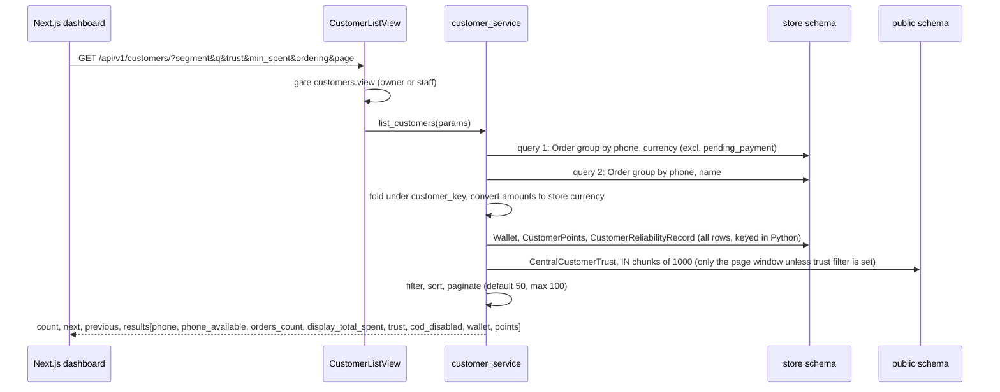
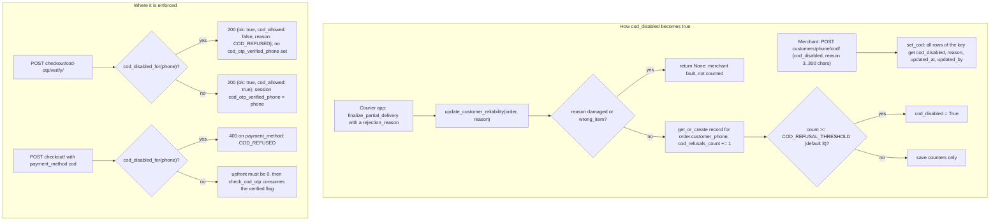
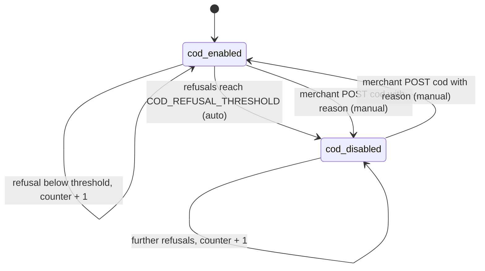
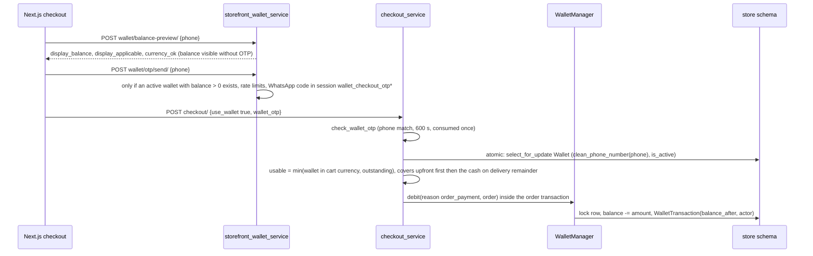

# Data model — Domain 6: customers, customer wallets, loyalty points and COD trust

> **Source**: DOC-486 · inventory Domain 6 · INT-017 (M07), INT-028 (M35) (+ INT-029 for the review fields on the customer profile)
> **Code**: `sharwa_saas/products/services/{customer_service,wallet_service,storefront_wallet_service,loyalty_service,reverse_logistics_service,cod_collection_service,refund_service}.py` · `sharwa_saas/products/loyalty.py` · `sharwa_saas/products/campaigns.py` · `sharwa_saas/api/{views_customers,views_wallets}.py` · `sharwa_saas/products/models/{wallets,loyalty,customer_interactions,reverse_logistics}.py` · `sharwa_saas/core/models.py` · `sharwa_saas/products/utils.py` · `sharwa_saas/products/views/{wallets,loyalty,customer_report}.py`
> **Last verified against code**: 2026-10-28 (step 37)

## 1. Purpose

Sharwa has **no `Customer` table**. A "customer" is a *derived* entity: the set of orders that share one normalised phone number. Everything a merchant sees about a customer (orders, lifetime value, wallet, points, COD trust, wishlist, reviews, notes, abandoned carts) is assembled at read time from tables that each store the phone as plain text, and the join key is computed in Python by `customer_service.customer_key()` (`products/services/customer_service.py:66`).

This page specifies:

1. the **customer key** (section 2.2, with worked examples for `77...`, `077...` and `96777...`),
2. the models that hold per-phone state: customer wallet, loyalty points, loyalty programme, internal notes, store-level COD reliability, and the platform-level (public) COD trust,
3. the merchant APIs (`customers/*`, `customers/wallets/*`, `loyalty/*`) and the checkout-side wallet and points endpoints,
4. the **COD enforcement path** (verify, checkout, automatic disable after refusals, manual override).

Out of scope: the merchant's own wallet and Sharwa Pay (see [`08-finance.md`](08-finance.md) and [`../43-ledgers.md`](../43-ledgers.md) section L5 for the customer-wallet ledger design), order storage ([`04-orders-returns.md`](04-orders-returns.md)), the checkout pipeline itself ([`05-storefront.md`](05-storefront.md)) and loyalty programme *settings* (`loyalty/program/`, marketing service; [`07-marketing-design-partners.md`](07-marketing-design-partners.md)).

## 2. Components

### 2.1 Provider table (file → what it owns)

| File | Owns |
|---|---|
| `products/services/customer_service.py` (763 lines) | The whole derived-customer model: `customer_key` (`:66`), `_matching_raw` (`:74`), `_aggregates` (`:105`), `platform_trust` (`:188`), `_store_reliability` (`:226`), `cod_disabled_for` (`:248`), list, filters and sorting (`list_customers` `:414`), `segment_count` (`:428`), `customer_detail` (`:462`), `set_cod` (`:518`), the tabs (`wallet_tab`, `points_tab`, `wishlist_tab`, `reviews_tab`), `reply_to_review` (`:666`), notes, `export_csv` (`:740`). |
| `api/views_customers.py` | HTTP layer for `customers/*` and `reviews/<id>/`: permission gate (`customers.view`, `customers.export`, `customers.edit_profile`), staff behaviour accounting for views and exports, audit logs for export and COD changes. |
| `products/services/wallet_service.py` (307 lines) | Merchant side of customer wallets and points: list and detail (`list_wallets` `:112`, `wallet_detail` `:106`), `create_wallet` (`:141`), `list_transactions` (`:184`), `topup` (`:203`, reasons `manual_topup`/`reward`/`adjustment`, idempotency), `list_points` (`:257`), `list_points_transactions` (`:291`), `normalize_phone` (`:65`). |
| `api/views_wallets.py` | HTTP layer for `customers/wallets/*`, `customers/loyalty-program/`, `loyalty/points/*` (plan-feature gated) and the checkout-side public views `wallet/balance-preview/`, `wallet/otp/send/`, `loyalty/balance/`, `loyalty/otp/send/`, `loyalty/redeem/`. |
| `products/services/storefront_wallet_service.py` (174 lines) | Checkout side: `wallet_preview` (`:61`), `send_wallet_otp` (`:85`), `loyalty_balance` (`:113`), `send_loyalty_otp` (`:129`), `verify_loyalty_otp` (`:149`). Shares the `wallet_checkout_otp*` session keys between wallet and loyalty proofs. |
| `products/models/wallets.py` | `Wallet`, `WalletTransaction`, **`WalletManager`** - the only write path for the balance (`credit` `:44`, `debit` `:60`, each in `transaction.atomic()` with `select_for_update()`). |
| `products/models/loyalty.py` + `products/loyalty.py` + `products/services/loyalty_service.py` | `LoyaltyProgram` (singleton), `CustomerPoints`, `CustomerPointsTransaction`, `CustomerPointsManager` (`earn`, `redeem`); `award_points_for_order` (`loyalty.py:18`), `redeem_points_to_wallet` (`loyalty.py:52`), `claw_back_points` / `claw_back_loyalty_points` (`loyalty_service.py:19,43`). |
| `products/models/customer_interactions.py` | `CustomerNote` (`:57`), and the phone-keyed `WishlistItem`, `BackInStockNotification`, `ProductReview` that the profile reads. |
| `products/models/reverse_logistics.py` | `CustomerReliabilityRecord` (`:65`): store-level refusal counter and COD switch. |
| `products/services/reverse_logistics_service.py` | `update_customer_reliability` (`:133`, the auto-disable rule), `is_cod_disabled` (`:154`, **not called anywhere**, see section 9). |
| `products/services/cod_collection_service.py` | Courier delivery finalisation; calls `update_customer_reliability` on a partial or full refusal (`:214-222`). |
| `core/models.py` | `CentralCustomerTrust` (`:13`, **public** schema), cross-store COD history. |
| `products/utils.py` | `clean_phone_number` (`:111`), `get_customer_trust_map` (`:143`), OTP session keys and rate limits. |
| `products/campaigns.py` | `_resolve_raw_recipients` (`:84`): the audience resolver that sizes the `customers/segments/count/` response. |
| `products/services/refund_service.py` | Credits the customer wallet on a refund (`method='wallet'` at `:103`, `'wallet_credit'` at `:151`) and claws back points on a full refund (`:195-196`). |
| `products/services/checkout_service.py` | Wallet debit with reason `order_payment` (`:705`) and `award_points_for_order` (`:719`) inside the order transaction. |

### 2.2 The customer key (specification)

#### 2.2.1 Definition

```python
# products/utils.py:111-131  (the single source of truth for phone cleaning)
def clean_phone_number(p, default_country_code='967'):
    if not p: return ""
    p = str(p).replace('+', '').replace(' ', '').replace('-', '').strip()
    if p.startswith('00'): p = p[2:]
    elif p.startswith('0'): p = p[1:]
    if len(p) == 9 and p.startswith('7'): p = default_country_code + p
    return p

# products/services/customer_service.py:51-71
_ARABIC_DIGITS  = {ord(chr(0x0660 + i)): str(i) for i in range(10)}   # Arabic-Indic digits
_EASTERN_DIGITS = {ord(chr(0x06F0 + i)): str(i) for i in range(10)}   # Eastern Arabic-Indic digits
def customer_key(raw):
    phone = _digits(clean_phone_number(str(raw or '').translate(_ARABIC_DIGITS).translate(_EASTERN_DIGITS)))
    if len(phone) == 9 and phone.startswith('5'):
        phone = '966' + phone
    return phone            # '' when the input has no digits
```

Steps, in order:

1. Convert Arabic-Indic and Eastern Arabic-Indic digits to ASCII (`customer_key` only; `clean_phone_number` itself does **not** translate digits).
2. `clean_phone_number`: drop `+`, spaces and `-`; strip a leading `00` (international prefix) **or** one leading `0`; if the result is exactly 9 digits and starts with `7`, prepend `967` (Yemen is the default country code).
3. `_digits`: keep digits only (this removes any other punctuation, **after** step 2, so the Yemen rule in step 2 sees the unfiltered string).
4. If the result is exactly 9 digits and starts with `5`, prepend `966` (Saudi mobile; the comment says this is the same rule as `normalizeCustomerPhone` in the Next.js dashboard, which was not available in the code copy and is therefore not verified here).
5. Anything else is returned as it is (landlines, 10-digit strings, partial numbers). No length or country validation happens in the key itself.

#### 2.2.2 Worked examples (computed by running the real functions)

Fake phone `771234567` (the sample used by `api/test_customers_api.py`); `clean` is the output of `clean_phone_number` alone.

| Input as stored or typed | `clean_phone_number` | `customer_key` | Rule that fired |
|---|---|---|---|
| `771234567` (the `77...` form) | `967771234567` | **`967771234567`** | 9 digits starting with 7 -> prefix `967` |
| `0771234567` (the `077...` form) | `967771234567` | **`967771234567`** | leading `0` stripped, then prefix `967` |
| `967771234567` (the `96777...` form) | `967771234567` | **`967771234567`** | already canonical |
| `+967 771 234 567` | `967771234567` | `967771234567` | `+` and spaces removed |
| `00967771234567` | `967771234567` | `967771234567` | `00` stripped |
| `077-123-4567` | `967771234567` | `967771234567` | `-` removed, `0` stripped, prefix |
| `٧٧١٢٣٤٥٦٧` (Arabic-Indic) | `٧٧١٢٣٤٥٦٧` (unchanged) | `967771234567` | digits translated first, then as `77...` |
| `۰۷۷۱۲۳۴۵۶۷` (Eastern) | `۰۷۷۱۲۳۴۵۶۷` (unchanged) | `967771234567` | translated, then as `077...` |
| `0501234567` (Saudi local) | `501234567` | **`966501234567`** | `0` stripped (9 digits, starts with 5) -> prefix `966` |
| `501234567` | `501234567` | `966501234567` | prefix `966` |
| `966501234567`, `+966 50 123 4567`, `00966501234567` | `966501234567` | `966501234567` | already canonical after cleaning |
| `٠٥٠١٢٣٤٥٦٧` | `٠٥٠١٢٣٤٥٦٧` (unchanged) | `966501234567` | translated, then as `050...` |
| `00771234567` | `967771234567` | `967771234567` | quirk: `00` removed leaves 9 digits starting with 7 -> prefix `967` |
| `(771) 234-567` | `(771)234567` | `771234567` | **no prefix**: the parenthesis keeps the length at 11 in step 2; `_digits` then leaves 9 digits starting with 7 (not 5) |
| `0112345678` (landline) | `112345678` | `112345678` | no rule applies |
| `7712345678` (10 digits) | `7712345678` | `7712345678` | no rule applies |
| `abc`, `` (empty), `None` | `abc` / `` / `` | `` (empty) | no digits; the row is skipped by every aggregator |

`api/test_customers_api.py::test_customer_key` asserts the first five rows (`771234567`, `0771234567`, `967771234567`, `+967 771234567`, `٠٧٧١٢٣٤٥٦٧`) all map to `967771234567` and `0501234567` to `966501234567`.



#### 2.2.3 How the key is used

- **No SQL phone expression.** Phones are stored in several formats (`77...`, `077...`, `96777...`), so a SQL equality cannot join them. The service narrows with `customer_phone__endswith=<last 9 digits of the key>` and then verifies in Python that `customer_key(raw) == key` (`_matching_raw`, `customer_service.py:74-82`; the same pattern in `cod_disabled_for`, `:248-254`, which filters `customer_phone__endswith=key[-9:]`).
- **Two grouped queries, merged in Python** (`_aggregates`, `:105-155`): (1) `Order` grouped by raw `customer_phone` and `currency` (counts, `Sum('total_price')` excluding cancelled, min and max dates, marketplace counter); (2) `Order` grouped by raw `customer_phone` and `customer_name` for the display name (newest name wins, older distinct names become `other_names`). Rows are folded under `customer_key(raw)`; each amount is converted to the store currency with `convert_amount` per row.
- **Which orders count.** `_base_orders()` is `Order.objects.exclude(status='pending_payment').exclude(customer_phone='')` (`:93`): a `pending_payment` order is a payment attempt, not a placed order.

| Measure | Rule | Code |
|---|---|---|
| `orders_count` | all placed orders, **including cancelled** | `:105` (`orders`) |
| `display_total_spent` (LTV) | sum of `total_price` for orders whose status is **not** `cancelled`, converted to the store currency | `:118` |
| `display_refunded` | sum of `OrderRefund.amount` (excluding `pending_payment` orders) | `customer_detail`, `:470-474` |
| `display_avg_basket` | spent / non-cancelled orders, 2 decimals | `:477` |
| `first_order_at`, `last_order_at` | min and max over all placed orders (cancelled included) | `:105` |
| dormant | newest **non-cancelled** order older than `DORMANT_DAYS = 90` days; no non-cancelled order means not dormant | `:45,283` |
| `phone_available` | at least one order whose `traffic_source` is not `amazon` or `noon` (`MARKETPLACES`); a marketplace-only customer has the marketplace proxy phone, so `phone_available = false`, the phone is hidden in the CSV export, and phone search does not match it | `:46,288-296,316` |

- **Where the key form is stored.** Rows written *by the customer API* use the key as is: `CustomerNote.customer_phone`, `ProductReview.customer_phone` (set by `engagement_service.submit_product_review` with `customer_key(phone)`), and a `CustomerReliabilityRecord` created by `set_cod` (`:518`). Rows written by checkout, refund and courier code use `clean_phone_number(order.customer_phone)` or the raw order phone: `Wallet`, `CustomerPoints`, `CustomerReliabilityRecord` (auto path), `WishlistItem`, `BackInStockNotification`. The profile therefore matches them through the Python key, never by equality. `Wallet` and `CustomerPoints` rows keyed `501234567` (9-digit Saudi, only possible from the legacy HTML flows) and `966501234567` fold under the same customer in the list, but see section 9 about `Wallet` choosing only the first row.
- **Search.** `_phone_query` (`:288`) strips digits, a leading `00` or `0`, and matches by substring against the key only for customers with `own > 0`; text search uses `normalize_arabic` on the main and other names.

## 3. Data model

`products` is a `TENANT_APP`: all `products.*` models below are per-store (`config/settings.py:152-158`). `core` is a `SHARED_APP` (`config/settings.py:121-125`), so `CentralCustomerTrust` lives only in the public schema and is read with `schema_context('public')`.

### 3.1 Model table

| Model | Schema (public/store) | Key fields | Constraints / indexes | Added or changed by (migration) |
|---|---|---|---|---|
| `Wallet` (`models/wallets.py:82`) | store | `customer_phone`, `customer_name`, `balance` (SAR, `Decimal(12,2)`), `is_active` | `customer_phone` **unique** + indexed; `is_active` indexed; ordering `-updated_at`; `balance` is a snapshot, the ledger is the truth | `products/0062_wallet_order_wallet_amount_used_wallettransaction.py` |
| `WalletTransaction` (`:111`) | store | `wallet`, `transaction_type` (`credit`/`debit`), `reason` (`manual_topup`, `refund`, `reward`, `order_payment`, `adjustment`, `loyalty_redeem`), `amount`, `balance_after`, `description`, `order`, **`actor`**, **`idempotency_key`** | `idempotency_key` **unique** (nullable); `created_at` indexed; `wallet` `CASCADE`, `order` `SET_NULL`; append-only by convention (no update or delete path) | `products/0062_wallet_order_wallet_amount_used_wallettransaction.py` (create), `0069_customerpoints_loyaltyprogram_and_more.py` (adds the `loyalty_redeem` reason), `0227_wallets_api.py` (`actor`, `idempotency_key`) |
| `CustomerPoints` (`models/loyalty.py:82`) | store | `customer_phone`, `customer_name`, `balance` (`PositiveIntegerField`) | `customer_phone` **unique** + indexed; ordering `-updated_at` | `products/0069_customerpoints_loyaltyprogram_and_more.py` |
| `CustomerPointsTransaction` (`:102`) | store | `customer_points`, `transaction_type` (`earn`/`redeem`), `points`, `balance_after`, `description`, `order`, **`wallet_transaction`** | `created_at` indexed; `wallet_transaction` `SET_NULL`, `related_name='+'`; the claw-back is stored as a `redeem` row with a descriptive text | `products/0069_customerpoints_loyaltyprogram_and_more.py` (create), `0227_wallets_api.py` (`wallet_transaction`) |
| `LoyaltyProgram` (`:10`) | store | `is_enabled` (default `False`), `riyals_per_point` (default 10.00), `points_per_riyal_redemption` (default 10.00), `min_points_to_redeem` (default 0) | singleton: `LoyaltyProgram.load()` does `get_or_create(pk=1)` (`:26-37`) | `products/0069_customerpoints_loyaltyprogram_and_more.py` |
| `CustomerNote` (`models/customer_interactions.py:57`) | store | `customer_phone` (key form), `body` (max 1000), `author_staff` (`SET_NULL`), `author_name` | `customer_phone` and `created_at` indexed; ordering `-created_at`, `-id`; `author_staff = None` means the owner wrote it | `products/0218_customer_crm.py` |
| `CustomerReliabilityRecord` (`models/reverse_logistics.py:65`) | store | `customer_phone`, `cod_refusals_count`, `last_refusal_reason`, `cod_disabled`, **`cod_status_reason`**, **`cod_status_updated_at`**, **`cod_status_updated_by`** | `customer_phone` **unique** + indexed; `cod_disabled` indexed; ordering `-updated_at` | `products/0166_customerreliabilityrecord_alter_shipmentorder_status.py` (create), `0218_customer_crm.py` (the three `cod_status_*` fields) |
| `CentralCustomerTrust` (`core/models.py:13`) | **public** | `phone_number`, `client_uuid`, `device_fingerprint`, `successful_cod_orders`, `failed_cod_orders`, `last_order_date`; properties `total_cod_orders`, `risk_percentage` | indexes `cc_phone_idx`, `cc_uuid_idx`, `cc_phone_uuid_idx`; **no unique constraint**: a phone can have several rows (one per browser), so readers `Sum` them | `core/migrations/0001_initial.py` |
| Joined, documented on [`05-storefront.md`](05-storefront.md): `ProductReview` (`customer_phone` added by `0218_customer_crm.py`), `WishlistItem`, `BackInStockNotification`, `AbandonedCart` | store | phone-keyed rows read by the profile tabs and by the abandoned-carts segment | - | see page 05 |

That is **8 owned models** (7 store + 1 public) plus the 4 joined models listed for context. `OrderRefund.wallet_transaction` (added in `0064_alter_order_status_orderrefund.py`) and `Order.wallet_amount_used` (`0062_...`) belong to the order/refund pages but are the two columns that tie the wallet ledger to orders.

> ⚠️ Discrepancy — roadmap says `CustomerReliabilityRecord.cod_status_reason/updated_at/updated_by` / code does: the three fields are named `cod_status_reason`, `cod_status_updated_at` and `cod_status_updated_by` (`products/models/reverse_logistics.py:76-78`, migration `0218_customer_crm.py`). Reported in step 37.

### 3.2 ER sketch



None of the phone columns is a foreign key. The customer is the *Python join* of `Order.customer_phone`, `Wallet.customer_phone`, `CustomerPoints.customer_phone`, `CustomerReliabilityRecord.customer_phone`, `CustomerNote.customer_phone`, `WishlistItem.customer_phone`, `BackInStockNotification.customer_phone`, `AbandonedCart.customer_phone`, `ProductReview.customer_phone` and (public) `CentralCustomerTrust.phone_number`.

### 3.3 Model notes

**Wallet.** Single currency, SAR (`Wallet.balance` is "SAR only"; the display currency is converted when shown). `WalletManager.credit/debit` (`models/wallets.py:44-80`) are the only code allowed to change `balance`: each opens `transaction.atomic()`, `select_for_update().get(pk=wallet_id)`, changes the balance, saves with `update_fields=['balance','updated_at']` and writes the `WalletTransaction` with `balance_after`, `actor` and `idempotency_key` in the same transaction. A debit larger than the balance raises `InsufficientWalletBalanceError`. The actor is the explicit argument, else the `acting_as` context (`products/services/change_actor.py`), else «النظام» (`_wallet_actor`, `:32-36`). Wallet writers: `checkout_service` (`order_payment` debit), `refund_service` (`refund` credit), `loyalty.redeem_points_to_wallet` (`loyalty_redeem` credit), `wallet_service.topup` and the legacy `wallet_create_view` / `wallet_topup_view`.

**Merchant top-up rules** (`wallet_service.topup`, `:203-249`): `reason` must be `manual_topup`, `reward` or `adjustment` (`MANUAL_REASONS`); amount matches `^-?\d{1,10}(\.\d{1,2})?$`; zero is refused; a negative amount (a debit) is allowed only with `reason='adjustment'` **and** a note; the wallet must be active; an `Idempotency-Key` header (or body field `idempotency_key`, 64 characters at most) turns a replay into the same transaction (checked first, then guarded again by the unique column when two clicks race, `IntegrityError` branch). Wallet creation (`create_wallet`) requires `^9(66|67)\d{8,9}$` after `normalize_phone` and refuses a second wallet for the same phone. See [`../41-idempotency.md`](../41-idempotency.md).

**Points.** `earn` and `redeem` go through `CustomerPointsManager` (`models/loyalty.py:44-79`) with the same lock-and-ledger pattern. Earn base (`award_points_for_order`, `loyalty.py:18-49`): `(subtotal - discount - promotion discount - wallet amount used)` converted to SAR, floored at 0, divided by `riyals_per_point`, rounded **down**; shipping is not included; the call happens inside the order transaction (`checkout_service.py:719`). Redeem (`redeem_points_to_wallet`, `loyalty.py:52-89`): the programme must be enabled, `points_per_riyal_redemption > 0`, `points >= min_points_to_redeem`, riyals = `points / points_per_riyal_redemption` rounded to 2 places; deduct points and credit the wallet (`reason='loyalty_redeem'`) in one `transaction.atomic()`, then link `CustomerPointsTransaction.wallet_transaction` to the credit. Claw-back (`claw_back_points`, `loyalty_service.py:19-40`): takes **at most the available balance**, never raises, never blocks the refund; only on a **full** refund (`refund_service.py:194-199`), recorded as a `redeem` row with an explanatory description (and the shortfall in the text when partial).

**Loyalty programme.** One row, `pk=1`, default disabled. The merchant edits it elsewhere (owner only, marketing API); `customers/loyalty-program/` is read-only for staff.

**CustomerNote.** Internal only; the API stores `customer_phone = customer_key(phone)`. Deletion is allowed for the author or the owner (`delete_note`, `:723`); the 403 text is «يحذف الملاحظة كاتبها أو مالك المتجر فقط.».

**CustomerReliabilityRecord.** The store's own record of COD refusals and its COD switch. Because `customer_phone` is unique on the *stored* string, the same customer can own several rows (`771234567`, `96777...`). `_store_reliability` (`customer_service.py:226-246`) therefore **sums** `cod_refusals_count`, ORs `cod_disabled`, and takes the reason and author from the row with the latest `cod_status_updated_at`; when COD is disabled with no manual reason and the refusals reach the threshold, it synthesises the text «أُوقف تلقائياً بعد {refusals} مرات رفض استلام.».

**CentralCustomerTrust (platform trust).** Cross-store history in the public schema, deliberately **not merged** with the store record (FR-07.03): the profile returns `trust.platform` and `trust.store` separately. `platform_trust(keys)` (`customer_service.py:188-226`) sums `successful_cod_orders` and `failed_cod_orders` over all rows of a phone with chunked `IN` queries of 1000 values inside `schema_context('public')`, and computes `risk_percentage = round(failed / (ok + failed) * 100, 2)` (0.0 with no history). For a Saudi key (`966` + 9 digits) it also looks up the bare 9-digit form because `clean_phone_number` does not add `966`. The list filter `trust=lt50|50-80|gt80` uses `100 - risk_percentage`; customers with no trust row never match a trust bucket (`_filtered`, `:316`). The order-list serializer reads the same table (`api/serializers_orders.py:122-131`, via `products/utils.get_customer_trust_map`).

### 3.4 Migration list (exact file names)

| Migration | What it does here |
|---|---|
| `products/0062_wallet_order_wallet_amount_used_wallettransaction.py` | creates `Wallet`, `WalletTransaction`; adds `Order.wallet_amount_used` |
| `products/0064_alter_order_status_orderrefund.py` | creates `OrderRefund` with `wallet_transaction` link |
| `products/0069_customerpoints_loyaltyprogram_and_more.py` | creates `CustomerPoints`, `LoyaltyProgram`, `CustomerPointsTransaction`; adds the `loyalty_redeem` wallet reason |
| `products/0093_orderrefund_loyalty_points_clawed_back_and_more.py` | `OrderRefund.loyalty_points_clawed_back`, `OrderRefund.sharwa_pay_transaction_id`, and the refund `method` choices (`wallet`, `sharwa_pay`, `manual`) |
| `products/0112_customer_interactions.py` | creates `ProductReview`, `WishlistItem`, `BackInStockNotification` |
| `products/0166_customerreliabilityrecord_alter_shipmentorder_status.py` | creates `CustomerReliabilityRecord` |
| `products/0218_customer_crm.py` | `ProductReview.customer_phone`; `CustomerReliabilityRecord.cod_status_reason`, `cod_status_updated_at`, `cod_status_updated_by`; creates `CustomerNote` |
| `products/0227_wallets_api.py` | `WalletTransaction.actor`, unique `WalletTransaction.idempotency_key`, `CustomerPointsTransaction.wallet_transaction` |
| `core/migrations/0001_initial.py` | creates `CentralCustomerTrust` and `OTPRequestTracker` (public) |

Phase 002 added exactly two migrations to this domain: `0218_customer_crm.py` (INT-017) and `0227_wallets_api.py` (INT-028); `0228_engagement_api.py` touches the review fields shown on the profile and is documented on [`05-storefront.md`](05-storefront.md). The customers API itself (list, detail, segments, tabs, export) needed no schema: it runs on the existing tables.

## 4. Flows

### 4.1 Customer list and profile (read path)



Segments (`SEGMENTS = all | abandoned_carts | dormant | bought_product`) mirror `MarketingCampaign.AUDIENCE_TYPE_CHOICES` (`models/marketing.py:384-389`). The list filters use the customer-service definitions (abandoned keys from `AbandonedCart.status='abandoned'`, dormant by 90 days, buyers of a product among non-cancelled placed orders). The **count endpoint** `customers/segments/count/` builds an unsaved `MarketingCampaign(audience_type=..., product=..., dormant_days=DORMANT_DAYS)` and calls `campaigns._resolve_raw_recipients` (`customer_service.py:428-445`), then counts distinct `customer_key(phone)`; so the number equals what an M13 campaign would reach. The explicit `dormant_days=90` overrides the model default of 30 (`models/marketing.py:400`).

The profile (`customer_detail`, `:462`) adds `segment_flags` (`abandoned_carts`, `dormant`), `trust: {platform, store}`, wallet and points summaries. Tabs: `wallet_tab` (last 10 ledger rows, actor shown as «النظام» for the system reasons `order_payment`, `refund`, `loyalty_redeem`, otherwise «المتجر»), `points_tab` (balance, riyal equivalent rounded down, last 50 rows), `wishlist_tab` (wishlist plus open back-in-stock requests), `reviews_tab`, notes.

### 4.2 COD enforcement path

A phone can be blocked from "pay on delivery" by the store in three ways, all stored in `CustomerReliabilityRecord`: a manual decision, an automatic decision after repeated refusals, or both.



Facts, with sources:

1. **Verify**: after a correct OTP, `verify_cod_otp` calls `customer_service.cod_disabled_for(phone)`; if true it returns `{'ok': True, 'cod_allowed': False, 'reason': COD_REFUSED}` and does **not** set `cod_otp_verified_phone` (`storefront_checkout_service.py:507-511`). `COD_REFUSED` is «التوصيل بالدفع عند الاستلام غير متاح لهذا الرقم — اختر طريقة أخرى.» (`:70`).
2. **Checkout**: `place_order` refuses `payment_method='cod'` for a disabled phone with the same message on the `payment_method` field (`:691-694`), before any OTP is consumed. `cod_disabled_for` matches rows by `endswith(last 9 digits)` and then `customer_key(row.customer_phone) == key` (`customer_service.py:248-254`), so all stored formats are covered.
3. **Auto-disable**: `update_customer_reliability` (`reverse_logistics_service.py:133-151`) is called by `cod_collection_service.finalize_partial_delivery` for every refused line that has a rejection reason (`cod_collection_service.py:214-222`, inside the same `transaction.atomic()`). Reasons `damaged` and `wrong_item` (lower-cased, trimmed) are the merchant's fault and are not counted; an empty reason is stored as `customer_rejected` and **is** counted. The threshold is `getattr(settings, 'COD_REFUSAL_THRESHOLD', 3)`; the setting is not defined in `config/settings.py`, so the default 3 applies unless an environment-level settings override exists.
4. **Manual**: `POST customers/<phone>/cod/` (permission `customers.edit_profile`) validates `cod_disabled` is a boolean, `reason` 3 to 300 characters, returns 409 when the state is already the requested one, updates **every** stored row of the customer, and writes an audit log `customers.cod_disabled` or `customers.cod_enabled` (`api/views_customers.py:178-198`).
5. **Platform trust is advisory only.** `CentralCustomerTrust` never blocks COD (`storefront_checkout_service.py:27-31` states it is a signal to the merchant); only the store's own record does.



A manual re-enable does **not** reset `cod_refusals_count`; the next counted refusal sets `cod_disabled = True` again immediately (section 9).

### 4.3 Wallet at checkout, top-up, refund



- `use_wallet` is a **payment method that settles the invoice after it is computed**; the wallet never enters `build_order_invoice` ([`05-storefront.md`](05-storefront.md) section 3.3). The wallet pays the upfront part first, then the cash-on-delivery remainder (`checkout_service.py:451-475`).
- **Points redemption at checkout**: `loyalty/balance/` (read), `loyalty/otp/send/` (code), `loyalty/redeem/` (verifies the code and stores `loyalty_redeem_verified = {phone, at}`, valid 600 s), then `redeem_points` on `POST checkout/`. Inside the order transaction the points are converted to wallet credit, `draft.use_wallet = True` and `draft.wallet_cap_sar = redeemed_sar` (so only the redeemed amount is spendable when the shopper did not ask for the whole wallet), and afterwards the newest unlinked `redeem` row and its wallet transaction are linked to the order (`storefront_checkout_service.py:757-783`). A failed order rolls the points back with it.
- **Refund to wallet** (`refund_service.py:104-126`, `:150-170`): `method='wallet'` is capped by what actually entered the local wallet for that order (`local_wallet_max_refundable`); `wallet_credit` is the cash-alternative credit with no cap; both `get_or_create` the wallet by `clean_phone_number(order.customer_phone)` and store the link in `OrderRefund.wallet_transaction`.
- **Merchant top-up**: `POST customers/wallets/<pk>/topup/` with an `Idempotency-Key` header (`api/views_wallets.py:78-82`).

### 4.4 Merchant APIs and gates

| Route (under `/api/v1/`) | Gate | Provider |
|---|---|---|
| `customers/`, `customers/<phone>/`, `.../orders/`, `.../wallet/transactions/`, `.../points/`, `.../wishlist/`, `.../reviews/`, `.../notes/` | session owner or staff, `customers.view`; profile views count toward the staff `view_volume` | `customer_service` |
| `customers/export.csv` | `customers.export`; for staff: 429 when the daily critical `export_volume` alert exists or the rate limit hits; every export is audited (`customers.export`) | `customer_service.export_csv` (`EXPORT_HEADER`: `phone, name, orders_count, total_spent, last_order_at, platform_trust_percent, cod_refusals_count, cod_disabled, wallet_balance, points_balance`; UTF-8 with BOM; phone blank when `phone_available` is false) |
| `customers/<phone>/notes/` (POST), `customers/<phone>/cod/`, `reviews/<id>/` (PATCH) | `customers.edit_profile` | notes, COD, review reply and `approved` |
| `customers/wallets/*` | plan feature `customer_wallets` (403 with `FEATURE_MESSAGE` when off), then `customers.view` (read) or `customers.edit_profile` (create, top-up) | `wallet_service` |
| `customers/loyalty-program/`, `loyalty/points/*` | plan feature `loyalty_settings`, then `customers.view` | `wallet_service`, marketing `loyalty_view` |
| `wallet/*`, `loyalty/balance/`, `loyalty/otp/send/`, `loyalty/redeem/` | public (session identity), `HasTenantContext` | `storefront_wallet_service` |

Route order matters: `customers/wallets/...` and `customers/loyalty-program/` are registered **before** `customers/<str:phone>/` so that "wallets" is not read as a phone number (`api/urls.py`, comment on the `INT-028` block). See [`../31-authorization.md`](../31-authorization.md) and [`../15-plans-and-features.md`](../15-plans-and-features.md).

## 5. Invariants

1. **One derived customer per `customer_key`.** Every join across phone-keyed tables goes through `customer_key`; no SQL expression normalises phones (`customer_service.py` module docstring).
2. **`pending_payment` is never a customer order** (`_base_orders`). Cancelled orders count in `orders_count` but never in LTV, average basket or dormancy.
3. **Marketplace-only customers expose no phone** (`phone_available = false`; blank in the CSV; excluded from phone search).
4. **Wallet balance changes only through `WalletManager.credit/debit`**, under a row lock, with the ledger row written in the same transaction; `balance_after` is stored on every row. No view or service writes `Wallet.balance` directly (`models/wallets.py` docstrings, `products/views/wallets.py` docstring).
5. **A debit never exceeds the balance** (`InsufficientWalletBalanceError`), and the wallet is single-currency SAR.
6. **Top-up idempotency**: `WalletTransaction.idempotency_key` is unique; a replay returns the first transaction; a racing duplicate loses on the unique constraint (`wallet_service.topup`).
7. **Merchant debit is a correction only**: negative amounts need `reason='adjustment'` and a note; the merchant can never choose `order_payment`, `refund` or `loyalty_redeem` (`MANUAL_REASONS`).
8. **Points move only through `CustomerPointsManager`**; redeem converts points to wallet credit in one atomic block and records the link in `wallet_transaction`; a failure rolls back both sides.
9. **Claw-back is partial, never blocking**: at most the available balance is taken, the refund is never refused for lack of points, and only a full refund claws back.
10. **COD gate**: a disabled phone cannot get `cod_allowed: true`, cannot obtain `cod_otp_verified_phone`, and cannot place a `cod` order (JSON checkout). Merchant-fault rejections (`damaged`, `wrong_item`) never count against the customer.
11. **Store trust and platform trust are never merged** in the API.
12. **Internal notes are internal**: never returned by storefront endpoints; only the author or the owner can delete a note.
13. **`LoyaltyProgram` is a singleton** (`pk=1`).
14. **Every customer export is audited and rate-limited for staff**; the CSV cannot leak marketplace proxy phones.

## 6. Background work

None in this domain: the customer list, trust lookups, exports and wallet/points writes are synchronous request work, and there is no Beat entry or Celery task for wallets, points or customers. The one asynchronous input is indirect: courier delivery finalisation (`finalize_partial_delivery`) updates `CustomerReliabilityRecord` inside the courier request transaction. WhatsApp OTP sending (wallet, loyalty, COD) is a synchronous call to `WhatsAppService.send_message`.

## 7. Configuration

| Setting / constant | Default | Where |
|---|---|---|
| `COD_REFUSAL_THRESHOLD` | 3 (read with `getattr`, not defined in `config/settings.py`) | `reverse_logistics_service.py:147`, `customer_service.py:236` |
| `DORMANT_DAYS` | 90 | `customer_service.py:45` |
| List page size | default 50, maximum 100 | `customer_service.py:47-48`; `wallet_service._page` (`:55`) |
| Chunk size for the platform-trust `IN` query | 1000 | `customer_service.py:204-206` |
| `MARKETPLACES` | `amazon`, `noon` | `customer_service.py:46` |
| Note body | at most 1000 characters; COD reason 3 to 300; review reply at most 1000 | `customer_service.py` (`add_note`, `set_cod`, `reply_to_review`) |
| Top-up amount | regex `^-?\d{1,10}(\.\d{1,2})?$`; note at most 200; idempotency key at most 64 | `wallet_service.py:35,203` |
| Wallet phone on creation | `^9(66|67)\d{8,9}$` | `wallet_service.py:36` |
| Wallet / loyalty OTP | 6 digits, 600 s TTL (`WALLET_OTP_TTL_SECONDS`), 3 attempts per 600 s per session and per phone | `products/utils.py:171`, `rate_limit_attempt` |
| Loyalty programme defaults | `is_enabled=False`, `riyals_per_point=10`, `points_per_riyal_redemption=10`, `min_points_to_redeem=0` | `models/loyalty.py:10-21` |
| Plan features | `customer_wallets`, `loyalty_settings` (merchant APIs); `customer_report` (legacy report) | `api/views_wallets.py:35`, `views/customer_report.py:87` |
| Permissions | `customers.view`, `customers.export`, `customers.edit_profile` | `api/views_customers.py:38-40`, `views_wallets.py:34` |

## 8. Failure modes and fixes

| Failure | Symptom | Cause | Handling / fix |
|---|---|---|---|
| Same shopper appears twice in an old export | two phone strings | pre-key reports matched raw strings | the key folds `77...`, `077...`, `96777...` (INT-017) |
| Customer missing from the list | not found | only `pending_payment` orders, or empty phone | by design (`_base_orders`) |
| Marketplace buyer has no phone | `phone_available=false`, blank CSV cell | `traffic_source` is `amazon` or `noon` | by design (FR-07 marketplace rule) |
| Double top-up click | one transaction | unique `idempotency_key` | replay returns the first transaction |
| Debit above balance | 400 `amount`: «المبلغ يتجاوز رصيد المحفظة.» | `InsufficientWalletBalanceError` | mapped by `topup` |
| Wallet disabled | top-up refused | `Wallet.is_active=False` | «المحفظة معطّلة.» |
| Saudi wallet created with a local number | «رقم الهاتف غير صالح.» | `^9(66|67)\d{8,9}$` after `clean_phone_number` | send the full `966...` form |
| COD blocked phone tries to pay COD | `cod_allowed:false` / 400 | store record | choose transfer or online payment; merchant can re-enable with a reason |
| Auto-disable fires again after a manual re-enable | COD off again at the next refusal | counter not reset | open item (section 9) |
| Platform trust missing for a Yemeni phone | `trust.platform = null` | the lookup tries only the exact key (and the 9-digit tail for `966...`); rows stored in other forms are not matched | open item |
| Export blocked for staff | 429 `EXPORT_LIMIT_MESSAGE` | behaviour alert or rate limit | owner reviews (INT-017) |
| Loyalty redeem refused | 400 with a specific message | programme off, below minimum, or balance too low | messages in `loyalty.py` and `storefront_wallet_service.py` |

## 9. Open items

> Note — scope of the COD guard. The roadmap ("checkout refuses `cod` for disabled phone") is correct for the JSON checkout (`storefront_checkout_service.py:691-694`, and `verify_cod_otp` at `:507-511`). The legacy HTML checkout (`products/views/cart_checkout.py`, `products/services/checkout_service.py`) never reads `CustomerReliabilityRecord`, and `reverse_logistics_service.is_cod_disabled` (`:154`) has no caller outside its re-export (`products/services/__init__.py:101`) although the model comment says the flag disables COD "in the Checkout" (`products/models/reverse_logistics.py:73`). Reported in step 37 as a scope note, not a roadmap contradiction.

- **Manual re-enable does not reset the counter.** After a merchant sets `cod_disabled=false`, `cod_refusals_count` stays at its value; with the default threshold 3, the very next counted refusal (`count >= threshold`) disables COD again (`reverse_logistics_service.py:147-149`).
- **Wallet rows are not summed.** `_wallets()` keeps the first row per key (`{k: v[0] ...}`, `customer_service.py:157-159`) while `_points()` sums all rows; two wallet rows under one key (for example `501234567` and `966501234567`) would show only one balance in the profile. New rows from the JSON flows and `create_wallet` always use the full `966`/`967` form, so this is only reachable through legacy data.
- **Reliability and wallet writers use different key forms** (`clean_phone_number(order.customer_phone)` for wallet and points; the raw `order.customer_phone` for `update_customer_reliability`; `customer_key` for notes, reviews and `set_cod`). All readers compensate, but a unique-constraint collision between two forms of one phone is possible for `CustomerReliabilityRecord`.
- **Platform-trust writers were not found.** Nothing in the staged `products/`, `api/` or `core/` code updates `CentralCustomerTrust` counters (only reads and the model); the writer (and how `phone_number` is normalised on write) could not be verified. Reported as unverified.
- **Segment size can differ from the list filter.** The count endpoint uses `campaigns._orders_qs()` (`Order.objects.exclude(status='cancelled')`, i.e. it **includes** `pending_payment`) and dedupes by `clean_phone_number`, then re-dedupes with `customer_key` (`campaigns.py:74-76,84-131`); the list uses `_base_orders()` (excludes `pending_payment`). A customer with only a pending payment can be counted by one and not the other.
- **Order link for redeemed points is a heuristic.** After the order transaction, `place_order` links "the newest `redeem` row of this phone with `order IS NULL`" to the order (`storefront_checkout_service.py:773-782`); two simultaneous redemptions by the same phone could cross-link. Not exercised by tests.
- **The Next.js `normalizeCustomerPhone`** that `customer_key` claims to mirror was not available in the frontend code copy; parity is unverified.
- **No test for the automatic disable.** No test in the staged tests calls `update_customer_reliability` or `finalize_partial_delivery` with the threshold; `api/test_customers_api.py::test_cod_toggle_audit_and_checkout_guard` covers the manual path and the checkout guard.

## 10. Related pages

- [`../43-ledgers.md`](../43-ledgers.md) - customer wallet as ledger L5, how it relates to the merchant wallet and Sharwa Pay
- [`../40-money.md`](../40-money.md) - SAR-only wallet, `convert_amount`, `format_money`
- [`../41-idempotency.md`](../41-idempotency.md) - `Idempotency-Key` on top-up
- [`../42-concurrency.md`](../42-concurrency.md) - row locks in `WalletManager`
- [`../10-multi-tenancy.md`](../10-multi-tenancy.md) and [`../13-cross-schema-access.md`](../13-cross-schema-access.md) - why `CentralCustomerTrust` is read inside `schema_context('public')`
- [`../31-authorization.md`](../31-authorization.md) - `customers.*` permissions and staff behaviour limits
- [`../15-plans-and-features.md`](../15-plans-and-features.md) - `customer_wallets`, `loyalty_settings`, `customer_report`
- [`04-orders-returns.md`](04-orders-returns.md) - `Order.customer_phone`, `OrderRefund`
- [`05-storefront.md`](05-storefront.md) - checkout pipeline, COD OTP, wishlist, back-in-stock, abandoned carts
- [`07-marketing-design-partners.md`](07-marketing-design-partners.md) - campaigns and the loyalty programme settings
- [`08-finance.md`](08-finance.md) - merchant wallet and Sharwa Pay

## Appendix A. Legacy HTML views kept

| Legacy view | Route (name) in `config/urls_tenant.py` | Notes |
|---|---|---|
| `customer_report_view` (`products/views/customer_report.py:88`, feature `customer_report`) | `dashboard/customers/report/` (`customer_report`, `:622`) | "Customer 360" HTML report; **does not use `customer_key`**: it finds a customer by `icontains` on the typed digits (and the last 9 digits) and then filters orders by the **one raw phone string** it picked, so other stored formats of the same customer are not folded |
| `customer_autocomplete_view` (`:321`, JSON) | `dashboard/customers/report/autocomplete/` (`customer_report_autocomplete`, `:623`) | search box helper |
| `customer_wallets_list_view`, `wallet_create_view`, `wallet_detail_view`, `wallet_topup_view` (`products/views/wallets.py:33,62,113,143`, feature `customer_wallets`) | `dashboard/wallets/` (`customer_wallets_list`), `dashboard/wallets/new/` (`wallet_create`), `dashboard/wallets/<int:wallet_id>/` (`wallet_detail`), `dashboard/wallets/<int:wallet_id>/topup/` (`wallet_topup`) (`:616-619`) | write through `Wallet.objects.credit` |
| `wallet_otp_send_view`, `wallet_balance_preview`, `sharwa_pay_checkout_otp_send_view` (`wallets.py:173,224,244`) | `wallet/otp/send/` (`wallet_otp_send`, `:265`), `wallet/balance-preview/` (`wallet_balance_preview`, `:264`) | the JSON twins in `storefront_wallet_service` reuse the same session keys; the Sharwa Pay OTP view belongs to page 08 |
| `loyalty_otp_send_view`, `redeem_loyalty_points_view` (`products/views/loyalty.py:28,68`) | `loyalty/otp/send/` (`loyalty_otp_send`, `:267`), `loyalty/redeem/` (`redeem_loyalty_points`, `:268`) | legacy redeem converts points to wallet directly via `redeem_points_to_wallet` |
| `loyalty_settings_view` (`products/views/merchant_settings.py:187`) | `dashboard/loyalty/` (`loyalty_settings`, `:470`) | programme settings page (covered on page 07) |

## Appendix B. Tests

Verified present in the staged backend copy (`def test_` counts):

| File | Tests | Covers |
|---|---|---|
| `api/test_customers_api.py` | 13 | `test_customer_key`; list merges phone formats and the response contract; `pending_payment` is not a customer and marketplace hides the phone; search, filters, ordering, pagination; segments (abandoned, bought product); trust filter and value; detail; tabs; notes (owner and staff); COD toggle with audit and the checkout guard; CSV export; export limited for staff; auth |
| `api/test_wallets_api.py` | 5 | feature gate and permissions; create, top-up, idempotency and ledger; points list and transactions; loyalty balance, OTP and checkout redemption; wallet preview and OTP |
| `products/test_customer_report.py` | 8 | legacy HTML customer report |
| `products/test_refund_service.py` | includes `test_loyalty_points_clawed_back_on_full_refund` | points claw-back on a full refund |
| `api/test_storefront_checkout_api.py` | 10 (shared with page 05) | COD OTP and `cod_allowed` flow, COD refused with upfront |

Not found in the staged tests: coverage of `update_customer_reliability` (automatic disable) and of `CentralCustomerTrust` writers.
