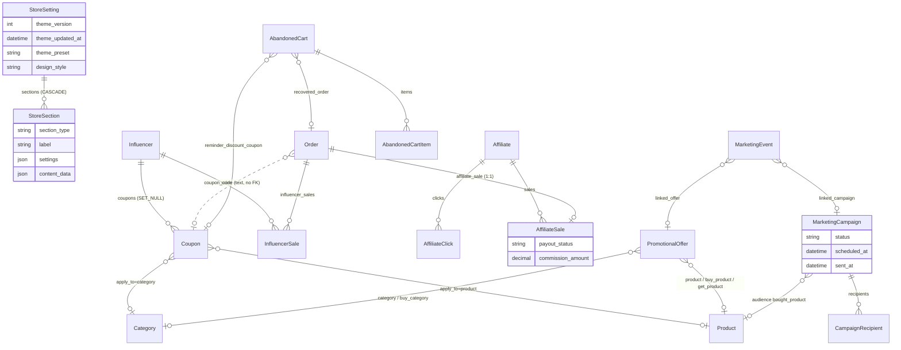
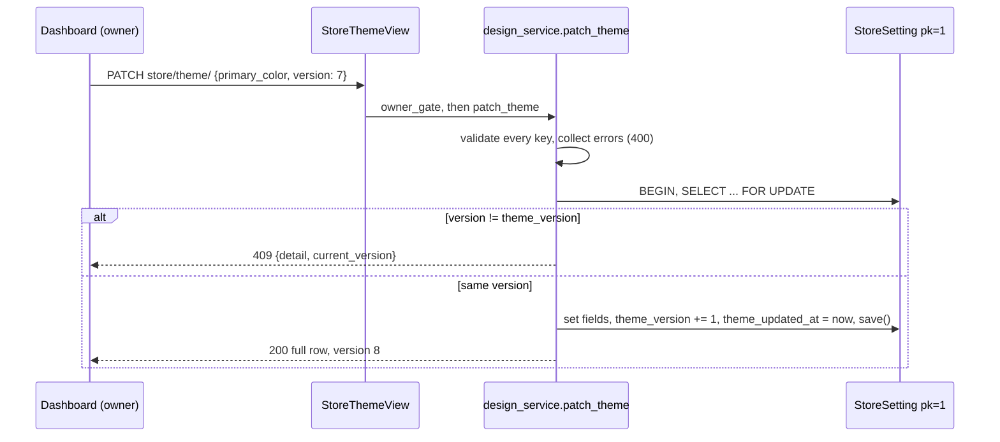
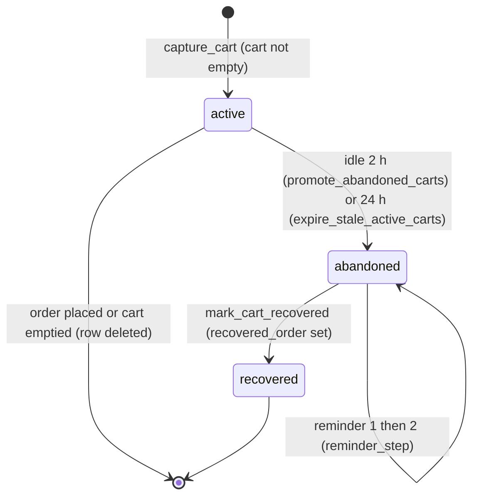
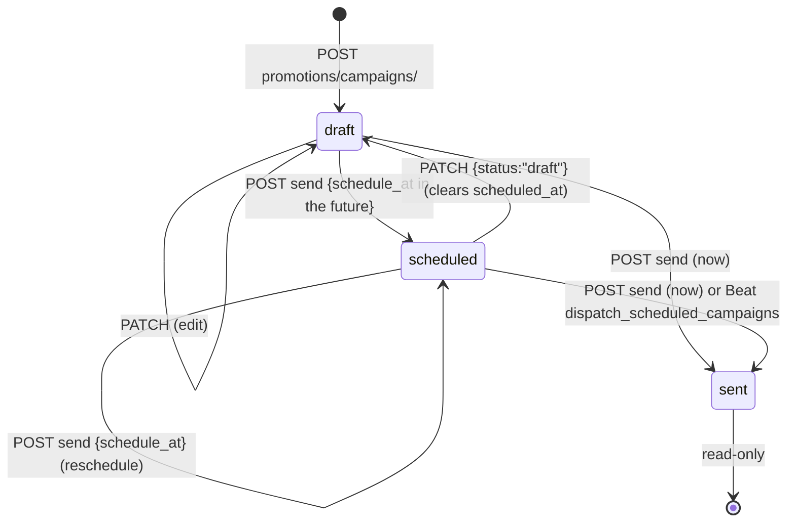
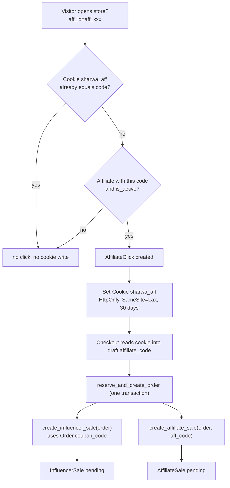

# Data model — Domain 7: storefront design, marketing, affiliates and influencers

> **Source**: DOC-487 · inventory Domain 7 · INT-018 (M08), INT-019 (M13), INT-034 (M17)
> **Code**: `sharwa_saas/products/services/{design_service,marketing_service,partners_service}.py` · `sharwa_saas/api/{views_design,views_marketing,views_partners}.py` · `sharwa_saas/products/theme_presets.py` · `sharwa_saas/products/models/{store_settings,marketing,carts_recovery,loyalty}.py` · `sharwa_saas/products/{campaigns,abandoned_carts,abandoned_cart_service,affiliates,influencers}.py` · `sharwa_saas/products/services/messaging.py` (`CheckoutService`) · `sharwa_saas/products/tasks/{operations,channels}.py` · `sharwa-frontend/src/features/{design,marketing,affiliates}/`
> **Last verified against code**: 2026-10-28 (step 37)

## 1. Purpose

Domain 7 covers three groups of store-level data that the Next.js dashboard edits through `/api/v1/`:

1. **Storefront design (M08)**: the store identity (preset, five colours, two fonts, design style, logo), the announcement bar and the home-page sections.
2. **Marketing centre (M13)**: coupons, automatic promotional offers, abandoned carts and their recovery settings, campaigns, the marketing timeline, the loyalty programme settings and the gift switch.
3. **Partners (M17)**: affiliates (tracking link and cookie) and influencers (coupon code), with their sales and payout state.

This page lists the models, where each lives, which migration added or changed each Phase 002 field, the one service that owns each tool, the campaign lifecycle and the attribution rules. It also lists the legacy Django HTML screens that were kept next to the API.

Not covered here: the commission payout as money movement (see [`../43-ledgers.md`](../43-ledgers.md) §4.6, ledger L6), the customer-side wallet and points (see [`06-customers-wallets.md`](06-customers-wallets.md)), checkout order of operations (see [`05-storefront.md`](05-storefront.md)), and the rest of `StoreSetting` (see [`12-settings-staff-integrations.md`](12-settings-staff-integrations.md)). Request and response shapes are on the API pages for these modules.

## 2. Components

### 2.1 Provider table (file → what it owns)

| Provider | Location | Owns |
|---|---|---|
| `design_service.py` | `sharwa_saas/products/services/design_service.py` | Theme read/patch with optimistic lock (`read_theme` `:57`, `patch_theme` `:126`), preset list (`list_presets` `:81`), announcement read/patch (delegates the write to `settings_service.patch_announcement`, `:218`), section CRUD, validation per type, reorder (`list_sections` `:239`, `create_section` `:358`, `update_section` `:385`, `delete_section` `:405`, `reorder_sections` `:412`), data-URL image storage (`_store_images` `:338`) |
| `views_design.py` | `sharwa_saas/api/views_design.py` | Six routes: `store/theme/`, `store/theme/presets/`, `store/announcement/`, `admin/sections/`, `admin/sections/<pk>/`, `admin/sections/reorder/` (`api/urls.py:310-315`). Owner-only gate (`DesignAPIMixin.owner_gate`, `:35`) |
| `theme_presets.py` | `sharwa_saas/products/theme_presets.py` | `THEME_PRESETS` (9 presets, platform code, not data: `:54`), `THEME_PRESET_FIELDS`, `get_preset()`, `DEFAULT_THEME_KEY` |
| `settings_service.patch_announcement` | `sharwa_saas/products/services/settings_service.py:294` | Validation and write of the nine announcement fields (the same row and validator as M34, so the two modules cannot drift) |
| `marketing_service.py` | `sharwa_saas/products/services/marketing_service.py` | Coupons, offers, abandoned carts + settings, campaigns, timeline, loyalty, gift switch, summary (seven tools, one file) |
| `views_marketing.py` | `sharwa_saas/api/views_marketing.py` | 18 routes under `promotions/…` and `loyalty/program/` (`api/urls.py:318-335`); `MarketingAPIMixin.check` (`:46`) applies the session, permission, owner-only and plan-feature gates |
| `campaigns.py` | `sharwa_saas/products/campaigns.py` | `resolve_audience` (`:169`), `render_message` (`:184`), `send_campaign` (`:196`), `send_campaign_recipient` (`:250`), `CAMPAIGN_CHUNK_SIZE` (`:38`) |
| `abandoned_carts.py` | `sharwa_saas/products/abandoned_carts.py` | Session-cart snapshot: `capture_cart`, `attach_cart_customer`, `mark_cart_recovered`, `promote_abandoned_carts` (`:195`, 2-hour threshold `ABANDON_THRESHOLD_HOURS = 2`, `:27`) |
| `abandoned_cart_service.py` | `sharwa_saas/products/abandoned_cart_service.py` | Reminder engine: `_due_carts_for_step` (`:33`), `_generate_recovery_coupon` (`:53`), `_render_message` (`:97`), `_resolve_reminder_channel` (`:154`), `_send_one_reminder` (`:191`), `run_abandoned_cart_reminders` (`:233`) |
| `messaging.CheckoutService` | `sharwa_saas/products/services/messaging.py` | The price engine that reads `Coupon` and `PromotionalOffer`: `calculate_discount` (`:69`), `calculate_promotional_discount` (`:128`), `_offer_condition_eligible` (`:207`), `_buy_x_get_y_discount` (`:233`) |
| `partners_service.py` | `sharwa_saas/products/services/partners_service.py` | Affiliate and influencer list/detail/summary/sales/mark-paid/create/patch, `record_referral_click` (`:401`), constants `AFF_COOKIE = 'sharwa_aff'`, `AFF_COOKIE_AGE` (`:42-43`) |
| `views_partners.py` | `sharwa_saas/api/views_partners.py` | `PartnersAPIMixin` (`kind` = `affiliates` or `influencers`, passed from `urls.py`), `StorefrontReferralView` (public, no session) |
| `affiliates.py` / `influencers.py` | `sharwa_saas/products/{affiliates,influencers}.py` | The write side of attribution: `create_affiliate_sale` (`:21`), `create_influencer_sale` (`:97`), called inside the checkout transaction (`checkout_service.py:713-718`) |
| Celery tasks | `sharwa_saas/products/tasks/operations.py:161-173`, `tasks/channels.py:625` | `dispatch_scheduled_campaigns` (fan-out), `dispatch_scheduled_campaigns_for_tenant`, `dispatch_broadcast_campaign_chunk` |
| Management command | `sharwa_saas/products/management/commands/send_abandoned_cart_reminders.py` | Per-tenant runner of `run_abandoned_cart_reminders` (not in the Beat schedule, see §6) |

### 2.2 Routes by provider

| Tool | Routes (under `/api/v1/`) | Gate |
|---|---|---|
| Design | `store/theme/` GET/PATCH (JSON or multipart `logo`); `store/theme/presets/` GET; `store/announcement/` GET/PATCH; `admin/sections/` GET/POST; `admin/sections/<pk>/` PATCH/DELETE; `admin/sections/reorder/` POST | Owner session only: a staff session answers 403 «تصميم المتجر مقصور على مالك المتجر.» (`views_design.py:29`). Plan feature `storefront_design` (identity, sections), `coupon` (announcement). Presets need only a logged-in session |
| Coupons, offers | `promotions/coupons/` · `<pk>/`; `promotions/offers/` · `<pk>/`; `promotions/summary/` | Owner or staff; staff need `discounts.apply` (read) and `discounts.manage` (write) (`views_marketing.py:30-31`); feature `coupon` (summary has no feature) |
| Abandoned carts | `promotions/abandoned-carts/` · `<pk>/` · `<pk>/remind/`; `promotions/abandoned-cart-settings/` | Owner only; feature `abandoned_carts` |
| Campaigns | `promotions/campaigns/` · `<pk>/` · `<pk>/preview/` · `<pk>/send/`; `promotions/campaigns/channels/` | Owner only; feature `campaigns`. The `campaigns/channels/` route is the exception: it has no owner-only check and no feature gate, so any logged-in owner or staff session can read it (`CampaignChannelsView` uses the bare `MarketingAPIMixin`, `views_marketing.py:202-205`) |
| Timeline | `promotions/timeline/` · `<pk>/` | Owner only; feature `timeline` |
| Loyalty, gift | `loyalty/program/`; `promotions/gift-settings/` | Owner only; features `loyalty_settings`, `gift_settings` |
| Affiliates | `affiliates/`, `affiliates/summary/`, `affiliates/<id>/`, `affiliates/<id>/sales/`, `affiliates/<id>/sales/mark-paid/` | Session (owner or staff) for reads; writes owner only (403 «إدارة المسوّقين والمؤثرين ومستحقاتهم لمالك المتجر.»); feature `affiliates` |
| Influencers | same five routes under `influencers/` | same; feature `influencers` (403 «ميزة المؤثرين غير مفعّلة في خطتك.») |
| Referral | `storefront/referral/` POST `{code}` | public, `HasTenantContext`, no authentication |

Feature codes are resolved by `settings_feature_enabled` (`api/views_settings.py:32`), the same decision as the legacy `require_feature`. The plan catalogue is in [`../15-plans-and-features.md`](../15-plans-and-features.md); permission keys are in [`../31-authorization.md`](../31-authorization.md).

### 2.3 Legacy HTML views kept

These Django screens still work next to the API; the API did not replace their routes.

| Screen | Code | Route (`config/urls_tenant.py`) |
|---|---|---|
| Store design centre: `StorefrontDesignForm` (`forms.py:1005`: five colours, two fonts, `theme_choice`, `logo`, `theme_preset`, `design_style`) | `storefront_design_view` and the section save views (`products/views/merchant_settings.py:312`, `:427`) | `dashboard/design/` and `dashboard/design/sections/*`, `dashboard/design/theme/save/` (`:624-630`) |
| Announcement bar: `AnnouncementBarForm` (`forms.py:979`, the nine fields) | `marketing_bar_view` (`merchant_settings.py:239`) | `dashboard/marketing-bar/` (`:583`) |
| Dynamic theme CSS | `theming.theme_css_view` | `theme.css` (imported at `urls_tenant.py:10`) |
| Marketing hub, abandoned carts, manual reminder | `views/marketing.py` | `dashboard/marketing/`, `dashboard/abandoned-carts/`, `.../settings/`, `.../<id>/remind/` (`:585-590`) |
| Offers | `views/promotions.py` | `dashboard/promotions/` + toggle, edit, delete (`:601-604`) |
| Campaigns | `views/campaigns.py` | `dashboard/campaigns/` + new, edit, send (`:606-609`) |
| Timeline | `views/marketing_timeline.py` | `dashboard/timeline/` + new, edit, delete (`:611-614`) |
| Loyalty and gifting settings | `loyalty_settings_view` (`merchant_settings.py:187`), `gift_settings_view` (`:209`) | `dashboard/loyalty/`, `dashboard/gifting/` (`:470-471`) |
| Influencers | `views/influencers.py` | `dashboard/influencers/` + toggle, mark-paid (`:593-595`) |
| Affiliates | `views/affiliates.py` | `dashboard/affiliates/` + toggle, paid (`:597-599`) |
| Referral rule `?aff_id=` | `views/storefront.py:174-185`, `:488-495` | storefront home and product list |
| Cart restore link | `restore_abandoned_cart` | `cart/restore/<token>/` (`:253`) |

## 3. Data model

### 3.1 Schema placement

Every model on this page is in the **store (tenant) schema**. Evidence: the models belong to the `products` app, which is listed in `TENANT_APPS` (`config/settings.py:152-161`) and not in `SHARED_APPS` (`config/settings.py:121-150`). The only public-schema pieces this domain touches are the plan features (`billing.Feature`, read by `settings_feature_enabled`). See [`../10-multi-tenancy.md`](../10-multi-tenancy.md).

### 3.2 Model table (17 models; `StoreSetting` only for its design and announcement fields)

| Model | Schema (public/store) | Key fields | Constraints / indexes | Added or changed by (migration) |
|---|---|---|---|---|
| `StoreSetting` (design fields) | store | `theme_preset` (`CharField(40)`, default `modern_trust`, no `choices`), `primary_color` · `secondary_color` · `background_color` · `text_color` · `card_border_color` (`CharField(7)`, `HEX_COLOR_VALIDATOR`), `heading_font` · `body_font` (`choices=GOOGLE_FONT_CHOICES`, default `Tajawal`), `design_style` (`CharField(30)`, default `fluid`), `theme_choice` (default `default`), `logo` (`ImageField`, `store_logos/`), **`theme_version`** (`PositiveIntegerField`, default 1), **`theme_updated_at`** (default `timezone.now`), `updated_at` (`auto_now`, the `theme.css` cache fingerprint) | singleton: `save()` forces `pk=1` (`store_settings.py:348`); `GOOGLE_FONT_CHOICES` has 11 fonts (`:107-121`) | `0040` (secondary/background/text colours, fonts), `0043` (`card_border_color`), `0044_storesetting_theme_preset`, `0047` (`design_style`), **`0219_theme_version_section_label`** (`theme_version`, `theme_updated_at`) |
| `StoreSetting` (announcement fields) | store | `enable_announcement_bar`, `announcement_text` (`CharField(255)`), `announcement_bg_color` (default `#000000`), `announcement_text_color` (default `#FFFFFF`), `announcement_scroll_speed` (`slow`/`medium`/`fast`, default `medium`), `show_banner_on_home` · `_on_products` · `_on_product_detail` · `_on_checkout` (default `True`) | nine fields = `ANNOUNCEMENT_KEYS` (`design_service.py:205`) | `0017` (`enable_announcement_bar`, `announcement_text`), `0075` (colours, speed, four placement flags) |
| `StoreSection` | store | `store_setting` (FK, `CASCADE`, `related_name='sections'`), `section_type` (8 choices), **`label`** (`CharField(80)`, blank, default `''`), `order` (`PositiveIntegerField`), `is_active`, `settings` (`JSONField`), `content_data` (`JSONField`) | `ordering = ['order', 'id']`; no unique constraint (removed so slider/banner/grid types can repeat) | `0039` (created), `0041` (`settings`), `0042_storesection_content_blocks` (`content_data`, drops `unique_together`), `0084` (`section_type` choices), **`0219`** (`label`) |
| `Coupon` | store | `code` (`CharField(50)`, unique), `discount_type` (`percent`/`fixed`), `discount_value` (`Decimal(10,2)`), `min_order_amount`, `apply_to` (`all`/`category`/`product`), `category` · `product` (FK `SET_NULL`), **`influencer`** (FK `SET_NULL`, `related_name='coupons'`), `start_date`, `expires_at`, `is_active`, `max_uses`, `used_count` | `code` unique and indexed; `is_active` indexed; `is_valid()` is the single validity check (`marketing.py:86`) | `0017` (created), `0026` (`apply_to`, `category`, `product`), `0056_influencer_influencersale_coupon` (`influencer`, `expires_at`), `0074` (`start_date`), `0076` (`max_uses`, `used_count`) |
| `PromotionalOffer` | store | `name`, `offer_type` (`discount` · `free_shipping` · `buy_x_get_y`), `condition_type` (`all` · `category` · `product` · `min_items`), `discount_type`, `discount_value`, `min_order_amount`, `category` · `product` (FK `SET_NULL`), `description` (`TextField(max_length=300)`), `image`, `cta_text` (40), `buy_quantity`, **`buy_condition_type`** (`all` · `category` · `product` · `min_items`, default `category`), `buy_category` · `buy_product` · `get_product` (FK `SET_NULL`), `get_quantity`, `get_discount_percent` (default 100), `min_total_items`, `priority`, `valid_from`, `valid_until`, `is_active` | `ordering = ['-priority', '-created_at']`; `is_active` indexed | `0057` (created), `0071` (`condition_type`, merges two old types), `0072` (`product`, `description`), `0080` (`buy_condition_type`, `buy_product`), `0084` (`image`, `cta_text`), **`0220_marketing_api`** (`buy_condition_type` choices gain `all` and `min_items`) |
| `AbandonedCart` | store | `session_key` (`CharField(40)`), `customer_phone`, `customer_name`, `total_amount`, `currency`, `items_count`, `status` (`active` · `abandoned` · `recovered`), `last_interaction_at`, `recovered_order` (FK `SET_NULL`), `reminder_step` (0, 1 or 2), `last_reminder_sent_at`, `reminder_discount_coupon` (FK `SET_NULL`) | `session_key` **unique**; `status` and `customer_phone` indexed | `0053` (created), `0054` (unique `session_key`, de-duplicating data migration), `0063` (`recovered_order`), `0076` (`reminder_*` fields) |
| `AbandonedCartItem` | store | `cart` (FK `CASCADE`, `related_name='items'`), `product` (FK `SET_NULL`), `product_name` (snapshot), `quantity`, `size`, `color` | — | `0053` |
| `AbandonedCartSettings` | store | `is_enabled` (default `False`), `min_cart_value`, `channel_whatsapp` (default `True`), `channel_email` · `channel_sms` (default `False`, "soon"), `channel_conversational_enabled`, `reminder_1_delay_hours` (2), `reminder_1_message`, `reminder_2_delay_hours` (24), `reminder_2_message`, `discount_percent` (0), `discount_validity_hours` (24) | singleton through `load()` = `get_or_create(pk=1)` | `0076` (created), `0192` (`channel_conversational_enabled`) |
| `MarketingCampaign` | store | `name`, `channel` (6 codes), `audience_type` (`all` · `abandoned_carts` · `dormant` · `bought_product`), `product` (FK `SET_NULL`), `dormant_days` (default 30; the API writes 90), `subject`, `message`, `status` (`draft` · `scheduled` · `sent`), `scheduled_at`, **`sent_at`**, `is_active`, `created_at`, `updated_at` | `status` indexed | `0059` (created), `0192` (`channel` widened to 30 chars, adds the three chat channels), **`0220`** (`sent_at`) |
| `CampaignRecipient` | store | `campaign` (FK `CASCADE`, `related_name='recipients'`), `customer_name`, `customer_phone`, `customer_email`, `external_contact_id`, `status` (`pending` · `sent` · `failed`), `sent_at` | `customer_phone`, `customer_email`, `status` indexed; `ordering = ['id']` | `0059`, `0192` (`external_contact_id`) |
| `MarketingEvent` | store | `title`, `event_type` (`seasonal` · `holiday` · `campaign_plan` · `custom`), `start_date` (indexed), `end_date`, `color` (5 choices), `notes`, `linked_campaign` · `linked_offer` (FK `SET_NULL`, optional) | `ordering = ['start_date']` | `0060` |
| `GiftSettings` | store | `is_enabled` (default `True`) | singleton through `load()` (`get_or_create(pk=1)`) | `0073`, `0074` (id field) |
| `LoyaltyProgram` | store | `is_enabled` (default `False`), `riyals_per_point` (default 10.00), `points_per_riyal_redemption` (default 10.00), `min_points_to_redeem` | singleton through `load()` | `0069` |
| `Influencer` | store | `name`, `contact`, `referral_code` (`inf_<8 hex>`, generated in `save()`), `is_active`, `commission_type` (`percent`/`fixed`), `commission_value` (`Decimal(10,2)`), `notes` | `referral_code` unique; `is_active` indexed | `0056` |
| `InfluencerSale` | store | `influencer` (FK `CASCADE`, `related_name='sales'`), `order` (**FK** `CASCADE`, `related_name='influencer_sales'`), `order_total_at_sale` (SAR), `commission_amount`, `commission_currency` (default `SAR`), `payout_status` (`pending`/`paid`), `paid_at` | `payout_status` indexed; no uniqueness on `order` | `0056` |
| `Affiliate` | store | `name`, `phone`, `referral_code` (`aff_<8 hex>`), `is_active`, `commission_type`, `commission_value`, `notes` | `referral_code` unique; `phone` and `is_active` indexed | `0067_affiliate_alter_orderstatus_marks_completed_and_more` |
| `AffiliateClick` | store | `affiliate` (FK `CASCADE`, `related_name='clicks'`), `session_key` (blank, null) | `created_at` indexed | `0067` |
| `AffiliateSale` | store | `affiliate` (FK `CASCADE`, `related_name='sales'`), `order` (**`OneToOneField`**, `related_name='affiliate_sale'`), `order_total_at_sale` (SAR), `commission_amount`, `commission_currency`, `payout_status`, `paid_at` | one sale per order at database level; `payout_status` indexed | `0067` |

Order fields written by this domain's engines (they belong to [`04-orders-returns.md`](04-orders-returns.md)): `Order.coupon_code` (`0017`), `Order.discount_amount` (`0017`), `Order.promotion_discount_amount` and `Order.applied_offers` (`0057`).

> ⚠️ Discrepancy — roadmap says the `StoreSection` unique constraint was relaxed "see migration 0043" (model docstring, `store_settings.py:444`) / code does: `unique_together` is dropped by `0042_storesection_content_blocks.py` (`AlterUniqueTogether`); `0043` is `storesetting_card_border_color`. The roadmap itself does not cite 0043; the stale number is in the model comment. Reported in step 37.

### 3.3 ER sketch

Singletons without relations (`AbandonedCartSettings`, `GiftSettings`, `LoyaltyProgram`) are each one row (`pk=1`, created by `load()`), so they are left out of the diagram.

### 3.4 Migrations (exact files in `sharwa_saas/products/migrations/`)

| Area | Files |
|---|---|
| Phase 002 (this domain) | `0219_theme_version_section_label.py` (INT-018) · `0220_marketing_api.py` (INT-019) |
| Design | `0039_storesection_product_is_featured.py` · `0040_storesetting_theme_enterprise_fields.py` · `0041_storesection_settings.py` · `0042_storesection_content_blocks.py` · `0043_storesetting_card_border_color.py` · `0044_storesetting_theme_preset.py` · `0047_storesetting_design_style.py` · `0075_storesetting_announcement_bg_color_and_more.py` · `0084_promotionaloffer_cta_text_promotionaloffer_image_and_more.py` (also `storesection.section_type`) |
| Coupons and offers | `0017_coupon_order_coupon_code_order_discount_amount_and_more.py` · `0023_alter_coupon_min_order_amount_and_more.py` · `0026_coupon_apply_to_coupon_category_coupon_product.py` · `0057_promotionaloffer_order.py` · `0071_promotionaloffer_condition_type.py` · `0072_promotionaloffer_feedback_fixes.py` · `0074_coupon_start_date_alter_giftsettings_id.py` · `0080_promotionaloffer_buy_condition_type_and_more.py` · `0106_alter_coupon_options.py` |
| Abandoned carts | `0053_abandonedcart_abandonedcartitem.py` · `0054_abandonedcart_session_key_unique.py` · `0063_abandonedcart_recovered_order.py` · `0076_abandonedcartsettings_and_more.py` · `0192_abandonedcartsettings_channel_conversational_enabled_and_more.py` |
| Campaigns, timeline, gift, loyalty | `0059_marketingcampaign_campaignrecipient_order.py` · `0060_marketingevent.py` · `0073_giftsettings.py` · `0069_customerpoints_loyaltyprogram_and_more.py` |
| Partners | `0056_influencer_influencersale_coupon.py` · `0067_affiliate_alter_orderstatus_marks_completed_and_more.py` |

`0219` adds `StoreSetting.theme_version` (`PositiveIntegerField`, default 1), `StoreSetting.theme_updated_at` (default `timezone.now`) and `StoreSection.label` (`CharField(80)`, blank, default `''`); depends on `0218_customer_crm`. `0220` adds `MarketingCampaign.sent_at` (nullable) and alters `PromotionalOffer.buy_condition_type` choices (`all`, `category`, `product`, `min_items`); depends on `0219`. Both are additive: existing rows keep working (existing offers keep `category` as default condition).

## 4. Flows

### 4.1 Theme save with optimistic lock (M08)

Rules, all in `patch_theme` (`design_service.py:126-201`):

- Validation runs **before** the lock and answers 400 `{field: [msg]}`: `theme_preset` must be `custom` or one of the nine preset keys («قالب غير معروف.»); the five colours match `^#[0-9a-fA-F]{6}$` and are stored upper-case («لون بصيغة #RRGGBB.»); fonts must be in `GOOGLE_FONT_CHOICES` («اختر خطاً من القائمة.»); `design_style` must be one of `fluid`, `aurora_glass`, `neo_brutalism`, `cinematic_silk`, `clay_zen` («نمط تصميم غير معروف.»).
- `version` is optional. When sent and different from `theme_version` the answer is 409 with `current_version` and the message in `CONFLICT_MESSAGE` (`:42`), «حُدِّث الثيم من جلسة أخرى. أعد التحميل لترى آخر نسخة منشورة.» A non-integer `version` is 400. When `version` is omitted the write is unconditional (last write wins); see [`../42-concurrency.md`](../42-concurrency.md).
- The row is locked (`select_for_update`) and `theme_version` is incremented on **every** successful patch, even one that changes nothing.
- Logo: a multipart file (`jpg/jpeg/png/webp/gif`, ≤ 5 MB; the message for a bad format is «الصيغ المسموحة: jpg, jpeg, png, webp, gif», for size «حجم الشعار 5MB على الأكثر.»), a `data:image/…;base64,…` string, `null`/`''` (clear) or an existing `https://` URL (no change).
- `read_theme` returns `brand_shades` (derived from `primary_color`), `version` and `updated_at`; `theme_choice` is returned but not writable here.
- Section edits do **not** bump `theme_version`: sections have no lock; the reorder endpoint requires the full id list (§4.3).

Presets are code, not rows: `THEME_PRESETS` has nine entries (`modern_trust`, `luxury_boutique`, `organic_earth`, `tech_cyber`, `bold_streetwear`, `aurora_glass`, `neo_brutalism`, `cinematic_silk`, `clay_zen`; `theme_presets.py:54-170`). `store/theme/presets/` returns `code`, `name`, `description`, the five colour tokens, both fonts and `design_style` for each. Adding a preset needs no migration (the field has no `choices`).

### 4.2 Announcement bar

`store/announcement/` reads and writes the nine `ANNOUNCEMENT_KEYS`. The write is `settings_service.patch_announcement` (`:294`), the same validator the M34 settings screen uses. Rules there: text ≤ `ANNOUNCEMENT_MAX` characters, colours HEX, speed in `slow/medium/fast`, and enabling the bar with an empty text is refused («اكتب نص الشريط قبل تفعيله، أو أوقفه.»). The plan feature for this route is `coupon` (`views_design.py:82`), not `storefront_design`.

### 4.3 Home-page sections

| Rule | Where |
|---|---|
| First `GET admin/sections/` seeds the five legacy singleton types (`hero`, `category_strip`, `featured_products`, `latest_products`, `promotional_offers`) in `DEFAULT_ORDER` | `StoreSection.get_or_seed_defaults`, called by `list_sections` (`:239`) |
| Addable types (any number): `slider`, `banner_grid`, `product_grid`; creating a second singleton answers 400 `{section_type: ['«قسم مفرد موجود مسبقاً.»']}` | `create_section` `:358`; `ALL_TYPES` `:45` |
| A singleton is never deleted, it is disabled: 400 «قسم مفرد لا يُحذف — عطّله بدلاً من حذفه.» | `delete_section` `:405` |
| The type cannot change after creation: 400 `{section_type: ['«لا يمكن تغيير نوع القسم.»']}` | `update_section` `:388` |
| `label` ≤ 80; `limit` 1-50 («العدد من 1 إلى 50.») | `_validate` `:260` |
| `slider` / `banner_grid`: `content_data.items` has 1-12 elements (`ITEMS_MAX = 12`); each needs a title or an image; `link` starts with `/` or `http(s)://` («الرابط يبدأ بـ / أو https://»); error keys are `items`, `items.<i>.image`, `items.<i>.title`, `items.<i>.link` | `:294-324` |
| `product_grid`: `category_id` required and must exist («اختر تصنيفاً.», «تصنيف محذوف — اختر آخر.»); `title` ≤ 80 | `:281-293` |
| `hero`: `title` ≤ 120, `subtitle` ≤ 240, `cta_text` ≤ 40, `link` rule as above | `:325-331` |
| Reorder takes `ordered_ids` with **every** section id, no duplicates; otherwise 400 «أرسل كل معرّفات الأقسام بترتيبها الكامل.»; written with one `bulk_update` of `order` (0-based index) and answers `{ok, reordered}` | `reorder_sections` `:412` |

**Section images are files, never base64.** An item image arriving as `data:image/(jpe?g|png|webp|gif);base64,…` is decoded after validation (≤ `MAX_IMAGE_BYTES = 5 * 1024 * 1024`, «حجم الصورة 5MB على الأكثر.»), saved with `tenant_upload_path('store_sections', 'item.<ext>', IMAGE_EXTENSIONS, randomize_name=True)` into `<schema>/store_sections/<uuid>.<ext>` (`core/uploads.py:62-88`, `design_service.py:347`) and replaced in `content_data` by the **absolute URL** (`request.build_absolute_uri(default_storage.url(...))`). Storing happens only after the whole payload validated, so a rejected save leaves no orphan files. Existing images (`/…` or `http(s)://`) are kept as they are.

The storefront reads the same rows through `GET /api/v1/config/`: `sections[].label` is `section.label` or, when empty, the Arabic type name (`api/serializers.py:23-24`).

`AdminStoreSectionViewSet` and its router entry were removed: `api/urls.py:50-54` keeps the `DefaultRouter()` with a comment only, and a search of the code copy finds no remaining reference. The old `admin/sections/` was `IsAdminUser` (platform admin only); the same paths now use the owner session.

### 4.4 Coupons and offers (the price engine reads the same rows)

`marketing_service` writes `Coupon` and `PromotionalOffer`; it adds no pricing logic. The cart and checkout read the same rows through `CheckoutService` (`products/pricing.py:114` and `:121`: promotions first, the coupon is applied to what is left).

**Coupons** (`_apply_coupon`, `marketing_service.py:245`):

- `code` matches `^[A-Z0-9_-]{3,32}$`, stored upper-case, unique case-insensitively («هذا الكود مستخدم لكوبون آخر.»). The code of an influencer coupon cannot change («كود كوبون المؤثر لا يُغيَّر.») and cannot be deleted from here (`delete_coupon`, `:325`: 400 «كوبون المؤثر يُدار من صفحة المؤثرين.»).
- `percent` values are whole numbers 1-100 («النسبة بين 1 و100.»), `fixed` values > 0; `apply_to` `category`/`product` requires the matching id.
- `expires_at` must be after `start_date`. State per row is computed, not stored: `inactive` → `exhausted` (`used_count >= max_uses`) → `not_started` → `expired` → `active` (`_temporal`, `:154`; the filter `?status=` uses the same function).
- `Coupon.is_valid()` (`marketing.py:86`) is the single runtime check. `used_count` is incremented by checkout with `F('used_count') + 1` (`checkout_service.py:686`), not by this module.
- The API never sets `Coupon.influencer`. No form or view in the code copy sets it either; the only writer found is the tenant Django admin (`CouponAdmin`, `products/admin.py:185`, which exposes every field). See §9.

**Offers** (`_apply_offer`, `:419`): the contract fields map onto the model as follows.

| Offer type | Condition fields written | Notes |
|---|---|---|
| `discount`, `free_shipping` | `condition_type` ∈ `all` · `category` · `product` · `min_items`, with `category`, `product` or `min_total_items` | the contract names it `buy_condition_type`; the view maps it back (`offer_view`, `:342`) |
| `buy_x_get_y` | `buy_condition_type` ∈ `all` · `category` · `product` · `min_items`, with `buy_category`, `buy_product` or `min_total_items`; plus `buy_quantity`, `get_product`, `get_quantity`, `get_discount_percent` (1-100) | `condition_type` is reset to `all`; `min_order_amount` is forced to `NULL` |

Other rules: `description` ≤ 300, `cta_text` ≤ 40, `priority` ≥ 0, `valid_until` after `valid_from`, image ≤ 5 MB and extension in `jpg/jpeg/png/webp/gif`; image can be sent as multipart (`OfferListView`, `_OfferMixin.parser_classes`).

**Engine behaviour** (`messaging.py`):

- Offers are evaluated `is_active`, inside their validity window, ordered by `-priority, id` (higher priority first, `:146`). All matching offers stack; the total is capped at the cart subtotal (`:203`).
- `_buy_x_get_y_discount` (`:233`) now handles the four buy conditions. `product` counts units of `buy_product`; `all` counts every unit in the cart; `min_items` counts every unit and returns zero until the total reaches `min_total_items`; `category` counts units of `buy_category`. The reward count is `min(buy_units // buy_quantity, get_units // get_quantity)`, so the bonus never exceeds the reward units actually in the cart (`:264-268`).
- `free_shipping` is a flag only (discount 0).

### 4.5 Abandoned carts

There is no cart table. The cart lives in the session; `AbandonedCart` is a snapshot written as a side effect.

- `capture_cart` upserts by `session_key` inside `transaction.atomic()` and rewrites the items; an empty cart deletes the row. `attach_cart_customer` sets name and phone from the checkout step.
- `mark_cart_recovered` turns only an `abandoned` cart into `recovered`; an `active` cart (the buyer never left) is deleted, so it never shows as "recovered" (`abandoned_carts.py:148-192`).
- `promote_abandoned_carts` is a lazy `UPDATE` (2 hours, `ABANDON_THRESHOLD_HOURS`), called by `list_carts` and by the reminder runner. The Beat task `expire_stale_active_carts` (every 30 minutes) promotes carts idle for `DRAFT_CART_TTL_HOURS = 24` (`tasks/operations.py`).
- **Reminders**: two steps only (`reminder_step` 0 → 1 → 2). Step 1 is due when `last_interaction_at <= now - reminder_1_delay_hours`; step 2 when `last_reminder_sent_at <= now - reminder_2_delay_hours`; both require `status='abandoned'` and a phone, and `total_amount >= min_cart_value` (`_due_carts_for_step`, `:33`; `run_abandoned_cart_reminders`, `:249-253`).
- The recovery coupon is created once per cart, at step 2, when `discount_percent > 0`: `BACK<cart id><4 digits>`, `percent`, `apply_to='all'`, `max_uses=1`, expiry `discount_validity_hours` (`_generate_recovery_coupon`, `:53`). It is stored in `reminder_discount_coupon` and reused.
- Template variables: step 1 allows `{customer_name}`, `{cart_url}`; step 2 also `{discount_percent}`, `{discount_code}` (`REMINDER_1_VARS`/`REMINDER_2_VARS`). The API rejects unknown names with «متغير غير معروف: {name}»; the renderer fills unknown names with an empty string and appends the restore URL when the template lost `{cart_url}` (`_ensure_cart_url`, `:86`).
- Channel (`_resolve_reminder_channel`, `:154`): the last `Conversation` of the phone when `channel_conversational_enabled`, else WhatsApp when `channel_whatsapp`, else none. Sending enqueues `dispatch_channel_message` and reports "queued", not "delivered". `channel_email` and `channel_sms` are stored but nothing sends through them.
- **Manual reminder** (`POST promotions/abandoned-carts/<pk>/remind/`, `remind_cart`, `:633`) calls the same `_send_one_reminder` as the scheduled command, so template, channel and coupon are identical. Refusals (400): no phone («لا رقم هاتف لهذه السلة.»), not abandoned («التذكير متاح للسلات المتروكة فقط.»), both reminders sent («أُرسل التذكيران لهذه السلة — لا تذكير ثالث.»), no channel available.

### 4.6 Campaign lifecycle

`status` is one of `draft`, `scheduled`, `sent` (there is no `failed` or `sending` state; delivery success lives on the recipient rows).

| Step | Code | Behaviour |
|---|---|---|
| Create / edit | `_apply_campaign` (`marketing_service.py:793`) | `name` ≥ 2, `channel` in the six codes, `audience_type` in four, `product_id` required for `bought_product`, `message` 5-1000 characters. `dormant_days` is always written as `DORMANT_DAYS = 90` (same "dormant" definition as the customers module). A `sent` campaign is read-only: 400 «الحملة المرسلة للقراءة فقط.» |
| Preview | `preview_campaign` (`:835`) | `{recipients_count, rendered_message}` using `resolve_audience` and the first recipient, so the count is the real audience (for chat channels it is the audience that has a conversation on that channel) |
| Send or schedule | `send_campaign_now` (`:860`) | 400 when already sent («أُرسلت هذه الحملة من قبل.») or the channel is not connected («القناة غير مربوطة — اربطها أولاً.»); a `schedule_at` that is invalid or not in the future answers 400 `{schedule_at: ['«اختر وقتاً في المستقبل.»']}`; otherwise status → `scheduled` |
| Dispatch | `dispatch_campaign` (`:844`) | in `transaction.atomic()`, `select_for_update` the campaign, return `None` unless its status is in `expected` (`draft`/`scheduled` by default), set `status='sent'`, `sent_at=now`, `scheduled_at=None`; **then** call `campaigns.send_campaign`. Two clicks, or the worker and the button, cannot send twice |
| Fan-out | `campaigns.send_campaign` (`campaigns.py:196`) | `resolve_audience` → `bulk_create` of `CampaignRecipient(status='pending')` → ids split into chunks of `CAMPAIGN_CHUNK_SIZE` (env `SHARWA_CAMPAIGN_CHUNK_SIZE`, default 50) → one `dispatch_broadcast_campaign_chunk` per chunk on queue `channels_broadcast` |
| Deliver | `tasks/channels.py:625` → `send_campaign_recipient` (`campaigns.py:250`) | per recipient, best effort: `sent` / `failed` + `sent_at`. For `meta_social_commerce`, `tiktok_shop`, `telegram_bot` `sent` means "queued" (a `dispatch_channel_message` call); WhatsApp is a synchronous `WhatsAppService.send_message`; SMS and email go through `LogGateway`, which only logs |
| Scheduled run | Beat `dispatch-scheduled-campaigns` (`crontab(minute='*/5')`, `config/settings.py:645-648`) → `dispatch_scheduled_campaigns` → per tenant `dispatch_due_campaigns` (`marketing_service.py:879`) | picks `status='scheduled'` and `scheduled_at <= now`, dispatches each with `expected=('scheduled',)` |

Audience resolution (`campaigns._resolve_raw_recipients`, `:84`): `all` and `bought_product` use non-cancelled orders de-duplicated by cleaned phone; `dormant` uses the latest order per phone older than `dormant_days`; `abandoned_carts` uses carts with `status='abandoned'` and a phone. For chat channels the audience is intersected with `Conversation` rows of that `channel_code` and each recipient carries `external_contact_id` (`_attach_chat_channel_contact`, `:134`); recipients with no conversation are dropped.

Channel connection (`channel_connected`, `marketing_service.py:717`): `sms` and `email` are always "not connected" (no real provider), the other four need an active app installation (`app_marketplace_service.is_app_active`). `GET promotions/campaigns/channels/` lists the six with a `manage_href`.

The `sent_at` column added by migration `0220` is set by `dispatch_campaign` only. Campaigns marked `sent` before the migration have `sent_at = NULL`; `summary()` falls back to the newest campaign by `created_at` when no row has `sent_at`.

### 4.7 Timeline, loyalty and gifting

- **Timeline** (`MarketingEvent`): title ≥ 2, `event_type` and `color` from the model choices, `start_date` / `end_date` ISO dates (end ≥ start; the view returns `end_date = start_date` when empty), `notes` ≤ 300, optional links to a campaign and an offer. `list_events` filters by overlap with `?from`/`?to`.
- **Loyalty** (`LoyaltyProgram`, route `loyalty/program/`): values are non-negative integers; when `is_enabled` is `true`, `riyals_per_point` and `points_per_riyal_redemption` must be > 0 («القيمة يجب أن تكون أكبر من صفر.»). The earning and redeeming logic is in [`06-customers-wallets.md`](06-customers-wallets.md).
- **Gift switch** (`GiftSettings.is_enabled`): `GET`/`PATCH promotions/gift-settings/`.
- **Summary** (`summary()`, `:1031`): `active_coupons`, `active_offers` (computed with `_temporal`), `abandoned_today` (abandoned carts whose `last_interaction_at` date is today), `last_campaign`.

### 4.8 Partner attribution and payout

- **Next.js storefront**: the BFF calls `POST storefront/referral/` with `{code}` (`StorefrontReferralView`, `views_partners.py:88`). `record_referral_click` returns `recorded: true` only when the code is non-empty, matches `^[A-Za-z0-9_\-]{1,32}$`, differs from the current cookie and belongs to an active affiliate; then it creates one `AffiliateClick` (with the session key or `''`) and the view sets `sharwa_aff` with `max_age=60*60*24*30`, `samesite='Lax'`, `httponly=True`. Only the first visit with a new code is counted.
- **Legacy storefront**: `products/views/storefront.py:174-185` and `:488-495` apply the same rule to `?aff_id=`, store the code in `session['pending_aff_cookie']` and write the cookie on the response (`:397`, `:626`).
- **Checkout** reads the cookie: `storefront_checkout_service.py:752` and `products/views/cart_checkout.py:689`.
- **Affiliate sale** (`create_affiliate_sale`, `affiliates.py:21`): returns `None` without error for an empty or unknown/inactive code, and **ignores self-referral** (customer phone equals the affiliate phone after `clean_phone_number`; logged, no exception). Base = subtotal − coupon discount − promotion discount − wallet amount used, each converted to SAR, floored at 0; `fixed` commission is taken as SAR as typed, `percent` is `net × value / 100`, rounded to 2 decimals. `order_total_at_sale` stores the **subtotal** in SAR.
- **Influencer sale** (`create_influencer_sale`, `influencers.py:97`): looks up `Coupon` where `code = order.coupon_code` and `influencer` is not null; same net base and rounding as above. An influencer with several coupons is attributed through the coupon actually used.
- Both run inside the checkout transaction (`checkout_service.py:711-718`) and **raise** on failure, which cancels the order. The `record_*` wrappers that swallow exceptions are for non-financial contexts only.
- Currency: amounts are stored in SAR (`commission_currency='SAR'`), displayed in the store currency with `convert_amount` (`partners_service._display`, `:74`); see [`../40-money.md`](../40-money.md).

**Owed and payout** (`partners_service`): eligible = `pending` sales whose order has `payment_status='paid'` and `status` not in `refunded`/`cancelled` (`_eligible_q`, `:61`); clawback = sales already `paid` whose order is now `refunded` (`_clawback_q`, `:66`); `pending` shown = eligible − clawback (can be negative). `mark_paid` (`:266`) is owner-only, locks the partner, walks the chosen sales oldest first, stops before the running total exceeds the allowance (eligible − clawback, floored at 0), never splits a sale, supports `dry_run`, and writes `payout_status='paid'`, `paid_at` plus an `AuditLog` row `affiliate.payout` / `influencer.payout`. `pending → paid` only. The ledger view of this is in [`../43-ledgers.md`](../43-ledgers.md) §4.6.

Create and patch rules (`_values`, `:342`): `name` 2-150; affiliate `phone` digits only matching `^(967|966)\d{9}$` and unique among affiliates («هذا الهاتف مسجّل لمسوّق آخر.»); influencer `contact` 3-100; `commission_type` `percent`/`fixed`; `commission_value` matches `^\d{1,8}(\.\d{1,2})?$`, > 0, and ≤ 100 for `percent`; `is_active` must be a boolean on patch. The referral code is generated by the model (`inf_`/`aff_` + 8 hex) and cannot be set through the API.

## 5. Invariants

| Invariant | Enforced by |
|---|---|
| Two design sessions cannot silently overwrite each other's theme save when `version` is sent | row lock + version compare in `patch_theme` (409) |
| `StoreSetting`, `GiftSettings`, `LoyaltyProgram`, `AbandonedCartSettings` are one row each | `save()` forcing `pk=1` / `load()` = `get_or_create(pk=1)` |
| A section image in `content_data` is always a file URL, never base64; files are stored only after the payload validated | `_store_images` called after `_validate` (`design_service.py:370-375`, `:398`) |
| A singleton section type exists once and is never deleted | `create_section`, `delete_section` |
| A campaign is dispatched at most once | row lock + status check in `dispatch_campaign`; status flips to `sent` **before** recipients are created |
| A pending recipient is sent at most once per chunk run | the chunk task filters `status='pending'` (`tasks/channels.py:652`) |
| An order gets at most one affiliate sale | `OneToOneField` on `AffiliateSale.order` |
| A refunded or cancelled order never counts as owed; a paid sale of a later-refunded order reduces what is owed | `_eligible_q`, `_clawback_q` |
| A payout never exceeds the net allowance and never splits a sale | `mark_paid` (locked, oldest first) |
| One cart row per browser session | unique `AbandonedCart.session_key` (`0054`) |
| Max two reminders per cart | `reminder_step` and the 400 in `remind_cart` |
| Recovery coupon is single-use and expiring | `max_uses=1`, `expires_at` set in `_generate_recovery_coupon` |
| Partner writes and payouts are owner-only | `PartnersAPIMixin.run(write=True)` |

## 6. Background work

| Job | Trigger | Detail |
|---|---|---|
| `products.tasks.dispatch_scheduled_campaigns` | Beat `dispatch-scheduled-campaigns`, every 5 minutes (`crontab(minute='*/5')`, `config/settings.py:645`) | dispatcher only: fans out `dispatch_scheduled_campaigns_for_tenant(schema)` which runs `marketing_service.dispatch_due_campaigns()` inside `schema_context` (`tasks/operations.py:161-173`) |
| `products.tasks.dispatch_broadcast_campaign_chunk` | `.apply_async` from `send_campaign`, queue `channels_broadcast` (routed in `CELERY_TASK_ROUTES`, `config/settings.py:586`) | one chunk of recipients; each recipient isolated by try/except, an unexpected error marks that recipient `failed` |
| `products.tasks.expire_stale_active_carts` | Beat every 30 minutes | marks carts idle 24 h as `abandoned` |
| `send_abandoned_cart_reminders` (management command) | **not scheduled in `CELERY_BEAT_SCHEDULE`** | loops over every tenant, builds the base URL from `StoreSetting.custom_domain` or the primary `Domain`, calls `run_abandoned_cart_reminders`. Must be run from cron or by hand (its docstring suggests hourly) |

See [`../jobs/`](../jobs/README.md) for the job register.

## 7. Configuration

| Setting | Default | Effect |
|---|---|---|
| `SHARWA_CAMPAIGN_CHUNK_SIZE` (env) | `50` | recipients per `dispatch_broadcast_campaign_chunk` call (`campaigns.py:38`) |
| `AbandonedCartSettings` (per store) | disabled, delays 2 h and 24 h, no discount | reminder engine switches and templates |
| `DORMANT_DAYS` | `90` | `dormant_days` written to every API-created campaign (`marketing_service.py:56`) |
| `ABANDON_THRESHOLD_HOURS` / `DRAFT_CART_TTL_HOURS` | `2` / `24` | lazy and Beat promotion of carts |
| `AFF_COOKIE_AGE` | 30 days | lifetime of `sharwa_aff` |
| Plan features | see §2.2 | `storefront_design`, `coupon`, `abandoned_carts`, `campaigns`, `timeline`, `loyalty_settings`, `gift_settings`, `affiliates`, `influencers` |
| `MAX_IMAGE_BYTES` | 5 MB | section, logo and offer images |

## 8. Failure modes and fixes

| Failure | Symptom | Cause | Handling / fix |
|---|---|---|---|
| Design saved from an old tab | 409 «حُدِّث الثيم من جلسة أخرى. أعد التحميل لترى آخر نسخة منشورة.» | stale `version` | INT-018: `theme_version` + row lock |
| Slider images bloated the page or the row | huge `content_data`, slow `config/` | base64 stored inline | INT-018: data URLs saved as files under `<schema>/store_sections/`, URL stored |
| Section editor could not be used by the store owner | 403 for non-platform users | old router entry used `IsAdminUser` | INT-018: `AdminStoreSectionViewSet` removed, same paths served by `views_design.py` with the owner gate |
| Scheduled campaign never sent | status stayed «مجدولة» | the old button only saved the status | INT-019: Beat task `dispatch_scheduled_campaigns` every 5 minutes |
| Campaign sent twice | duplicate messages | two clicks, or button and worker together | INT-019: status flipped to `sent` under a row lock before fan-out |
| `PostgreSQL` refuses `FOR UPDATE` on the campaign | `select_for_update` error | `select_related('product')` creates a LEFT JOIN | `dispatch_campaign` locks without `select_related` (comment at `marketing_service.py:850`) |
| "Buy X get Y" ignored "any product" and "minimum items" conditions | offer never applied | engine supported category and product only | INT-019: `_buy_x_get_y_discount` handles `all` and `min_items`; migration `0220` widens the choices |
| Manual reminder lacked the cart link | message without `{cart_url}` | the old button used a separate message builder | one renderer for the button and the command; `_ensure_cart_url` appends the link |
| Commission paid for an unpaid order | payout of a sale whose order was never collected | legacy influencer screen paid every pending row | API path applies `_eligible_q` + clawback (INT-034). The legacy influencer HTML screen was not changed, see §9 |
| Click lost on a visitor's first visit | missing `AffiliateClick` | `session_key` still `None` | click is recorded with an empty session key (`storefront.py:177-185`) |

### 8.1 Tests

| File | Tests | Covers |
|---|---|---|
| `api/test_design_api.py` (class `DesignApiTests`) | 7 | `test_auth`, `test_theme_read_patch_and_conflict`, `test_logo_multipart_data_url_and_clear`, `test_presets`, `test_announcement`, `test_sections_seed_create_update_delete`, `test_reorder` |
| `api/test_marketing_api.py` (class `MarketingApiTests`) | 10 | `test_auth_permissions_and_feature`, `test_coupons_crud_and_state`, `test_influencer_coupon_guarded`, `test_offers_conditions_image_and_engine`, `test_abandoned_carts_list_remind_settings`, `test_campaign_lifecycle`, `test_scheduled_campaigns_are_dispatched`, `test_channels`, `test_timeline`, `test_loyalty_gifting_summary` |
| `api/test_partners_api.py` (class `PartnersApiTests`) | 8 | `test_gates`, `test_create_and_patch_affiliate`, `test_create_influencer_with_coupons`, `test_pending_counts_eligible_minus_clawback`, `test_search_sort_and_has_pending`, `test_mark_paid_rules`, `test_influencer_sales_and_payout_guard`, `test_referral_click_and_cookie` |
| `products/test_campaigns.py` (legacy, class `CampaignSegmentationTests`) | 3 | audience segment, fan-out with chunk queue, WhatsApp recipient send |

> ⚠️ Discrepancy — roadmap says "(8)" after the three test files / code does: the three files hold 7 + 10 + 8 = 25 tests; only `test_partners_api.py` has 8. The "(n)" in the roadmap is a per-file test count (DOC-488 gives "(8)" for `test_expenses_api.py`, which has 8, and "(9)" for `test_sharwa_pay_api.py`, which has 9), so DOC-487's "(8)" counts the last file only. Reported in step 37.

## 9. Open items

- **Legacy influencer payout is looser than the API.** `mark_influencer_paid` (`products/views/influencers.py:94-106`) marks **every** pending sale paid, with no `payment_status='paid'` check and no clawback allowance. `partners_service`'s docstring says "the path is now one" (`:12`), which holds for the API only; the legacy HTML screen kept in the route table (`config/urls_tenant.py:595`) still behaves the old way. The legacy affiliate screen (`views/affiliates.py:146`) applies the eligibility and allowance rules.
- **No UI or API links a coupon to an influencer.** `Coupon.influencer` can be set only in the tenant Django admin (`CouponAdmin` exposes all fields); `partners_service` only lists the linked coupons read-only. Verified by search of the code copy; the INT-034 mock may expect another path.
- **Abandoned-cart reminders are not scheduled.** The command exists but has no Beat entry (§6); a store with the engine enabled sends nothing until something runs it. Manual `remind` works regardless.
- **`channel_email` and `channel_sms` are stored and exposed but nothing sends through them**; the campaign channels `sms` and `email` report "not connected" for the same reason (`channel_connected`).
- **`MarketingCampaign.dormant_days` default is 30** but the API always writes 90, so rows created by the legacy campaign form (default 30) and by the API differ for the same audience name.
- **Section edits are not versioned.** Only the identity has `theme_version`; two owners editing sections at the same time overwrite each other (reorder requires the full list, which narrows but does not remove the race).

## 10. Related pages

- Same domain: [`../43-ledgers.md`](../43-ledgers.md) (L6 partner commissions) · [`../40-money.md`](../40-money.md) · [`../42-concurrency.md`](../42-concurrency.md) · [`../31-authorization.md`](../31-authorization.md) · [`../15-plans-and-features.md`](../15-plans-and-features.md) · [`../10-multi-tenancy.md`](../10-multi-tenancy.md)
- Data-model siblings: [`05-storefront.md`](05-storefront.md) (checkout pipeline, cookies) · [`06-customers-wallets.md`](06-customers-wallets.md) (loyalty points, customer key) · [`04-orders-returns.md`](04-orders-returns.md) (`Order` fields) · [`12-settings-staff-integrations.md`](12-settings-staff-integrations.md) (`StoreSetting` other sections) · [`13-channels-operations.md`](13-channels-operations.md) (conversation channels, app installations)
- API pages: `docs/api/domains/07-marketing-design-partners/` (planned; routes are named in §2.2)
