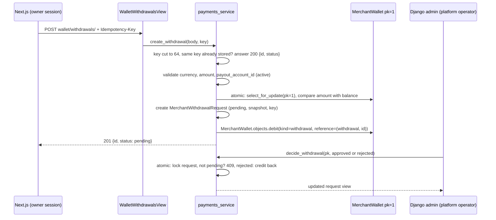
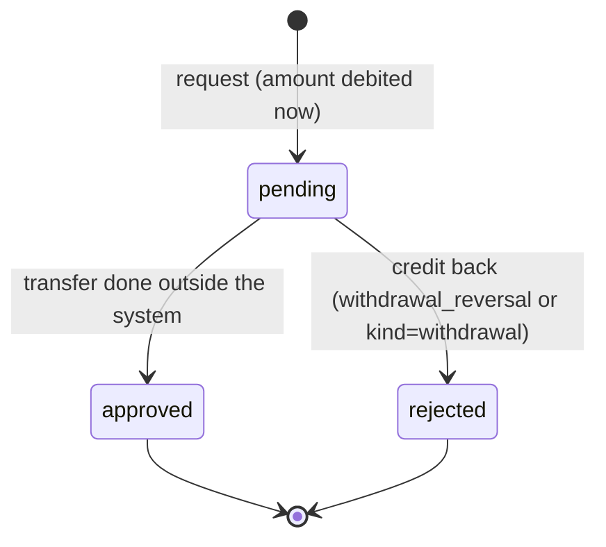
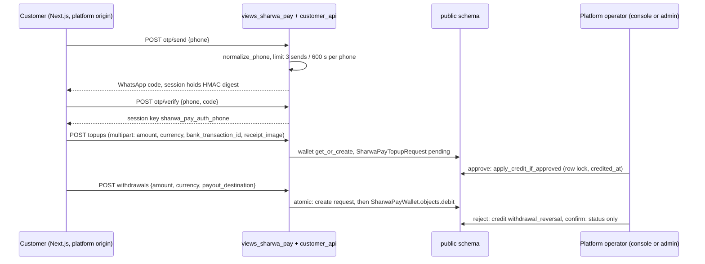

# Data model — Domain 8: payments, merchant wallet, expenses and Sharwa Pay

> **Source**: DOC-488 · inventory Domain 8 · INT-020 (M14), INT-043 (M33), INT-048 (M40)
> **Code**: `sharwa_saas/products/services/{payments_service,expenses_api_service}.py` · `sharwa_saas/api/{views_payments,views_expenses,views_sharwa_pay}.py` · `sharwa_saas/sharwapay/{models,customer_api,admin,constants}.py` · `sharwa_saas/products/models/{store_settings,wallets,billing,operations}.py` · `sharwa_saas/billing/models.py` · `sharwa_saas/products/payments/{registry,base,jeeb,kuraimi}.py` · `sharwa_saas/tenants/{merchant_billing,sharwa_pay_views,webhooks,console_money_service}.py` · `sharwa-frontend/src/features/{payments,expenses,sharwa-pay}/`
> **Last verified against code**: 2026-10-28 (step 37)

## 1. Purpose

Domain 8 is the money the merchant handles through the Next.js dashboard and the money a customer keeps in Sharwa Pay:

1. **Payments settings (M14)**: gateway credentials (Jeeb, Kuraimi), the two store switches (`enable_sharwa_pay`, `enable_manual_payment`) and the payout accounts a customer pays into.
2. **Merchant wallet (M14)**: the store's internal wallet (four currencies), its statement, withdrawal requests, and the read-only list of what the store owes the platform (sales commission and app charges).
3. **Operating expenses (M33)**: a manual, month-grouped expense ledger.
4. **Sharwa Pay, customer side (M40)**: the cross-store prepaid wallet of a customer, with top-up and withdrawal requests, on the platform origin.

This page is the **data model**: the 13 models, the schema each one lives in, the migration that added or changed each field, the provider that owns each tool, and the three ledgers (merchant wallet, expenses, Sharwa Pay) with every writer on **one ER diagram** (§3.3). The money rules, the reversal paths and the full writer tables are in [`../43-ledgers.md`](../43-ledgers.md); this page does not repeat them, it links to them and flags where the code differs (see §9). Amount formatting is in [`../40-money.md`](../40-money.md), idempotency keys in [`../41-idempotency.md`](../41-idempotency.md), locks in [`../42-concurrency.md`](../42-concurrency.md).

Not covered here: the customer wallet and loyalty points (Domain 6, [`06-customers-wallets.md`](06-customers-wallets.md)), the console actions that approve top-ups and collect dues (Domain 16, [`16-platform-console.md`](16-platform-console.md)), the Sharwa Ship waybill fee ([`11-shipping.md`](11-shipping.md)) and the rest of `StoreSetting` ([`12-settings-staff-integrations.md`](12-settings-staff-integrations.md)). Request and response shapes are on the API pages for these modules; `docs/api/` is not in this copy of the repository, so routes are named in prose.

## 2. Components

### 2.1 Provider table (file → what it owns)

| Provider | Location | Owns |
|---|---|---|
| `payments_service.py` | `sharwa_saas/products/services/payments_service.py` (652 lines) | Gateways (`list_gateways` `:136`, `get_gateway` `:144`, `set_gateway_enabled` `:154`, `save_credentials` `:177`), store switches (`get_store_payments` `:212`, `patch_store_payments` `:221`), payout accounts (`list_accounts` `:247`, `create_account` `:320`, `update_account` `:338`, `delete_account` `:350`, `reorder_accounts` `:361`), merchant wallet (`read_wallet` `:395`, `list_transactions` `:446`, `list_withdrawals` `:479`, `create_withdrawal` `:503`, `decide_withdrawal` `:556`), dues (`list_dues` `:629`) |
| `views_payments.py` | `sharwa_saas/api/views_payments.py` | 11 routes (`api/urls.py:338-348`). `PaymentsAPIMixin.check` (`:34`) applies, in order: session (401), **owner only** (a staff session answers 403 «المدفوعات والمحفظة مقصورة على مالك المتجر.», `:28`), plan feature |
| `registry.py` | `sharwa_saas/products/payments/registry.py` | `GATEWAY_REGISTRY` (`:18`), `get_gateway_class` (`:24`), `get_gateway` (`:28`), `get_enabled_gateway_codes` (`:57`). The single extension point for gateways (§2.3) |
| `settings_service.patch_payments` | `sharwa_saas/products/services/settings_service.py:321` | Validation and write of the two store switches, including the "at least one payment method" guard. Same row and validator as M34 |
| `expenses_api_service.py` | `sharwa_saas/products/services/expenses_api_service.py` (180 lines) | `list_expenses` (`:88`), `create_expense` (`:138`), constants `PAGE_SIZE = 50`, `NOTE_MAX = 500`, `MAX_AMOUNT = 10^12` (`:25-31`) |
| `views_expenses.py` | `sharwa_saas/api/views_expenses.py` | `ExpenseListView` (`:32`), `ExpenseDetailView` (`:52`, answers 405 to every method); gate `expenses.manage` (`:22`) |
| `customer_api.py` | `sharwa_saas/sharwapay/customer_api.py` (436 lines) | OTP login (`send_otp` `:153`, `verify_otp` `:171`, `logout` `:206`), reads (`wallet_view` `:224`, `list_transactions` `:251`, `list_requests` `:304`), writes (`create_topup` `:360`, `create_withdrawal` `:401`), error type `PayError` (`:71`) |
| `views_sharwa_pay.py` | `sharwa_saas/api/views_sharwa_pay.py` | Eight routes (`api/urls.py:463-470`); `SharwaPayView` (`:35`): public-schema only (`_public_only` `:26`), CSRF enforced on every write (`:44-45`), `Cache-Control: no-store` (`:56`) |
| Wallet managers | `sharwa_saas/products/models/wallets.py` (`MerchantWalletManager` `:151`), `sharwa_saas/sharwapay/models.py` (`SharwaPayWalletManager` `:31`) | The only code allowed to change a balance (row lock + movement row in one transaction) |
| `apply_credit_if_approved` | `sharwa_saas/sharwapay/models.py:208` | The single deposit point of a Sharwa Pay top-up request, guarded by `credited_at` |
| Dues records and collection | `sharwa_saas/products/models/billing.py` (`collect` `:57`, `:132`), `sharwa_saas/tenants/merchant_billing.py:29` | `PlatformCommissionRecord`, `AppBillingCharge` and the one function that debits a platform fee |
| `commission_service.py` | `sharwa_saas/products/services/commission_service.py:33` | Creates `PlatformCommissionRecord` (records only, no debit) |
| `PlatformBillingSettings` | `sharwa_saas/billing/models.py:140` | The public-schema singleton with `subscriptions_enabled` and `commission_enabled` |

### 2.2 Routes by provider

| Tool | Routes (under `/api/v1/`) | Gate |
|---|---|---|
| Gateways | `payments/gateways/` GET; `payments/gateways/<code>/` GET, PATCH `{is_enabled}`; `payments/gateways/<code>/credentials/` PUT (204) | Owner only. Feature `local_wallets` for `jeeb`, `payment_gateways` for every other code (`payments_service.gateway_feature` `:93`, `LOCAL_WALLET_GATEWAY_CODES = {'jeeb'}` `:45`). An unknown code answers 404 «البوابة غير معروفة.» |
| Store switches | `store/payments/` GET, PATCH `{enable_sharwa_pay, enable_manual_payment}` | Owner only, no plan feature |
| Payout accounts | `payments/payout-accounts/` GET, POST; `.../<pk>/` PATCH, DELETE; `.../reorder/` POST `{ordered_ids}` | Owner only; feature `bank_transfers` |
| Merchant wallet | `wallet/` GET; `wallet/transactions/` GET `?currency&type&from&to&page`; `wallet/withdrawals/` GET `?status&currency`, POST (header `Idempotency-Key`) | Owner only; feature `merchantwallet` |
| Dues | `wallet/dues/` GET `?kind=commission` or `?kind=app_charge`, `&status&page` | Owner only, no feature (reading platform dues is a permanent right, `views_payments.py:11-12`) |
| Expenses | `expenses/` GET `?category&currency&from&to&page`, POST; `expenses/<id>/` any method → 405 «تعديل المصروفات وحذفها غير متاحَين بعد.» | Merchant session; a staff session needs `expenses.manage` (403 otherwise); the owner has it implicitly; **no plan feature** (`views_expenses.py:6-7`) |
| Sharwa Pay | `sharwa-pay/otp/send/`, `otp/verify/`, `logout/` (POST); `wallet/`, `transactions/?currency&reason&page`, `requests/` (GET); `topups/` (POST multipart), `withdrawals/` (POST) | Wallet session of the platform origin; no merchant session. A store origin answers 404; a missing wallet session answers 401 «سجّل الدخول برقم جوالك.» |

Plan feature decisions come from `settings_feature_enabled` (`api/views_settings.py:32`), the same decision as the legacy `require_feature`. The plan catalogue is in [`../15-plans-and-features.md`](../15-plans-and-features.md); the permission model is in [`../31-authorization.md`](../31-authorization.md).

### 2.3 Gateway registry

`GATEWAY_REGISTRY` (`products/payments/registry.py:18-21`) holds exactly two gateways. The credential form of the dashboard (legacy and API) is built from each class's `credential_fields`, so a new bank is one adapter file plus one registry line, with no migration (registry docstring, `:2-12`).

| Code | Class | Display name | `credential_fields` (all required) | Customer field at payment | Settlement currency |
|---|---|---|---|---|---|
| `jeeb` | `JeebGateway` (`jeeb.py:26`) | «محفظة جيب» | `merchant_id`, `base_url` (kind `url`), `api_key` (secret), `api_secret` (secret) | `purchase_code` | `YER_NEW` |
| `kuraimi` | `KuraimiGateway` (`kuraimi.py:28`) | «حاسب الكريمي» | `merchant_code`, `base_url` (kind `url`), `api_key` (secret), `api_secret` (secret) | `pin` | taken from `BasePaymentGateway` default (`YER_NEW`, `base.py:126`) |

`CredentialField` (`base.py:65`) has `name`, `label`, `secret`, `kind` (`text` or `url`), `help_text`, `required` (default `True`). No field of either gateway sets `required=False`. A gateway counts as enabled only when `PaymentCredential.is_enabled` is true **and** every required field is filled (`get_gateway` raises `PaymentConfigurationError` otherwise, `registry.py:28-54`).

### 2.4 Legacy HTML views kept

The Django screens still work next to the API; the API did not replace their routes. Routes are in `config/urls_tenant.py` unless stated.

| Screen | Code | Route |
|---|---|---|
| Direct bank gateways (Kuraimi): `GatewayCredentialForm` (`products/forms.py:1043`, fields built at run time from `credential_fields`; a secret left empty keeps the stored value; saving a partial form is allowed, enabling is not; `clean` `:1089`, `save` `:1126`) | `payment_gateways_view` (`products/views/merchant_settings.py:932`, feature `payment_gateways`), shared builder `_build_gateway_forms` (`:875`) | `dashboard/payment-gateways/` (`:637`) |
| Local wallets (Jeeb): same form | `local_wallets_view` (`merchant_settings.py:959`, feature `local_wallets`) | `dashboard/local-wallets/` (`:641`) |
| Store switches | `save_sharwa_pay_toggle` (`merchant_settings.py:278`), `save_manual_payment_toggle` (`:252`): the same "one method at least" guard, written separately | `dashboard/payment-gateways/sharwa-pay/toggle/` (`:640`), `dashboard/bank-transfers/manual-payment/toggle/` (`:645`) |
| Payout accounts | `bank_transfers_view` (`:982`, feature `bank_transfers`), `add_payout_account` (`:696`), `delete_payout_account` (`:731`), `toggle_payout_account` (`:740`) | `dashboard/bank-transfers/` (`:642`), `dashboard/payout/add/`, `.../delete/<id>/`, `.../toggle/<id>/` (`:648-650`) |
| Merchant wallet page and withdrawal form | `merchant_wallet_view` (`products/views/merchant_wallet.py:24`, feature `merchantwallet`), `merchant_withdrawal_request_view` (`:44`) | `dashboard/merchant-wallet/`, `.../withdrawal/` (`:714-715`) |
| Operating expenses | `operating_expenses_view` (`products/views/operations.py:17`), `OperatingExpenseForm` (`products/forms.py:1212`) | `dashboard/operating-expenses/` (`:302`) |
| Withdrawal decision (merchant) | Django admin `MerchantWithdrawalRequestAdmin` actions `approve_withdrawal`, `reject_withdrawal` (`products/admin.py:243-273`), which call `payments_service.decide_withdrawal` (`:263`, `:269`). **No API route decides a merchant withdrawal** | tenant admin site |
| Dues collection and waiver | `PlatformCommissionRecordAdmin` (`products/admin.py:277`: `collect_commissions`, `waive_commissions`), `AppBillingChargeAdmin` (`:356`: `collect_charges`, `waive_charges`), `StoreAppInstallationAdmin.generate_current_period_charge` (`:316`) | tenant admin site |
| Sharwa Pay customer pages | `tenants/sharwa_pay_views.py`: wallet page (`sharwa_pay_wallet_page_view` `:94`), OTP (`sharwa_pay_otp_send_view` `:68`), top-up (`:138`), withdrawal (`:170`), logout (`:131`), PWA manifest and service worker (`:223`, `:260`) | `sharwa-pay/`, `sharwa-pay/otp/send/`, `sharwa-pay/topup/`, `sharwa-pay/withdraw/`, `sharwa-pay/logout/`, `manifest.json`, `sw.js` in `config/urls_public.py:48-56` |
| Sharwa Pay admin | `sharwapay/admin.py`: `SharwaPayWalletAdmin` (balances read-only), `SharwaPayWalletTransactionAdmin` (read-only audit list: no add, change or delete), `SharwaPayTopupRequestAdmin` (`save_model` calls `apply_credit_if_approved`; actions `approve_topup`, `reject_topup`), `SharwaPayWithdrawalRequestAdmin` (`approve_withdrawal`, `reject_withdrawal`) | platform admin site |
| Kuraimi bank webhook | `tenants/webhooks.kuraimi_topup_webhook` (`:39`), token `KURAIMI_WEBHOOK_TOKEN`, escrow account `SHARWA_ESCROW_ACCOUNT` | `webhooks/kuraimi/topup/` (`urls_public.py`) |

> ⚠️ Discrepancy — roadmap says the legacy HTML kept includes "payout forms" / code does: there is no payout form class. `add_payout_account`, `delete_payout_account` and `toggle_payout_account` read `request.POST` directly (`products/views/merchant_settings.py:696-748`); the only dashboard forms in this domain are `GatewayCredentialForm` and `OperatingExpenseForm`. Reported in step 37.

The roadmap's "wallet page + withdrawal form" is a template plus `merchant_withdrawal_request_view` reading `request.POST`; there is no form class for it either.

## 3. Data model

### 3.1 Schema placement

| Group | Schema | Evidence |
|---|---|---|
| `PaymentCredential`, `PayoutAccount`, `MerchantWallet`, `MerchantWalletTransaction`, `MerchantWithdrawalRequest`, `OperatingExpense`, `PlatformCommissionRecord`, `AppBillingCharge` | **store** (one copy per tenant schema) | They belong to the `products` app, which is in `TENANT_APPS` (`config/settings.py:152-161`) and not in `SHARED_APPS` (`:121-150`) |
| `SharwaPayWallet`, `SharwaPayWalletTransaction`, `SharwaPayTopupRequest`, `SharwaPayWithdrawalRequest` | **public** | App `sharwapay` is in `SHARED_APPS` (`settings.py:133`); the tables keep the pre-split names `tenants_sharwapay*` through `db_table` (`sharwapay/models.py:97`, `:158`, `:199`, `:271`) |
| `PlatformBillingSettings` (and `Plan`, `Subscription`, which it works with) | **public** | App `billing` is in `SHARED_APPS` (`settings.py:132`); `db_table = 'tenants_platformbillingsettings'` (`billing/models.py:156`) |

Three places link a store row to a public row, and **none is a foreign key** (django-tenants forbids it between the schemas): `SharwaPayWalletTransaction.source_tenant_schema` + `source_order_id` point back to a store and an order (`sharwapay/models.py:152-153`); `PlatformCommissionRecord` and `AppBillingCharge` keep snapshots of the plan and the app instead of a key (`billing.py:35`, `:110`); the merchant's own Sharwa Pay wallet is found by `Client.merchant_phone == SharwaPayWallet.customer_phone` (`merchant_billing.py:46-51`). See [`../10-multi-tenancy.md`](../10-multi-tenancy.md) and [`../13-cross-schema-access.md`](../13-cross-schema-access.md).

### 3.2 Model table

Thirteen models are documented. `StoreSetting` (two switches), `Order`, `StoreAppInstallation`, `StaffMember`, `Permission`/`Role`/`RolePermission`, `Plan` and `Client` are referenced only.

| Model | Schema | Key fields | Constraints / indexes | Added or changed by |
|---|---|---|---|---|
| `PaymentCredential` (`store_settings.py:12`) | store | `gateway_code` (30), `is_enabled`, `credentials_encrypted` (encrypted `TextField` holding a JSON dict, exposed as the `credentials` property), `updated_at` | `gateway_code` unique and indexed | `products/0031_paymentcredential_and_more`; `0035_paymentcredential_credentials_encrypted` (encrypted column), `0036_encrypt_existing_payment_credentials` (data copy), `0037_remove_paymentcredential_credentials` (plaintext column dropped) |
| `PayoutAccount` (`store_settings.py:62`) | store | `account_type` (`bank` or `wallet`, default `wallet`), `provider_name` (100), `account_number` (150), `account_name` (150), `is_active`, `sort_order`, `created_at` | `is_active` indexed; Meta ordering `sort_order, created_at`; **no unique constraint on the number** (duplicates are rejected in the service, §4.3) | `products/0033_payoutaccount_and_more` |
| `MerchantWallet` (`wallets.py:211`) | store | `balance_sar`, `balance_usd`, `balance_yer_old`, `balance_yer_new` (`Decimal(12,2)`), `created_at`, `updated_at` | One row: `save()` forces `pk=1`, `load()` is `get_or_create(pk=1)` (`:233-240`); created by the `StoreSetting` post-save signal (`products/signals.py:21`) | `0087_merchantwallet_merchantwallettransaction` (single SAR `balance`); `0090_merchantwallet_multicurrency` (four balances, old balance moved to `balance_sar` first) |
| `MerchantWalletTransaction` (`wallets.py:251`) | store | `wallet` (FK, CASCADE), `transaction_type` (`credit`/`debit`), `currency`, `amount`, `balance_after`, `description` (255), **`kind`** (`order_payment`, `refund`, `commission`, `withdrawal`, `adjustment`; default `adjustment`), **`reference_kind`** (`order`, `commission`, `withdrawal`, or empty), **`reference_id`** (`PositiveBigIntegerField`, nullable, no FK), `created_at` | `kind` indexed, `created_at` indexed; ordering `-created_at` | `0087`; `0090` (currency); **`0221_merchant_wallet_api`** (`kind`, `reference_kind`, `reference_id`, with a backfill, §3.4) |
| `MerchantWithdrawalRequest` (`wallets.py:284`) | store | `wallet` (FK, CASCADE), `amount` (min 0.01 by validator), `currency`, `payout_destination` (255, text snapshot), **`payout_account`** (FK to `PayoutAccount`, `SET_NULL`, nullable), **`idempotency_key`** (64, nullable), `status` (`pending`, `approved`, `rejected`), `rejection_reason` (255), `created_at`, `reviewed_at` | `idempotency_key` **unique** (global, not per wallet); `status` indexed; ordering `-created_at` | `0090_merchantwallet_multicurrency` (table created); **`0221_merchant_wallet_api`** (`payout_account`, `idempotency_key`) |
| `OperatingExpense` (`operations.py:16`) | store | `category` (`packaging`, `rent`, `salaries`, `other`; default `other`), `amount` (`Decimal(14,2)`, validator min 0.00), `currency` (10, default `SAR`, no choices), `expense_date`, `note` (`TextField`), `created_by` (FK to `StaffMember`, `SET_NULL`, nullable), `created_at` | `expense_date` indexed (`:39`); ordering `-expense_date, -id` | `0175_operations`; permission `expenses.manage` seeded by `0235_seed_expenses_permission` (the model itself did not change in Phase 002) |
| `PlatformCommissionRecord` (`billing.py:19`) | store | `order` (**OneToOne**, CASCADE, related name `platform_commission`), `plan_name_snapshot`, `commission_type` (`percentage` or `fixed`), `commission_value`, `amount` (`Decimal(12,2)`), `currency`, `status` (`pending`, `collected`, `waived`), `created_at`, `collected_at`, `notes` | one record per order (OneToOne); `status`, `created_at` indexed | `0101_platformcommissionrecord` |
| `AppBillingCharge` (`billing.py:89`) | store | `installation` (FK to `StoreAppInstallation`, CASCADE), `app_name_snapshot`, `period_label` (for example `2026-09`), `price_snapshot`, `currency`, `status`, `created_at`, `collected_at`, `notes` | `UniqueConstraint(installation, period_label)` named `unique_app_charge_per_period` | `0102_appbillingcharge` |
| `PlatformBillingSettings` (`billing/models.py:140`) | public (`tenants_platformbillingsettings`) | `subscriptions_enabled` (default `False`), `commission_enabled` (default `False`), `updated_at` | Singleton: `save()` forces `pk=1`, `delete()` does nothing, `load()` is `get_or_create(pk=1)` | created in `tenants/0012_plan_subscription_platformbillingsettings`; state moved to `billing` by `billing/0001_initial` and `tenants/0016_move_models_to_new_apps` (no SQL) |
| `SharwaPayWallet` (`sharwapay/models.py:80`) | public (`tenants_sharwapaywallet`) | `customer_phone` (20), `customer_name`, `balance_sar`, `balance_usd`, `balance_yer_old`, `balance_yer_new` (`Decimal(12,2)`), `is_active`, `created_at`, `updated_at` | `customer_phone` unique and indexed; `save()` normalises the phone with `clean_phone_number` on every save (`:101-114`); `is_active` indexed | `tenants/0004_sharwapaywallet_sharwapaytopuprequest_and_more` (single `balance`); `tenants/0007_sharwapaywallet_multicurrency`; moved by `sharwapay/0001_initial` + `tenants/0016` |
| `SharwaPayWalletTransaction` (`sharwapay/models.py:126`) | public | `wallet` (FK, CASCADE), `transaction_type`, `reason` (`topup_manual`, `topup_auto`, `purchase`, `purchase_refund`, `withdrawal`, `withdrawal_reversal`, `platform_fee`), `currency`, `amount`, `balance_after`, `description`, `source_tenant_schema` (63), `source_order_id`, `created_at` | `source_tenant_schema`, `source_order_id`, `created_at` indexed; ordering `-created_at`. This is the **audit row**: written by the manager in the same transaction as the balance; the admin list is read-only | `tenants/0004`; `0007` (`currency`); `0008_sharwapaywallettransaction_source_order_id_and_more`; `0015_alter_sharwapaywallettransaction_reason` (adds `platform_fee`) |
| `SharwaPayTopupRequest` (`sharwapay/models.py:168`) | public | `wallet` (FK, CASCADE, **nullable**), `bank_transaction_id` (100, nullable), `amount` (min 0.01), `currency`, `reference_note` (255), `receipt_image`, `status`, `rejection_reason`, `bank_name`, `claimed_phone`, `reviewed_by`, `credited_at`, `created_at`, `reviewed_at` | `bank_transaction_id` **unique** (also when the request is rejected) and indexed; `status` indexed | `tenants/0004`; `0005_sharwapaytopuprequest_bank_transaction_id_and_more`; `0006_sharwapaytopuprequest_credited_at` (with backfill); `0007` (`currency`); `sharwapay/0002_alter_sharwapaytopuprequest_receipt_image`; `sharwapay/0003_console_review_fields` (`bank_name`, `claimed_phone`, `reviewed_by`) |
| `SharwaPayWithdrawalRequest` (`sharwapay/models.py:256`) | public | `wallet` (FK, CASCADE), `amount` (min 0.01), `currency`, `payout_destination` (255), `status`, `rejection_reason`, `reviewed_by`, `created_at`, `reviewed_at` | `status` indexed; **no idempotency key** | `tenants/0004`; `0007` (`currency`); `sharwapay/0003_console_review_fields` (`reviewed_by`) |

Referenced, not documented here: `StoreSetting.enable_manual_payment` (default `True`) and `enable_sharwa_pay` (default `False`), added by `products/0009_order_payment_method_and_more` (`store_settings.py:291`, `:297`).

### 3.3 ER sketch: the three ledgers, their models and every writer

The diagram shows each ledger's balance holder, movement rows and requests. Entities that start with `W_` are **writers** (the function that creates or changes the rows), with `file:line` of the write. A dotted line from a writer means "creates or moves"; solid lines are foreign keys. Store schema: L1, L2, the dues records, `PaymentCredential`, `PayoutAccount`. Public schema: L3, `PlatformBillingSettings`, `Plan`, `Client`. Lines between the two schemas are soft links, not foreign keys.

```mermaid
erDiagram
  %% ===== L1 merchant wallet (store) =====
  MerchantWallet ||--o{ MerchantWalletTransaction : "transactions"
  MerchantWallet ||--o{ MerchantWithdrawalRequest : "withdrawal_requests"
  PayoutAccount |o--o{ MerchantWithdrawalRequest : "payout_account SET_NULL"
  Order ||..o{ MerchantWalletTransaction : "reference_kind=order, no FK"
  MerchantWithdrawalRequest ||..o{ MerchantWalletTransaction : "reference_kind=withdrawal, no FK"

  W_merchant_credit ||..o{ MerchantWalletTransaction : "credit order_payment"
  W_refund_reversal ||..o{ MerchantWalletTransaction : "debit refund"
  W_cancel_order ||..o{ MerchantWalletTransaction : "debit adjustment"
  W_api_withdrawal ||..o{ MerchantWithdrawalRequest : "creates, then debits"
  W_legacy_withdrawal ||..o{ MerchantWithdrawalRequest : "creates, then debits"
  W_decide_withdrawal ||..o{ MerchantWithdrawalRequest : "approves or rejects"
  W_api_withdrawal ||..o{ MerchantWalletTransaction : "debit withdrawal"
  W_legacy_withdrawal ||..o{ MerchantWalletTransaction : "debit withdrawal"
  W_decide_withdrawal ||..o{ MerchantWalletTransaction : "credit withdrawal on reject"

  %% ===== L2 operating expenses (store) =====
  StaffMember |o--o{ OperatingExpense : "created_by SET_NULL"
  W_create_expense ||..o{ OperatingExpense : "creates"
  W_legacy_expense ||..o{ OperatingExpense : "creates"

  %% ===== L3 Sharwa Pay (public) =====
  SharwaPayWallet ||--o{ SharwaPayWalletTransaction : "transactions"
  SharwaPayWallet |o--o{ SharwaPayTopupRequest : "topup_requests, nullable"
  SharwaPayWallet ||--o{ SharwaPayWithdrawalRequest : "withdrawal_requests"
  Order ||..o{ SharwaPayWalletTransaction : "source_order_id, no FK"
  Client ||..o| SharwaPayWallet : "merchant_phone = customer_phone"

  W_customer_topup ||..o{ SharwaPayTopupRequest : "creates pending, no balance move"
  W_kuraimi_webhook ||..o{ SharwaPayTopupRequest : "creates approved or pending"
  W_kuraimi_webhook ||..o{ SharwaPayWalletTransaction : "credit topup_auto"
  W_apply_credit ||..o{ SharwaPayWalletTransaction : "credit topup_auto or topup_manual"
  W_apply_credit ||..o{ SharwaPayTopupRequest : "stamps credited_at"
  W_checkout_debit ||..o{ SharwaPayWalletTransaction : "debit purchase"
  W_refund_credit ||..o{ SharwaPayWalletTransaction : "credit purchase_refund"
  W_customer_withdrawal ||..o{ SharwaPayWithdrawalRequest : "creates, then debits"
  W_legacy_sp_withdrawal ||..o{ SharwaPayWithdrawalRequest : "debits, then creates"
  W_customer_withdrawal ||..o{ SharwaPayWalletTransaction : "debit withdrawal"
  W_legacy_sp_withdrawal ||..o{ SharwaPayWalletTransaction : "debit withdrawal"
  W_reject_withdrawal ||..o{ SharwaPayWalletTransaction : "credit withdrawal_reversal"
  W_collect_fee ||..o{ SharwaPayWalletTransaction : "debit platform_fee"

  %% ===== L4 dues (store records, public debit) =====
  Order ||--o| PlatformCommissionRecord : "OneToOne platform_commission"
  StoreAppInstallation ||--o{ AppBillingCharge : "billing_charges"
  Plan ||..o{ PlatformCommissionRecord : "snapshot, no FK"
  PlatformBillingSettings ||..o{ PlatformCommissionRecord : "commission_enabled gates creation"
  W_record_commission ||..o{ PlatformCommissionRecord : "creates pending"
  W_generate_charge ||..o{ AppBillingCharge : "creates pending"
  PlatformCommissionRecord ||..o{ W_collect_fee : "collect()"
  AppBillingCharge ||..o{ W_collect_fee : "collect()"
  W_issue_waybill ||..o{ W_collect_fee : "waybill fee, no due record"

  %% ===== payment settings (store) =====
  StoreSetting ||..o{ PaymentCredential : "enable_sharwa_pay, enable_manual_payment guard"

  MerchantWallet {
    int id PK "always 1"
    decimal balance_sar
    decimal balance_usd
    decimal balance_yer_old
    decimal balance_yer_new
  }
  MerchantWalletTransaction {
    int id PK
    int wallet_id FK
    string transaction_type "credit or debit"
    string currency
    decimal amount
    decimal balance_after
    string kind "order_payment, refund, commission, withdrawal, adjustment"
    string reference_kind "order, commission, withdrawal"
    int reference_id "no FK"
  }
  MerchantWithdrawalRequest {
    int id PK
    int wallet_id FK
    int payout_account_id FK "nullable"
    string payout_destination "text snapshot"
    string idempotency_key UK "64, nullable"
    string status "pending, approved, rejected"
  }
  PayoutAccount {
    int id PK
    string account_type "bank or wallet"
    string account_number
    bool is_active
    int sort_order
  }
  PaymentCredential {
    int id PK
    string gateway_code UK
    bool is_enabled
    text credentials_encrypted
  }
  OperatingExpense {
    int id PK
    string category "packaging, rent, salaries, other"
    decimal amount "14,2"
    string currency
    date expense_date "indexed"
    int created_by_id FK "nullable"
  }
  SharwaPayWallet {
    int id PK
    string customer_phone UK
    decimal balance_sar
    decimal balance_usd
    decimal balance_yer_old
    decimal balance_yer_new
    bool is_active
  }
  SharwaPayWalletTransaction {
    int id PK
    int wallet_id FK
    string reason "topup_auto, topup_manual, purchase, purchase_refund, withdrawal, withdrawal_reversal, platform_fee"
    string currency
    decimal amount
    decimal balance_after
    string source_tenant_schema "no FK"
    int source_order_id "no FK"
  }
  SharwaPayTopupRequest {
    int id PK
    int wallet_id FK "nullable"
    string bank_transaction_id UK "nullable"
    string status
    string claimed_phone
    datetime credited_at "double-credit guard"
  }
  SharwaPayWithdrawalRequest {
    int id PK
    int wallet_id FK
    string payout_destination
    string status
    string reviewed_by
  }
  PlatformCommissionRecord {
    int id PK
    int order_id FK "unique"
    string commission_type "percentage or fixed"
    decimal amount
    string status "pending, collected, waived"
  }
  AppBillingCharge {
    int id PK
    int installation_id FK
    string period_label
    decimal price_snapshot
    string status "pending, collected, waived"
  }
  PlatformBillingSettings {
    int id PK "always 1"
    bool subscriptions_enabled
    bool commission_enabled
  }

  W_merchant_credit {
    string fn "merchant_credit_service.process_order_merchant_credit :14, credit :66"
  }
  W_refund_reversal {
    string fn "refund_service.process_order_refund :67, debit :181"
  }
  W_cancel_order {
    string fn "Order.cancel_order orders.py :529, debit :541"
  }
  W_api_withdrawal {
    string fn "payments_service.create_withdrawal :503, debit :542"
  }
  W_legacy_withdrawal {
    string fn "views/merchant_wallet.merchant_withdrawal_request_view :44, debit :77"
  }
  W_decide_withdrawal {
    string fn "payments_service.decide_withdrawal :556, credit :567; admin actions only"
  }
  W_create_expense {
    string fn "expenses_api_service.create_expense :138"
  }
  W_legacy_expense {
    string fn "views/operations.operating_expenses_view :17"
  }
  W_customer_topup {
    string fn "sharwapay/customer_api.create_topup :360"
  }
  W_kuraimi_webhook {
    string fn "tenants/webhooks.kuraimi_topup_webhook :39, credit :113"
  }
  W_apply_credit {
    string fn "SharwaPayTopupRequest.apply_credit_if_approved :208, credit :246; callers console topup_action :530, admin :65 and :84"
  }
  W_checkout_debit {
    string fn "checkout_service debit :539"
  }
  W_refund_credit {
    string fn "refund_service.process_order_refund credit :142"
  }
  W_customer_withdrawal {
    string fn "sharwapay/customer_api.create_withdrawal :401, debit :429"
  }
  W_legacy_sp_withdrawal {
    string fn "tenants/sharwa_pay_views.sharwa_pay_withdrawal_request_view :170, debit :207"
  }
  W_reject_withdrawal {
    string fn "console withdrawal_action :569, credit :584; admin reject_withdrawal sharwapay/admin.py :117, credit :120"
  }
  W_collect_fee {
    string fn "tenants/merchant_billing.collect_platform_fee_from_merchant :29, debit :59"
  }
  W_record_commission {
    string fn "commission_service._record_platform_commission :33"
  }
  W_generate_charge {
    string fn "app_marketplace_service.generate_billing_charge :232"
  }
  W_issue_waybill {
    string fn "shipping_billing_service.issue_waybill :21, fee call :142"
  }
```

Reading the diagram:

- **L1** (merchant wallet): one balance row, one movement row per move, one request row per withdrawal. The six writers are the full list of callers of `MerchantWallet.objects.credit/debit` (a grep of the code finds no other: `merchant_credit_service.py:66`, `refund_service.py:181`, `orders.py:541`, `payments_service.py:542`, `:567`, `merchant_wallet.py:77`).
- **L2** (expenses): no balance and no movement row; the list itself is the ledger. Two writers.
- **L3** (Sharwa Pay): the balance holder is the wallet of a **phone**, not a store. The nine call sites of `SharwaPayWallet.objects.credit/debit` are all on the diagram (`webhooks.py:113`, `sharwapay/models.py:246`, `checkout_service.py:539`, `refund_service.py:142`, `customer_api.py:429`, `sharwa_pay_views.py:207`, `console_money_service.py:584`, `sharwapay/admin.py:120`, `merchant_billing.py:59`); `W_apply_credit` has three callers (console `topup_action`, and two admin paths) and `W_reject_withdrawal` two sites.
- **Dues** (L4 in `43-ledgers.md`): the two records move no money. `W_collect_fee` is the only function that debits a platform fee; it has three callers (the two `.collect()` methods, and `issue_waybill`, which charges the Sharwa Ship fee without a due record).

| Entity | Schema |
|---|---|
| `MerchantWallet`, `MerchantWalletTransaction`, `MerchantWithdrawalRequest`, `PayoutAccount`, `PaymentCredential`, `OperatingExpense`, `PlatformCommissionRecord`, `AppBillingCharge`, `StoreSetting`, `StaffMember`, `StoreAppInstallation`, `Order` | store |
| `SharwaPayWallet`, `SharwaPayWalletTransaction`, `SharwaPayTopupRequest`, `SharwaPayWithdrawalRequest`, `PlatformBillingSettings`, `Plan`, `Client` | public |

### 3.4 Migrations

All names below exist in the repository; `products/` migrations run once per tenant schema, the others once in `public`.

**Phase 002 (this domain)**

| Migration | What it did |
|---|---|
| `products/0221_merchant_wallet_api.py` (INT-020) | Adds `MerchantWalletTransaction.kind` (indexed, default `adjustment`), `reference_kind`, `reference_id`; `MerchantWithdrawalRequest.payout_account` (FK `SET_NULL`) and `idempotency_key` (unique). **Backfill** (`RunPython`, reverse is a no-op): `classify(description)` reads each old row's description. If it contains «سحب» the row is `withdrawal`; «استرجاع» means `refund`; «إلغاء» means `adjustment` with an order reference; «إيداع قيمة الطلب» means `order_payment`; anything else is `adjustment` with no reference. The number after `#` becomes `reference_id`. The classification works because these descriptions are fixed phrases in the code (migration docstring) |
| `products/0235_seed_expenses_permission.py` (INT-043) | Seeds `Permission` `expenses.manage` (category «المالية») and links it to the system roles «مدير المتجر» and «مدير الفرع». Same shape as `products/0210_seed_catalog_manage_permission.py` (get-or-create permission, link to the two admin roles, reverse deletes both). The owner has the permission implicitly |
| `sharwapay/0003_console_review_fields.py` (INT-031, M45) | Adds `SharwaPayTopupRequest.bank_name`, `claimed_phone`, `reviewed_by` and `SharwaPayWithdrawalRequest.reviewed_by`; backfills `bank_name = «كريمي»` for every request that has a bank transaction id and extracts `claimed_phone` from the note «الرقم الوارد: X» of requests without a wallet |
| `sharwapay/0002_alter_sharwapaytopuprequest_receipt_image.py` | Changes `receipt_image` to `TenantUploadTo('sharwa_pay_topups', …, randomize_name=True)` with an extension validator. No migration is named after INT-048 itself: the M40 customer API added no column |

**Earlier history that shaped the models**

| Migration | What it did |
|---|---|
| `products/0009_order_payment_method_and_more.py` | Adds `StoreSetting.enable_manual_payment`, `enable_sharwa_pay` |
| `products/0031_paymentcredential_and_more.py` | Creates `PaymentCredential`; removes the eight `jeeb_*`/`kuraimi_*` columns and the e-wallet fields from `StoreSetting` |
| `products/0033_payoutaccount_and_more.py` | Creates `PayoutAccount` |
| `products/0035_paymentcredential_credentials_encrypted.py`, `0036_encrypt_existing_payment_credentials.py`, `0037_remove_paymentcredential_credentials.py` | Encrypted credentials column, data copy (reverse is a no-op on purpose), plaintext column dropped |
| `products/0087_merchantwallet_merchantwallettransaction.py`, `0090_merchantwallet_multicurrency.py` | Merchant wallet (one SAR balance), then four balances plus `MerchantWithdrawalRequest`; the old balance is copied to `balance_sar` before the column is dropped |
| `products/0101_platformcommissionrecord.py`, `0102_appbillingcharge.py` | The two dues records |
| `products/0175_operations.py` | `OperatingExpense` (with `SupportTicket`, `ZeroResultSearchLog`) |
| `tenants/0004_sharwapaywallet_sharwapaytopuprequest_and_more.py` | The four Sharwa Pay tables (single SAR `balance`) |
| `tenants/0005_sharwapaytopuprequest_bank_transaction_id_and_more.py` | Unique `bank_transaction_id`; `wallet` becomes nullable |
| `tenants/0006_sharwapaytopuprequest_credited_at.py` | `credited_at`, with a backfill so that already-credited requests are not credited again |
| `tenants/0007_sharwapaywallet_multicurrency.py`, `0008_sharwapaywallettransaction_source_order_id_and_more.py`, `0015_alter_sharwapaywallettransaction_reason.py` | Four balances, and `currency` on the movement and both request tables; `source_order_id` + `source_tenant_schema`; `platform_fee` reason |
| `tenants/0012_plan_subscription_platformbillingsettings.py` | `Plan`, `Subscription`, `PlatformBillingSettings` |
| `tenants/0016_move_models_to_new_apps.py`, `sharwapay/0001_initial.py`, `billing/0001_initial.py` | State-only move of the Sharwa Pay and billing models to their own apps (`SeparateDatabaseAndState` with empty database operations); no table is recreated, so balances survive |

## 4. Flows

### 4.1 Gateway credentials

1. `GET payments/gateways/` lists the registry filtered by plan feature (`list_gateways(allowed)`, `:136`). Each item says `is_enabled` (enabled **and** complete), `has_credentials`, and one entry per field. **No secret leaves the service**: a secret field returns only `masked_hint` (`••••` plus the last four characters, `_mask` `:97`) and `value: null`; a non-secret field returns its value.
2. `PUT .../credentials/` merges the sent fields into the stored dict (`save_credentials`, `:177`). A missing or empty field keeps the stored value (secret or not); a value over `SECRET_MAX = 500` characters or a `url` field that is not `http`/`https` answers 400 with the field name as key. Partial saves are allowed. The write runs under a row lock (`_locked_credential`, `:149`: get-or-create, then `select_for_update`) and answers 204.
3. `PATCH .../<code>/ {is_enabled}` (`set_gateway_enabled`, `:154`). Enabling requires every required field, else 400 `{is_enabled: [«لا يمكن تفعيل {name} قبل تعبئة: {labels}»]}`. Disabling the last working method (no manual payment, no Sharwa Pay, no other complete gateway) answers 400 «يجب تفعيل طريقة دفع واحدة على الأقل.» (`LAST_METHOD_MESSAGE`, `:46`).

Storage: `credentials_encrypted` is a `TextField` wrapped by `django_cryptography.encrypt`, so the column is encrypted at rest; the `credentials` property reads and writes a dict transparently (`store_settings.py:34-58`).

### 4.2 Store switches

`PATCH store/payments/` calls `settings_service.patch_payments` (`:321`): both keys must be booleans, then the same guard (not all of manual, Sharwa Pay and complete gateways switched off), then `_commit`. The answer is `{enable_sharwa_pay, enable_manual_payment, active_payout_accounts}`, where the last value is a count of accounts with `is_active=True` (`get_store_payments`, `:212`). The row is `StoreSetting`, the same row M34 edits, so the two modules cannot drift.

### 4.3 Payout accounts

- **Order.** Banks first, then wallets; inside a type by `sort_order`, `created_at`, `pk` (`_accounts_sorted`, `:241`, with `ACCOUNT_TYPES = ('bank', 'wallet')`). The model's own Meta ordering (`sort_order, created_at`) does not separate the types.
- **Create** (`:320`): `sort_order` is the highest in that type plus one (zero for the first), read after a `select_for_update` on that type's accounts. There is no unique constraint on `(account_type, sort_order)`.
- **Number normalisation and duplicates** (`_clean_account`, `:267`): Arabic and Persian digits become Latin (`_DIGITS`, `:51`), runs of whitespace become one space, the length must be 4 to 150 and the characters `A-Z a-z 0-9 space hyphen` only (`ACCOUNT_NUMBER_RE`, `:48`). The duplicate check compares the number with spaces and hyphens removed and uppercased (`_squash`, `:263`) against every other account, so «777 410 225» and «٧٧٧-٤١٠-٢٢٥» are the same number (the pair used in `test_payout_accounts`); a duplicate answers `{account_number: [«هذا الرقم مضاف مسبقاً.»]}`. The stored value keeps the merchant's spacing.
- **Update** (`:338`): only `provider_name`, `account_number`, `account_name`, `is_active` are editable. `account_type` in the body is ignored.
- **Delete** (`:350`): refused while any `MerchantWithdrawalRequest` with this account is `pending`: 400 with `code: 'has_pending_withdrawal'` and a message that tells the merchant to disable the account instead. After a decision the delete succeeds; the request keeps its `payout_destination` snapshot, and `_withdrawal_view` (`:456`) shows that text, or «حساب محذوف» if even the snapshot is empty.
- **Reorder** (`:361`): the body must list **all** accounts of **one** type, each once; otherwise 400 with «رتّب حسابات نوع واحد في كل مرة.» or «أرسل كل حسابات النوع بترتيبها الكامل.». The rows are locked and renumbered `0..n-1` in one `bulk_update`.

The legacy `delete_payout_account` has no pending-withdrawal check (see §9).

### 4.4 Wallet read and statement

- `read_wallet` (`:395`) returns four entries in the order `SAR, USD, YER_OLD, YER_NEW`. The stored balance is already net of pending withdrawals (they are debited at request time), so `available` is the stored balance, `reserved` is the sum of `pending` withdrawal amounts in that currency, and the displayed balance is `available + reserved`. Currencies are never added to each other.
- `list_transactions` (`:446`) filters by `currency`, `type` (the `kind`), `from`, `to`; ordered `-created_at, -id`; page size default 50, maximum 100 (`_page`, `:73`). Each row exposes `type = kind`, a signed `amount`, and a `reference` object `{kind, id, label}` where the label is «طلب #{}», «طلب سحب #{}» or «عمولة #{}» (`REFERENCE_LABELS`, `:413`); a row with an empty `reference_kind` or no id has `reference: null`.

### 4.5 Merchant withdrawal and decision

Rules the code adds to the diagram:

- The `Idempotency-Key` header is trimmed and **cut to 64 characters**; a repeated key returns `200 {id, status}` of the stored request **without comparing the body** (`_replay`, `:498`). Two simultaneous first requests with the same key: the second hits the unique constraint, and the `IntegrityError` handler replays the first (`:547-551`).
- Validation: `currency` must be one of the four; `amount` must match `^\d{1,10}(\.\d{1,2})?$` and be above zero (`AMOUNT_RE`, `:47`); `payout_account_id` must exist and be active. All errors return together as `{field: [message]}`.
- The balance check uses the locked wallet row: «المبلغ أكبر من المتاح للسحب (…)» when the amount exceeds the stored balance. Nothing is created in that case: the error is raised inside the `atomic` block, which rolls back.
- `payout_destination` is written as `provider — account name — number`, cut to 255 characters. The debit description is «طلب سحب رصيد #<id> — قيد المراجعة».
- `decide_withdrawal` (`:556`) is called today only by the Django admin actions (and by tests): the row is locked, a non-`pending` request answers 409 «تم البتّ في هذا الطلب مسبقاً.», `rejected` credits the amount back with `kind='withdrawal'` and the same reference, and `approved` writes **no** wallet row (the money left at request time).

The same three states apply to `MerchantWithdrawalRequest` and `SharwaPayWithdrawalRequest`.

### 4.6 Dues (read) and their writers

`GET wallet/dues/` (`list_dues`, `:629`) reads either `PlatformCommissionRecord` (default) or `AppBillingCharge` (`kind=app_charge`; any other value means `commission`). It returns `commission_enabled` (from `PlatformBillingSettings.load()`), `counts` and `totals` for the three statuses (a per-currency sum such as «2.50 ر.س · $1», never a mixed number), and a page of rows. It is read-only. The commission detail line says «{value}% من قيمة الطلب — باقة {plan}» for `commission_type == 'percentage'` and a fixed-amount text otherwise (`_commission_view`, `:590`).

How the rows come to exist (the debit itself is in [`../43-ledgers.md`](../43-ledgers.md) §4.4):

- **Commission**: `commission_service._record_platform_commission` (`:33`) runs from `process_order_merchant_credit` for every order that reaches it. It returns without writing unless `PlatformBillingSettings.commission_enabled` is on, the store's current plan has `commission_type != 'none'` and the amount is above zero. Percentage amounts are `total_price × value / 100`, rounded half-up to two decimals; fixed amounts use the plan value as is. The order row is locked and an existing record stops a second one. Any exception is logged and swallowed (`record_platform_commission_if_enabled`, `:23-30`).
- **App charge**: `app_marketplace_service.generate_billing_charge` (`:232`) needs an installed, billed app; the period label is `YYYY-MM` for monthly apps and the year otherwise; the unique constraint is the duplicate guard (a savepoint absorbs the `IntegrityError`). It is called only from the console and the admin action; no Celery job calls it.
- **Collect and waive**: `.collect()` (`billing.py:57`, `:132`, both `@atomic`) checks `status == 'pending'`, then calls `collect_platform_fee_from_merchant`, which debits the merchant's Sharwa Pay wallet and returns `(ok, error)` without raising. `waive` is a status update with no money. A `collected` record has no reverse path.

### 4.7 Operating expenses

- **List** (`list_expenses`, `:88`): filters `category`, `currency` (invalid values are ignored, not errors), `from`, `to` (`YYYY-MM-DD`; an impossible date such as `2026-02-30` is ignored), `page`. Rows are ordered `-expense_date, -id`, 50 per page. The months shown are the months of the page's rows; **each month's totals cover the whole filtered month, not only the page**: one query takes the filtered set from the first day of the earliest month on the page to the end of the latest, annotates `TruncMonth('expense_date')`, groups by `(month, currency)` and sums `amount` (`:104-117`, `.order_by()` keeps `Meta.ordering` out of the `GROUP BY`). Totals are listed per currency in the fixed order of `CURRENCY_CHOICES`; two currencies are never added.
- **Create** (`create_expense`, `:138`): the five fields of FR-33.01 only. Errors are collected and returned together as `{field: [message]}`: category «اختر فئة صحيحة.», amount «قيمة المصروف موجبة دائماً.» (not a `^\d+(\.\d{1,2})?$` number, or below 0.01) or «المبلغ أكبر من المسموح.» (at or above `10^12`), currency «عملة غير مدعومة.» (default `SAR` when omitted), date «أدخل تاريخاً صحيحاً.», note «الملاحظة 500 حرف على الأكثر.». The amount is stored with two decimals. `created_by` is the staff member of the request (`resolve_request_staff`), `None` for the owner; the row shows `created_by_name` and keeps it after the employee's service ends (the staff row stays; `terminated_at` does not delete it, `_row` comment in `expenses_api_service.py:67`).
- **No edit or delete**: `expenses/<id>/` answers 405 to GET, PATCH, PUT and DELETE (after the permission gate) (FR-33.06).
- **Readers**: the report `operating_expenses` (`reports_registry.py:415`, registered at `:734`, permission `reports.profit.view`) and nothing else in the files checked (§9).

### 4.8 Sharwa Pay, customer side

| Rule | Value / behaviour | Where |
|---|---|---|
| Session | Django session in the public schema, key `sharwa_pay_auth_phone`; `session.cycle_key()` at login | `customer_api.py:47`, `:201` |
| Code | 6 digits, valid 600 s, stored only as an HMAC-SHA256 digest bound to the phone; consumed once | `:49`, `:124`, `:164-167`, `:198` |
| Send limit | 3 per 600 s per phone (cache, so clearing cookies does not help); 429 «طلبات كثيرة — حاول لاحقاً.» + `Retry-After` | `:50-51`, `:159-163` |
| Verify limit | 5 wrong codes lock the phone for 300 s; 429 «محاولات كثيرة — أُقفل التحقق مؤقتاً.» | `:52-53`, `:188-197` |
| Phone | `^(967\|966)\d{8,9}$`; local numbers get `967` | `:59`, `:85-96` |
| Reads | 4 balances always (one per currency, formatted by the server, no conversion); transactions 20 per page; requests capped at 100 each | `:224-236`, `:54-55`, `:251` |
| Transactions | Each row carries `source_store_name` and `source_store_available` (store inactive or deleted means unavailable) and a `related_request` found from the `#<id>` in the description | `:239-301` |
| Top-up request | amount `^\d{1,10}(\.\d{1,2})?$` and at least 0.01; currency one of four; `bank_transaction_id` required, 100 characters at most, **globally unique**; receipt required, `jpg jpeg png webp gif`, 5 MB, verified by Pillow; the first top-up request creates the wallet | `:58`, `:360-398` |
| Withdrawal | `payout_destination` 6 to 255 characters; no wallet means «الرصيد غير كافٍ.»; request and debit in one transaction | `:401-436` |
| Suspended wallet | `is_active=False` answers 403 «المحفظة موقوفة — تواصل مع الدعم.» on both writes | `:364-365`, `:405-406` |
| Origin and CSRF | public schema only (404 otherwise); CSRF enforced on every write including login; `Cache-Control: no-store` | `views_sharwa_pay.py:26`, `:44`, `:56` |

Platform decisions are in the console and the Django admin ([`16-platform-console.md`](16-platform-console.md)). Two differences between them matter for data: the console stamps `reviewed_by` and `reviewed_at`, while the admin bulk actions `approve_withdrawal` and `reject_topup` use `queryset.update(...)` and leave `reviewed_by` empty; `reject_topup` also leaves `rejection_reason` empty, which the customer API answers with the fallback text «رُفض الطلب.» (`customer_api.py:325`, `:335`).

## 5. Invariants

Cross-ledger rules are in [`../43-ledgers.md`](../43-ledgers.md) §5. These are the ones this data model adds or makes visible:

| Invariant | Enforced by |
|---|---|
| `MerchantWallet` has exactly one row | `save()` forces `pk=1`; every manager call reads `select_for_update().get(pk=1)` (`wallets.py:169`, `:190`) |
| `PlatformBillingSettings` has exactly one row and cannot be deleted | `save()` forces `pk=1`, `delete()` is a no-op (`billing/models.py:163-173`) |
| One withdrawal per `Idempotency-Key` | unique `MerchantWithdrawalRequest.idempotency_key`; pre-check `_replay` and `IntegrityError` handler (`payments_service.py:498`, `:547`) |
| A withdrawal request exists if and only if its debit does | request creation and `debit` in one `transaction.atomic` (`payments_service.py:532-546`, `customer_api.py:424-432`, `merchant_wallet.py:71-81`, `sharwa_pay_views.py:204-215`) |
| A bank transaction id is used once | unique `SharwaPayTopupRequest.bank_transaction_id`, including rejected requests |
| A top-up is credited once | `credited_at` stamped under `select_for_update` in `apply_credit_if_approved` (`sharwapay/models.py:234-253`); the webhook stamps it at creation |
| One commission record per order, one app charge per installation and period | OneToOne `order`; `unique_app_charge_per_period` |
| A balance is per currency | `wallet_balance_field(currency)` raises `ValueError` on an unknown code (`wallets.py:14-21`, `sharwapay/constants.py`); both managers require `currency` (no default for Sharwa Pay `credit/debit`; `MerchantWalletManager` takes it as a required argument) |
| Dues and payout accounts keep a snapshot, not a live link | `plan_name_snapshot`, `commission_*`, `app_name_snapshot`, `price_snapshot`; `MerchantWithdrawalRequest.payout_destination` |
| No secret leaves the gateway service | `_gateway_view` returns `masked_hint` only for secret fields; `value` is `None` (`payments_service.py:105-126`); test `test_gateway_credentials_never_leak_and_enable_rules` |
| A staff session never reaches payments or the wallet | `PaymentsAPIMixin.check` (`views_payments.py:38-39`); expenses are the exception, gated by `expenses.manage` |
| Sharwa Pay is never read from a store origin | `_public_only` (`views_sharwa_pay.py:26`) |

## 6. Background work

No Celery task or Beat entry in this domain: `CELERY_BEAT_SCHEDULE` (`config/settings.py:622`) has no entry whose name or task mentions a wallet, withdrawal, commission, billing, expense or top-up. Dues are generated and collected by hand, top-ups arrive through the Kuraimi webhook or the console, and withdrawals are decided by an operator. The only automatic write is the `MerchantWallet` row created when a store's `StoreSetting` is first saved (`products/signals.py:21`). See [`../43-ledgers.md`](../43-ledgers.md) §6.

## 7. Configuration

| Setting | Default | Effect |
|---|---|---|
| `StoreSetting.enable_manual_payment` | `True` | manual transfer / pay on delivery switch; guarded with the other methods |
| `StoreSetting.enable_sharwa_pay` | `False` | Sharwa Pay at checkout |
| `PlatformBillingSettings.commission_enabled` | `False` | turns commission **recording** on; collection stays manual |
| `PlatformBillingSettings.subscriptions_enabled` | `False` | plan system on (affects which plan a store has, hence its commission) |
| Plan features `payment_gateways`, `local_wallets`, `bank_transfers`, `merchantwallet` | per plan | gate the API and the legacy screens listed in §2.2 and §2.4 |
| Staff permission `expenses.manage` | seeded for «مدير المتجر» and «مدير الفرع» | gate for the expenses API and `operating_expenses_view` |
| `Client.merchant_phone` | none | identifies the merchant's Sharwa Pay wallet for dues |
| `KURAIMI_WEBHOOK_TOKEN`, `SHARWA_ESCROW_ACCOUNT` (env) | empty | an empty token rejects every webhook call (`webhooks.py:32-34`) |
| Constants in `customer_api.py:43-61` | see §4.8 | OTP lifetime, limits, page sizes, receipt rules |
| `SECRET_KEY` | required | key of the OTP HMAC (`customer_api.py:124-126`) |

## 8. Failure modes and fixes

| Failure | Symptom | Cause | Handling / fix |
|---|---|---|---|
| Gateway cannot be enabled | 400 «لا يمكن تفعيل {name} قبل تعبئة: …» | a required field is empty | save the credentials first (partial saves are allowed), then enable |
| Last payment method switched off | 400 «يجب تفعيل طريقة دفع واحدة على الأقل.» | manual and Sharwa Pay off and no complete gateway | enable another method first |
| Retried withdrawal created two debits | two requests after a network drop | no key (before INT-020) | `Idempotency-Key` + unique column; replay answers `200` |
| Delete of a payout account refused | 400 `code: has_pending_withdrawal` | a pending withdrawal uses it | disable it; delete after the decision |
| Duplicate payout number | `{account_number: [«هذا الرقم مضاف مسبقاً.»]}` | same number after removing spaces, hyphens and case | edit the existing account |
| Withdrawal above balance | `{amount: [«المبلغ أكبر من المتاح للسحب (…).»]}` | amount above the stored balance | lower it; pending requests are already deducted |
| Top-up id reused | 400 «رقم العملية مستخدم مسبقاً.» | `bank_transaction_id` unique, even for a rejected request | ask the customer for the correct id |
| Customer cannot log in | 429 with `Retry-After` | send or verify limit | wait; the lock is on the phone, not the browser |
| Dues not collected | admin or console message from `collect()` | no `merchant_phone`, no Sharwa Pay wallet, or low balance | the merchant tops up Sharwa Pay, then retry |
| A Sharwa Pay wallet looks empty for an approved top-up | approved status, balance unchanged | request approved by a path that never reached `apply_credit_if_approved` | every approval path calls it; `credited_at` empty with status approved is the signal ([`../43-ledgers.md`](../43-ledgers.md) §8) |
| Commission missing for a sale | no record | `commission_enabled` off, plan has no commission, or the commission step raised (logged, swallowed) | check the flag and the plan; look for «فشل تسجيل عمولة المنصة للطلب» in the log |

### 8.1 Tests

| File | Tests | Covers |
|---|---|---|
| `api/test_payments_api.py` | 6 | `test_auth_owner_only_and_features`; `test_gateway_credentials_never_leak_and_enable_rules`; `test_store_payments`; `test_payout_accounts` (type order, Arabic-digit duplicate, partial update, reorder rules); `test_wallet_withdrawal_idempotent_and_reject_refunds` (balance split, replay, statement kinds and references, delete guard, `decide_withdrawal` reject then 409); `test_dues_totals_per_currency` |
| `api/test_expenses_api.py` | 8 | `test_gates`; `test_permission_is_seeded_for_admin_roles`; `test_ledger_groups_by_month_with_one_total_per_currency`; `test_filters_and_invalid_values`; `test_pagination_keeps_whole_month_totals`; `test_create_owner_and_staff`; `test_create_validation_messages`; `test_edit_and_delete_are_not_available` |
| `api/test_sharwa_pay_api.py` | 9 | `LoginTests`: `test_otp_login_wallet_logout`, `test_send_limit_and_verify_lock`, `test_expired_code_and_whatsapp_failure`, `test_csrf_enforced_on_writes`, `test_store_origin_is_404`; `WalletTests`: `test_topup_validation_and_create`, `test_withdrawal_debits_now_and_links_its_transaction`, `test_transactions_filters_sources_and_requests`, `test_suspended_wallet` |

The counts match the roadmap's "(8)" and "(9)" (per-file counts); `test_payments_api.py` has 6 and the roadmap gives no number. Related tests outside the three files: `products/test_refund_service.py` (14 tests; includes `test_merchant_wallet_credit_reversed_on_full_refund`, `test_merchant_wallet_reversal_failure_does_not_block_customer_refund` and the Sharwa Pay refund caps); `products/tests_payments.py` (14 tests; the checkout side of the gateways, including `GatewayConfigurationTestCase`, which pins "a gateway is enabled only when complete and switched on", and `PaymentSecretsHandlingTestCase`, which pins that the purchase code is never stored). Among the test files read, none targets the legacy HTML screens of this domain, the Django admin actions, the Kuraimi webhook or `commission_service`; the platform-console tests (for example `api/test_platform_money_api.py`, named in [`../41-idempotency.md`](../41-idempotency.md)) were not read.

## 9. Open items

- ⚠️ **Disagreements with [`../43-ledgers.md`](../43-ledgers.md)** (the page is otherwise consistent with the code; its line numbers and field lists were re-checked):
  - §4.2 and the table in §2 say the only other way to write an expense is "the Django admin" and that `create_expense` is the "single write path". No admin class is registered for `OperatingExpense` (the class list in `products/admin.py` has none); the second writer is the legacy HTML view `operating_expenses_view` (`products/views/operations.py:17-35`), which accepts an amount of 0.00 and any currency text, while the API requires at least 0.01 and one of four currencies.
  - §4.2 says the list is "read by the expenses report and optionally by net revenue". The report `operating_expenses` sums `amount` per category **across currencies** (`reports_registry.py:427-430`; its hint admits the mixture), which contradicts "never summed across currencies" for the API view. `compute_net_revenue(…, operating_expenses_amount)` exists (`reports_finance_service.py:95-130`), but its only caller (`reports_aggregation.py:95`) does not pass it, so expenses do not reduce net revenue today.
  - §3 shows no index for `OperatingExpense`; `expense_date` is indexed (`operations.py:39`).
  Reported in step 37.
- **Legacy payout delete has no guard.** `delete_payout_account` (`merchant_settings.py:731`) deletes any account; a pending `MerchantWithdrawalRequest` keeps its `payout_destination` text and loses its FK. Legacy `add_payout_account` also skips the duplicate and format rules of the API.
- **Sharwa Pay withdrawal has no idempotency key.** `SharwaPayWithdrawalRequest` has no key column, so a repeated `POST sharwa-pay/withdrawals/` makes a second request and a second debit (unlike the merchant withdrawal). The legacy view's description also lacks the request id (`sharwa_pay_views.py:209`), as noted in [`../43-ledgers.md`](../43-ledgers.md) §9.
- **Replay does not compare bodies.** A merchant withdrawal key reused with a different amount returns the first request unchanged (`payments_service.py:498-501`).
- **`StoreSetting.merchant_balance`** (`store_settings.py:298`, «رصيد التاجر في شروة باي») is a balance column that no code writes or reads except as a read-only field in the tenant admin (`products/admin.py:167`). It is not one of the ledgers; it may mislead anyone reading the model.
- **`MerchantWithdrawalRequest.amount` ≥ 0.01** is a field validator, not a database check; only the API and forms enforce it. Same for `OperatingExpense.amount`.
- **No API to decide merchant withdrawals.** `decide_withdrawal`'s docstring says the platform console takes this over later (M45); until then only the Django admin approves or rejects.
- **Admin `reject_withdrawal` of Sharwa Pay has no row lock** (`sharwapay/admin.py:117-127`): reported in [`../43-ledgers.md`](../43-ledgers.md) §9; unchanged.
- **`payout_account` sort order can collide**: no unique constraint on `(account_type, sort_order)`; two simultaneous creates could share a number. The reorder endpoint repairs it. Not reproduced.
- **Unverified.** Whether `OperatingExpenseForm` renders a usable currency selector (the model field has no `choices`, the form widget is a `Select`, `forms.py:1220`) was not checked against the template.

## 10. Related pages

- Ledgers and writers in full: [`../43-ledgers.md`](../43-ledgers.md) · money formatting [`../40-money.md`](../40-money.md) · keys [`../41-idempotency.md`](../41-idempotency.md) · locks [`../42-concurrency.md`](../42-concurrency.md)
- Platform: [`../10-multi-tenancy.md`](../10-multi-tenancy.md) · [`../13-cross-schema-access.md`](../13-cross-schema-access.md) · [`../15-plans-and-features.md`](../15-plans-and-features.md) · [`../31-authorization.md`](../31-authorization.md)
- Data model siblings: [`06-customers-wallets.md`](06-customers-wallets.md) (customer wallet, L5) · [`04-orders-returns.md`](04-orders-returns.md) (refunds that reverse wallet credits) · [`07-marketing-design-partners.md`](07-marketing-design-partners.md) (partner commissions, L6) · [`11-shipping.md`](11-shipping.md) (waybill fee) · [`12-settings-staff-integrations.md`](12-settings-staff-integrations.md) (`StoreSetting`, roles) · [`16-platform-console.md`](16-platform-console.md) (top-up, withdrawal and dues actions)
- Index: [`README.md`](README.md)
