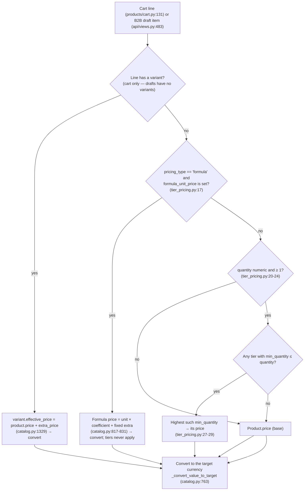
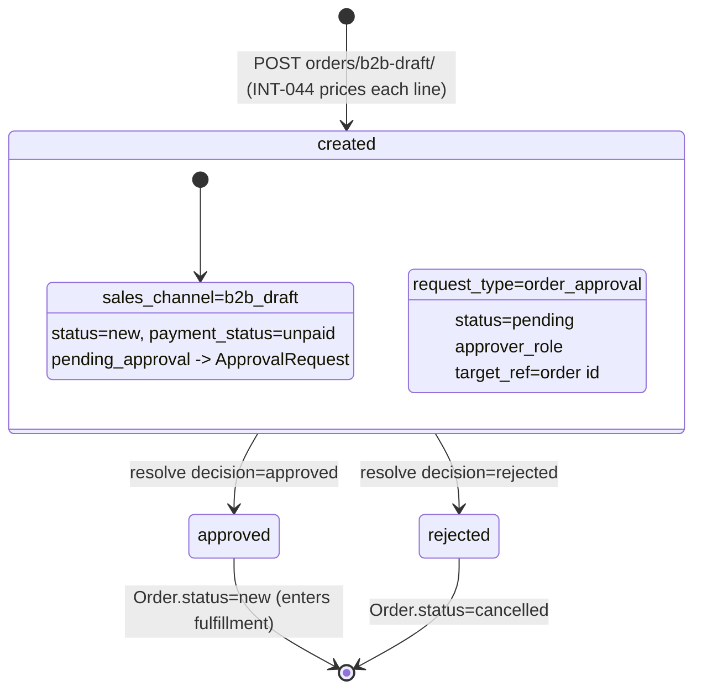

# Data model — Domain 9: B2B wholesale

> **Source**: DOC-489 · inventory Domain 9 · INT-044 (M36)
> **Code**: `sharwa_saas/products/services/{b2b_api_service,tier_pricing,order_approval_service}.py` · `sharwa_saas/api/{views_b2b,views}.py` · `sharwa_saas/products/models/{catalog,negotiation,staff_approvals}.py` · `sharwa-frontend/src/features/b2b/`
> **Last verified against code**: 2026-10-29 (step 50)

## 1. Purpose

Domain 9 is wholesale selling, which in this codebase is two things that came online together in Phase 002 (INT-044, M36):

1. **Quantity (tier) prices**: per-product price thresholds (`ProductTierPrice`, unique `min_quantity` per product, in the product's own currency) managed from the product editor, and the **one decision function** that turns (product, quantity) into a unit price — `products/services/tier_pricing.py:unit_price` — used by the storefront cart, checkout and B2B drafts, so a customer who saw a quantity price on the product page is charged that price (§4.1).
2. **B2B draft orders**: orders a staff member creates for a wholesale customer (`Order.sales_channel = 'b2b_draft'`), which wait as an `ApprovalRequest` (`request_type = 'order_approval'`) until someone with `orders.approve_b2b` approves or rejects them; the linked `Order` follows the decision.

This page is the **data model**: the three models, the schema each lives in, the migration history of each (§3), the tier-price resolution order with a worked example (§4.1), and the draft approval lifecycle (§4.3). Request and response shapes are on the module API page [`docs/api/domains/09-b2b/`](../../api/domains/09-b2b/README.md) (`m36-b2b-wholesale.md`); this page links to it instead of repeating payload tables.

Not covered here: the M18 approval machine itself (Domain 12, [`12-settings-staff-integrations.md`](12-settings-staff-integrations.md); the machine is in [`../45-approvals.md`](../45-approvals.md)), the orders and RMA models ([`04-orders-returns.md`](04-orders-returns.md)), the product model that carries `tier_prices` ([`03-catalog.md`](03-catalog.md)), the storefront cart and checkout ([`05-storefront.md`](05-storefront.md)), and money conversion rules ([`../40-money.md`](../40-money.md)). **POS is out of scope by code decision**: POS variant lines are priced `variant.effective_price ?? product.price` with no tier lookup (`products/services/pos_service.py:656-659`), so a retail buyer at the register never gets a tier discount.

## 2. Components

### 2.1 Provider table (file → what it owns)

| Provider | Location | Owns |
|---|---|---|
| `tier_pricing.py` | `sharwa_saas/products/services/tier_pricing.py` (59 lines) | The shared price rule: `tier_base_price(product, quantity, tiers)` (`:15`) returns the unit price **in the product's currency** or `None` for a formula product; `unit_price(product, quantity, currency, store_setting, tiers)` (`:33`) adds currency conversion. Also `personalization_extra` (`:47`, INT-045, out of this domain). The module docstring pins the rule as the single answer to «أي سعر يُطبَّق على هذه الكمية؟» (`:3`) |
| `b2b_api_service.py` | `sharwa_saas/products/services/b2b_api_service.py` (115 lines) | Draft-form choices `b2b_options` (`:38`); tier-price CRUD `list_tiers` (`:78`), `add_tier` (`:82`), `delete_tier` (`:106`); limits `MAX_TIER_PRICE = 10^8` (`DecimalField(10,2)` ceiling), `MAX_MIN_QUANTITY = 2147483647` (`:27-28`), `DEC_RE = ^\d+(\.\d{1,2})?$` (`:26`); change-log writer `_log` (`:72`) |
| `views_b2b.py` | `sharwa_saas/api/views_b2b.py` (61 lines) | The three INT-044 views: `B2BOptionsView` (`:43`), `ProductTierPricesView` (`:49` GET/POST), `ProductTierPriceDetailView` (`:58` DELETE). `B2BAPIMixin.run` (`:27`) chains gate → any-of permissions («ليست لديك صلاحية لهذا الإجراء.», `:32`) → actor label → service call → `ProductApiError` mapping |
| `api/views.py` (drafts) | `sharwa_saas/api/views.py:392-577` | `B2BDraftCreateView` (`:395`), `B2BDraftListView` (`:519`), `B2BDraftResolveView` (`:543`), all on `MerchantAPIMixin` (`:356`: merchant session 401 → permission 403, CSRF via `MerchantSessionAuthentication`). These predate Phase 002 («كانت Ready قبل هذا التكامل», `b2b_api_service.py:11`) and were extended by INT-044 |
| `order_approval_service.py` | `sharwa_saas/products/services/order_approval_service.py` (55 lines) | `create_b2b_draft_order` (`:11`): stamps `sales_channel='b2b_draft'`, creates the `ApprovalRequest(request_type='order_approval')`, links `Order.pending_approval`. `resolve_order_approval` (`:29`): resolve + order status. `is_pending_approval` (`:49`): the "not in fulfillment yet" predicate — **no production caller** (grep finds only the definition; see §9) |
| `B2BDraftSerializer` | `sharwa_saas/api/serializers.py:333-359` | The list row: `approval_id`, `approval_version`, `escalated_at` (from `pending_approval`), `items_count`, `created_by_name` (`:356` prefers the requester, falls back to `created_by_staff`) |
| `Cart.__iter__` | `sharwa_saas/products/cart.py:87-157` | The storefront pricing loop: local import of `tier_pricing` — comment «استيراد محلي» … «تجنّب الدوائر» (`:88`), `prefetch_related('tier_prices', 'personalization_fields')` (`:95`), variant branch (`:131-135`), tier branch `unit_price(..., tiers=product.tier_prices.all())` (`:140-143`) |
| Models | `products/models/catalog.py` (`ProductTierPrice` `:1366-1387`, `Product.get_tier_price` `:606-615`, `ProductTemplateTierPrice` `:1632`), `products/models/staff_approvals.py` (`ApprovalRequest` `:21-101`), `products/models/negotiation.py` (`NegotiationDraft` `:10-37`) | See §3.2 |
| Frontend feature | `sharwa-frontend/src/features/b2b/` — `schemas.ts` (73 lines), `api.ts` (72 lines), `components/{b2b-new-screen,b2b-drafts-screen}.tsx` (240 + 297 lines) | Zod contract, React Query hooks, the two screens. **The browser never sends a price** (FR-36.01, `api.ts:39-40`); resolve sends `approval_id` + `version`, never the order id (FR-36.04, `api.ts:58-64`); the list refreshes every 60 s (FR-36.03, `api.ts:24`) |
| BFF wiring | `sharwa-frontend/src/lib/bff/live-products.ts:75-78` (`B2B_LIVE_RULES`), `src/app/api/bff/b2b/[[...path]]/route.ts` | `products/<id>/extras/tier-prices[/<tier_id>]` maps 1:1 to Django's tier routes under the live key `b2b`; `api/bff/b2b/options` uses `liveOrMock(…, "b2b", …)`. The three draft routes go through the transparent `/api/v1/*` passthrough — Django-first, no switch (`src/features/b2b/schemas.ts:5-11`) |

### 2.2 Routes by provider

All under `/api/v1/`, registered in `sharwa_saas/api/urls.py`. The draft routes (§ first three rows) were registered before Phase 002 (`:156-159`); `b2b-options` and the tier routes are INT-044 (`:161`, `:282-284`).

| Tool | Routes | Gate (in order) |
|---|---|---|
| Draft create | `orders/b2b-draft/` POST (`:157`) | Merchant session (401 «غير مصرح لك بالوصول.», `views.py:371`) → `orders.create_b2b` (403) → **a staff member must be attached** (403 «يتطلب إنشاء طلب الجملة تسجيل دخول موظف.», `views.py:409` — `ApprovalRequest.requested_by` is mandatory for drafts, the owner alone cannot create one) |
| Draft list | `orders/b2b-drafts/` GET (`:158`) | Merchant session → **either** `orders.create_b2b` **or** `orders.approve_b2b` (403 «لا تملك صلاحية تنفيذ هذا الإجراء.», `views.py:530-531`; INT-044: an approver who never creates still needs the list) |
| Draft resolve | `orders/b2b-draft/<int:pk>/resolve/` POST (`:159`) | Merchant session → `orders.approve_b2b` → `pk` must be an `ApprovalRequest` with `request_type='order_approval'` (404 «طلب الموافقة غير موجود.», `views.py:557-559`) |
| Draft-form choices | `orders/b2b-options/` GET (`:161`) | Merchant session → either B2B permission (`B2B_PERMS`, `views_b2b.py:22`) |
| Tier prices (read) | `products/<int:pk>/tier-prices/` GET (`:283`) | Merchant session → `inventory.view` (same as reading the product; decision of 2026-10-21, `views_b2b.py:7-8`) → product exists (404 «المنتج غير موجود.», `b2b_api_service.py:30`) |
| Tier prices (write) | `products/<int:pk>/tier-prices/` POST → 201 (`:283`); `products/<int:pk>/tier-prices/<int:tier_id>/` DELETE → 200 (`:284`) | Merchant session → `catalog.manage` → 404 for an unknown product or tier row |

> ⚠️ Discrepancy — roadmap says the B2B draft routes are gated by the permission codes `orders.create_b2b` / `orders.approve_b2b` for staff / code does: all three draft views call `MerchantAPIMixin.check_merchant` (`api/views.py:369-376`), which first requires `session['is_merchant_authenticated']` (401 otherwise). `StaffLoginView` removes that flag on purpose, so a staff session is answered 401 on create, list and resolve, while the owner session passes the 401 check and is then refused on create by the staff-attached rule. In a browser with a normal login nobody can create a B2B draft (found in Step 08, [`../30-security.md`](../30-security.md) §4.4, register item OI-10); `api/test_b2b_api.py` hides it by setting `is_merchant_authenticated = True` on staff requests. Not re-run live here.

There is **no plan-feature gate** on any B2B route — the permission codes are the whole gate (unlike payments, [`08-finance.md`](08-finance.md) §2.2). The two B2B permissions are seeded by `products/0159_seed_returns_b2b_permissions.py` for the system roles «مدير المتجر» and «مدير الفرع» only; «كاشير»/«أمين مخزن» get neither, and the permission that creates a draft does not include the right to approve it (`0159:5-13`). The permission model is in [`../31-authorization.md`](../31-authorization.md).

### 2.3 Who charges a tier price (and who does not)

| Caller | Rule | Where |
|---|---|---|
| Storefront cart and checkout | Full chain of §4.1 (variant ?? formula ?? tier ?? base), quantity of the **line** | `products/cart.py:131-143`; checkout consumes the same lines (`products/views/cart_checkout.py:56`, `:313` → `OrderItem.price`) |
| B2B drafts | `unit_price` without the variant step (draft items are products only) | `api/views.py:483` |
| Product page (PDP) display | Tier rows listed next to the price | `products/services/storefront_product_service.py:267`; the API product detail prefetches `tier_prices` (`api/views.py:160`) |
| POS | **No tier lookup** — `variant.effective_price ?? product.price`, converted | `products/services/pos_service.py:656-659` |
| `Product.get_tier_price` | Older direct query implementing only "highest tier ≤ quantity ?? base" (no formula guard, no variant step). **No production caller** — only `products/test_product_commerce.py:44-46` | `products/models/catalog.py:606-615` |

### 2.4 Legacy HTML views kept

The Django screens still work next to the API; the API did not replace their routes.

| Screen | Code | Route (`config/urls_tenant.py`) |
|---|---|---|
| B2B draft form (Django screen) | `create_order_view` (`products/views/merchant_dashboard.py:68-89`) renders products, locations and approver roles; the page itself **does not create an `Order`** — its JS posts to `/api/v1/orders/b2b-draft/` («لا تُنشئ هذه الصفحة Order مباشرة», `:71-72`) | `dashboard/orders/new/` (`:286`) |
| Legacy tier editor in the product form | `add_product_tier_price` (`merchant_dashboard.py:896-920`, `@require_POST`, owner session only), `delete_product_tier_price` (`:924-929`) | `dashboard/product/<int:product_id>/tier-price/add/`, `.../tier-price/<int:tier_id>/delete/` (`:343-344`) |
| Template tier editor (catalog domain) | `products/views/product_templates.py` + template `products/templates/products/product_template_form.html:364-395` (writes `ProductTemplateTierPrice`, applied to new products via `ProductTemplate.apply_relations`, `catalog.py:1286`) | `dashboard/product-templates/<int:template_id>/tier-price/add/`, `.../delete/` (`:338-339`) |

Two rule differences between the legacy tier editor and the API (both kept):

- The legacy add **upserts**: `update_or_create(product, min_quantity, defaults={'price': price})` (`merchant_dashboard.py:916-918`) — re-sending a threshold edits it; the API `add_tier` refuses a duplicate with 400 (`b2b_api_service.py:89-90`).
- The legacy form demands `min_quantity >= 2` («أدخل كمية دنيا صحيحة (2 فأكثر) وسعراً موجباً.», `merchant_dashboard.py:913`); the API accepts `>= 1` («أدخل عدداً صحيحاً موجباً.», `b2b_api_service.py:88`).
- The legacy paths do not write `ProductChangeLog`; only the API does (`_log`, `b2b_api_service.py:72-75`).

## 3. Data model

### 3.1 Schema placement

| Group | Schema | Evidence |
|---|---|---|
| `ProductTierPrice`, `ApprovalRequest`, `NegotiationDraft` (and the `Order`/`OrderItem` fields they hang on) | **store** (one copy per tenant schema) | All live in the `products` app, which is in `TENANT_APPS` (`config/settings.py:152`, `'products'` at `:157`) and not in `SHARED_APPS` (`:121-150`) |

Nothing in this domain crosses schemas. See [`../10-multi-tenancy.md`](../10-multi-tenancy.md).

### 3.2 Model table

Three models are documented. `Order` (four fields), `OrderItem`, `Role`, `Location`, `StaffMember`, `Product`, `ProductChangeLog` and `ProductTemplateTierPrice` are referenced only.

| Model | Schema | Key fields | Constraints / indexes | Added or changed by |
|---|---|---|---|---|
| `ProductTierPrice` (`products/models/catalog.py:1366`) | store | `product` (FK `Product`, CASCADE, related name `tier_prices`), `min_quantity` (`PositiveIntegerField`), `price` (`Decimal(10,2)`, in the **product's** currency), `created_at` | `UniqueConstraint(product, min_quantity)` named `unique_product_tier_quantity` (`:1383`); Meta ordering `min_quantity`. Example row in the docstring: «اشترِ 3+ بسعر 90 بدل 100» (`:1369`) | **created by `products/0117_product_barcode_product_description_en_and_more.py`** (2026-09-11, `CreateModel` at `:46-59` with the unique constraint already in place); unchanged since — no later `products/` migration mentions it |
| `ApprovalRequest` (`products/models/staff_approvals.py:21`) | store | `request_type` (choices `refund`, `shift_shortage`, `stock_writeoff`, `discount_exception`, **`order_approval`** «موافقة طلب جملة» `:31`, `po_approval`), `location` (FK `Location`, PROTECT, nullable), `requested_by` (FK `StaffMember`, PROTECT, nullable), `approver_role` (FK `Role`, PROTECT, related name `+`), `target_ref` (100; the order id as text for B2B), `amount` (nullable — **left null for B2B drafts**), `payload` (`JSONField`, default `{}` — **not set by the B2B path**), `status` (`pending`/`approved`/`rejected`, default `pending`), `resolved_by` (FK `StaffMember`, SET_NULL), `resolved_at`, `resolution_note` (255), `version` (optimistic lock), `escalated_at`, `created_at` | `status` indexed (`:74-76`); Meta ordering `-created_at`. `resolve()` (`:81-101`) is the single decision point: self-approval raises `PermissionError` («لا يمكن للموظف الموافقة على طلبه الخاص.», `:90`), a stale `version` or non-pending status raises `ConcurrencyError` («تم حسم هذا الطلب بالفعل من طرف آخر.», `:95`) under `select_for_update` | **created by `products/0147_staff_approvals.py`** (2026-09-14; with `CommissionLedgerEntry`); `order_approval` choice added by `0156_negotiation_draft.py`; later changes belong to other domains — `0178`/`0179` add `po_approval` (procurement), `0225_inventory_api.py` adds `payload` (INT-024, inventory). No B2B migration |
| `NegotiationDraft` (`products/models/negotiation.py:10`) | store | `customer_name` (150), `customer_phone` (20), `product` (FK `Product`, SET_NULL, nullable), `quantity` (`Decimal(10,3)`), `proposed_unit_price` (`Decimal(12,2)`), `original_unit_price_snapshot` (`Decimal(12,2)`), `notes` (255), `status` (`draft`/`submitted`/`approved`/`rejected`, default `draft`, indexed), `created_by_staff` (FK, SET_NULL), `approval` (FK `ApprovalRequest`, SET_NULL, related name `+`), `created_at` | `status` indexed; ordering `-created_at`. **Not wired**: no route, view, serializer use or template renders it — see §9 | **created by `products/0156_negotiation_draft.py`** (2026-09-14, together with the `order_approval` choice); unchanged since |

Referenced, not documented here:

- `Order.sales_channel` choice `b2b_draft` «طلب جملة/شركات (مسودة)» (`products/models/orders.py:275`, field `:414`), `Order.pending_approval` (FK `ApprovalRequest`, SET_NULL, related name `+`, `:416-419`, added by `products/0151_order_snapshot_fields.py:65-66`), `Order.created_by_staff` (`:410`), `Order.exchange_rate_locked` (`:402`).
- `OrderItem.price` / `currency` / `exchange_rate_locked` (`orders.py:717`) — for a B2B draft, `price` is the tier-resolved unit price already converted into the draft's currency, and `exchange_rate_locked` is copied from the order (`api/views.py:484-492`), which is **never populated on this path** — no code assigns `Order.exchange_rate_locked` today (grep finds only the field and the copies), so the column stays null on B2B lines.
- `ProductTemplateTierPrice` (`catalog.py:1632`) — the same rule one level up, stored on a product template and copied to `ProductTierPrice` rows when a template is applied (`:1286`); catalog domain.

### 3.3 ER sketch

Solid lines are foreign keys; dotted lines are soft links. `W_` entities are **writers** with `file:line` of the write. Store schema only.

```mermaid
erDiagram
  Product ||--o{ ProductTierPrice : "tier_prices CASCADE"
  Product |o--o{ NegotiationDraft : "product SET_NULL, not wired"
  Product ||--o{ OrderItem : "items"
  Order ||--|{ OrderItem : "order"
  Order |o--o| ApprovalRequest : "pending_approval SET_NULL"
  ApprovalRequest }o--|| Role : "approver_role PROTECT"
  ApprovalRequest }o--o| Location : "location PROTECT, nullable"
  ApprovalRequest }o--o| StaffMember : "requested_by PROTECT"
  ApprovalRequest }o--o| StaffMember : "resolved_by SET_NULL"
  ApprovalRequest |o--o{ NegotiationDraft : "approval SET_NULL, not wired"
  StaffMember |o--o{ Order : "created_by_staff SET_NULL"
  Product ||--o{ ProductChangeLog : "product"

  W_api_add_tier ||..o{ ProductTierPrice : "creates (201)"
  W_api_delete_tier ||..o{ ProductTierPrice : "deletes"
  W_legacy_add_tier ||..o{ ProductTierPrice : "upserts, no change log"
  W_legacy_delete_tier ||..o{ ProductTierPrice : "deletes, no change log"
  W_template_apply ||..o{ ProductTierPrice : "update_or_create from template"
  W_api_add_tier ||..o{ ProductChangeLog : "field tier_prices"
  W_api_delete_tier ||..o{ ProductChangeLog : "field tier_prices"
  W_draft_create ||..o{ Order : "creates b2b_draft + items"
  W_draft_create ||..o| ApprovalRequest : "create_b2b_draft_order"
  W_draft_resolve ||..o| ApprovalRequest : "resolve (version lock)"
  W_draft_resolve ||..o{ Order : "new or cancelled"
  W_escalate_beat ||..o{ ApprovalRequest : "stamps escalated_at"

  ProductTierPrice {
    int id PK
    int product_id FK
    int min_quantity "unique per product"
    decimal price "10,2 in product currency"
    datetime created_at
  }
  ApprovalRequest {
    int id PK
    string request_type "order_approval for B2B"
    int approver_role_id FK
    int requested_by_id FK "nullable"
    int location_id FK "nullable"
    string target_ref "order id as text"
    decimal amount "null for B2B"
    json payload "empty for B2B"
    string status "pending, approved, rejected"
    int version "optimistic lock"
    datetime escalated_at "beat job after 24 h"
  }
  NegotiationDraft {
    int id PK
    int product_id FK "nullable"
    decimal quantity "10,3"
    decimal proposed_unit_price "12,2"
    decimal original_unit_price_snapshot "12,2"
    string status "draft, submitted, approved, rejected"
    int approval_id FK "nullable, not wired"
  }
  Order {
    int id PK
    string sales_channel "b2b_draft"
    string status "new; cancelled on reject"
    int pending_approval_id FK "nullable"
    int created_by_staff_id FK "nullable"
  }

  W_api_add_tier {
    string fn "b2b_api_service.add_tier :82"
  }
  W_api_delete_tier {
    string fn "b2b_api_service.delete_tier :106"
  }
  W_legacy_add_tier {
    string fn "merchant_dashboard.add_product_tier_price :896"
  }
  W_legacy_delete_tier {
    string fn "merchant_dashboard.delete_product_tier_price :924"
  }
  W_template_apply {
    string fn "ProductTemplate.apply_relations catalog.py :1286"
  }
  W_draft_create {
    string fn "B2BDraftCreateView api/views.py :450-504"
  }
  W_draft_resolve {
    string fn "order_approval_service.resolve_order_approval :29"
  }
  W_escalate_beat {
    string fn "tasks/operations.escalate_expired_approvals :122"
  }
```

Reading the diagram:

- **Tier prices**: four writers (API add/delete, legacy add/delete) plus the template apply. Only the API pair writes `ProductChangeLog`; the legacy pair and the template apply do not.
- **ApprovalRequest** is shared with four other request types (returns, shift shortage, write-off, purchase orders) — the writers above are only the `order_approval` ones. The same row is also resolved through the M18 staff-approvals API (`staff_service.resolve_approval` `:878`), which reaches every `request_type`.
- **`NegotiationDraft`** has no writer at all: no route, service or view creates a row.

### 3.4 Migrations

**No migration belongs to this domain.** INT-044 (M36) added behaviour only — routes, the `tier_pricing` module, service functions and tests; the three models and the `Order` fields they use all predate Phase 002. Verified: the only `products/` migrations naming these models are `0117` (creates `ProductTierPrice`), `0147` (creates `ApprovalRequest`), `0151` (adds `Order.pending_approval`), `0156` (creates `NegotiationDraft`, adds the `order_approval` choice) and `0159` (seeds the two permissions) — all dated September 2026, before Phase 002's numbering.

> ⚠️ Discrepancy — roadmap says "No migration." / code does: true for Domain 9 itself, but three later `products/` migrations (≥ 0159) do alter `ApprovalRequest`: `0178_po_approval.py` + `0179_alter_approvalrequest_request_type_and_more.py` add the `po_approval` choice (procurement, Domain 10) and `0225_inventory_api.py:55-60` adds the `payload` JSONField (INT-024, inventory). None of them is a B2B integration, and none touches `ProductTierPrice` or `NegotiationDraft`. Reported in step 50.

| Migration | What it did |
|---|---|
| `products/0117_product_barcode_product_description_en_and_more.py` | Creates `ProductTierPrice` with the `unique_product_tier_quantity` constraint already present (`:46-59`) |
| `products/0147_staff_approvals.py` | Creates `ApprovalRequest` (request types `refund`/`shift_shortage`/`stock_writeoff`/`discount_exception`, optimistic `version`, `escalated_at`) and `CommissionLedgerEntry`; adds `Order.sales_rep` |
| `products/0151_order_snapshot_fields.py` | Adds `Order.pending_approval` FK (`:65-66`) with the other §2.1 snapshot fields |
| `products/0156_negotiation_draft.py` | Adds the `order_approval` choice to `ApprovalRequest.request_type`; creates `NegotiationDraft` |
| `products/0159_seed_returns_b2b_permissions.py` | Seeds `orders.create_b2b` «إنشاء طلبات الجملة (B2B)» and `orders.approve_b2b` «الموافقة على طلبات الجملة (B2B)» (category `orders`) and grants both to the system roles «مدير المتجر» and «مدير الفرع»; reverse deletes them (`0159:18-23`, `:47-49`). Two atomic permissions on purpose: sales staff can create without being able to approve (`0159:11-13`) |

## 4. Flows

### 4.1 Tier price resolution order (the "Done when" of DOC-489)

One decision function answers "which unit price applies to this quantity?" for the cart, checkout and B2B drafts. The code order, branch by branch:

So the effective storefront chain is **variant price ?? formula ?? highest tier ≤ quantity ?? base**, then one conversion into the display/draft currency. Two details the diagram hides:

- **A formula product never gets a tier price.** `tier_base_price` returns `None` for it (`tier_pricing.py:17-18`) and `unit_price` then prices it through `get_converted_price`, which computes the formula (`tier_pricing.py:36-37`, `catalog.py:841-842`). The module docstring pins this: a formula product gets «سعر المعادلة (get_converted_price) بلا أسعار كميات» (`tier_pricing.py:7`).
- **A variant line never gets a tier price either** — the variant branch in `Cart.__iter__` runs before `unit_price` is called (`cart.py:131-135`), matching the PDP display order, where a variant means «سعر المتغيّر (لا أسعار كميات له — مثل PDP: variant ?? tier ?? price)» (`tier_pricing.py:6`).

> ⚠️ Discrepancy — roadmap says `unit_price` resolves "variant price ?? formula ?? highest tier ≤ quantity ?? base" / code does: `unit_price` (`tier_pricing.py:33`) takes no variant at all — it implements only "formula ?? highest tier ≤ quantity ?? base" plus conversion. The variant step lives one level up, in `Cart.__iter__` (`products/cart.py:131-135`), and POS has its own `_unit_price` that resolves "variant ?? base" with no tier lookup (`pos_service.py:656-659`). The composed chain and its order are exactly as the roadmap says; only the attribution of the variant step differs. Reported in step 50.

**Worked example** — quantities and prices are the test fixture's own numbers (`api/test_b2b_api.py:151-153`): product «أكواب ورقية», base price `10.00` SAR, tiers `min_quantity 10 → 8.00` and `min_quantity 50 → 6.50`:

| Quantity (one cart line) | Branch taken | Unit price | Why |
|---|---|---|---|
| 1 | base | `10.00` | no tier ≤ 1 |
| 9 | base | `10.00` | tier 10 does not apply yet |
| 10 | tier | `8.00` | highest `min_quantity ≤ 10` is 10 |
| 49 | tier | `8.00` | tier 10 still the highest match |
| 120 | tier | `6.50` | tier 50 now the highest match |

These five rows are asserted verbatim in `test_highest_threshold_not_above_quantity` (`test_b2b_api.py:155-160`), and `test_cart_line_uses_tier_price` (`:162-171`) pins the cart line: quantity 12 → `price 8.00`, `subtotal 96.00`. If the same product were `pricing_type='formula'`, every row above would instead be `(formula_unit_price × coefficient) + fixed_extra` converted to the display currency, tiers ignored.

**The same rule prices B2B drafts, in the draft's currency.** `test_tier_price_currency_and_branch_rules` (`test_b2b_api.py:200-206`): product base `50.00`, tier `10+ → 40.00`, draft with one line `quantity 12` → `OrderItem.price = 40.00`, `total_price = 480.00` (same currency, SAR). Cross-currency: the resolved base price is converted by `_convert_value_to_target` (`tier_pricing.py:38`) with the store's rates — `StoreSetting.sar_to_yer_old` (default 140), `sar_to_yer_new` (520), `usd_to_sar` (3.75) (`products/models/store_settings.py:270-272`), overridden per product by `Product.custom_sar_rate` (`catalog.py:781-788`). With the defaults, a `90.00` SAR tier price on a USD draft is `90 / 3.75 = 24.00` USD (quantized half-up to 2 decimals, `catalog.py:807-808`). Before INT-044 the draft stored the product's raw number in another currency («كان يُخزَّن رقم المنتج الخام بعملة أخرى», `api/views.py:482`).

The price comes **only from the database** — «[صفر ثقة]: السعر من قاعدة البيانات حصراً — لا نثق بأي سعر من الواجهة» (`api/views.py:480`); the request carries ids and quantities only, and the browser-side figures are labelled «السعر النهائي من الخادم» (`src/features/b2b/components/b2b-new-screen.tsx:169`).

### 4.2 Tier price CRUD and the change log

- **List** (`list_tiers`, `b2b_api_service.py:78`): rows ascending by `min_quantity, id`; each row `{id, min_quantity, price (2 decimals), display_price}` where `display_price` is `format_money(price, product.currency)` (`:60-69`; `format_money` at `products/models/base.py:75` — «90 ر.س» for SAR, no conversion).
- **Add** (`add_tier`, `:82-103`): `min_quantity` must match `^\d+` and be `1..2147483647` («أدخل عدداً صحيحاً موجباً.» `:88`), must not collide with an existing threshold («يوجد سعر لهذه الكمية مسبقاً.» `:90`); `price` must match `^\d+(\.\d{1,2})?$` and be `0 < price < 10^8` («أدخل سعراً صحيحاً.» `:94`). All errors return together as `{field: [msg]}`. The create runs in one `atomic` block and an `IntegrityError` (two concurrent adds of the same threshold hitting `unique_product_tier_quantity`) is converted to the same 400 duplicate message (`:97-101`). 201 answers with the new list.
- **Delete** (`delete_tier`, `:106-114`): unknown tier id → 404 «السعر غير موجود.» (`:110`); 200 answers with the remaining list.
- **Change log**: every API add/delete writes `ProductChangeLog(product, field_name='tier_prices', old_value, new_value, actor)` (`_log`, `:72-75`) — before/after strings like `12+ → 90.00` — with the actor label: «مالك المتجر» for the owner (`products/services/change_actor.py:16`) or the staff member's name (`views_products.actor` → `actor_label`, `api/views_products.py:85-86`). The tests pin the exact log rows (`test_b2b_api.py:132-135`, `:144`).

### 4.3 B2B draft lifecycle

Create (`B2BDraftCreateView`, `api/views.py:400-515`), one `transaction.atomic` block:

1. A staff member must be resolved from the session (403 «يتطلب إنشاء طلب الجملة تسجيل دخول موظف.», `:409`) — `ApprovalRequest.requested_by` is the structural reason.
2. Customer name, phone and address are required («اسم العميل وهاتفه وعنوانه مطلوبة.», `:415`); at least one item («يجب تحديد منتج واحد على الأقل.», `:419`); quantities must be positive integers («الكمية يجب أن تكون عدداً صحيحاً موجباً.», `:478`); currency must be one of `CURRENCY_CHOICES` or defaults to `SAR` («عملة غير مدعومة.», `:446-448` — INT-044 closed a hole that accepted any text).
3. `approver_role_id` is optional; when omitted it defaults to the system role «مدير المتجر», and if even that is missing the answer is 400 «حدّد دور المعتمد (approver_role_id).» (`:421-430`).
4. `location_id` rules (INT-044, US-36.1.2): a multi-location store must name a branch explicitly — no implicit "first branch" (`:440-443`, «لا يوجد فرع متاح — أنشئ فرعاً أولاً أو حدّد location_id.»); a single-location store falls back to the first active branch.
5. The `Order` is created with `status='new'`, `payment_status='unpaid'`, `sales_channel='b2b_draft'` (`:452-464`); each `OrderItem` gets the §4.1 price in the draft currency (`:483-492`); totals are subtotal only («مسودة بلا رسوم توصيل بعد.», `:496`); then `create_b2b_draft_order` creates the approval and links it (`order_approval_service.py:11-26`). 201 answers «أُنشئت المسودة وهي الآن بانتظار موافقة المدير.» with `order_id` and `approval_id` (`:508-515`).

List (`B2BDraftListView`, `:519-540`): only orders with `sales_channel='b2b_draft'` **and** `pending_approval__status='pending'`, escalated first then newest (`:532-539`). The serializer deliberately shows the waiting state without touching `Order.status` («دون أي ربط فعلي بـ Order.status», `serializers.py:334-335`) — a draft `Order` is born `status='new'`; "waiting" is a property of the approval row, not the order.

Resolve (`B2BDraftResolveView`, `:543-577`): `decision` must be `approved` or `rejected` («القرار يجب أن يكون approved أو rejected.», `:555`); `version` from the list row must be sent («قيمة الإصدار (version) مطلوبة وصحيحة.», `:565`). `resolve_order_approval` reuses `ApprovalRequest.resolve` (`staff_approvals.py:81-101`), so it inherits the self-approval ban (`PermissionError` → 403) and the optimistic lock (`ConcurrencyError` → 409) with no new code (`order_approval_service.py:29-45`). Approval sets `Order.status='new'`; rejection sets `'cancelled'`. 200 answers «حُسمت الموافقة بنجاح.».

Who approves, precisely: the gate of this route is the permission `orders.approve_b2b` (owner holds it implicitly), plus the two structural checks inside `resolve`. The `approver_role` stored on the row is **not** re-checked here — unlike the M18 staff-approvals path, whose `can_decide` requires the resolver to hold the approver role at the approval's location or `staff.manage`, else 403 «الحسم لحامل دور … في هذا الموقع أو للمالك.» (`products/services/staff_service.py:870-888`). For B2B, `approver_role` steers the notification audience («على حاملي دور المعتمد», `products/services/notification_service.py:123-131`) and the default of step 3 above; the same approval row can also be decided from the M18 queue, where the role check does apply. The frontend hides the decision buttons on the creator's own drafts (FR-36.05, `src/features/b2b/components/b2b-drafts-screen.tsx:57`, `:222-225`), mirroring the server's self-approval ban.

## 5. Invariants

| Invariant | Enforced by |
|---|---|
| One tier per `(product, min_quantity)` | `unique_product_tier_quantity` (`catalog.py:1383`); pre-check in `add_tier` (`b2b_api_service.py:89`) **and** `IntegrityError` handler for the race (`:97-101`) |
| A tier price is positive, ≤ 2 decimals, < 10^8; a threshold is an integer ≥ 1 | service validation (`b2b_api_service.py:86-94`) — the model columns alone would accept `0` and negatives (`PositiveIntegerField` stops only negatives) |
| A B2B draft order exists iff its approval row does | both created in one `transaction.atomic` (`api/views.py:451-504`) |
| A pending approval is decided once, by one person | optimistic `version` + `select_for_update` inside `ApprovalRequest.resolve` (`staff_approvals.py:92-100`); stale version → 409 |
| Nobody approves their own draft | first line of `resolve` (`staff_approvals.py:89-90`) → 403; mirrored client-side on the creator's rows |
| The charged price is never taken from the client | the draft view reads only `product_id`/`quantity` and prices from the DB (`api/views.py:480-483`); the B2B payload type has no price field (`src/features/b2b/api.ts:39-40`) |
| Cart and drafts cannot disagree on the unit price | both call the same `unit_price` (`cart.py:140-143`, `api/views.py:483`) with prefetched tiers (`cart.py:95`) — the module exists for exactly this («فلا يرى الزبون في صفحة المنتج سعر الكمية ثم يُحاسَب بالسعر الأساسي», `tier_pricing.py:3-4`) |
| A formula product is never tier-priced | `tier_base_price` returns `None` before any tier lookup (`tier_pricing.py:17-18`) |
| Tier writes are attributable | every API write creates a `ProductChangeLog` row with the actor (`b2b_api_service.py:72-75`) |

## 6. Background work

The domain's own routes are synchronous — no Celery task creates, prices or resolves a draft or a tier price. One Beat entry touches this domain's data: **`escalate-expired-approvals`** (`config/settings.py:639-642`, hourly at minute 15) fans out `escalate_expired_approvals` per tenant (`products/tasks/operations.py:122-128`) and stamps `escalated_at` on every `ApprovalRequest` still `pending` and older than `APPROVAL_ESCALATION_HOURS = 24` (`:100`, `:109-118`) — including `order_approval` rows. Escalation only reorders queues (escalated first, `api/views.py:538`); it does not resolve anything. The job belongs to the approvals domain ([`../45-approvals.md`](../45-approvals.md), [`../50-background-jobs.md`](../50-background-jobs.md)); it is listed here because `escalated_at` is a B2B list field.

## 7. Configuration

| Setting | Default | Effect |
|---|---|---|
| Permission `orders.create_b2b` | seeded for «مدير المتجر», «مدير الفرع» (`0159:25-26`) | gate for the draft create route and (either key) the list and options routes |
| Permission `orders.approve_b2b` | seeded for the same two roles | gate for resolve; a creator without it cannot approve |
| `inventory.view` / `catalog.manage` | catalog-domain permissions | read / write gate for the tier routes (`views_b2b.py:7-8`) |
| Live module key `b2b` (`SHARWA_LIVE_MODULES`) | off (mock) | switches the BFF tier routes and options to Django (`live-products.ts:75-78`); the draft routes are always the passthrough |
| `StoreSetting.sar_to_yer_old` / `sar_to_yer_new` / `usd_to_sar` | 140 / 520 / 3.75 (`store_settings.py:270-272`) | the conversion applied to a tier/base price when the draft currency differs from the product currency |
| `Product.custom_sar_rate` | null | per-product override of the product-currency rate (`catalog.py:781-788`) |
| `StoreSetting.multi_location_enabled` | off | on: `location_id` becomes mandatory for a draft (`api/views.py:440-443`) and `b2b_options` reports it (`b2b_api_service.py:47`) |
| `StoreSetting.currency` | SAR | `default_currency` of the options payload when it is a supported code (`b2b_api_service.py:39-40`) |
| `APPROVAL_ESCALATION_HOURS` | 24 (`tasks/operations.py:100`) | how long a pending approval waits before `escalated_at` is stamped |

There is no env var owned by this domain; the currency source is `StoreSetting` (merchant-editable), not an external rate feed.

## 8. Failure modes and fixes

| Failure | Symptom | Cause | Handling / fix |
|---|---|---|---|
| Duplicate threshold | 400 `{min_quantity: [«يوجد سعر لهذه الكمية مسبقاً.»]}` | unique `(product, min_quantity)` — also on a concurrent double-add (`IntegrityError` path) | edit by delete + add (the API has no tier update; the legacy form upserts) |
| Threshold or price invalid | 400 `{min_quantity: [«أدخل عدداً صحيحاً موجباً.»]}` / `{price: [«أدخل سعراً صحيحاً.»]}` | `0`, non-integer, > 2 decimals, ≥ 10^8 | send an integer ≥ 1 and a price `^\d+(\.\d{1,2})?$` |
| Draft currency rejected | 400 «عملة غير مدعومة.» | any code outside `CURRENCY_CHOICES` (before INT-044 any text was accepted) | use `SAR`, `USD`, `YER_OLD` or `YER_NEW` |
| Create refused for the owner | 403 «يتطلب إنشاء طلب الجملة تسجيل دخول موظف.» | `ApprovalRequest.requested_by` needs a `StaffMember` | log in as a staff member with `orders.create_b2b` — but see the session-flag discrepancy in §2.2: a pure staff session is answered 401 by `check_merchant` (OI-10) |
| Multi-branch store without a branch | 400 «لا يوجد فرع متاح — أنشئ فرعاً أولاً أو حدّد location_id.» | `multi_location_enabled` and no `location_id` | pass an active `location_id` |
| Approve twice / two approvers race | 409 «تم حسم هذا الطلب بالفعل من طرف آخر.» | optimistic `version` in `ApprovalRequest.resolve` | reload the list (the frontend refreshes every 60 s) and re-check |
| Creator approves own draft | 403 «لا يمكن للموظف الموافقة على طلبه الخاص.» | first check of `resolve` | another role holder (or the owner) decides |
| Customer saw a tier price but was charged the base | wrong `OrderItem.price` | before INT-044 the cart priced the base while the PDP showed tiers | the shared `unit_price` (this was the integration's core fix, `cart.py:137-143`) |
| Draft total looks wrong after a rate change | total ≠ today's conversion | each line's `price` was converted with the rates **at creation** and frozen on the row; `Order.exchange_rate_locked` itself stays null (§3.2) | re-create the draft; there is no reprice endpoint |

### 8.1 Tests

| File | Tests | Covers |
|---|---|---|
| `api/test_b2b_api.py` | 8 | `B2BOptionsApiTests.test_gate_and_payload` (401/403/either-permission; active roles and branches only; multi-location flag; currency); `TierPricesApiTests.test_crud_messages_and_change_log` (ascending list, 201, exact Arabic validation messages, delete + 404, `ProductChangeLog` rows with «مالك المتجر»); `TierPricesApiTests.test_permissions` (`inventory.view` reads, `catalog.manage` writes, actor name in the log); `TierPricingTests.test_highest_threshold_not_above_quantity` (the §4.1 table); `TierPricingTests.test_cart_line_uses_tier_price` (line 12 → 8.00 / 96.00); `B2BDraftExtensionsTests.test_tier_price_currency_and_branch_rules` (tier price frozen on the item, `EUR` rejected, multi-location without branch rejected); `B2BDraftExtensionsTests.test_list_for_approver_with_creator_and_escalation` (`approve_b2b` alone suffices; escalated first; `created_by_name`; 403 without either key); `B2BDraftResolveView` unknown id → Arabic 404 |

The count matches the roadmap's "(8)". Related but outside this domain's file: `products/test_product_commerce.py:44-46` pins `Product.get_tier_price` (the older query form of the rule), and `products/test_returns_b2b_api.py` provides the `_make_staff`/`_grant_permission` helpers used above and covers the pre-Phase-002 draft contract.

## 9. Open items

- ⚠️ **B2B drafts cannot be created from a normal browser login** — owner session fails the staff-attached rule, staff session fails the `is_merchant_authenticated` check (§2.2 call-out; register OI-10, [`../30-security.md`](../30-security.md) §4.4). Found by reading the code, not reproduced live.
- ⚠️ **`NegotiationDraft` is not wired — haggling has no screen.** The model (`products/models/negotiation.py:10-37`, migration `0156`) was built for live price/quantity negotiation as an independent draft before conversion to a real `b2b_draft` order («مفاوضات السعر/الكمية تُدار كمسودة مستقلة», `:3-5`), but nothing reaches it: no route in `api/urls.py`, no view, no template, no admin, and its import in `api/serializers.py:5` is dead (never used in that file). On the frontend, the mock router keeps the future route hidden on purpose — "Negotiation drafts (`/api/v1/orders/negotiations/`) stay hidden until a screen asks for them" (`src/mocks/b2b/router.ts:9`) — and no screen exists under `src/features/`. **This item belongs in the open-items register [`../90-open-items.md`](../90-open-items.md)** (planned, DOC-526); the module API page records it too ([`docs/api/domains/09-b2b/README.md`](../../api/domains/09-b2b/README.md), "Open item").
- **The fulfillment gate is not enforced in code.** `is_pending_approval` (`order_approval_service.py:49-54`) exists precisely as the "not in fulfillment yet" predicate, but a grep of `products/` and `api/` finds no caller. In practice a draft `Order` is born `status='new'` and rejection is what removes it (`'cancelled'`); between creation and decision, nothing structural stops another flow from acting on the order. The rich state machine (`products/services/order_state_machine.py:15`) models `draft → pending_approval` transitions but its own docstring says it is an unwired validation layer over different status values (`:4-13`).
- **`approver_role` is not checked by the B2B resolve route** (§4.3): the permission code plus the self-approval ban are the gate; the role-location check exists only on the M18 path (`staff_service.py:870-888`). A staff member with `orders.approve_b2b` but without the chosen approver role can still decide B2B drafts through this route.
- **No tier update endpoint.** The API offers add and delete only; editing a threshold is delete + add, which splits the change log into two rows. The legacy form upserts instead (`merchant_dashboard.py:916-918`) and writes no log — the two writers keep different rules (§2.4).
- **`Product.get_tier_price` is a second implementation of the rule** (`catalog.py:606-615`): same "highest tier ≤ quantity ?? base" outcome, but no formula guard and no variant step, and no production caller (tests only). If the rule ever changes, this method can drift silently.
- **Draft lines are not variant-aware**: a B2B item is `{product_id, quantity}` (`api/views.py:467-492`), so a variant-only product is priced at the product's base price in a draft, while the storefront would charge the variant price.
- **`Order.exchange_rate_locked` is never populated** (§3.2): the B2B (and checkout) code copies it to items, but no assignment exists anywhere, so the freeze exists only implicitly in the stored per-line `price`.
- **Escalation stamps every pending approval type**, including `order_approval` rows of already-superseded drafts; there is no per-type TTL.

## 10. Related pages

- Module API (request/response shapes): [`docs/api/domains/09-b2b/README.md`](../../api/domains/09-b2b/README.md) · [`m36-b2b-wholesale.md`](../../api/domains/09-b2b/m36-b2b-wholesale.md)
- Approvals machine: [`../45-approvals.md`](../45-approvals.md) · authorization [`../31-authorization.md`](../31-authorization.md) · background jobs [`../50-background-jobs.md`](../50-background-jobs.md)
- Money: conversion and rounding [`../40-money.md`](../40-money.md) · concurrency [`../42-concurrency.md`](../42-concurrency.md)
- Data model siblings: [`03-catalog.md`](03-catalog.md) (`Product`, `ProductChangeLog`, templates) · [`04-orders-returns.md`](04-orders-returns.md) (`Order`, `OrderItem`) · [`05-storefront.md`](05-storefront.md) (cart, checkout) · [`08-finance.md`](08-finance.md) · [`10-inventory-locations-procurement.md`](10-inventory-locations-procurement.md) · [`12-settings-staff-integrations.md`](12-settings-staff-integrations.md) (staff, permissions, `ApprovalRequest`'s other request types)
- Registers: [`../90-open-items.md`](../90-open-items.md) (OI-10, OI-16, OI-17) · [`../92-inconsistencies.md`](../92-inconsistencies.md) · Index: [`README.md`](README.md)
