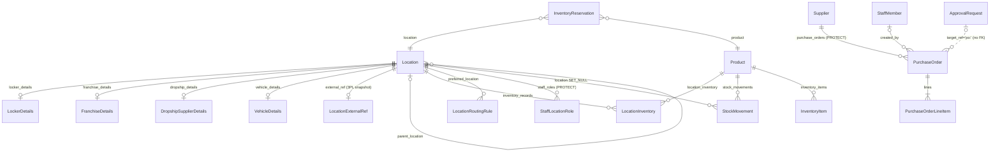
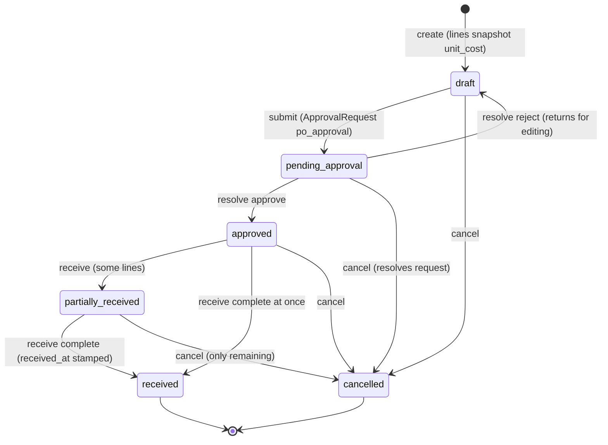

# Data model — Domain 10: inventory, locations and procurement

> **Source**: DOC-490 · inventory Domain 10 · INT-024 (M21), INT-025 (M22), INT-035 (M23)
> **Code**: `sharwa_saas/products/services/{inventory_service,location_service,location_routing_service,procurement_service,purchase_order_service}.py` · `sharwa_saas/api/{views_inventory,views_locations,views_procurement}.py` · `sharwa_saas/products/models/{stock,locations,suppliers,staff_rbac}.py` · `sharwa-frontend/src/features/{inventory,locations,procurement}/`
> **Last verified against code**: 2026-10-29 (step 50)

## 1. Purpose

Domain 10 answers three questions about physical goods:

1. **Inventory (M21)**: how much of each product/variant exists, where, who changed it and why — the stock ledger (`StockMovement`), serial/digital units (`InventoryItem`), the self-healing checkout reservations (`InventoryReservation`) and the write-off approval flow.
2. **Locations (M22)**: the location network — warehouses, branches, lockers, vehicles, franchise and dropship-supplier locations described by capability flags instead of a rigid `type`; per-location stock (`LocationInventory`), operating hours, staff assignments, and the routing rules that pick the source location for each order item.
3. **Procurement (M23)**: suppliers and purchase orders — an approval-gated state machine that never touches stock until goods are actually received.

The money-adjacent rules (write-off approvals, `ApprovalRequest`) connect to [`45-approvals.md`](../45-approvals.md); the stock ledger philosophy is expanded in [`44-stock-ledger.md`](../44-stock-ledger.md). This page is the data model: 15 models, the PO state machine, the adjust/write-off flows and the routing match.

## 2. Components

### 2.1 Provider table

| Provider | Location | Owns |
|---|---|---|
| `inventory_service.py` | `products/services/inventory_service.py` (698 lines) | List/counters/export (`list_inventory` `:225`, `counters` `:242`, `export_csv` `:250`); the single stock-change engine `_apply_delta` (`:273`, row-locked `LocationInventory` + `StockMovement` + `recalculate_stock_from_locations` in one transaction); `adjust` (`:322`); reservations (`list_reservations` `:528`); movements ledger read (`list_movements` `:448`, balance-after recomputed backwards via `_later_sum` `:411`); serial units (`list_items` `:481`); write-offs (`request_writeoff` `:609`, snapshot `:562`, `apply_writeoff` `:671` through `ApprovalRequest`) |
| `location_service.py` | `products/services/location_service.py` (724 lines) | Location CRUD + detail sections (`_validate` `:234` incl. virtual⇒no-coordinates `:375` and parent-cycle refusal `_creates_cycle` `:383-391`); `deactivation_impact` (`:461`); per-location inventory rows (`list_location_inventory` `:497`, `patch_location_row` `:531`, adjust `:531`+); staff assignments; routing rules with `_renumber()` (`:635`) and generated names (`:656`) |
| `location_routing_service.py` | `products/services/location_routing_service.py` | Order-time routing: `route_order` (`:138`), `_sorted_candidates` (`:58`, rule priority → distance → quantity), `_rule_matches` (`:46`, category/city both optional), `_reserve_inventory` (`:120`), `_forward_method` (`:130` for dropship legs) |
| `procurement_service.py` | `products/services/procurement_service.py` (604 lines) | The M23 contract provider over `purchase_order_service`: suppliers (`list/detail/create/patch/delete`, `contact_name` ↔ `Supplier.contact_person` `:106`, `:136`), purchase orders (list/detail/create with lines, submit, resolve, receive, cancel) |
| `purchase_order_service.py` | `products/services/purchase_order_service.py` | The transitions: `submit_purchase_order` (`:62`, creates `ApprovalRequest` `request_type='po_approval'` with `target_ref='po:<id>'`), `resolve_purchase_order` (`:196`), `receive_purchase_order` (`:93` — the only stock-touching step), `cancel_purchase_order` (`:219`); every transition `_bump`s `version` and writes a timeline event (`record_po_event` `:35`) |
| `settings_service.set_multi_location` | `products/services/settings_service.py:348` | The multi-location switch on the settings row; turning it **off** with more than one stock-bearing location answers 409 unless `merge: true` (conflict list computed by `location_stock_conflicts`) |
| `views_inventory.py` / `views_locations.py` / `views_procurement.py` | `sharwa_saas/api/` | 9 + 14 + 9 routes (§2.2) |

### 2.2 Routes by provider (all under `/api/v1/`, merchant session)

| Group | Routes |
|---|---|
| Inventory | `inventory/` GET; `inventory/counters/`; `inventory/export.csv` (and trailing-slash twin `:439`); `inventory/adjustments/` POST; `inventory/movements/`; `inventory/items/`; `inventory/reservations/`; `inventory/writeoffs/` GET, POST (`api/urls.py:436-444`) |
| Locations | `locations/` GET, POST; `locations/mode/` GET, PATCH; `locations/staff-options/`; `locations/routing-rules/` GET, POST + `reorder/` + `preview/` + `/<pk>/` PATCH, DELETE; `locations/<pk>/` GET, PATCH, DELETE; `.../deactivation-impact/`; `.../inventory/` GET, `.../inventory/adjust/` POST, `.../inventory/<unit>/` PATCH; `.../staff/` GET, POST + `/<aid>/` PATCH, DELETE (`:447-460`) |
| Procurement | `suppliers/` GET, POST; `suppliers/<pk>/` GET, PATCH, DELETE; purchase-order routes (`:550`+) — list/create/detail/submit/resolve/receive/cancel |

### 2.3 Legacy HTML kept (same services)

| Screen | Route(s) in `config/urls_tenant.py` |
|---|---|
| `inventory_hub_view`, `update_product_stock`, `product_analytics_view` (`products/views/inventory.py`) | `dashboard/inventory/` + stock update actions |
| `products/views/locations.py` — locations list/editor, location staff (`add_location_staff` `:403`), routing rules (`add_location_routing_rule` `:408`) | `dashboard/locations/…` |
| Supplier screens (`supplier_list_view`, `toggle_supplier_active_view`) | `dashboard/suppliers/` |
| PO screens — `purchase_order_{list,create,detail,submit,resolve,receive,cancel}_view` (`products/views/suppliers.py`) | `dashboard/purchase-orders/…` |

## 3. Data model

### 3.1 Schema placement

Every model in this domain is in the `products` app → **store schema** (`TENANT_APPS`, `config/settings.py`); the module docstrings state the deliberate schema isolation (`suppliers.py:3-4`, `locations.py`). The only public-schema neighbours referenced are the 3PL provider/agreement rows mirrored locally through `LocationExternalRef` (a snapshot, no cross-schema FK — same pattern as `ShipmentOrder.zone_name_snapshot`).

### 3.2 Model table

| Model | Schema | Key fields | Constraints / indexes | Added or changed by |
|---|---|---|---|---|
| `StockMovement` (`stock.py:12`) | store | `product` (FK CASCADE), `variant` (SET_NULL), `quantity_change` (12,3, signed), `reason` (`sale`/`cancel_restock`/`refund_restock`/`manual_adjust`/`restock`/`po_received`), `note` (255), `location` (FK SET_NULL — null = pre-multi-location rows), **`actor`** (150), **`quantity_after`** (12,3, nullable), **`reference_type`** (`order`/`return`/`purchase_order`/`approval`), **`reference_id`** (64) | `created_at` indexed; ordering `-created_at` | multi-location program; **`products/0225_inventory_api`** added the four ledger-screen fields |
| `InventoryItem` (`stock.py:65`) | store | `product`, `variant`, `code` (255), `status` (`available`/`reserved`/`sold`), `meta` (JSON), **`location`** (SET_NULL), **`order`** (SET_NULL) | `UniqueConstraint(product, code)` `unique_inventory_item_code_per_product`; `code`, `status` indexed | P5 serial units; **`0225_inventory_api`** added `location`, `order` |
| `InventoryReservation` (`stock.py:110`) | store | `session_or_order_ref` (100), `location` (FK CASCADE), `product`, `variant`, `quantity` (10,3), `status` (`active`/`consumed`/`released`), `expires_at` | index `(status, expires_at)`; `active_quantity` excludes expired rows in the query itself (self-healing, `:141-154`); `available_quantity` = physical − active (`:156-173`) | orders architecture §2.6 |
| `Location` (`locations.py:24`) | store | `name`, `code` (30, unique), `is_active`, address/city/coords (10,7), capability flags (`stores_inventory`, `ships_to_customer`, `is_transient`, `is_mobile`, `is_virtual`, `serves_walk_in_customers`, `has_pos_terminal`, `is_pickup_point`), `ownership_model` (`owned`/`franchise`/`third_party_3pl`/`dropship_supplier`), `parent_location` (self FK SET_NULL), **`external_refs`** (JSON `[{system, ref}]` — merchant's own WMS/ERP/POS refs, INT-025) | `code` unique; index `(is_active, ownership_model)`; `display_type` is a **derived property**, not a stored field (`:119-143`) | multi-location program; **`0226_locations_api`** added `external_refs` |
| `LocationOperatingHours` (`locations.py:146`) | store | weekly hours per fixed location | — | multi-location program |
| `LockerDetails` (`locations.py:254`) | store | OneToOne `Location`; `compartment_count`, `provider_type` (`self_owned`/`third_party`), `max_hold_hours` (default 72), **`provider_name`** (100), **`locker_code`** (50) | — | **`0226_locations_api`** added `provider_name`, `locker_code` |
| `FranchiseDetails` (`locations.py:286`) | store | OneToOne; `franchisee_name`, `franchisee_phone`, `royalty_percentage` (5,2), `contract_start`, `contract_end` | — | multi-location program |
| `DropshipSupplierDetails` (`locations.py:310`) | store | OneToOne; contact name/phone/email, `average_lead_time_days` (3), `forward_method` (`whatsapp`/`email`/`api_webhook`), `api_endpoint_url` | — | multi-location program |
| `VehicleDetails` (`locations.py:342`) | store | OneToOne; `plate_number`, `driver` (FK StaffMember SET_NULL), `capacity_note`, **`driver_phone`** (20), `last_known_lat/lng` (10,7), `last_ping_at` | — | **`0226_locations_api`** added `driver_phone` |
| `LocationInventory` (`locations.py:375`) | store | `location` (FK CASCADE), `product`/`variant` (both nullable), `quantity_on_hand`, `quantity_reserved`, `quarantine_quantity` (12,3; excluded from available until explicitly approved), `reorder_point`; `quantity_available` = on_hand − reserved − quarantine (property `:399-401`) | `UniqueConstraint(location, product, variant)` `unique_location_product_variant_stock` | §3.6; quarantine phase 6 (#42) |
| `LocationRoutingRule` (`locations.py:613`) | store | `name` (100, **generated**), `priority` (smaller first), `is_active`, `applies_to_category` (SET_NULL), `applies_to_city` (100), `preferred_location` (FK CASCADE) | ordering `priority`; priorities **renumbered 1..n** after every create/delete (`_renumber`, `location_service.py:635-638`); name generated as `<category name> · <city> ← <location name>` with «كل التصنيفات» / «كل المدن» when category or city is empty, cut to 100 characters (`location_service.py:655`) | §3.9 |
| `LocationExternalRef` (`locations.py:645`) | store | OneToOne `Location`; `external_provider_id` (public `ThirdPartyLogisticsProvider.id`, **no FK**), `external_provider_name_snapshot`, `agreement_id_snapshot` | — | §3.4 — deliberately separate from `Location.external_refs` |
| `StaffLocationRole` (`staff_rbac.py:86`) | store | `staff` (CASCADE), `location` (**PROTECT**), `role` (**PROTECT**), `is_active`, `assigned_by` | `UniqueConstraint(staff, location, role)` `unique_staff_location_role` — one row per staff × location × role; different roles per location are separate rows | RBAC §1.3 (#4) |
| `Supplier` (`suppliers.py:20`) | store | `name` (150, unique), `contact_person`, `phone` (20, **optional since INT-035**), `email`, **`address`** (300), **`tax_number`** (30), `default_currency` (SAR), `notes`, `is_active` | `UniqueConstraint(name)` `unique_supplier_name`; `phone`, `is_active` indexed | phase D; **`0230_procurement_api`** added `address`, `tax_number`, made `phone` optional |
| `PurchaseOrder` (`suppliers.py:47`) | store | `supplier` (**PROTECT**), `location` (PROTECT, receiving site), `status` (6 states), `currency`, `expected_delivery_date`, `received_at`, `created_by` (StaffMember SET_NULL), **`notes`**, **`version`** (optimistic lock), **`updated_at`**; `number` = `PO-0001` derived from pk (`:96-99`); `order_total()` derived Σ(unit_cost × ordered) (`:101-108`); `pending_approval_obj` links the `ApprovalRequest` via `target_ref='po:<id>'` (`:110-122`) | `status`, `created_at` indexed | phase D; **`0230_procurement_api`** added `notes`, `version`, `updated_at` (backfilled from `created_at` in the migration) |
| `PurchaseOrderLineItem` (`suppliers.py:125`) | store | `purchase_order` (CASCADE), `product` (PROTECT), `variant` (SET_NULL), `quantity_ordered` (12,3, min 0.001), `quantity_received` (12,3), `unit_cost` (14,2 snapshot) | **`CheckConstraint(quantity_received ≤ quantity_ordered)`** `po_line_received_not_exceed_ordered` | phase D |

Referenced: `ApprovalRequest` (payload JSON + nullable `location` for write-offs, [`12-settings-staff-integrations.md`](12-settings-staff-integrations.md) and [`45-approvals.md`](../45-approvals.md)); `StoreSetting.multi_location_enabled` (switch, `set_multi_location` `settings_service.py:348`); `Product.stock` / `ProductVariant.stock` as the aggregate mirror recomputed by `recalculate_stock_from_locations` (`locations.py:429`).

### 3.3 ER sketch

## 4. Flows

### 4.1 Purchase-order state machine (Done-when diagram)

Every transition runs under `select_for_update`, bumps `version`, and writes a timeline event (`purchase_order_service._bump` `:48-51`, `record_po_event` `:35`). Approval never touches stock; only **receive** does.

`cancel_purchase_order` accepts statuses `draft, pending_approval, approved, partially_received` (`:219`) — terminal states are final. Receiving is bounded line by line by the check constraint (`quantity_received ≤ quantity_ordered`); each received line creates the positive `StockMovement(reason='po_received')` **once**, at the PO's receiving `Location`.

### 4.2 Stock adjust and write-off

- `adjust` (`inventory_service.py:322`) → `_apply_delta` (`:273`): locks the `LocationInventory` row (or `Product.stock` when multi-location is off), writes the `StockMovement` with actor/reference, recomputes the aggregate mirror — all in one transaction. Negative results are refused unless explicitly allowed (`_stock_guard` `:312`).
- Write-off is approval-gated: `request_writeoff` (`:609`) snapshots the affected rows (`writeoff_snapshot` `:562`) and creates an `ApprovalRequest`; `apply_writeoff` (`:671`) replays the snapshot inside the approval resolution, so deciding long after the request still writes off exactly what was seen.

### 4.3 Order-time routing

`route_order` (`location_routing_service.py:138`) builds candidates from `LocationInventory` rows that can ship, sorts by `(matching rule priority, distance to customer, −quantity_available)` (`:58-85`) and reserves through `InventoryReservation` (`:120`). `_rule_matches` (`:46`) matches a rule when its optional category and city both apply; no rule ⇒ distance/stock order.

### 4.4 Contract mappings (verified)

| Contract (Next.js) | Model / code | Evidence |
|---|---|---|
| franchise `contract_ends_at` | `FranchiseDetails.contract_end` | read `location_service.py:147`, write `:339`, `:345` |
| supplier `contact_name` | `Supplier.contact_person` | `procurement_service.py:106`, `:136`; `phone` optional with international-format check «رقم الهاتف أرقام فقط بالصيغة الدولية.» (`:161-162`), `email` «بريد إلكتروني غير صالح.» (`:164-165`) |
| `display_type` | `Location.display_type` derived property (never stored) | `locations.py:119-143` |
| parent cycles | refused — `_creates_cycle` walks the ancestor chain | `location_service.py:383-391` |
| virtual location | no coordinates allowed after `is_virtual` | `location_service.py:375` |

## 5. Invariants

1. **No silent stock change**: every quantity change writes a `StockMovement` row with reason, actor and reference (`stock.py:1-6`, `_apply_delta`).
2. **Approval never stocks**: a PO increases stock only at receive, once per line (`suppliers.py:6-8`, `receive_purchase_order`).
3. **No over-receive**: database check constraint, not just service validation (`suppliers.py:153-158`).
4. **Optimistic-lock every transition**: `version` bump on each PO change; concurrent editors get the version conflict path ([`42-concurrency.md`](../42-concurrency.md)).
5. **Reservations self-heal**: expired rows are excluded by the query (`active_quantity`), not by a cleanup task; adding to cart never reserves (checkout only, `stock.py:110-114`).
6. **Quarantine is not available**: returns pending inspection stay out of `quantity_available` until approved (`locations.py:392-401`).
7. **Routing priorities are dense**: 1..n after every mutation (`_renumber`); rule names are generated, never hand-written (`:656`).
8. **References, not FKs, to the public schema**: `LocationExternalRef` keeps a local snapshot of the 3PL provider (`locations.py:645-656`).

## 6. Background work

Low-stock webhooks are dispatched per tenant (INT-023; see [`50-background-jobs.md`](../50-background-jobs.md) and [`../jobs/webhooks.md`](../jobs/webhooks.md)). Reservation cleanup relies on the self-healing query, not a job. No other Celery work in this domain.

## 7. Configuration

- `StoreSetting.multi_location_enabled` — the single switch (`locations/mode/` GET+PATCH); off with >1 stock-bearing location ⇒ 409 with the conflict list unless `merge: true` (`settings_service.py:348-361`).
- `reorder_point` per `LocationInventory` row drives the low-stock signals.

## 8. Failure modes and fixes

| Failure | Symptom | Cause | Handling / fix |
|---|---|---|---|
| Concurrent stock edits | Lost update | Two writers on the same row | `_apply_delta` locks the row inside the transaction (`inventory_service.py:267-311`) |
| Write-off drift | Decided value ≠ requested value | Stock moved between request and decision | Snapshot at request; decision replays the snapshot (`:562`, `:671`) |
| PO edited concurrently | Second editor overwrites | — | `version` + `select_for_update`; conflicts surface as the standard 409 ([`42-concurrency.md`](../42-concurrency.md)) |
| Over-receiving a line | Stock exceeds order | — | DB check constraint refuses (`po_line_received_not_exceed_ordered`) |
| Location tree cycle | Parent chase never ends | — | `_creates_cycle` walks with a seen-set (`location_service.py:383-391`) |
| Turning multi-location off with live rows | Aggregate mirror breaks | — | 409 + conflict list; explicit `merge` required (`set_multi_location`) |

### 8.1 Tests

| File | Tests | Covers |
|---|---|---|
| `api/test_inventory_api.py` | 9 | `InventoryApiTests`: auth, feature and permission gates; list contract, variants, search and counters; adjust rules and the ledger; variant adjust mirrors the product; the multi-location row as source of truth; legacy movements reference and balance; items and reservations; a write-off as an approval that deducts on approval; CSV export |
| `api/test_locations_api.py` | 7 | `LocationsApiTests`: feature and owner-only gate; create/detail round trip and sections; list order, filters and counts; mode toggle with conflicts; per-location inventory rows (patch and adjust); staff assignments; routing rules (priority, reorder, preview) |
| `api/test_procurement_api.py` | 9 | `ProcurementApiTests`: permissions; supplier CRUD; draft validation and listing; submit → resolve → reject returns to draft; self-approval refused; partial then full receive; variant receive mirrors product stock; cancel closes the pending approval; resolve from the approvals queue |
| `products/test_suppliers_phase1.py` · `test_suppliers_phase2.py` · `test_suppliers_phase3.py` | 4 + 4 + 4 | Legacy supplier, PO-approval and PO-receive suites |
| `products/test_suppliers_purchase_orders.py` | 14 | Legacy base, approval and receiving suites for purchase orders |

> ⚠️ Discrepancy — roadmap says `test_locations_api.py` has 8 tests and "three legacy supplier suites" / code does: 7 test methods in `test_locations_api.py` (the inventory 9 and procurement 9 counts match), and four legacy supplier files — `test_suppliers_phase1/2/3.py` plus `test_suppliers_purchase_orders.py` (counted with `grep -c '    def test_'`, step 50).

## 9. Open items

- Pickup-code verification at the counter is still unbuilt (register [`../90-open-items.md`](../90-open-items.md) OI-05).
- `recalculate_stock_from_locations` runs inline on every stock write; no reconciliation job exists for drift between `Product.stock` and the location rows (observation, not a known incident).

> ⚠️ Discrepancy — roadmap says `api/test_locations_api.py` (8 tests) / code has **7** test functions (`grep -c 'def test_'`); the inventory (9) and procurement (9) counts match. Reported in step 50.

## 10. Related pages

- API contracts: [`../../api/domains/10-inventory-locations-procurement/m21-inventory.md`](../../api/domains/10-inventory-locations-procurement/m21-inventory.md), `m22-locations.md`, `m23-procurement.md` in the same folder.
- [`03-catalog.md`](03-catalog.md) (Product.stock), [`04-orders-returns.md`](04-orders-returns.md) (reservations at checkout), [`12-settings-staff-integrations.md`](12-settings-staff-integrations.md) (StaffMember/roles), [`42-concurrency.md`](../42-concurrency.md), [`44-stock-ledger.md`](../44-stock-ledger.md), [`45-approvals.md`](../45-approvals.md), [`90-open-items.md`](../90-open-items.md).
