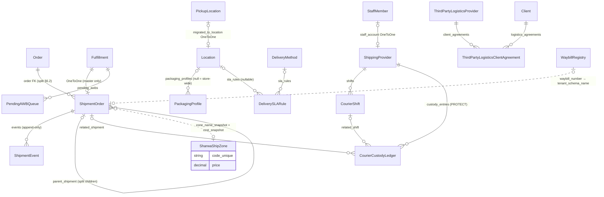
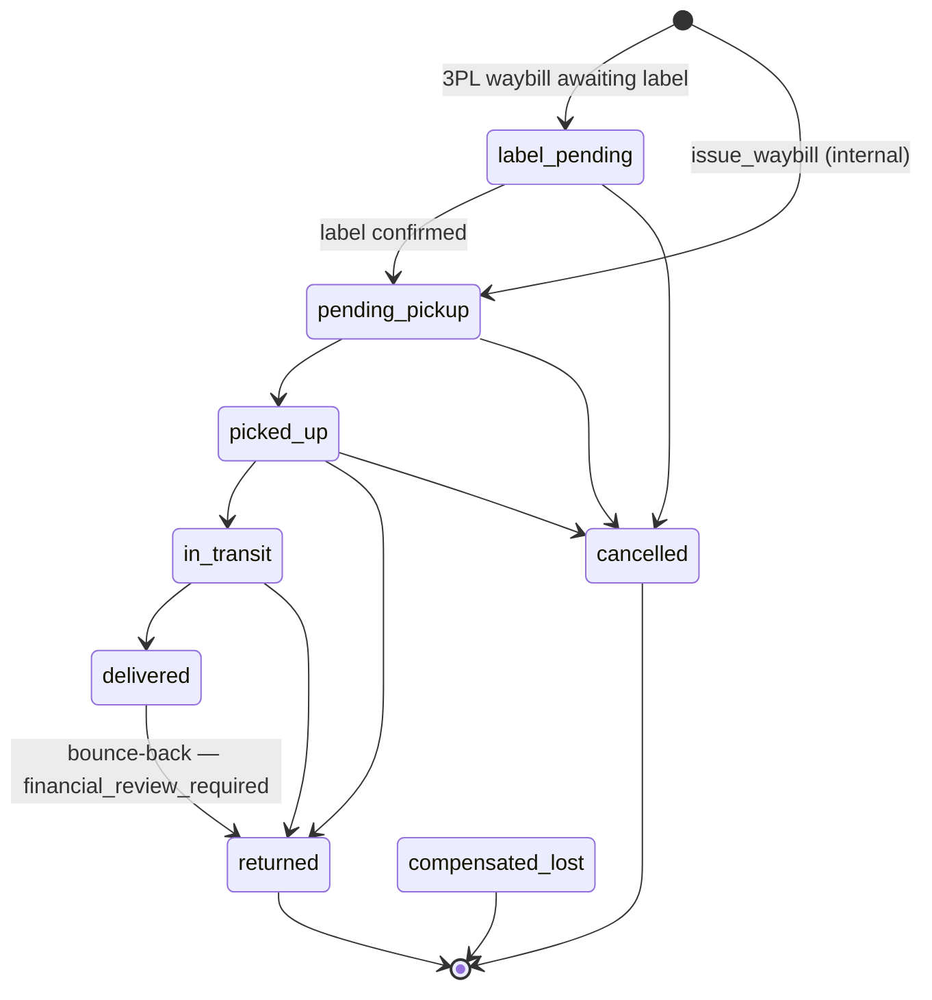
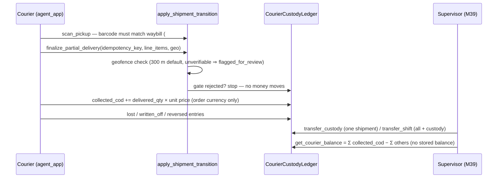

# Data model — Domain 11: shipping, courier app and Sharwa Ship

> **Source**: DOC-491 · inventory Domain 11 · INT-021 (M15), INT-046 (M38), INT-047 (M39)
> **Code**: `sharwa_saas/products/services/{shipping_service,sharwa_ship_api_service,courier_app_service,shipment_state_service,shipping_billing_service,shipment_weight_service,cod_collection_service,zone_routing_service,shipment_operations_service}.py` · `sharwa_saas/api/{views_shipping,views_sharwa_ship,views_courier}.py` · `sharwa_saas/products/carriers/{registry,base,aramex,smsa}.py` · `sharwa_saas/products/models/{shipping,courier,zones,orders}.py` · `sharwa_saas/sharwa_ship/models.py` · `sharwa_saas/tenants/models.py` · `sharwa-frontend/src/features/{shipping,courier}/`
> **Last verified against code**: 2026-10-29 (step 50)

## 1. Purpose

Domain 11 is everything that moves a placed order to the customer's hands:

1. **Merchant shipping configuration (M15)**: delivery methods (what the customer picks at checkout), pickup locations, the courier/3PL providers that actually execute, external carrier credentials (Aramex, SMSA), restricted zones, delivery SLA rules, packaging profiles, and the zone-review queue for ambiguous addresses.
2. **Courier app (M38)**: the four read endpoints a courier phone session uses (me, shipments, shipment detail, custody), plus the five write actions it shares with the legacy screens.
3. **Sharwa Ship (M39)**: the merchant's own waybills — issue (with atomic Sharwa Pay charge), manual status through the single state-machine gate, agent assignment, the 3PL AWB retry queue, rate-card drift surveillance, and courier supervision (shifts, custody, emergency reassignment).

This page is the **data model**: the 15 models across two schemas, the state machine `ALLOWED_TRANSITIONS`, the custody ledger, and the engines (`issue_waybill`, weight/split, SLA resolution). Zone routing geography, the BFF switch and money formatting live on their own pages ([`../40-money.md`](../40-money.md), [`../42-concurrency.md`](../42-concurrency.md)); the shipment state machine's audit-trail design is summarized here with a link to the jobs pages for the async half.

Not covered here: `Fulfillment`/`FulfillmentItem` ownership and the order lifecycle (Domain 4, [`04-orders-returns.md`](04-orders-returns.md)), the COD enforcement path and `PickupCode` (Domain 5/6), and console-side waybill fee collection (Domain 8, [`08-finance.md`](08-finance.md)).

## 2. Components

### 2.1 Provider table (file → what it owns)

| Provider | Location | Owns |
|---|---|---|
| `shipping_service.py` | `sharwa_saas/products/services/shipping_service.py` (1306 lines) | Settings row read (`read_settings` `:161`) and `patch_settings` (`:174`, via `settings_service.patch_shipping`); delivery methods (`list_methods` `:200`, `create_method` `:234`, `patch_method` `:248`, `delete_method` `:263` — delete refused with 409 when orders exist (`:505`): the message is built from the method name, opening with «لا يمكن حذف » and closing with «— مرتبط بطلبات سابقة. عطّله بدل حذفه للحفاظ على سجل تلك الطلبات.»; the official Sharwa Ship method answers 403 with «لا يمكن حذف » followed by the method name «شروة شيب» and «— هذه طريقة شحن رسمية من المنصة، يمكنك تعطيلها فقط.» at `:266`); pickup locations (`:282`–`:362`, incl. `reorder_pickups` `:352`); providers (`:403`–`:508`, incl. `staff_options` `:369` for the OneToOne staff account); carriers (`carrier_state` `:537`, `carrier_view` `:559`, `list_carriers` `:594`, `save_credentials` `:599`, `test_carrier` `:652`); Sharwa Ship zones read (`zone_view` `:674`, `list_zones` `:685`); packaging profiles (`:694`+); zone review; restricted zones; SLA rules (`list_sla` `:882`, `sla_hours_for` `:953`); edge-cases feed (`EDGE_KINDS` `:69`); `ShipmentAddressView` logic and `ConvertToPickupView` |
| `shipment_state_service.py` | `products/services/shipment_state_service.py` | **The single transition gate** `apply_shipment_transition` (`:131`), `ALLOWED_TRANSITIONS` (`:30`), `STATUS_RANK` (`:47`), haversine geofence (`_haversine_m` `:64`, radius `SHIPMENT_DELIVERY_GEOFENCE_RADIUS_M`, default 300 m, `:110`) |
| `shipping_billing_service.py` | `products/services/shipping_billing_service.py` | `issue_waybill` (`:21`, `@_txn.atomic`) — the only waybill creation point |
| `shipment_weight_service.py` | `products/services/shipment_weight_service.py` | `calculate_chargeable_weight` (`:52`), `check_hazard_compatibility` (`:104`), `split_fulfillment_into_awbs` (`:123`), packaging resolution (`:40`) |
| `cod_collection_service.py` | `products/services/cod_collection_service.py` | `get_courier_balance` (`:33`), `start_shift`/`end_shift`, `transfer_shift` (`:60`), `transfer_custody` (`:98`), `scan_pickup` (`:106`, label-swap guard #36), `finalize_partial_delivery` (`:124`) |
| `zone_routing_service.py` | `products/services/zone_routing_service.py` | `point_in_polygon` (`:38`, ray casting), `check_zone_restriction` (`:55`), zone assignment, `resolve_delivery_sla` (`:118`, origin→zone pair), `checkout_geography_guard` (`:133`) |
| `shipment_operations_service.py` | `products/services/shipment_operations_service.py` | In-transit address change (`:40` context), `convert_order_to_pickup` (`:52`) |
| `sharwa_ship_api_service.py` | `products/services/sharwa_ship_api_service.py` (487 lines) | M39 contract provider: shipments list/detail (`:112`, `:201`), pending orders + issue (`:257`, `:270`), manual status (`:289`), assign (`:335`), AWB queue + retry (`:361`, `:369`), rate cards (`:392`, `DRIFT_THRESHOLD = 0.10` `:37`), supervisor + emergency reassign (`:428`, `:456`), shifts (`:478`) |
| `courier_app_service.py` | `products/services/courier_app_service.py` (198 lines) | M38 reads: `me` (`:67`), `shipments` (`:114`), `shipment_detail` (`:140`), `custody` (`:173`), `_cod` (`:82`), `_display_balance` (`:52`); `STATUS_ORDER` (`:27`) |
| `carriers/` package | `products/carriers/{registry,base,aramex,smsa}.py` | `CARRIER_REGISTRY` (`registry.py:14`), `CarrierAdapter` contract (`base.py:68`) with `test_connection()` default (`:93`), Aramex adapter (real HTTP ping, `aramex.py:30`), SMSA adapter (skeleton, `smsa.py:17`) |
| `views_shipping.py` / `views_sharwa_ship.py` / `views_courier.py` | `sharwa_saas/api/` | 33 + 7 + 4 routes (§2.2); the courier gate resolves the staff session → `shipping_provider_profile` |

### 2.2 Routes by provider

| Group | Routes (under `/api/v1/`) | Gate |
|---|---|---|
| Shipping settings | `shipping/settings/` GET, PATCH | Merchant session; `shipping.manage`-family permissions per action (view files) |
| Delivery methods | `shipping/delivery-methods/` GET, POST; `.../<pk>/` PATCH, DELETE | Merchant session |
| Pickup locations | `shipping/pickup-locations/` GET, POST; `.../reorder/` POST; `.../<pk>/` PATCH, DELETE | Merchant session |
| Providers (couriers/3PL) | `shipping/providers/` GET, POST; `.../staff-options/` GET; `.../<pk>/` PATCH, DELETE | Merchant session |
| Carriers | `shipping/carriers/` GET; `.../<code>/` GET; `.../<code>/credentials/` (save); `.../<code>/test/` (test connection) | Merchant session; unknown code → 404 «ناقل غير معروف.» (`shipping_service.py:515`) |
| Zones read | `shipping/sharwa-ship/zones/` GET | Merchant session (public-schema read via `_public_zones` `:152`) |
| Sharwa Ship ops | `shipping/sharwa-ship/pending-orders/` GET; `shipping/sharwa-ship/orders/<order_id>/waybill/` POST; `shipping/shipments/` GET; `shipping/shipments/<pk>/` GET; `.../<pk>/status/` POST; `.../<pk>/assign/` POST; `shipping/awb-queue/` GET; `.../retry/` POST; `shipping/rate-cards/` GET; `shipping/supervisor/` GET; `shipping/agents/<id>/emergency-reassign/` POST; `shipping/agent-shifts/` GET | Merchant session (`api/urls.py:367-378`) |
| Packaging / zones guard / SLA | `shipping/packaging-profiles/` GET, POST + `/<pk>/` PATCH, DELETE; `shipping/zone-review/` GET + `/<order_id>/resolve/` POST; `shipping/restricted-zones/` GET, POST + `/<pk>/` PATCH, DELETE; `shipping/sla-rules/` GET, POST + `/<pk>/` PATCH, DELETE; `shipping/edge-cases/` GET | Merchant session |
| Order-level ops | `shipments/<pk>/address/` (in-transit address change); `orders/<pk>/convert-to-pickup/` POST | Merchant session |
| Courier app (M38) | `agent/me/`, `agent/shipments/?status`, `agent/shipments/<id>/`, `agent/custody/?page` (all GET) | Staff session **with** a `shipping_provider_profile`; a merchant session answers 403 «هذا التطبيق لحسابات المندوبين. يدير مالك المتجر المندوبين من شاشة الإشراف في لوحة التحكم.» (`views_courier.py:35`); no credentials → 401 «لم تُقدَّم بيانات الاعتماد.» (`:33`) |

The five courier **write** actions (start shift, scan pickup, record delivery/partial delivery, hand over custody) are not new M38 routes — they are the legacy `api/views.py` actions reused, per the module docstring (`views_courier.py:1-11`).

### 2.3 Carrier registry

`CARRIER_REGISTRY` (`products/carriers/registry.py:14-17`) holds exactly two adapters; one line per new carrier, no migration (registry docstring `:1-12`).

| Code | Class | Display name | `credential_fields` (name, label, secret, required) | `test_connection` |
|---|---|---|---|---|
| `aramex` | `AramexAdapter` (`aramex.py:16`) | «أرامكس» | `username` «اسم المستخدم» (secret), `password` «كلمة المرور» (secret), `account_number` «رقم الحساب», `account_pin` «الرقم السري للحساب» (secret, INT-021 SC-15.4: write-only, never returned) | Real HTTP GET to `ARAMEX_API_URL` (`aramex.py:30-44`); failures return «أرامكس لا تستجيب حالياً — أعد المحاولة بعد قليل.» / «واجهة أرامكس غير مهيأة على المنصة بعد — تواصل مع دعم شروة.» |
| `smsa` | `SMSAAdapter` (`smsa.py:17`) | `SMSA` | `username`, `password` (both secret, required) | Skeleton: `test_connection` always returns `(False, message)` with the message «SMSA غير مرتبطة بواجهة فعلية بعد — لا يمكن اختبار الاتصال الآن.» (`smsa.py:22-23`); every operation raises `CarrierUnavailableError` → retried via `PendingAWBQueue` |

`CarrierAdapter.test_connection()` default (`base.py:93-95`) answers `(True, message)` with the message «بيانات اعتماد {display_name} مكتملة — تُستخدم عند إصدار أول بوليصة.» (`{display_name}` is the carrier name) — INT-021 added the method to the contract. Credentials resolve per merchant through `ThirdPartyLogisticsClientAgreement` (`credential_source` `platform_shared` or `merchant_own`, encrypted) — see §3.2.

### 2.4 Legacy HTML kept (both surfaces call the same services)

Routes in `config/urls_tenant.py`:

| Screen | Route(s) | Notes |
|---|---|---|
| `shipping_companies_view` / `edit_shipping_company` | `dashboard/shipping-companies/` (`:662`) | Delivery methods |
| `shipping_providers_view` / `edit_shipping_provider` | `dashboard/shipping-providers/` (`:668`) | Couriers/3PL |
| `pickup_locations_view` + add/delete/toggle | `dashboard/pickup-locations/` (`:656`) | |
| `carrier_settings_view` / `carrier_settings_save_view` | `dashboard/carrier-settings/` (`:690-691`) | |
| `packaging_profiles_view` + add | `dashboard/packaging-profiles/` (`:703`) | |
| `zone_review_view` | `dashboard/zone-review/` (`:709`) | |
| `update_address_in_transit_view` | `dashboard/orders/<id>/update-address-in-transit/` (`:710`) | `shipment_operations_service` |
| `convert_order_to_pickup_view` | `dashboard/orders/<id>/convert-to-pickup/` (`:711`) | |
| Sharwa Ship screens | `dashboard/sharwa-ship/`, `.../issue/<order_id>/`, `.../shipment/<id>/events/` (`:674-676`) | Same `issue_waybill` |
| Courier supervisor | `dashboard/courier-supervisor/`, `.../emergency-reassign/<agent_id>/` (`:686-687`) | Same `cod_collection_service` calls as the API |

## 3. Data model

### 3.1 Schema placement

| Group | Schema | Evidence |
|---|---|---|
| `PickupLocation`, `DeliveryMethod`, `ShippingProvider`, `RestrictedZonePolygon`, `DeliverySLARule`, `PackagingProfile`, `ShipmentOrder`, `ShipmentEvent`, `PendingAWBQueue`, `CarrierRateCardSnapshot`, `CourierShift`, `CourierCustodyLedger` (+ `Order` delivery-coord fields) | **store** (one copy per tenant schema) | All belong to the `products` app → `TENANT_APPS` (`config/settings.py`); the `products/models/shipping.py` module docstring states the deliberate placement: the operational waybill lives tenant-side next to `Order` (`shipping.py:1-13`) |
| `SharwaShipZone` | **public** | App `sharwa_ship` is a public app; central pricing read via `schema_context('public')` (`shipping_billing_service.py:76-77`) |
| `ThirdPartyLogisticsClientAgreement`, `WaybillRegistry`, `PendingWebhookEvent` | **public** | `tenants` app (`tenants/models.py:258`, `:335`, `:358`) — they link a public provider/platform to any tenant and must be reachable before the tenant schema is known |

No foreign keys cross the schemas. The tenant row keeps **snapshots** instead: `ShipmentOrder.zone_name_snapshot`/`cost_snapshot` (like `PlatformCommissionRecord.plan_name_snapshot`), and `WaybillRegistry` maps `waybill_number → tenant_schema_name` so an external carrier webhook (which only knows the number) finds the tenant with one public query (`tenants/models.py:335-342`).

### 3.2 Model table

| Model | Schema | Key fields | Constraints / indexes | Added or changed by |
|---|---|---|---|---|
| `PickupLocation` (`orders.py:104`) | store | `name` (100), `address`, `phone`, `is_active`, `sort_order`, `migrated_to_location` (OneToOne → `Location`, SET_NULL, transitional §6.1) | ordering `sort_order, id` | pre-Phase-002; §6.1 migration added `migrated_to_location` |
| `DeliveryMethod` (`orders.py:137`) | store | `name` (100), `price` `Decimal(10,2)` min 0 (customer-facing, converted per customer currency), `estimated_time`, `is_active`, `sort_order`, **`is_sharwa_official`** (default False, help text «تُفعَّل فقط من لوحة الإدمن المركزية — التاجر لا يملك صلاحية إنشائها أو حذفها، فقط تعديل سعرها/تفعيلها.») | `is_active`, `is_sharwa_official` indexed | pre-Phase-002 |
| `ShippingProvider` (`orders.py:169`) | store | `name`, `phone_number`, `is_active`, `sort_order`, `max_weight_per_awb` / `max_items_per_awb` (8,2 / int, nullable), `accepts_hazardous`, `volumetric_divisor`, `carrier_code` (30, blank = own fleet), **`staff_account`** (OneToOne → `StaffMember`, SET_NULL — the real login identity behind the courier) | `carrier_code` indexed | pre-Phase-002; `staff_account` added by the 2026-09-16 audit fix |
| `RestrictedZonePolygon` (`zones.py:10`) | store | `name`, **`reason`** (200, blank — merchant's own note, INT-021 US-15.6), `polygon_points` (JSON list of `{lat, lng}`), `is_active` | `is_active` indexed | **`products/0222_shipping_api`** added `reason` |
| `DeliverySLARule` (`zones.py:31`) | store | `source_location` (FK `Location`, **nullable**), `destination_zone_code` (50, blank default), **`delivery_method`** (FK, nullable), `sla_hours` (1..720), `is_active` | `UniqueConstraint(source_location, destination_zone_code)` `unique_sla_rule_per_origin_destination` | **`0222_shipping_api`**: `source_location` nullable, `destination_zone_code` blank-able, `delivery_method` added |
| `PackagingProfile` (`shipping.py:180`) | store | `location` (FK nullable — blank = store-wide), `name`, `box_weight_kg` (8,3 kg — grams in the API: `empty_weight_g` `shipping_service.py:704`), `box_length/width/height_cm` (8,2), `is_default` | ordering `-is_default, name` | pre-Phase-002 (phase 2 weight program) |
| `ShipmentOrder` (`shipping.py:20`) | store | `order` (FK CASCADE — OneToOne→FK per §6.2 split orders), `fulfillment` (OneToOne → `Fulfillment`, SET_NULL, nullable), `waybill_number` (50, unique, auto `SHW-<timestamp>`), `carrier_code` (default `sharwa_ship`), `zone_name_snapshot` + `cost_snapshot` + `currency`, `status` (8 states), `billing_status` (`pending`/`collected`/`waived`), `collected_at`, `delivered_at`, weight snapshots (`actual`/`volumetric`/`chargeable`, 8,3), `master_waybill_number`, `parent_shipment` (self FK) | `waybill_number` unique; `status`, `billing_status`, `carrier_code`, `created_at` indexed | §6.2 (FK + split), phase 2 (weights), phase 7 (`compensated_lost`) |
| `ShipmentEvent` (`shipping.py:107`) | store | `shipment` (FK CASCADE), `event_time` vs `received_at`, `from_status`/`to_status`, `source` (`webhook`/`agent_app`/`merchant_manual`/`system`), `actor_type`/`actor_id`, `idempotency_key` (200, **unique**), `raw_payload` (JSON), `geo_lat/lng` (10,7) + `geo_accuracy_m`, **`is_rejected`** + `rejection_reason`, **`out_of_order`**, **`flagged_for_review`** | `idempotency_key` unique; index `(shipment, event_time)`; `source`, `is_rejected`, `flagged_for_review` indexed | phase 1 audit log; 2026-09-16 fixes (geofence-unverifiable flagging, `_create_event` savepoint) |
| `PendingAWBQueue` (`shipping.py:218`) | store | `fulfillment` (FK CASCADE), `carrier_code`, `status` (`pending`/`processing`/`issued`/`failed`), `attempts`, `error_detail`, `payload` (JSON) | `carrier_code`, `status` indexed | phase 5 (#22) |
| `CarrierRateCardSnapshot` (`shipping.py:251`) | store | `carrier_code`, `zone_code`, `currency`, `expected_price`, `last_confirmed_price` (nullable) | `UniqueConstraint(carrier_code, zone_code)` `unique_carrier_zone_rate_snapshot` | phase 5 (#25) |
| `CourierShift` (`courier.py:12`) | store | `agent` (FK → `ShippingProvider`, CASCADE), `vehicle_ref`, `started_at`, `ended_at` (nullable), `handed_over_to` (FK SET_NULL, `related_name='+'`) | ordering `-started_at` | phase 4 |
| `CourierCustodyLedger` (`courier.py:38`) | store | `agent` (FK **PROTECT**), `entry_type` (`collected_cod`/`handed_over`/`lost`/`written_off`/`reversed`), `amount` (12,2), `currency`, `related_shipment` (SET_NULL), `related_shift` (SET_NULL), `idempotency_key` (200, unique, nullable — 2026-09-16 fix), `notes` | `idempotency_key` unique; `entry_type`, `created_at` indexed | phase 4 (#9) |
| `SharwaShipZone` (`sharwa_ship/models.py:18`) | **public** | `code` (SlugField 50, unique, immutable — help text «بالإنجليزية، لا يتغيّر بعد الإنشاء…»), `name`, `price` (10,2 — what the **merchant** pays per waybill, deliberately separate from `DeliveryMethod.price`), `currency`, `volumetric_divisor` (default 5000), `center_latitude`/`center_longitude` (10,7) + `radius_km` (all-or-none: any null ⇒ no geo bounds), `is_active`, `sort_order` | `code` unique; `is_active`, `sort_order` indexed | phase 3 app split |
| `ThirdPartyLogisticsClientAgreement` (`tenants/models.py:258`) | **public** | `provider` (FK → `ThirdPartyLogisticsProvider`), `client` (FK → `Client`), `allocated_capacity_units`, `commission_rate`, `credential_source` (`platform_shared`/`merchant_own`), `credentials_encrypted` (property `credentials`), `started_at`, `ended_at` | one agreement per (provider, client) via `get_or_create` (`shipping_service.py:637`) | phase 5 (#26 per-merchant credentials) |
| `WaybillRegistry` (`tenants/models.py:335`) | **public** | `waybill_number` (50, **globally unique**), `tenant_schema_name` (63, indexed), `carrier_code` | `waybill_number` unique | phase 1 (#23/#49) |

Referenced: `Order.delivery_latitude`/`delivery_longitude` (10,7) and `Order.zone_review_resolved_at` — **added by `products/0222_shipping_api`** (`0222_shipping_api.py:14-33`, fields at `orders.py:427-429`); `Fulfillment.shipping_provider`, `requires_reassignment`, `delivered_at` and `FulfillmentItem.delivered_quantity`/`rejection_reason` (Domain 4).

### 3.3 ER sketch

## 4. Flows

### 4.1 Shipment state machine — the single gate

Every status change — webhook, courier app, merchant manual, system — must pass `apply_shipment_transition` (`shipment_state_service.py:131`): `select_for_update` on the row, idempotency-key short-circuit, rejection recorded as an event (never raised as an exception for invalid transitions). Terminal states `returned`, `cancelled`, `compensated_lost` have **no** outgoing transitions.

Rejected events carry one of four `rejection_reason` codes (`sharwa_ship_api_service.py:36`): `invalid_transition`, `stale_event` (older than the latest accepted event and not higher-ranked — `STATUS_RANK` `:47` decides, a higher-ranked older event is accepted with `out_of_order=True`), `order_already_reversed` (#12: no delivery after order cancel/refund), `compensated_lost_scan` (#48), plus `geo_required` for agent deliveries without coordinates.

### 4.2 Custody flow (courier money)

`finalize_partial_delivery` re-derives the collected amount from the locked order prices (`unit_price × delivered_quantity`, order currency, no re-conversion, #10) and is idempotent at the **ledger** level (2026-09-16 fix) so even BOPIS fulfillments without a `ShipmentOrder` cannot double-collect.

### 4.3 `issue_waybill` — atomic charge with creation

Order of operations is fixed (`shipping_billing_service.py:28-34`): (a) plan-feature check `sharwa_ship` first; suspended/deactivated store guard (#46); marketplace guard `fulfillment_block_reason` (FBA/FBN or unpaid marketplace order); one-waybill-per-(order, fulfillment); (b) read `SharwaShipZone` in `schema_context('public')`, snapshot name+price; (c) hazard check + weight + split plan (only with a fulfillment); (d) register every number in public `WaybillRegistry`, create `ShipmentOrder`(s) with `billing_status='pending'`, then `collect_platform_fee_from_merchant` — **inside the same transaction**; insufficient balance raises «رصيدك في شروة باي غير كافٍ لإصدار هذه البوليصة — اشحن محفظتك أولاً.» and rolls everything back. Split shipments share `master_waybill_number`; only the master holds the `fulfillment` OneToOne; numbers are `SHW-<ts>` (single) / `SHW-<ts>-<idx>` (split).

### 4.4 Weight, split and SLA

- `calculate_chargeable_weight` (`shipment_weight_service.py:52`): `actual = Σ(product.weight × qty) + box_weight_kg`; `volumetric = (L×W×H cm) ÷ divisor` (zone's `volumetric_divisor`, default 5000); `chargeable = max(actual, volumetric)` rounded to 3 decimals.
- `split_fulfillment_into_awbs` (`:123`) packs items into master + children plans bounded by the provider's `max_weight_per_awb` / `max_items_per_awb`; hazardous items with a non-hazardous-capable carrier are rejected before any write with the fixed sentence «تعذّر إصدار البوليصة: المنتجات التالية خطرة ولا يدعمها الناقل» followed by the carrier name in guillemets and the first three product names (`shipment_weight_service.py:117-119`).
- SLA resolution — two distinct resolvers:
  - `sla_hours_for(zone, method, rules)` (`shipping_service.py:953-965`): **(zone + method) ⟵ (zone) ⟵ (method) ⟵ 72 h** (`DEFAULT_SLA_HOURS = 72`, `:40`) — used by the M15 breach scanner.
  - `resolve_delivery_sla(source_location, zone)` (`zone_routing_service.py:118-127`): the original origin→zone pair lookup, returns `None` when not configured.

> ⚠️ Discrepancy — roadmap says the chain "zone+method ⟵ zone ⟵ method ⟵ 72 h" is `resolve_delivery_sla` / code does: that chain lives in `sla_hours_for` (`shipping_service.py:953`, used by the breach scanner at `:1117`); `resolve_delivery_sla` (`zone_routing_service.py:118`) is the narrower origin→zone resolver. Both are documented above. Reported in step 50.

### 4.5 Zone review and restricted zones

Customer coordinates (`Order.delivery_latitude/longitude`, 7 decimals) are checked at checkout by `checkout_geography_guard` → inside any active `RestrictedZonePolygon` (ray-casting `point_in_polygon`, `zone_routing_service.py:38`) refuses with «عنوان التوصيل يقع داخل منطقة لا نغطيها حالياً (…). يرجى اختيار عنوان آخر.» before stock is reserved (#30). Ambiguous zone assignment lands the order in the `shipping/zone-review/` queue until resolved (`Order.zone_review_resolved_at` stamped).

## 5. Invariants

1. **One gate**: `ShipmentOrder.status` changes only through `apply_shipment_transition` under `select_for_update` with a unique `ShipmentEvent.idempotency_key` (`shipment_state_service.py:131-158`); `finalize_partial_delivery` routes through it before any ledger write (2026-09-16 fix, `cod_collection_service.py:1-15`).
2. **Terminal states never leave**: `returned`, `cancelled`, `compensated_lost` have empty transition sets (`:39-43`); a later scan of a compensated-lost waybill is rejected with a dedicated reason for human decision.
3. **Charge atomicity**: waybill creation + Sharwa Pay debit are one transaction; a failed debit leaves no `ShipmentOrder` row (`shipping_billing_service.py:8-9`, `:148-150`).
4. **Global waybill uniqueness**: `WaybillRegistry.waybill_number` unique across all tenants (#23/#49); tenant `ShipmentOrder.waybill_number` unique per schema.
5. **Custody is a ledger**: no stored balance; `get_courier_balance` = Σ(`collected_cod`) − Σ(everything else); courier rows are `PROTECT`ed (`courier.py:52`); duplicate keys return the original result (`cod_collection_service.py:131-140`).
6. **Snapshot, not FK**: zone name/price captured at issue time; carrier rate drift beyond `DRIFT_THRESHOLD` (±10 %) suspends auto-charge into `pending_rate_confirmation` (#25) instead of silently debiting.
7. **Delivered⇏money**: `delivered → returned` sets `financial_review_required` and enqueues a human review task; money is never auto-refunded (`shipment_state_service.py:239-263`).

## 6. Background work

- `retry_pending_awb_issuance_for_tenant` — Celery task draining `PendingAWBQueue` with exponential backoff (`sharwa_ship_api_service.py:383-386` dispatches it; register and discussion in [`../50-background-jobs.md`](../50-background-jobs.md)).
- `process_carrier_webhook_event` — normalizes external carrier webhooks into `ShipmentEvent` through the gate (see [`../50-background-jobs.md`](../50-background-jobs.md)).
- `trigger_delivered_return_review` — enqueued outside the transition transaction; failure never reverts the transition (`shipment_state_service.py:281-294`).
- Accepted transitions fan out: browser push (`push_for_shipment`, INT-016) and a `shipment.event` webhook emit (INT-023) — both best-effort, never raising into the caller (`:265-276`).

## 7. Configuration

| Setting | Default | Where |
|---|---|---|
| `SHIPMENT_DELIVERY_GEOFENCE_RADIUS_M` | `300` | `shipment_state_service.py:107-112` |
| `ARAMEX_API_URL` | `''` (unset ⇒ test answers «واجهة أرامكس غير مهيأة على المنصة بعد…») | `aramex.py:23-25` |
| `DEFAULT_VOLUMETRIC_DIVISOR` | `5000` | `shipment_weight_service.py` (zone may override per zone) |
| `NO_EVENTS_DAYS`, `TEST_ERROR_TTL`, `DEFAULT_SLA_HOURS = 72` | — | `shipping_service.py:40`+ |
| Carrier webhook | `POST /api/v1/webhooks/carrier/<code>/`, signature header `X-Carrier-Signature` | `carrier_view` `:586-587` |

## 8. Failure modes and fixes

| Failure | Symptom | Cause | Handling / fix |
|---|---|---|---|
| Carrier outage at issue time | Waybill creation fails | Network / carrier down | Enqueued to `PendingAWBQueue` with backoff instead of terminal failure (#22); SMSA raises `CarrierUnavailableError` by design (`smsa.py:25-28`) |
| Silent rate change by carrier | Merchant over/under-charged | Carrier changed zone price | `CarrierRateCardSnapshot` drift > ±10 % ⇒ `awaiting_confirmation`, manual confirm before charge (#25; `sharwa_ship_api_service.py:392-408`) |
| Duplicate webhook/event | Double transition | Retries, offline sync | Unique `ShipmentEvent.idempotency_key`; `_create_event` absorbs IntegrityError races via savepoint (`shipment_state_service.py:115-128`) |
| Offline courier re-sync | Old events replayed | Offline device | `STATUS_RANK` vs latest accepted event: higher rank accepted with `out_of_order=True`, lower rejected `stale_event` (#1/#5) |
| Fake delivery (geofence) | Delivery outside area | Fraud / GPS drift | Agent deliveries require `geo`; unverifiable coordinates **flag for review** instead of passing silently (2026-09-16 fix, `:222-233`) |
| Wrong-schema credential read | Carriers looked up in tenant schema | `schema_context('public')` resets `connection.schema_name` | `_agreement` captures `tenant_schema = connection.schema_name` **before** entering the public context (`shipping_service.py:522-524`) |
| Leaked secret | `account_pin` in responses | — | INT-021 SC-15.4: `account_pin` flagged secret/write-only (`aramex.py:22`); `carrier_view` returns `value: None` for secrets (`:580-583`) |
| Convert-to-pickup left 3PL waybills active | `label_pending` waybills stayed open | Transition table lacked the path | INT-021: `convert_order_to_pickup` cancels `label_pending` **and** `pending_pickup`, then waives billing (`shipment_operations_service.py:52-73`) |

### 8.1 Tests

| File | Tests | Covers |
|---|---|---|
| `api/test_shipping_api.py` | 9 | `ShippingApiTests`: auth, owner-only features and edge permissions; settings share the M34 row; delivery methods and the official-method rules; pickups reorder and renumber; provider ⇄ staff link rules; carrier credentials never leak; zones, packaging, restricted zones and SLA; zone-review reasons and resolve; edge cases (address change, convert to pickup) |
| `api/test_courier_api.py` | 5 | `AgentReadsTests` (identity gate; `me`, shipments, detail, custody) and `AgentActionsContractTests` (start-shift shape; end and handover only my open shift; actions refuse another agent's shipments) |
| `api/test_sharwa_ship_api.py` | 6 | `GatesAndShipmentsTests` (gates; list, detail and manual status; assign) and `IssueQueueRatesSupervisorTests` (pending orders and issue; AWB queue retry and rate cards; supervisor reassign and shifts) |
| `products/test_cod_collection.py` | 6 | Custody balance is the sum of entries; pickup scan mismatch; partial and full delivery finalisation; shift transfer; reversal entry |
| `products/test_shipment_state.py` · `test_shipment_weight.py` · `test_zone_routing.py` · `test_carrier_integration.py` | 9 · 6 · 6 · 6 | Related engine suites for the transition gate, chargeable weight, zone routing and carrier adapters |

> ⚠️ Discrepancy — roadmap says `test_courier_api.py` has 6 tests and `test_sharwa_ship_api.py` has 7 / code does: 5 and 6 test methods (shipping 9 and `test_cod_collection.py` 6 match; counted with `grep -c '    def test_'`, step 50).

## 9. Open items

- **SMSA not wired**: adapter is a registered skeleton — `test_connection` always fails with «SMSA غير مرتبطة بواجهة فعلية بعد — لا يمكن اختبار الاتصال الآن.» and every operation raises `CarrierUnavailableError` (`products/carriers/smsa.py:1-38`). Registered in [`../90-open-items.md`](../90-open-items.md).
- Pickup-code verification at the counter (M15/M22/POS) — see Domain 5/10 pages and the register.
- Marketplace FBA/FBN orders are blocked from waybills by design (`fulfillment_block_reason`, `shipping_billing_service.py:64-68`).

## 10. Related pages

- API contracts: [`../../api/domains/11-shipping/m15-shipping.md`](../../api/domains/11-shipping/m15-shipping.md), [`../../api/domains/11-shipping/m38-courier-app.md`](../../api/domains/11-shipping/m38-courier-app.md), [`../../api/domains/11-shipping/m39-sharwa-ship.md`](../../api/domains/11-shipping/m39-sharwa-ship.md)
- [`04-orders-returns.md`](04-orders-returns.md) (Fulfillment), [`08-finance.md`](08-finance.md) (Sharwa Pay debit), [`10-multi-tenancy.md`](../10-multi-tenancy.md), [`13-cross-schema-access.md`](../13-cross-schema-access.md), [`42-concurrency.md`](../42-concurrency.md), [`50-background-jobs.md`](../50-background-jobs.md), [`90-open-items.md`](../90-open-items.md)
