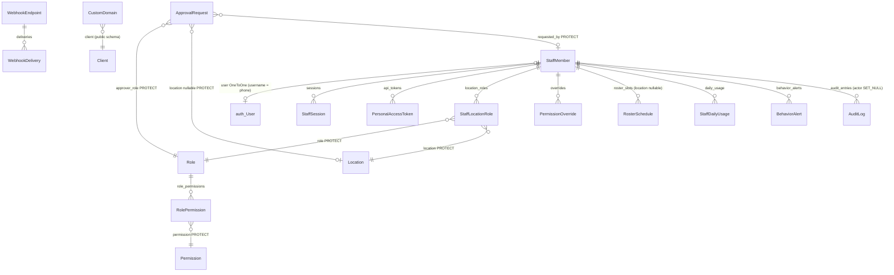
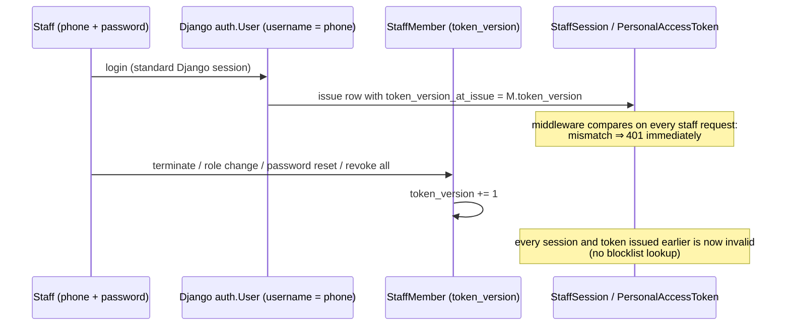

# Data model — Domain 12: settings, staff & permissions, domains & integrations

> **Source**: DOC-492 · inventory Domain 12 · INT-010 (M34), INT-022 (M18), INT-023 (M19)
> **Code**: `sharwa_saas/products/services/{settings_service,staff_service,behavior_service,integrations_service,webhook_service,domain_service}.py` · `sharwa_saas/api/{views_settings,views_staff,views_integrations,serializers,serializers_catalog}.py` · `sharwa_saas/products/models/{store_settings,locations,staff_rbac,staff_sessions,staff_approvals,behavior,audit,webhooks}.py` · `sharwa_saas/tenants/models.py` (`CustomDomain`) · `sharwa-frontend/src/features/{settings,staff,integrations}/`
> **Last verified against code**: 2026-10-29 (step 50)

## 1. Purpose

Domain 12 is the store's control plane:

1. **Settings (M34)**: the single `StoreSetting` row every module patches a slice of — identity, contact, policies, shipping fees, currency and FX rates, SEO, announcement bar, payment switches, multi-location mode — plus the public `StoreConfigSerializer` projection for storefront bootstrapping.
2. **Staff & permissions (M18)**: the staff identity model (`StaffMember` ↔ `auth.User`, phone as username), RBAC (permissions, roles, per-location assignments, overrides), sessions/tokens/trusted devices/roster, behavior telemetry, the approval queue and the hash-chained audit log.
3. **Domains & integrations (M19)**: custom-domain requests (public schema), tracking scripts, outgoing webhooks, and the aggregated integration status board.

This page is the data model: the settings-row ownership map (Done-when), the staff identity model (Done-when), and the 20 models. Session/CSRF security detail is in [`30-security.md`](../30-security.md), the gate order in [`31-authorization.md`](../31-authorization.md), OTP designs in [`33-otp.md`](../33-otp.md), audit redaction in [`37-audit.md`](../37-audit.md).

## 2. Components

### 2.1 Settings — provider table

| Provider | Location | Owns |
|---|---|---|
| `settings_service.py` | `products/services/settings_service.py` (377 lines) | `read` (`:96`, the full grouped read), the per-module patchers (§2.2), `store_url` (`:74`), `fx_preview` (`:84`), `location_stock_conflicts` (`:337`), `set_multi_location` (`:348`), section writes (`write_section` `:363`). All patchers share `_pick`/`_fail`/`_commit` (`:148-165`) — pick only owned keys, validate, write the single row |
| `StoreConfigSerializer` | `api/serializers.py:65` | The **public** storefront projection: `brand_shades`, `logo`, `sections`, `free_shipping_threshold`, plus the M34 contract extensions from `src/lib/schemas/store-config.ts` — customer-visible fields only, «لا أسرار ولا مال التاجر» (`:76-77`) |
| `Base64ImageField` | `api/serializers_catalog.py:69` | Base64 image upload used by `patch_seo` for `seo_og_image` (`settings_service.py:256-276`, with the `UNCHANGED` sentinel so an omitted image keeps the stored file) |

### 2.2 The settings row ownership map (Done-when)

One `StoreSetting` row per store (`StoreSetting.load()`); each module owns a disjoint slice. Anyone patching outside their keys gets them silently dropped by `_pick`.

| Module (INT) | Patcher | Owned fields |
|---|---|---|
| M34 core (INT-010) | `patch_identity` `:166` | store name/description/logo/colors, social links |
| M34 (INT-010) | `patch_contact` `:191` | `contact_info` block (phone/whatsapp/email/address/map) |
| M34 (INT-010) | `patch_policies` `:214` | `store_policies` (shipping/returns/about text blocks) |
| M15 (INT-021) | `patch_shipping` `:223` | `default_delivery_fee`, `free_shipping_threshold` — money regex, error «أدخل مبلغاً صحيحاً (مثال: 1500.00)» |
| M34 (INT-010) | `patch_currency` `:236` | `currency`, `usd_to_sar`, `sar_to_yer_old`, `sar_to_yer_new` — **4-decimal precision** (migration `0217_storesetting_fx_rate_precision` widened the three rate columns); errors «اختر عملة من القائمة.», «أدخل رقماً صحيحاً.», «يجب أن يكون أكبر من صفر.» |
| M34 (INT-010) | `patch_seo` `:256` | `seo_title`/`seo_description`/`seo_keywords` (per-field limits), `seo_og_image` via `Base64ImageField` |
| M08 (INT-018) | `patch_announcement` `:294` | `ANNOUNCEMENT_KEYS` (`enable_announcement_bar`, text, colors, scroll speed, four banner placement flags, `:283-291`) |
| M14 (INT-020) | `patch_payments` `:321` | `enable_sharwa_pay`, `enable_manual_payment` (with the "at least one method" guard, see [`08-finance.md`](08-finance.md)) |
| M22 (INT-025) | `set_multi_location` `:348` | `multi_location_enabled` — 409 with the conflict list when disabling with >1 stock-bearing location |
| M16 (INT-033) | POS migration `0229` | `pos_refund_otp_threshold`, `pos_manager_code_hash` ([`13-channels-operations.md`](13-channels-operations.md)) |

### 2.3 Staff — provider table

| Provider | Location | Owns |
|---|---|---|
| `staff_service.py` | `products/services/staff_service.py` (1032 lines) | Staff CRUD (create issues a one-time temporary password, `:336`), terminate/reset/revoke, assignments (`StaffLocationRole`), role management incl. `delete_role` (`:466`), overrides, sessions list/revoke, tokens, devices, roster, approvals resolution, audit read + chain verification, settings slice (`enforce_ip_whitelist`, `enforce_roster_schedule` toggles at `:190`, `:242`, `:263`) |
| `behavior_service.py` | `products/services/behavior_service.py` (75 lines) | Daily usage counters (`StaffDailyUsage`) and threshold alerts (`BehaviorAlert`) — cumulative tracking, alert-not-block |
| `permission_resolver.py` | `products/services/permission_resolver.py` | `resolve_request_staff` — the middleware-side identity resolution used by every API gate ([`31-authorization.md`](../31-authorization.md)) |

### 2.4 Integrations — provider table

| Provider | Location | Owns |
|---|---|---|
| `views_integrations.py` | `api/views_integrations.py` | 13 routes: domains (4), tracking (1), webhooks (7: events, endpoints CRUD, rotate-secret, test, deliveries, redeliver), `integrations/status/` (`api/urls.py:421-433`) |
| `domain_service.py` | `products/services/domain_service.py` (326 lines) | Custom-domain lifecycle over public `CustomDomain`: request (TXT token), verify, set-primary, failure reasons |
| `integrations_service.py` | `products/services/integrations_service.py` (231 lines) | `TrackingSettings` singleton (same fields `_tracking_scripts.html` injects, `:3`), `public_tracking` (`:93`), and `integration_statuses` (`:205-224`) — the **13-row** board from `DEFS` (`:109-124`): apps (whatsapp, sharwa_ai), channels (meta, tiktok, telegram), marketplaces (amazon, noon), suppliers (cj, «مخازن», knawat, flat feed), carriers (aramex, smsa) — each row filtered by permission and plan feature, state from the owning subsystem |
| `webhook_service.py` | `products/services/webhook_service.py` (430 lines) | `WebhookEndpoint` CRUD + secret rotation (returned once), `emit(event, payload)` (used across domains, e.g. `shipment.event`), delivery recording, HMAC-SHA256 `X-Sharwa-Signature`, auto-disable after 10 consecutive failures (`webhooks.py:8`) |

### 2.5 Legacy HTML kept

`products/views/`: `merchant_settings.py` (the seven settings forms + the two payment toggles), `staff_rbac.py` (`staff_list_view`, `roles_list_view`, `staff_detail_view`), `staff_approvals.py` (`approval_requests_view`, `resolve_approval_view`), `staff_audit.py` (`audit_log_view`, `verify_audit_chain_view`), `staff_behavior.py` (`behavior_alerts_view`), `merchant_settings.py` tracking form — routes under `dashboard/…` in `config/urls_tenant.py`. Both surfaces call the same services; the 101-test legacy staff suites cover them (§6).

## 3. Data model

### 3.1 Schema placement

All `products` models are **store-schema** (`TENANT_APPS`). `CustomDomain` is **public** (`tenants` app — it must be readable before tenant resolution and race-safe across stores: first to prove ownership wins, `tenants/models.py:426-432`). No FK crosses the schemas; `CustomDomain.client` is a public-side FK to `Client`.

### 3.2 Model table

| Model | Schema | Key fields | Constraints / indexes | Added or changed by |
|---|---|---|---|---|
| `StoreSetting` | store | one row per store (`load()` singleton); the slices in §2.2 | singleton by convention + `load()` | FX rate columns → 4 decimals by **`0217_storesetting_fx_rate_precision`** |
| `StaffMember` (`locations.py:174`) | store | `user` (OneToOne `auth.User`, CASCADE — real password/session machinery), `full_name`, `phone` (**unique**, and the `auth.User` username is set to the same phone at creation), `token_version` (bumped on terminate/role change/reset/revoke-all → invalidates every session and token at once), `is_active`, `terminated_at/_reason`, `enforce_ip_whitelist`, `enforce_roster_schedule` | `phone` unique; `is_active` indexed | locations architecture → RBAC core |
| `Permission` (`staff_rbac.py:20`) | store | `code`, label | unique code | RBAC |
| `Role` (`staff_rbac.py:46`) | store | `name`, `is_system` | — | RBAC; deletions guarded by PROTECT below |
| `RolePermission` (`staff_rbac.py:68`) | store | `role`, `permission` — both **PROTECT** («حذف صلاحية مستخدمة في دور» refused, `:69-73`) | unique pair | RBAC #4 |
| `StaffLocationRole` (`staff_rbac.py:86`) | store | `staff`, `location` (PROTECT), `role` (PROTECT), `is_active`, `assigned_by` | `UniqueConstraint(staff, location, role)` | RBAC #4; also Domain 10 |
| `PermissionOverride` (`staff_rbac.py:112`) | store | `staff`, `permission`, `effect` (allow/deny) | unique (staff, permission) | RBAC |
| `StaffSession` (`staff_sessions.py:14`) | store | `staff`, `session_key` (unique, matches the Django session), `token_version_at_issue`, `device_fingerprint`, **`device_label`** (readable «المتصفح · النظام» from User-Agent), `ip_address`, `revoked_at` | `session_key` unique | sessions layer; **`0223_staff_api`** added `device_label` |
| `PersonalAccessToken` (`staff_sessions.py:38`) | store | `staff`, **`name`** (100), **`last_used_at`**, `token_hash` (128, unique — raw token never stored), `token_version_at_issue`, `expires_at` (**mandatory**, max enforced in the view), `revoked_at` | `token_hash` unique | #6 eternal keys; **`0223`** added `name`, `last_used_at` |
| `TrustedDevice` (`staff_sessions.py:61`) | store | `location`, **`staff`** (nullable — blank = the location's shared device), `device_id` (unique), `label`, `approved_by`, **`last_seen_at`**, `is_active` | `device_id` unique | #10; **`0223`** added `staff`, `last_seen_at` |
| `RosterSchedule` (`staff_sessions.py:87`) | store | `staff`, **`location`** (nullable — null = all the staff's locations), `weekday` (0=Sunday…6=Saturday), `starts_at`/`ends_at` | — | #10; **`0223`** made `location` nullable |
| `StaffDailyUsage` (`behavior.py`) | store | `staff`, `action` (50), `day`, `count` | `UniqueConstraint(staff, action, day)` | §6 behavior |
| `BehaviorAlert` (`behavior.py:33`) | store | `staff` (SET_NULL) + `staff_name` snapshot, `alert_type`, `level` (`warning`/`critical`), `detail`, **`value`**, **`limit`** (observed vs threshold as numbers), `is_read` | `alert_type`, `is_read` indexed | §6; **`0223`** added `value`, `limit` |
| `ApprovalRequest` (`staff_approvals.py:21`) | store | `request_type` (`refund`/`shift_shortage`/`stock_writeoff`/`discount_exception`/`order_approval`/`po_approval`), **`location`** (PROTECT, nullable — INT-024: store without locations resolves by role anywhere or owner), `requested_by` (PROTECT, nullable = owner), `approver_role` (PROTECT), `target_ref` (100, e.g. `po:<id>`), `amount`, **`payload`** (JSON snapshot, e.g. write-off `{product_id, variant_id, location_id, quantity, note}`), `status`, `resolved_by/_at`, `resolution_note`, `version` (optimistic), `escalated_at` | `status` indexed; version-guarded resolve | §5; INT-024 added `payload` + nullable `location` |
| `AuditLog` (`audit.py:26`) | store | `actor` (SET_NULL), `action_code`, `target_model/_id`, `before/after_snapshot`, `ip_address`, `device_fingerprint`, `request_id`, `prev_hash`, `row_hash` | append-only: `save()` on existing pk raises «AuditLog غير قابل للتعديل — سجل غير قابل للتغيير بالتصميم.», `delete()` raises the twin message; DB `REVOKE` (migration `0149`); sha256 chain | §2.6 (#41/#33/#47) |
| `TrackingSettings` (`store_settings.py:592`) | store | singleton; the tracking-pixel fields `_tracking_scripts.html` injects | `load()` | pre-existing, reused by M19 |
| `WebhookEndpoint` (`webhooks.py:14`) | store | `url` (500), `events` (JSON list), `is_active`, `description`, `secret` (**encrypted**, shown once), `failure_count`, `auto_disabled` | `is_active` indexed | **`0224_webhooks`** (both webhook models) |
| `WebhookDelivery` (`webhooks.py:34`) | store | `endpoint` (CASCADE), `event_id`, `event`, `payload`, `status` (`pending`/`delivered`/`failed`), `response_code`, `duration_ms`, `attempt`, `error` | append-per-attempt; index `(endpoint, created_at)` | **`0224_webhooks`** |
| `CustomDomain` (`tenants/models.py:425`) | **public** | `client` (FK CASCADE), `domain` (253), `verification_token` (TXT), `status` (`pending_dns`/`verifying`/`active`/`failed`), `dns_ok`, `failure_reason`, `last_checked_at`, `verified_at` | `UniqueConstraint(client, domain)` `unique_custom_domain_per_client` — same domain may be requested by different stores; first to verify wins the `Domain` row | **`tenants/0026_customdomain`** |

### 3.3 ER sketch

## 4. Flows

### 4.1 Staff identity model (Done-when)

- **Identity**: `StaffMember.user` is a OneToOne to `auth.User` created inside the tenant schema; the username equals the member's unique `phone`. `null=True` exists only for pre-RBAC rows (`locations.py:181-186`).
- **Revocation is one integer**: every session/token stores `token_version_at_issue`; any privileged event bumps `token_version` (`locations.py:189-192`).
- **Tokens are bounded**: `expires_at` is mandatory, raw values never stored (unique `token_hash`).

### 4.2 Approval resolution

`ApprovalRequest.resolve()` runs under `select_for_update` with the optimistic `version`; callers pass `expected_version` (POS shortage, returns, write-offs, PO submit/resolve, B2B order approval — the six `request_type`s). Escalation stamps `escalated_at` toward the owner role. See [`45-approvals.md`](../45-approvals.md).

### 4.3 Custom-domain lifecycle

`pending_dns` (TXT token published) → `verifying` (DNS check passed; the real `Domain` row is only created now) → `active` (valid HTTPS response); `failed` carries `failure_reason`. A pending request from another store never blocks yours — ownership is proven, not claimed (`tenants/models.py:426-432`). Detail in [`12-custom-domains.md`](../12-custom-domains.md).

## 5. Invariants

1. **One settings row, disjoint slices**: patchers write only their `_pick`ed keys; nothing else can drift (`settings_service.py:148-165`).
2. **Revocation completeness**: no session or token outlives a `token_version` bump; comparisons happen per request (zero-trust, `staff_sessions.py:1-8`).
3. **RBAC PROTECT web**: `Role`, `Permission`, `Location` in their join rows are PROTECT — an in-use role/permission/location cannot be deleted, only deactivated (`staff_rbac.py:69-96`); `delete_role` (`staff_service.py:466`) surfaces those refusals.
4. **AuditLog is append-only at three layers**: application (`save`/`delete` raise), database (`REVOKE` from the app role, migration `0149`), and the sha256 hash chain (`audit.py:1-9`).
5. **Webhook secrets**: encrypted at rest, returned once at create/rotate; every attempt is a new `WebhookDelivery` row; 10 consecutive failures auto-disable the endpoint (`webhooks.py:1-8`).
6. **Domain ownership is proven**: unique per (client, domain); the routing-owned `Domain` row appears only after verification.

## 6. Background work

- `deliver_webhook` task + Beat `dispatch-low-stock-webhooks` (15 min) — [`50-background-jobs.md`](../50-background-jobs.md), [`../jobs/webhooks.md`](../jobs/webhooks.md).
- Domain verification is on-demand (merchant clicks verify), not scheduled.

## 7. Configuration

- `StoreSetting` fields per §2.2; FX rates 4 decimals (`0217`).
- `SHIPMENT_…`/carrier settings live in Domain 11; POS thresholds in Domain 13.

## 8. Failure modes and fixes

| Failure | Symptom | Cause | Handling / fix |
|---|---|---|---|
| Ghost session after termination | Terminated staff still working | session valid at the Django layer | `token_version` mismatch ⇒ 401 (`staff_sessions.py:1-8`) |
| Duplicate staff login in one browser | 500 on the second `StaffSession` | unique `session_key` | `rotate_staff_session` revokes the old row before re-login (2026-10-24 fix, [`30-security.md`](../30-security.md)) |
| Evidence tampering | audit rows edited/deleted | — | triple-layer append-only (`audit.py`) |
| Webhook endpoint poisoning | failures forever | consumer gone | auto-disable at 10 consecutive failures; manual re-enable |
| Settings clobbered across modules | one module overwrites another's fields | — | slice isolation by `_pick` (§2.2) |

### 8.1 Tests

| File | Tests | Covers |
|---|---|---|
| `api/test_settings_api.py` | 11 | `SettingsApiTests`: anonymous 401; read shape has no secrets; identity and validation; contact, policies and shipping slices; currency four decimals and preview; SEO image round trip; announcement needs text when enabled; payments keep one method; multi-location conflict; feature and role gates; storefront config extensions |
| `api/test_staff_api.py` | 9 | `StaffApiTests`: feature and permissions; phone normalisation and the password returned once; soft terminate and revoke; system roles read-only and delete rules; assignments, overrides and effective permissions; sessions, tokens, devices and roster; roster enforced at login; approval resolve rules; audit verify, alerts and counters |
| `api/test_integrations_api.py` | 21 | `DomainApiTests` (7), `TrackingApiTests` (3), `WebhookApiTests` (8), `IntegrationStatusTests` (3) |
| `products/test_staff_rbac.py` · `test_staff_sessions.py` · `test_staff_approvals.py` · `test_staff_behavior.py` · `test_staff_pos.py` · `test_staff_templates.py` · `test_audit_log.py` | 10 · 5 · 6 · 5 · 5 · 1 · 5 | Legacy staff, session, approval, behavior, POS-staff, template and audit suites |

## 9. Open items

- IP allow-list enforcement behind `enforce_ip_whitelist` is not built (register [`../90-open-items.md`](../90-open-items.md) OI-01); roster is checked at login only (OI-12); `StaffSession.last_seen_at` is never saved after login (OI-13); trusted devices are not enforced (OI-14); PATs authenticate nothing yet (OI-11).

> ⚠️ Discrepancy — roadmap says `api/test_settings_api.py` without a count and `test_staff_api.py` (9; 101 incl. legacy) / code has 11 settings tests and 9 API staff tests; the "101 incl. legacy" figure is not reproduced: the seven legacy staff and audit suites listed in §8.1 hold 37 test methods (46 with the 9 API tests), so the roadmap figure cannot be reconstructed from the files found. `test_integrations_api.py` matches at 21. Reported in step 50.

## 10. Related pages

- [`01-public-onboarding.md`](01-public-onboarding.md) (settings row creation), [`02-dashboard-shell.md`](02-dashboard-shell.md) (auth), [`08-finance.md`](08-finance.md) (`patch_payments`), [`10-inventory-locations-procurement.md`](10-inventory-locations-procurement.md) (`set_multi_location`, `StaffLocationRole`), [`11-shipping.md`](11-shipping.md) (`patch_shipping`, carriers), [`13-channels-operations.md`](13-channels-operations.md) (POS settings), [`../12-custom-domains.md`](../12-custom-domains.md), [`../30-security.md`](../30-security.md), [`../31-authorization.md`](../31-authorization.md), [`../33-otp.md`](../33-otp.md), [`../37-audit.md`](../37-audit.md), [`../45-approvals.md`](../45-approvals.md), [`../90-open-items.md`](../90-open-items.md).
