# Data model — Domain 13: inbox & channels, marketplaces, dropshipping, POS and bookings

> **Source**: DOC-493 · inventory Domain 13 · INT-037 (M27), INT-038 (M28), INT-039 (M29), INT-033 (M16), INT-036 (M26)
> **Code**: `sharwa_saas/products/services/social_channels/` · `sharwa_saas/products/services/{marketplaces,suppliers}/` · `sharwa_saas/products/services/{pos_service,booking_service}.py` · `sharwa_saas/api/{views_channels,views_marketplaces,views_dropshipping,views_pos,views_bookings}.py` · `sharwa_saas/products/models/{social_channels_inbox,social_channels_catalog,social_channels_keywords,social_channels_routing,marketplaces,suppliers_dropship,staff_pos,bookings}.py` · `sharwa_saas/tenants/{models,webhooks_channels,webhooks_suppliers}.py` · `sharwa-frontend/src/features/{inbox,channels,marketplaces,dropshipping,pos,bookings}/`
> **Last verified against code**: 2026-10-29 (step 50)

## 1. Purpose

Domain 13 is everything that sells or fulfils **outside the web storefront's own checkout**: conversations on social channels, external marketplaces, supplier-shipped stock, the cashier counter and appointment services. The five modules came online together in Phase 002 and share one pattern: a thin DRF provider in `api/views_*.py`, a service module that owns the rules, tenant-schema tables, and a small public-schema bridge so that an external callback can find the right store.

| Module | INT | Stores | Engine |
|---|---|---|---|
| M27 Unified inbox and social channels | INT-037 | conversations, messages, keyword triggers, reply templates, catalog-sync settings and links, staff channel access, order routing, order links, archives | `inbox_api_service`, `channels_api_service`, `chat_to_order_service`, `catalog_sync_service`, `tasks/channels.py` |
| M28 Marketplaces (Amazon, noon) | INT-038 | per-market settings, listings, sync jobs, feed chunks, per-order detail | `marketplaces/*_service.py`, adapters |
| M29 Dropshipping | INT-039 | supplier connections, jobs, pricing rules, mirrored catalog, feed mappings, stock holds, webhook events, supplier orders | `suppliers/*_service.py`, adapters |
| M16 Point of sale | INT-033 | registers, shifts, cash movements, OTP challenges, receipts, idempotency keys | `pos_service.py` |
| M26 Bookings | INT-036 | weekly availability windows, booking slots | `booking_service.py` |

This page is the **data model**: which tables exist, which schema holds each, the constraint that enforces each rule, the migration that introduced it (§3), the code maps between UI vocabulary and Django (§3.1.2), and the lifecycles that matter (§4). Request and response shapes belong to the module API pages.

Not covered: the app store that owns `StoreAppInstallation` (Domain 14, `14-apps-ai-support.md`, planned / not in this copy), orders and fulfilments (`04-orders-returns.md`, planned / not in this copy), locations and procurement ([`10-inventory-locations-procurement.md`](10-inventory-locations-procurement.md)), the M18 approval machine behind shift shortages ([`12-settings-staff-integrations.md`](12-settings-staff-integrations.md)) and carriers ([`11-shipping.md`](11-shipping.md)).

> ⚠️ Discrepancy — roadmap lists the five modules as separate model sets / code does: social channels, marketplaces and supplier webhooks share one public table, `ChannelSessionIndex` (`tenants/models.py:190`), and the first two also share `ChannelOrderLink` (`social_channels_routing.py:49`) and `create_order_from_resolved_items` (`order_ingestion_service.py:145`) (§3.0).

## 2. Components

### 2.1 Provider table (file → what it owns)

All paths are under `sharwa_saas/products/services/` unless stated.

| Provider | Owns |
|---|---|
| **Channels (M27)** | |
| `social_channels/inbox_api_service.py` (433 lines) | Inbox rules. `INBOX_CODES`, `CHANNEL_FILTER` (`:31-38`), `ui_channel` (`:49`); `Viewer` (`:60`) applies `StaffChannelAccess`; `list_conversations` (`:149`), `patch_conversation` (`:219`), `queue_outbound` (`:296`), `send_message` (`:320`, idempotent on `client_id`), `convert_to_order` (`:385`) |
| `social_channels/channels_api_service.py` (553) | Connection settings and code maps (`CONNECTION_CODES`, `ACCESS_CODES`, `UI_CODE`, `SYNC_CODES`, `OAUTH_CODES`, `:30-37`); `connect_telegram` (`:156`), `disconnect` (`:181`), keyword and template CRUD, `run_sync` (`:408`), `TIKTOK_CATEGORIES` (`:53-62`), staff access |
| `social_channels/chat_to_order_service.py` (166) | `convert_conversation_to_order` (`:49`) |
| `social_channels/order_ingestion_service.py` (293) | Shared by channels and marketplaces: `map_channel_to_traffic_source` (`:44`), `create_order_from_resolved_items` (`:145`), `ingest_channel_order` (`:249`) |
| `social_channels/catalog_sync_service.py` (258) | Push to Meta or TikTok: `_sync_one_product` (`:102`), `sync_channel_catalog` (`:155`), `hide_product` / `show_product` |
| `social_channels/bridge_service.py` (36) | `register_channel_session` (`:14`), `unregister_channel_session` (`:31`) |
| `social_channels/channel_dispatch/`, `channel_clients.py`, `channel_rate_limit.py`, `whatsapp_catalog.py` | Outbound adapter registry (one per channel code, `KeyError` for an unknown code); platform network clients behind `ChannelClientError`; Redis send limiter; `compose_product_message` (`:28`, prices always in SAR) |
| `api/views_channels.py` (288), `tenants/webhooks_channels.py` (396) | Provider (`INBOX_PERMISSION` `:39`, `guard` `:48`); public webhooks `meta_channel_webhook` (`:76`), `telegram_channel_webhook` (`:124`), `tiktok_shop_channel_webhook` (`:373`) |
| `tenants/webhooks.py:249`, `products/signals_channels.py`, `products/signals_social_channels.py` | WhatsApp inbound (SharwaConnect `message.received`) via `WhatsAppSessionIndex`; the `incoming_channel_message` signal (`:32`) and its one receiver (`:62`); stock-shield `post_save` receivers |
| `products/tasks/channels.py` (665) | `process_inbound_channel_message` (`:410`), `dispatch_channel_message` (`:337`), `ingest_channel_order_task` (`:224`), catalog and shield tasks (`:72-107`), `archive_stale_conversations` (`:585`), health fan-out (`:18`, `:48`), `CHANNEL_DISPATCH_QUEUE_MAP` (`:264`) |
| **Marketplaces (M28)** | |
| `marketplaces/registry.py` (67) | `MARKETPLACES` (`app_code` `amazon_marketplace` / `noon_marketplace`); `get_marketplace_adapter` (`:54`) |
| `marketplaces/api_service.py` (576) | Provider logic: `materialize_listings` (`:102`), `push_listings` (`:371`), `trigger_job` (`:413`), `confirm_shipment` (`:540`), `ID_PATTERNS` (`:33`) |
| `marketplaces/{listing,connection,bulk_sync,order_pull,shipment_confirm,fba_inventory}_service.py` | Pricing and quantity (`compute_effective_price` `listing_service.py:56`, `set_identifier` `:114`); credentials and bridge (`connect_marketplace` `:86`); chunked push (`FEED_CHUNK = 500`, `DIRECT_CHUNK = 50`); order pull (`FIRST_PULL_DAYS = 7`, `ingest_marketplace_order` `:284`); ship confirmation (`MAX_ATTEMPTS = 12`) |
| `marketplaces/{amazon_adapter,noon_adapter,amazon_auth,marketplace_rate_limit,order_guard}.py` | Adapters (`AmazonAdapter`, `FakeNoonAdapter` `:95`, `NoonAdapter` `:252`), Login With Amazon OAuth, Redis token bucket and circuit breaker, payment-hold rules |
| `products/tasks/marketplaces.py` (687), `signals_marketplaces.py` (81), `api/views_marketplaces.py` (195) | `MARKETPLACE_QUEUE_MAP` (`:29`); debounced auto-push and shipment confirmation on waybill save (`signals_marketplaces.py:76`); provider (`PERMISSION` `:36`) |
| **Dropshipping (M29)** | |
| `suppliers/registry.py` (123), `base.py` (367) | `SUPPLIERS`, `DEFAULT_MODES` (`:67`), `get_supplier_adapter` (`:102`); `SupplierAdapter` contract (`base.py:275`) and the error taxonomy |
| `suppliers/api_service.py` (1244) | Provider logic and the **contract mapping layer**: `FEED_FIELDS` (`:60`), `FRONT_TO_MODEL` (`:68`), `PRIORITY_BASE = 1000` (`:46`), `simulate` (`:524`), feed wizard (`:758-1075`) |
| `suppliers/{connection,catalog,import,inventory,stock,pricing_engine,pricing_service,feed_engine,order_forward}_service.py` | `ensure_dropship_location` (`connection_service.py:83`); `compute_sell_price` (`pricing_engine.py:120`); `RuleBook` (`pricing_service.py:22`); `hold_dropship_stock` (`stock_service.py:67`); `route_order_to_suppliers` (`order_forward_service.py:129`), `apply_result` (`:318`) |
| `suppliers/{cj,fake,flat_feed,makhazen,knawat}_adapter.py` | `CJAdapter` real; `FakeSupplierAdapter` base; `FlatFeedAdapter` (no forwarding); Makhazen and Knawat each hold a fake class (in use) and a real skeleton raising `NotImplementedError` |
| `tenants/webhooks_suppliers.py` (120), `products/signals_dropshipping.py` (19), `products/tasks/suppliers.py` (830), `api/views_dropshipping.py` (272) | `supplier_webhook` (`:41`); `route_dropship_order_when_ready` (`post_save` on `Order`); `SUPPLIER_QUEUES` (`:21`); provider (`PERMISSION` `:37`) |
| **POS (M16)** | |
| `pos_service.py` (1311) | `Actor` (`:175`), `open_shift` (`:403`), `add_movement` (`:467`), `close_shift` (`:499`), `resolve_variance` (`:558`), `create_order` (`:1057`), `refund` (`:1248`), `_claim` (`:446`) |
| `api/views_pos.py` (146), `tasks/operations.py:63-96` | Provider (`PosAPIMixin.run`); `SHIFT_MAX_DURATION_HOURS = 12` and the force-close job |
| `products/views/staff_pos.py` | Legacy shift screens: `close_shift_view` (`:100`), `resolve_shift_variance_view` (`:187`) call the service; `open_shift_view` (`:73`), `add_cash_movement_view` (`:155`) write models directly (§3.4) |
| **Bookings (M26)** | |
| `booking_service.py` (487), `api/views_bookings.py` (117) | `day_slots` (`:132`), `hold` (`:226`), `cancel_slot` (`:466`), `put_availability` (`:379`); four merchant and two public views. Legacy: `views/cart_checkout.py:96`, `:124`, `views/bookings.py:80`; checkout hook `checkout_service.py:417-424`, `:690-694` |
| **Frontend** (`sharwa-frontend/src/features/`) | `inbox/schemas.ts:16` (`facebook · instagram · tiktok · telegram · whatsapp`), `channels/schemas.ts:4`, `:9`, `dropshipping/schemas.ts:44-65` (20-key `FEED_FIELD_LABELS`), `pos/schemas.ts:14`, `bookings/schemas.ts:8` and `weekdays.ts` |

### 2.2 Routes by provider

All under `/api/v1/` (`sharwa_saas/api/urls.py`). The shared `ProductsAPIMixin.gate` answers 401 without a session and 403 without the M18 key (`views_products.py:72-79`); the owner passes every key.

| Tool | Routes | Gate, in order |
|---|---|---|
| Inbox (`urls.py:565-570`) | `inbox/{counters,conversations,products}/`, `conversations/<id>/{messages,convert-to-order}/` | session (401) → plan feature `social_channels` (403) → `channels.inbox.access` (403) → per-channel `StaffChannelAccess` in the service |
| Channel settings (`:571-585`) | `channels/`, `telegram/connect/`, `keywords/`, `templates/`, `tiktok/{categories,category-mapping}/`, `staff-access/`, `<code>/{disconnect,oauth/start,catalog-sync[/run],products[/<id>/resync]}/` | same chain, owner-only (`OWNER_ONLY`), except template reads for any inbox member |
| Marketplaces (`:588-601`) | hub, `amazon/oauth/start/`, `noon/connect/`, `<market>/{disconnect,settings,listings[/push|/<id>],jobs}/`, `jobs/`, `orders/` | session (401) → `channels.marketplaces.manage` (403) → plan feature `marketplaces` (403) |
| Dropshipping (`:604-630`) | `dropshipping/{meta,suppliers,pricing-rules,feeds,orders,jobs}/` | session (401) → `channels.dropshipping.manage` (403) → plan feature `dropshipping` (403) |
| POS (`:521-534`) | `pos/{context,registers,shifts,products,quote,discount-approvals,orders}/` | session (401) → plan feature `pos` (403 `feature_disabled`) → authorised locations (`actor_for`) → `discounts.apply` / `orders.refund` per action |
| Bookings, merchant (`:559-562`) | `bookings/{services,slots}/` | session (401) → plan feature `bookings` (403); no M18 key |
| Bookings, buyer (`:81-82`) | `catalog/products/<id>/slots/[hold/]` | public → feature `bookings` (403) → product visible and `is_bookable` (404) |
| Public webhooks (`config/urls_public.py:68-73`) | `webhooks/{meta,tiktok-shop}/`, `telegram/<bot_id>/`, `suppliers/<supplier_code>/<bridge_token>/` | signature or per-store secret (§4.1, §4.6); store from `ChannelSessionIndex` |

> ⚠️ Discrepancy — the module docstring of `views_marketplaces.py` gives the gate as plan feature first, M18 key second / code does: `MarketplacesAPIMixin.guard` calls `self.gate(request, PERMISSION)` first and checks the feature after (`views_marketplaces.py:43-49`), like dropshipping (`views_dropshipping.py:43-49`) and unlike channels (`views_channels.py:48-59`). A staff member without the key gets 403 even when the plan lacks the feature.

### 2.3 Legacy HTML surfaces kept

| Surface | Relation to the engine |
|---|---|
| Social hub, connect and OAuth callbacks (`products/views/social_channels_connect.py`, bridge writes at `:162`, `:164`, `:220`, `:257`) | same installation config and bridge rows as the API |
| Marketplaces connect and hub (`views/marketplaces_connect.py`, `marketplaces_hub.py`), dropshipping hub (`config/urls_tenant.py:194`, `:560`) | same services |
| Shift hub and cash drawer (`views/staff_pos.py`) | partly the service (§3.4) |
| Bookings calendar, list, availability editor (`views/bookings.py:16`, `:56`, `:80`) | calendar and list read-only; the editor writes `ServiceAvailability` directly |

## 3. Data model

### 3.0 Schema placement

| Where | What lives there |
|---|---|
| **Store (tenant) schema**, `products` app | every business table on this page: 12 channel, 5 marketplace, 9 dropshipping (+ `DropshipForwardLog`), 6 POS and 2 booking tables |
| Store schema, **encrypted** | `StoreAppInstallation.config_encrypted` (`products/models/apps.py:58`, `encrypt(models.TextField(default='{}', blank=True))`), one row per `app_code` (unique, `:21`). It holds every external credential: Meta and TikTok tokens, Telegram `bot_token` and `secret_token`, Amazon refresh token, noon and supplier `api_key`, supplier `webhook_secret` and `bridge_token`. Module tables never hold a secret |
| **Public schema**, `tenants` app | `ChannelSessionIndex` (`tenants/models.py:190`) maps an external identifier to a store schema; `WhatsAppSessionIndex` (`:162`) does the same for SharwaConnect sessions (Domain 14) |
| Public schema, `billing` app | `Feature` rows `social_channels`, `marketplaces`, `dropshipping`, `pos`, `bookings` that gate every route; `pos` is seeded by `billing/0013_seed_pos_feature` with `requires_plan=True` |

`ChannelSessionIndex` is shared on purpose: `(channel_code, external_ref)` is unique (`unique_channel_session_index`, migration `tenants/0024_channelsessionindex`) and `schema_name` is written from `connection.schema_name`, never from input (`bridge_service.py:14-28`).

| `channel_code` | `external_ref` | Written by |
|---|---|---|
| `meta_social_commerce` | Facebook `page_id`, plus a second row for the Instagram business id | `views/social_channels_connect.py:162`, `:164` |
| `tiktok_shop` | `shop_id` | `social_channels_connect.py:220` |
| `telegram_bot` | `bot_id` | `channels_api_service.py:177`, `social_channels_connect.py:257` |
| `amazon` / `noon` | `selling_partner_id` / `seller_id` | `marketplaces/connection_service.py:93` |
| `cj`, `makhazen`, `knawat`, `flat_feed` | random rotatable `bridge_token` | `suppliers/connection_service.py:152`, `:331-332` |

The channel health fan-out iterates the distinct schemas of this table (`tasks/channels.py:48-70`), so a store with only a marketplace or supplier row is visited too; the per-store task finds no social installation and does nothing.

### 3.1 Channels and inbox (M27, INT-037)

#### 3.1.1 Model table

Tenant tables; files `social_channels_{inbox,catalog,keywords,routing}.py`.

| Model (`file:line`) | Key fields | Constraints, indexes, FK `on_delete` | Migration |
|---|---|---|---|
| `Conversation` (`inbox.py:35`) | `channel_code`, `external_contact_id`, `customer_phone`, `status` (`open`/`pending`/`resolved`), `source_platform` (`facebook`/`instagram` for Meta), `assigned_staff`, `order`, `unread_count`, `last_message_at` | `unique_conversation_per_contact` (channel_code, external_contact_id); index (channel_code, last_message_at); ordering `-last_message_at`; `assigned_staff` SET_NULL; `order` SET_NULL | `0190`; `source_platform` in `0231` |
| `Message` (`:91`) | `conversation`, `direction`, `sender_type` (`customer`/`staff`/`bot`), `staff`, `body`, `media_object_key`, `media_type`, `external_message_id`, `status` (`queued`/`sent`/`delivered`/`read`/`failed`), `error_detail`, `client_id`, `product` | `external_message_id` **unique** (null ok); `client_id` **unique** (null ok); index (conversation, created_at); ordering `created_at`; `conversation` CASCADE; `staff`, `product` SET_NULL | `0190`; `queued`, `error_detail`, `client_id`, `product` in `0231` |
| `ChannelReplyTemplate` (`:146`) | `title` (60), `body` (max 1000) | ordering `-updated_at`, `-id` | `0231` |
| `ArchivedConversation` / `ArchivedMessage` (`:164`, `:186`) | `original_conversation_id` (unique, plain integer), counters and dates; messages keep direction, sender, body, `original_created_at` | message `archived_conversation` CASCADE | `0190` |
| `ConversationKeywordTrigger` (`keywords.py:21`) | `keyword`, `channel_code` (blank = all), `match_type` (`contains`/`exact`), `response_type` (`text`/`product_card`/`catalog_link`), `product`, `response_text` | `keyword` **unique across all channels**; `product` SET_NULL | `0188`; extended by `0191` |
| `StaffChannelAccess` (`routing.py:81`) | `staff`, `channel_code`, `can_view`, `can_reply` | `unique_staff_channel_access` (staff, channel_code); `staff` CASCADE | `0191` |
| `ChannelCatalogSync` (`catalog.py:13`) | `channel_code`, `sync_mode`, `selected_categories` (M2M), `auto_update_enabled`, `price_adjustment_percent`, `stock_shield_enabled`, `last_run_at`; `load` (`:54`) | `channel_code` unique | `0187`; `last_run_at` in `0231` |
| `ChannelCategoryMapping` (`:60`) | `channel_code`, `local_category`, `external_category_code`, `external_category_label` | `unique_channel_category_mapping` (channel_code, local_category); CASCADE | `0187` |
| `ChannelProductLink` (`:88`) | `channel_code`, `product`, `variant` (nullable), `external_product_id`, `sync_status` (`pending`/`synced`/`error`/`hidden_out_of_stock`), `last_error` | `unique_channel_product_link` (channel_code, product, variant); `product`, `variant` CASCADE | `0187` |
| `ChannelOrderRoutingSettings` (`routing.py:12`) | `channel_code` (unique), `default_order_status`, `notify_on_status_change` (JSON, **no reader**); `load` (`:43`) | `default_order_status` SET_NULL | `0189` |
| `ChannelOrderLink` (`:49`) | `channel_code`, `external_order_id`, `order` | `unique_channel_order_link` (channel_code, external_order_id); `order` OneToOne CASCADE. Also used by marketplaces | `0189` |

- `Message` has two independent idempotency keys: `external_message_id` stops a webhook retry from storing a customer message twice, `client_id` stops a double-clicked reply from queuing two.
- `ChannelProductLink.variant` is nullable and the constraint has no `nulls_distinct`, so PostgreSQL does not de-duplicate links of simple products; `_write_link` (`catalog_sync_service.py:77`) does, by `update_or_create(variant=None)`.
- Permission `channels.inbox.access` is seeded by `0186`; `channels.marketplaces.manage` by `0194`; `channels.dropshipping.manage` by `0200`.

> ⚠️ Discrepancy — roadmap attributes the channels models to migration `0231_inbox_api` and omits three models / code does: `0231` created only `ChannelReplyTemplate` and altered three existing models (§ table). `Conversation` and `Message` are from `0190`, `ConversationKeywordTrigger` from `0188`/`0191`, the catalog trio from `0187`, `ChannelOrderRoutingSettings` from `0189`, `StaffChannelAccess` from `0191`. `ChannelOrderLink`, `ArchivedConversation` and `ArchivedMessage` exist and are not in the roadmap list.

#### 3.1.2 Channel code map

| Concept | Connection and access code | Inbox conversation channel | Django `channel_code` = `app_code` | Outbound queue | Inbound entry | `traffic_source` |
|---|---|---|---|---|---|---|
| Meta | `meta` | `facebook`, or `instagram` when `source_platform == 'instagram'` | `meta_social_commerce` | `channels_meta` | `POST webhooks/meta/`, `X-Hub-Signature-256` HMAC with `META_APP_SECRET` | `facebook`; `instagram` only when the payload says so |
| TikTok Shop | `tiktok` | `tiktok` | `tiktok_shop` | `channels_tiktok` | `POST webhooks/tiktok-shop/`, `X-Tt-Webhook-Signature` with `TIKTOK_APP_SECRET` (**orders only**) | `tiktok` |
| Telegram | `telegram` | `telegram` | `telegram_bot` | `channels_telegram` | `POST webhooks/telegram/<bot_id>/`, per-bot `X-Telegram-Bot-Api-Secret-Token` | `telegram` |
| WhatsApp | `whatsapp` (access control only, not in the connection list) | `whatsapp` | `whatsapp` | `whatsapp` | SharwaConnect `message.received` (`tenants/webhooks.py:249`) | `whatsapp` |

```text
CONNECTION_CODES = {'meta': 'meta_social_commerce', 'tiktok': 'tiktok_shop', 'telegram': 'telegram_bot'}   # channels_api_service.py:30
ACCESS_CODES     = {**CONNECTION_CODES, 'whatsapp': 'whatsapp'}
UI_CODE          = reverse of ACCESS_CODES
SYNC_CODES = OAUTH_CODES = ('meta', 'tiktok')      # catalog sync and OAuth exist for these two only
```

`inbox_api_service.py:31-38` holds the second vocabulary (`INBOX_CODES`, `CHANNEL_FILTER`); `ui_channel` (`:49`) converts back. Queue names come from `CHANNEL_DISPATCH_QUEUE_MAP` (`tasks/channels.py:264-269`); an unknown code falls back to `channels_meta` at every call site. `map_channel_to_traffic_source` (`order_ingestion_service.py:44`) maps `tiktok_shop` to `tiktok`, `meta_social_commerce` to `facebook` (`instagram` when the payload object says so), `telegram_bot` to `telegram`, and passes `amazon`, `noon` and `whatsapp` through.

> ⚠️ Discrepancy — roadmap gives the code map as UI `meta · tiktok · telegram (+whatsapp)` ⇄ `meta_social_commerce · tiktok_shop · telegram_bot · whatsapp` / code does: that map is the **connection and staff-access** map only. The inbox uses a second UI set of five values, `facebook · instagram · tiktok · telegram · whatsapp` (`inbox/schemas.ts:16`), where Facebook versus Instagram is `source_platform`, not a different `channel_code`.

> ⚠️ Discrepancy — the inbox filter offers TikTok but no path creates a TikTok conversation: `tiktok_shop_channel_webhook` extracts and dispatches **orders only** (`webhooks_channels.py:373-396`) and sends no `incoming_channel_message`. The TikTok filter returns an empty list today.

#### 3.1.3 Diagram

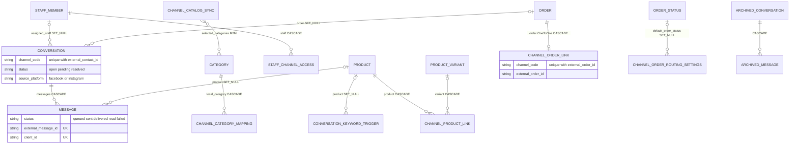

#### 3.1.4 Orders written by channels

Webhook orders (`ingest_channel_order`) keep `sales_channel='online'` and set only `traffic_source`. Orders converted from a conversation (`chat_to_order_service.py:129`) write `sales_channel='chat'`, `payment_method='manual'`, `payment_status='unpaid'`.

> ⚠️ Discrepancy — `Order.SALES_CHANNEL_CHOICES` (`products/models/orders.py:272-277`) lists four values (`online`, `pos`, `b2b_draft`, `phone`) / code does: the inbox writes `'chat'`. Migration `0191` added it to the choices and `0193_alter_order_sales_channel_alter_order_traffic_source` removed it again; the column is a plain `CharField`, so the value is stored, but screens that label `sales_channel` through the choices have no label for it.

### 3.2 Marketplaces (M28, INT-038)

`products/models/marketplaces.py` (439 lines); tenant tables.

#### 3.2.1 Model table

| Model (`file:line`) | Key fields | Constraints, indexes, FK `on_delete` | Migration |
|---|---|---|---|
| `MarketplaceSettings` (`:22`) | `marketplace_code` (`amazon`/`noon`), `default_price_markup_percent`, `price_currency`, `fx_rate_from_sar`, `auto_push_enabled`, `inventory_sync_enabled`, `stock_buffer`, `order_pull_enabled`, `import_marketplace_fulfilled_orders`, `default_order_status`, `last_orders_pull_at`; `load` (`:96`) | `marketplace_code` unique; `default_order_status` SET_NULL | `0195` |
| `MarketplaceListing` (`:102`) | `marketplace_code`, `product`, `variant`, `seller_sku`, `identifier_type` (`asin`/`nsku`/`ean`/`upc`/`gtin`), `external_id`, `price_override`, `effective_price`, `is_published`, `sync_status` (`needs_identifier`/`pending`/`synced`/`failed`/`unpublished`/`hidden_out_of_stock`), `last_error_code`, `last_feed_id`, `last_job_id` (plain integer, not a FK), `fba_fulfillable_qty` | `unique_marketplace_listing` (code, product, variant); `unique_marketplace_seller_sku` (code, seller_sku); index `mp_listing_filter_idx` (code, is_published, sync_status); `product`, `variant` CASCADE | `0196`; `last_job_id` in `0197`; FBA fields in `0199` |
| `MarketplaceSyncJob` (`:200`) | `job_type` (`catalog_push`, `price_update`, `inventory_update`, `order_pull`, `barcode_match`, `feed_result`, `shipment_confirm`, `fba_inventory`), `status`, counters, `error_summary` (capped 200), `payload`, `triggered_by` | ordering `-created_at` | `0196`; types widened in `0199` |
| `MarketplaceFeed` (`:263`) | `job`, `chunk_index`, `feed_id`, `status` (`preparing`/`submitted`/`in_progress`/`processed`/`fatal`/`timed_out`), `listing_ids` (JSON), `sent`, `poll_attempts` | `unique_marketplace_feed_chunk` (job, chunk_index); `job` CASCADE | `0197` |
| `MarketplaceOrderDetail` (`:325`) | `order`, `external_order_id`, `fulfillment_model` (`marketplace` = FBA/FBN, `merchant` = FBM), `inventory_deducted`, `external_status`, `status_class` (`pending`/`open`/`shipped`/`canceled`/`unknown`), `latest_ship_date`, shipment-confirm fields | index `mp_order_status_idx` (code, status_class); `order` OneToOne CASCADE | `0198` (also added `amazon`, `noon` to `Order.traffic_source`); `0199` |

- `MarketplaceOrderDetail` has no uniqueness of its own on the external id; duplicate protection is `ChannelOrderLink` (§3.1.1), written inside `create_order_from_resolved_items` (`order_ingestion_service.py:238`). The loser of a race rolls back and is processed as an update (`order_pull_service.py:358-364`).
- `last_job_id` and `MarketplaceFeed.listing_ids` are loose references by design.
- Quantity sent is `max(0, local stock − stock_buffer)`; the price is `price_override`, else `base_price_sar × fx_rate_from_sar × (1 + markup/100)` rounded half-up (`listing_service.py:56-69`).

> ⚠️ Discrepancy — roadmap lists `materialize_listings`, `compute_effective_price`, `set_identifier` with the `MarketplaceListing` bullet / code does: they are service functions (`api_service.py:102`, `listing_service.py:56`, `:114`); the model has only the `has_identifier` property. "No migration" is right for INT-038 itself: the tables arrived with `0195`–`0199` earlier.

#### 3.2.2 Engine services and code mappings

| Concept | Mapping |
|---|---|
| Market code | `amazon` / `noon` is the `marketplace_code`, the `Order.traffic_source` value and the URL segment; `app_code` is `amazon_marketplace` / `noon_marketplace` (`registry.py:16-35`) |
| Bridge | Amazon `selling_partner_id`, noon `seller_id` (§3.0). The markets are polled, so no market webhook uses the row today |
| Queues | `MARKETPLACE_QUEUE_MAP` = `amazon → marketplaces_amazon`, `noon → marketplaces_noon` (`tasks/marketplaces.py:29`) |
| Adapters | `AmazonAdapter` (OAuth through Login With Amazon, bulk feeds); noon is `FakeNoonAdapter` unless `NOON_MARKETPLACE_ADAPTER` is not `fake` |
| Push mode | more than `BULK_FEED_THRESHOLD = 20` listings and `supports_bulk_feed`: one chunked feed job (500 per chunk); otherwise one task per listing (`api_service.py:371-410`) |
| Identifiers | `ID_PATTERNS` (`api_service.py:33`): ASIN `B0` + 8 alphanumerics, EAN 13 digits, UPC 12, GTIN 8–14, NSKU 4–40 of `A–Z 0–9 -` |

### 3.3 Dropshipping (M29, INT-039)

`products/models/suppliers_dropship.py` (704 lines); `DropshipForwardLog` is in `products/models/locations.py:572`. Tenant tables.

#### 3.3.1 Model table

| Model (`file:line`) | Key fields | Constraints, indexes, FK `on_delete` | Migration |
|---|---|---|---|
| `SupplierConnection` (`:29`) | `supplier_code` (`cj`/`makhazen`/`knawat`/`flat_feed`), `location`, `purchasing_supplier`, four sync/forward switches, `inventory_sync_interval_min` (30), `catalog_sync_interval_min` (360), `price_sync_interval_min` (360), `last_price_sync_at`, `stock_buffer`, `forward_cod_orders`, `default_country_code`, `shipping_method`, `default_pricing_rule`; `load` (`:118`) | `supplier_code` unique; `location` OneToOne **PROTECT**; `purchasing_supplier`, `default_pricing_rule` SET_NULL | `0201`; `default_pricing_rule` `0202`; forward fields `0205`; the three intervals and `last_price_sync_at` `0232` |
| `SupplierSyncJob` (`:123`) | `job_type` (`catalog_pull`, `catalog_search`, `product_import`, `feed_import`, `inventory_sync`, `price_sync`, `order_forward`, `order_status_poll`), `status`, counters, `error_summary` (200), `triggered_by` | index `supplier_job_lookup_idx` (code, job_type, status); keyed by string, no FK | `0201` |
| `PricingRule` (`:183`) | `scope` (`supplier`/`category`/`product`), `supplier_code` (blank = all), `category_prefix`, `priority` (higher wins), `markup_percent` (30), `fixed_add`, `shipping_estimate`, `min_margin_percent` (10), `rounding` (`none`/`nearest_1`/`end_99`/`end_95`/`end_00`), `fx_source` (`store_setting`/`fixed`), `fx_rate`; `clean` (`:249`) | ordering `-priority`, `name` | `0202` |
| `SupplierProduct` (`:264`) | `supplier_code`, `external_product_id`, `title`, `category_path`, `base_cost`, `content_hash`, `last_seen_at`, `is_discontinued`, `product`, `price_locked`, `pricing_rule`, `import_status`, `stock_synced_at`, `auto_hidden`, `cost_alert_pct`, `cost_alert_at` | `uniq_supplier_product_ext` (code, external id); indexes `supplier_prod_status_idx`, `supplier_prod_seen_idx`; `product` OneToOne SET_NULL; `pricing_rule` SET_NULL | `0202`; last four fields `0204` |
| `SupplierVariant` (`:345`) | `supplier_product`, `external_variant_id`, `sku`, `barcode`, `cost`, `stock`, `variant`, `is_gone` | `uniq_supplier_variant_ext`; `supplier_product` CASCADE; `variant` OneToOne SET_NULL | `0202` |
| `FeedMapping` (`:436`) | `source_kind`, `source_url`, `source_file`, `schedule`, `schedule_interval_min`, `column_map` (JSON), `price_unit`, `variant_group_mode`, `version`, `is_approved`, `approved_version`, `last_validation_report`; `MAX_FEEDS = 20`; `clean` (`:521`) | `import_pricing_rule`, `import_category` SET_NULL | `0203`; `schedule_interval_min` `0232` |
| `DropshipStockHold` (`:567`) | `order`, `product`, `variant`, `location`, `supplier_code`, `quantity`, `released_at`, `release_reason` | index `dropship_hold_active_idx` (product, variant, released_at); `order`, `product`, `variant` CASCADE; `location` PROTECT | `0204` |
| `SupplierWebhookEvent` (`:594`) | `supplier_code`, `event_id`, `event_type`, `signature_valid`, `payload_hash`, `payload`, `processed_at`, `processing_error` | `uniq_supplier_webhook_event` (code, event_id) | `0204` |
| `SupplierOrder` (`:625`) | `fulfillment`, `order`, `supplier_code`, `external_order_id`, `idempotency_key`, `status` (`queued`/`held`/`submitted`/`accepted`/`processing`/`shipped`/`delivered`/`cancelled`/`rejected`/`failed`), `hold_reason`, `whole_order`, cost snapshots, `tracking_number`, `attempts`, `next_attempt_at`, `shipping_address` (JSON), `holds_consumed`; `ACTIVE_STATUSES`, `TERMINAL_STATUSES = (delivered, cancelled, rejected)` | `idempotency_key` **unique**; index `supplier_order_status_idx`; `fulfillment` OneToOne CASCADE; `order` CASCADE | `0205` |
| `DropshipForwardLog` (`locations.py:572`) | `fulfillment`, `forwarded_via` (`api`/`manual`), `forwarded_payload_snapshot`, `forwarded_at` | `fulfillment` OneToOne CASCADE | Domain 10 migration; `get_or_create` in `route_order_to_suppliers` |

- The mirrored catalog (`SupplierProduct`, `SupplierVariant`) is **not** the store catalog: a product reaches `Product` only through `import_supplier_product`, which sets the OneToOne link; deleting the `Product` nulls it and the mirror row stays.
- `SupplierOrder.shipping_address` is set to `NULL` at `delivered`, `cancelled` and `rejected` (`order_forward_service.py:345`, `:353`, `:380`, `:499`, `:590`): the customer's address is not kept after the order ends.
- Permission `channels.dropshipping.manage` is seeded by `0200`.

> ⚠️ Discrepancy — roadmap lists `FEED_FIELDS (+6 fields)` as one list / code does: there are **two**. The **model list** (`suppliers_dropship.py:392-427`) has 26 keys, the original 20 plus `gtin`, `brand`, `price`, `compare_at_price`, `extra_images`, `supplier_url` (the "+6"), with 4 required (`external_product_id`, `title`, `cost`, `stock`). The **contract tuple** (`api_service.py:60-66`) has the 20 keys the Next.js wizard knows (`sku`, `name`, `cost`, `stock`, `price`, `compare_at_price`, `description`, `barcode`, `gtin`, `brand`, `category`, `image_url`, `extra_images`, `weight`, `variant_sku`, `option1_name`, `option1_value`, `option2_name`, `option2_value`, `supplier_url`), 4 required (`sku`, `name`, `cost`, `stock`). `FRONT_TO_MODEL` (`:68-75`), `front_mapping` (`:765`) and `_model_mapping` (`:781`) translate; `currency` and `image_url_2` to `image_url_5` exist on the model side only.

> ⚠️ Discrepancy — roadmap lists the dropshipping models together under migration `0232_dropshipping_api` and omits `DropshipForwardLog` / code does: `0232` adds only the three `SupplierConnection` intervals/`last_price_sync_at` and `FeedMapping.schedule_interval_min`; the tables come from `0201`–`0205`. The log exists and is written for every supplier fulfilment.

> ⚠️ Discrepancy — roadmap gives the adapter registry as "CJ real, Makhazen and Knawat fake, flat feed" / code does: `DEFAULT_MODES = {'cj': 'real', 'makhazen': 'fake', 'knawat': 'fake', 'flat_feed': 'real'}` (`registry.py:67`) is only the default; `SUPPLIER_ADAPTER_MODES` can flip any supplier, CJ included. The real Makhazen and Knawat classes are skeletons whose methods raise `NotImplementedError` (`makhazen_adapter.py:19-30`). The Arabic names are «مخازن» and «قنوات».

#### 3.3.2 Engine services and code mappings

| Concept | Mapping |
|---|---|
| Supplier code | `supplier_code` ⇄ `app_code` (`supplier_cj`, `supplier_makhazen`, `supplier_knawat`, `supplier_flat_feed`, `registry.py:14-66`); the app installation holds the credentials |
| Location | each connected supplier owns one virtual `Location` named «مورد دروبشيبينغ: {name}», `ownership_model='dropship_supplier'`, plus a `DropshipSupplierDetails` row (`connection_service.py:100-114`) |
| Queues | `SUPPLIER_QUEUES = {'sync': 'suppliers_sync', 'orders': 'suppliers_orders'}` (`tasks/suppliers.py:21`) |
| Priority | UI priority = `1000 − PricingRule.priority` (`PRIORITY_BASE`, `api_service.py:46`; read `:397`, write `:473`); the API accepts 1 to 100000 |
| Rule precedence | product override → category rule → supplier rule → connection default → built-in rule (worked example in §4.7) |
| Currencies | `compute_sell_price` converts SAR and USD (store `usd_to_sar`, fallback 3.75); any other currency needs a rule with `fx_source='fixed'` or a `PricingError` is raised (`pricing_engine.py:77-94`) |
| Bridge | supplier `bridge_token` (§3.0); URL `webhooks/suppliers/<supplier_code>/<bridge_token>/` built from `SUPPLIER_WEBHOOK_BASE_URL` (`connection_service.py:274-290`) |
| Forwarding | `flat_feed` has `supports_order_forwarding = False`: a `Fulfillment` and a log (`forwarded_via='manual'`) are created but no `SupplierOrder` |

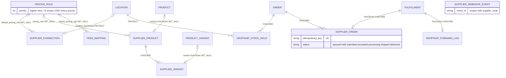

### 3.4 POS (M16, INT-033)

`products/models/staff_pos.py` (225 lines); tenant tables.

#### 3.4.1 Model table

| Model (`file:line`) | Key fields | Constraints, indexes, FK `on_delete` | Migration |
|---|---|---|---|
| `CashRegister` (`:17`) | `location`, `name`, `is_active` | `location` PROTECT; ordering `location__name`, `name` | `0146` |
| `Shift` (`:33`) | `register`, `opened_by` (null = owner), `status` (`open`/`pending_manager_approval`/`closed`/`force_closed`), `opening_float`, `expected_closing`, `actual_closing`, `variance` (expected − actual, positive = shortage), `approved_by`, `version`, `approval`, `force_close_notice_seen`; `net_cash` (`:77`), `compute_expected_closing` (`:87`) | **`unique_open_shift_per_register`**: unique `register` where `status='open'`; `register`, `opened_by` PROTECT; `approved_by`, `approval` SET_NULL; ordering `-opened_at` | `0146`; `opened_by` null, `version`, `approval`, `force_close_notice_seen` in `0229` |
| `ShiftCashMovement` (`:92`) | `shift`, `movement_type` (`sale`/`cash_in`/`cash_out`/`refund`/`rounding_adjustment`), `amount`, `related_order`, `created_by` (null = owner), `note` | **`cash_movement_amount_non_negative`** (`amount >= 0`); `shift`, `created_by` PROTECT; `related_order` SET_NULL | `0146`; `created_by` null and `note` in `0229` |
| `OTPChallenge` (`:125`) | `purpose`, `code_hash` (hashed), `target_ref`, `requested_by`, `expires_at`, `used_at`; `create` (`:147`), `verify` (`:157`) | `requested_by` SET_NULL | `0146` |
| `PosReceipt` (`:167`) | `order`, `shift`, `register`, `number`, `payment_method` (`cash`/`sharwa_pay`), `cashier_name`, `lines` (JSON snapshot), `subtotal`, `discount`, `total`, `discount_approval` | `number` **unique**; `order` OneToOne PROTECT; `shift`, `register` PROTECT; `discount_approval` SET_NULL | `0229` |
| `PosIdempotencyKey` (`:206`) | `key`, `kind` (`order`/`movement`/`refund`), `object_id` (plain integer) | `key` **unique**: a concurrent insert waits on the index | `0229` |
| `StoreSetting.pos_refund_otp_threshold`, `pos_manager_code_hash` (`store_settings.py:335`, `:339`) | refund amount needing a code (200.00); hashed manager code (blank until `manage.py set_pos_manager_code`) | — | `0229` |

- The **database** guarantees one `open` shift per register and non-negative movements. It does not make a `pending_manager_approval` shift block the register: `open_shift` checks `status__in=LIVE` (`pos_service.py:50`) in code (`:419-421`) and treats the unique-index `IntegrityError` as the race fallback (`:431-432`, «الجهاز مشغول بوردية أخرى.»).
- `Shift.approved_by` is set by `_settle` (`:544-549`) for approval **and** rejection; the decision lives on the `ApprovalRequest`.
- `PosReceipt.number` is `POS-{shift.pk:04d}-{seq:03d}` (`pos_service.py:1095`) with `seq` = receipts in the shift + 1, computed under the shift row lock. A POS sale is a real `Order` (`completed`, `paid`, `sales_channel='pos'`, `payment_method` `pos_cash` or `pos_sharwa_pay`, customer «عميل نقطة البيع»); the receipt stores only what the order does not.

> ⚠️ Discrepancy — roadmap says "legacy `products/views/staff_pos.py` calls the same service" / code does: only two of four write views do. `close_shift_view` (`:100`) calls `pos_service.close_shift` (`:119`) and `resolve_shift_variance_view` (`:187`) calls `resolve_variance` (`:202`). `open_shift_view` (`:73`) does `Shift.objects.create` (`:91`) and `add_cash_movement_view` (`:155`) does `ShiftCashMovement.objects.create` (`:176`) behind `require_feature('staff_rbac')`, not the `pos` feature. Those two skip the service checks: a register whose shift is still `pending_manager_approval` can be opened again, a deactivated register can be opened, a movement needs no note, and a cash-out is not capped by expected cash.

> ⚠️ Discrepancy — roadmap writes `POS-<shift>-<seq>` / code does: zero-padded, `POS-0007-003` for the third receipt of shift 7.

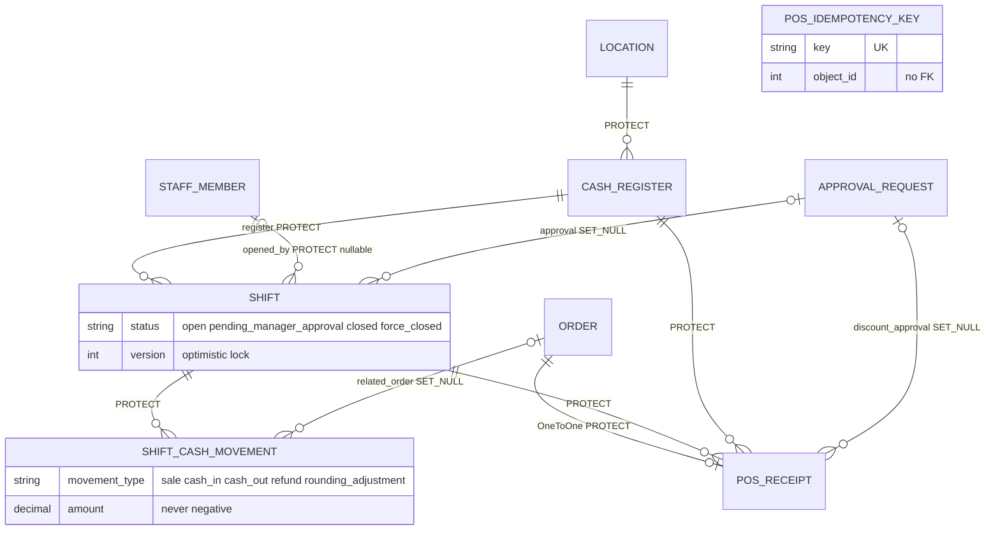

#### 3.4.2 Engine services and code mappings

| Concept | Mapping |
|---|---|
| Who sells | `Actor` (`pos_service.py:175`): `staff=None` is the store owner (no `StaffMember` row); staff sell only in active locations with `has_pos_terminal` that are in their authorised set (`actor_for`, `:206-215`) |
| Permissions | `discounts.apply`, `orders.refund`; shortage resolution = owner, `staff.manage`, or the roles «مدير الفرع» / «مدير المتجر» at a POS location (`can_resolve`, `:247`; `APPROVER_ROLE_NAMES`) |
| Discount ceiling | highest `Role.max_discount_percent` among the staff member's active roles with `discounts.apply` (`None` = owner, no ceiling); above it: manager code or an approved `ApprovalRequest(discount_exception)` (`_discount_approval`, `:894`) |
| Approval types | `shift_shortage` (at close) and `discount_exception`; the approval's `target_ref` becomes `order:<id>` once the sale exists |
| Manager code | hashed in `StoreSetting`; 5 wrong codes lock a register 15 minutes (`:71-72`); a development-only fallback exists under `DEBUG` and its value is deliberately not documented (OI-09b) |
| Refund OTP | 6 digits, 300 s, 3 attempts then a 900 s lock, 3 sends per 600 s, counted in the cache; sent to the store's WhatsApp number |
| Idempotency | header `Idempotency-Key` or body `idempotency_key`, `^[A-Za-z0-9_\-]{8,64}$` (`KEY_RE`, `:61`); `_claim` (`:446`) inserts the key first in the write transaction |

### 3.5 Bookings (M26, INT-036)

`products/models/bookings.py` (72 lines); tenant tables; the product flags live on `Product`.

#### 3.5.1 Model table

| Model (`file:line`) | Key fields | Constraints, indexes, FK `on_delete` | Migration |
|---|---|---|---|
| `Product.is_bookable`, `booking_duration_minutes` (`catalog.py:483`, `:484`) | service flag (indexed); slot length (default 30) | — | `0077_product_booking_duration_minutes_product_is_bookable_and_more` |
| `ServiceAvailability` (`bookings.py:6`) | `product`, `weekday` (**0 = Monday to 6 = Sunday**), `start_time`, `end_time`, `is_active` | no unique key: several windows per day; `product` CASCADE; ordering (weekday, start_time) | `0077` |
| `BookingSlot` (`:33`) | `product`, `start_datetime` (indexed), `end_datetime`, `status` (`held`/`booked`/`cancelled`), `session_key`, `held_until`, `order` | **`uniq_active_booking_slot_per_product_time`**: unique (product, start_datetime) where status in (`held`, `booked`); `product` CASCADE; `order` SET_NULL; ordering `start_datetime` | `0077` |
| `OrderItem.booking_slot` (`orders.py:690`) | slot an order line bought | SET_NULL | `0077` |

- Availability is **computed**: a `BookingSlot` row exists only once a visitor holds a time (docstring `bookings.py:34-41`). `day_slots` (`booking_service.py:132`) walks each active window in 30-minute steps in the **store** time zone and marks a candidate unavailable when a live row overlaps (booked, or held with `held_until` in the future).
- A visitor needs no account: the hold is tied to the session (`session_key`) and the cart keeps slot ids in `cart_bookings` / `buy_now_bookings` (`booking_service.py:44-45`).
- `StoreSetting.timezone` defaults to `Asia/Aden` (`store_settings.py:322`), `week_start_day` to `sunday` (`:326`); an invalid zone falls back to `Asia/Aden` (`store_zone`, `booking_service.py:72`). The only gate is the plan feature `bookings` (`Feature.is_enabled_for_client`); there is no M18 key.

> ⚠️ Discrepancy — roadmap says "hold 15 min (`BOOKING_HOLD_MINUTES`)" / code does: the constant is `HOLD_MINUTES = 15` (`booking_service.py:36`); `BOOKING_HOLD_MINUTES` is only a legacy alias in `products/views/cart_checkout.py:43`.

> ⚠️ Discrepancy — roadmap says bookings have "no migration" / code does: INT-036 added none, but both tables, the two `Product` columns and the partial unique index were created by `0077` (2026-09-02), before the integration.

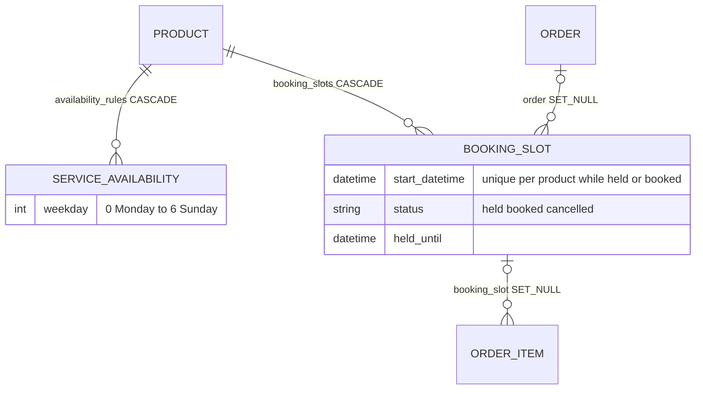

#### 3.5.2 Engine services and code mappings

| Concept | Mapping |
|---|---|
| Weekday | model `0 = Monday` (Python `date.weekday()`); UI conversion only in `bookings/weekdays.ts`; `week_start_day` decides how the calendar starts |
| Constants | `HOLD_MINUTES = 15`, `SLOT_STEP_MINUTES = 30`, `NEXT_AVAILABLE_SCAN_DAYS = 21`, `MAX_WINDOWS = 70`, `MAX_LIVE_HOLDS_PER_SESSION = 10`, `MAX_SLOT_ROWS = 2000` (`booking_service.py:36-41`) |
| Slot status | `held` «محجوز مؤقتاً (لم يُدفع بعد)», `booked` «مؤكد (تم الدفع/إنشاء الطلب)», `cancelled` «ملغي» |
| Hold to book | checkout locks the held rows and refuses when a slot is no longer `held` or expired (`checkout_service.py:417-424`); in the order transaction every slot becomes `booked`, gets `order`, `held_until=None` (`:690-694`) |
| Cancel | `cancel_slot` (`:466`): `cancelled`, audit `booking.cancel`; the **order is not touched** and the reply carries `order_effect` |

### 3.6 Migration map

| Domain | Migrations (`products/migrations/`) |
|---|---|
| Channels | `0186` permission, `0187` catalog trio, `0188` keyword trigger, `0189` routing and order link, `0190` conversation, message, archives, `0191` access and trigger extension, `0193` order-field choices, `0231_inbox_api` |
| Marketplaces | `0194` permission, `0195`–`0199` |
| Dropshipping | `0200` permission, `0201`–`0205`, `0232_dropshipping_api` |
| POS | `0146_staff_pos`, `0229_pos_api`, `billing/0013_seed_pos_feature` |
| Bookings | `0077_product_booking_duration_minutes_product_is_bookable_and_more` |
| Public bridge | `tenants/0024_channelsessionindex` |

## 4. Flows

### 4.1 Inbound message (Meta, Telegram, WhatsApp)

A webhook does no work: it verifies, finds the store, sends one Django signal and returns. Everything else runs in a Celery task inside the store schema.

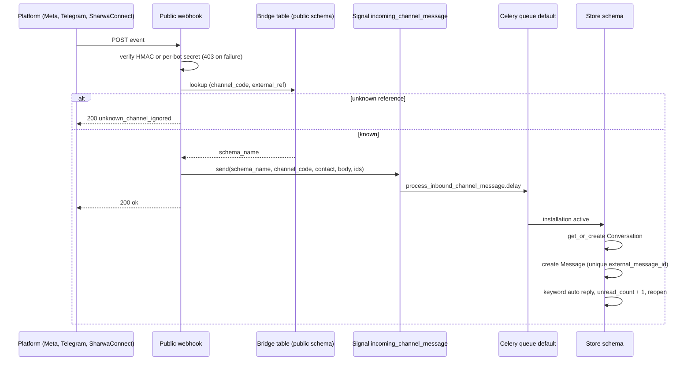

| # | Step | Where | Guard |
|---|---|---|---|
| 1 | Signature or secret check. Meta: `X-Hub-Signature-256` HMAC-SHA256 with `META_APP_SECRET`; TikTok: `X-Tt-Webhook-Signature` with `TIKTOK_APP_SECRET`; Telegram: per-bot `secret_token` from the encrypted config, `hmac.compare_digest`. Failure is HTTP **403** | `webhooks_channels.py:43`, `:56`, `:124-150` | no store is resolved before the check |
| 2 | Resolve the store from the public bridge. Unknown reference: HTTP 200 `unknown_channel_ignored` (a 4xx would make the platform retry for days) | `webhooks_channels.py:69-71`, `:88-91` | `schema_name` from the bridge row only |
| 3 | Send `incoming_channel_message`; the single receiver only calls `process_inbound_channel_message.delay` | `signals_channels.py:32`, `:62` | the webhook never runs business logic |
| 4 | Installation inactive: `AppUsageLog` row with status `skipped`, stop | `tasks/channels.py:448-455` | checked at execution time |
| 5 | `Conversation.objects.get_or_create` in a savepoint; the `IntegrityError` of `unique_conversation_per_contact` means another worker won: re-read | `:463-478` | the DB constraint is the lock |
| 6 | Welcome message for a **new** conversation (channels in `TEMPLATE_REGISTRY['social_welcome']`); a failure never blocks the customer message | `:480-499` | best effort |
| 7 | Create the inbound `Message` in a savepoint; `IntegrityError` on `external_message_id` is a webhook retry: return without touching `unread_count` | `:501-523` | unique `external_message_id` |
| 8 | Meta and Telegram media arrive as a URL: a separate task uploads it and fills `media_object_key`; WhatsApp media already arrives as a key | `:525-530` | text is never delayed |
| 9 | First active keyword trigger that matches queues an automatic reply; failure is logged only | `:532-562` | one reply per inbound message |
| 10 | `unread_count + 1`, `last_message_at = now`; `resolved` or `pending` returns to `open`; `source_platform` filled once | `:564-573` | `F()` expression |

An Instagram **comment** matching a keyword queues `dispatch_instagram_comment_auto_reply`; a Telegram `/start` or callback button queues `dispatch_telegram_start` / `dispatch_telegram_callback`; neither creates a conversation. Commerce **orders** from Meta and TikTok go to `ingest_channel_order_task` (`tasks/channels.py:224`) and become orders through `ingest_channel_order` (`order_ingestion_service.py:249`), idempotent through `ChannelOrderLink`.

### 4.2 Outbound message lifecycle

A staff reply (`send_message`, `inbox_api_service.py:320`) is stored **before** it is sent, so the browser gets an answer at once and each bubble shows its delivery state.

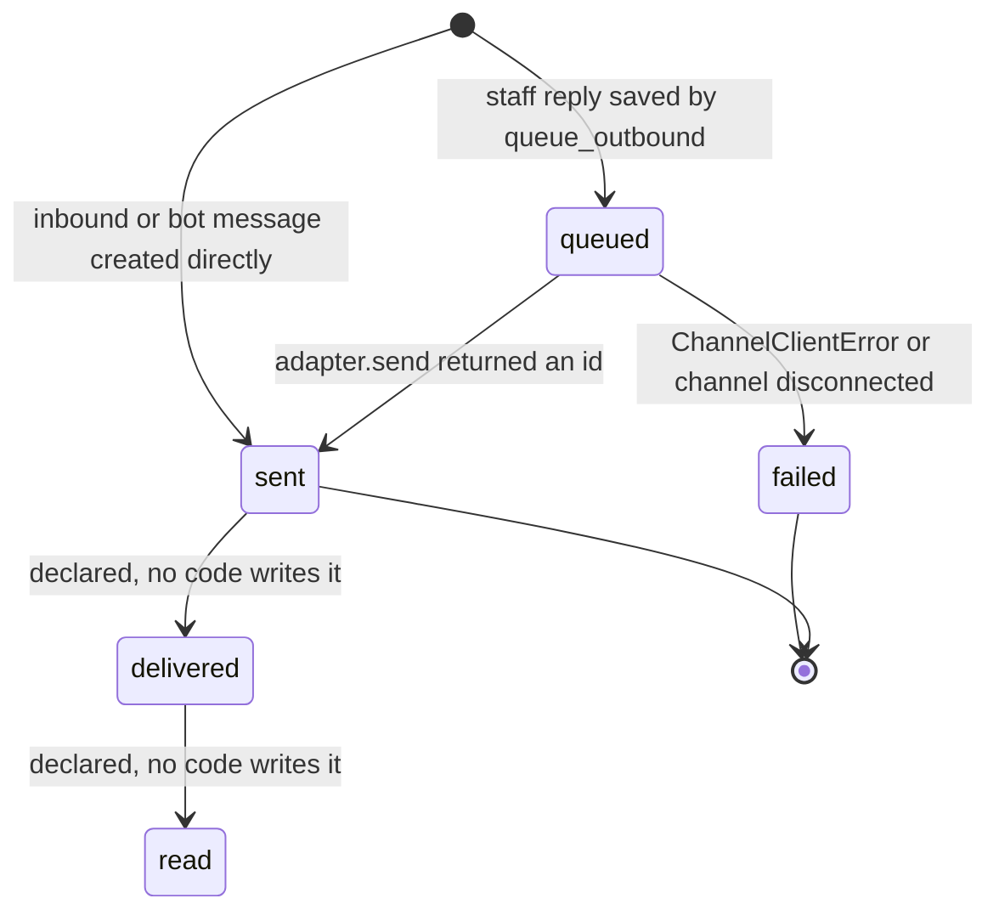

1. `send_message` returns the existing message with **HTTP 200** when `client_id` (body, or `Idempotency-Key` header) was already used in that conversation (`:325-328`). Otherwise it checks the channel is connected (409 «القناة غير مربوطة — لا يمكن الردّ.») and that the staff member has `can_reply` (403 «لا تملك صلاحية الردّ على هذه القناة.»), then calls `queue_outbound`.
2. `queue_outbound` (`:296`) saves the `Message` as `queued` with a pending `AppUsageLog`; if the log cannot be created (installation inactive) the row is set to `failed` at once. Otherwise the send is enqueued **on commit** on the queue from `CHANNEL_DISPATCH_QUEUE_MAP` (`tasks/channels.py:264`). A staff reply also sets `unread_count = 0` (`inbox_api_service.py:361`).
3. `dispatch_channel_message` (`tasks/channels.py:337`) re-checks the installation, then the Redis rate limiter, then calls the adapter from `CHANNEL_DISPATCH_REGISTRY`. Success updates **the same row** to `sent` with the provider's `external_message_id`; a `ChannelClientError` sets `failed` and `error_detail`. Without a `message_id` (welcome, keyword replies) the task creates a `bot` message instead.
4. Retries: `autoretry_for=(SharwaConnectTransientError,)`, `retry_backoff_max=300`, `max_retries=5`. Only WhatsApp raises that class; Meta, TikTok and Telegram failures are final at the first attempt. The limiter allows `SHARWA_CHANNELS_RATE_LIMIT_PER_MINUTE` sends per (store, channel) per minute (default 80, fail-open when Redis is down); an excess send retries after `min(2 ** n, 60)` seconds.

> ⚠️ Discrepancy — `Message.STATUS_CHOICES` (`social_channels_inbox.py:95-101`) and the roadmap list `queued · sent · delivered · read · failed` / code does: only `queued`, `sent` and `failed` are ever written. No handler processes delivery or read receipts, and a search of `products/`, `tenants/` and `api/` finds no writer of `delivered` or `read`. The UI labels exist («وصلت», «قُرئت») but a bubble can never reach them. Finding (not in the register).

### 4.3 Chat to order

`POST inbox/conversations/<id>/convert-to-order/` (`inbox_api_service.py:385`) uses the engine of the legacy button. Already linked: 409 with the order number; no `can_reply`: 403. Inside one transaction the conversation row is locked and `order_id` re-checked (`:404-407`), so two clicks create one order. `convert_conversation_to_order` (`chat_to_order_service.py:49`) requires a phone and at least one item, locks products in **id order** (the checkout lock order, no deadlock), prices each line in the store currency and creates the order (`new`, `unpaid`, `manual`, `sales_channel='chat'`, default status from `ChannelOrderRoutingSettings`). Bookable services are skipped; other lines decrement `Product.stock` with a `StockMovement` of type `sale`; insufficient stock does **not** block the order, it sets `is_backordered`. Then `Conversation.order` is set, an order-created event is added to the timeline and, after the transaction, a confirmation message is queued (a failure there never undoes the order). No `ChannelOrderLink` is written: that table holds orders that originate **on the platform**.

### 4.4 Catalog sync and the stock shield (Meta and TikTok)

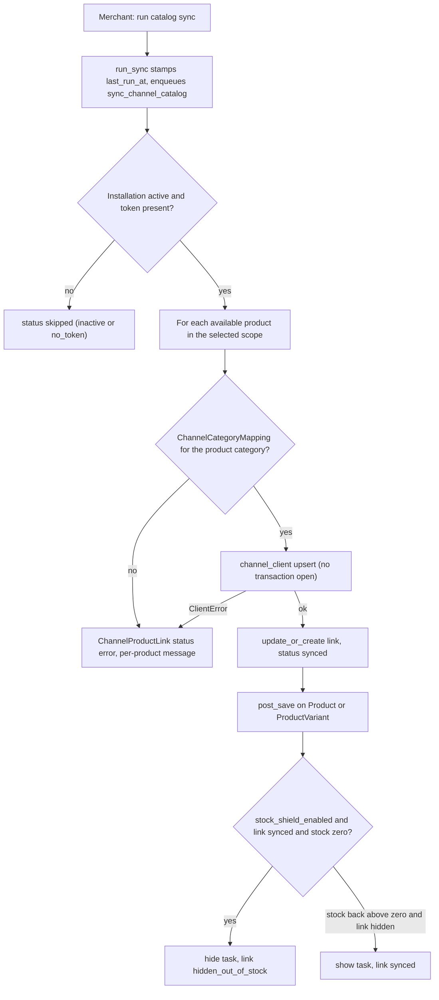

- Scope: `Product.objects.filter(is_available=True)`, narrowed to `selected_categories` in that mode (`catalog_sync_service.py:68-74`). Price sent: `product.price × (1 + price_adjustment_percent / 100)` rounded half-up. A failure is written on **that product's** link and the loop continues (`_sync_one_product`, `:102`); the network call is always outside `transaction.atomic()`.
- The shield receiver (`products/signals_social_channels.py`) reads only `ChannelProductLink` and enqueues a task that re-checks the link status first, so a duplicate enqueue is harmless. Only product-level links (`variant` NULL) exist today.
- «لا يوجد ربط تصنيف لهذا المنتج على هذه القناة.» is stored on a link whose category has no mapping (`:117`). Only TikTok has a mapping screen, so Meta products fail until a mapping row exists (OI-02).

> ⚠️ Discrepancy — roadmap describes `ChannelCatalogSync.last_run_at` as the time of the last sync / code does: `run_sync` writes it when the run is **requested** (`channels_api_service.py:418`), so a run that fails or is skipped still moves the timestamp.

### 4.5 Marketplaces: push listings and pull orders

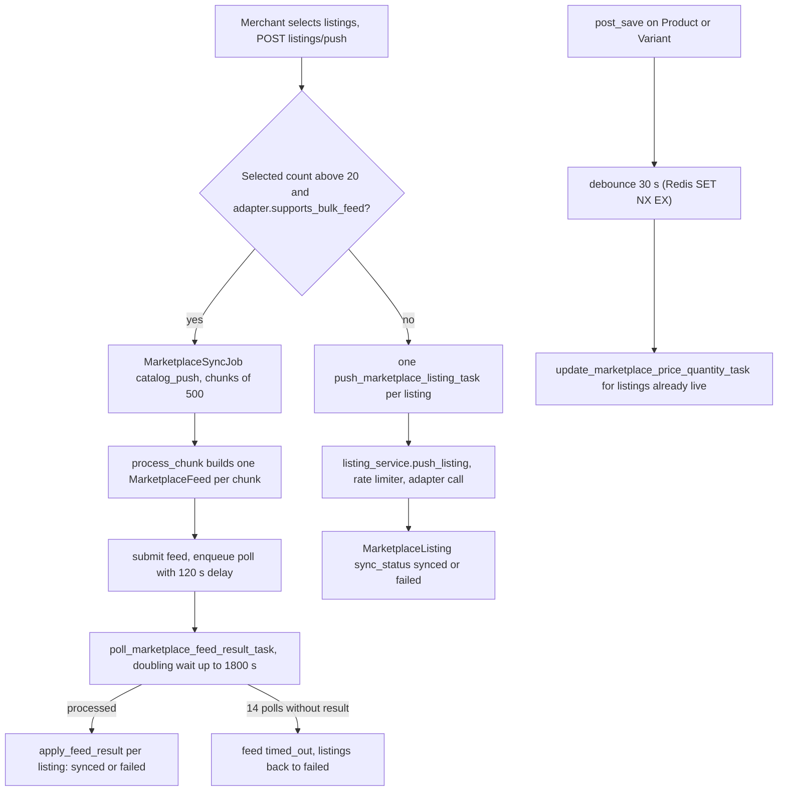

- A listing with no identifier stays `needs_identifier` until the merchant sets one (`set_identifier`, checked with `ID_PATTERNS`) or the barcode-matching job does.
- Job counters are **derived** from `MarketplaceListing.last_job_id`, not accumulated, so re-running a chunk after a crash or a 429 cannot count a listing twice (`bulk_sync_service.py`). Each task runs one chunk and enqueues the next at the queue tail, so two stores alternate on one worker.
- Auto-update touches only listings in `LIVE_STATUSES = ('synced','hidden_out_of_stock')` of a market with `auto_push_enabled` (`signals_marketplaces.py:25`, `:56`).

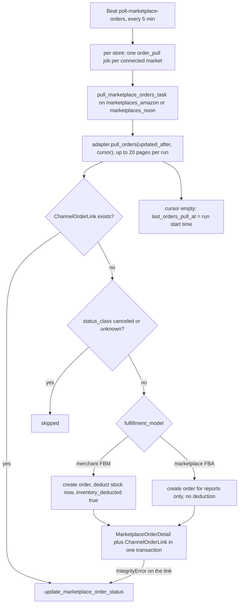

- `last_orders_pull_at` advances only after **all** pages, to the run **start** time, with `OVERLAP_MINUTES = 10`; the first pull looks back `FIRST_PULL_DAYS = 7`.
- A **pending** order (payment not confirmed) is created `awaiting_payment`, locked by `order_guard`, with FBM stock reserved at once. When the market reports `open` or `shipped`, `confirm_marketplace_payment` fills in customer and prices and sets `new` / `paid` **without a second deduction**; a cancellation restores stock once (`inventory_deducted` under `select_for_update`). FBA / FBN orders are imported only when `import_marketplace_fulfilled_orders` is on and never touch stock.
- Ship confirmation starts on `on_order_shipping_assigned` or a saved waybill (`signals_marketplaces.py:76`); `confirm_marketplace_shipment_task` retries up to `MAX_ATTEMPTS = 12` or the ship-by deadline; an order the market already reports shipped is marked confirmed with no call.
- Transient failures reschedule after `min(60 × 2^(n-1), 900)` s and fail the job after 5 attempts; an auth error fails the job and marks the connection `reauth_required`, so the next Beat run skips the market (no circuit breaker in this path).

### 4.6 Dropshipping: order forwarding and sync

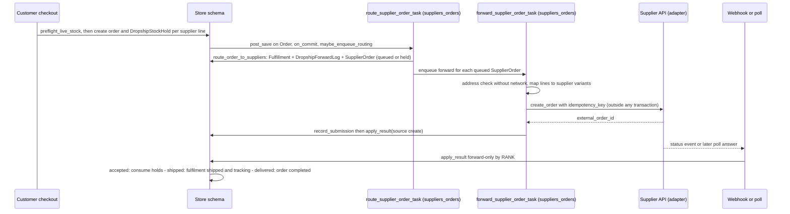

**Readiness.** `readiness(order)` (`order_forward_service.py:57`) returns `paid`, `cod` or nothing; nothing for `NOT_READY_STATUSES` (pending or awaiting payment, payment review, cancelled, refunded), for a marketplace order on payment hold and for a marketplace-fulfilled order.

**Routing.** One `Fulfillment` (`forwarded_to_supplier`) per supplier location, one `DropshipForwardLog` and, if the adapter forwards, one `SupplierOrder` with `idempotency_key = sha256("schema:fulfillment_id")`. Initial status is `held` when `order_forward_enabled` is off (reason constant `HOLD_REASON_DISABLED`) or when the order is cash on delivery and `forward_cod_orders` is off (`HOLD_REASON_COD`: the supplier charges the merchant's balance, so the merchant must confirm); otherwise `queued`. The generic location router is not used: it would spread **all** items over all locations and flag the supplier line as backorder because the checkout hold already lowered availability (`route_order_to_suppliers`, `:129`).

**Forwarding.** `forward_supplier_order` (`:225`) re-checks readiness, normalises the address **without network** (`SupplierAddressError`: `failed`), maps every line to a `SupplierVariant` (missing or gone: `failed`, `UNMAPPED`), then calls `adapter.create_order` with the key.

| Adapter error | Result |
|---|---|
| rate limit | reschedule after `retry_after`, attempt not consumed |
| transient | reschedule after `min(60 × 2^(attempt-1), 1800)` s; at `MAX_TRANSIENT_ATTEMPTS = 12` the order is `failed` |
| auth | `failed`; connection marked `reauth_required`, circuit opened |
| insufficient funds, address, schema drift, generic | `failed` with a code and message; "resend" (`send_now`) re-queues |
| permanent or not found | `rejected`: holds released, fulfilment cancelled, address erased |
| `NotImplementedError` (Makhazen or Knawat skeleton) | `failed` with code `MANUAL` |

`record_submission` is a separate step on purpose: a worker killed between the supplier call and the write retries with the **same key** and the supplier returns the same order.

**Status.** `apply_result` (`:318`) is the only writer of supplier status. Under a row lock it applies a new status only if `RANK[new] > RANK[old]` (`queued/held/failed 0 < submitted 1 < accepted 2 < processing 3 < shipped 4 < delivered 5`); `cancelled` and `rejected` apply unless the row is terminal. Side effects once, after commit: `accepted` or later consumes the holds (supplier stock is lowered by the held quantity so visible stock does not jump back); `cancelled` / `rejected` release holds and recompute stock; `shipped` gives the fulfilment its tracking number, and a whole-order single-supplier shipment assigns the order shipping (which triggers marketplace ship confirmation); `delivered` delivers the fulfilment and, when all are done and the order is paid, completes the order (cash on delivery waits for the merchant). The address JSON is nulled at every terminal status.

| Source | Mechanism |
|---|---|
| Supplier webhook | `POST webhooks/suppliers/<supplier_code>/<bridge_token>/` (`webhooks_suppliers.py:41`): store from the bridge token, installation active, HMAC over the raw bytes **before** parsing, 401 on a bad signature (at most 50 invalid rows per hour), 413 above 1 MB, up to 200 events per call, `uniq_supplier_webhook_event` (a duplicate counts but is not processed twice) |
| Processing | `process_supplier_webhook_task`: job lock 300 s, supplier busy re-enqueues up to `WEBHOOK_MAX_ATTEMPTS = 5`; success sets `processed_at` and clears the payload |
| Beat repair | `schedule_supplier_inventory_sync_for_tenant` re-enqueues valid unprocessed events older than 5 minutes (up to a day, 200 per run) |
| Order poll | `poll_supplier_orders` (minutes 9, 39): poll active orders not synced for 25 min, forward `queued` orders whose `next_attempt_at` is due, route paid supplier orders of the last 7 days that no fulfilment covers (safety net for a lost signal) |
| Cancellation | `on_order_cancelled`: `queued`, `held`, `failed` cancel locally; `submitted`, `accepted`, `processing` send a cancel request after commit; `shipped` is refused with a message |

**Catalog and stock.** `schedule_supplier_catalog_refresh` starts catalog pulls and price syncs when the connection's interval is due; `schedule_supplier_inventory_sync` starts inventory jobs after `max(inventory_sync_interval_min, adapter minimum, 15)`. Visible stock is `max(0, supplier stock − active holds − stock_buffer)`; `LocationInventory.quantity_on_hand` holds the supplier figure, `quantity_reserved` the holds, and **no `StockMovement` is written** (supplier stock is not owned stock, `stock_service.py`). A cost move above `COST_ALERT_PCT = 30` sets `cost_alert_pct` / `cost_alert_at` instead of silently repricing.

### 4.7 Pricing precedence, with a worked example

`RuleBook.select` (`pricing_service.py:39`) stops at the first match: (1) **product override** (`SupplierProduct.pricing_rule`, when active); (2) **category rule** whose normalised prefix equals the category path or is a path prefix (`prefix + ' > '`), best by `(priority, longer prefix, bound to this supplier, lower id)`; (3) **supplier rule** (empty `supplier_code` = all), best by `(priority, bound to this supplier, lower id)`; (4) **connection default** (`default_pricing_rule`); (5) built-in `DEFAULT_RULE`: markup 30 %, minimum margin 10 %, `end_99`, no fixed add or shipping.

`compute_sell_price` (`pricing_engine.py:120`):

```text
cost_sar = cost x fx          (SAR as is · USD x store usd_to_sar, fallback 3.75 · other currency needs fx_source=fixed)
price    = (cost_sar + shipping_estimate) x (1 + markup/100) + fixed_add
floor    = cost_sar x (1 + min_margin/100)
final    = apply_rounding(max(price, floor), rounding, floor)      never below floor, end_* only round up
```

| Case | Calculation | Result |
|---|---|---|
| A. Default rule, cost 10.00 USD at 3.75 | cost_sar 37.50, price 37.50 × 1.30 = 48.75, floor 41.25, `end_99` rounds 48.75 up | **48.99**, margin 30.6 % |
| B. Floor wins, markup 5 % | price 39.375 is below floor 41.25, so 41.25 is rounded by `end_99` | **41.99**, margin 12.0 % |
| C. Priority display | a rule stored with priority 990 is shown as `1000 − 990 = 10` and the UI value 10 is stored as 990 | stored higher wins |

A rule with `fx_source='fixed'` multiplies **every** cost by `fx_rate`, SAR costs included (`to_sar` checks the fixed source first); a fixed rate of 1 means "no conversion".

### 4.8 POS: shift, sale and refund

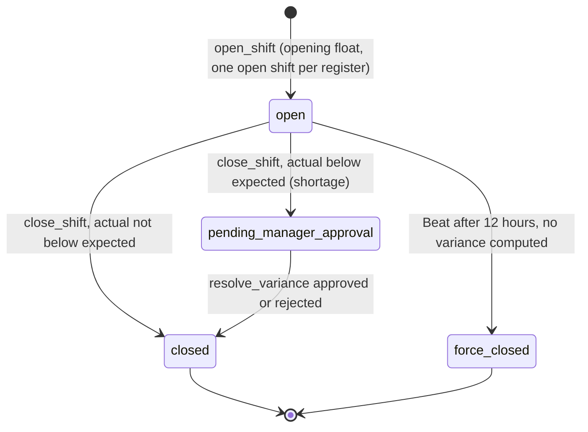

| Step | What happens | Evidence |
|---|---|---|
| Open | register active and in the actor's POS locations; one live shift (`LIVE` = open or pending approval) per person and register; the partial index is the race fallback; opening clears earlier force-close notices | `pos_service.py:403-433` |
| Movements | only `cash_in` / `cash_out`, amount above zero, note required, cash-out cannot exceed expected cash; sales and refunds write their own | `:467-496` |
| Expected cash | `opening_float + sale + cash_in + rounding_adjustment − refund − cash_out` | `_expected`, `:325` |
| Close | `variance = expected − actual` (positive = shortage). Shortage: `pending_manager_approval` plus `ApprovalRequest(shift_shortage)` addressed to «مدير الفرع» or «مدير المتجر»; otherwise `closed`. `version + 1`, audit `shift.close` | `:499-542` |
| Resolve | owner, `staff.manage`, or a manager role at the location; stale `version` gives 409; staff cannot resolve their own shortage; **approve and reject both end in `closed`**; the M18 queue calls `settle_shift_for_approval` so both screens agree | `:551-604`, `staff_service.py:912` |
| Force close | every 30 min, shifts still `open` after `SHIFT_MAX_DURATION_HOURS = 12` become `force_closed`, `version + 1`, notice `False`; no variance, `pending_manager_approval` shifts ignored | `tasks/operations.py:63-96` |

**Sale (`create_order`, `:1057`).** One transaction whose first statement claims the idempotency key (a repeat returns the first receipt with 200; a key used for another kind of write is 409). Then: lock the actor's open shift (a pending-approval shift **cannot sell**), price the cart under row locks, check discount permission and the role ceiling (above it: manager code or an approved `ApprovalRequest`), create the `Order` (`completed`, `paid`, `sales_channel='pos'`), one `OrderItem` per line with the discount allocated proportionally (the last line takes the remainder), deduct stock from the **register's location** with `_apply_delta(reason='sale')`, create the `PosReceipt` (`POS-{shift:04d}-{seq:03d}`) and, for **cash** only, a `sale` movement equal to the total.

**Refund (`refund`, `:1248`).** Needs `orders.refund` and an open shift (403 / 409); an amount above the refundable maximum is 400. Three wrong codes already used: 429, locked 15 minutes. Above `pos_refund_otp_threshold` (converted to the receipt currency) a 6-digit code is sent to the store's WhatsApp number and the answer is 428 `otp_required`; a wrong code is 400 with attempts left, 429 after the third. A valid code, inside one transaction, claims the key, consumes the OTP and runs `process_order_refund`; a cash receipt also writes a `refund` movement. The OTP is bound to receipt **and** amount (`pos_refund:{order}:{amount}`), lives 300 s, and a store may request 3 codes per 10 minutes per receipt.

### 4.9 Bookings: slot hold, book and cancel

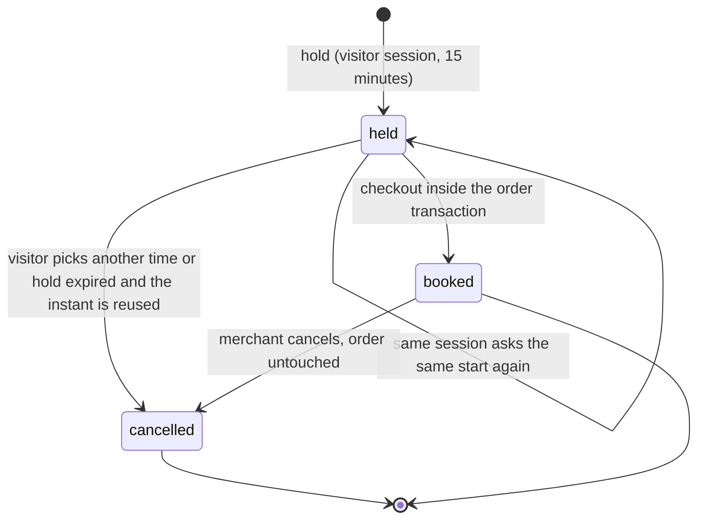

| Step | What happens | Evidence |
|---|---|---|
| Availability | no pre-generated rows: `day_slots` walks each active window in 30-minute steps in the **store** time zone, drops past starts and marks a candidate unavailable when a live row overlaps (`booked`, or `held` with `held_until` in the future) | `booking_service.py:132-175` |
| Hold | `POST catalog/products/<id>/slots/hold/`, no account. Product not bookable: 404; start unparsable or not on offer: 400; taken: 409; 10 live holds in the session: 429. A live hold of the same session on the same start is returned unchanged. An **expired** hold on the same instant is cancelled first (the partial unique index would refuse the insert); a concurrent insert raises `IntegrityError`, answered 409 | `:226-271` |
| Release | `release_slot_id` cancels that session hold and removes it from `cart_bookings` / `buy_now_bookings` | `_release`, `:273` |
| Book | checkout locks held slots, refuses when one is no longer `held` or past `held_until`, and in the order transaction sets `booked`, `order`, `held_until = NULL` | `checkout_service.py:417-424`, `:690-694` |
| Cancel | `bookings/slots/<id>/cancel/`: `cancelled`, audit `booking.cancel`, already cancelled is 409. The order is **not** cancelled or refunded; `order_effect` tells the merchant to review it | `:466-487` |

The database enforces "no two live rows for one product and **exact start instant**"; overlap of different starts is computed on read and re-checked by `hold` in its transaction. Expired holds are never swept: reads treat a `held` row past `held_until` as free.

> ⚠️ Discrepancy — roadmap implies a hold is released when it expires / code does: nothing changes the row at expiry. It stays `held` until the same product and start are held again (then `cancelled`) or the visitor releases it. A report that counts `held` rows without checking `held_until` over-counts.

## 5. Invariants

| # | Invariant | Enforced by | Where |
|---|---|---|---|
| 1 | One conversation per (channel, contact) | `unique_conversation_per_contact` plus savepointed `get_or_create` | `social_channels_inbox.py:35`, `tasks/channels.py:463-478` |
| 2 | A provider message is stored once | unique `Message.external_message_id` | `social_channels_inbox.py:91` |
| 3 | A double-clicked reply is sent once | unique `Message.client_id`; look first, then catch the race (200 with the first message) | `inbox_api_service.py:325-328`, `:362-368` |
| 4 | One order per conversation | row lock plus `order_id` re-check (409 «مرتبطة بالطلب») | `inbox_api_service.py:404-407` |
| 5 | A platform order becomes one local order | unique `(channel_code, external_order_id)`; order, stock and link roll back together on the race | `order_ingestion_service.py:238`, `order_pull_service.py:358-364` |
| 6 | Webhook identity comes from the bridge, never from the body | `ChannelSessionIndex` lookup after the signature check; `schema_name` from `connection.schema_name` | `bridge_service.py:14`, `webhooks_channels.py:88-91` |
| 7 | Credentials are encrypted and live only in the store schema | `django_cryptography.encrypt` on `config_encrypted` | `products/models/apps.py:58` |
| 8 | Outbound sends are checked at execution time | `is_effectively_active()` in the task, plus the limiter | `tasks/channels.py:365-385` |
| 9 | A listing is unique per product and variant, its seller SKU per market | two `UniqueConstraint`s | `marketplaces.py:102` |
| 10 | Job counters cannot double count | derived from `last_job_id` | `bulk_sync_service.py` |
| 11 | FBA / FBN orders never touch local stock | `deduct_stock = (fulfillment_model == 'merchant')` | `order_pull_service.py` |
| 12 | A pending marketplace order deducts stock once; a cancellation restores it once | `inventory_deducted` guard under `select_for_update` | `order_pull_service.py` |
| 13 | One connection per supplier code, one virtual location per supplier | unique `supplier_code`, `ensure_dropship_location` under a row lock, OneToOne `location` | `suppliers_dropship.py:29`, `connection_service.py:83` |
| 14 | Supplier product, variant and webhook event are unique | `uniq_supplier_product_ext`, `uniq_supplier_variant_ext`, `uniq_supplier_webhook_event` | `suppliers_dropship.py:264`, `:345`, `:594` |
| 15 | A fulfilment is sent to the supplier once | unique `idempotency_key`, OneToOne `fulfillment`, `record_submission` split from the call | `suppliers_dropship.py:625`, `order_forward_service.py:103`, `:293` |
| 16 | Supplier status never goes backwards | `RANK` map and row lock in `apply_result`; terminal rows ignore events | `order_forward_service.py:37`, `:318` |
| 17 | No network call inside a transaction (dropshipping, catalog sync) | structure of `forward_supplier_order`, `_sync_one_product` (a rule in the docstrings, not a runtime check) | `order_forward_service.py:225`, `catalog_sync_service.py:102` |
| 18 | The customer's address is not kept after the supplier order ends | `shipping_address` nulled at `delivered`, `cancelled`, `rejected` | `order_forward_service.py:345`, `:353`, `:380` |
| 19 | A supplier webhook is accepted only with this store's secret | HMAC over raw bytes before parsing; store from `bridge_token` | `webhooks_suppliers.py:41` |
| 20 | A sell price is never below cost plus minimum margin | `floor` and `apply_rounding` | `pricing_engine.py:97`, `:120` |
| 21 | One open shift per register | partial unique `unique_open_shift_per_register` | `staff_pos.py:33` |
| 22 | A pending-approval shift blocks the register and the person | `LIVE` check in the service (**not** in the DB; bypassed by the legacy open view, §3.4.1) | `pos_service.py:50`, `:414-421` |
| 23 | Drawer amounts are never negative | `cash_movement_amount_non_negative`; direction from `movement_type` | `staff_pos.py:92` |
| 24 | A POS write happens once per idempotency key | `PosIdempotencyKey.key` unique, claimed first; format `KEY_RE` | `pos_service.py:446`, `:61` |
| 25 | Shift state is optimistic-locked | `Shift.version` checked in `resolve_variance`, incremented by close and force close | `pos_service.py:558` |
| 26 | A large refund needs a one-time code bound to receipt and amount | hashed `OTPChallenge`, `_otp_ref`, 3 attempts, 15 min lock | `pos_service.py:1183`, `:1223` |
| 27 | A slot instant is held or booked by one party | partial unique `uniq_active_booking_slot_per_product_time` (409 on race) | `bookings.py:33` |
| 28 | An expired held slot cannot become an order | `select_for_update` plus status and `held_until` check | `checkout_service.py:417-424` |
| 29 | A visitor cannot exhaust the calendar | `MAX_LIVE_HOLDS_PER_SESSION = 10` (429) | `booking_service.py:40` |

## 6. Background work

Every merchant route answers from the database; workers do what must not happen inside a request: calls to Meta, TikTok, Telegram, SharwaConnect, Amazon, noon and the suppliers. Three conventions apply everywhere:

1. **No network call inside a transaction.** Services commit or read local state first, call the platform, then write the result in a short transaction.
2. **Per-store fan-out.** A Beat entry runs a *dispatcher* (`DISPATCHER_TASK_LIMITS`: soft 120 s, hard 180 s) that only lists stores and sends one `*_for_tenant` task per store (`TENANT_TASK_LIMITS`: soft 300 s, hard 360 s, `tasks/_common.py:28-31`) inside `schema_context`. The social-channel dispatcher lists the schema names of the public `ChannelSessionIndex`; the others iterate every tenant except `public`.
3. **Explicit queues per vendor**: `channels_meta`, `channels_tiktok`, `channels_telegram`, `whatsapp`, `channels_broadcast`, `marketplaces_amazon`, `marketplaces_noon`, `suppliers_sync`, `suppliers_orders`. Unrouted tasks run on `default`.

### 6.1 Beat entries owned by this domain

| Beat entry (`config/settings.py`) | Cron | What it does per store |
|---|---|---|
| `force-close-expired-shifts` (`:634`) | every 30 min | `open` shifts older than 12 h become `force_closed` (§4.8) |
| `check-channel-connection-health` (`:677`) | every 15 min | validate `meta_social_commerce`, `tiktok_shop`, `telegram_bot`; write `connection_health` and `last_health_check_at` into the encrypted config |
| `check-marketplace-connection-health` (`:683`) | minutes 7, 22, 37, 52 | same for Amazon and noon (offset from the other health checks) |
| `poll-marketplace-orders` (`:689`) | `1-59/5` | per connected market with `order_pull_enabled`: start an `order_pull` job unless one is active |
| `poll-fba-inventory` (`:695`) | minute 41 | read-only snapshot of marketplace-warehouse stock |
| `check-supplier-connection-health` (`:701`) | minutes 11, 26, 41, 56 | validate each connected supplier |
| `schedule-supplier-catalog-refresh` (`:706`) | minute 23 | catalog pull when `catalog_sync_interval_min` is due; price re-sync when `price_sync_interval_min` is due (the first pass only stamps the time, so a deploy does not reprice every store) |
| `fetch-scheduled-feeds` (`:711`) | minute 37 | download flat-feed URLs whose schedule is due |
| `schedule-supplier-inventory-sync` (`:717`) | `3-59/5` | inventory job after `max(inventory_sync_interval_min, adapter minimum, 15)`; re-enqueue unprocessed webhook events older than 5 minutes |
| `poll-supplier-orders` (`:722`) | minutes 9, 39 | poll active supplier orders, re-forward due `queued` orders, route paid orders no fulfilment covers |
| `purge-supplier-webhook-payloads` (`:727`) | 03:17 | clear payloads after 7 days, delete rows after 90 days |

**Not scheduled:** `archive_stale_conversations` (`tasks/channels.py:585`) moves `resolved` conversations idle for 90 days into the archive tables but no Beat entry runs it. Bookings need none (expiry is read-time, §4.9); marketplace ship confirmation starts on the shipment event (§4.5).

### 6.2 Event-driven tasks

| Task | Queue | Started by | Retry / idempotency |
|---|---|---|---|
| `process_inbound_channel_message`, `upload_inbound_channel_media_task` | `default` (`settings.py:577-578`) | `incoming_channel_message` signal | savepointed `get_or_create`, unique `external_message_id` |
| `dispatch_channel_message` | `CHANNEL_DISPATCH_QUEUE_MAP[channel]`, fallback `channels_meta` | `queue_outbound`, keyword and welcome replies | WhatsApp transient errors only, 5 retries, backoff up to 300 s; the rate-limit retry shares the 5 |
| `ingest_channel_order_task` | `default` | Meta and TikTok order webhooks | unique `(channel_code, external_order_id)` |
| `sync_channel_catalog`, `sync_channel_product`, `hide_channel_product_out_of_stock`, `show_channel_product_back_in_stock` | `default` | `run_sync`, `resync_product`, stock shield | per-product failure isolation; the link status is re-checked before calling |
| `dispatch_instagram_comment_auto_reply`, `dispatch_telegram_start`, `dispatch_telegram_callback` | `default` | Meta and Telegram webhooks | best effort |
| `push_marketplace_listing_task`, `bulk_push_marketplace_listings_task`, `poll_marketplace_feed_result_task`, `match_marketplace_listings_by_barcode_task`, `update_marketplace_price_quantity_task`, `pull_marketplace_orders_task`, `confirm_marketplace_shipment_task`, `refresh_fba_inventory_task` | `marketplaces_amazon` / `marketplaces_noon` | push route, product save (debounced 30 s), Beat, shipment events | self-chained chunks, Redis job lock per (store, market, job) for 300 s, counters derived from data |
| `pull_supplier_catalog_task`, `import_supplier_products_task`, `reprice_supplier_products_task`, `download_supplier_images_task`, `import_feed_task`, `fetch_feed_url_task`, `sync_supplier_inventory_task` | `suppliers_sync` | merchant action or Beat | chunked, resumable from a stored cursor |
| `route_supplier_order_task`, `forward_supplier_order_task`, `poll_supplier_order_task`, `cancel_supplier_order_task`, `process_supplier_webhook_task` | `suppliers_orders` | order signal, webhook, Beat, merchant | `idempotency_key`, row locks, forward-only status |

### 6.3 Cross-cutting guards

- **Rate limiting.** Social channels: Redis fixed window per (store, channel), default 80 per minute, fail-open. Marketplaces and suppliers share `marketplace_rate_limit.py`: a per-operation token bucket, a penalty factor 0.5 for 600 s after a 429, a circuit opening after 5 failures in 120 s for 300 s, and 3600 s after a re-authentication failure (`:90-96`).
- **Credentials gone.** A task that finds the installation inactive, expired or `reauth_required` fails the job with a fixed message (for example «السوق غير مرتبط أو يتطلب إعادة الربط.») and does nothing else; Beat skips a connection already in that state.
- **Webhook backlog.** If the broker is down when a supplier webhook arrives, the event row is already stored; the 5-minute repair re-enqueues it for up to a day.

## 7. Configuration

| Setting or env var | Default | Effect |
|---|---|---|
| `META_APP_ID`, `META_APP_SECRET` | empty | Facebook and Instagram OAuth; the secret also verifies webhook signatures and is **read once at import** (`tenants/webhooks_channels.py:27`): when empty every Meta webhook is refused with 403 |
| `TIKTOK_APP_KEY`, `TIKTOK_APP_SECRET` | empty | TikTok Shop OAuth and webhook signature (`channel_clients.py:135-136`, `webhooks_channels.py:28`) |
| `TELEGRAM_WEBHOOK_BASE_URL` | empty | origin used to register the bot webhook (`channel_clients.py:191`); fallback of `SUPPLIER_WEBHOOK_BASE_URL` |
| `SHARWA_CHANNELS_RATE_LIMIT_PER_MINUTE` | 80 | outbound sends per store and channel per minute (`channel_rate_limit.py:35`) |
| `WHATSAPP_CHANNEL_PROVIDER` | `sharwaconnect` (constant) | outbound WhatsApp provider (`settings.py:601`) |
| `AMAZON_SP_APP_ID`, `AMAZON_SP_LWA_CLIENT_ID`, `AMAZON_SP_LWA_CLIENT_SECRET` | empty | Login With Amazon consent and token exchange (`amazon_auth.py:52-54`); missing values make the connect route answer that settings are incomplete |
| `AMAZON_SP_OAUTH_BETA` | unset | `1` adds the beta flag to the consent URL (`amazon_auth.py:59`) |
| `NOON_MARKETPLACE_ADAPTER` | `fake` (`settings.py:606`) | `fake` keeps `FakeNoonAdapter`; any other value selects the real `NoonAdapter` |
| `CJ_API_BASE_URL` | `https://developers.cjdropshipping.com/api2.0/v1` (`:610`) | CJ endpoint, overridable for a sandbox |
| `SUPPLIER_ADAPTER_MODES` | empty, parsed from `cj:real,makhazen:fake` (`:614`) | per-supplier `real` or `fake`; defaults in `registry.py:67` |
| `SUPPLIER_WEBHOOK_BASE_URL` | empty (`:613`), falls back to `TELEGRAM_WEBHOOK_BASE_URL` | origin of the webhook URL shown to the merchant; with both empty only the path is shown, with a warning |
| `Feature` rows `social_channels`, `marketplaces`, `dropshipping`, `pos`, `bookings` (public `billing`) | per plan | plan gate of every route (§2.2) |
| Permissions `channels.inbox.access`, `channels.marketplaces.manage`, `channels.dropshipping.manage` | seeded by `0186`, `0194`, `0200` | M18 keys behind the three routes; POS uses `discounts.apply` and `orders.refund`; bookings use none |
| `StoreSetting.pos_refund_otp_threshold`, `pos_manager_code_hash` | 200.00; blank | refunds above the threshold need the WhatsApp code (`store_settings.py:335`); manager code set with `manage.py set_pos_manager_code`, never displayed (OI-09b) |
| `StoreSetting.timezone`, `week_start_day`, `usd_to_sar` | `Asia/Aden`, `sunday`, 3.75 | booking zone and calendar start (`store_settings.py:322`, `:326`); USD cost conversion in supplier pricing |
| Code constants | bookings: `HOLD_MINUTES = 15`, `SLOT_STEP_MINUTES = 30`, `MAX_LIVE_HOLDS_PER_SESSION = 10`; POS: `OTP_TTL_SECONDS = 300`, `OTP_MAX_ATTEMPTS = 3`, `OTP_LOCK_SECONDS = 900`, `OTP_SENDS_PER_WINDOW = 3`, `OTP_SEND_WINDOW = 600`, `MANAGER_CODE_MAX_FAILS = 5`, `MANAGER_CODE_LOCK_SECONDS = 900`; marketplaces: `FEED_CHUNK = 500`, `BULK_FEED_THRESHOLD = 20`, `MAX_FEED_POLLS = 14`, `FIRST_PULL_DAYS = 7`, `OVERLAP_MINUTES = 10`; dropshipping: `MAX_TRANSIENT_ATTEMPTS = 12`, `COST_ALERT_PCT = 30`, `WEBHOOK_MAX_ATTEMPTS = 5`, `MAX_FEEDS = 20` | not configurable at run time |

## 8. Failure modes and fixes

| Failure | Symptom and cause | Handling / fix |
|---|---|---|
| Meta or TikTok webhook refused | 403 `invalid_signature` on every call: `META_APP_SECRET` / `TIKTOK_APP_SECRET` empty (read at import) or wrong; the check fails closed | set the variable, restart web workers; the platform retries |
| Telegram webhook refused | 403 `invalid_secret`: stored per-bot `secret_token` differs from the header | reconnect the bot (registers a new secret) |
| Webhook accepted, nothing appears | 200 `unknown_channel_ignored`: no bridge row (never connected, disconnected, or another environment) | reconnect; the row is written at connect time |
| Customer message ignored | no conversation, `AppUsageLog` `skipped`: installation inactive when the task ran | reactivate; messages sent meanwhile are not replayed |
| Reply stays "sending" | `queued` for minutes: no worker on the channel queue, **or** the limiter used up the 5 retries (by reading the code, no handler then marks the row `failed`) | start the worker; keep bursts under the limit. Finding (not in the register) |
| Reply fails with the provider's reason | `failed` with `error_detail` (for example Meta's 24-hour window) | send a template or wait for the customer; no automatic resend |
| Reply refused / not allowed | 409 «القناة غير مربوطة — لا يمكن الردّ.» (channel disconnected) or 403 «لا تملك صلاحية الردّ على هذه القناة.» (`can_reply` false) | reconnect, or edit staff access |
| TikTok conversations never appear | the webhook handles orders only (§3.1.2) | use Meta, Telegram or WhatsApp for chat |
| Keyword save refused | `keyword` is unique across all channels | use another keyword |
| Meta products stay `error` | «لا يوجد ربط تصنيف لهذا المنتج على هذه القناة.»: no `ChannelCategoryMapping` and no Meta mapping screen (OI-02) | add the mapping through the legacy free-text screen |
| Catalog "last run" moves, nothing synced | `last_run_at` is stamped at request (§4.4) | read the task result in logs |
| Old resolved chats pile up | `archive_stale_conversations` has no Beat entry (§6.1) | schedule it or run it from a shell |
| Listing never leaves `needs_identifier` | no identifier, or the format check rejected it (400) | set it (`ID_PATTERNS`) or run barcode matching |
| Listings stuck `pending` after a bulk push | feed poll worker down; after 14 polls the feed is `timed_out` and listings become `failed` with «لم تُكمل أمازون معالجة الدفعة خلال المهلة — أعد النشر لهذه العروض.» | restore the worker, push again |
| Marketplace orders not imported | `order_pull_enabled` off, connection `reauth_required`, or no listing matches the lines (`NO_MATCHED_ITEMS`) | reconnect, or match the product; the order is imported at its next update |
| noon shows canned data | `NOON_MARKETPLACE_ADAPTER` is `fake` (default) | set it only when the real contract is available |
| Ship confirmation fails | 12 attempts used or ship-by passed (`shipment_confirm_service.py:42`) | `POST marketplaces/orders/<id>/confirm-shipment/` re-runs (409 if none failed or no tracking number) |
| Supplier order `held` | automatic forwarding off, or cash on delivery with `forward_cod_orders` off | review, then `send_now` |
| Supplier order `failed` | `ADDRESS`, `UNMAPPED`, `NOT_CONNECTED`, insufficient funds, schema drift or `MANUAL` | fix the address (re-queues), reconnect, top up, or ship manually |
| Supplier webhook rejected | 401 `invalid_signature`: secret rotated; at most 50 bad attempts stored per hour | rotate the webhook and give the supplier the new URL and secret |
| Supplier price jumps / pricing error | a move above 30 % is flagged, not applied; a currency other than SAR or USD without a fixed-rate rule raises a pricing error | review and reprice; set a rule with a fixed rate |
| Register busy / sale refused | 409 «الجهاز مشغول بوردية أخرى.» (a live shift exists); 409 «لا وردية مفتوحة لك على هذا الجهاز.» (no `open` shift; one waiting for approval cannot sell) | close it or have a manager resolve it; open a shift |
| Shift stuck waiting | nobody with «مدير الفرع» or «مدير المتجر» (or the owner) resolved it; force close ignores it | resolve from the M18 queue or the shift screen |
| Stale or own-shortage resolution | 409 «تغيّرت الوردية، أعد التحميل.», 409 «حُسم فرق هذه الوردية من مستخدم آخر.», 403 «لا يمكنك اعتماد عجز ورديتك.» | reload; another manager decides |
| Large refund | 428 `otp_required`, 400 with attempts left, then 429 «أُقفل الاسترجاع مؤقتاً بعد 3 محاولات خاطئة. حاول بعد 15 دقيقة أو راجع المدير.»; with no WhatsApp number «لا يوجد رقم واتساب مسجَّل للمتجر لإرسال رمز التحقق — راجع المالك.»; delivery failure 502 «تعذّر إرسال رمز التحقق إلى واتساب المتجر. حاول مرة أخرى.» | enter the code sent to the store's WhatsApp number |
| Idempotency key reused | 409 «مفتاح منع التكرار مستخدم لعملية أخرى.» | new key per action |
| Force-close notice shown again | cleared only by the next `open_shift` (Finding, not in the register) | open a shift |
| POS locked by plan | 403 `feature_disabled`, «ميزة نقطة البيع غير مفعّلة في خطتك.» | upgrade |
| Slot lost / too many holds | 409 «لم يعد هذا الموعد متاحاً.»; 429 «احتجزت مواعيد كثيرة في الوقت نفسه — أكمل الطلب أو أزل بعضها من السلة أولاً.» | choose another time; remove holds from the cart |
| Checkout refused for a booking | the 15-minute hold expired while the customer typed | choose the time again |
| Cancelled booking, order unchanged | by design: `cancel_slot` does not touch the order | refund from the order screen |

### 8.1 Tests

Counts are `grep -c '    def test_'` on each file in the staged copy of `sharwa_saas`, checked on 2026-10-29.

| File | Tests | Covers |
|---|---|---|
| `api/test_channels_api.py` | 10 | `test_gates`; `test_list_filters_and_channels`; `test_detail_patch_and_staff_visibility`; `test_messages_send_idempotent_template_product`; `test_dispatch_updates_the_same_message`; `test_inbound_reopens_and_records_platform`; `test_convert_to_order`; `test_channels_telegram_and_oauth`; `test_keywords_and_templates`; `test_catalog_sync_mapping_and_access` |
| `api/test_marketplaces_api.py` | 9 | `test_gates`; `test_hub_noon_connect_and_disconnect`; `test_amazon_oauth_start_not_configured`; `test_amazon_return_hook_pins_saudi`; `test_settings`; `test_listings_patch`; `test_push_and_jobs`; `test_trigger_jobs`; `test_orders_and_confirm_shipment` |
| `api/test_dropshipping_api.py` | 11 | `test_gates`; `test_connect_settings_webhook_disconnect`; `test_catalog_filters_import_and_inventory_sync`; `test_importing_status_is_computed_from_the_active_job`; `test_pricing_rules_crud_simulate_apply`; `test_feed_wizard_run_and_extra_fields`; `test_variant_mapping_and_link_schedule`; `test_supplier_orders_attention_and_resubmit`; `test_jobs_listing_csv_and_retry`; `test_meta`; and in `SupplierBeatIntervalTests` `test_catalog_interval_and_periodic_reprice` |
| `api/test_pos_api.py` | 17 | session and plan gate, context, cashier scope and ceiling, open-shift rules, idempotent movements, quote and sale, no shift no sale, barcode search, discount paths, refund and OTP (`test_refund_and_otp`, `test_refund_otp_lock`, `test_refund_permission`), overage close, shortage resolved on the device and from the approvals queue, `test_force_close_notice` |
| `api/test_bookings_api.py` | 9 | `test_gates`; `test_services_and_availability`; `test_buyer_slots_and_hold`; `test_expired_hold_is_freed`; `test_next_available_date`; `test_calendar_and_cancel`; `test_cart_booking_checkout_books_slot`; `test_remove_line_releases_hold`; `test_buy_now_is_isolated_from_cart_bookings` |
| `products/test_social_channels_phase1.py` to `phase8.py` | 8 + 15 + 6 + 10 + 14 + 23 + 27 + 20 = **123** | engine, bridge, webhooks; catalog sync and shield; templates and keywords; order ingestion; inbox and media; chat to order and RBAC; marketing and broadcast; analytics |
| `products/test_marketplaces_phase1.py` to `phase5.py` | 33 + 26 + 24 + 38 + 23 = **144** | foundation; matching, pricing, push; bulk feeds; order pull, FBA versus FBM; ship confirmation, FBA stock, multi-store |
| `products/test_dropshipping_phase1.py` to `phase5.py` | 68 + 69 + 34 + 45 + 38 = **254** | registry and connect; catalog, pricing, import; flat feed; inventory, webhooks, holds; order forwarding |
| `products/test_staff_pos.py` | 5 | original shift and drawer models, legacy views |

API suites total 56, legacy suites 526, grand total **582**. The five API counts match the roadmap (10, 9, 11, 17, 9). The roadmap gives no counts for the eight social-channel and five marketplace phase files (123 and 144 here) and does **not** mention the five `test_dropshipping_phase*` files (254 tests, the largest legacy suite of the domain) or `products/test_staff_pos.py` (5). `test_suppliers_*` files belong to procurement (Domain 10).

## 9. Open items

Register items are quoted **by id** and not redefined here; the register holds owner and status.

| Register id | Relevance to this page | Where |
|---|---|---|
| OI-02 | Meta catalog sync needs a category mapping that has no screen; TikTok categories are a static starter list of 8 entries (`channels_api_service.py:53-62`) | §3.1, §4.4, §8 |
| OI-05 | The pickup code is issued but no POS route verifies it | §4.8 |
| OI-08 | SMS and e-mail campaign channels have no provider; the channels here cover Meta, TikTok, Telegram and WhatsApp only | §3.1.2 |
| OI-09b | Superseded: the manager code and the 200 refund threshold are real settings (`store_settings.py:335-340`; `0229_pos_api`, `billing/0013_seed_pos_feature`). This page never repeats the development fallback | §3.4.2, §7 |
| OI-12 | The staff roster is checked at login only, so a cashier keeps working at the register after the rostered window | §4.8 |
| OI-14 | Trusted devices are not enforced: a POS sale or shift open does not check the device | §4.8 |
| KI-04 | Mock-aligned rule: the Next.js fixtures imitate Django, never the reverse; this page describes Django only (`../92-inconsistencies.md`) | whole page |

### 9.1 Discrepancies recorded on this page

Each is also marked ⚠️ in its section.

| # | Roadmap says | Code does | Section |
|---|---|---|---|
| D1 | The module list is five independent model sets | Channels, marketplaces and supplier webhooks share the public `ChannelSessionIndex`; channels and marketplaces share `ChannelOrderLink` | §1 |
| D2 | Marketplaces gate: feature first (module docstring) | `guard` checks the M18 key first, then the plan feature | §2.2 |
| D3 | Channels models arrive with `0231_inbox_api`; omits `ChannelOrderLink`, `ArchivedConversation`, `ArchivedMessage` | `0231` created one table and altered three; the omitted models exist | §3.1.1 |
| D4 | One UI code per channel (`meta · tiktok · telegram`, plus whatsapp) | The inbox uses `facebook · instagram · tiktok · telegram · whatsapp`; Facebook versus Instagram is `source_platform` | §3.1.2 |
| D5 | (not stated) | The inbox filter lists TikTok but no path creates a TikTok conversation | §3.1.2 |
| D6 | (not stated; `SALES_CHANNEL_CHOICES` lists four values) | The inbox writes `sales_channel='chat'`, removed from the choices by `0193` | §3.1.4 |
| D7 | `materialize_listings`, `compute_effective_price`, `set_identifier` listed with the model | They are service functions | §3.2.1 |
| D8 | `FEED_FIELDS (+6 fields)` | Two lists: 26 model keys and a 20-key contract tuple | §3.3.1 |
| D9 | Dropshipping tables come from `0232_dropshipping_api`; `DropshipForwardLog` omitted | `0232` adds four columns; tables are `0201`–`0205`; the log exists | §3.3.1 |
| D10 | Adapter registry: CJ real, Makhazen and Knawat fake, flat feed | Those are defaults that `SUPPLIER_ADAPTER_MODES` can override; the real Makhazen and Knawat classes are skeletons | §3.3.1 |
| D11 | Legacy `staff_pos.py` calls the same service | Two of four write views do; open and cash movement write models directly | §3.4.1 |
| D12 | Receipt number `POS-<shift>-<seq>` | Zero-padded, `POS-0007-003` | §3.4.1 |
| D13 | Hold 15 min as `BOOKING_HOLD_MINUTES` | Canonical name `HOLD_MINUTES`; the other is a legacy alias | §3.5.1 |
| D14 | Bookings: no migration | INT-036 added none, but `0077` created the tables | §3.5.1 |
| D15 | `Message.status` includes `delivered` and `read` | No code writes them | §4.2 |
| D16 | `ChannelCatalogSync.last_run_at` is the last sync | Stamped at request time | §4.4 |
| D17 | A booking hold is released at expiry | The row stays `held`; reads ignore it | §4.9 |

### 9.2 Findings (not in the register)

Observed while reading the code; none has a register id and this page registers none.

- `archive_stale_conversations` is not in Beat (§6.1).
- `ChannelOrderRoutingSettings.notify_on_status_change` is stored and echoed by the API but no code reads it to send a notification.
- A rate-limited send that uses up its 5 retries leaves the `Message` in `queued` (by code reading, §8).
- `Shift.approved_by` is set for a rejected shortage as well as an approved one.
- The force-close notice is cleared only by the next `open_shift` (§8).
- The database guarantees one live booking row per exact start instant only (§4.9).
- `ChannelProductLink` and `MarketplaceListing` unique constraints include a nullable `variant`; PostgreSQL treats NULLs as distinct, so for simple products uniqueness rests on `_write_link` and, for listings, on the seller-SKU constraint.
- `ConversationKeywordTrigger.keyword` is globally unique although the row carries a `channel_code`.
- `ChannelSessionIndex` serves three subsystems, so the channel health fan-out visits stores that only have a marketplace or supplier row.
- `compose_product_message` always prints the price in SAR, whatever the store currency.

## 10. Related pages

- Index and conventions: [`README.md`](README.md) · registers: [`../90-open-items.md`](../90-open-items.md) · [`../92-inconsistencies.md`](../92-inconsistencies.md) · security model: [`../30-security.md`](../30-security.md) · architecture index: [`../README.md`](../README.md)
- Data model siblings: [`08-finance.md`](08-finance.md) (Sharwa Pay, refunds used by the POS refund) · [`09-b2b.md`](09-b2b.md) (the page this one follows) · [`10-inventory-locations-procurement.md`](10-inventory-locations-procurement.md) (locations, `LocationInventory`, procurement `Supplier`) · [`11-shipping.md`](11-shipping.md) (`Fulfillment`, `assign_order_shipping`) · [`12-settings-staff-integrations.md`](12-settings-staff-integrations.md) (staff, roles, M18 approvals, `StoreSetting`) · [`15-reports.md`](15-reports.md) (sales-channel and traffic-source reporting) · [`16-platform-console.md`](16-platform-console.md) (public `Feature` and plan rows)
- Linked pages: [`04-orders-returns.md`](04-orders-returns.md) (`Order`, `OrderItem`, `Fulfillment` tables) · [`05-storefront.md`](05-storefront.md) (cart and checkout, booking hold hand-off) · [`14-apps-ai-support.md`](14-apps-ai-support.md) (app store, `StoreAppInstallation`, WhatsApp session bridge, SharwaConnect) · [`../91-legacy-surfaces.md`](../91-legacy-surfaces.md) (the legacy HTML screens of these five sub-domains) · [`../40-money.md`](../40-money.md) · [`../42-concurrency.md`](../42-concurrency.md) · [`../45-approvals.md`](../45-approvals.md) · [`../50-background-jobs.md`](../50-background-jobs.md); the module API pages under `docs/api/domains/13-channels-operations/` are separate tasks.
