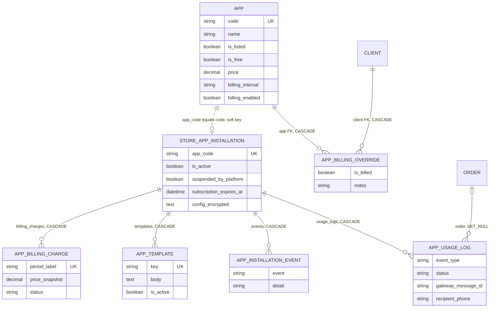
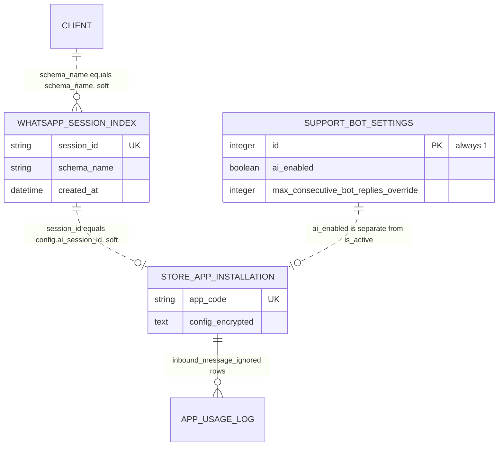
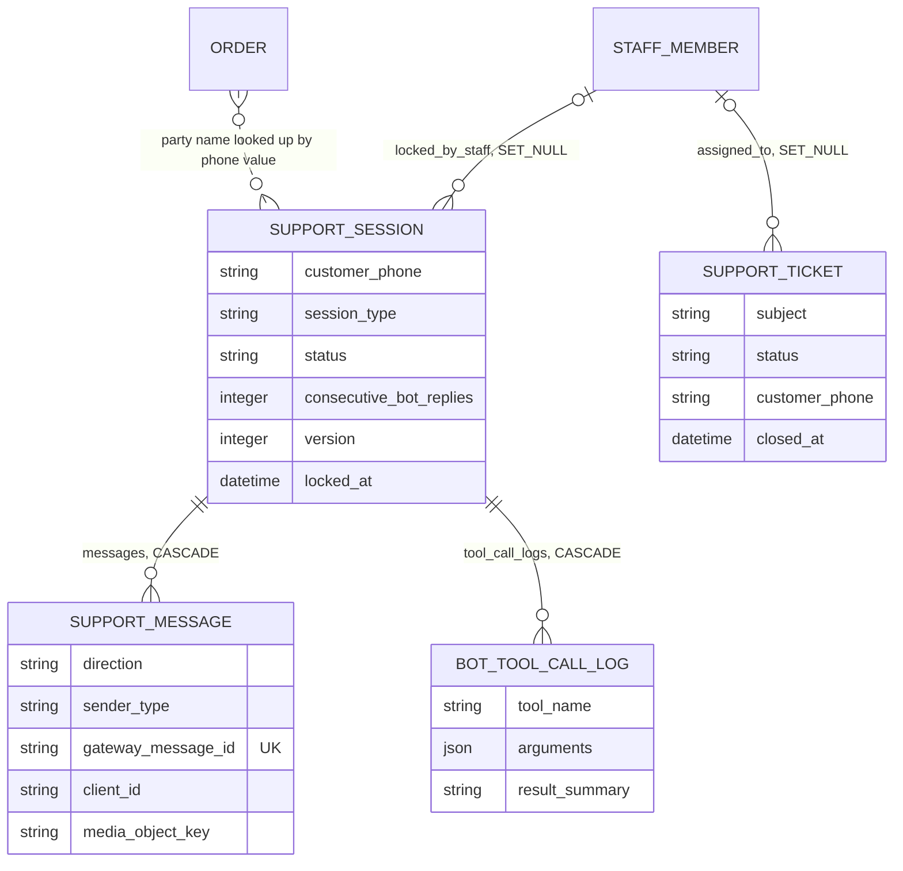
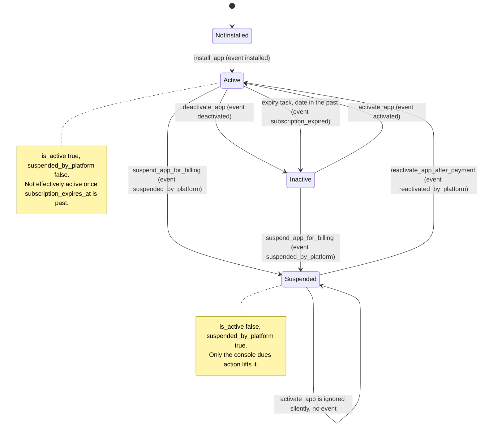
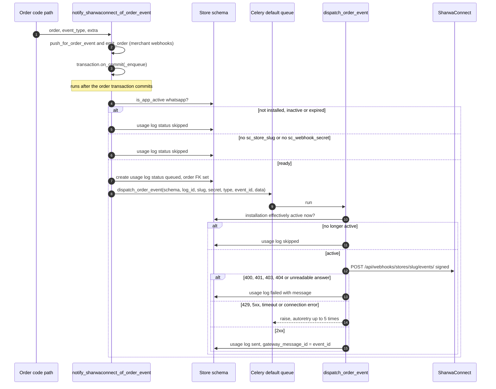
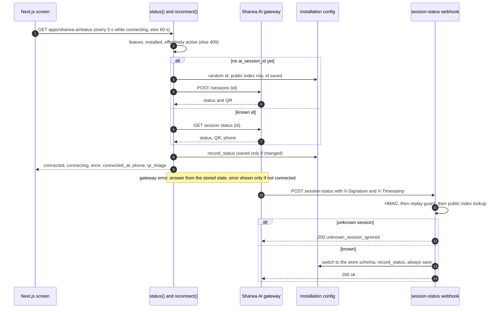
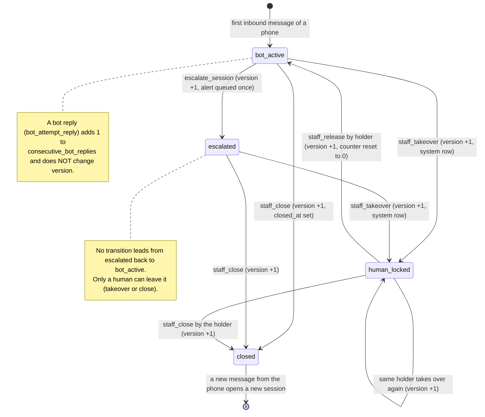

# Data model — Domain 14: app store, Sharwa AI and support

> **Source**: DOC-494 · inventory Domain 14 · INT-040 (M30), INT-041 (M31), INT-042 (M32)
> **Code**: `sharwa_saas/products/services/{apps_api_service,app_marketplace_service,template_service,sharwaconnect_client,sharwa_ai_api_service,sharwa_ai_client,sharwa_ai_sso,support_api_service,support_lock_service,ai_reply_service,ai_rate_limit,change_actor}.py` · `sharwa_saas/api/{views_apps,views_sharwa_ai,views_support}.py` · `sharwa_saas/appstore/models.py` · `sharwa_saas/products/models/{apps,billing,support,operations}.py` · `sharwa_saas/tenants/{models,webhooks,webhooks_ai,webhook_replay}.py` · `sharwa_saas/products/{order_events,whatsapp_service,signals_support}.py` · `sharwa_saas/products/tasks/{whatsapp,support,operations}.py` · `sharwa-frontend/src/features/{apps,support}/`
> **Last verified against code**: 2026-10-29 (step 50)

## 1. Purpose

Domain 14 is the part of the platform that lets a store **install apps**, link its **WhatsApp number to the Sharwa AI support bot**, and let people **take over the bot's conversations**. Three modules came online together in Phase 002 and share one engine: a platform-wide catalogue in the public schema, one installation row per app in each store schema, a small public bridge so that outside callbacks can find the right store, and a lock service that arbitrates between the bot and staff.

| Module | INT | Routes | What it stores | Engine |
|---|---|---|---|---|
| M30 App store | INT-040 | 12 | catalogue (`App`, `AppBillingOverride`), installation (`StoreAppInstallation`), lifecycle events, usage log, merchant templates, billing charges | `apps_api_service.py` over `app_marketplace_service.py`, `template_service.py`, `sharwaconnect_client.py`, `order_events.py` |
| M31 Sharwa AI | INT-041 | 4 | link state inside the installation's encrypted config, `SupportBotSettings`, the public `WhatsAppSessionIndex` | `sharwa_ai_api_service.py` over `sharwa_ai_client.py`, `sharwa_ai_sso.py`, `tenants/webhooks_ai.py` |
| M32 Support | INT-042 | 11 | `SupportSession`, `SupportMessage`, `BotToolCallLog`, `SupportTicket` | `support_api_service.py` over `support_lock_service.py`, `ai_reply_service.py`, `ai_rate_limit.py`, `tasks/support.py` |

This page is the **data model**: which tables exist, which schema each lives in, the constraint or index that enforces each rule, the migration that introduced it (§3), and the lifecycles that matter — the installation (§4.1), billing (§4.2), the order-event send path and its event map (§4.3), the template registry (§4.4), the Sharwa AI link and `record_status` (§4.5), support intake (§4.6), the session lock (§4.7) and the timeline merge (§4.8). Request and response shapes belong on the module API pages (`docs/api/domains/14-apps-ai-support/`, not in this copy of the repository), so they are not repeated here.

Not covered here: the console CRUD on `App` / `AppBillingOverride` and the dues screens ([`16-platform-console.md`](16-platform-console.md) §3.2, §4.4; this page records only the fields and `is_billed_for_client`), the wallet that `AppBillingCharge.collect()` debits ([`08-finance.md`](08-finance.md)), staff roles behind `support.takeover_session` ([`12-settings-staff-integrations.md`](12-settings-staff-integrations.md)), the channel, marketplace and supplier apps that reuse `StoreAppInstallation`, `AppUsageLog` and `AppTemplate` (Domain 13), and the Sharwa AI commerce routes and cart publisher (`config/urls_public.py:92-94`, `products/tasks/sharwa_ai.py`), whose service modules are not in the staged tree.

> ⚠️ Discrepancy — roadmap says outgoing WhatsApp goes through `dispatch_whatsapp_message` and `send_whatsapp_notification_async` as well as `notify_sharwaconnect_of_order_event` (DOC-255, "Celery" bullet) / code does: only the third is live. `send_whatsapp_notification_async` (`products/whatsapp_service.py:44`) has **no caller** anywhere in `sharwa_saas`; its task `dispatch_whatsapp_message` (`products/tasks/whatsapp.py:22-75`) reads `config['wa_session_id']`, a key **no code writes**, and then calls `sharwaconnect_client.send_message`, which raises unconditionally (`sharwaconnect_client.py:242-246`). The docstring of `notify_sharwaconnect_of_order_event` (`order_events.py:85`) itself describes the old `whatsapp_service` path as disabled and unused, kept on disk only. The live path is order event → `dispatch_order_event` (§4.3). Reported in step 50.

## 2. Components

### 2.1 Provider table (file → what it owns)

**M30 — app store**

| File | Lines | Owns |
|---|---|---|
| `products/services/apps_api_service.py` | 360 | the Next.js contract layer: catalogue and installation views (`app_view` `:105`, `list_apps` `:121`, `app_detail` `:139`), `install` `:158`, `toggle` `:167`, `events` `:179`, `charges` `:189`, WhatsApp `list_usage` `:227`, `usage_summary` `:258`, the template editor (`template_view` `:279`, `save_template` `:318`) and `connect_url` `:342`; the code translation `CONTRACT_CODES` `:28` and the event map `EVENT_SOURCES` `:36` |
| `products/services/app_marketplace_service.py` | 282 | the only lifecycle layer allowed to touch `StoreAppInstallation` / `AppUsageLog`: `install_app` `:41`, `activate_app` `:57`, `deactivate_app` `:83`, `suspend_app_for_billing` `:102`, `reactivate_app_after_payment` `:120`, `renew_subscription` `:137`, `log_app_usage` `:157`, `create_pending_usage_log` `:184`, `mark_usage_log_result` `:201`, `generate_billing_charge` `:232` |
| `products/services/template_service.py` | 111 | `TEMPLATE_REGISTRY` `:11` (12 entries) and `render_notification` `:94` |
| `products/services/sharwaconnect_client.py` | 443 | signed HTTP client to the SharwaConnect service: `create_store` `:135`, `connect_store` `:169`, `get_store_status` `:189`, `create_store_invite` `:204`, `send_order_event` `:261`, `send_custom_message` `:353`; `send_message` `:228` is reserved and raises |
| `products/order_events.py` | 170 | the single entry point for order events: `notify_sharwaconnect_of_order_event` `:85` |
| `products/tasks/whatsapp.py` | 164 | `dispatch_order_event` `:78` (live), `dispatch_whatsapp_message` `:22` (dormant), `dispatch_platform_event` `:129` (platform welcome events, no store) |
| `products/tasks/operations.py` | — | `check_expired_subscriptions` `:45` and its per-store task `:15` |
| `api/views_apps.py` | 129 | 12 DRF views and the gate chain `AppsAPIMixin.guard` `:34-42` |
| `products/models/apps.py`, `products/models/billing.py:89-154`, `appstore/models.py` | 238 / 154 / 134 | the seven M30 models (§3.2) |

**M31 — Sharwa AI**

| File | Lines | Owns |
|---|---|---|
| `products/services/sharwa_ai_api_service.py` | 238 | `status` `:124`, `reconnect` `:149`, settings `:182-222`, `console_token` `:226`, and the shared rule `record_status` `:67` |
| `products/services/sharwa_ai_client.py` | 77 | gateway client with its own key (`SHARWA_AI_GATEWAY_*`), never shared with SharwaConnect: `create_session` `:65`, `get_session_status` `:70`, `send_message` `:75` |
| `products/services/sharwa_ai_sso.py` | 120 | RS256 console token `issue_console_token` `:79`, JWKS `jwks` `:106` |
| `api/views_sharwa_ai.py` | 62 | 4 views, the console-token view adds the session-pin check `:54-58` |
| `tenants/webhooks_ai.py`, `tenants/webhook_replay.py` | 193 / 96 | the two public webhooks, HMAC check, replay guard, session-index lookup |
| `products/views/sharwa_ai_hub.py` | — | `_get_or_create_session_id` `:45-60`, the only writer of `WhatsAppSessionIndex` |

**M32 — support**

| File | Lines | Owns |
|---|---|---|
| `products/services/support_api_service.py` | 488 | session list, detail and timeline (`list_sessions` `:173`, `session_detail` `:281`), `session_action` `:311`, `session_reply` `:324`, tickets `:346-488`, redaction `:214` |
| `products/services/support_lock_service.py` | 198 | every state change of `SupportSession` under `select_for_update`: `staff_takeover` `:41`, `staff_release` `:70`, `staff_close` `:96`, `bot_attempt_reply` `:119`, `escalate_session` `:141`, `staff_send_reply` `:171` |
| `products/services/ai_reply_service.py` | 339 | DeepSeek function-calling engine: `generate_reply` `:295`, tools `get_order_status` `:100` and `search_products` `:131` |
| `products/services/ai_rate_limit.py` | 150 | Redis fixed-window limits and the circuit breaker |
| `products/services/change_actor.py` | 43 | `actor_label` `:35` (`None` = store owner) used for system rows, `sender_name` and `created_by` |
| `products/tasks/support.py`, `products/signals_support.py` | 353 / 46 | `process_support_inbound_message` `:29`, `notify_staff_of_escalation` `:233`, `send_staff_reply_message` `:299`, `deliver_staff_reply` `:341`; the signal receiver that starts the first one |
| `api/views_support.py` | 137 | 11 DRF views; writes need `support.takeover_session` (constant `TAKEOVER` at `:30`) |
| `products/models/support.py`, `products/models/operations.py:104` | 175 / — | `SupportSession`, `SupportMessage`, `BotToolCallLog`, `SupportBotSettings`, `SupportTicket` |

### 2.2 Routes by provider

All under `/api/v1/` (`api/urls.py:633-664`). The literal `apps/whatsapp/*` and `apps/sharwa-ai/*` routes are registered **before** `apps/<str:code>/` so the catch-all cannot swallow them (`urls.py:640-651`).

| Module | Method and path | View → service function | Gate beyond a signed-in session |
|---|---|---|---|
| M30 | `GET apps/` | `AppsView` → `list_apps` | plan feature `app_marketplace` |
| M30 | `GET apps/<code>/` | `AppDetailView` → `app_detail` | same |
| M30 | `POST apps/<code>/install/` (201) | `AppInstallView` → `install` | feature, **owner only** |
| M30 | `POST apps/<code>/activate/` · `deactivate/` | `toggle(code, True/False)` | feature, owner only |
| M30 | `GET apps/<code>/events/` · `charges/` | `events`, `charges` | feature |
| M30 | `GET apps/whatsapp/usage/` · `summary/` | `list_usage`, `usage_summary` | feature, WhatsApp installed and effectively active (409) |
| M30 | `GET apps/whatsapp/templates/` · `GET`/`PATCH apps/whatsapp/templates/<int:pk>/` | `list_templates`, `get_template`, `save_template` | feature, active; PATCH owner only |
| M30 | `GET apps/whatsapp/connect-url/` | `connect_url`, response `Cache-Control: no-store` | feature, active |
| M31 | `GET apps/sharwa-ai/status/` | `status` | feature, Sharwa AI installed and effectively active (409) |
| M31 | `POST apps/sharwa-ai/reconnect/` | `reconnect` | feature, owner only, active |
| M31 | `GET`/`PUT apps/sharwa-ai/settings/` | `get_settings`, `save_settings` | feature, active; PUT owner only |
| M31 | `POST apps/sharwa-ai/console-token/` | `console_token`, `no-store`, `Referrer-Policy: no-referrer` | feature, owner only, **session pinned to this store** |
| M32 | `GET support/sessions/` · `sessions/counters/` · `sessions/<int:pk>/` | `list_sessions`, `session_counters`, `session_detail` | none beyond the session |
| M32 | `POST support/sessions/<pk>/takeover/` · `release/` · `close/` | `session_action` | `support.takeover_session` |
| M32 | `POST support/sessions/<pk>/messages/` | `session_reply` (201 new, 200 duplicate) | `support.takeover_session` |
| M32 | `GET`/`POST support/tickets/` · `GET support/tickets/counters/` · `GET`/`PATCH support/tickets/<pk>/` · `GET support/assignees/` | ticket functions | none beyond the session |

The counts match the roadmap: 12 + 4 + 11.

### 2.3 Gate chains

| Module | Order of checks | Evidence |
|---|---|---|
| M30 | 401 «انتهت جلستك، سجّل الدخول مجدداً.» → feature `app_marketplace` 403 «متجر التطبيقات غير مفعّل في خطتك.» → write by a staff-attached session 403 «إدارة التطبيقات لمالك المتجر فقط.» → for WhatsApp rows, installed and not suspended and effectively active else 409 «تطبيق الواتساب غير مثبَّت أو غير مفعّل.» | `views_products.py:72-79`, `views_apps.py:34-42`, `apps_api_service.py:201-205` |
| M31 | the M30 chain, then 409 «شروة AI غير مثبَّت أو غير مفعّل.»; the console token additionally needs `session['auth_tenant_schema']` equal to this store's schema (401 otherwise) | `views_sharwa_ai.py:26-62`, `sharwa_ai_api_service.py:29,51-55` |
| M32 | 401 → for the four writes, `support.takeover_session` 403 «ليست لديك صلاحية استلام جلسات الدعم.» (the owner holds it implicitly, `can()` `views_products.py:81-83`); **no plan feature**, tickets are open to every signed-in user | `views_support.py:29-52` |

The feature row is the public `billing.Feature` with code `app_marketplace`; `settings_feature_enabled` returns false when no such row exists (`api/views_settings.py:32-38`), so a database without that row answers the whole of M30 and M31 with the 403 above. The staged `billing/migrations/` holds only `0013_seed_pos_feature.py`, so where this row is seeded could not be verified (§9).

### 2.4 Public callbacks and keys

| Route (`config/urls_public.py`) | Handler | Used by |
|---|---|---|
| `webhooks/sharwaconnect/` `:62` | `tenants/webhooks.py:195` `sharwaconnect_webhook` | SharwaConnect: `message.status`, `session.status`, `message.received` |
| `webhooks/sharwa-ai/session-status/` `:64` | `tenants/webhooks_ai.py:99` | the Sharwa AI gateway: link state |
| `webhooks/sharwa-ai/inbound-message/` `:65` | `tenants/webhooks_ai.py:139` | the Sharwa AI gateway: customer messages, the entry of support (§4.6) |
| `.well-known/sharwa-ai-jwks.json` `:96` | `products/views/sharwa_ai_sso.py:69` `sharwa_ai_jwks`, `Cache-Control: public, max-age=300`, `{"keys": []}` with 503 when SSO is not configured | the engine, to verify console tokens |

These land on the public schema first because only the platform domain is registered with outside providers; the handler then **switches** to the store schema named by the trusted index row (§3.1).

### 2.5 Legacy HTML surfaces kept

The Django-rendered dashboard still serves the same data and several writers. They are not removed; the API and the HTML share the services above.

| Surface | Routes (`config/urls_tenant.py`) | Notes |
|---|---|---|
| Store app list | `dashboard/apps/` `:736` → `views/apps.py` `app_marketplace_view` | **hard-coded two-app catalogue** (`whatsapp`, `sharwa_ai`), not read from `appstore.App` |
| WhatsApp app | `dashboard/apps/whatsapp/` `:475` plus `install` `:476`, `disable` `:477`, `enable` `:478`, `open-sharwaconnect` `:482`, `qr/start` `:483`, `qr/poll` `:484`, `logs` `:485`, `templates` `:486` | the QR-pairing proxy (`whatsapp_qr_start` `views/apps.py:360`, `whatsapp_qr_poll` `:413`) is superseded by the SharwaConnect panel but still reachable; `whatsapp_open_sharwaconnect` `:315` registers the store once and activates the app on success |
| Sharwa AI app | `dashboard/apps/sharwa-ai/` `:490` plus `connect` `:488`, `poll` `:489`, `settings` `:491`, `enable` `:492`, `disable` `:493`, `console` `:495` | `sharwa_ai_connect_view` installs the app implicitly (`install_app`); the HTML poll returns the gateway answer and stores nothing |
| Support sessions | `dashboard/support-sessions/` `:460` plus detail, `takeover`, `release`, `reply`, `poll` `:461-465` | no `close` route in HTML; these callers pass no `expected_version` |
| Support tickets | `dashboard/support-tickets/` `:303` → `views/operations.py:44` `support_tickets_view` | sets `created_by` and `closed_at` the same way the API does (`:60`, `:69-73`) |

## 3. Data model

### 3.1 Schema placement

django-tenants splits the models by app. `appstore` is a **shared** app (`config/settings.py:134`, inside `SHARED_APPS` `:121`), so the catalogue is one set of rows for the whole platform. `products` is a **tenant** app (`TENANT_APPS` `:152`, products at `:157`), so every store schema owns its own installation, usage, billing and support tables. `tenants` is shared as well; `WhatsAppSessionIndex` is the one bridge table both worlds need.

| Schema | Table (physical name) | Model | Why there |
|---|---|---|---|
| public | `tenants_app` | `appstore.App` | platform catalogue; the table kept its pre-split name through `db_table` (`appstore/models.py:81`), and `tenants/0016` moved only the Django state, so no row was copied |
| public | `tenants_appbillingoverride` | `appstore.AppBillingOverride` | per-store price exception; FK to `tenants.Client` (also public) |
| public | `tenants_whatsappsessionindex` | `tenants.WhatsAppSessionIndex` | maps an outside session id to a store schema, so a public webhook knows which schema to enter |
| public | `billing_feature` | `billing.Feature` (code `app_marketplace`) | plan gate for M30 and M31; read-only here, see §2.3 |
| store | `products_storeappinstallation` | `StoreAppInstallation` | one row per installed app per store; holds the encrypted config |
| store | `products_appusagelog` | `AppUsageLog` | one row per message or event handled for an app |
| store | `products_appinstallationevent` | `AppInstallationEvent` | lifecycle history of one installation |
| store | `products_apptemplate` | `AppTemplate` | merchant-edited message text, keyed by `TEMPLATE_REGISTRY` key |
| store | `products_appbillingcharge` | `AppBillingCharge` | one invoice per installation and period |
| store | `products_supportsession` | `SupportSession` | one conversation thread per customer phone |
| store | `products_supportmessage` | `SupportMessage` | every in or out message, bot, staff or system |
| store | `products_bottoolcalllog` | `BotToolCallLog` | audit row per tool call made by the bot |
| store | `products_supportbotsettings` | `SupportBotSettings` | store-wide bot switch, singleton `pk=1` |
| store | `products_supportticket` | `SupportTicket` | internal or customer ticket, not tied to a session |

Table names for the `products` models are Django's defaults (none of these classes sets `db_table`). Adjacent but outside this page: `products_whatsappmessagecostlog` (`WhatsAppMessageCostLog`, `products/models/operations.py`), which only the dormant `whatsapp_service.py:93` writes (§4.3).

**No foreign key crosses the schema line.** The soft links are:

| From (store schema) | To (public) | Link | Consequence |
|---|---|---|---|
| `StoreAppInstallation.app_code` | `App.code` | equal text | an installation survives the catalogue row being delisted or even deleted; `list_apps` keeps showing an installed app that was unlisted (`apps_api_service.py:121-128`) |
| `AppBillingCharge.app_name_snapshot`, `price_snapshot`, `currency` | `App.name`, `price`, `currency` | copied at generation | later price changes never rewrite an old charge |
| `config['ai_session_id']` | `WhatsAppSessionIndex.session_id` | equal random text | the store schema never appears in the outside project (§3.4) |
| (public) `WhatsAppSessionIndex.schema_name` | `Client.schema_name` | equal text, 63 chars | a deleted store leaves a dead index row; the webhook would then enter a schema that no longer exists |

### 3.2 Model table

**Catalogue (public)**

| Model | Fields (type, limits, default) | Constraints and indexes | Introduced |
|---|---|---|---|
| `App` `appstore/models.py:18` | `code` char(50) unique, indexed; `name` char(100); `description` text; `icon` image (blank); `icon_name` char(40) blank; `is_listed` bool, default true, indexed; `is_free` bool, default true, indexed; `price` decimal(10,2), default 0.00; `currency` char(10), default SAR, choices from `sharwapay.constants.WALLET_CURRENCY_CHOICES`; `billing_interval` char(10), `monthly` or `yearly`, default `monthly`; `billing_enabled` bool, default false, indexed; `created_at`, `updated_at` | unique `code`; ordering by `name`; method `is_billed_for_client(client)` `:89` | `tenants/0009_app` (2026-09-07), prices `tenants/0014` (2026-09-08), `icon_name` `appstore/0007` |
| `AppBillingOverride` `:111` | `app` FK CASCADE (`billing_overrides`); `client` FK `tenants.Client` CASCADE (`app_billing_overrides`); `is_billed` bool (no default, so always explicit); `notes` char(255) blank; `created_at` | unique `unique_app_billing_override_per_client` on (`app`, `client`) `:130` | `tenants/0014` |

`is_billed_for_client` is the single pricing decision and its order matters: an override row wins first (true forces payment even for a free app, false exempts a store when pricing is on for everyone), then `is_free` answers false, and only then does the global `billing_enabled` decide. The docstring records a 2026-09-09 fix: before it, `is_free` was checked first and silently defeated an explicit override. Both switches default to off, so a fresh database bills nobody.

**Installation and usage (store)**

| Model | Fields | Constraints and indexes | Introduced |
|---|---|---|---|
| `StoreAppInstallation` `products/models/apps.py:7` | `app_code` char(50) unique, indexed; `is_active` bool, default false, indexed; `suspended_by_platform` bool, default false, indexed; `installed_at` datetime null; `subscription_expires_at` datetime null (null means no end); `config_encrypted` encrypted text, default `{}`; `created_at`, `updated_at` | unique `app_code` (the only guard, so code must use `get_or_create`); methods `config` `:70`, `set_config` `:79`, `is_effectively_active` `:86-99` | `products/0097` (2026-09-07); `suspended_by_platform` `0104`, `0105` (2026-09-09) |
| `AppUsageLog` `:102` | `installation` FK CASCADE (`usage_logs`); `event_type` char(50) indexed; `recipient_phone` char(20) null, indexed; `status` char(10), choices below, indexed; `error_detail` char(255) null; `gateway_message_id` char(100) null, indexed; `order` FK `Order` SET_NULL null (`app_usage_logs`); `created_at` indexed | indexes (`installation`, `created_at`) and (`installation`, `status`, `created_at`) `:166-169`; ordering `-created_at` | `0097`; `gateway_message_id` and the extra statuses `0098`; `order` `0233_app_store_api` |
| `AppInstallationEvent` `:175` | `installation` FK CASCADE (`events`); `event` char(30), choices below, indexed; `detail` char(255) null; `created_at` indexed | ordering `-created_at` | `0099` |
| `AppTemplate` `:207` | `installation` FK CASCADE (`templates`); `key` char(50) indexed; `body` text; `is_active` bool, default true; `updated_at` | unique `unique_app_template_per_key` on (`installation`, `key`) `:232-234` | `0099` |
| `AppBillingCharge` `products/models/billing.py:89` | `installation` FK CASCADE (`billing_charges`); `app_name_snapshot` char(100); `period_label` char(20); `price_snapshot` decimal(10,2); `currency` char(10), default SAR; `status` char(10), default `pending`, indexed; `created_at` indexed; `collected_at` null; `notes` char(255) blank | unique `unique_app_charge_per_period` on (`installation`, `period_label`) `:124-126`; method `collect()` `:131-154` | `0102` (2026-09-08) |

Choice codes: `AppUsageLog.status` is `queued`, `sent`, `delivered`, `read`, `failed`, `skipped`; `AppInstallationEvent.event` is `installed`, `activated`, `deactivated`, `subscription_renewed`, `subscription_expired`, `suspended_by_platform`, `reactivated_by_platform`; `AppBillingCharge.status` is `pending`, `collected`, `waived`. The stored labels are Arabic and live in the model classes.

`AppUsageLog.event_type` is free text (50 characters) and is **not** constrained to the contract names: the live writer stores the raw order-event type (`ORDER_CREATED`, `PAYMENT_RECEIVED`, …), the dormant path stored `order_new`-style keys, and the Sharwa AI webhook stores `inbound_message_ignored`. The contract translation happens on read (§3.5).

**Support (store)**

| Model | Fields | Constraints and indexes | Introduced |
|---|---|---|---|
| `SupportSession` `products/models/support.py:17` | `customer_phone` char(20) indexed; `session_type` char(20), `customer` / `affiliate` / `staff_internal`, default `customer`; `status` char(20), default `bot_active`, indexed; `consecutive_bot_replies` uint, default 0; `context_summary` text, default empty; `created_at`, `updated_at`, `closed_at` null; `locked_by_staff` FK `StaffMember` SET_NULL null (`locked_support_sessions`); `locked_at` null; `version` uint, default 1 `:59` | index (`customer_phone`, `status`); partial unique `one_active_support_session_per_customer` on `customer_phone` where status in `bot_active`, `human_locked`, `escalated` `:65-72` | `0180` (2026-09-18); lock fields `0181`; `version` `0234_support_api` |
| `SupportMessage` `:78` | `session` FK CASCADE (`messages`); `direction` char(3), `in` / `out`; `sender_type` char(15), `customer` / `bot` / `staff` / `system`; `raw_text` text; `sender_name` char(150); `client_id` char(64) null `:91`; `media_object_key` char(500) null; `media_type` char(20); `gateway_message_id` char(100) **unique**, null, indexed `:101`; `created_at` indexed | index (`session`, `created_at`); conditional unique `support_message_client_id_once` on (`session`, `client_id`) where `client_id` is not null `:109-114` | `0180`; media `0183` (2026-09-19); `sender_name`, `client_id` and the constraint `0234` |
| `BotToolCallLog` `:120` | `session` FK CASCADE (`tool_call_logs`); `tool_name` char(50); `arguments` JSON, default `{}`; `result_summary` char(500); `created_at` | ordering `-created_at`; written and never edited | `0184` |
| `SupportBotSettings` `:137` | `ai_enabled` bool, default true; `max_consecutive_bot_replies_override` uint null; `updated_at` | `save()` forces `pk=1` `:161`; `load()` is `get_or_create(pk=1)` `:165` | `0185` (2026-09-19) |
| `SupportTicket` `operations.py:104` | `customer_phone` char(20) blank, indexed; `subject` char(255); `description` text; `status` char(15), `open` / `in_progress` / `closed`, default `open`, indexed; `opened_at`; `updated_at`; `created_by` char(150); `closed_at` null; `assigned_to` FK `StaffMember` SET_NULL null (`support_tickets`) | ordering `-opened_at`; no uniqueness, no version column | `0175_operations`; `description`, `updated_at`, `created_by` and the relaxed `customer_phone` `0234` |

Choice codes: `SupportSession.status` is `bot_active`, `human_locked`, `escalated`, `closed`; `SupportTicket.status` is `open`, `in_progress`, `closed`.

Points that are easy to misread:

- `SupportSession.locked_by_staff` NULL **with** status `human_locked` means the **store owner** holds the lock; the owner has no `StaffMember` row (`support.py:50` help text). Every identity comparison in the lock service therefore uses `getattr(staff, 'id', None)`, so `None == None` is a match for the owner.
- `SupportMessage.gateway_message_id` is a *global* unique inside the store schema, so the same gateway id can never be stored twice even across two sessions. It is also the only database-level duplicate guard for inbound text (§4.6).
- `SupportMessage.client_id` is the client's own idempotency key for staff replies. Gateway inbound rows leave it NULL, which the conditional constraint ignores.
- `SupportTicket` was built in Phase B as a CRM entity (`operations.py:104`) and is reported by the average-close-time report (`closed_at − opened_at`); the M32 API reuses it and does not know `SupportSession`.
- `SupportSession.context_summary` is a diagnostic string, not an AI summary: `generate_reply` overwrites it with the last exchange truncated to 100 characters each side (`ai_reply_service.py:329-336`).

### 3.3 `StoreAppInstallation.config` keys

The column is an encrypted JSON object (`django_cryptography.fields.encrypt`, key `CRYPTOGRAPHY_KEY`, required and independent of `SECRET_KEY`: `config/settings.py:41-47`). Everything below lives inside that one blob. `config` returns `{}` on corrupt or empty JSON, and every writer does read, change, `set_config`, `save(update_fields=['config_encrypted','updated_at'])` **without a row lock**, so two near-simultaneous writers (poll and webhook, §4.5) can overwrite each other's keys.

| App code | Key | Written by | Read by | Meaning |
|---|---|---|---|---|
| `whatsapp` | `sc_store_slug` | `_get_or_register_sc_store` (`views/apps.py:273`) | `order_events._enqueue_unsafe`, `connect_url`, legacy dashboard | the store's SharwaConnect slug, `sharwa-<schema_name>` |
| `whatsapp` | `sc_webhook_secret` | same function, from the `create_store` answer, shown once | `order_events._enqueue_unsafe`, then `dispatch_order_event` | HMAC secret used to **sign** outgoing order events; not used to verify incoming webhooks (§4.3) |
| `whatsapp` | `wa_session_status` | `_handle_session_status_event` (`webhooks.py:297`), legacy QR views | legacy dashboard, `dispatch_whatsapp_message` | last connection state, upper case |
| `whatsapp` | `connected_phone_number` | legacy QR views (`views/apps.py:385-387`, `:451-452`) | legacy dashboard | popped by the webhook handler on `DISCONNECTED` or `SESSION_EXPIRED` |
| `whatsapp` | `wa_session_id` | **nothing** | `dispatch_whatsapp_message` (`tasks/whatsapp.py:54`) | read, never written (§1 discrepancy) |
| `sharwa_ai` | `ai_session_id` | `_get_or_create_session_id` (`sharwa_ai_hub.py:45`) | status, reconnect, tasks that send to customers | random id, `secrets.token_urlsafe(24)`, 32 characters |
| `sharwa_ai` | `wa_session_status` | `record_status` | `_status_view` | normalised: any of five connected-like words becomes `CONNECTED` |
| `sharwa_ai` | `ai_connected_at` | `record_status`, first time connected | `_status_view` | ISO time, kept while connected, dropped on a failure state |
| `sharwa_ai` | `connected_phone_number` | `record_status` when the gateway gives a phone | `_status_view` | dropped on a failure state |

The tenants' two apps share the key name `wa_session_status` but never the same blob (each app has its own installation row), and the SharwaConnect handler upper-cases without normalising, whereas the Sharwa AI one collapses `ACTIVE`, `READY`, `OPEN` and `AUTHENTICATED` into `CONNECTED`.

### 3.4 Session identity: why `WhatsAppSessionIndex` exists

Outside providers know exactly one host (the platform domain), so their callbacks land on the **public** schema, where `StoreAppInstallation` does not exist. The index is the key that takes a callback from `session_id` to the schema to enter.

| Column | Type | Rule |
|---|---|---|
| `session_id` | char(100) unique, indexed | for Sharwa AI always `secrets.token_urlsafe(24)`, never the schema name (isolation barrier: the outside project must not learn internal schema names) |
| `schema_name` | char(63) indexed | taken from `connection.schema_name` in the request, never from user input (`sharwa_ai_hub.py:52-54`) |
| `created_at` | auto | — |

The only writer in the staged code is `_get_or_create_session_id` (grep across `sharwa_saas` finds `WhatsAppSessionIndex.objects.create` once), under `schema_context('public')`. The row is created **before** the config is saved, so a crash in between leaves an unused index row but never a store with an id the webhook cannot resolve. The Django admin class (`tenants/admin.py:279`) is read-only: add and change are disabled, delete is the only edit.

> Observation — the model docstring (`tenants/models.py:162`) and the admin docstring (`tenants/admin.py:279`) say the index is filled when a WhatsApp session is created in `views/apps.py::whatsapp_qr_start`. The code does not: that view never touches `WhatsAppSessionIndex`, and nothing in `sharwa_saas` writes a row for the SharwaConnect (`whatsapp`) path. The SharwaConnect webhook (`webhooks.py:228`) resolves its payload `session_id` through the same table, so unless a row was inserted by hand or SharwaConnect sends a Sharwa AI session id, its `message.status`, `session.status` and `message.received` events are answered `200 unknown_session_ignored` (§4.3, §8). How SharwaConnect keys its `session_id` is not visible in the staged tree.

### 3.5 Contract-code map: `whatsapp_bot` ⇄ `whatsapp`

The Next.js contract calls the WhatsApp app `whatsapp_bot`; the database, every task and every legacy view call it `whatsapp`. Only one code differs.

| Direction | Where | Rule |
|---|---|---|
| Output (model to contract) | `_contract(code)` `apps_api_service.py:67-68`, used by `app_view` `:105` | `CONTRACT_CODES = {'whatsapp': 'whatsapp_bot'}` `:28`; any other code passes through, so `sharwa_ai` stays `sharwa_ai` |
| Input (contract to model) | `_model(code)` `:71-72`, used by `_platform_app` `:85` and `_app_or_404` `:131` | `MODEL_CODES` is the inverted dict `:29`; an unknown code passes through and then fails the catalogue lookup with 404 |
| Hard-coded WhatsApp calls | `_whatsapp()` `:201` | uses the constant `WHATSAPP = 'whatsapp'` `:27` directly, so the literal routes `apps/whatsapp/*` need no translation |
| Usage log event names | `EVENT_SOURCES` `:36-45` and `EVENT_OF` `:47` | output only, see below |

Because the URL has the literal segment `whatsapp` for usage, summary, templates and connect-url, but the catalogue and install routes use `<code>`, the frontend calls `POST apps/whatsapp_bot/install/` and `GET apps/whatsapp/usage/` for the same app. The literal routes are registered first (`api/urls.py:640-651`); `apps/whatsapp_bot/` is reached through the `<str:code>` route and translated by `_model`.

Event-name map, **contract name ← stored `event_type` values** (`EVENT_SOURCES` `apps_api_service.py:36-45`). A stored value that is in no list is shown as `manual` (`usage_view`: `EVENT_OF.get(log.event_type, 'manual')` `:211`).

| Contract `event_type` | Stored values accepted when filtering | Writer in current code |
|---|---|---|
| `order_new` | `order_new`, `ORDER_CREATED` | `ORDER_CREATED` from `checkout_service.py:837` |
| `order_shipping_update` | `order_shipping_update`, `ORDER_SHIPPED` | `ORDER_SHIPPED` from `views/shipping.py:246` only (legacy view) |
| `order_delivered` | `order_delivered`, `ORDER_DELIVERED` | `order_api_service.py:460`, `merchant_dashboard.py:1440`, `suppliers/order_forward_service.py:440` |
| `order_cancelled` | `order_cancelled`, `ORDER_CANCELLED` | `order_api_service.py:462`, `:512`, `merchant_dashboard.py:1444`, `:1553` |
| `payment_confirmed` | `payment_confirmed`, `PAYMENT_RECEIVED` | `order_api_service.py:486`, `:501`, `merchant_dashboard.py:1527` |
| `payment_failed` | `payment_failed` | none; no live event type exists for it |
| `abandoned_cart_reminder` | `abandoned_cart_reminder` | none in this domain |
| `otp` | `otp` | none through this app |
| `manual` | `manual` (also the fallback for any unmapped value) | `whatsapp_service` default, dormant |

Note that `inbound_message_ignored` (written for `sharwa_ai`) is outside the WhatsApp usage list entirely: `list_usage` and `usage_summary` filter on the WhatsApp installation only (§4.2).

### 3.6 Seeded catalogue

Eleven `App` rows are seeded by migrations. All start listed, free and unpriced (`is_free` true, `billing_enabled` false, `price` 0).

| `code` | Seeded by | Domain | Name seeded |
|---|---|---|---|
| `whatsapp` | `tenants/0009_app` | 14 | «الواتساب» |
| `sharwa_ai` | `appstore/0002_seed_sharwa_ai` | 14 | «الدعم الفني الذكي — Sharwa AI» |
| `meta_social_commerce`, `tiktok_shop`, `telegram_bot` | `appstore/0003` | 13 | per migration |
| `amazon_marketplace`, `noon_marketplace` | `appstore/0004` | 13 | per migration |
| `supplier_cj`, `supplier_makhazen`, `supplier_knawat`, `supplier_flat_feed` | `appstore/0005` | 13 | per migration |

`GET apps/` returns **all** of these (the query is `App.objects.filter(is_listed | installed)`), not just the two of this domain. The seed migrations do not set `icon_name` (added later by `appstore/0007` with an empty default), so each card falls back to `DEFAULT_ICON = 'package'` (`apps_api_service.py:31`) until the console edits the row. The legacy dashboard page, by contrast, never reads this table (§2.5).

### 3.7 Entity relationships

**A. Catalogue, installation, usage and billing**



`APP`, `APP_BILLING_OVERRIDE` and `CLIENT` are public; the other six entities exist once per store schema. The dotted line is the soft key of §3.1.

**B. The Sharwa AI link and the public bridge**



`is_active` on the installation answers whether the app exists in the store at all; `SupportBotSettings.ai_enabled` answers whether the bot may reply inside sessions. Neither changes the other (`sharwa_ai_hub.py:134-138`).

**C. Support**



The partial unique on `customer_phone` (status active) and the conditional unique on (`session`, `client_id`) are not drawn because Mermaid's `erDiagram` has no notation for conditions; they are in the §3.2 table.

### 3.8 Migrations

| App | Migration | Date | What it does |
|---|---|---|---|
| tenants | `0009_app` | 2026-09-07 | creates `App`, seeds `whatsapp` |
| tenants | `0010_whatsappsessionindex` | 2026-09-07 | public bridge table |
| tenants | `0014_app_billing_appbillingoverride` | 2026-09-08 | five pricing fields on `App` (`is_free`, `price`, `currency`, `billing_interval`, `billing_enabled`); creates `AppBillingOverride` |
| tenants | `0016_move_models_to_new_apps` | — | **state only**: moves both models to `appstore` with `SeparateDatabaseAndState`, no SQL |
| appstore | `0001_initial` … `0005_seed_supplier_apps` | — | model state, then the seeds of §3.6 |
| appstore | `0006_alter_app_icon` · `0007_app_icon_name` | 2026-10-14 · — | icon upload path · `icon_name` (INT-032) |
| products | `0097_storeappinstallation_and_more` | 2026-09-07 | `StoreAppInstallation`, `AppUsageLog` |
| products | `0098_appusagelog_gateway_message_id_and_more` · `0099_appinstallationevent_apptemplate` | 2026-09-07 | `gateway_message_id` and the statuses `queued`, `delivered`, `read` · lifecycle events and templates |
| products | `0102_appbillingcharge` | 2026-09-08 | invoice table |
| products | `0104_…suspended_by_platform` · `0105_alter_…` | 2026-09-09 | platform suspension flag and two event choices |
| products | `0175_operations` | — | `SupportTicket` (with `OperatingExpense`) |
| products | `0180_supportsession_supportmessage` · `0181_supportsession_locked_at_and_more` | 2026-09-18 | session and message tables with the partial unique · `locked_at`, `locked_by_staff` |
| products | `0182_seed_support_permission` | — | seeds permission `support.takeover_session` (name «استلام محادثات الدعم الفني») and links it to the system roles «مدير المتجر» and «مدير الفرع»; reversible |
| products | `0183_supportmessage_media_object_key_and_more` · `0184_bottoolcalllog` · `0185_supportbotsettings` | 2026-09-19 | media columns · tool-call audit · bot singleton |
| products | `0233_app_store_api` | — (INT-040) | `AppUsageLog.order` FK, SET_NULL |
| products | `0234_support_api` | 2026-10-26 (INT-041/042) | `SupportSession.version`; `SupportMessage.sender_name`, `client_id` and `support_message_client_id_once`; `SupportTicket` description, `updated_at`, `created_by`; relaxed `customer_phone` |

`0234` adds `SupportTicket.updated_at` with `auto_now=True` and a one-off `timezone.now` default, so existing tickets all show the migration time as their update time; existing sessions get `version=1`. `0182` is the only data migration of the support group and, like every tenant migration, runs once per store schema.

## 4. Flows

### 4.1 App installation lifecycle

Only `app_marketplace_service.py` changes `StoreAppInstallation`; the API, the legacy views, the console and the expiry task all go through it. State is the pair (`is_active`, `suspended_by_platform`); "working now" is `is_effectively_active()`: `is_active` and (no expiry date or the date is not past).



| Transition | Function | Guard and side effects |
|---|---|---|
| install | `install_app` `:41` | `get_or_create(app_code)` with `is_active=True`, `installed_at=now` in `defaults` (the model default of false never applies here); only a created row writes `installed`. The API `install` (`apps_api_service.py:158`) first answers 404 for an unlisted code and 409 for an existing installation. The legacy Sharwa AI connect page installs implicitly (`sharwa_ai_hub.py:74`) |
| activate | `activate_app` `:57` | no row raises `AppNotInstalledError`; a suspended row is returned untouched, no event |
| deactivate | `deactivate_app` `:83` | `is_active=False`, event; the suspension flag is not touched |
| API toggle | `toggle` `apps_api_service.py:167` | refusal order: not installed 404, suspended 403, already in that state 409, then the service call |
| suspend, reactivate | `:102`, `:120` | both flags flip together; callers are the console dues action (`console_money_service.py:430`, `:434`) and the legacy dues screen |
| expire | `check_expired_subscriptions_for_tenant` (`tasks/operations.py:15`) | `is_active` true and a past date: sets `is_active=False`, writes `subscription_expired` with the date; does not set the suspension flag |
| renew | `renew_subscription` `:137` | writes the date and `subscription_renewed`, does not reactivate; **no caller exists**, so the date can only be edited in the Django admin (`StoreAppInstallationAdmin`, `products/admin.py:327-331`, field editable) |

After an expiry, `activate_app` sets `is_active` back to true but the row stays not effectively active, and `_whatsapp()` keeps answering 409, until the date is cleared or moved.

> Observation — nothing in the product sets `subscription_expires_at` (only the admin form can), `renew_subscription` has no caller, and paying an `AppBillingCharge` does not touch the date. The hourly task (`config/settings.py:629-632`) therefore finds rows only after a manual date edit, and the expiry warning in `notification_service.py:244` depends on the same date.

> ⚠️ Discrepancy — roadmap says `app_marketplace_service` handles "install/activate silently refused while `suspended_by_platform`/deactivate" (DOC-494, App store bullet) / code does: only `activate_app` returns silently while suspended. `install_app` (`:41`) has no suspension check (on an existing row it returns the row and writes no event; the API `install` answers 409 «التطبيق مثبَّت مسبقاً.» before reaching it), and the API `toggle` refuses a suspended app with a 403 instead of ignoring it.

> ⚠️ Discrepancy — roadmap says `app_detail` returns `suspension_reason` "from the latest suspension event" (DOC-253) / code does: `app_detail` reads `detail` of the latest `suspended_by_platform` event (`apps_api_service.py:151-154`), but the only writer of that event (`suspend_app_for_billing`, `app_marketplace_service.py:116`) creates it without `detail`, so `suspension_reason` is always null.

### 4.2 Billing

```
App.is_billed_for_client(client)
   ├─ AppBillingOverride row for (app, client)?  yes → its is_billed
   ├─ App.is_free?                               yes → false
   └─ otherwise                                       → App.billing_enabled
```

| Step | Who | Rule |
|---|---|---|
| Show price | `app_view` `apps_api_service.py:105` | `billed = _billed(app, client)`; then `is_free = app.is_free and not billed`, `display_price` only when billed, `billing_enabled = billed`. So the contract field `billing_enabled` means *billed for this store*, not the global switch. `display_price` is `format_money(price, currency)` |
| Preview before install | `app_detail` | when not installed and billed: `install_preview` with the interval label and a note that fees are added to platform dues and no payment happens on the page |
| Generate | `generate_billing_charge(app_code, period_label=None)` `:232` | returns `(charge, error)`; refuses when not installed, no `Client` for the schema, no catalogue row, or not billed for this store; the default label is `%Y-%m` for `monthly` and the year for `yearly`; creates inside `transaction.atomic()`; an `IntegrityError` on `unique_app_charge_per_period` returns the existing row **with** an error string, so callers can tell "duplicate" from "failed" |
| Who triggers | the Django admin action on `StoreAppInstallation` (`products/admin.py:336`), the console dues action (`console_money_service.py:411`) and the legacy dues screen (`tenants/views.py:474`) | always manual: there is no Beat entry that generates charges |
| Collect | `AppBillingCharge.collect()` `billing.py:131` | `@atomic`; refuses unless `pending`; calls `tenants.merchant_billing.collect_platform_fee_from_merchant(schema_name, amount, currency, description)`; on success status `collected` and `collected_at=now`; on failure returns the error text |
| Waive and the rest | admin actions `collect_charges`, `waive_charges` (`products/admin.py:355`) and the console `waive`, `unwaive`, `generate`, `suspend_app`, `reactivate_app` | documented in [`16-platform-console.md`](16-platform-console.md) §4.4; money rules in [`08-finance.md`](08-finance.md) |
| Merchant view | `charges(code)` `apps_api_service.py:189` | all charges of the installation, newest first, no pagination, with `display_amount` and status |

The merchant API can only *read* charges; nothing in M30 pays them. The page text of `install_preview` says the same to the user.

### 4.3 Order events to WhatsApp

Since the 2026-09-08 decision (docstring of `order_events.py`) the platform sends **no WhatsApp text itself**. It tells SharwaConnect that an order event happened; SharwaConnect picks the template, fills the variables and sends. `AppUsageLog` therefore records "was the event handed over", not "was the message delivered".



The enqueue step swallows **any** exception (for example an unreachable Redis broker) after logging it; the comment records that without this wrapper the failure reached the shopper as a 500 although the order had been saved (observed 2026-09-08).

**Event map** (`order_events.py:44-48`, `_order_event_data`, callers found by grep):

| Event type | Contract name in the usage list | `data` keys besides `customer_phone`, `customer_name`, `order_id`, `language` (always `ar`) | Emitted from |
|---|---|---|---|
| `ORDER_CREATED` | `order_new` | `total_amount`, `currency` | `checkout_service.py:837` |
| `ORDER_SHIPPED` | `order_shipping_update` | `tracking_number`, `carrier_name` | `views/shipping.py:246` only (legacy view) |
| `ORDER_DELIVERED` | `order_delivered` | none | `order_api_service.py:460`, `merchant_dashboard.py:1440`, `suppliers/order_forward_service.py:440` |
| `ORDER_CANCELLED` | `order_cancelled` | `cancellation_reason` | `order_api_service.py:462`, `:512` (payment proof rejected), `merchant_dashboard.py:1444`, `:1553` |
| `PAYMENT_RECEIVED` | `payment_confirmed` | `amount_paid`, `currency` | `order_api_service.py:486`, `:501`, `merchant_dashboard.py:1527` |

The fulfilment path that assigns a carrier through the API (`fulfillment_service`) is not in the staged tree, so whether it also emits `ORDER_SHIPPED` could not be checked.

`event_id` is `order-<order.id>-<event_type lowercased>`, constant per (order, event). Per the client docstring SharwaConnect keeps a `WebhookEvent` on (store, event id) and answers `duplicate_ignored` for a repeat, so a double click or a Celery retry sends once. The same property swallows a second legitimate event of the same kind, for example cancelling, re-opening and cancelling an order again, while the platform's usage list still shows a `sent` row for it.

**Signing and retries.** The request carries `X-Sharwa-Timestamp` and `X-Sharwa-Signature` (HMAC-SHA256 hex of `f"{timestamp}."` plus the exact body bytes, keyed with the store's `sc_webhook_secret`; the timestamp is also inside the body). Timeouts are 10 s connect and 20 s read (`sharwaconnect_client.py:33-34`). The `/api/internal/` calls use a different scheme: the shared `WA_GATEWAY_API_KEY` and `_sign` over method, path and body (`:68`). `dispatch_order_event` (`tasks/whatsapp.py:78`) retries only `SharwaConnectTransientError`, with exponential back-off, jitter, a 300 s cap and at most 5 retries; a permanent error marks the row `failed` and stops. `CELERY_TASK_ACKS_LATE` and `CELERY_TASK_REJECT_ON_WORKER_LOST` are on (`settings.py:564-565`), and the idempotent `event_id` absorbs a re-delivery. The task runs on the `default` queue; only the dormant `dispatch_whatsapp_message` is routed to `whatsapp` (`settings.py:573`).

Skip and failure texts written to `error_detail`: «التطبيق غير مثبَّت أو معطّل.» (enqueue, app not active), «المتجر غير مسجَّل بشروة كونكت بعد (افتح لوحة شروة كونكت أولاً).» (no slug or secret), «التطبيق غير نشط وقت التنفيذ الفعلي.» (deactivated while queued), and in the dormant task «لا توجد جلسة واتساب متصلة فعلياً لهذا المتجر.».

**Receipts coming back.** `message.status` (`webhooks.py:280`) sets `AppUsageLog.status` to `delivered`, `read` or `failed` by matching `gateway_message_id` to the payload `message_id`; the update is unconditional, so an out-of-order `delivered` after `read` overwrites it. `session.status` (`:297`) writes the upper-cased status into `wa_session_status` and drops `connected_phone_number` on `DISCONNECTED` or `SESSION_EXPIRED`; it never changes `is_active` (the merchant's switch is independent of the technical link). `message.received` is forwarded as `incoming_channel_message` to Domain 13's inbox, **not** to support.

> Observation — the live path stores the *event id* (for example `order-1042-order_created`) in `gateway_message_id`, while the receipt handler looks the row up by the payload `message_id`; only the dormant path stored a gateway `message_id` (`tasks/whatsapp.py:74-75`). With the missing index rows of §3.4 a receipt can match a row only if SharwaConnect reuses the event id as message id **and** its session id resolves. Neither could be confirmed from the staged tree (§9). The dormant path (`whatsapp_service.send_whatsapp_notification_async`, flat 0.30 SAR cost row, `whatsapp_service.py:26`) has no caller.

### 4.4 Message templates

`TEMPLATE_REGISTRY` (`template_service.py:11`) is the single source of default text, variable names and required variables. It has twelve keys; the first six are the WhatsApp templates editable from Next.js and carry the stable ids of `TEMPLATE_IDS` (`apps_api_service.py:51-54`). The registry writes variables with one brace (`{order_id}`); the contract shows and accepts two (`{{order_id}}`).

| Id | Key | Label as stored | Variables | Required |
|---|---|---|---|---|
| 1 | `merchant_new_order` | «تنبيه التاجر بطلب جديد» | `order_id`, `order_total`, `order_currency` | `order_id` |
| 2 | `customer_order_confirmation` | «تأكيد الطلب للعميل» | `store_name`, `order_id` | `order_id` |
| 3 | `payment_review` | «تنبيه مراجعة دفع يدوية (للتاجر)» | `order_id` | `order_id` |
| 4 | `order_shipping_update` | «تحديث حالة الشحن للعميل» | `order_id`, `store_name`, `status_label` | `order_id`, `status_label` |
| 5 | `payment_confirmed` | «تأكيد استلام الدفع» | `order_id` | `order_id` |
| 6 | `payment_failed` | «تعذّر تأكيد الدفع» | `order_id` | `order_id` |
| — | `social_welcome`, `social_order_confirmation`, `telegram_start`, `telegram_contact_support`, `instagram_comment_auto_reply` | Domain 13 | per registry | none |
| — | `abandoned_cart_reminder` | managed by its own older system | none | `default` is `None`; `render_notification` raises `ValueError` for it |

`save_template` (`apps_api_service.py:318`; `MAX_BODY` 1024, `VAR_PATTERN` `\{\{\s*(\w+)\s*\}\}`): a blank body sets any custom row to `is_active=False` (nothing is created or deleted) and returns the default; more than 1024 characters, a `{{name}}` outside the key's `variables`, or a missing required variable is a 400 naming the first offender; otherwise `update_or_create` on (`installation`, `key`) with `is_active=True`, storing single braces (`_to_model_body`). Reads convert back, and `preview` renders the body with fixed samples plus the live `store_name`. An id outside 1 to 6 is a 404.

> ⚠️ Discrepancy — roadmap says `TEMPLATE_REGISTRY` carries "six WhatsApp entries fixed ids 1–6" (DOC-494, DOC-255) / code does: the registry has twelve keys (six WhatsApp, five Domain 13, one excluded), and the numeric ids are `TEMPLATE_IDS` in `apps_api_service.py:51-54`, not registry fields; the editor serves only keys that have an id.

> Observation — no live sender reads `AppTemplate` for the six WhatsApp keys. `render_notification` is called only for Domain 13 channels (`inbox_api_service.py:380`, `social_channels_inbox.py:299`, `tasks/channels.py:142`, `:176`); the WhatsApp text of an order event is chosen by SharwaConnect (§4.3). The editor stores data, but the stored text does not reach customers through the code in this repository.

### 4.5 Sharwa AI link: `record_status` from polling and from the webhook

One rule updates the stored link state for both entry points, so they cannot disagree about what counts as connected. `record_status(config, status, *, phone=None, now=None)` (`sharwa_ai_api_service.py:67`) upper-cases the input and returns whether anything changed.

| Input status | Stored `wa_session_status` | `ai_connected_at` | `connected_phone_number` |
|---|---|---|---|
| `CONNECTED`, `ACTIVE`, `READY`, `OPEN`, `AUTHENTICATED` | `CONNECTED` | set to now only if absent | set when the gateway sent a phone |
| `DISCONNECTED`, `SESSION_EXPIRED`, `LOGGED_OUT`, `BANNED`, `FAILED`, `ERROR` | as sent | removed | removed |
| anything else (for example `PENDING`) | as sent | unchanged | unchanged |



The status view derives `connected` from the connected set, the error from the mapped failed-state message (or the gateway error) only when not connected, `connecting` as "neither", and returns the QR only while connecting. Failed-state messages as stored: `DISCONNECTED` «انقطع اتصال واتساب — أعد الربط.»; `SESSION_EXPIRED` «انتهت جلسة واتساب — أعد الربط.»; `LOGGED_OUT` «سُجِّل الخروج من واتساب على الهاتف — أعد الربط.»; `BANNED` «حظر واتساب هذا الرقم — اربط رقماً آخر.»; `FAILED` and `ERROR` «تعذّر ربط واتساب — أعد المحاولة.».

> ⚠️ Discrepancy — roadmap says five states map to Arabic messages: "DISCONNECTED / SESSION_EXPIRED / LOGGED_OUT / BANNED / FAILED" (DOC-257) / code does: six, `ERROR` is mapped as well (same sentence as `FAILED`) and, like the other five, drops `ai_connected_at` and the phone.

`reconnect()` keeps the session id, answers 409 «واتساب مربوط فعلاً.» when the stored state is connected, writes `PENDING`, then repeats the create call (idempotent at the gateway for the same id) for a new QR. `_qr` returns only `data:image/…` URLs and wraps raw base64 as PNG.

**Webhook checks in order** (`tenants/webhooks_ai.py`, `tenants/webhook_replay.py`):

| # | Check | Failure |
|---|---|---|
| 1 | secret `SHARWA_AI_GATEWAY_WEBHOOK_SECRET` set; `X-Signature` and `X-Timestamp` present; HMAC-SHA256 over `f"{timestamp}."` plus the raw body, constant-time compare | 403 `invalid_signature` (an empty secret rejects everything) |
| 2 | body is JSON | 400 `invalid_json` |
| 3 | timestamp within ±300 s (seconds or milliseconds auto-detected) | 403 `stale_or_missing_timestamp` |
| 4 | nonce exists | 400 `missing_event_id` (unreachable here: the nonce falls back to the signature) |
| 5 | nonce claimed once with `cache.add`, TTL 600 s, namespace `sharwa_ai.session_status` | 409 `replay_detected`; cache failure 503 `replay_guard_unavailable` (fails closed) |
| 6 | `session_id` present and in the public index | 400 `missing_session_id`; unknown id 200 `unknown_session_ignored` |

The nonce is `sig:<X-Signature>` for status events and `msg:<message_id>` for inbound messages (namespace `sharwa_ai.inbound_message`), so a re-broadcast of one message under a new timestamp is caught too. The guard runs only after the signature, otherwise an anonymous caller could reserve real message ids and drop genuine messages; the TTL is twice the window so a request accepted early cannot be replayed late. The SharwaConnect webhook uses the same guard (namespace `sharwaconnect`) but its HMAC covers the raw body only (header `X-SharwaConnect-Signature`, secret `WA_GATEWAY_WEBHOOK_SECRET`) and its timestamp is a field inside the signed JSON. Poll and webhook rewrite the same encrypted blob without a lock; the values converge, but a poll that read just before a `DISCONNECTED` webhook and saved just after can briefly restore the old state until the next poll.

**Console single sign-on** (`sharwa_ai_sso.py`, `console_token()` `:226`). Owner only, and only when `session['auth_tenant_schema']` equals this store's schema (401 otherwise, also `no-store`). RS256, header `alg`, `typ`, `kid`; claims `iss`, `aud`, `sub`=`merchant:<schema>`, `tenant`=`<schema>`, `role`=`merchant_admin`, `iat`, `exp`. Fail-closed: a missing key, kid, issuer or audience, a non-integer TTL, a TTL outside 60 to 3600 s (default 900) or an RSA key under 2048 bits raises `SsoNotConfigured`, answered 503. The token travels only in the JSON body (`no-store`, `Referrer-Policy: no-referrer`); the screen hands it over with `postMessage` after the console announces `sharwa-console-ready` and answers `sharwa-console-token`. The public JWKS (`.well-known/sharwa-ai-jwks.json`, `Cache-Control: public, max-age=300`) publishes the current key and, during rotation, the previous public key under `SHARWA_AI_SSO_PREVIOUS_KID`; unconfigured SSO answers 503 with `{"keys": []}`.

### 4.6 Support intake and the bot

One door leads into support: the Sharwa AI `inbound-message` webhook. It runs the checks of §4.5 (namespace `sharwa_ai.inbound_message`), enters the store schema and, if the `sharwa_ai` app is effectively active, sends the `incoming_whatsapp_message` signal; its receiver (`signals_support.py`) only enqueues `process_support_inbound_message`. If the app is not active the webhook writes a usage row `inbound_message_ignored` with status `skipped` and «التطبيق غير نشط أو منتهي الاشتراك — لم تُمرَّر الرسالة لأي رد آلي.»: no session is created and the customer gets no reply.

The task (`tasks/support.py:29`), in order:

| # | Step | Result |
|---|---|---|
| 1 | lock and take the newest active session of the phone, or create a `bot_active` one | the partial unique index prevents a second active session |
| 2 | insert the inbound `SupportMessage` | a duplicate `gateway_message_id` raises `IntegrityError`, which is logged and **ignored: processing continues** (§8) |
| 3 | `ai_enabled` false | `escalate_session(reason='ai_disabled_by_merchant')`, stop |
| 4 | message has media | send «تم استلام المرفق وتم تحويله للموظف المختص.» to the customer, store it as a bot row, escalate, stop. This runs **before** the status check of step 5 |
| 5 | session not `bot_active` | stop |
| 6 to 8 | circuit open, store limit, phone limit | escalate with reason `circuit_breaker_open`, `tenant_rate_limit`, `phone_rate_limit`; stop |
| 9 | `consecutive_bot_replies` at or above the limit | write a system row with the transfer text, escalate, then send the text; stop |
| 10 | `generate_reply` returns nothing | stop (the engine already escalated, or skipped) |
| 11 | `bot_attempt_reply` under the row lock returns false (a human took over meanwhile) | the reply is dropped, nothing is sent |
| 12 | send through the gateway; no `ai_session_id` or a gateway error | escalate |

The limit of step 9 is the store override when set, else `SHARWA_AI_MAX_CONSECUTIVE_BOT_REPLIES` (default 4); the API validates the override as an integer from 1 to 50, and `null` clears it. The transfer text is «يبدو أنك بحاجة لمساعدة أكثر تخصصاً. سيتم تحويل محادثتك الآن لأحد موظفينا وسيتواصل معك في أقرب وقت.».

`generate_reply` (`ai_reply_service.py:295`): no `DEEPSEEK_API_KEY` returns nothing **without escalating** (a setup state, to avoid flooding staff); one of 13 escalation keywords (six Arabic, seven English: fraud, theft, lawyer, formal complaint and similar) escalates at once without calling the model; otherwise DeepSeek chat with the last 10 messages, temperature 0.2, up to 3 tool rounds, timeouts 10 s and 30 s. Two read-only tools run locally in the store schema, `get_order_status` and `search_products`, and each call writes a `BotToolCallLog` row. An exception or an empty answer escalates; an answer matching one of 7 injection-compliance patterns escalates with `prompt_injection_suspected` and is not sent.

Limits (`ai_rate_limit.py`, Redis on the broker URL, database 1): phone 5 per fixed 60 s window, key `sharwa_ai:rl:<phone>`; store 60 per window, key `sharwa_ai:rl:tenant:<schema>`; the breaker opens after 5 failures inside 60 s (`sharwa_ai:cb:failures`) and stays open 120 s (`sharwa_ai:cb:open`). All checks **fail open** on a Redis error. The phone key has no store prefix, so one customer writing to two stores shares one counter.

`escalate_session` bumps `version` and queues `notify_staff_of_escalation`, which writes a `BehaviorAlert` (no staff, level and type by reason): `prompt_injection_suspected` and `circuit_breaker_open` are critical; `tenant_rate_limit` and `ai_disabled_by_merchant` are warnings; every other reason (including `manual`, `phone_rate_limit` and the keyword case) becomes type `support_escalation`, a warning.

### 4.7 Session lock and optimistic version

`support_lock_service.py` is the only writer of `SupportSession.status`. Each function opens `transaction.atomic()` and `select_for_update()` on the session row, so two staff members, or staff and bot, serialise on it; no Redis lock is used (a deliberate correction recorded in the module). The model call happens **outside** any lock; only the final write is locked.



| Function | Conflict when | Writes |
|---|---|---|
| `staff_takeover` `:41` | `closed`; or `human_locked` by another holder (the message names the holder); or stale version | status, `locked_by_staff`, `locked_at`, `version`+1, system row naming the actor |
| `staff_release` `:70` | not `human_locked`; or another holder; or stale | `bot_active`, lock fields cleared, counter 0, `version`+1, system row |
| `staff_close` `:96` | already `closed`; or held by another; or stale | `closed`, `closed_at`, `version`+1, system row; lock fields **not** cleared |
| `bot_attempt_reply` `:119` | returns false unless `bot_active` | bot row, counter+1 |
| `escalate_session` `:141` | returns the session unchanged unless `bot_active` | `escalated`, `version`+1, then queues the alert |
| `staff_send_reply` `:171` | §4.8 | staff row |

The holder test runs before the version test, so for `bot_active` and `escalated` the version is the only guard, and re-taking an own session needs the current version. The owner is identity `None`: the owner can close a `bot_active` or `escalated` session, but can neither release nor close a session a staff member holds. A conflict becomes HTTP 409 with `{detail, session}` carrying the current view so the screen refreshes without another request (`support_api_service.py:311-321`). The body must carry `version` for takeover, release and close (400 when missing or boolean); the old HTML screens pass none, which skips the check. Conflict texts as stored: «تغيّرت الجلسة منذ فتحتها — حُدّثت.», «هذه الجلسة مغلقة ولا يمكن استلامها.», «هذه الجلسة ليست مستلَمة حالياً.», «لا يمكنك تحرير جلسة استلمها موظف آخر.», «الجلسة مغلقة مسبقاً.».

### 4.8 Staff reply and the timeline

**Reply.** `POST sessions/<pk>/messages/` takes `text` (trimmed, 1 to 4096) and `client_id` (trimmed, cut to 64). `staff_send_reply` first looks for a row with the same (`session`, `client_id`) and returns it as a duplicate **before** checking the status, so a retry after a release still succeeds; only then does it require `human_locked` with the caller as holder (409 «يجب استلام المحادثة أولاً قبل الرد عليها.» or «لا يمكنك الرد على جلسة استلمها موظف آخر.»; the API turns both into «استلم الجلسة أولاً لتتمكن من الردّ.»). The row stores `sender_name` from `actor_label` (full name, else «موظف»; the owner is «مالك المتجر»). A new row answers 201 and queues `deliver_staff_reply` in `on_commit`; a duplicate answers 200 with the same item and queues nothing. The task sends through the `sharwa_ai` gateway session without re-checking the lock; on a gateway failure the row stays and only a log line records it, because `SupportMessage` has no delivery state.

**Timeline items.** The detail endpoint merges two tables:

| Source | `id` | `kind` | Notes |
|---|---|---|---|
| `SupportMessage` | `2 × pk` | `message` | `sender_name` as stored; bot rows show «شروة AI»; a staff row with no name shows «موظف»; `media_url` is presigned on read; system rows are included |
| `BotToolCallLog` | `2 × pk + 1` | `tool_call` | `input_summary` and `output_summary` are JSON strings; an `error` key in the result becomes `error` and clears the output |

Redaction is server-side: any dict key containing (case-insensitive substring) `token`, `secret`, `password`, `passwd`, `api_key`, `api-key`, `authorization`, `auth`, `otp`, `pin`, `cvv` or `card` has its value replaced by `***`, recursively. Substring matching over-redacts (`shipping_address` matches `pin`, `discard` matches `card`). A result is redacted only if it parses as JSON, and `result_summary` is cut at 500 characters when stored, so a long result is no longer valid JSON and is returned **unredacted** as plain text.

> ⚠️ Discrepancy — roadmap says redaction hides "token/secret/password/api-key/OTP/PIN/card" (DOC-260) / code does: the pattern `SECRET_KEYS` (`support_api_service.py:43`) has eleven alternatives, also `passwd`, `authorization`, `auth` and `cvv`, and applies them as a substring of the key name.

**Cursor.** The response carries `cursor = "<last message pk>.<last tool pk>"` (the incoming cursor is kept for a table with no new rows). The client sends it back as `?after=` and each table is filtered by its own `pk > …`, so a late row in one table is never skipped because the other advanced. A bare number (the older form, a composite item id) is decoded: even `v` means message `v // 2` and tool 0; odd means message 0 and tool `v // 2`; non-numeric input returns the full timeline. Each table returns at most `TIMELINE_LIMIT` (500) rows, the newest 500 re-ordered ascending; a burst above 500 new rows in one table between polls loses the older ones. The merged list is sorted by (`created_at` text, `id`).

Worked example (`test_timeline_merges_redacts_and_follows_the_cursor`): messages 7 and 9 and tools 3 and 4 give item ids 14, 18, 7, 9 and cursor `9.4`; `?after=9.4` returns an empty list; a new message 11 returns only id 22 and cursor `11.4`.

The screen polls sessions every 10 s, counters every 15 s and the open timeline every 5 s (`support/api.ts:47`, `:53`, `:72`); a sent reply appears at once under a negative temporary id and is replaced when the server item with the same `client_id` arrives; the `client_id` is also the idempotency key header.

### 4.9 Tickets

`SupportTicket` has no link to sessions. `POST support/tickets/` creates an `open` ticket with `created_by` from `actor_label`; `PATCH` may change `status`, `assigned_to_id`, `title`, `description`, `customer_phone`. Moving to `closed` sets `closed_at` (keeping an earlier value); moving away clears it; reopening is allowed. There is no version column and the whole row is saved, so the last writer wins. Validation: title required, at most 200 (the column allows 255), description at most 4000, phone reduced to digits and `+`, at most 20, assignee an active staff member who is not terminated. The list sorts by `-updated_at`, filters by status and assignee (`me`, `none` or an id) and searches subject, phone and ticket number; `support/assignees/` needs no staff permission by design (FR-32.05).
## 5. Invariants

| # | Invariant | Enforced by |
|---|---|---|
| 1 | One installation per app per store | unique `app_code`; code uses `get_or_create`, never `create` |
| 2 | A suspended app cannot be switched on by the merchant | `activate_app` returns early, API `toggle` answers 403; only `reactivate_app_after_payment` clears the flag |
| 3 | "Working" means active, not expired and not suspended | `is_effectively_active()` plus the suspension check in `_whatsapp()` and `_installation()` |
| 4 | One invoice per installation and period, values copied at generation | unique `unique_app_charge_per_period`; a clash returns the existing row with an error string |
| 5 | A store override beats every global pricing switch; M30 never takes money | `is_billed_for_client` order; no M30 route calls `collect()` |
| 6 | The contract says `whatsapp_bot`, the database says `whatsapp` | `_contract` / `_model` (§3.5) |
| 7 | M30 and M31 writes are for the store owner; the console token only for a session authenticated for this store | `guard(write=True)`; `auth_tenant_schema` check |
| 8 | The outside project never learns a schema name | random `ai_session_id`; the schema comes from the public index, never from the payload |
| 9 | Webhooks check, in order: signature, JSON, timestamp window, one-time nonce, index lookup; replay protection fails closed, bot protection fails open | `webhooks_ai.py`, `webhooks.py`, `webhook_replay.py`, `ai_rate_limit.py` |
| 10 | An order event can never fail the order, and one event id exists per (order, type) | `on_commit` with a catch-all; `order-<id>-<type>` |
| 11 | One active support session per phone; a gateway message is stored once | partial unique index; unique `gateway_message_id` (processing is not stopped by the clash, §8) |
| 12 | Session status changes only inside `support_lock_service`, under `select_for_update`; a bot reply is written only while `bot_active` | `atomic()` plus row lock in every function; `bot_attempt_reply` re-check |
| 13 | `version` rises on takeover, release, close and escalate, not on a bot reply; a stale value gives 409 `{detail, session}` | the lock service and `_check_version` |
| 14 | A staff reply with the same `client_id` is stored once, even after a release; release resets the counter | duplicate lookup before the status check; conditional unique; `consecutive_bot_replies=0` |
| 15 | Tool arguments and JSON results are redacted before leaving the server; secrets are never returned | `_redact`; `config_encrypted` is not serialised and `sc_webhook_secret` only signs outgoing events |

## 6. Background work

| Task | Trigger | Queue and limits | Retry and idempotency |
|---|---|---|---|
| `dispatch_order_event` (`tasks/whatsapp.py:78`) | order event, after commit | `default` | autoretry on transient errors only, jitter, cap 300 s, 5 retries; idempotent through `event_id` |
| `dispatch_platform_event` (`:129`) | merchant welcome event (`tenants/platform_events.py`) | `default` | same policy; no schema, no usage log |
| `dispatch_whatsapp_message` (`:22`) | none (dormant) | `whatsapp` (`settings.py:573`) | always ends in `send_message`, which raises |
| `check_expired_subscriptions` (`tasks/operations.py:45`) | Beat `check-expired-app-subscriptions-hourly`, `crontab(minute=0)` (`settings.py:629-632`) | 120 s soft, 180 s hard | fans out one task per store |
| `check_expired_subscriptions_for_tenant` (`:15`) | the dispatcher | 300 s soft, 360 s hard | selects only still-active rows |
| `process_support_inbound_message` (`tasks/support.py:29`) | signal `incoming_whatsapp_message` | `default`, `ignore_result` | no retry; duplicates are not skipped (§8) |
| `notify_staff_of_escalation` (`:233`) | `escalate_session`, once per real transition | `default`, `ignore_result` | no retry |
| `deliver_staff_reply` (`:341`) · `send_staff_reply_message` (`:299`) | API reply in `on_commit` · legacy HTML reply | `default`, `ignore_result` | no retry, no delivery state |

All names are registered as `products.tasks.<function>`. Broker `CELERY_BROKER_URL` is Redis database 1, cache database 0, results are ignored, `ACKS_LATE`, `REJECT_ON_WORKER_LOST` and `PREFETCH_MULTIPLIER` 1 are set (`settings.py:562-567`). The signal `incoming_whatsapp_message` (`signals_chatbot.py`) has one receiver, `handle_incoming_support_message` in `signals_support.py`, imported by `products/apps.py`. Adjacent, not read in depth: `send_sharwa_ai_cart_events` (`tasks/sharwa_ai.py`), active only when `SHARWA_AI_WEBHOOK_URL` and `PLATFORM_WEBHOOK_SECRET` are both set.

## 7. Configuration

| Variable | Used by | Default and effect when missing |
|---|---|---|
| `CRYPTOGRAPHY_KEY` | encrypted `config_encrypted` | none; the process refuses to start (`settings.py:41-47`) |
| `WA_GATEWAY_BASE_URL`, `WA_GATEWAY_API_KEY` | `sharwaconnect_client` (internal calls need both, event delivery only the base URL) | empty; calls raise `SharwaConnectError`, connect-url answers 502 |
| `WA_GATEWAY_WEBHOOK_SECRET` | `webhooks.py:195` | empty; every SharwaConnect webhook gets 403 |
| `SHARWA_AI_GATEWAY_BASE_URL`, `SHARWA_AI_GATEWAY_API_KEY` | `sharwa_ai_client` (header `X-API-Key`, timeouts 10 s and 20 s) | empty; gateway calls fail |
| `SHARWA_AI_GATEWAY_WEBHOOK_SECRET` | `webhooks_ai.py` | empty; both Sharwa AI webhooks get 403 |
| `SHARWA_AI_SSO_PRIVATE_KEY_PEM`, `SHARWA_AI_SSO_KID`, `SHARWA_AI_JWT_ISSUER`, `SHARWA_AI_JWT_AUDIENCE` | `sharwa_ai_sso._config` | all four required, else 503 and an empty JWKS (`\n` accepted in the PEM) |
| `SHARWA_AI_SSO_TTL_S` | token lifetime | 900; outside 60 to 3600 SSO counts as not configured |
| `SHARWA_AI_SSO_PREVIOUS_PUBLIC_KEY_PEM`, `SHARWA_AI_SSO_PREVIOUS_KID` | JWKS during rotation | unset; only the current key |
| `SHARWA_AI_CONSOLE_URL` | console token answer | empty or not `http(s)`; 503 |
| `SHARWA_AI_MAX_CONSECUTIVE_BOT_REPLIES` | bot loop limit | 4; a store override of 1 to 50 wins |
| `SHARWA_AI_RATE_LIMIT_PER_MINUTE`, `SHARWA_AI_TENANT_RATE_LIMIT_PER_MINUTE` | `ai_rate_limit` | 5 and 60 |
| `DEEPSEEK_API_KEY`, `DEEPSEEK_API_BASE_URL`, `DEEPSEEK_MODEL` | `ai_reply_service` | empty key: the bot silently does not answer; `https://api.deepseek.com`, `deepseek-chat` |
| `CELERY_BROKER_URL`, `REDIS_CACHE_URL` | Celery, limiter and breaker · replay nonces | `redis://localhost:6379/1` and `/0`; the cache has 2 s socket timeouts (`settings.py:230-245`); the test run swaps it for a local cache |

Code constants: list page 20 (maximum 100), template body 1024, staff reply 4096, ticket title 200 and description 4000, `client_id` 64, `TIMELINE_LIMIT` 500 per table, install events capped at 200, webhook window 300 s with nonce TTL 600 s, SharwaConnect timeouts 10 s and 20 s, bot override ceiling 50.

## 8. Failure modes and fixes

| Symptom | Cause | Fix |
|---|---|---|
| Every M30 and M31 route answers 403 «متجر التطبيقات غير مفعّل في خطتك.» | no `billing.Feature` row with code `app_marketplace`, or the plan lacks it | enable it in the console ([`16-platform-console.md`](16-platform-console.md) §4.6); where it is seeded was not found in the staged `billing/migrations/` |
| WhatsApp usage, templates or connect-url answer 409 «تطبيق الواتساب غير مثبَّت أو غير مفعّل.» | not installed, deactivated, expired or suspended | install or activate; lift a suspension from the dues screen; fix an expiry date in the admin |
| Sharwa AI status never reaches connected | QR not scanned and the gateway answers `PENDING`; or the gateway is unreachable (then `error` carries its message while not connected) | set `SHARWA_AI_GATEWAY_*`; use `reconnect/` for a fresh QR |
| Webhook 403 `invalid_signature` | empty or different secret, or a missing header | align the secret with the sender |
| Webhook 403 `stale_or_missing_timestamp` | clock skew over 300 s | fix NTP on the sender |
| Webhook 409 `replay_detected` | same signature or message id within 600 s | intended for duplicates; a legitimate retry must be re-signed |
| Webhook 503 `replay_guard_unavailable` | cache Redis down | restore Redis; the sender retries |
| Webhook 200 `unknown_session_ignored` and nothing changes | no `WhatsAppSessionIndex` row (always so for the SharwaConnect path, §3.4) | insert the row or change how SharwaConnect keys its session; the admin cannot add rows |
| The bot never answers | empty `DEEPSEEK_API_KEY` (silent); breaker open; limit reached; `ai_enabled` false; app inactive; session not `bot_active` | set the key; wait out the 120 s breaker; check the alert list and settings |
| A photo sent into a human-held session gets the automatic acknowledgement | media branch precedes the `bot_active` check (§4.6 step 4) | move the status check first |
| The bot answers the same message twice | nonce expired or cache cleared; the swallowed `IntegrityError` lets the task continue | return from the task after the conflict |
| A staff reply is in the thread but the customer never got it | gateway failure after commit is only logged | add a delivery state or retry; check the gateway log |
| Takeover returns 409 each time | stale `version` | resend with the `version` in the 409 body |
| An escalated session never returns to the bot | by design | takeover, then release |
| An order event stays `queued` | the broker was down at `.delay()`; the catch-all swallowed it after the row was written; no reaper exists | correct the row by hand; automatic recovery would need new code |
| A WhatsApp template edit changes nothing for customers | the live sender does not read `AppTemplate` (§4.4) | change the text in SharwaConnect's own templates |
| A config key vanished | lock-free read-modify-write on the encrypted blob | poll again; for `sc_webhook_secret` call `rotate_webhook_secret` (`sharwaconnect_client.py`) |
| Console token 503 | `SHARWA_AI_CONSOLE_URL` unset or SSO keys incomplete | set the variables of §7 |

### 8.1 Tests

Domain 14 has **19** test methods in three files (7 + 6 + 6), all API-level, matching the roadmap.

| File | Tests | What they pin |
|---|---|---|
| `api/test_apps_api.py` | 7 | `test_gates`; `test_catalogue_codes_prices_and_delisted_installs`; `test_install_toggle_events_and_charges`; `test_whatsapp_usage_and_summary`; `test_whatsapp_templates`; `test_connect_url`; `test_usage_log_keeps_its_order` |
| `api/test_sharwa_ai_api.py` | 6 | `test_gates`; `test_first_status_starts_a_session_with_a_qr` (also the public index row); `test_disconnect_gateway_outage_and_reconnect`; `test_webhook_rule_shared_with_polling` (calls `record_status` and `_qr` directly, **not** the HTTP webhook); `test_settings_round_trip_and_validation`; `test_console_token` (503 cases, headers, the schema pin, the arguments passed to `issue_console_token`) |
| `api/test_support_api.py` | 6 | `test_gates`; `test_session_list_order_filters_and_party`; `test_timeline_merges_redacts_and_follows_the_cursor`; `test_takeover_release_close_with_versions`; `test_staff_reply_dedup_and_lock`; `test_tickets_crud_filters_and_counters` |

Not covered by any staged test (searched by function name across all 58 test files): the HMAC checks and replay guard, the HTTP webhooks and their handlers, `notify_sharwaconnect_of_order_event` and `dispatch_order_event`, `generate_billing_charge` and `collect`, the expiry task, the SSO claims and JWKS, `generate_reply`, the limiter and breaker, `process_support_inbound_message`, and the legacy HTML views. `TEMPLATE_REGISTRY` is exercised only by Domain 13's `test_social_channels_phase3.py` and `phase5.py`. What this page says about those paths comes from reading the code, not from a run.

## 9. Open items

[`../90-open-items.md`](../90-open-items.md) has **no entry for Domain 14**, and no new id is created here. The related row is OI-08: the marketing channel check requires an active app installation for WhatsApp, which is the `is_effectively_active` rule of §4.1. The items below stay on this page.

Roadmap-versus-code discrepancies (each also stands in its section):

> ⚠️ Discrepancy — roadmap says outgoing WhatsApp goes through `dispatch_whatsapp_message` and `send_whatsapp_notification_async` as well as `notify_sharwaconnect_of_order_event` (DOC-255, "Celery" bullet) / code does: only the third is live; `send_whatsapp_notification_async` has no caller (§1).

> ⚠️ Discrepancy — roadmap says `app_marketplace_service` handles "install/activate silently refused while `suspended_by_platform`/deactivate" (DOC-494) / code does: only `activate_app` is silent while suspended; `install_app` has no suspension check; the API `toggle` answers 403 (§4.1).

> ⚠️ Discrepancy — roadmap says `app_detail` returns `suspension_reason` "from the latest suspension event" (DOC-253) / code does: the event is written without `detail`, so the value is always null (§4.1).

> ⚠️ Discrepancy — roadmap says `TEMPLATE_REGISTRY` carries "six WhatsApp entries fixed ids 1–6" (DOC-494, DOC-255) / code does: twelve keys, and the ids live in `TEMPLATE_IDS` in `apps_api_service.py` (§4.4).

> ⚠️ Discrepancy — roadmap says five states map to Arabic messages: "DISCONNECTED / SESSION_EXPIRED / LOGGED_OUT / BANNED / FAILED" (DOC-257) / code does: six, with `ERROR` too (§4.5).

> ⚠️ Discrepancy — roadmap says redaction hides "token/secret/password/api-key/OTP/PIN/card" (DOC-260) / code does: eleven alternatives matched as substrings (§4.8).

Code findings with no roadmap claim (each needs an owner decision; none is fixed here):

| Finding | Where | Effect |
|---|---|---|
| No writer of `WhatsAppSessionIndex` for the SharwaConnect path | §3.4 | its webhooks resolve only if a row exists some other way |
| WhatsApp template edits are stored but no live sender reads them | §4.4 | merchant text never reaches customers |
| `gateway_message_id` holds the event id on the live path | §4.3 | delivery and read receipts probably never match |
| `subscription_expires_at` has no writer; `renew_subscription` has no caller | §4.1 | expiry and its warnings follow manual admin edits only |
| `ORDER_SHIPPED` comes only from the legacy shipping view (fulfilment service not staged) | §4.3 | the API shipping path may send no shipping message |
| A duplicate inbound message does not stop processing; the media branch runs before the `bot_active` check | §4.6 | possible double reply; acknowledgement into a human-held session |
| The phone rate-limit key is shared across stores | §4.6 | one customer, two stores, one counter |
| Staff replies have no delivery state; an enqueue failure leaves a `queued` row | §4.8, §4.3 | silent loss; no reaper |
| Legacy settings form: an absent checkbox disables the bot, the override has no upper bound | `sharwa_ai_hub.py:214-227` | differs from the API (1 to 50) |
| `sc_webhook_secret` signs outgoing events but a single global secret verifies incoming ones | §3.3, §4.3 | rotating the global secret hits every store |

Not verifiable from the staged tree: where the `app_marketplace` feature row is seeded; whether `fulfillment_service` or `assign_order_shipping` emit `ORDER_SHIPPED`; whether SharwaConnect sends the event id as `message_id`; the Django admin class for `App` (`appstore/admin.py` is not staged); the Sharwa AI commerce views and cart publisher. Every finding comes from reading code and none was reproduced on a running system.

## 10. Related pages

- Folder index: [`README.md`](README.md); style sibling: [`09-b2b.md`](09-b2b.md)
- Money behind app charges and dues: [`08-finance.md`](08-finance.md) §4.6; the console dues actions and the `App` / `AppBillingOverride` CRUD: [`16-platform-console.md`](16-platform-console.md) §3.2, §4.4
- Staff, roles and `integrations_service.py`, whose card list names `whatsapp` and `sharwa_ai`: [`12-settings-staff-integrations.md`](12-settings-staff-integrations.md)
- Tenant-pinned sessions and the owner identity: [`../30-security.md`](../30-security.md) §4.3
- Register and known inconsistencies: [`../90-open-items.md`](../90-open-items.md) · [`../92-inconsistencies.md`](../92-inconsistencies.md)
- Legacy HTML surfaces kept beside these APIs: [`../91-legacy-surfaces.md`](../91-legacy-surfaces.md)
