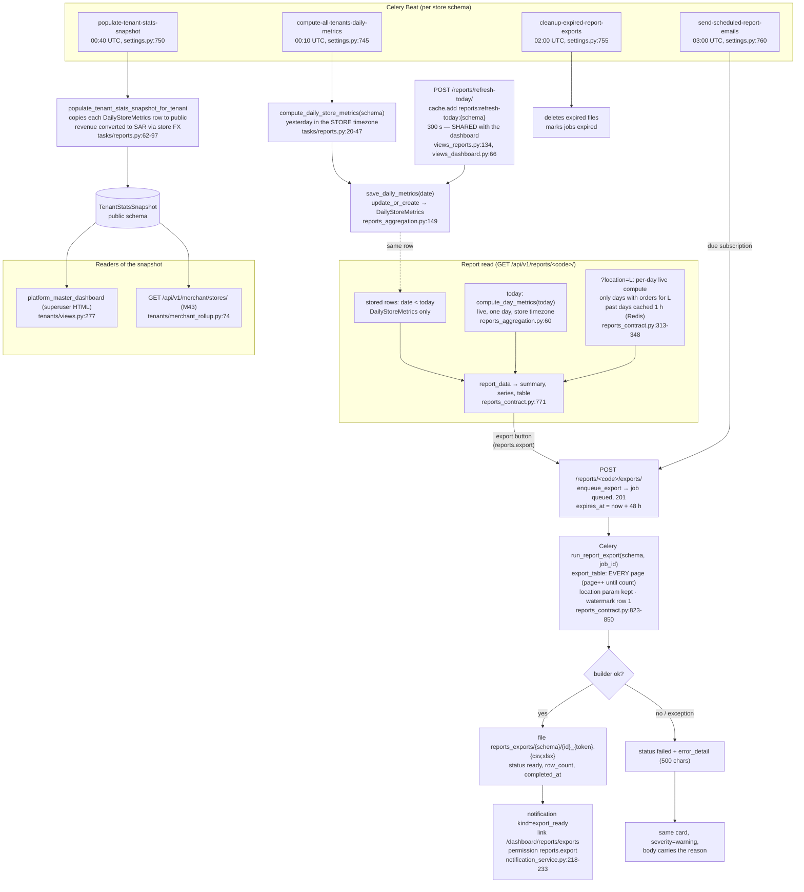
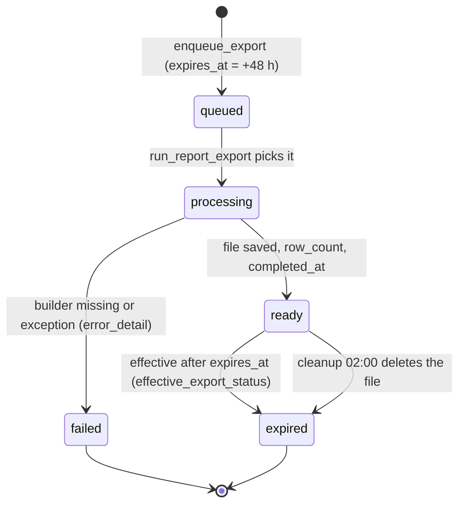
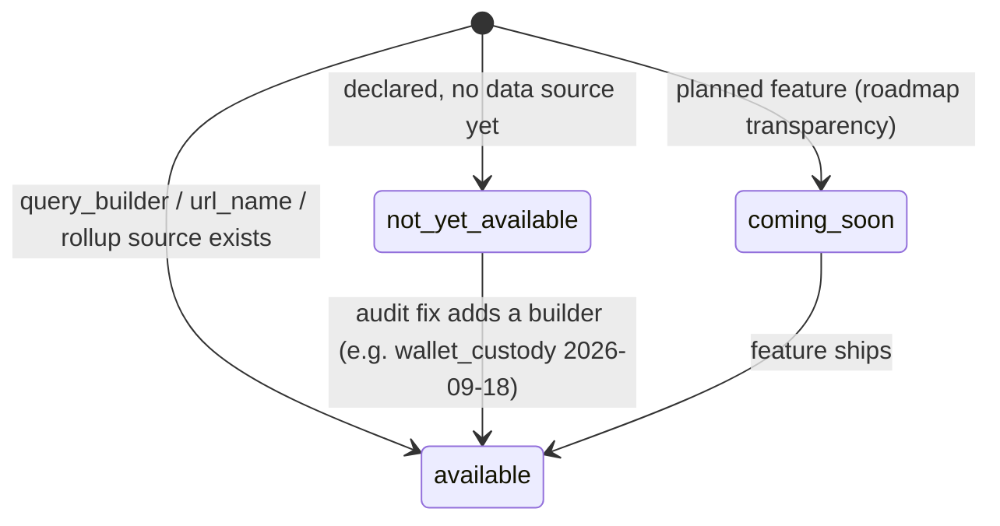
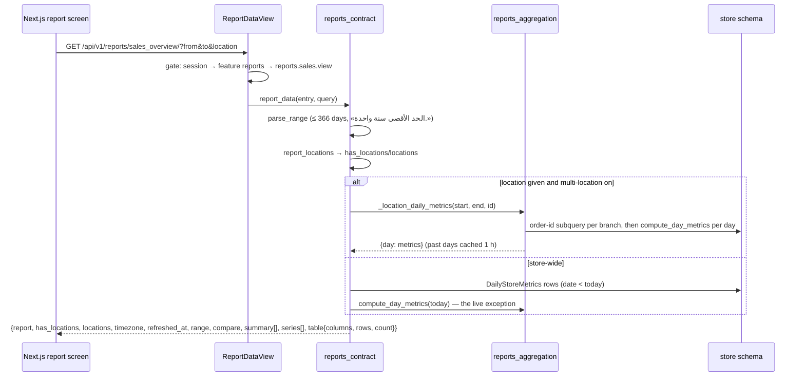

# Data model — Domain 15: reports and analytics

> **Source**: DOC-495 · inventory Domain 15 · INT-027 (M25)
> **Code**: `sharwa_saas/api/{views_reports,serializers}.py` · `sharwa_saas/products/services/{reports_contract,reports_registry,reports_aggregation,export_service,dashboard_service}.py` · `sharwa_saas/products/{models/reports,tasks/reports}.py` · `sharwa_saas/tenants/{models,merchant_rollup}.py` · `sharwa-frontend/src/features/reports/` · `sharwa-frontend/scripts/reports-check.ts`
> **Last verified against code**: 2026-10-29 (step 50)

## 1. Purpose

Domain 15 is everything the merchant sees under «التقارير» in the Next.js dashboard and the Django screens behind it:

1. **The pre-aggregation layer (Rollup Engine)**: one `DailyStoreMetrics` row per store per day, computed by Celery after midnight in the store's own timezone, plus the live compute of *today only* (`compute_day_metrics`) that both the reports screen and the dashboard overview share.
2. **The report registry**: 42 declarative report entries in 10 fixed categories, each with a permission code, a data source (`query_builder`, `url_name`, or the rollup layer) and one of three statuses (`available`, `not_yet_available`, `coming_soon`).
3. **The Next.js contract provider** (`api/views_reports.py` + `products/services/reports_contract.py`): the index, one-report data, today-refresh, exports and schedules, shaped exactly to the Zod schemas of `src/features/reports/`.
4. **The async export engine** (`ReportExportJob`, Celery, CSV/XLSX with a watermark, token-gated downloads, `export_ready` notification) and **scheduled reports** (`ScheduledReportSubscription`, daily Beat e-mail).
5. **The public-schema platform rollup** (`tenants.TenantStatsSnapshot`): one row per store per day in `public`, written from `DailyStoreMetrics`, read by the platform dashboard and the multi-store owner rollup — never by a live query across schemas.

This page is the **data model**: the four models, the registry as a table (all 42 rows), the metrics pipeline as a diagram (§4.1), and the invariants that keep the numbers trustworthy (no double counting with split orders, no live historical queries, one currency per number). Money formatting rules are in [`../40-money.md`](../40-money.md); the dashboard shell that reads the same rollup row is [`../02-dashboard-shell.md`](02-dashboard-shell.md); the store timezone rule is described there and in [`../10-multi-tenancy.md`](../10-multi-tenancy.md).

Not covered here: the expenses ledger itself (`OperatingExpense`, [`../08-finance.md`](08-finance.md) §4.7), the multi-location model (`Location`, a later data-model page), the PWA push model (Domain 5), and the API request/response shapes ([`../../api/domains/15-reports/`](../../api/domains/15-reports/)).

## 2. Components

### 2.1 Provider table (file → what it owns)

| Provider | Location | Owns |
|---|---|---|
| `views_reports.py` | `sharwa_saas/api/views_reports.py` (286 lines) | The eight API routes (`api/urls.py:240-248`). `ReportsAPIMixin.gate` (`:74`): session → plan feature → per-report permission. Constants `EXPORT_PERMISSION = "reports.export"`, `REFRESH_PERMISSION = "reports.sales.view"`, `REFRESH_COOLDOWN_SECONDS = 300`, `EXPORTS_LIST_LIMIT = 50` (`:44-47`). `visible_jobs` (`:86`): a staff session sees only its own export jobs (audit fix 2026-09-16) |
| `reports_contract.py` | `sharwa_saas/products/services/reports_contract.py` (911 lines) | The adaptation layer over the registry: `report_index` (`:172`), `report_data` (`:771`), `parse_range` (`:202`), the rollup reports `ROLLUP_TIME_REPORTS` (`:281`), the location filter `LOCATION_REPORTS`/`report_locations`/`_location_daily_metrics` (`:301`, `:305`, `:313`), `export_table` (`:823`), `schedule_next_run` (`:862`), `effective_export_status` (`:889`). Computes no business number of its own — numbers come from the rollup layer or the registry builders |
| `reports_registry.py` | `sharwa_saas/products/services/reports_registry.py` (797 lines) | `REPORT_CATEGORIES` (10, `:659-670`), `REPORT_REGISTRY` (42, `:672-750`), every `query_builder`, `get_report` (`:756`), `get_visible_reports_for` (`:761`, the Django screens). The 90-day default window `DEFAULT_LIVE_QUERY_WINDOW_DAYS` (`:52`, death-query fix #1) |
| `reports_aggregation.py` | `sharwa_saas/products/services/reports_aggregation.py` (236 lines) | The pure rollup engine: `_day_bounds` (`:27`, store timezone), `location_orders` (`:43`) / `location_items` (`:52`), `compute_day_metrics` (`:60`), `save_daily_metrics` (`:149`, upsert), `metrics_row_to_dict` (`:169`), `aggregate_metrics` (`:186`) |
| `export_service.py` | `sharwa_saas/products/services/export_service.py` (270 lines) | `enqueue_export` (`:171`, 48 h expiry, `.delay`), `run_export` (`:187`, chunked write, watermark `# Sharwa Export` `:28`), `get_download_or_403` (`:258`), the mini XLSX writer `_write_xlsx` (`:125`, no openpyxl dependency), `EXPORT_BUILDERS = {"orders"}` + generic `_contract_rows` for every other exportable report (`:72-99`) |
| `tasks/reports.py` | `sharwa_saas/products/tasks/reports.py` (217 lines) | `compute_daily_store_metrics` (`:20`) / `compute_all_tenants_daily_metrics` (`:50`, fan-out), `populate_tenant_stats_snapshot(_for_tenant)` (`:62`, `:100`), `run_report_export` (`:118`), `cleanup_expired_report_exports` (`:130`, `:147`), `send_scheduled_report_emails` (`:162`, `:208`) |
| `api/serializers.py` | `sharwa_saas/api/serializers.py:380-488` | `ReportExportJobSerializer` (`:380`, renames `id→job_id`, `error_detail→error`, hides `download_token` unless ready), `ReportExportCreateSerializer` (`:434`, `{format, params:{from,to,compare,location}}`), `ScheduledReportSerializer` (`:458`, `recipient_email→email`, server-computed `next_run_at`) |
| `models/reports.py` | `sharwa_saas/products/models/reports.py` (143 lines) | `DailyStoreMetrics` (`:17`), `ReportExportJob` (`:65`), `ScheduledReportSubscription` (`:115`) — all tenant-schema |
| `notification_service._exports` | `sharwa_saas/products/services/notification_service.py:218-233` | The `export_ready` / export-failed notification card: kind `export_ready`, link `/dashboard/reports/exports`, permission `reports.export`, `merchant_only` when the owner requested it, `audience_staff=job.requested_by` for staff jobs |
| `dashboard_service.py` | `sharwa_saas/products/services/dashboard_service.py` | The M03 overview reads the same `DailyStoreMetrics` row (`refresh_today` `:103`); `DashboardOverviewRefreshView` (`api/views_dashboard.py:59-75`) imports `REFRESH_PERMISSION`/`REFRESH_COOLDOWN_SECONDS` from `views_reports` (`:26`) and uses the **same** cache key (INT-003, §4.1) |
| `merchant_rollup.py` | `sharwa_saas/tenants/merchant_rollup.py:74` | `GET /api/v1/merchant/stores/` (M43): reads `TenantStatsSnapshot` only — no live query on any store schema |
| Frontend feature | `sharwa-frontend/src/features/reports/` | `schemas.ts` (Zod, the contract the server obeys), `api.ts` (BFF calls `/api/bff/reports…`), `permissions.ts` (`canOpenReport` — the UI's first layer, the server stays the final word), `range.ts`, components `reports-index` / `report-screen` / `exports-screen` / `scheduled-screen` / `report-chart` / `export-job` |

### 2.2 Routes by provider (all under `/api/v1/`, `api/urls.py:240-248`)

Every route goes through `ReportsAPIMixin.gate` (`views_reports.py:74-84`) in this order:

1. a merchant session (`is_merchant_authenticated`) or a staff session (`request.staff`) — else 401 «انتهت جلستك، سجّل الدخول مجدداً.» (`:77`);
2. the plan feature `reports` (`reports_feature_enabled`, `:59-65`, the same decision as the legacy `require_feature('reports')`) — else 403 «ميزة التقارير غير مفعّلة في خطتك.» (`:80`);
3. the route's permission — a staff member without it gets 403 «ليست لديك صلاحية لهذا الإجراء.» (`:83`). The owner has every permission implicitly.

| Route | Methods | Extra gate | Notes |
|---|---|---|---|
| `reports/` | GET | — | The index: 10 categories, 42 rows, `allowed` per row (`report_index`) |
| `reports/refresh-today/` | POST | `reports.sales.view` (`REFRESH_PERMISSION` `:45`) | Store-level Redis cooldown 300 s, 429 «يمكنك التحديث مرة كل 5 دقائق فقط للحفاظ على الأداء.» (`:136`) + `Retry-After` |
| `reports/<code>/` | GET | the entry's `permission_code` (403 carries `report_title`) | `?from&to&compare_from&compare_to&location&ordering&page`; unknown code 404 «التقرير غير موجود.» (`:116`) |
| `reports/<code>/exports/` | POST | `reports.export` + the entry's `permission_code` + `status == "available"` + `export_enabled` | 400 «هذا التقرير غير متاح بعد للتصدير.» (`:162`) / «هذا التقرير غير متاح للتصدير.» (`:164`); creates the job and answers 201 |
| `reports/exports/` | GET | `reports.export` | Last 50 jobs (`EXPORTS_LIST_LIMIT`); staff sees only its own (`visible_jobs`) |
| `reports/exports/<job_id>/` | GET | `reports.export` | Poll target (the UI polls every 5 s); 404 «مهمة التصدير غير موجودة.» (`:196`) |
| `reports/exports/<job_id>/download/` | GET `?token=` | `reports.export` + job ownership | 410 «انتهت صلاحية الملف — أعد التصدير.» (`:214`), 409 «الملف ليس جاهزاً بعد.» (`:216`), 403 «رمز التنزيل غير صالح.» (`:218`) |
| `reports/schedules/` | GET, POST | `reports.export` | List/create `ScheduledReportSubscription`; field errors as DRF `{field: [messages]}` |
| `reports/schedules/<pk>/` | PATCH, DELETE | `reports.export` | 404 «الاشتراك غير موجود.» (`:270`); DELETE answers 204 |

> ⚠️ Discrepancy — roadmap says gates are "the `reports` plan feature and permissions like `reports.view`/export" / code does: the plan feature `reports` exists (`views_reports.py:59-65`), but there is **no `reports.view` permission in Django**. The backend gates each report by its own code — `reports.sales.view`, `reports.profit.view`, `reports.customers.view`, `reports.inventory.view`, `reports.staff_performance.view`, and `reports.export` for exports (registry `permission_code`, `views_reports.py:44`). `reports.view` exists only as the frontend's *base* key that a staff member must hold on top of the per-report key (`src/features/reports/permissions.ts:59-62`). Reported in step 50.

The Next.js BFF proxies these as `/api/bff/reports…` (`src/features/reports/api.ts:44-151`); the pages live under `/dashboard/reports` (`reports`, `[code]`, `exports`, `scheduled`, plus the `products` alias that rewrites to `best_sellers`).

### 2.3 Registry statuses and the 42 rows

`REPORT_REGISTRY` holds exactly **42 entries** (asserted by `test_index_matches_contract`, `api/test_reports_api.py:57`, and by the frontend check script, `scripts/reports-check.ts:70`). Statuses: **36 `available`**, **5 `not_yet_available`**, **1 `coming_soon`** — six non-available rows in total, exactly what the UI counts as disabled (`reports-check.ts:71`). Registry invariant (module docstring, `reports_registry.py:9-12`): no `available` entry without a `query_builder` or the rollup layer.

| # | Code | Registry title (verbatim) | Category | Permission | Status | Export | Source / note | Line |
|---|---|---|---|---|---|---|---|---|
| 1 | `sales_overview` | «المبيعات» | core | `reports.sales.view` | available | yes | rollup layer, line chart, `url_name` merchant_reports | `:674` |
| 2 | `best_sellers` | «المنتجات الأكثر مبيعاً» | core | `reports.sales.view` | available | no | rollup layer (`top_products_snapshot`), top-10 bar | `:675` |
| 3 | `orders` | «الطلبات» | core | `reports.sales.view` | available | yes | rollup layer (time series) + `_orders_builder` | `:676` |
| 4 | `store_overview` | «نظرة عامة» | core | `reports.sales.view` | available | no | rollup layer via `_summary_builder` (KPI shape) | `:677` |
| 5 | `inventory_overview` | «المخازن» | core | `reports.inventory.view` | available | yes | `_inventory_builder` (low stock) | `:678` |
| 6 | `customers_vip` | «العملاء و VIP» | customers | `reports.customers.view` | available | yes | `_customers_builder` | `:681` |
| 7 | `abandoned_carts` | «السلال المتروكة» | customers | `reports.customers.view` | available | yes | `_abandoned_carts_builder` | `:682` |
| 8 | `visits` | «الزيارات» | customers | `reports.customers.view` | **not_yet_available** | no | no builder — shown with a «قريباً» badge, not hidden | `:683` |
| 9 | `ratings` | «التقييمات» | customers | `reports.customers.view` | available | yes | `_ratings_builder` | `:684` |
| 10 | `payment_gateways` | «بوابات الدفع» | finance | `reports.sales.view` | available | yes | `_payment_methods_builder` | `:687` |
| 11 | `taxes` | «الضرائب» | finance | `reports.profit.view` | available | yes | `_taxes_builder` (line-item tax snapshots) | `:688` |
| 12 | `coupons` | «الكوبونات» | finance | `reports.sales.view` | available | yes | `_coupons_builder` | `:689` |
| 13 | `refunds` | «المبالغ المستردة» | finance | `reports.profit.view` | available | yes | `_refunds_builder` (KPI shape) | `:690` |
| 14 | `wallet_custody` | «المحفظة والعهدة» | finance | `reports.profit.view` | available | no | `_wallet_custody_builder` (audit fix 2026-09-18) | `:693` |
| 15 | `invoices_settlements` | «الفواتير والتسويات» | finance | `reports.profit.view` | **not_yet_available** | (flag yes, refused) | export POST answers 400 because status ≠ available | `:694` |
| 16 | `platform_commissions` | «عمولات المنصة» | finance | `reports.profit.view` | available | no | `_platform_commissions_builder` | `:696` |
| 17 | `third_party_logistics` | «المزوّدون 3PL» | shipping | `reports.sales.view` | available | yes | `_third_party_logistics_builder` | `:702` |
| 18 | `couriers` | «المناديب» | shipping | `reports.sales.view` | available | yes | `_couriers_builder` (custody ledger) | `:704` |
| 19 | `returns` | «المرتجعات» | shipping | `reports.sales.view` | available | yes | `_returns_builder` | `:706` |
| 20 | `zones` | «المناطق» | shipping | `reports.sales.view` | available | no | `_zones_builder` (zone name snapshot) | `:708` |
| 21 | `categories` | «التصنيفات والعلامات» | inventory | `reports.inventory.view` | available | yes | reuses `_inventory_builder` (same data as #5) | `:711` |
| 22 | `variants` | «الخيارات الدقيقة» | inventory | `reports.inventory.view` | available | yes | `_variants_builder` | `:713` |
| 23 | `stock_movements` | «حركة المخزون» | inventory | `reports.inventory.view` | available | yes | `_stock_movements_builder` | `:715` |
| 24 | `suppliers` | «الموردون» | inventory | `reports.inventory.view` | available | no | `_suppliers_builder` | `:716` |
| 25 | `staff_performance` | «أداء الموظفين» | operations | `reports.staff_performance.view` | available | no | `_staff_performance_builder`; separate permission on purpose (blind-manager fix #19, `:389-391`) | `:719` |
| 26 | `audit_log` | «سجل التدقيق» | operations | `reports.sales.view` | available | yes | URL-only builder `_audit_log_builder` (contract `:525`) | `:724` |
| 27 | `customer_service` | «خدمة العملاء» | operations | `reports.customers.view` | available | no | `_customer_service_builder` | `:725` |
| 28 | `system_performance` | «أداء النظام» | operations | `reports.sales.view` | **not_yet_available** | no | no builder | `:726` |
| 29 | `marketing_utm` | «التسويق و UTM» | operations | `reports.sales.view` | available | yes | `_marketing_utm_builder` (needs `utm_*` columns, migration `0174`) | `:727` |
| 30 | `ai_forecasting` | «توقعات الذكاء الاصطناعي» | operations | `reports.sales.view` | **coming_soon** | no | the only `coming_soon` row | `:728` |
| 31 | `currencies` | «العملات وأسعار الصرف» | local_market | `reports.sales.view` | available | yes | reuses `_payment_methods_builder` (placeholder, see §9) | `:731` |
| 32 | `pos` | «نقاط البيع POS» | local_market | `reports.sales.view` | available | yes | `_pos_builder` (shifts) | `:733` |
| 33 | `operating_expenses` | «المصروفات التشغيلية» | local_market | `reports.profit.view` | available | no | `_operating_expenses_builder` (`:415-438`), source `OperatingExpense` (M33, [`../08-finance.md`](08-finance.md) §4.7) | `:734` |
| 34 | `failed_searches` | «البحث المفقود» | advanced_behavior | `reports.customers.view` | available | no | `_failed_searches_builder` (`ZeroResultSearchLog`) | `:737` |
| 35 | `wishlists` | «قوائم الرغبات» | advanced_behavior | `reports.customers.view` | available | yes | `_wishlists_builder` | `:738` |
| 36 | `loyalty` | «الولاء والمكافآت» | advanced_behavior | `reports.customers.view` | available | no | `_loyalty_builder` | `:739` |
| 37 | `affiliates` | «المسوقون بالعمولة» | marketing | `reports.sales.view` | available | yes | `_affiliates_builder` | `:742` |
| 38 | `bundles` | «المنتجات المركبة» | marketing | `reports.sales.view` | **not_yet_available** | no | no builder | `:743` |
| 39 | `subscriptions` | «الاشتراكات» | marketing | `reports.sales.view` | **not_yet_available** | no | no builder | `:744` |
| 40 | `export_engine` | «محرك التصدير» | infrastructure | `reports.export` | available | no | URL-only `_export_engine_builder` (jobs by status, contract `:535`) | `:747` |
| 41 | `scheduled_reports` | «التقارير المجدولة» | infrastructure | `reports.export` | available | no | URL-only `_scheduled_reports_builder` (by frequency, contract `:546`) | `:748` |
| 42 | `whatsapp_costs` | «تكلفة إشعارات الواتساب» | infrastructure | `reports.sales.view` | available | no | `_whatsapp_costs_builder` (`:550-584`, source `WhatsAppMessageCostLog`) | `:749` |

All rows and titles are copied verbatim from `REPORT_REGISTRY` (`sharwa_saas/products/services/reports_registry.py:672-750`); the category keys and Arabic category titles from `REPORT_CATEGORIES` (`:659-670`): `core` «اللاعبون الأساسيون», `customers` «العملاء والسلوك», `finance` «المالية والمدفوعات», `shipping` «الشحن واللوجستيات», `inventory` «المخزون المتقدم», `operations` «العمليات والرقابة», `local_market` «تعقيدات السوق المحلي», `advanced_behavior` «السلوك المتقدم», `marketing` «التوسع التسويقي», `infrastructure` «البنية التحتية للتقارير». The index returns the categories in exactly this order (`report_index`, `reports_contract.py:177`).

### 2.4 Legacy HTML screens kept

The Django screens still work next to the API (routes in `config/urls_tenant.py:291-300`); they read the same rollup layer and the same registry, so the two UIs cannot show different numbers.

| Screen | Code | Route |
|---|---|---|
| Sales screen (the rollup read: stored rows + today live, traffic/device/payment breakdowns, dead stock, PWA stats, push subscribers) | `merchant_reports_view` (`products/views/merchant_settings.py:1140`, `@require_feature('reports')` + `@requires_permission('reports.sales.view')`; `push_subscriber_count` `:1290`) | `dashboard/reports/` |
| Refresh today (legacy) | `refresh_today_metrics` (`merchant_settings.py:1302`) | `dashboard/reports/refresh-today/` |
| One-report detail screen (any registry code) | `report_detail_view` (`products/views/report_detail.py:15`), `scheduled_reports_view` (`:57`) | `dashboard/reports/<report_code>/`, `dashboard/reports/scheduled/` |
| «صادراتي» + create + status + download | `my_exports_view` (`products/views/report_exports.py:83`), `enqueue_report_export_view`, `report_export_status_view`, `report_export_download_view` (`:71`) | `dashboard/reports/exports/`, `.../create/`, `.../<job_id>/status/`, `.../<job_id>/download/<uuid:token>/` |
| Test push (PWA) | `send_test_push_notification` (`products/views/push.py:17`) | `dashboard/reports/send-test-push/` |
| Platform master dashboard (reads `TenantStatsSnapshot`, superuser) | `platform_master_dashboard` (`tenants/views.py:267`, aggregate `:277-282`) | platform admin site |

### 2.5 Frontend pages and the push stats card

The Next.js hub is `/dashboard/reports` (index), `/dashboard/reports/[code]` (one report), `/dashboard/reports/exports`, `/dashboard/reports/scheduled`, and `/dashboard/reports/products` → `best_sellers`. The index renders the **push stats card** of the PWA milestone (INT-016, M44): `PushBroadcastCard` (`src/features/reports/components/reports-index.tsx:19`, rendered `:129`), which shows the store's active push subscribers and lets the owner broadcast (`src/features/pwa/components/push-broadcast.tsx`). The legacy screen shows the same number as `push_subscriber_count` (`merchant_settings.py:1290`) next to the PWA install stats (`merchant_reports.html:323-337`).

## 3. Data model

### 3.1 Schema placement

| Group | Schema | Evidence |
|---|---|---|
| `DailyStoreMetrics`, `ReportExportJob`, `ScheduledReportSubscription` | **store** (one copy per tenant schema) | App `products` is in `TENANT_APPS` (`config/settings.py:157`) and not in `SHARED_APPS` (`:121-150`); the module docstring repeats the isolation rule (`products/models/reports.py:3-4`) |
| `TenantStatsSnapshot` | **public** | App `tenants` is in `SHARED_APPS` (`settings.py:122`); created by `tenants/0019_tenant_stats_snapshot.py`; written from store data through `schema_context`, never via a cross-schema FK (`products/tasks/reports.py:73-96`) |

`ReportExportJob.report_code` and `ScheduledReportSubscription.report_code` hold a registry **code as text, with no foreign key** — the registry is a Python list, not a table. Deleting or renaming a registry code orphans the row (the export fails with «تقرير غير معروف», `export_service.py:200`; the schedule still e-mails a failing job). `TenantStatsSnapshot.client` is the only real FK, and it stays inside `public`.

### 3.2 Model table

Four models are documented. `Order`, `OrderItem` (snapshot fields + `source_location`), `StaffMember`, `OperatingExpense`, `WhatsAppMessageCostLog`, `PushSubscription`, `Location` and `StoreSetting` are referenced only.

| Model | Schema | Key fields | Constraints / indexes | Added or changed by |
|---|---|---|---|---|
| `DailyStoreMetrics` (`products/models/reports.py:17`) | store | `date` (indexed), `orders_count`, `completed_orders_count`, `cancelled_orders_count`, `refunded_orders_count`, `gross_revenue` / `net_revenue` (`Decimal(14,2)`, from line-item snapshots not the live product price), `currency` (10, default `SAR`), `top_products_snapshot` (JSON list of top 10 `{product_name, total_sold, revenue}`), `traffic_source_breakdown` (JSON dict), `computed_at` (`auto_now`) | `UniqueConstraint(fields=["date"], name="unique_daily_store_metrics_date")`; Meta ordering `-date`; one row per store per day (upsert in `save_daily_metrics`) | `products/0168_dailystoremetrics.py` (2026-09-16) — the only migration of this model |
| `ReportExportJob` (`products/models/reports.py:65`) | store | `report_code` (100, no FK), `format` (`csv`/`xlsx`, default `csv`, M25 US-25.3), `params` (JSON: `{from,to,compare,location,start,end}`), `status` (`queued` «قيد الانتظار» / `processing` «قيد المعالجة» / `ready` «جاهز للتنزيل» / `failed` «فشل» / `expired` «منتهي الصلاحية», choices `:75-81`), `file_path` (500, `reports_exports/{schema}/{id}_{token}.{ext}`), `download_token` (UUID, unique, not editable), `requested_by` (FK `StaffMember`, `SET_NULL`, nullable — null = the owner), `row_count`, `error_detail` (500 max when written), `expires_at`, `created_at` (indexed), `completed_at` | `status` indexed; `download_token` unique; `expires_at` required (48 h at creation, `export_service.py:180`) | `products/0171_reportexportjob.py`; `products/0207_reportexportjob_format.py` (adds `format`, M25 wave) |
| `ScheduledReportSubscription` (`products/models/reports.py:115`) | store | `report_code` (100, no FK), `frequency` (`daily`/`weekly`/`monthly`, default `weekly`), `recipient_email`, `is_active` (indexed), `last_sent_at` (nullable), `created_at` | no unique constraint — the duplicate guard is serializer-level validation only (§9) | `products/0173_scheduledreportsubscription.py` |
| `TenantStatsSnapshot` (`tenants/models.py:310`) | public | `client` (FK `Client`, CASCADE, `stats_snapshots`), `date` (indexed), `orders_count`, `completed_orders_count`, `refunded_orders_count`, `revenue_sar` (`Decimal(14,2)` — converted to SAR with the store's own FX rates at write time), `created_at` | `UniqueConstraint(fields=['client','date'], name='unique_tenant_stats_day')` | `tenants/0019_tenant_stats_snapshot.py` (2026-09-14) |

Referenced, not documented here: `Order.source_location` and `OrderItem.source_location` (FK `Location`, `PROTECT`, added by `products/0151_order_snapshot_fields.py:77-81` and `0139_fulfillment.py`), `StoreSetting.multi_location_enabled` (`store_settings.py:315`), `StoreSetting.timezone` (the day-bounds input).

### 3.3 ER sketch

```mermaid
erDiagram
  %% ===== store schema =====
  DailyStoreMetrics {
    date date PK "unique per store schema"
    int orders_count
    int completed_orders_count
    int cancelled_orders_count
    int refunded_orders_count
    decimal gross_revenue "14,2 line-item snapshots"
    decimal net_revenue "14,2 after refunds, discounts, tax"
    string currency "dominant currency of the day"
    json top_products_snapshot "top 10"
    json traffic_source_breakdown
    datetime computed_at
  }
  ReportExportJob {
    int id PK
    string report_code "registry code, no FK"
    string format "csv or xlsx"
    json params "from, to, compare, location"
    string status "queued, processing, ready, failed, expired"
    string file_path "reports_exports/{schema}/{id}_{token}.{ext}"
    uuid download_token UK
    int requested_by_id FK "nullable, null = owner"
    int row_count
    datetime expires_at "48 h"
  }
  ScheduledReportSubscription {
    int id PK
    string report_code "registry code, no FK"
    string frequency "daily, weekly, monthly"
    string recipient_email
    bool is_active
    datetime last_sent_at
  }
  StaffMember |o--o{ ReportExportJob : "requested_by SET_NULL"
  Order ||..o{ DailyStoreMetrics : "aggregated once per day"
  Location |o..o{ Order : "source_location"
  Location |o..o{ OrderItem : "source_location (split orders)"

  %% ===== public schema =====
  Client ||--o{ TenantStatsSnapshot : "stats_snapshots"
  TenantStatsSnapshot {
    int id PK
    int client_id FK
    date date "unique with client"
    int orders_count
    int completed_orders_count
    int refunded_orders_count
    decimal revenue_sar "converted at write time"
  }
  DailyStoreMetrics ||..o{ TenantStatsSnapshot : "copied by populate task, no FK"

  %% ===== writers =====
  W_beat_daily ||..o{ DailyStoreMetrics : "save_daily_metrics upsert"
  W_refresh_today ||..o{ DailyStoreMetrics : "today row, 5-min store cooldown"
  W_enqueue ||..o{ ReportExportJob : "creates queued"
  W_run_export ||..o{ ReportExportJob : "processing, then ready or failed"
  W_cleanup ||..o{ ReportExportJob : "expired, file deleted"
  W_scheduled_mail ||..o{ ScheduledReportSubscription : "stamps last_sent_at"
  W_scheduled_mail ||..o{ ReportExportJob : "enqueue_export per due subscription"
  W_populate ||..o{ TenantStatsSnapshot : "from DailyStoreMetrics, SAR"
  W_legacy_aggregate ||..o{ TenantStatsSnapshot : "unscheduled, from live Order"

  W_beat_daily {
    string fn "tasks/reports.compute_daily_store_metrics :20 (Beat 00:10)"
  }
  W_refresh_today {
    string fn "views_reports.ReportRefreshTodayView :126; dashboard_service.refresh_today :103"
  }
  W_enqueue {
    string fn "export_service.enqueue_export :171"
  }
  W_run_export {
    string fn "export_service.run_export :187 via tasks/reports.run_report_export :118"
  }
  W_cleanup {
    string fn "tasks/reports.cleanup_expired_report_exports :130 (Beat 02:00)"
  }
  W_scheduled_mail {
    string fn "tasks/reports.send_scheduled_report_emails_for_tenant :162 (Beat 03:00)"
  }
  W_populate {
    string fn "tasks/reports.populate_tenant_stats_snapshot_for_tenant :62 (Beat 00:40)"
  }
  W_legacy_aggregate {
    string fn "tenants/tasks.aggregate_tenant_stats :121 (not in CELERY_BEAT_SCHEDULE)"
  }
```



Reading the diagram: the only real foreign keys are `ReportExportJob.requested_by` (store schema) and `TenantStatsSnapshot.client` (public schema). `report_code` on both job and subscription is a soft link to the Python registry. The dotted `DailyStoreMetrics → TenantStatsSnapshot` line is a copy across schemas, not a reference.

### 3.4 Migrations

**Phase 002 (INT-027, this task's domain)** — none. No migration from `0208` onward touches `DailyStoreMetrics`, `ReportExportJob` or `ScheduledReportSubscription` (verified by grep over `products/migrations/02*.py`); the M25 work reused the three tables as they were.

> ⚠️ Discrepancy — roadmap says "No migration" / code does: true for the INT-027 Phase-002 API step, but the M25 reports wave itself had added one migration earlier: `products/0207_reportexportjob_format.py` (the `ReportExportJob.format` column, CSV/XLSX, default `csv`). It predates the Phase-002 numbering (`0220_marketing_api` onward) and is the last migration of these models. Reported in step 50.

**Earlier history that shaped the models**

| Migration | What it did |
|---|---|
| `products/0139_fulfillment.py`, `products/0151_order_snapshot_fields.py` | `OrderItem.source_location` and `Order.source_location` (FK `Location`, `PROTECT`) — the dimension the location filter reads (`0151:77-81`) |
| `products/0168_dailystoremetrics.py` | Creates `DailyStoreMetrics` (Phase 1 rollup engine, 2026-09-16) |
| `products/0171_reportexportjob.py` | Creates `ReportExportJob` with `download_token` (unique UUID) and `expires_at` (Phase 4 export engine) |
| `products/0172_seed_report_permissions.py` | Seeds the five permission codes `reports.sales.view`, `reports.profit.view`, `reports.customers.view`, `reports.inventory.view`, `reports.export` (category «المالية»… no — category `reports`), get-or-create, reversible |
| `products/0173_scheduledreportsubscription.py` | Creates `ScheduledReportSubscription` (Phase 6) |
| `products/0174_utm_and_staff_performance.py` | `Order.utm_source/utm_medium/utm_campaign`, `Fulfillment.prepared_by_staff/prepared_at`, and seeds the sixth permission `reports.staff_performance.view` (separate on purpose, blind-manager fix #19) |
| `products/0207_reportexportjob_format.py` | Adds `format` (`csv`/`xlsx`) — see the discrepancy above |
| `tenants/0019_tenant_stats_snapshot.py` | Creates `TenantStatsSnapshot` in `public` (2026-09-14) |

## 4. Flows

### 4.1 The metrics pipeline (daily compute → report read → export → notification)



Rules the code adds to the diagram:

- **Yesterday is computed in the store's timezone, not the server's** (`compute_daily_store_metrics`, `tasks/reports.py:42-44` — midnight-crisis fix #11); `_day_bounds` uses `StoreSetting.timezone` (`reports_aggregation.py:27-40`).
- **Today is the only live exception.** Every read path (`merchant_reports_view` legacy, `report_data`, `dashboard_service`) takes stored rows for `date < today` and computes only today live (`_daily_metrics`, `reports_contract.py:351-363`).
- **The refresh cooldown is store-level and shared.** `ReportRefreshTodayView` and `DashboardOverviewRefreshView` (INT-003) both do `cache.add("reports:refresh-today:{schema}", …, 300)` (`views_reports.py:134`, `views_dashboard.py:66-67`, importing the constants from `views_reports`, `:26`), so a second browser or the dashboard cannot bypass the five minutes. The legacy screen enforces its own 300 s check **per session** instead (`merchant_settings.py:1318-1325`, session key `reports_last_refresh_at`) — the same limit, a weaker scope (§9).
- **The export file is the filtered table, complete.** `export_table` keeps `params["location"]` («الملف = ما يعرضه الجدول المفلتر», `reports_contract.py:835-836`) and loops `page += 1` until it has `count` rows (`:841-847`) — before INT-027 it stopped at the first `TABLE_PAGE_SIZE = 1000` slice (`:44`). Without `from/to` it exports the last 30 days (`:831-834`, same default as `export_service._parse_range`).
- **Every exported file starts with a watermark** `# Sharwa Export` + report + job + timestamp (`export_service.py:28`, `:209-214`), and the CSV is written UTF-8-BOM so Excel opens Arabic correctly (`:231`); XLSX is a hand-rolled RTL worksheet (`_write_xlsx`, `:125-168`).
- **The `export_ready` card is per-audience**: `merchant_only` when the owner requested the job, `audience_staff = job.requested_by` for a staff job (`notification_service.py:230-233`) — a staff member never sees a colleague's export card.

Export job lifecycle:



`expired` is both a computed state (`effective_export_status`, `reports_contract.py:889-894`: a `ready` job past `expires_at` *reads* expired before the cleanup runs) and a stored one (the nightly cleanup deletes the file and sets `status = "expired"`, `tasks/reports.py:130-144`). The download route distinguishes them with 410 (expired), 409 (not ready), 403 (bad token), 404 (unknown) — pinned by `test_download_status_codes`.

### 4.2 Registry statuses model



- `available` (36 rows): the entry answers data. `report_data` builds the full contract; export is possible only if `export_enabled` is also true.
- `not_yet_available` (5 rows: `visits`, `invoices_settlements`, `system_performance`, `bundles`, `subscriptions`): the row is **shown, not hidden**, with a «قريباً» badge and no link (`get_visible_reports_for`, `reports_registry.py:792`; the API returns an empty table without `range`, `reports_contract.py:782-783`).
- `coming_soon` (1 row: `ai_forecasting`): same display treatment, different label (the frontend labels map `not_yet_available` → «غير متاح بعد» and `coming_soon` → «قريباً», `schemas.ts:8-9`).

`whatsapp_costs` is `available` (`:749`) with the `WhatsAppMessageCostLog` source; `ai_forecasting` is the single `coming_soon` row (`:728`). Together the six non-available rows are exactly the "6 disabled" the UI counts (`reports-check.ts:71`).

### 4.3 The location dimension (INT-027)

Only four reports carry the branch filter: `LOCATION_REPORTS = {"sales_overview", "orders", "store_overview", "best_sellers"}` (`reports_contract.py:301`). Everything else answers `has_locations = false` — the merchant is never offered a filter that would not change the numbers.

- **Offering the filter**: `report_locations` (`:305-310`) returns `(false, [])` unless the report is in `LOCATION_REPORTS` **and** `StoreSetting.multi_location_enabled` is on; otherwise `(true, [{id, name}])` from active locations ordered by `sort_order, id`. `has_locations` and `locations` are part of every report payload (`:777-778`).
- **Accepting the parameter**: `?location=<id>` is honoured only when the id belongs to that same list; anything else is silently ignored (store-wide numbers), exactly like the mock (`:792-793`; test `test_location_filters_order_derived_reports` pins `location=999999` → whole store).
- **The no-double-counting query**: `location_orders` (`reports_aggregation.py:43-49`) filters with an **id subquery**, not a join:

```python
ids = (Order.objects.filter(Q(source_location_id=location_id) | Q(items__source_location_id=location_id))
       .values('id'))
return orders.filter(id__in=ids)
```

  An order sourced to branch A (`Order.source_location`) **or** carrying any line shipped from branch A (`OrderItem.source_location`, the split-order case) is in the set **once** — `id__in` de-duplicates by construction, so an order with three lines from A is not counted three times, and `orders.count()` / `Sum` aggregates stay per-order. Line-level money uses `location_items` (`:52-57`): a line belongs to the branch when the line has that `source_location`, **or** the line has no source and its order does — so split orders attribute their unattributed lines to the order's branch, without ever attributing one line to two branches.
- **No stored per-location rows**: `DailyStoreMetrics` has no location dimension, so a filtered read computes each day live via `compute_day_metrics(day, location_id=…)` — but only for days that have at least one order for that location (one id-list query first, then day-by-day), and **past days are cached one hour** in Redis under `reports:location-day:{schema}:{location_id}:{date}` (`LOCATION_CACHE_SECONDS = 3600`, `reports_contract.py:302`, `:341-346`). Today is never cached. The trade-off is explicit in the code: live history is tolerated only because the day set is small and each day is a bounded one-day query (`:314-318`).

### 4.4 One report request, end to end



The response shape is the Zod contract verbatim (`sharwa-frontend/src/features/reports/schemas.ts:85-101`); `table.rows` is one page of `TABLE_PAGE_SIZE = 1000` with the full `count` beside it (`reports_contract.py:807`), and `compare_from/compare_to` add a second series and `delta_pct` per summary item (`:403-458`). The `«اليوم»` column label and the newest-first row order are part of the contract (`:442`, `:457`).

### 4.5 Scheduled reports

`POST /api/v1/reports/schedules/` creates a `ScheduledReportSubscription` (`{report_code, frequency, email}`, serialized as `recipient_email`; duplicates are refused by serializer validation — `test_schedule_crud_maps_email`). Dispatch is one Beat task: `send-scheduled-report-emails` runs daily at 03:00 UTC (`settings.py:760-763`), and per tenant (`send_scheduled_report_emails_for_tenant`, `tasks/reports.py:162-205`) every active subscription whose `last_sent_at` is older than its interval (or never sent) gets:

1. `enqueue_export(report_code, {})` — a normal 48-hour export job of the last 30 days;
2. an e-mail with the signed path `/dashboard/reports/exports/{id}/download/{token}/` («ينتهي الرابط خلال 48 ساعة»), `fail_silently=True`;
3. `last_sent_at = now`.

`next_run_at` shown in the UI is computed **by the server** with `schedule_next_run` (`reports_contract.py:862-879`): the first Beat run (03:00 UTC) at or after `last_sent_at + interval` — the UI never estimates. A paused subscription answers `next_run_at: null`.

### 4.6 Platform rollups: the public snapshot

`populate-tenant-stats-snapshot` (Beat 00:40, `settings.py:750-753`) fans out per tenant and copies **every** `DailyStoreMetrics` row into one `TenantStatsSnapshot` row per `(client, date)`, converting `gross_revenue` to SAR with the store's own exchange rates (`convert_amount` + `StoreSetting.load()`) — the only place live FX conversion is allowed, because this is the platform dashboard, not a merchant's historical report (`tasks/reports.py:100-111`). Readers: the superuser `platform_master_dashboard` (`tenants/views.py:277-282`) and the M43 multi-store owner API `GET /api/v1/merchant/stores/` (`tenants/merchant_rollup.py:74-99`) — both query a single public table instead of looping over schemas (fix #20/#27). A second, **unscheduled** writer exists: `tenants/tasks.aggregate_tenant_stats` (`:121-160`) computes today from live `Order` rows per tenant; it is not in `CELERY_BEAT_SCHEDULE` (§9).

## 5. Invariants

| Invariant | Enforced by |
|---|---|
| One `DailyStoreMetrics` row per store per day | `unique_daily_store_metrics_date` + `update_or_create` upsert (`reports_aggregation.py:152-166`) |
| One `TenantStatsSnapshot` row per client per day | `unique_tenant_stats_day` + `update_or_create` (`tasks/reports.py:86-95`) |
| No double counting with split orders | id-subquery filter, never a join (`location_orders`, `reports_aggregation.py:43-49`); line attribution is exclusive (`location_items`, `:52-57`) |
| No live query over history | stored rows for past days everywhere; live compute bounded to *today* (`_daily_metrics`, `reports_contract.py:351-363`); registry builders default to a 90-day window (`DEFAULT_LIVE_QUERY_WINDOW_DAYS`, `reports_registry.py:52`) |
| The branch filter never lies | `has_locations` false outside `LOCATION_REPORTS` or without `multi_location_enabled` (`report_locations`, `:305-310`); unknown ids ignored (`:792-793`) |
| Next.js and Django show the same number | the contract computes nothing itself; both UIs read the rollup layer / the same builders (`reports_contract.py:8-16`) |
| One currency per number | `DailyStoreMetrics.currency` is the dominant currency of the day's items (`reports_aggregation.py:104-110`); the snapshot stores SAR only, converted at write time |
| Historical money from line snapshots, never the live product price | `gross_revenue` built from `OrderItem.price/quantity` snapshots (`compute_day_metrics`, `:77-82`, help text `reports.py:36`) |
| A download needs ownership + token + time window | `visible_jobs` + `download_token` compare + `effective_export_status` (`views_reports.py:201-232`); the token is revealed by the serializer only when ready (`serializers.py:418-419`) |
| A staff member sees only their own exports | `ReportsAPIMixin.visible_jobs` (`views_reports.py:86-89`) — audit fix 2026-09-16 |
| The export file equals the filtered table | `export_table` reuses `report_data` with the same query incl. `location`, all pages (`reports_contract.py:823-850`) |
| Ranges are bounded | `MAX_RANGE_DAYS = 366`, inclusive, `YYYY-MM-DD` only (`parse_range`, `:202-223`); errors are field errors: «تاريخ غير صالح (YYYY-MM-DD).» (`:216`), «تاريخ النهاية قبل البداية.» (`:220`), «الحد الأقصى سنة واحدة.» (`:222`) |
| Individual performance is a separate permission | `staff_performance` gated by `reports.staff_performance.view`, seeded by `0174` (blind-manager fix #19) |

## 6. Background work

Four Beat entries feed and clean this domain (`config/settings.py:745-763`, added by the 2026-09-16 audit — before that the tasks existed but were **never scheduled**, so `DailyStoreMetrics` and `TenantStatsSnapshot` stayed empty and expired files were never cleaned, comment `:738-743`):

| Beat entry | Schedule | Task | Effect |
|---|---|---|---|
| `compute-all-tenants-daily-metrics` | 00:10 UTC | `products.tasks.compute_all_tenants_daily_metrics` → per-tenant `compute_daily_store_metrics` | yesterday's row per store, store timezone |
| `populate-tenant-stats-snapshot` | 00:40 UTC | `populate_tenant_stats_snapshot` → `…_for_tenant` | copies rollup rows to `public` as SAR |
| `cleanup-expired-report-exports` | 02:00 UTC | `cleanup_expired_report_exports` → `…_for_tenant` | deletes expired files, marks jobs `expired` |
| `send-scheduled-report-emails` | 03:00 UTC | `send_scheduled_report_emails` → `…_for_tenant` | due subscriptions → export job + e-mail |

Plus one queue task per export (`run_report_export`, no schedule — triggered by `enqueue_export.delay`). Retry/limits: the per-tenant tasks carry `TENANT_TASK_LIMITS`, the dispatchers `DISPATCHER_TASK_LIMITS` (`products/tasks/_common.py`); `run_report_export` is a plain `shared_task`. Failures are absorbed: a failed export marks the job `failed` with `error_detail` (`export_service.py:251-255`), a failed scheduled e-mail logs and continues (`tasks/reports.py:203-204`). See [`../50-background-jobs.md`](../50-background-jobs.md).

## 7. Configuration

| Setting | Default | Effect |
|---|---|---|
| Plan feature `reports` | per plan | the whole domain (API and legacy screens); checked per request `reports_feature_enabled` (`views_reports.py:59-65`) |
| `REFRESH_COOLDOWN_SECONDS` | 300 | store-level refresh cooldown, shared key with the dashboard (INT-003) (`views_reports.py:46`, `views_dashboard.py:26`) |
| `LOCATION_CACHE_SECONDS` | 3600 | Redis TTL of a past day × location metrics row (`reports_contract.py:302`) |
| `TABLE_PAGE_SIZE` | 1000 | report table page (and export loop step) (`:44`) |
| `MAX_RANGE_DAYS` | 366 | range ceiling (`:43`) |
| `CHART_TOP_ITEMS` | 10 | bar-chart points and top-products snapshot size (`:45`, `reports_aggregation.py:124`) |
| `EXPORTS_LIST_LIMIT` | 50 | «تصديراتي» page (`views_reports.py:47`) |
| `DEFAULT_LIVE_QUERY_WINDOW_DAYS` | 90 | default builder window (`reports_registry.py:52`) |
| Export expiry | 48 h | `expires_at` at enqueue (`export_service.py:180`); nightly cleanup at 02:00 |
| `StoreSetting.multi_location_enabled` | off | turns the four-report location dimension on (`report_locations`) |
| `StoreSetting.timezone` | — | defines "day" everywhere (`_day_bounds`) |
| Staff permissions | seeded `0172` (5 codes) + `0174` (`reports.staff_performance.view`) | per-report gates; owner implicit |

## 8. Failure modes and fixes

| Failure | Symptom | Cause | Handling / fix |
|---|---|---|---|
| Death query on the live tables (`Order.objects.all()` aggregates) | reports page kills the DB as the store grows | pre-Phase-1 screens | rollup layer + 90-day builder windows (`reports_registry.py:47-52`, fix #1) |
| Reports and dashboard empty for ever | no rows in `DailyStoreMetrics` | Beat entries missing (tasks never scheduled) | entries added 2026-09-16 (`settings.py:738-748`, audit fix) |
| "Yesterday" computed at the wrong midnight | day boundaries off by hours for non-UTC stores | server timezone | store timezone in `compute_daily_store_metrics` and `_day_bounds` (fix #11) |
| Refresh spammed as a back door to live recompute | DB load | per-session limit only | store-level `cache.add` key shared with the dashboard (catastrophe #12; INT-003) |
| Export file truncated at 1000 rows | merchant downloads fewer rows than the table shows | export stopped at the first page | `export_table` pages to `count` (`reports_contract.py:841-847`, INT-027) |
| Downloaded file ignores the branch filter | file ≠ screen | location dropped between screen and export | `location` kept in `export_table` (`:835-836`, INT-027; test `test_export_keeps_location`) |
| Two rows for the same day | duplicated totals | concurrent compute | unique `(date)` + upsert |
| Split order counted once per line | branch totals exceed store totals | join fan-out | id-subquery, `id__in` de-duplicates (`location_orders`) |
| Export link shared | anyone with the URL downloads | guessable path | random UUID token + 48 h expiry + ownership (`views_reports.py:201-232`) |
| File gone but job says ready | 410 on download | cleanup ran between polls | `effective_export_status` reports expired instantly; `FileNotFoundError` → 410 (`:224-225`) |
| Export fails silently | no feedback | — | job `failed` + `error_detail`; notification card severity warning with the reason; UI retry creates a **new** job (`reports-check.ts:216-218`) |
| Cashier opens reports | 403 / feature-off screen | plan without `reports` | gate order session → feature → permission (`views_reports.py:74-84`; `reports-check.ts:253-257`) |

### 8.1 Tests

| File | Tests | Covers |
|---|---|---|
| `sharwa_saas/api/test_reports_api.py` | 19 | `ReportsApiContractTests` (14): index contract (10 categories × 42 rows, statuses), 401/403 gates, time series, compare + delta, field errors, empty `not_yet_available` payload, KPI mapping, 404, export create/poll (`xlsx`, params round-trip, «مالك المتجر» requester label), bad format and non-exportable 400, download status codes (403/410/409/404 + effective expired), schedule CRUD + duplicate e-mail, schedule field errors. `ReportsContractUnitTests` (2): XLSX writer (RTL, escaping), `schedule_next_run` vs Beat. `ReportsLocationFilterTests` (3): no filter without multi-location, the four order-derived reports filtered (incl. unknown id ignored and `customers_vip` without filter), export keeps location |
| `sharwa-frontend/scripts/reports-check.ts` | 272 lines | Playwright: 42 rows / 6 disabled / 10 categories in order, local search, permission map for a `reports.view`-only member, range+compare+location in the URL (same URL reproduces the numbers), dashed compare series, «—» delta without data, 366-day block, unavailable page, `products` alias, refresh-today, export strip queued→processing→ready by 5-s poll, token download + 410, failed export with reason + retry = new job, schedule validation/pause/delete, cashier feature-off + API 403 |

The roadmap's "`ReportsLocationFilterTests` (3)" matches the code (three test methods, `test_reports_api.py:247-309`). Related backend tests outside this file: `products/test_reports_rollup.py`, `api/test_rollup_api.py` (the M43 snapshot reader) and `api/test_dashboard_api.py` (the shared refresh cooldown).

## 9. Open items

- ⚠️ **Stale module docstring**: `reports_contract.py:18-19` still says `has_locations` is returned `false` always because `DailyStoreMetrics` carries no location dimension — the INT-027 filter (`:301-348`) made that untrue. Code wins; the comment misleads.
- ⚠️ **Frontend permission map ≠ registry**: `src/features/reports/permissions.ts:21` gates `audit_log` with `reports.staff_performance.view`, while the registry gates it with `reports.sales.view` (`reports_registry.py:724`); the frontend also requires a base `reports.view` key and, for the `inventory` category, an `inventory` plan feature (`permissions.ts:11-12`, `:66-70`) — neither base rule exists in the Django gate (`can_open` checks only the entry's `permission_code`; no registry entry sets `feature_code`). The server stays the final word, but a staff member can be denied a row in the UI the API would allow.
- ⚠️ **Placeholder reports**: `currencies` reuses `_payment_methods_builder` (same numbers as `payment_gateways`; its contract description admits it, `reports_contract.py:82`), and `categories` reuses `_inventory_builder` (same as `inventory_overview`).
- **Legacy refresh cooldown is per session**: `refresh_today_metrics` checks `request.session['reports_last_refresh_at']` (`merchant_settings.py:1318-1325`), so a legacy-screen user can refresh in a second browser; the API pair shares the Redis key. Same 300 s, weaker scope.
- **Two writers of `TenantStatsSnapshot` with different semantics**: the scheduled `populate_tenant_stats_snapshot` (from rollup rows, revenue converted to SAR via store FX) and the unscheduled legacy `tenants/tasks.aggregate_tenant_stats` (`:121-160`, from live `Order.total_price`, today only, stored raw into `revenue_sar`). If the legacy task is ever re-enabled, the two will fight over the same `(client, date)` row with different numbers.
- **Scheduled e-mail can link a not-ready file**: the mail is sent right after `enqueue_export` (job still `queued`) and `fail_silently=True` swallows SMTP errors; `last_sent_at` is stamped even if the export later fails, so that run is lost (a non-exportable `report_code` on a subscription produces a failing job every interval, `tasks/reports.py:186-201`).
- **`ScheduledReportSubscription` has no unique constraint** — duplicate e-mails are rejected only by serializer validation (`test_schedule_crud_maps_email`); a row created by any other path (admin shell) is not deduplicated.
- **`best_sellers` and `operating_expenses` are not exportable** (`export_enabled: False`, registry `:675`, `:734`) although both are `available`; the export POST answers 400 «هذا التقرير غير متاح للتصدير.»
- **Domain 16 page pending**: `TenantStatsSnapshot`'s console-side readers get their page in DOC-496 (`16-platform-console.md`, not yet written at step 50); until then this page and [`../10-multi-tenancy.md`](../10-multi-tenancy.md) are the reference.
- **Unverified**: whether any store currently runs with `multi_location_enabled` on in production (the code path is tested; no data check was possible from this repo).

## 10. Related pages

- Dashboard shell that shares the rollup row and the refresh cooldown (INT-003): [`../02-dashboard-shell.md`](02-dashboard-shell.md)
- Money rules (one currency per number, line snapshots): [`../40-money.md`](../40-money.md) · locks [`../42-concurrency.md`](../42-concurrency.md)
- `OperatingExpense` and the expenses ledger (M33): [`../08-finance.md`](08-finance.md) §4.7
- Schema isolation and cross-schema copies: [`../10-multi-tenancy.md`](../10-multi-tenancy.md) · [`../13-cross-schema-access.md`](../13-cross-schema-access.md)
- Permissions model: [`../31-authorization.md`](../31-authorization.md) · plan features [`../15-plans-and-features.md`](../15-plans-and-features.md)
- Background jobs: [`../50-background-jobs.md`](../50-background-jobs.md)
- API module pages: [`../../api/domains/15-reports/`](../../api/domains/15-reports/) (M25 reports hub, exports, schedules)
- Index: [`README.md`](README.md)
