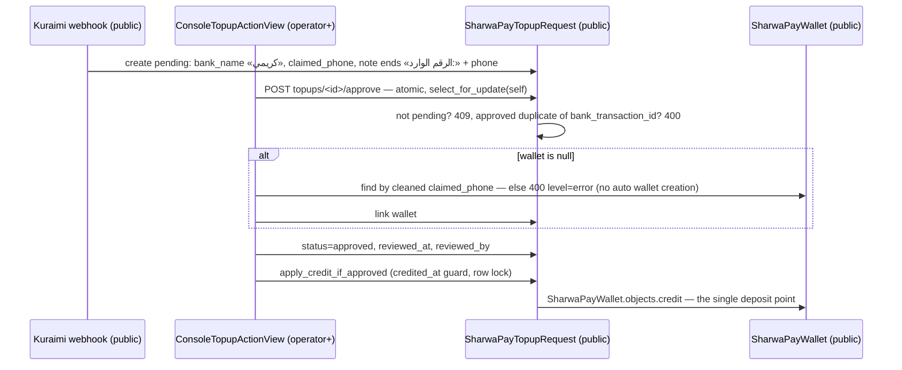
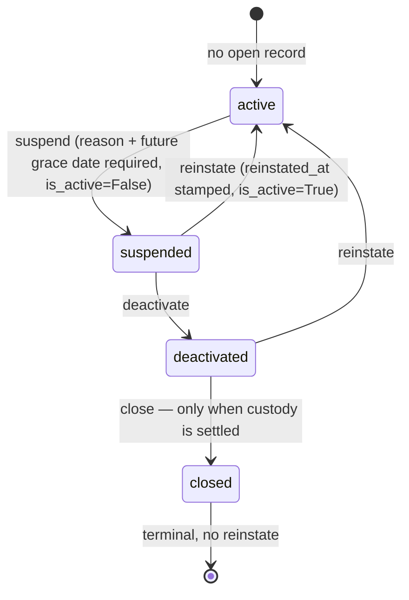

# Data model — Domain 16: platform console

> **Source**: DOC-496 · inventory Domain 16 · INT-030 (M20), INT-031 (M45), INT-032 (M46)
> **Code**: `sharwa_saas/tenants/{console_service,console_money_service,console_billing_service}.py` · `sharwa_saas/api/views_platform.py` · `sharwa_saas/{tenants,billing,appstore,marketing,sharwa_ship,sharwapay}/models.py` · `sharwa-frontend/src/features/platform-admin/…`
> **Last verified against code**: 2026-10-29 (step 50)

## 1. Purpose

Domain 16 is the platform owner's console: the Next.js screens under `src/app/(admin)/_a/(console)/` (feature code `src/features/platform-admin/`) that one superuser and any number of operational staff use to run every store of the platform from a single place. Three Django service modules hold all logic, and every route hangs off one base class in `sharwa_saas/api/views_platform.py`:

1. **M20 — console core (INT-030)**: stores list/detail, re-provisioning, per-store Sharwa Ship toggle, feature overrides and the feature catalogue, domains, the deactivation lifecycle, the carrier-webhook dead-letter queue, and the action log (`tenants/console_service.py`).
2. **M45 — money (INT-031)**: per-store dues (commissions and app invoices, 8 actions), Sharwa Pay top-up/withdrawal review, the customer wallet lookup, and Sharwa Ship zones (`tenants/console_money_service.py`).
3. **M46 — business model (INT-032)**: plans, the plan × feature matrix, subscriptions, the two billing switches, the app catalogue with app billing overrides, and market categories (`tenants/console_billing_service.py`).

This page is the **data model**: which model each console resource reads and writes, which schema each model lives in (everything public — §3.1), which migration added each console field, the providers and routes (§2), the flows that tie them together (§4), and the legacy Django-admin/HTML surface each console resource replaces (§2.4). The services deliberately add **no new decision logic**: re-provisioning reuses the admin action, Sharwa Ship reuses the two Celery tasks, features reuse `resolve_feature_decision`, dues reuse `.collect()`, top-ups reuse `apply_credit_if_approved` (`tenants/console_service.py:8-10`, `tenants/console_money_service.py:4-10`, `tenants/console_billing_service.py:4-7`).

Not covered here: request and response shapes and status codes per route — those are on the API pages for this domain ([`auth.md`](../../api/domains/16-platform-console/auth.md), [`m20-console.md`](../../api/domains/16-platform-console/m20-console.md), [`m45-dues-sharwa-pay-admin.md`](../../api/domains/16-platform-console/m45-dues-sharwa-pay-admin.md), [`m46-plans-billing.md`](../../api/domains/16-platform-console/m46-plans-billing.md)). The money rules behind dues and Sharwa Pay are in [`08-finance.md`](08-finance.md) and [`../43-ledgers.md`](../43-ledgers.md); provisioning mechanics in [`../11-provisioning.md`](../11-provisioning.md); schema isolation in [`../10-multi-tenancy.md`](../10-multi-tenancy.md) and [`../13-cross-schema-access.md`](../13-cross-schema-access.md); the plan catalogue in [`../15-plans-and-features.md`](../15-plans-and-features.md).

## 2. Components

### 2.1 Provider table (file → what it owns)

| Provider | Location | Owns |
|---|---|---|
| `console_service.py` | `sharwa_saas/tenants/console_service.py` (1001 lines, M20 — INT-030) | Session and roles (`console_role` `:80`, `can_write` `:90`, `OPERATOR_WRITES` `:77`), the action log (`log_action` `:110`, `action_view` `:124`), stores (`store_queryset` `:136`, `list_stores` `:294`, `client_options` `:326`, `store_detail` `:409`), overview (`overview` `:344`), re-provisioning (`reprovision` `:431`), Sharwa Ship state (`sharwa_ship_active` `:224`, `sharwa_ship_state` `:236`, `toggle_sharwa_ship` `:457`), per-store features (`store_features` `:495`, `save_store_features` `:520`), feature catalogue (`feature_views` `:573`, `patch_feature` `:599`, `resolve_for_store` `:628`), overrides (`list_overrides` `:662`, `bulk_override` `:676`, `delete_override` `:721`), domains (`add_domain` `:732`, `set_primary_domain` `:748`), deactivation (`custody` `:783`, `deactivation_state` `:814`, `deactivation_action` `:850`), webhook DLQ (`list_webhook_events` `:937`, `webhook_event_action` `:953`) |
| `console_money_service.py` | `sharwa_saas/tenants/console_money_service.py` (728 lines, M45 — INT-031) | Wallet lookup (`wallet_detail` `:87`), dues overview (`dues_overview` `:156`, pending counts via one UNION query `_pending_counts` `:121`), per-store dues (`dues_detail` `:249`), the eight dues actions (`DUE_ACTIONS` `:318`, `due_action` `:324`), top-up review (`topup_view` `:443`, `list_topups` `:467`, `topup_action` `:485`), withdrawal review (`withdrawal_action` `:569`), Sharwa Ship zones (`list_zones` `:623`, `_zone_fields` `:643`, `create_zone` `:700`, `update_zone` `:707`, `delete_zone` `:719`) |
| `console_billing_service.py` | `sharwa_saas/tenants/console_billing_service.py` (581 lines, M46 — INT-032) | Plans (`list_plans` `:75`, `_plan_fields` `:91`, `create_plan` `:155`, `update_plan` `:163`, `delete_plan` `:175`), matrix (`matrix` `:200`, `set_cell` `:208`), subscriptions (`list_subscriptions` `:221`, `assign_subscription` `:259`), billing switches (`billing_settings` `:298`, `patch_billing_settings` `:311`, `_stores_without_subscription` `:292`), apps (`_installation_counts` `:341`, `list_apps` `:388`, `create_app` `:439`, `update_app` `:446`), app billing overrides (`list_app_overrides` `:466`, `create_app_override` `:475`, `delete_app_override` `:500`), market categories (`categories` `:511`, `create_category` `:529`, `patch_category` `:539`, `reorder_categories` `:553`, `delete_category` `:570`) |
| `views_platform.py` | `sharwa_saas/api/views_platform.py` (553 lines) | One class per route, all deriving from `ConsoleView` (`:95`); the session gate `ConsoleView.initial` (`:103`); `ConsoleSessionAuthentication` (`:83`) that keeps "no session" a 401 with `WWW-Authenticate: Session`; console login with per-username lockout (`ConsoleLoginView` `:133`, limits `:78-81`) |
| Console models | `tenants/models.py`, `billing/models.py`, `appstore/models.py`, `marketing/models.py`, `sharwa_ship/models.py` | §3.2 |
| Reused money paths | `products/models/billing.py` (`.collect()`), `tenants/merchant_billing.py`, `products/services/app_marketplace_service.py`, `sharwapay/models.py` (`apply_credit_if_approved`) | Unchanged by M45; documented in [`08-finance.md`](08-finance.md) §4.6 and §4.8 |
| Frontend feature | `sharwa-frontend/src/features/platform-admin/` (`schemas/{auth,stores,billing,catalog,money,common}.ts`, `api/hooks.ts`, `components/`) · screens under `src/app/(admin)/_a/(console)/` | Zod schemas are the contract the three services shape their dicts to (`console_service.py:4-5`) |

### 2.2 Routes by provider, with the console session gate

Every route below is under `/api/v1/platform/` and registered in `sharwa_saas/api/urls.py:473-518`. The gate runs in `ConsoleView.initial` (`views_platform.py:103-111`) in this order:

1. **public schema only** — `_public_only()` (`:90-92`) raises 404 on any store origin or `X-Store-Domain` request (FR-20.01; test `test_store_origin_gets_404`, `api/test_platform_console_api.py:127`).
2. **console session** — `console_role` (`console_service.py:80-87`) maps a Django user to `superuser` (owner) or `operator` (`is_staff` without `is_superuser`); anything else is 401 «انتهت جلسة لوحة المنصة، سجّل الدخول مجدداً.» (`views_platform.py:74`, raised at `:108`).
3. **role vs area on writes** — `can_write(role, area)` (`console_service.py:90-91`): the superuser writes everywhere; an operator only in `OPERATOR_WRITES = ('dues', 'sharwa_pay')` (`:77`). Any other write is 403 «هذا الإجراء لمالك المنصة فقط.» (`views_platform.py:75`, FR-20.09). CSRF is enforced on every write including login (`SessionAuthentication`, `views_platform.py:43-44`, `:140`).

| Group (area) | Routes (under `/api/v1/platform/`) | Views |
|---|---|---|
| Auth | `auth/login/` POST, `auth/logout/` POST (204), `auth/me/` GET | `ConsoleLoginView` `:133`, `ConsoleLogoutView` `:177`, `ConsoleMeView` `:189` (`urls.py:473-475`) |
| Overview + stores (`stores`) | `overview/` GET; `stores/` GET `?status&plan&is_active&q&ordering&page&page_size`; `clients/` GET `?q` (⌘K picker, 20 results); `stores/reprovision/` POST `{schemas}`; `stores/<schema>/` GET; `stores/<schema>/sharwa-ship/` POST `{active}` | `views_platform.py:198-231` (`urls.py:476-481`) |
| Store-scoped M20 (`stores`) | `stores/<schema>/features/` GET, PUT; `stores/<schema>/domains/` POST; `stores/<schema>/domains/<pk>/` POST (make primary); `stores/<schema>/deactivation/` GET, POST | `views_platform.py:235-263` (`urls.py:482-485`) |
| Features + overrides (`billing`) | `features/` GET; `features/<code>/` PATCH; `features/<code>/resolve/?schema=` GET; `feature-overrides/` GET; `feature-overrides/bulk/` POST; `feature-overrides/<pk>/` DELETE | `views_platform.py:284-329` (`urls.py:486-491`) |
| Webhook DLQ (`webhooks`) | `webhook-events/` GET `?status&source`; `webhook-events/<pk>/<retry|discard>/` POST | `views_platform.py:267-279` (`urls.py:492-493`) |
| Dues (`dues`) | `dues/overview/` GET `?period=today|7d|30d&q`; `dues/<schema>/` GET; `dues/<schema>/actions/` POST `{action, record_id?, installation_id?}` | `views_platform.py:334-354` (`urls.py:495-497`) |
| Sharwa Pay (`sharwa_pay`) | `sharwa-pay/topups/` GET `?status&q`; `sharwa-pay/topups/<pk>/<approve|reject>/` POST `{note}`; `sharwa-pay/withdrawals/` GET; `sharwa-pay/withdrawals/<pk>/<confirm|reject>/` POST; `sharwa-pay/wallets/<phone>/` GET | `views_platform.py:359-395` (`urls.py:498-502`) |
| Zones (`zones`) | `sharwa-ship/zones/` GET, POST; `sharwa-ship/zones/<pk>/` PATCH, DELETE | `views_platform.py:400-419` (`urls.py:503-504`) |
| Plans / matrix / subscriptions / switches (`billing`) | `plans/` GET, POST; `plans/<pk>/` PATCH, DELETE; `plan-features/` GET, PUT `{plan_id, feature_code, is_enabled}`; `subscriptions/` GET; `subscriptions/assign/` POST; `billing-settings/` GET, PATCH | `views_platform.py:424-481` (`urls.py:506-511`) |
| Apps + categories (`apps` / `catalog`) | `apps/` GET, POST; `apps/<code>/` PATCH; `app-billing-overrides/` GET, POST; `app-billing-overrides/<pk>/` DELETE; `market-categories/` GET, POST; `market-categories/reorder/` POST `{ids}`; `market-categories/<pk>/` PATCH, DELETE | `views_platform.py:486-552` (`urls.py:512-518`) |

Console errors travel as `ConsoleError` (`console_service.py:57-67`): the view's `handle_exception` returns the body verbatim with its status (`views_platform.py:113-116`), so field errors keep the `{field: [messages]}` shape and financial failures carry `level: 'error'` (`console_money_service.py:53-55`).

### 2.3 Legacy admin and HTML surface (all still live)

The console did not delete anything; the Django admin and the two HTML dashboards keep their routes.

| Legacy surface | Code | What it does |
|---|---|---|
| Client admin actions | `tenants/admin.py:123-207`: `reprovision_tenants` `:126`, `activate_sharwa_ship` `:167`, `deactivate_sharwa_ship` `:189` | Bulk queue `provision_tenant_schema` for non-ready stores; schedule the two Sharwa Ship Celery tasks — the exact logic `console_service.reprovision` (`:448-450`) and `toggle_sharwa_ship` (`:477-479`) reuse |
| Bulk feature manager | `tenants/admin.py:209-270` (`manage_tenant_features` → `manage_tenant_features_view` + `_apply_feature_overrides` `:26`) | Intermediate checkbox page that creates/updates/deletes `TenantFeatureOverride` rows for the selected stores in one POST |
| DLQ + action-log admins | `tenants/admin.py:333-345` (`PendingWebhookEventAdmin`, `status` editable in the list), `:347-365` (`PlatformActionLogAdmin`, read-only: no add/change/delete) | The pre-console way to resolve a dead-letter event and to read the log |
| Sharwa Pay admins | `sharwapay/admin.py`: `SharwaPayTopupRequestAdmin` `:50` (`save_model` `:59` calls `apply_credit_if_approved`; actions `approve_topup` `:72`, `reject_topup` `:98`), `SharwaPayWithdrawalRequestAdmin` `:104` (`approve_withdrawal` `:112`, `reject_withdrawal` `:117`) | Bulk `queryset.update(...)` decisions; unlike the console they do not stamp `reviewed_by` (see [`08-finance.md`](08-finance.md) §4.8) |
| Billing admins | `billing/admin.py`: `PlanAdmin` `:27` with `PlanFeatureInline` `:13`, `SubscriptionAdmin` `:65` (`save_model` `:80` ends any current subscription), `PlatformBillingSettingsAdmin` `:86` (singleton guards `:92-99`), `FeatureAdmin` `:198`, `TenantFeatureOverrideAdmin` `:226`; `appstore/admin.py:11,32`; `marketing/admin.py:6`; `sharwa_ship/admin.py:11` | Full CRUD for every catalogue model the console also edits |
| Platform master dashboard (HTML) | `tenants/views.py:266-310` `platform_master_dashboard` (superuser only), route `config/urls_public.py:41` | Read-only totals from `TenantStatsSnapshot` + the last 50 stores — the same numbers `svc.overview` returns (`console_service.py:349-350`) |
| Platform dues dashboard (HTML) | `tenants/views.py:377-538` `platform_dues_dashboard`, route `config/urls_public.py:44`; overview rows `:545`, per-store detail `_collect_tenant_dues` `:578` | GET renders overview/detail; the POST block (`:407-505`) handles exactly the eight actions `collect_commission`, `waive_commission`, `collect_charge`, `waive_charge`, `unwaive_charge`, `generate_charge`, `suspend_app`, `reactivate_app` (`:422`, `:439`, `:456`, `:471`, `:482`) — the same eight as `DUE_ACTIONS` (`console_money_service.py:318-321`) |

### 2.4 Console resource → model → legacy equivalent

| Console API resource | Model(s) written or read | Legacy admin/HTML equivalent |
|---|---|---|
| `auth/login|logout|me` | Django `User` (`is_superuser`/`is_staff`), session + CSRF token | Django admin login (same user base; `views_platform.py:41-43`) |
| `overview/` | `Client`, `TenantStatsSnapshot`, `SharwaPayTopupRequest`/`SharwaPayWithdrawalRequest`/`PendingWebhookEvent` pending counts | `master-dashboard/` HTML (`tenants/views.py:267`) |
| `stores/`, `clients/`, `stores/<schema>/` | `Client`, `Domain`, `Subscription`, `TenantDeactivationRecord`, `PlatformActionLog`, `StoreAppInstallation` (read, store schema), `DeliveryMethod` (read, store schema), `Client.interested_categories` → `MarketCategory` | `ClientAdmin` list (`tenants/admin.py:110`) |
| `stores/reprovision/` | `Client.provisioning_status`/`provisioning_error` + `provisioning.queue_provisioning` | `ClientAdmin.reprovision_tenants` (`tenants/admin.py:126`) |
| `stores/<schema>/sharwa-ship/` | `DeliveryMethod` (store schema) via `tenants.tasks.*_sharwa_ship_task` | `ClientAdmin.activate_sharwa_ship` / `deactivate_sharwa_ship` (`tenants/admin.py:167`, `:189`) |
| `stores/<schema>/features/` | `TenantFeatureOverride` (+ `Feature`, `PlanFeature`, `PlatformBillingSettings` for the decision) | Bulk feature manager page (`tenants/admin.py:233`) |
| `stores/<schema>/domains/`, `domains/<pk>/` | `Domain` | `DomainAdmin` (`tenants/admin.py:271`) |
| `stores/<schema>/deactivation/` | `TenantDeactivationRecord`, `Client.is_active`; custody reads `ShipmentOrder`, `PlatformCommissionRecord`, `AppBillingCharge` (store schema) and `SharwaPayWallet` | none — no admin is registered for the model (§9) |
| `features/`, `features/<code>/` | `Feature` | `FeatureAdmin` (`billing/admin.py:198`) |
| `features/<code>/resolve/` | `resolve_feature_decision` (`billing/models.py:192`) | none (read-only view of the hierarchy) |
| `feature-overrides/…` | `TenantFeatureOverride` | `TenantFeatureOverrideAdmin` (`billing/admin.py:226`) + bulk manager |
| `webhook-events/…` | `PendingWebhookEvent` (+ re-runs `products.tasks.process_carrier_webhook_event`) | `PendingWebhookEventAdmin` status edit (`tenants/admin.py:333`) |
| `dues/overview/`, `dues/<schema>/` | `TenantStatsSnapshot`, `SharwaPayWallet`, `PlatformCommissionRecord`, `AppBillingCharge`, `StoreAppInstallation` | `master-dashboard/dues/` GET (`tenants/views.py:377`) |
| `dues/<schema>/actions/` (8) | `PlatformCommissionRecord`, `AppBillingCharge`, `StoreAppInstallation.suspended_by_platform`; debit via `collect_platform_fee_from_merchant` | `master-dashboard/dues/` POST block (`tenants/views.py:407-505`) |
| `sharwa-pay/topups/…` | `SharwaPayTopupRequest` (+ `SharwaPayWallet` through `apply_credit_if_approved`) | `SharwaPayTopupRequestAdmin` actions (`sharwapay/admin.py:72`, `:98`) |
| `sharwa-pay/withdrawals/…` | `SharwaPayWithdrawalRequest`, `SharwaPayWallet` (`withdrawal_reversal` credit) | `SharwaPayWithdrawalRequestAdmin` actions (`sharwapay/admin.py:112`, `:117`) |
| `sharwa-pay/wallets/<phone>/` | `SharwaPayWallet`, `SharwaPayWalletTransaction`, `Client.merchant_phone` | `SharwaPayWalletAdmin` (`sharwapay/admin.py:17`) |
| `sharwa-ship/zones/…` | `SharwaShipZone` | `SharwaShipZoneAdmin` (`sharwa_ship/admin.py:11`) |
| `plans/…` | `Plan` | `PlanAdmin` (`billing/admin.py:27`) |
| `plan-features/` | `PlanFeature` | `PlanFeatureInline` (`billing/admin.py:13`) |
| `subscriptions/…`, `subscriptions/assign/` | `Subscription` | `SubscriptionAdmin.save_model` (`billing/admin.py:80`) |
| `billing-settings/` | `PlatformBillingSettings`, `Subscription` (auto-assign) | `PlatformBillingSettingsAdmin` (`billing/admin.py:86`) |
| `apps/…` | `App` (+ `StoreAppInstallation` counts, read) | `AppAdmin` (`appstore/admin.py:11`) |
| `app-billing-overrides/…` | `AppBillingOverride` | `AppBillingOverrideAdmin` (`appstore/admin.py:32`) |
| `market-categories/…` | `MarketCategory`, `Client.interested_categories` | `MarketCategoryAdmin` (`marketing/admin.py:6`) |

## 3. Data model

### 3.1 Schema placement — everything public

Every model the console writes lives in the **public schema**. Evidence: `SHARED_APPS` (`config/settings.py:121`) contains `tenants` (`:123`), `billing` (`:132`), `sharwapay` (`:133`), `appstore` (`:134`), `marketing` (`:135`) and `sharwa_ship` (`:138`); none of them is in `TENANT_APPS` (`:152`). The store rows the console only *reads* (`DeliveryMethod`, `StoreAppInstallation`, `PlatformCommissionRecord`, `AppBillingCharge`, `ShipmentOrder`) stay in each tenant schema and are reached only through an explicit `schema_context`, and only for a `ready` store (`console_service.py:5-6`, `:229`, `:393`, `:767`; `console_money_service.py:254`).

| Group | Schema | Evidence |
|---|---|---|
| `Client`, `Domain`, `TenantStatsSnapshot`, `PendingWebhookEvent`, `TenantDeactivationRecord`, `PlatformActionLog` | public | app `tenants` in `SHARED_APPS` (`settings.py:123`); models in `tenants/models.py:26`, `:105`, `:310`, `:358`, `:391`, `:463` |
| `Plan`, `Subscription`, `PlatformBillingSettings`, `Feature`, `PlanFeature`, `TenantFeatureOverride` | public | app `billing` (`settings.py:132`); tables keep the pre-split names via `db_table = 'tenants_plan'` etc. (`billing/models.py:75`, `:113`, `:156`) |
| `App`, `AppBillingOverride` | public | app `appstore` (`settings.py:134`); `db_table = 'tenants_app'` / `'tenants_appbillingoverride'` (`appstore/models.py:81`, `:126`) |
| `MarketCategory` | public | app `marketing` (`settings.py:135`); `db_table = 'tenants_marketcategory'` (`marketing/models.py:30`) |
| `SharwaShipZone` | public | app `sharwa_ship` (`settings.py:138`); `sharwa_ship/models.py:18` |
| `SharwaPayWallet`, `SharwaPayTopupRequest`, `SharwaPayWithdrawalRequest` | public (referenced) | app `sharwapay` (`settings.py:133`); documented in [`08-finance.md`](08-finance.md) §3 |

Cross-schema links are all **soft** (django-tenants forbids FKs across schemas): `PendingWebhookEvent.tenant_schema_name` and `PlatformActionLog.schema_name` are plain strings (`tenants/models.py:370`, `:476`); `SharwaShipZone.code` is snapshotted on each waybill (`console_money_service.py:644-646`); the merchant wallet is found by `Client.merchant_phone == SharwaPayWallet.customer_phone` (`console_money_service.py:76-84`). See [`../13-cross-schema-access.md`](../13-cross-schema-access.md).

### 3.2 Model table

Sixteen console-relevant models plus three referenced Sharwa Pay models. Fields in **bold** are the console additions of M20/M45/M46.

| Model | Schema | Key fields | Constraints / indexes | Added or changed by |
|---|---|---|---|---|
| `Client` (`tenants/models.py:26`) | public | `schema_name`, `name`, `merchant_phone` (unique, indexed), `interested_categories` M2M → `MarketCategory`, `terms_accepted_at`, `is_active`, `provisioning_status` (`pending/provisioning/ready/failed`, indexed) + `provisioning_started_at`/`provisioned_at`/`provisioning_error` | `is_active, created_on` index (`:83`); django-tenants `TENANT_MODEL` | `tenants/0025_client_provisioning_status`; earlier history in [`01-public-onboarding.md`](01-public-onboarding.md) |
| `TenantStatsSnapshot` (`tenants/models.py:310`) | public | `client` FK CASCADE, `date`, `orders_count`, `completed_orders_count`, `refunded_orders_count`, `revenue_sar` (14,2) | `UniqueConstraint(client, date)` `unique_tenant_stats_day` (`:327`); `date` indexed | `tenants/0019_tenant_stats_snapshot`; fed by `products.tasks.populate_tenant_stats_snapshot` (§6) |
| `PendingWebhookEvent` (`tenants/models.py:358`) | public | `waybill_number` (indexed), `tenant_schema_name` (blank allowed), `carrier_code` (default `sharwa_ship`), `payload` (JSON), `error_detail`, `attempts` (default 0), `status` (`pending/resolved/discarded`, indexed), `created_at`, `updated_at`, **`resolved_at`** | ordering `-created_at`; no row is ever deleted — both resolutions keep it (`:361`) | `tenants/0020_pendingwebhookevent_waybillregistry`; `resolved_at` by `tenants/0027_platform_console_api` (`:26-29`) |
| `TenantDeactivationRecord` (`tenants/models.py:391`) | public | `client` FK CASCADE, `status` (`suspended/deactivated/closed`, indexed), `deactivated_at`, `grace_period_ends_at`, `settled_custody`, `reason`, `closed_at`, `created_at`, **`reinstated_at`**, **`actor`** (150), **`updated_at`** | ordering `-created_at`; one open record per store is enforced in the service (`reinstated_at__isnull=True` filters, `:411` comment); store-side guards read it (`products/views/edge_cases.py:33`, `products/services/shipping_billing_service.py:57`) | `tenants/0022_tenantdeactivationrecord`; the three console fields + `updated_at = created_at` backfill by `tenants/0027` (`:30-45`) |
| `PlatformActionLog` (`tenants/models.py:463`) | public | `client` FK **SET_NULL** nullable, `schema_name` (indexed, kept when the store is deleted), `actor_username`, `actor_role` (`superuser`/`operator`), `action` (indexed, ≤60), `detail`, `created_at` (indexed) | append-only: `PlatformActionLogAdmin` denies add/change/delete (`tenants/admin.py:355-362`); a `DatabaseError` in `log_action` never fails the action itself (`console_service.py:120-121`) | created by `tenants/0027` (`:46-63`) |
| `Plan` (`billing/models.py:27`) | public (`tenants_plan`) | `name`, `code` (slug, unique, immutable), `description`, `is_free`, `price` (10,2), `currency`, `billing_interval` (`monthly/yearly/lifetime`), `commission_type` (`none/percentage/fixed`) + `commission_value`, `max_products`/`max_orders_per_month` (null = unlimited), `is_active`, `is_default_free`, `display_order` | `Plan.save` keeps exactly one `is_default_free` (`:83-88`); delete refused while subscriptions exist (service 409) and `Subscription.plan` is PROTECT (`:103`) | `tenants/0012_plan_subscription_platformbillingsettings`; moved state-only to `billing` (`tenants/0016` + `billing/0001`) |
| `PlanFeature` (`billing/models.py:275`) | public | `plan` FK CASCADE, `feature` FK CASCADE, `is_enabled` | `UniqueConstraint(plan, feature)` `unique_plan_feature` (`:288`) | `billing/0002_feature_toggling`; managed by the console matrix (§4.6) |
| `Feature` (`billing/models.py:213`) | public | `code` (slug, unique, immutable), `name`, `description`, `module_group`, `is_active_globally` (default **True**, kill switch), `requires_plan` (default False) | ordering `module_group, name` | `billing/0002_feature_toggling`; feature rows seeded by `billing/0003`–`0013` |
| `TenantFeatureOverride` (`billing/models.py:295`) | public | `feature` FK CASCADE, `client` FK CASCADE (`'tenants.Client'` string ref), `is_enabled` (no default — explicit choice), `notes` (255), `created_at`, **`updated_at`** | `UniqueConstraint(feature, client)` `unique_feature_override_per_client` (`:314`) | `billing/0002_feature_toggling`; `updated_at` + backfill by `billing/0012_tenantfeatureoverride_updated_at` |
| `Subscription` (`billing/models.py:91`) | public (`tenants_subscription`) | `client` FK CASCADE, `plan` FK **PROTECT**, `status` (`active/cancelled/expired`), `is_current`, `started_at`, `current_period_end`, `cancelled_at`, `notes` (255) | index `(client, is_current)` pinned to the pre-move name (`:120`); `assign_plan` (`:126-137`) is the only assignment point | `tenants/0012`; state move `tenants/0016`/`billing/0001` |
| `PlatformBillingSettings` (`billing/models.py:140`) | public (`tenants_platformbillingsettings`) | `subscriptions_enabled` (default False), `commission_enabled` (default False), `updated_at` | singleton: `save()` forces `pk=1` (`:163-165`), `delete()` is a no-op (`:167-168`), `load()` get-or-creates (`:170-173`) | `tenants/0012`; state move; console reads/writes both switches (`console_billing_service.py:298-337`) |
| `App` (`appstore/models.py:18`) | public (`tenants_app`) | `code` (unique, immutable), `name`, `description`, `icon` (image, legacy templates), **`icon_name`** (40, lucide library name), `is_listed`, `is_free`, `price`, `currency`, `billing_interval` (`monthly/yearly`), `billing_enabled` | `is_billed_for_client` (`:89-108`): override first, then `is_free`, then `billing_enabled` | `tenants/0009_app`; pricing `tenants/0014`; `icon_name` by `appstore/0007_app_icon_name` (INT-032) |
| `AppBillingOverride` (`appstore/models.py:111`) | public (`tenants_appbillingoverride`) | `app` FK CASCADE, `client` FK CASCADE, `is_billed` (no default), `notes`, `created_at` | `UniqueConstraint(app, client)` `unique_app_billing_override_per_client` (`:130`) — one override per app × store | `tenants/0014_app_billing_appbillingoverride` |
| `MarketCategory` (`marketing/models.py:13`) | public (`tenants_marketcategory`) | `name` (100, unique), `display_order` (indexed), `is_active` (indexed) | ordering `display_order, name`; linked from `Client.interested_categories` (M2M table `tenants_client_interested_categories`, `tenants/models.py:40-44`) | `tenants/0011_marketcategory_and_client_interests`; state move `marketing/0001_initial` (`SeparateDatabaseAndState`, no SQL) |
| `SharwaShipZone` (`sharwa_ship/models.py:18`) | public | `code` (slug, unique, immutable after creation), `name`, `price` (10,2), `currency`, `volumetric_divisor` (default 5000), `center_latitude`/`center_longitude` (10,7) + `radius_km` (8,2) — all three or none, `is_active`, `sort_order` | ordering `sort_order, name`; new codes must match `^[A-Z]{3}-\d{2}$` (`console_money_service.py:603`, `:653`) | `sharwa_ship/0001_initial`; `0002` (volumetric divisor); `0003` (geo circle) |
| `SharwaPayTopupRequest` (`sharwapay/models.py:168`) | public | (finance fields in [`08-finance.md`](08-finance.md) §3.2) + **`bank_name`** (100), **`claimed_phone`** (20), **`reviewed_by`** (150) | `bank_transaction_id` unique; `credited_at` is the single-credit guard | `tenants/0004`–`0007`; console display/audit fields by `sharwapay/0003_console_review_fields` (§4.2) |
| `SharwaPayWithdrawalRequest` (`sharwapay/models.py:256`) | public | (finance fields in [`08-finance.md`](08-finance.md)) + **`reviewed_by`** (150) | `status` indexed | `tenants/0004`, `0007`; `reviewed_by` by `sharwapay/0003` |
| `SharwaPayWallet` (`sharwapay/models.py:80`) | public | referenced for wallet lookup, custody check and dues debit | `customer_phone` unique | documented in [`08-finance.md`](08-finance.md) §3.2 |

### 3.3 ER sketch: one console, public rows and soft links into the stores

Solid lines are foreign keys inside the public schema; dotted lines are soft links (no FK) or "written by". Entities starting with `W_` are the console write paths, with `file:line` of the write.

```mermaid
erDiagram
  %% ===== store identity and history (public) =====
  Client ||--o{ Domain : "domains"
  Client ||--o{ TenantStatsSnapshot : "stats_snapshots"
  Client ||--o{ TenantDeactivationRecord : "deactivation_records"
  Client ||--o{ Subscription : "subscriptions"
  Client ||--o{ PlatformActionLog : "platform_actions SET_NULL"
  Client ||--o{ TenantFeatureOverride : "feature_overrides"
  Client ||--o{ AppBillingOverride : "app_billing_overrides"
  Client }o--o{ MarketCategory : "interested_categories M2M"
  Subscription }o--|| Plan : "plan PROTECT"
  Plan ||--o{ PlanFeature : "plan_features"
  Feature ||--o{ PlanFeature : "plan_features"
  Feature ||--o{ TenantFeatureOverride : "overrides"
  App ||--o{ AppBillingOverride : "billing_overrides"
  PlatformBillingSettings ||..o{ Subscription : "subscriptions_enabled gates auto-assign"
  Plan ||..o{ Subscription : "is_default_free is the auto-assigned plan"

  %% ===== money (public, owned by Domain 8) =====
  SharwaPayWallet ||--o{ SharwaPayTopupRequest : "topup_requests, nullable"
  SharwaPayWallet ||--o{ SharwaPayWithdrawalRequest : "withdrawal_requests"
  Client ||..o| SharwaPayWallet : "merchant_phone = customer_phone"

  %% ===== DLQ =====
  PendingWebhookEvent {
    string waybill_number
    string tenant_schema_name "soft link, no FK"
    string carrier_code
    json payload
    int attempts
    string status "pending, resolved, discarded"
    datetime resolved_at
  }

  %% ===== soft links into tenant schemas (read-only from console) =====
  PendingWebhookEvent ||..o| ShipmentOrder : "tenant_schema_name, no FK"
  Client ||..o{ StoreAppInstallation : "schema_name, no FK"
  Client ||..o{ PlatformCommissionRecord : "schema_name, no FK"
  Client ||..o{ AppBillingCharge : "schema_name, no FK"
  App ||..o{ StoreAppInstallation : "code = app_code, no FK"
  Plan ||..o{ PlatformCommissionRecord : "snapshot only"
  App ||..o{ AppBillingCharge : "snapshot only"

  %% ===== console writers =====
  W_log_action ||..o{ PlatformActionLog : "log_action, every console write"
  W_suspend ||..o{ TenantDeactivationRecord : "deactivation_action"
  W_suspend ||..o{ Client : "is_active flip"
  W_reprovision ||..o{ Client : "provisioning_status = pending"
  W_override ||..o{ TenantFeatureOverride : "save_store_features, bulk_override"
  W_cell ||..o{ PlanFeature : "set_cell update_or_create"
  W_assign ||..o{ Subscription : "assign_plan"
  W_switch ||..o| PlatformBillingSettings : "patch_billing_settings"
  W_app_override ||..o{ AppBillingOverride : "create/delete_app_override"
  W_category ||..o{ MarketCategory : "create/patch/reorder/delete"
  W_zone ||..o{ SharwaShipZone : "create/update/delete_zone"
  W_topup_action ||..o{ SharwaPayTopupRequest : "topup_action"
  W_withdrawal_action ||..o{ SharwaPayWithdrawalRequest : "withdrawal_action"
  W_collect ||..o{ PlatformCommissionRecord : "collect() debit"
  W_collect ||..o{ AppBillingCharge : "collect() debit"
  W_generate ||..o{ AppBillingCharge : "generate_billing_charge"
  W_app_suspend ||..o{ StoreAppInstallation : "suspended_by_platform"
  W_dlq_retry ||..o| PendingWebhookEvent : "retry re-runs the task, same key"
  W_kuraimi_webhook ||..o{ SharwaPayTopupRequest : "creates approved or pending"
  W_stats_job ||..o{ TenantStatsSnapshot : "nightly populate task"

  W_log_action {
    string fn "tenants/console_service.log_action :110"
  }
  W_suspend {
    string fn "console_service.deactivation_action :850"
  }
  W_reprovision {
    string fn "console_service.reprovision :449"
  }
  W_override {
    string fn "console_service.save_store_features :555, bulk_override :711"
  }
  W_cell {
    string fn "console_billing_service.set_cell :215"
  }
  W_assign {
    string fn "console_billing_service.assign_subscription :285, Subscription.assign_plan :126"
  }
  W_switch {
    string fn "console_billing_service.patch_billing_settings :318"
  }
  W_app_override {
    string fn "console_billing_service.create_app_override :493"
  }
  W_category {
    string fn "console_billing_service.reorder_categories :564"
  }
  W_zone {
    string fn "console_money_service.create_zone :702"
  }
  W_topup_action {
    string fn "console_money_service.topup_action :492-530 + apply_credit_if_approved sharwapay/models.py:208"
  }
  W_withdrawal_action {
    string fn "console_money_service.withdrawal_action :577-596"
  }
  W_collect {
    string fn "console_money_service._commission_action :359, _charge_action :381 → collect_platform_fee_from_merchant"
  }
  W_generate {
    string fn "console_money_service._generate_charge :411 → generate_billing_charge"
  }
  W_app_suspend {
    string fn "console_money_service._app_suspension :430, :434"
  }
  W_dlq_retry {
    string fn "console_service.webhook_event_action :985, :993"
  }
  W_kuraimi_webhook {
    string fn "tenants/webhooks.kuraimi_topup_webhook :102, :121"
  }
  W_stats_job {
    string fn "products/tasks/reports.populate_tenant_stats_snapshot_for_tenant :86"
  }
```

| Entity | Schema |
|---|---|
| `Client`, `Domain`, `TenantStatsSnapshot`, `PendingWebhookEvent`, `TenantDeactivationRecord`, `PlatformActionLog`, `Plan`, `Subscription`, `PlatformBillingSettings`, `Feature`, `PlanFeature`, `TenantFeatureOverride`, `App`, `AppBillingOverride`, `MarketCategory`, `SharwaShipZone`, `SharwaPayWallet`, `SharwaPayTopupRequest`, `SharwaPayWithdrawalRequest` | public |
| `StoreAppInstallation`, `PlatformCommissionRecord`, `AppBillingCharge`, `ShipmentOrder`, `DeliveryMethod` | store (read-only from the console) |

### 3.4 Migrations

All migrations below exist in the repository; `tenants/`, `billing/`, `appstore/`, `marketing/`, `sharwapay/`, `sharwa_ship/` migrations run once, in `public`.

**The console migrations (Phase 002)**

| Migration | What it did |
|---|---|
| `tenants/0027_platform_console_api.py` (INT-030, M20) | Adds `PendingWebhookEvent.resolved_at`; `TenantDeactivationRecord.reinstated_at`, `actor`, `updated_at` (backfill `updated_at = created_at`, reverse is a no-op); creates `PlatformActionLog` |
| `billing/0012_tenantfeatureoverride_updated_at.py` (INT-030, M20) | Adds `TenantFeatureOverride.updated_at` (backfill `updated_at = created_at`) — the console override list is ordered by it (`console_service.py:671`) |
| `sharwapay/0003_console_review_fields.py` (INT-031, M45) | Adds `SharwaPayTopupRequest.bank_name`, `claimed_phone`, `reviewed_by` and `SharwaPayWithdrawalRequest.reviewed_by`, then backfills (§4.2) |
| `appstore/0007_app_icon_name.py` (INT-032, M46) | Adds `App.icon_name` (40) — a frontend icon-library name such as `message-circle`, not a brand logo (`appstore/models.py:43-45`) |

**Earlier history that shaped the models**

| Migration | What it did |
|---|---|
| `tenants/0019_tenant_stats_snapshot.py`, `tenants/0020_pendingwebhookevent_waybillregistry.py` | The daily snapshot table (unique per client+day) and the DLQ + central waybill registry (`attempts` exists since `0020`, line `:22`) |
| `tenants/0022_tenantdeactivationrecord.py` | The deactivation record with grace period and custody flag (issue #46) |
| `tenants/0011_marketcategory_and_client_interests.py`, `tenants/0014_app_billing_appbillingoverride.py` | Market categories + the `Client` M2M; app pricing keys |
| `tenants/0016_move_models_to_new_apps.py` with `billing/0001_initial.py`, `appstore/0001_initial.py`, `marketing/0001_initial.py` | State-only move of the catalogue models to their own apps (`SeparateDatabaseAndState`, no SQL; `db_table` pinned) |
| `billing/0002_feature_toggling.py`, `billing/0003`–`0013` seeds | `Feature`, `PlanFeature`, `TenantFeatureOverride`, then one seed migration per feature code |
| `sharwa_ship/0001_initial.py`, `0002`, `0003` | `SharwaShipZone`, its volumetric divisor and its geo circle |

## 4. Flows

### 4.1 Console session

`POST platform/auth/login/` (`views_platform.py:138-173`): CSRF is enforced on the login itself (`:140`); failures are counted per username (5 per 15 min, `:78-79`) and per IP (100, a deliberately wide ceiling for Yemeni CGNAT, `:80-81`); a locked account answers 429 «محاولات دخول كثيرة — حاول بعد 15 دقيقة.» with `Retry-After` (`:77`, `:155-157`); a valid user without console rights gets the same 400 «اسم المستخدم أو كلمة المرور غير صحيحة.» as a wrong password (no account enumeration, `:76`, `:162-166`). `login()` rotates the CSRF token and the response carries the new one (`:169-172`). Store-origin requests never see any of this — they get 404 at step 1 of the gate (§2.2).

### 4.2 Sharwa Pay top-up review, and the Kuraimi backfill

Two paths create the rows the console reviews:

- **Kuraimi bank webhook** (`tenants/webhooks.py:39`): when the customer's phone matches an existing wallet, the request is created **approved and credited in the same transaction** with `bank_name` set to «كريمي» (`:102-113`, bank name at `:108`). When no wallet matches, the request is created **pending** with `wallet=None`, `bank_name` set to «كريمي» (`:124`), `claimed_phone=(clean_phone or customer_note)[:20]` (`:125`) and a reference note ending in the claimed phone: «تحويل بنكي آلي عبر كريمي — عملية {transaction_id} — الرقم الوارد: {customer_note}» (`:123`).
- **Customer app** (`sharwapay/customer_api.create_topup`): pending with receipt image, no bank name.

`sharwapay/0003_console_review_fields.py` backfilled the display fields for existing rows before the console shipped: every request with a `bank_transaction_id` got `bank_name` set to «كريمي» (migration `:17`), and for wallet-less requests the claimed phone was parsed out of the note with the regular expression `CLAIMED_RE`, which matches the label «الرقم الوارد:» followed by the phone at the very end of the note (migration `:12`, applied at `:18-21`, cut to 20 characters). So the literals «كريمي» (`tenants/webhooks.py:108`, `:124`; migration `:17`) and «الرقم الوارد:» (`tenants/webhooks.py:123`; migration `:12`) are the durable carriers of the bank name and the claimed phone.

Rules the code adds: reject requires a note («اذكر سبب الرفض» is enforced as a field error, `console_money_service.py:497`); approving a bank-id that another approved request already uses answers 400 with `duplicate_of` (`:505-513`); a wallet-less top-up is **never** auto-attached to a wallet the customer never opened — the operator is told to have the customer open the wallet first (`:514-523`, same constraint as the admin action's skip warning `sharwapay/admin.py:87-94`); every decision stamps `reviewed_by` (`:501`, `:527`), which the admin bulk actions do not (see [`08-finance.md`](08-finance.md) §4.8).

### 4.3 Sharwa Pay withdrawal review

`withdrawal_action` (`console_money_service.py:569-599`): the amount left the wallet at request time, so **confirm** only records the fact (`status='approved'`), while **reject** credits the amount back as `withdrawal_reversal` in the same transaction as the status change (`:584-590`), both under `select_for_update(of=('self',))` (`:578`). A decided request answers 409 with the shared "already handled" wording (`HANDLED` `:31`, raised at `:580`). Reject requires a note (`:583`).

### 4.4 Dues: overview, detail and the eight actions

The overview (`dues_overview` `:156-198`) reads only public rows for the period (1/7/30 days): the latest `TenantStatsSnapshot` per store, the merchant `SharwaPayWallet`, and a pending-dues count computed by **one UNION ALL query across all ready stores' schemas** (`_pending_counts` `:121-141`); if any schema is missing the query aborts and a per-store fallback runs, each store inside its own atomic block (`:144-153`). The per-store detail (`dues_detail` `:249-304`) enters one schema and lists pending commissions, pending and waived app charges, uninvoiced billed installations, installations with suspension/expiry state, per-currency totals, the merchant wallet and the latest snapshot.

The eight actions (`DUE_ACTIONS` `:318-321`) map one-to-one to the eight POST branches of the legacy HTML dashboard (`tenants/views.py:422-505`) and reuse the same four service functions:

| Action | What it does | Where |
|---|---|---|
| `collect_commission` / `collect_charge` | lock the pending row, `.collect()` → `collect_platform_fee_from_merchant` debits the merchant's Sharwa Pay wallet; failure is 400 `{detail, level: 'error'}` and the row stays pending | `:347-362`, `:365-384` |
| `waive_commission` / `waive_charge` | status → `waived`, no money moves | `:353-356`, `:373-376` |
| `unwaive_charge` | a wrongly waived charge returns to `pending` (the unique `(installation, period_label)` makes regeneration impossible, so this is the only correction path) | `:377-380` |
| `generate_charge` | `generate_billing_charge` for the current period label; already-generated is 409 | `:396-416` |
| `suspend_app` / `reactivate_app` | `suspend_app_for_billing` / `reactivate_app_after_payment` — the platform-only suspension the merchant cannot lift | `:419-435` |

A store that is suspended but not closed stays reachable (`_ready_client` `:202-209`) — its dues must be settled before it can be closed (test `test_suspended_store_dues_stay_reachable`, `api/test_platform_money_api.py:115`).

### 4.5 Deactivation and reinstate

`deactivation_state` (`console_service.py:814-833`) computes the four allowed transitions from the open record (`reinstated_at__isnull=True`); `deactivation_action` (`:850-900`) re-checks under `select_for_update` on the open record before writing, so two operators cannot both suspend. **Close** additionally requires settled custody (`custody` `:783-795`): no open shipments, no pending platform dues (checked inside the store's schema, `:761-780`) and a zero Sharwa Pay merchant-wallet balance across all four currencies. Reinstate does not delete the record — it stamps `reinstated_at`, and every guard (store-side suspension banner `products/views/edge_cases.py:33-38`, waybill blocking `products/services/shipping_billing_service.py:55-63`) filters `reinstated_at__isnull=True`, so history stays complete.

### 4.6 Feature decision, store overrides and matrix cells

`store_features` (`console_service.py:495-517`) shows every `Feature` with its effective value and the deciding step, from the single decision function `resolve_feature_decision` (`billing/models.py:192-210`): explicit override → global kill switch → `requires_plan=False` → subscriptions disabled → `PlanFeature` check. `PUT stores/<schema>/features/` (`save_store_features` `:520-561`) takes `{code, is_enabled: bool|null, notes}` per feature: `null` deletes the override (return to the hierarchy), `true/false` is saved via `update_or_create` even when it matches the plan default — a one-store decision must survive a later plan change (`:522-523` docstring). The bulk endpoint (`bulk_override` `:676-718`) applies one feature to many stores in one transaction and logs per store. The matrix cell `PUT plan-features/` (`set_cell` `console_billing_service.py:208-217`) is one `PlanFeature.objects.update_or_create(plan=plan, feature=feature, defaults={'is_enabled': enabled})` (`:215`) — cell states are rows, not columns; there is no "clear" (a cell is either granted or not granted).

### 4.7 Billing switches and the auto-assign

`PATCH billing-settings/` (`patch_billing_settings` `console_billing_service.py:311-337`) locks the singleton row (`select_for_update` `:318`). Turning `subscriptions_enabled` on for the first time assigns the active default free plan to **every ready store without a current subscription, in the same transaction** (`:320-327`), stamping the notes «إسناد تلقائي عند تفعيل الباقات» (`AUTO_ASSIGN_NOTE` `:27`); without this, enabling subscriptions would immediately block every plan-gated feature for those stores (hierarchy step 5, `:313-315`). There must be an active default free plan or the switch refuses to flip (`:323-324`). The read side reports `stores_without_subscription` — ready stores with no current `Subscription` (`:292-295`, `:305`).

### 4.8 Carrier webhook dead-letter queue

`process_carrier_webhook_event` (`products/tasks/shipping.py:66-72`) retries transient carrier failures with backoff; on final failure `_WebhookDLQTask.on_failure` writes the raw payload to `PendingWebhookEvent` in public (`:49-59`). The console lists events (`list_webhook_events` `:937-950`, `store_missing` true when the tenant row is gone) and resolves them (`webhook_event_action` `:953-1000`): **discard** flips the status with `resolved_at` under a conditional update (`:965`); **retry** refuses when the store is gone or the payload has no target status (`:972-977`), rebuilds the **same idempotency key** the original call used (`carrier_idempotency_key`, `:981`, key builder `products/tasks/shipping.py:27-33`), re-runs the task synchronously (no worker, immediate feedback for the operator), and on success stamps `status='resolved'`, `attempts+1`, `resolved_at` (`:993-995`). Any re-run failure records the new error and `attempts+1` and leaves the event pending (`:989-992`). A decided event answers 409 «الحدث غير موجود أو تم التعامل معه مسبقاً.» (`HANDLED` `:54`).

### 4.9 Market categories: reorder the full set, or keep it

`reorder_categories` (`console_billing_service.py:553-567`) requires the body to list **every** category id exactly once — `len(ids) != len(all_ids) or set(ids) != all_ids` answers 400 «أرسل كل الفئات بترتيبها الجديد.» (`:561-562`) — then renumbers `display_order = 1..n` in one transaction. Delete is refused for a category any store ticked at registration: `interested_clients.count()` > 0 answers 409 with «الفئة مختارة لدى {used} متجراً — عطّلها بدل الحذف.» (`:577`; `{used}` is the number of stores) — «عطّلها بدل الحذف» is the operator instruction embedded in the error. A create appends with `display_order = max + 1` (`:533-534`); names are unique among categories (`:524-525`).

## 5. Invariants

| Invariant | Enforced by |
|---|---|
| Console tables are public; a store origin never reaches them | `_public_only` 404 (`views_platform.py:90-92`), first check in `ConsoleView.initial` (`:104`); test `test_store_origin_gets_404` |
| Writes need a role that owns the area | `can_write` + `OPERATOR_WRITES` (`console_service.py:77`, `:90-91`) at `views_platform.py:109-110`; operator tests in all three test files |
| Every console write is logged with who and role | `log_action` after each mutating service call (all call sites pass `actor`); the log write itself can never fail the action (`console_service.py:120-121`) |
| Cross-schema reads never leak out of an explicit `schema_context`, and a missing schema never breaks the request | every read wrapped in `transaction.atomic(), schema_context(...)` — a savepoint that absorbs the error and degrades the row (`console_service.py:229-233`, `:393-397`, `:767-775`; `console_money_service.py:137-153`, `:363-367`; test `test_missing_schema_does_not_break_the_request`, `api/test_platform_console_api.py:404`, class docstring «القراءة تفشل داخل savepoint ولا تُفسد المعاملة» `:402`) |
| One open deactivation record per store | all filters use `reinstated_at__isnull=True` (`console_service.py:149`, `:199`, `:864`); second suspend answers 409 (`:876`) |
| A closed store is never reinstated; a store is closed only with settled custody | allowed-transitions table (`:826-832`) + `custody` (`:783-795`) |
| One override per feature × store, one per app × store, one `PlanFeature` per plan × feature | `unique_feature_override_per_client` (`billing/models.py:314`), `unique_app_billing_override_per_client` (`appstore/models.py:130`), `unique_plan_feature` (`billing/models.py:288`); the service also pre-checks and converts `IntegrityError` (`console_billing_service.py:487-495`) |
| Exactly one default free plan; a plan with any subscription history is never deleted | `Plan.save` (`billing/models.py:83-88`); current-subscriber 409 then `PROTECT` 409 (`console_billing_service.py:180-195`) |
| A money decision happens once | `select_for_update` before every decide (`console_money_service.py:492`, `:578`, `:350`, `:369`, `console_service.py:863`); non-pending rows answer 409 with the "already handled" wording (`HANDLED` `console_money_service.py:31`, `console_service.py:54`) |
| A top-up credits exactly once, from any path | `credited_at` guard inside `apply_credit_if_approved` (`sharwapay/models.py:234-253`), called by console approve (`console_money_service.py:530`) |
| Plan/subscription codes are immutable once used | code change attempts are field errors (`console_billing_service.py:102-103`, `:405-406`; `console_money_service.py:657-658` for zones) |
| Sharwa Ship "activating/deactivating" is a cache flag, not a state column | `_ship_job_key` with a 10-minute TTL (`console_service.py:49`, `:206-207`, `:473-475`); the truth is `DeliveryMethod` in the store schema (`:224-233`) |

## 6. Background work

The console queues no new Celery tasks of its own; it reuses and surfaces existing ones (see [`../50-background-jobs.md`](../50-background-jobs.md)):

| Task | Trigger from the console | Queue / schedule |
|---|---|---|
| `tenants.tasks.provision_tenant_schema` | `stores/reprovision/` → `provisioning.queue_provisioning` (`console_service.py:450`) | `default`; retried by Beat `retry-stalled-tenant-provisioning` every 5 min (`config/settings.py:624-627`) — the same staleness definition the console shows (`stalled_q` `console_service.py:163-171` quotes the sweeper) |
| `tenants.tasks.activate_sharwa_ship_task` / `deactivate_sharwa_ship_task` | `stores/<schema>/sharwa-ship/` (`console_service.py:477-479`) | `default`; the console sets the cache flag first and answers 503 if the broker is down (`:474-483`) |
| `products.tasks.process_carrier_webhook_event` | DLQ **retry** runs it synchronously, same idempotency key (`console_service.py:981-988`) | normally async with backoff ×8 (`products/tasks/shipping.py:66-72`); its final failure is what writes the DLQ row |
| `products.tasks.populate_tenant_stats_snapshot` | none (feeds the overview numbers) | Beat daily 00:40 (`config/settings.py:750-753`), fanning out per tenant (`products/tasks/reports.py:101-111`) |

There is **no sweeper for `PendingWebhookEvent`**: nothing resolves or expires rows automatically; both resolutions are human (console retry/discard, or the admin status edit). The action log has no retention job either — it is append-only.

## 7. Configuration

| Setting | Default | Effect |
|---|---|---|
| `PlatformBillingSettings.subscriptions_enabled` | `False` | plan system on; first enable auto-assigns the default free plan (§4.7) |
| `PlatformBillingSettings.commission_enabled` | `False` | commission **recording** on; collection stays a manual dues action |
| `Plan.is_default_free` / `is_active` | `False` / `True` | the auto-assign source; both are required together (`console_billing_service.py:322-324`) |
| Role rules | superuser = «مالك المنصة» (`tenants/models.py:470`, `views_platform.py:42`), `is_staff` = operator | `console_role` (`console_service.py:80-87`); operator writes limited to dues and Sharwa Pay (`:77`) |
| Login limits | 5 failures / 15 min per username, 100 per IP | `views_platform.py:78-81`; IP ceiling wide on purpose for CGNAT (`:80` comment) |
| Page sizes | 50 default, 100 max; stores list keeps 50 recent; wallet shows last 100 movements | `console_service.py:45-47`, `console_money_service.py:32` |
| `SHIP_JOB_TTL_SECONDS` | 600 | how long the activating/deactivating cache flag outlives its task (`console_service.py:49`) |
| Zone rules | new codes `^[A-Z]{3}-\d{2}$`; `volumetric_divisor` 1000–10000 (default 5000); geo circle all-or-nothing | `console_money_service.py:603`, `:674-676`, `:682-686` |
| Frontend live keys | `platform`, `platform_money`, `platform_billing` (`SHARWA_LIVE_MODULES`) | which console rows the BFF proxies live vs fixtures — see the API pages for this domain |

## 8. Failure modes and fixes

| Failure | Symptom | Cause | Handling / fix |
|---|---|---|---|
| Store schema missing (deleted manually) while `Client` says `ready` | store detail shows `sharwa_ship: inactive`, empty installations, unsettled custody warning | the schema read raised inside its savepoint | savepoint absorbs it (`console_service.py:229-233`, `:393-397`, `:773-775`); test `test_missing_schema_does_not_break_the_request` (`api/test_platform_console_api.py:401-410`) |
| UNION dues count aborts | overview still renders, warning in logs | one schema missing breaks the multi-schema `UNION ALL` | per-store fallback loop, each store in its own atomic block; unreadable store counts 0 (`console_money_service.py:142-153`) |
| Dues collection with low balance | 400 `{detail, level: 'error'}`, record stays pending | `collect_platform_fee_from_merchant` returned `(False, error)` | merchant tops up Sharwa Pay, retry — the row is still `pending` (test `test_actions_end_to_end` asserts the 400 then the real debit 20 → 17.50, `api/test_platform_money_api.py:122-132`) |
| Double decision (two operators, stale tab) | 409 with the "already handled" message | conditional `select_for_update` + status filter | refresh the list; the response of the first operator stands |
| Approving a wallet-less top-up | 400 telling the operator the claimed phone has no wallet | no wallet was ever created for that phone | customer opens the wallet, then re-approve; or link it from the Django admin (`console_money_service.py:514-523`) |
| Sharwa Ship task cannot be queued | 503 «تعذّر إرسال المهمة الآن — حاول بعد قليل.» (`console_service.py:483`) | broker down | the cache flag is deleted and the task is not sent (`:480-483`); retry later |
| Console login locked | 429 + `Retry-After: 900` | 5 failures per username in 15 min | wait; a successful login clears the username counter (`views_platform.py:168`) |
| Plan delete refused | 409 with the current-subscriber count, or the PROTECT message naming history | active subscriptions, or historical subscriptions | move stores to another plan first; a plan with history can only be deactivated — the message says «عطّلها بدل الحذف» for categories and the equivalent for plans (`console_billing_service.py:180-195`, `:577`) |
| Category delete refused | 409, message ending «عطّلها بدل الحذف.» (`console_billing_service.py:577`) | stores ticked it at registration | deactivate (`is_active=false`) instead of deleting |
| Cache down | Sharwa Ship state falls back to the truth, log-only warnings | `_cache_get`/`_cache_set` swallow exceptions | no user-facing failure (`console_service.py:210-221`, `:475-476`) |
| Action log unavailable | action succeeds, one warning line | `log_action` catches `DatabaseError` | deliberate: the log never blocks an operator action (`console_service.py:120-121`) |

### 8.1 Tests

| File | Tests | Covers |
|---|---|---|
| `api/test_platform_console_api.py` | 14 | `PlatformConsoleApiTests` (`:43`, 12): `test_session_roles_and_login` (401/403 paths, role payloads, CSRF token), `test_login_lockout_by_username` (429 + `Retry-After`), `test_store_origin_gets_404`, `test_overview_and_store_list_contract`, `test_reprovision_and_detail`, `test_sharwa_ship_toggle`, `test_feature_resolution_and_overrides`, `test_feature_catalog_and_bulk_overrides`, `test_domains`, `test_deactivation_lifecycle`, `test_webhook_events`, `test_carrier_webhook_uses_the_shared_idempotency_key`; **real tenant-schema read**: `TenantSchemaReadsTests.test_reads_come_from_the_store_schema` (`:380-399` — DeliveryMethod, StoreAppInstallation and custody read from a live store schema, asserting `schema_context` returns to `public`); **missing-schema store**: `MissingSchemaTests.test_missing_schema_does_not_break_the_request` (`:401-410`) |
| `api/test_platform_money_api.py` | 7 | `DuesConsoleTests` (`TenantTestCase`, `:53`): `test_overview_and_detail_contract`, `test_suspended_store_dues_stay_reachable`, `test_actions_end_to_end` (`:121-160`) — **real wallet debits** in a live store schema: insufficient-balance 400, then balance 20 → 17.50 SAR with a `platform_fee` movement, all eight actions, `PlatformActionLog` row; `SharwaPayConsoleTests` (`:164`): `test_topup_approve_reject_and_unmatched`, `test_withdrawal_confirm_and_reject_reverses`, `test_operator_cannot_edit_zones`; `ZonesConsoleTests.test_zone_crud_and_rules` |
| `api/test_platform_billing_api.py` | 7 | `BillingConsoleTests` (`:54`): `test_plans_crud_and_rules`, `test_matrix_and_subscriptions`, `test_enabling_plans_assigns_the_default_free_plan`, `test_apps_and_overrides`, `test_market_categories`, `test_operator_reads_but_cannot_write`; **real installation count**: `InstallationCountTests.test_counts_come_from_store_schemas` (`:193-201`, `TenantTestCase` — counts read from a live store schema via the UNION path) |

The counts match the roadmap's 14 / 7 / 7 exactly. Related legacy tests outside these files: `tenants/test_platform_dues_dashboard.py` (the HTML dues dashboard and its eight POST actions). Among the files read, none covers `platform_master_dashboard`, the admin actions or the Kuraimi webhook on the console path.

## 9. Open items

- ⚠️ Discrepancy — roadmap says the console feature lives under `sharwa-frontend/src/features/console/` / code has it under `src/features/platform-admin/` (schemas, hooks, screens) with the route group `src/app/(admin)/_a/(console)/`; no `src/features/console/` exists. The backend docstrings name `src/features/platform-admin/schemas/*` as the contract source (`tenants/console_service.py:4`). Reported in step 50.
- ⚠️ Discrepancy — roadmap lists `PendingWebhookEvent` "(+ `resolved_at`, `attempts`)" under migrations `tenants/0027` / `billing/0012` / `attempts` predates the console: it was created with the model in `tenants/0020_pendingwebhookevent_waybillregistry.py:22` and is only *displayed and incremented* by the console; `tenants/0027` adds `resolved_at` alone. Reported in step 50.
- ⚠️ Discrepancy — the DOC-496 bullet groups `TenantFeatureOverride` with the `tenants` models / the model lives in `billing/models.py:295` (app `billing`, table public since the split); its console field `updated_at` came from `billing/0012`, not `tenants/0027`. Reported in step 50.
- ⚠️ Discrepancy — the roadmap's "HTML `master-dashboard` + `master-dashboard/dues/` (8 POST actions)" reads as if both screens take POSTs / `master-dashboard/` (`platform_master_dashboard`, `tenants/views.py:267-310`) is GET-only and renders totals; all eight POST actions are in `master-dashboard/dues/` (`platform_dues_dashboard`, `:407-505`). Reported in step 50.
- **No admin for the deactivation record.** `TenantDeactivationRecord` has no Django-admin class (nothing registers it — see the register list in `tenants/admin.py`); the console is its only write surface, so the "legacy equivalent" column of §2.4 is empty for it.
- **Legacy admin decisions lose attribution.** The Sharwa Pay admin bulk actions stamp only `reviewed_at` (`sharwapay/admin.py:99`, `:113-114`), never `reviewed_by`; the console stamps both. Rows decided before M45 (or by the admin after it) have an empty `reviewed_by` and the console shows `—`.
- **Legacy dues dashboard and console can race, and only one logs.** Both surfaces decide the same rows; both lock before deciding, so the loser gets the "already handled" message. But `PlatformActionLog` is written only by the console services — a grep finds no `log_action` call in `tenants/views.py` or any admin file — so dues decided from `master-dashboard/dues/` never appear in the action log.
- **Plan delete messages differ by cause.** Current subscribers produce a count message; historical subscriptions produce the PROTECT message that advises deactivation instead (`console_billing_service.py:180-195`) — both are 409, so clients must not rely on the text.
- **`aggregate_tenant_stats` exists but is not scheduled.** `tenants/tasks.py:121-160` still contains the older direct-from-orders aggregation; the Beat entry that actually runs is `products.tasks.populate_tenant_stats_snapshot` (`config/settings.py:750-753`), which reads `DailyStoreMetrics`. The unscheduled task is dead code unless invoked manually.
- **Category reorder is all-or-nothing.** A partial id list is rejected (`console_billing_service.py:561-562`); there is no append/insert operation — new categories always land last (`:533-534`).
- **Unverified.** Whether any operator-facing screen or report reads `PlatformActionLog` outside `store_detail` (last 20) and the read-only admin was not exhaustively checked; no other reader was found in the files read.

## 10. Related pages

- API pages for this domain: [`auth.md`](../../api/domains/16-platform-console/auth.md) · [`m20-console.md`](../../api/domains/16-platform-console/m20-console.md) · [`m45-dues-sharwa-pay-admin.md`](../../api/domains/16-platform-console/m45-dues-sharwa-pay-admin.md) · [`m46-plans-billing.md`](../../api/domains/16-platform-console/m46-plans-billing.md) · domain index [`README.md`](../../api/domains/16-platform-console/README.md)
- Money behind dues and Sharwa Pay: [`08-finance.md`](08-finance.md) · [`../40-money.md`](../40-money.md) · [`../41-idempotency.md`](../41-idempotency.md) · [`../43-ledgers.md`](../43-ledgers.md)
- Platform structure: [`../10-multi-tenancy.md`](../10-multi-tenancy.md) · [`../11-provisioning.md`](../11-provisioning.md) · [`../13-cross-schema-access.md`](../13-cross-schema-access.md) · [`../14-store-lifecycle.md`](../14-store-lifecycle.md) · [`../15-plans-and-features.md`](../15-plans-and-features.md)
- Logging and jobs: [`../37-audit.md`](../37-audit.md) · [`../50-background-jobs.md`](../50-background-jobs.md) · [`../jobs/provisioning-and-carrier-webhooks.md`](../jobs/provisioning-and-carrier-webhooks.md)
- Data model siblings: [`01-public-onboarding.md`](01-public-onboarding.md) (`Client`, `MarketCategory` at registration)
- Index: [`README.md`](README.md)
