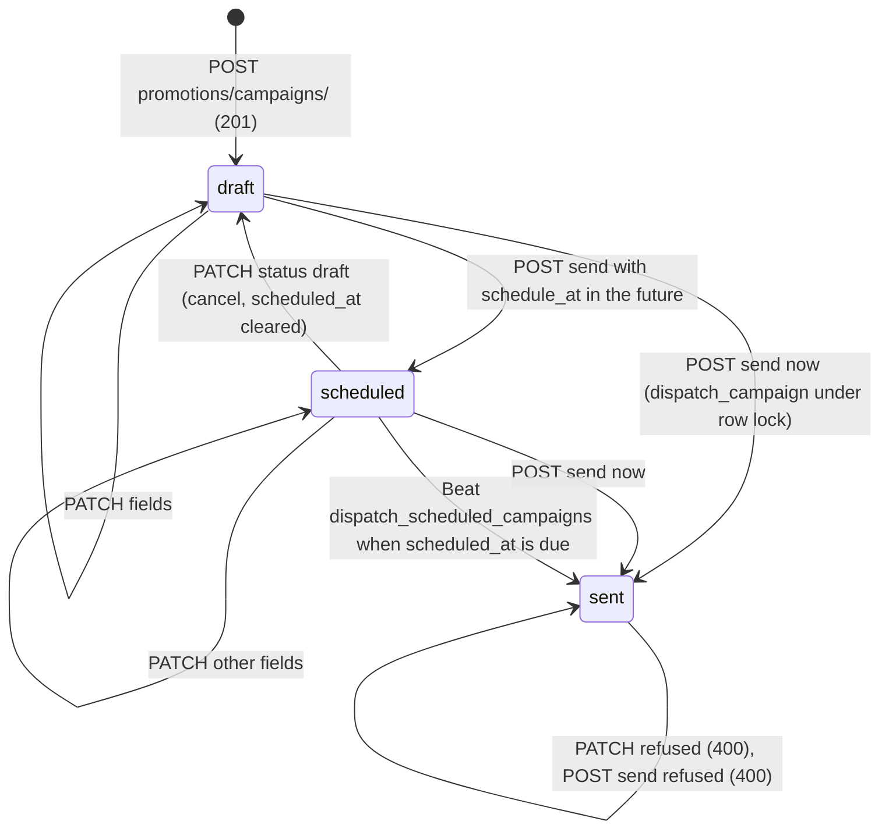
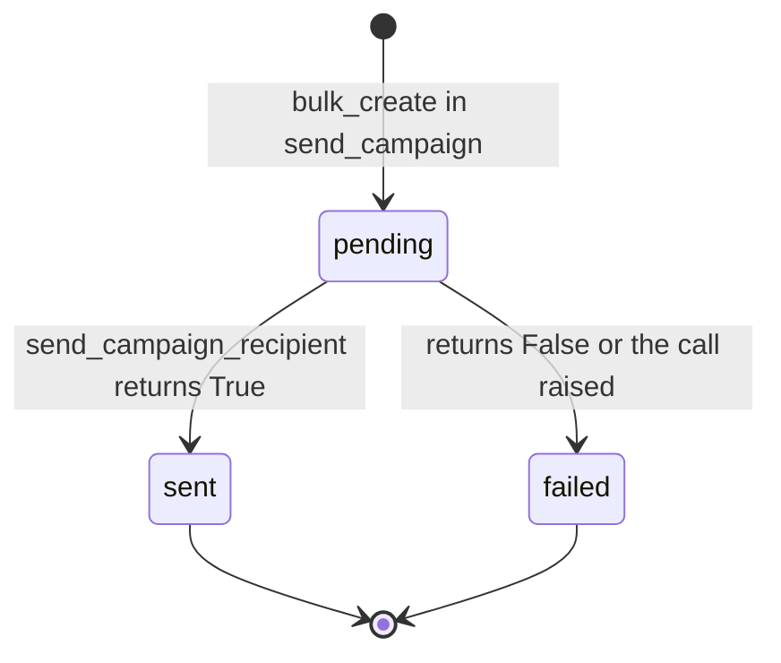
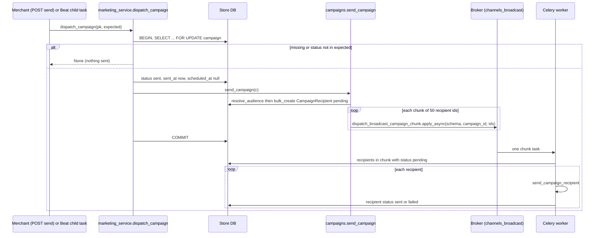

# Marketing campaign jobs — `dispatch_scheduled_campaigns` and the chunked send

> **Source**: DOC-499 · inventory A.8 · INT-019 (M13)
> **Code**: `sharwa_saas/products/campaigns.py` (`send_campaign`, `send_campaign_recipient`, `resolve_audience`) · `products/services/marketing_service.py` (`dispatch_campaign`, `dispatch_due_campaigns`, `send_campaign_now`, `update_campaign`, `channel_connected`, `remind_cart`) · `products/tasks/operations.py` (`dispatch_scheduled_campaigns*`) · `products/tasks/channels.py` (`dispatch_broadcast_campaign_chunk`) · `products/models/marketing.py` (`MarketingCampaign`, `CampaignRecipient`) · `products/abandoned_cart_service.py` · `products/management/commands/send_abandoned_cart_reminders.py` · `api/views_marketing.py` · `config/settings.py` (`CELERY_BEAT_SCHEDULE`, `CELERY_TASK_ROUTES`)
> **Last verified against code**: 2026-10-28 (step 38)

## 1. Purpose

A merchant composes a marketing message, picks a channel and an audience, then either sends it now or schedules it. This page documents everything that happens **after** the merchant presses send:

1. the **status flip under a row lock** (so a double click, or the button and the Beat worker together, never send twice);
2. the **fan-out into `CampaignRecipient` rows and fixed-size chunks**, each chunk processed by one Celery task on the isolated `channels_broadcast` queue;
3. the **Beat dispatcher** that sends scheduled campaigns when they fall due — before INT-019 the button saved «scheduled» and nothing ever sent the campaign;
4. the **abandoned-cart reminders**, which share the channel/dispatch machinery but run through a management command, not the campaign tables.

It does not cover the CRUD screens of campaigns (see the API page [`m13-marketing.md`](../../api/domains/07-marketing-design-partners/m13-marketing.md)), conversational channel delivery (`dispatch_channel_message`, see [`channels.md`](channels.md)), or the WhatsApp gateway ([`whatsapp.md`](whatsapp.md)).

> ⚠️ Discrepancy — roadmap says `send_campaign` is a job that sends "in chunks" and flips the status under a row lock / code does: `send_campaign` (`products/campaigns.py:196`) is a **plain function**, not a Celery task, and it neither locks nor flips the status. The lock and the flip are in `marketing_service.dispatch_campaign` (`marketing_service.py:844-857`); the Celery task that sends is `products.tasks.dispatch_broadcast_campaign_chunk` (`products/tasks/channels.py:625`). Reported in step 38.

## 2. Components

| Component | Location | Role |
|---|---|---|
| `send_campaign_now(pk, data)` | `marketing_service.py:860` | Endpoint logic of `POST promotions/campaigns/<id>/send/`: refuses sent campaigns, refuses a not-connected channel, then either schedules (`schedule_at`) or dispatches now. |
| `dispatch_campaign(pk, expected)` | `marketing_service.py:844` | Opens `transaction.atomic()`, `select_for_update()` on the campaign, requires `status in expected`, sets `status='sent'`, `sent_at=now`, `scheduled_at=None`, then calls `send_campaign`. Returns `None` when the row is missing or not in `expected`. |
| `dispatch_due_campaigns(now)` | `marketing_service.py:879` | Per-store Beat body: `status='scheduled' AND scheduled_at <= now` → `dispatch_campaign(pk, expected=('scheduled',))`. Returns how many were dispatched. |
| `send_campaign(campaign)` | `campaigns.py:196` | `resolve_audience` → `bulk_create` of `CampaignRecipient(status='pending')` → ids split by `_chunk_ids` into chunks of `CAMPAIGN_CHUNK_SIZE` → one `dispatch_broadcast_campaign_chunk.apply_async(args=[schema, campaign_id, ids], queue='channels_broadcast')` per chunk. Returns `(recipient_count, chunk_count)`. |
| `dispatch_broadcast_campaign_chunk` | `tasks/channels.py:625-665` | Worker side: loads the campaign, loads the chunk's recipients **still `pending`**, calls `send_campaign_recipient` for each, with a per-recipient `try/except`. |
| `send_campaign_recipient(campaign, recipient)` | `campaigns.py:250` | The single place that knows how to deliver one campaign message; sets `recipient.status` to `sent`/`failed` and `sent_at`. |
| `dispatch_scheduled_campaigns` / `_for_tenant` | `tasks/operations.py:170-173`, `:161-167` | Beat dispatcher and its per-store child (fan-out pattern, [`../50-background-jobs.md`](../50-background-jobs.md)). |
| `channel_connected(channel)` | `marketing_service.py:717` | `False` for `sms` and `email`; otherwise `is_app_active(channel)` (installed, `is_active`, subscription not expired). |
| `run_abandoned_cart_reminders` / `_send_one_reminder` | `abandoned_cart_service.py:233`, `:191` | Reminder engine (§4.5). |
| `send_abandoned_cart_reminders` | `management/commands/send_abandoned_cart_reminders.py:30` | Per-store loop that calls the engine. |

## 3. Data model

Owned models (store schema; full field list in [`../data-model/07-marketing-design-partners.md`](../data-model/07-marketing-design-partners.md)):

| Model | Key fields used by the jobs | Notes |
|---|---|---|
| `MarketingCampaign` (`models/marketing.py:365`) | `status` ∈ `draft` / `scheduled` / `sent` (indexed), `scheduled_at`, `sent_at` (INT-019: the instant of the actual send), `channel` ∈ `sms`, `email`, `whatsapp`, `meta_social_commerce`, `tiktok_shop`, `telegram_bot`, `audience_type` ∈ `all`, `abandoned_carts`, `dormant`, `bought_product`, `product`, `dormant_days` (forced to 90 by `_apply_campaign`, `marketing_service.py:815`), `message` (5–1000 characters), `is_active` | `is_active` is never read by the send path (§9). |
| `CampaignRecipient` (`models/marketing.py:420`) | `campaign` FK (`related_name='recipients'`), `customer_name`, `customer_phone`, `customer_email`, `external_contact_id` (PSID / open_id / chat_id for the three chat channels), `status` ∈ `pending` / `sent` / `failed`, `sent_at` | One row per reachable recipient, created in one `bulk_create`. No unique `(campaign, phone)` constraint. |
| `AbandonedCart` | `status` ∈ `active` / `abandoned` / `recovered`, `reminder_step` (0–2), `last_reminder_sent_at`, `last_interaction_at`, `reminder_discount_coupon` | updated by `_send_one_reminder` with a queryset `update()` |
| `AbandonedCartSettings` | `is_enabled` (default `False`), `min_cart_value`, `channel_whatsapp` (default `True`), `channel_conversational_enabled` (default `False`), `reminder_1_delay_hours` (2), `reminder_2_delay_hours` (24), `discount_percent` (0), `discount_validity_hours` (24) | `models/store_settings.py:681` |

## 4. Flows

### 4.1 Campaign state machine

Per-recipient lifecycle (rows created by `send_campaign`):

Rules read from the code:

- **Cancel** is `PATCH promotions/campaigns/<id>/` with `{"status": "draft"}` on a *scheduled* campaign: status → `draft`, `scheduled_at` → `null` (`marketing_service.py:828-831`). The same body on a draft just re-applies the other fields. A `sent` campaign answers 400 «الحملة المرسلة للقراءة فقط.».
- **Send / schedule** is `POST promotions/campaigns/<id>/send/` (owner only, feature `campaigns`). In order: a sent campaign → 400 «أُرسلت هذه الحملة من قبل.»; not connected → 400 «القناة غير مربوطة — اربطها أولاً.»; `schedule_at` present: unparsable or `<= now` → 400 `{schedule_at: ['«اختر وقتاً في المستقبل.»']}`, otherwise `status='scheduled'`, `scheduled_at=<value>` and the campaign view is returned; no `schedule_at` → `dispatch_campaign`, and a `None` result (lost the race) → 400 «أُرسلت هذه الحملة من قبل.» (`marketing_service.py:860-876`).
- `recipients` in the campaign view counts `CampaignRecipient` rows by status; a *scheduled* campaign with no rows yet shows the **live** audience size as `pending` (`marketing_service.py:744-745`).
- `sent` means "handed to the queue", not "delivered": the campaign flips to `sent` (with `sent_at`) before a single message is sent, even when the audience is empty (`recipients_count = 0`).

### 4.2 Send path: lock, fan-out, chunks

Delivery per channel (`send_campaign_recipient`, `campaigns.py:250-344`):

| `campaign.channel` | What happens | `recipient.status` means |
|---|---|---|
| `meta_social_commerce`, `tiktok_shop`, `telegram_bot` (`CHAT_CHANNEL_CODES`) | needs `external_contact_id` (audience is intersected with `Conversation` of the same `channel_code` by phone in `resolve_audience`); `create_pending_usage_log(channel, event_type='campaign_broadcast')` then `dispatch_channel_message.apply_async(..., queue=CHANNEL_DISPATCH_QUEUE_MAP[channel])` (`channels_meta` / `channels_tiktok` / `channels_telegram`) | `sent` = queued for the channel task only; the real outcome is on the `AppUsageLog` row and the `Message` row (see [`channels.md`](channels.md)). No `external_contact_id` or no usage log (`create_pending_usage_log` returned `None`: app not installed) → `failed`. |
| `whatsapp` | synchronous `WhatsAppService.send_message(phone, text)` (`products/services/messaging.py:14`): a POST with a 10 s timeout to the platform's Green API account configured by `GREEN_API_INSTANCE`, `GREEN_API_TOKEN`, `GREEN_API_URL`; the same path the OTP uses, **not** the store's SharwaConnect session. No phone → `failed`. | `sent` = HTTP 2xx from the gateway; no `AppUsageLog` row and no cost row are written. |
| `email` | `LogGateway.send_email` — logs the message and returns success (`campaigns.py:60-62`) | `sent` although nothing is delivered (no real provider). |
| `sms` | `LogGateway.send_sms` — same | same |

The audience (`resolve_audience`, `campaigns.py:169`) is computed from `audience_type` alone: `all` = distinct phones of non-cancelled orders; `dormant` = latest order older than `dormant_days` (90); `bought_product` = distinct buyers of `campaign.product`; `abandoned_carts` = carts with `status='abandoned'` and a phone. For the three chat channels the result is then filtered to contacts with a conversation on that channel.

The `{customer_name}` placeholder is the only variable (`render_message`, `campaigns.py:184`); an empty name becomes «عميلنا العزيز».

### 4.3 Scheduled dispatch (Beat)

```mermaid
flowchart LR
  B["Beat: dispatch-scheduled-campaigns, crontab minute */5"] --> D["dispatch_scheduled_campaigns (dispatcher, 120 s soft limit)"]
  D -->|"_fan_out_per_tenant: tenants with provisioning_status ready, not public"| T["dispatch_scheduled_campaigns_for_tenant(schema) (300 s soft limit)"]
  T --> S["schema_context then dispatch_due_campaigns()"]
  S --> L["for each campaign scheduled with scheduled_at <= now"]
  L --> X["dispatch_campaign(pk, expected=scheduled)"]
  X --> N["status sent, recipients, chunks on channels_broadcast"]
```

A scheduled campaign is sent at the first tick after `scheduled_at`, i.e. up to ~5 minutes late. The dispatcher only counts `dispatch_campaign` results that are not `None`; a campaign locked and flipped by a concurrent click is skipped silently (`marketing_service.py:879-883`). `api/test_marketing_api.py::test_scheduled_campaigns_are_dispatched` checks exactly this: a due campaign is sent once (second call returns 0), a future one stays `scheduled`.

### 4.4 Channel connectivity

`channel_connected` (`marketing_service.py:717-725`) is the gate used by `send_campaign_now` and by `GET promotions/campaigns/channels/` (`channel_statuses`, six rows in the fixed order `sms, email, whatsapp, meta_social_commerce, tiktok_shop, telegram_bot`, with `manage_href`):

| Channel | Connected when |
|---|---|
| `sms`, `email` | never — «no real provider» (`LogGateway` only); `send` answers 400 «القناة غير مربوطة — اربطها أولاً.» |
| `whatsapp`, `meta_social_commerce`, `tiktok_shop`, `telegram_bot` | `is_app_active(<channel code>)` — an installed app whose `StoreAppInstallation.is_effectively_active()` is true: `is_active` and `subscription_expires_at` empty or in the future (`app_marketplace_service.py:25`, `models/apps.py:86`); any exception → `False` |

The gate runs only when the merchant presses send (now or schedule). `dispatch_due_campaigns` does **not** re-check it (§9).

### 4.5 Abandoned-cart reminders

Two entry points share one function, `_send_one_reminder(cart, step, settings, base_url)` (`abandoned_cart_service.py:191`):

| Entry | Code | Preconditions |
|---|---|---|
| Scheduled engine | `run_abandoned_cart_reminders(base_url)` (`:233`), called by the management command | `AbandonedCartSettings.is_enabled`; then `promote_abandoned_carts()` (active carts idle > `ABANDON_THRESHOLD_HOURS = 2` h → `abandoned`); for step 1 and 2: carts with `status='abandoned'`, `reminder_step = step-1`, a phone, `total_amount >= min_cart_value`, and the delay elapsed (`_due_carts_for_step`, `:33`: step 1 counted from `last_interaction_at` + `reminder_1_delay_hours`, step 2 from `last_reminder_sent_at` + `reminder_2_delay_hours`) |
| Manual "remind" | `marketing_service.remind_cart` (`:633`) ← `POST promotions/abandoned-carts/<id>/remind/` | cart has a phone, is `abandoned`, `reminder_step < 2`; ignores `is_enabled`, minimum value and delays. Errors: «لا رقم هاتف لهذه السلة.» · «التذكير متاح للسلات المتروكة فقط.» · «أُرسل التذكيران لهذه السلة — لا تذكير ثالث.» · when `_send_one_reminder` returns `False`: «لا قناة إرسال متاحة لهذه السلة — فعّل واتساب في إعدادات الاسترداد أو اربط القناة.» |

`_send_one_reminder` (never raises; returns `True` only when the message was queued):

1. **Channel** (`_resolve_reminder_channel`, `:154`): if `channel_conversational_enabled` and a `Conversation` exists for the phone → that conversation's `channel_code` + `external_contact_id`; else `('whatsapp', phone)` if `channel_whatsapp`; else none → `False` and a warning.
2. **Text** (`render_reminder_message`, `:137`): the store template for the step (`reminder_1_message` or `reminder_2_message`) with `{customer_name}`, `{cart_url}` (signed restore link, salt `abandoned-cart-restore`), and for step 2 `{discount_percent}`, `{discount_code}`. Step 2 creates the **coupon once per cart** (`_generate_recovery_coupon`, `:53`): code `BACK<cart id><4 random digits>`, percent type, `max_uses=1`, valid `discount_validity_hours`; only when `discount_percent > 0`.
3. **Dispatch**: `create_pending_usage_log(channel_code, event_type='abandoned_cart_reminder', recipient_phone=to)` (→ `False` if no installation for that app), then `dispatch_channel_message.apply_async(..., queue=CHANNEL_DISPATCH_QUEUE_MAP.get(channel_code, 'whatsapp'))`.
4. **State**: `AbandonedCart.objects.filter(pk).update(reminder_step=step, last_reminder_sent_at=now)`. A cart is reminded **once per step**; `True` means "queued", not "delivered" (the usage log carries the outcome).

#### Beat state of the reminder command (verified)

`send_abandoned_cart_reminders` is a **management command with no schedule in the repository**:

- `CELERY_BEAT_SCHEDULE` (`config/settings.py:622-764`) has no entry that calls it, `run_abandoned_cart_reminders` or any `*reminder*` task; `products/tasks/*.py` contains no reminder task and no `call_command`.
- `deploy/` (`celery.env`, `docker-compose.prod.yml`, `systemd/celery-sharwa.service`, `systemd/celery-sharwa-beat.service`, `README.md`, `deploy.sh`) contains no cron line, timer or container that runs it.
- The only abandoned-cart schedule is Beat `expire-stale-active-carts` (`settings.py:654-657`, every 30 min → `expire_stale_active_carts`), which marks `active` carts idle for 24 h (`DRAFT_CART_TTL_HOURS`, `tasks/operations.py:134`) as `abandoned`. It sends nothing.
- [`../../ops/management-commands.md`](../../ops/management-commands.md#send_abandoned_cart_reminders) already records the same finding.

> ⚠️ Discrepancy — roadmap says abandoned-cart reminders go out "via the scheduled command" / code does: the command exists (`send_abandoned_cart_reminders.py:30`) but nothing in the repository schedules it — no `CELERY_BEAT_SCHEDULE` entry, no cron or systemd timer in `deploy/`. Automatic reminders are sent only when someone runs `python manage.py send_abandoned_cart_reminders`; the manual «remind» button works independently. Reported in step 38.

The command iterates `Client.objects.exclude(schema_name='public')` (no `provisioning_status` filter, unlike `_fan_out_per_tenant`), uses `StoreSetting.custom_domain` or the primary `Domain` for `base_url` (a store with neither is skipped with a warning), and isolates each store with its own `try/except`.

## 5. Invariants

| Invariant | Enforced by |
|---|---|
| A campaign is dispatched at most once | row lock + status check in `dispatch_campaign` (`marketing_service.py:849-855`); the lock is held while `send_campaign` runs, the status is `sent` on commit |
| A re-delivered chunk never re-sends a recipient | the task filters `status='pending'` (`tasks/channels.py:651-653`) and `send_campaign_recipient` always leaves `sent`/`failed` |
| One failing recipient does not stop the chunk | per-recipient `try/except` marks it `failed` (`:655-665`) |
| A sent campaign is read-only | `update_campaign` (400) and `send_campaign_now` (400) |
| Chat-channel campaigns reach only known conversations | `_attach_chat_channel_contact` (`campaigns.py:134`) + safety check in `send_campaign_recipient` |
| Each abandoned cart gets at most one reminder per step; one coupon per cart | `_due_carts_for_step` filter on `reminder_step`; `_generate_recovery_coupon` reuses `reminder_discount_coupon` |
| Beat never sends for a store still provisioning | `_fan_out_per_tenant` filters `provisioning_status = ready` (`products/tasks/_common.py:45-46`) |

## 6. Background work

### 6.1 Job table

| Job (dotted path / task name) | Kind | Trigger (who / where) | Queue | Schedule | Retry | Idempotency | Failure handling |
|---|---|---|---|---|---|---|---|
| `products.tasks.operations.dispatch_scheduled_campaigns` / `products.tasks.dispatch_scheduled_campaigns` | Beat (dispatcher) | Beat entry `dispatch-scheduled-campaigns` (`settings.py:645-648`) | `default` (no route) | `crontab(minute='*/5')` | none; global `acks_late` + `reject_on_worker_lost` (`settings.py:564-565`); limits `DISPATCHER_TASK_LIMITS` soft 120 s / hard 180 s | stateless; missing a tick only delays the send | exception logged by Celery; next tick retries because campaigns stay `scheduled` |
| `products.tasks.operations.dispatch_scheduled_campaigns_for_tenant` / `products.tasks.dispatch_scheduled_campaigns_for_tenant` | task (per store) | `_fan_out_per_tenant` from the dispatcher (`operations.py:173`) | `default` | per Beat tick | none; `TENANT_TASK_LIMITS` soft 300 s / hard 360 s | `dispatch_campaign` row lock + status `scheduled` → `sent` | an exception leaves the not-yet-flipped campaigns `scheduled`, retried at the next tick; a campaign already flipped in a crashed run is **not** resent (its recipients may be partly created, §9) |
| `products.tasks.channels.dispatch_broadcast_campaign_chunk` / `products.tasks.dispatch_broadcast_campaign_chunk` | task (per chunk of 50) | `send_campaign` (`campaigns.py:241-244`), from the send endpoint, the Beat child task, or the legacy view `campaign_send_view` (`views/campaigns.py:95`) | `channels_broadcast` (explicit in `apply_async` and in `CELERY_TASK_ROUTES`, `settings.py:586`) | event-driven | none (`bind=True`, no `autoretry_for`, no `max_retries`, no time limit); global `acks_late` + `reject_on_worker_lost` | recipient `status='pending'` filter; campaign deleted → chunk ignored with a warning | per-recipient failure → `CampaignRecipient.status='failed'` and a log line «فشل غير متوقع في إرسال مستلم حملة #%s (حملة %s)»; a lost or crashed chunk leaves its rows `pending` forever (no sweeper) |
| `send_campaign` | none (plain function) | `dispatch_campaign`, `campaign_send_view` | — | — | — | — | — |
| `send_abandoned_cart_reminders` | management command (no Beat) | an operator or external cron | — (queues `dispatch_channel_message` on the channel queue) | **none in the repository** | n/a | `reminder_step` filter | per-store `try/except`; output «[<SCHEMA>] فشل — انظر السجل.» |
| `products.tasks.channels.dispatch_channel_message` | task (shared) | `_send_one_reminder`, chat-channel campaign recipients | `whatsapp` / `channels_meta` / `channels_tiktok` / `channels_telegram` | — | `autoretry_for=(SharwaConnectTransientError,)`, backoff, `retry_backoff_max=300`, jitter, `max_retries=5` (`tasks/channels.py:327-336`) | usage log row | documented in [`channels.md`](channels.md) |

### 6.2 State fields changed by each job

| Job | Fields |
|---|---|
| `dispatch_scheduled_campaigns_for_tenant` (via `dispatch_campaign`) | `MarketingCampaign.status` (`scheduled` → `sent`), `sent_at`, `scheduled_at` (→ `null`), `updated_at`; new `CampaignRecipient` rows (`pending`) |
| `dispatch_broadcast_campaign_chunk` | `CampaignRecipient.status`, `CampaignRecipient.sent_at`; for chat channels also new `AppUsageLog` rows (`queued`, `event_type='campaign_broadcast'`) |
| `send_abandoned_cart_reminders` | `AbandonedCart.status` (lazy promotion), `reminder_step`, `last_reminder_sent_at`, `reminder_discount_coupon`; new `Coupon` (step 2); new `AppUsageLog` row (`abandoned_cart_reminder`) |

### 6.3 Endpoints that trigger the jobs

All routes are owner only (a staff session gets 403 «الحملات مقصورة على مالك المتجر.»), feature-gated:

| Route (`api/urls.py`) | Effect |
|---|---|
| `POST /api/v1/promotions/campaigns/` (`:327`) | create (`draft`) |
| `PATCH /api/v1/promotions/campaigns/<id>/` (`:329`) | edit, or `{status:"draft"}` to cancel a schedule |
| `GET /api/v1/promotions/campaigns/<id>/preview/` (`:330`) | `{recipients_count, rendered_message}` — same `resolve_audience` as the send |
| `POST /api/v1/promotions/campaigns/<id>/send/` (`:331`) | send now or `{schedule_at}` |
| `GET /api/v1/promotions/campaigns/channels/` (`:328`) | six channel connectivity rows |
| `POST /api/v1/promotions/abandoned-carts/<id>/remind/` (`:325`) | manual reminder |
| `PATCH /api/v1/promotions/abandoned-cart-settings/` (`:326`) | engine settings (`is_enabled`, delays, templates, discount) |
| `POST dashboard/campaigns/<id>/send/` (`config/urls_tenant.py:609`) | **legacy HTML** view `campaign_send_view`; calls `send_campaign` directly (§9) |

## 7. Configuration

| Name | Where | Value |
|---|---|---|
| `SHARWA_CAMPAIGN_CHUNK_SIZE` | environment, read at import in `campaigns.py:38` | `50` |
| Beat `dispatch-scheduled-campaigns` | `settings.py:645-648` | every 5 minutes (`*/5`) |
| `channels_broadcast` queue | `CELERY_TASK_ROUTES` (`settings.py:586`), `deploy/celery.env` `CELERY_QUEUES` | must be listed in the worker's queues (it is in `celery.env`) |
| `GREEN_API_INSTANCE`, `GREEN_API_TOKEN`, `GREEN_API_URL` | environment (`messaging.py`) | required for `whatsapp`-channel campaigns; missing → every recipient `failed` and an error log |
| `AbandonedCartSettings` | per store, `PATCH promotions/abandoned-cart-settings/` | defaults in §3 |
| `ABANDON_THRESHOLD_HOURS` / `DRAFT_CART_TTL_HOURS` | `abandoned_carts.py:27` / `tasks/operations.py:134` | 2 h (lazy promotion) / 24 h (Beat) |

See [`../../ops/environment.md`](../../ops/environment.md) and [`../../ops/runbooks/celery.md`](../../ops/runbooks/celery.md).

## 8. Failure modes and fixes

| Failure | Symptom | Cause | Handling / fix |
|---|---|---|---|
| Beat not running | scheduled campaigns stay `scheduled` past their time | `dispatch-scheduled-campaigns` never fires | start the single Beat instance; the next tick sends everything due ([`../../ops/runbooks/celery.md`](../../ops/runbooks/celery.md)) |
| No worker on `channels_broadcast` | campaign `sent`, recipients all `pending` | queue not consumed | add `channels_broadcast` to `CELERY_QUEUES`; queued chunks run on restart |
| Chunk lost or worker killed mid-chunk | some recipients `pending` forever | no retry, no sweeper | none automatic; recipients can be inspected via `GET promotions/campaigns/` (`recipients.pending`) |
| `whatsapp` campaign, Green API variables missing | all recipients `failed` | `send_message` returns `False` | set the variables |
| `sms` / `email` campaign | cannot be sent from the API (400) | no provider | connect a real provider (open item) |
| Reminders not going out | carts stay at `reminder_step = 0` | command not scheduled (§4.5) | run or schedule the command; check `AbandonedCartSettings.is_enabled` |
| Manual remind answers «لا قناة إرسال متاحة لهذه السلة — فعّل واتساب في إعدادات الاسترداد أو اربط القناة.» | 400 | no conversation and `channel_whatsapp` off, or the WhatsApp app not installed | enable the channel / install the app |
| Merchant double-clicks send | second click 400 «أُرسلت هذه الحملة من قبل.» | row lock | expected |

## 9. Open items

- **Chunks are enqueued before the transaction commits.** `dispatch_campaign` calls `send_campaign` inside `transaction.atomic()` (`marketing_service.py:849-856`), and `send_campaign` calls `apply_async` immediately (`campaigns.py:241`, not `on_commit`). A fast worker can run a chunk before the `CampaignRecipient` rows are visible; the task then finds no `pending` rows (`tasks/channels.py:651-653`) and returns without error, leaving them `pending`. Read from the code, not reproduced. `ATOMIC_REQUESTS` is not enabled (`settings.py`), so the legacy view does not have this exposure.
- **Legacy HTML send has no lock and no connectivity check.** `campaign_send_view` (`views/campaigns.py:88-98`) sends first (`send_campaign`) and flips `status='sent'` afterwards, without `select_for_update`; it also accepts `scheduled` campaigns, so it can race with the Beat dispatcher and send twice. It does not call `channel_connected`, so an `sms` / `email` campaign sent from it marks every recipient `sent` through `LogGateway` although nothing is delivered.
- `dispatch_due_campaigns` does not re-check `channel_connected` at send time: a channel disconnected after scheduling still dispatches (chat channels then fail per recipient).
- `MarketingCampaign.is_active` is never consulted by the dispatch path.
- Recipient `sent` for chat channels and reminders means "queued"; no job reconciles `CampaignRecipient.status` with the final `AppUsageLog` status.
- `whatsapp`-channel campaigns bypass SharwaConnect and `AppUsageLog` (they use the platform Green API account synchronously, up to 10 s per recipient inside a 50-recipient chunk with no task time limit) while the connectivity gate checks the store's WhatsApp app installation.
- No automatic abandoned-cart reminders until the command is scheduled (decision for the owner; see [`../../ops/management-commands.md`](../../ops/management-commands.md#send_abandoned_cart_reminders)).
- `send_abandoned_cart_reminders` and `run_abandoned_cart_reminders` have no automated test (only `_send_one_reminder` and `_resolve_reminder_channel` are covered).

**Tests** (verified files):

- `api/test_marketing_api.py` — 10 tests; `test_campaign_lifecycle` (create → preview → 400 not connected → past `schedule_at` → schedule → cancel with `{status:"draft"}` → send → `sent_at` → second send 400 → PATCH sent 400), `test_scheduled_campaigns_are_dispatched`, `test_channels`, `test_abandoned_carts_list_remind_settings`.
- `products/test_campaigns.py` — 3 tests: `test_bought_product_segment`, `test_send_campaign_creates_pending_recipient_and_queues_chunk` (asserts `queue='channels_broadcast'` and the `[schema, campaign_id, ids]` args), `test_send_campaign_recipient_whatsapp_success`.
- `products/test_social_channels_phase7.py` — reminder channel resolution (`ResolveReminderChannelTests`, `SendOneReminderDispatchTests`), chat-channel audience, chunking (`ChunkIdsTests`, `SendCampaignChunkingTests`), `SendCampaignRecipientChatChannelTests`, `DispatchBroadcastCampaignChunkTests` (only pending recipients are reprocessed, missing campaign does not raise), legacy `CampaignSendViewTests`.
- `products/test_beat_fanout.py` — the Beat dispatcher guards (`test_beat_schedule_has_the_expected_product_dispatchers` expects 25 product Beat tasks: 23 + `dispatch_scheduled_campaigns` + `dispatch_low_stock_webhooks`; fan-out helper and dispatcher time limits).

## 10. Related pages

- [`../50-background-jobs.md`](../50-background-jobs.md) — job register; [`../../ops/runbooks/celery.md`](../../ops/runbooks/celery.md) — workers and Beat.
- [`channels.md`](channels.md) — `dispatch_channel_message` and the conversational channels; [`whatsapp.md`](whatsapp.md) — WhatsApp / SharwaConnect.
- [`../41-idempotency.md`](../41-idempotency.md) — pattern C (campaign send under a row lock); [`../42-concurrency.md`](../42-concurrency.md).
- [`../../ops/management-commands.md`](../../ops/management-commands.md) — `send_abandoned_cart_reminders`.
- [`../data-model/07-marketing-design-partners.md`](../data-model/07-marketing-design-partners.md) — campaign, recipient and abandoned-cart tables.
- API: [`m13-marketing.md`](../../api/domains/07-marketing-design-partners/m13-marketing.md).
