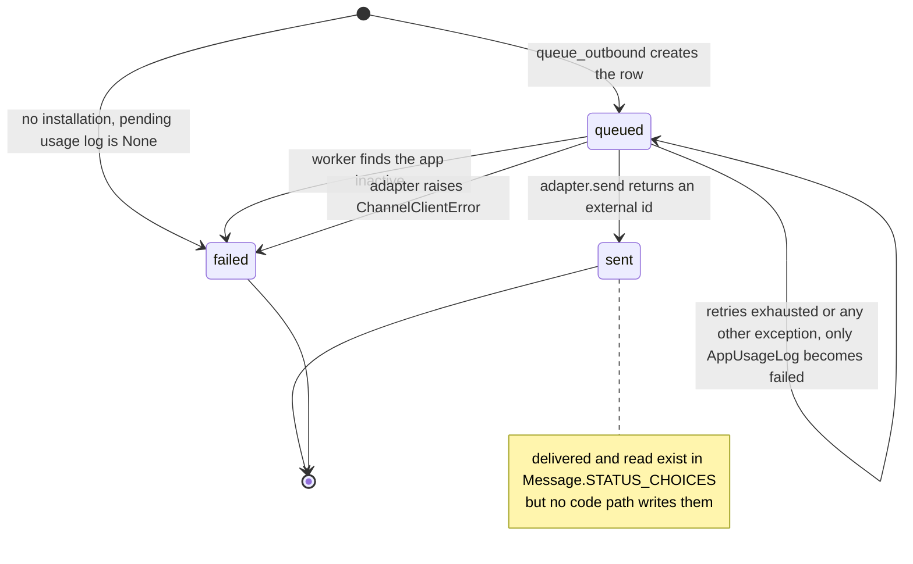
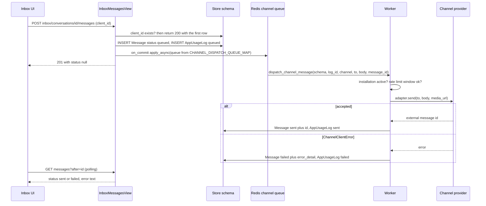
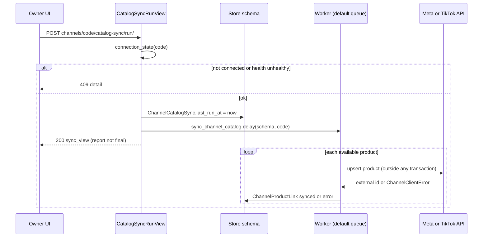
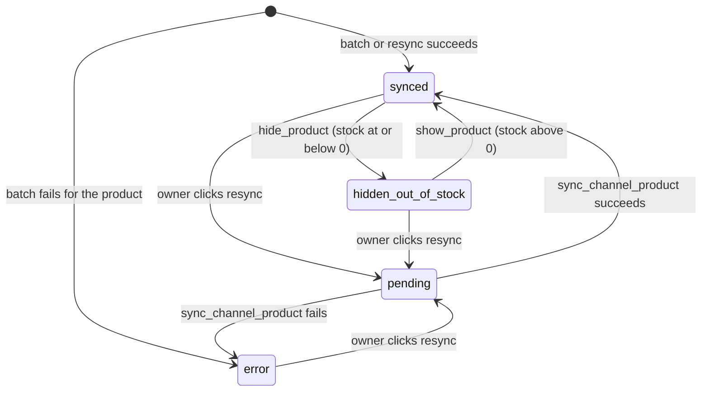
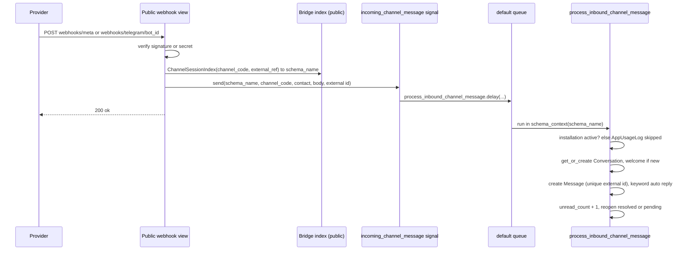

# Social channels and unified inbox jobs

> **Source**: DOC-503 · inventory A.8 · INT-037 (M27)
> **Code**: `sharwa_saas/products/tasks/channels.py` (all tasks on this page) · `products/tasks/_common.py` (`_LoggingFailureTask`, `_fan_out_to_schemas`, limits) · `products/services/social_channels/` (`inbox_api_service.py`, `channels_api_service.py`, `catalog_sync_service.py`, `channel_clients.py`, `channel_rate_limit.py`, `bridge_service.py`, `channel_dispatch/*`) · `products/signals_channels.py` · `products/signals_social_channels.py` · `tenants/webhooks_channels.py` · `tenants/webhooks.py` (WhatsApp) · `products/models/social_channels_inbox.py` · `products/models/social_channels_catalog.py` · `tenants/models.py` (`ChannelSessionIndex`, `WhatsAppSessionIndex`) · `api/views_channels.py` · `config/settings.py` (`CELERY_*`) · `deploy/celery.env`
> **Last verified against code**: 2026-10-28 (step 38)

## 1. Purpose

The unified inbox (M27) lets staff read and answer customer conversations from four channels (WhatsApp, Meta Facebook/Instagram, TikTok Shop, Telegram) and lets the owner sync the product catalog to Meta and TikTok. The HTTP side is synchronous and thin; everything that touches an external provider runs in Celery:

- **Outbound**: a staff reply is saved as a `Message` row with `status='queued'`, then one task, `dispatch_channel_message`, calls the channel adapter and updates **that same row** to `sent` or `failed`.
- **Inbound**: provider webhooks land on the public schema, are routed to a store through a bridge index, and `process_inbound_channel_message` creates or reopens the `Conversation` and stores the `Message`.
- **Catalog**: a batch sync, a per-product resync, a stock shield that hides and shows products, and a 15-minute connection health sweep.
- **Housekeeping**: media upload for inbound attachments, an archive task that is not scheduled.

Out of scope: broadcast campaigns, which reuse `dispatch_channel_message` ([`campaigns.md`](campaigns.md) owns `dispatch_broadcast_campaign_chunk`); marketplace jobs ([`marketplaces.md`](marketplaces.md)); WhatsApp gateway jobs ([`whatsapp.md`](whatsapp.md)); the order-ingestion service behind `ingest_channel_order_task` (listed here only as an adjacent job). The register of every task is [`../50-background-jobs.md`](../50-background-jobs.md); the operator view is [`../../ops/runbooks/celery.md`](../../ops/runbooks/celery.md). The API domain index is [`13-channels-operations`](../../api/domains/13-channels-operations/README.md); no per-endpoint API page exists for M27 yet.

## 2. Components

| Component | Location | Role |
|---|---|---|
| `queue_outbound` | `inbox_api_service.py:296-317` | saves the `queued` message, creates the pending `AppUsageLog`, enqueues `dispatch_channel_message` on commit with the channel's queue |
| `send_message` | `inbox_api_service.py:320-369` | `POST` handler logic: dedupe by `client_id`, connection and reply checks, template and product card, then `queue_outbound` |
| `dispatch_channel_message` | `tasks/channels.py:327-406` | the single outbound task for all four channels |
| `CHANNEL_DISPATCH_QUEUE_MAP` | `tasks/channels.py:264-269` | channel code to queue name, passed as `queue=` at every call site |
| `get_channel_adapter` / `CHANNEL_DISPATCH_REGISTRY` | `channel_dispatch/__init__.py:19-31` | picks `WhatsAppAdapter`, `MetaAdapter`, `TikTokAdapter` or `TelegramAdapter`; an unknown code raises `KeyError` |
| `is_channel_rate_limited` | `channel_rate_limit.py:43-63` | fixed-window Redis counter per store and channel |
| `_LoggingFailureTask.on_failure` | `tasks/_common.py:66-86` | last-resort hook: marks the `AppUsageLog` failed after the task fails for good |
| `incoming_channel_message` signal and receiver | `signals_channels.py:32`, `:61-87` | the only thing a webhook does after verification; the receiver calls `.delay` |
| `process_inbound_channel_message` | `tasks/channels.py:409-573` | inbound conversation and message writer |
| `upload_inbound_channel_media_task` | `tasks/channels.py:310-324` | downloads provider media and stores the object key on the message |
| `meta_channel_webhook`, `telegram_channel_webhook`, `tiktok_shop_channel_webhook` | `tenants/webhooks_channels.py:76`, `:124`, `:373` | signature or secret check, bridge lookup, enqueue; routes in `config/urls_public.py:68-70` |
| `sharwaconnect_webhook` (event `message.received`) | `tenants/webhooks.py:242`, `:249-277` | WhatsApp inbound; routed through `WhatsAppSessionIndex`, not `ChannelSessionIndex` |
| `run_sync` / `resync_product` | `channels_api_service.py:408-420`, `:445-454` | endpoint services that enqueue the catalog tasks |
| `sync_channel_catalog` (service) | `catalog_sync_service.py:155-176` | batch loop over products; per-product failures are isolated |
| `hide_product` / `show_product` | `catalog_sync_service.py:217-257` | stock shield actions, guarded by the link status |
| `check_channel_connection_health(_for_tenant)` | `tasks/channels.py:47-68`, `:17-44` | Beat dispatcher and per-store child |
| `register_channel_session` | `bridge_service.py:14-28` | writes the public `ChannelSessionIndex` row when a channel is connected |

## 3. State fields touched

| Model | Schema | Fields | Written by |
|---|---|---|---|
| `Message` (`social_channels_inbox.py:91`) | store | `status` (`queued`, `sent`, `delivered`, `read`, `failed`; default `sent`), `external_message_id` (unique, nullable), `error_detail`, `client_id` (unique, nullable), `staff`, `product`, `body`, `media_object_key`, `media_type` | `queue_outbound` (create `queued`), `dispatch_channel_message` (update), `process_inbound_channel_message` (create inbound), `upload_inbound_channel_media_task` (`media_object_key`) |
| `Conversation` (`:35`) | store | `status` (`open`, `pending`, `resolved`), `unread_count`, `last_message_at`, `source_platform`, `customer_name_snapshot`, `customer_phone` (WhatsApp only), unique `(channel_code, external_contact_id)` named `unique_conversation_per_contact` | inbound task; `send_message` sets `unread_count=0` and `last_message_at` |
| `AppUsageLog` | store | `status` (`queued`, `sent`, `delivered`, `read`, `failed`, `skipped`), `error_detail` (cut to 255 chars), `gateway_message_id` | `create_pending_usage_log`, `mark_usage_log_result`, WhatsApp status webhook |
| `ChannelProductLink` (`social_channels_catalog.py:88`) | store | `sync_status` (`pending`, `synced`, `error`, `hidden_out_of_stock`), `external_product_id`, `external_catalog_id`, `last_synced_at`, `last_error`; unique `(channel_code, product, variant)` | `_write_link`, shield actions, `resync_product` (sets `pending` first) |
| `ChannelCatalogSync` (`:13`) | store | `last_run_at` (set at request time, see 4.4), `sync_mode`, `price_adjustment_percent`, `stock_shield_enabled`; `auto_update_enabled` exists but nothing reads it (section 9) | `run_sync`, `save_sync` |
| `StoreAppInstallation.config` | store | `connection_health` (`healthy`, `unhealthy`, `not_configured`), `last_health_check_at` (ISO string) | `check_channel_connection_health_for_tenant` |
| `ChannelSessionIndex` | public | `channel_code`, `external_ref`, `schema_name`; unique pair `unique_channel_session_index` | connect and disconnect code, read by webhooks and the health dispatcher |
| `ArchivedConversation`, `ArchivedMessage` | store | copies of old resolved conversations | `archive_stale_conversations` (never scheduled) |

Migrations: `products/0187` (catalog sync models), `0190` (conversation and message models plus the archive pair), `0231_inbox_api` (adds `Message.error_detail`, `client_id`, `product`, the `queued` choice, `Conversation.source_platform`, `ChannelCatalogSync.last_run_at`, `ChannelReplyTemplate`). The channel models are not described in a data-model page: [`02-dashboard-shell`](../data-model/02-dashboard-shell.md) mentions `Conversation` as a counter source and [`07-marketing-design-partners`](../data-model/07-marketing-design-partners.md) uses it for campaign channel resolution only.

## 4. Flows

### 4.1 Job register

Global Celery settings that apply to every row (`config/settings.py:563-568`): `acks_late`, `reject_on_worker_lost`, `ignore_result`, prefetch 1, default queue `default`. `CELERY_TASK_ROUTES` (`settings.py:569-597`) names only `process_inbound_channel_message` and `upload_inbound_channel_media_task` (both `default`) and the broadcast chunk (`channels_broadcast`) from this module; every other task below runs on `default`. Dispatchers use `DISPATCHER_TASK_LIMITS` (soft 120 s, hard 180 s), per-store children `TENANT_TASK_LIMITS` (soft 300 s, hard 360 s) (`_common.py:28-31`). A task row without limits means none are set.

| Job | Kind | Trigger (file:line) | Queue | Schedule | Retry | Idempotency | Failure handling |
|---|---|---|---|---|---|---|---|
| `products.tasks.dispatch_channel_message` | task | `inbox_api_service.py:311` (staff reply, on commit), `views/social_channels_inbox.py:185`, `:308` (legacy screens), `tasks/channels.py:493`, `:555` (welcome and keyword reply), `campaigns.py:294`, `abandoned_cart_service.py:217` | **dynamic**: `CHANNEL_DISPATCH_QUEUE_MAP` (`whatsapp`, `channels_meta`, `channels_tiktok`, `channels_telegram`); fallback `channels_meta` (`whatsapp` in campaigns and cart reminders) | on demand | `autoretry_for=(SharwaConnectTransientError,)`, `retry_backoff`, cap 300 s, jitter, `max_retries=5`; rate-limited branch `self.retry(countdown=min(2 ** retries, 60))` (`:379`) shares the same counter; no time limit | `message_id` selects the row to update (updates are plain `UPDATE`s, so a repeat is harmless for the row); the usage log `log_id` is reused, never recreated; **the WhatsApp send has no stable key** (a new uuid per attempt, `sharwaconnect_provider.py:53`, `:59`) | `ChannelClientError` is caught: usage log `failed`, row `failed` with `error_detail`. Anything else is not caught (see 4.2 and section 9) |
| `products.tasks.process_inbound_channel_message` | task | `signals_channels.py:76` | `default` (static route, `settings.py:577`) | on demand | none | unique `Message.external_message_id` (duplicate is swallowed), unique conversation constraint (race recovered) | inactive installation: `AppUsageLog(status='skipped')` and return; welcome and keyword replies are wrapped so they never block the inbound save |
| `products.tasks.upload_inbound_channel_media_task` | task | `tasks/channels.py:528` | `default` (static route, `settings.py:578`) | on demand | none | overwrites `Message.media_object_key` | download or upload failure returns `None` and logs a warning; the text message is already saved |
| `products.tasks.sync_channel_catalog` | task | `channels_api_service.py:419` (`POST channels/<code>/catalog-sync/run/`), `views/social_channels_catalog.py:113` (legacy) | `default` | on demand (no Beat entry) | none; no time limit | upserts one `ChannelProductLink` per product (`update_or_create`) | per-product failure becomes `sync_status='error'` plus `last_error`; the batch continues |
| `products.tasks.sync_channel_product` | task | `channels_api_service.py:453` (`POST channels/<code>/products/<id>/resync/`) | `default` | on demand | none | same `_sync_one_product` as the batch | returns `skipped` (inactive, no token, missing product) **without** resetting the link from `pending` (section 9) |
| `products.tasks.hide_channel_product_out_of_stock` | task | `signals_social_channels.py:49` | `default` | on demand (every `Product` save with stock at or below zero) | none | `hide_product` returns early unless the link is `synced` | provider error: logged, link unchanged, returns `False` |
| `products.tasks.show_channel_product_back_in_stock` | task | `signals_social_channels.py:51` | `default` | on demand (stock above zero) | none | `show_product` returns early unless the link is `hidden_out_of_stock` | same as above |
| `products.tasks.check_channel_connection_health` | Beat dispatcher | Beat `check-channel-connection-health` (`settings.py:677-680`) | `default` | `crontab(minute='*/15')` | none; dispatcher limits | reads `ChannelSessionIndex` (distinct `schema_name`), fans out with `_fan_out_to_schemas` | returns `{'dispatched': n}` |
| `products.tasks.check_channel_connection_health_for_tenant` | task (per store) | dispatcher `.delay(schema_name)` (`_common.py:61`) | `default` | every 15 min via dispatcher | none; tenant limits | overwrites the same two config keys | the whole loop sits in one `try/except`; an error is logged and the remaining channels of that store are skipped |
| `products.tasks.dispatch_instagram_comment_auto_reply` *(adjacent)* | task | `webhooks_channels.py:98` | `default` | on demand | `autoretry_for=(ChannelClientError,)`, backoff cap 300 s, jitter, `max_retries=5` | none (a retried send repeats the DM) | exhausted retries leave only the Celery log |
| `products.tasks.dispatch_telegram_start`, `dispatch_telegram_callback` *(adjacent)* | task | `webhooks_channels.py:171`, `:163` | `default` | on demand | same policy as above | none | same |
| `products.tasks.ingest_channel_order_task` *(adjacent)* | task | `webhooks_channels.py:108`, `:394` | `default` | on demand | none by design (pure database work) | unique `ChannelOrderLink` inside `ingest_channel_order` | `ChannelOrderIngestionError` is logged; no local order is created |
| `products.tasks.archive_stale_conversations` | task, **unscheduled** | none (no Beat entry, no caller) | `default` | none | none | moves `resolved` conversations idle for `days` (default 90) | see section 9 |

### 4.2 Outbound message lifecycle (queued to sent or failed)

The state of a staff reply is the `Message.status` column. The inbox API hides `queued` (it returns `status: null` while the task has not finished, `inbox_api_service.py:273`) and shows `sent` or `failed` together with `error_detail` as `error`.

What each branch writes:

| Branch | `Message` | `AppUsageLog` | Code |
|---|---|---|---|
| created | `status='queued'`, `client_id` | `queued` (event `channel_message_out`) | `inbox_api_service.py:302-306` |
| no installation when the log is created | `failed`, `error_detail` «القناة غير مربوطة — لم تُرسَل الرسالة.» | none | `inbox_api_service.py:307-310` |
| app inactive at run time | `failed`, same text | `skipped`, «التطبيق غير نشط وقت التنفيذ الفعلي.» | `tasks/channels.py:365-374` |
| success | `sent`, `external_message_id` (or `NULL` when empty), `error_detail=''` | `sent`, `gateway_message_id` | `tasks/channels.py:397-401` |
| `ChannelClientError` | `failed`, `error_detail = exc.message` | `failed`, same message | `tasks/channels.py:384-393` |
| rate limited | unchanged | unchanged | `tasks/channels.py:378-379` |

> ⚠️ Discrepancy — roadmap says the failed row carries the "provider reason in `error_detail`, e.g. Meta 24 h window" / code does: it stores `ChannelClientError.message`, the Arabic text chosen by the client wrapper. Every provider HTTP error of 400 or above becomes the generic «رفض مزوّد القناة تنفيذ العملية.» and the provider's body goes only to `internal_detail` (`channel_clients.py:50-54`), which `dispatch_channel_message` neither stores nor logs. No code maps the Meta 24-hour window error; the 24-hour text exists only in a model comment (`social_channels_inbox.py:125`) and in a test that raises its own exception (`api/test_channels_api.py:147`). Reported in step 38.

> ⚠️ Discrepancy — roadmap says "channel's own queue" for all channels / code does: three channels have their own queue and WhatsApp reuses `whatsapp`, shared with `dispatch_whatsapp_message` (`tasks/channels.py:259-269`). TikTok has a queue and a consumer (`deploy/celery.env:16`) but its adapter always raises «الإرسال عبر تيك توك شوب غير مدعوم بعد.», so every TikTok reply ends `failed` (`channel_dispatch/tiktok_adapter.py:25-32`). Reported in step 38.

The unified path is also used without a `message_id`: the welcome message, keyword replies and legacy dashboard replies pass only `conversation_id`, so on success a new `sender_type='bot'` row is created (`tasks/channels.py:402-406`) and on a `ChannelClientError` a `failed` bot row is created with **no** `error_detail` (`:388-392`). Campaign and cart-reminder calls pass neither id, so they create no `Message` at all and leave only the `AppUsageLog`.

### 4.3 Staff reply sequence

Endpoint: `POST /api/v1/inbox/conversations/<id>/messages/` (`api/urls.py:568`, `api/views_channels.py:104-119`). The view guards the feature flag `social_channels` and the permission `channels.inbox.access`; `send_message` then checks `StaffChannelAccess` through `Viewer.can_reply`. A repeated `client_id` (body or `Idempotency-Key` header) returns the first message with 200 and does **not** enqueue again; two simultaneous posts are resolved by the unique constraint (`IntegrityError` caught, `inbox_api_service.py:362-367`). The conversation row is updated in the same transaction: `unread_count=0`, `last_message_at=now`. A channel that is not connected answers 409 «القناة غير مربوطة — لا يمكن الردّ.»; a staff member without reply rights answers 403 «لا تملك صلاحية الردّ على هذه القناة.».

Where a call site differs: `convert_to_order` also uses `queue_outbound` (`send_order_confirmation`, `inbox_api_service.py:373-382`) with `sender_type='bot'`, so the order confirmation appears as a bot row that goes through the same lifecycle.

### 4.4 Catalog sync, shield and health

- **Run endpoint** (`channels_api_service.py:408-420`, `api/views_channels.py:249-252`, owner only). Not connected returns 409 «القناة غير مربوطة.»; connected but the health flag is `unhealthy` returns 409 with the channel's own message (for Meta, «انتهت صلاحية رمز الوصول من Meta — أعد الربط لمتابعة استقبال الرسائل ومزامنة الكتالوج.»). `last_run_at` is written **when the request is accepted**, not when the task finishes; the report in `sync_view` counts links by `sync_status` and is refreshed only by reading again.
- **Batch task**: returns `{'status': 'skipped', 'reason': 'inactive'}` or `'no_token'`, otherwise `{'status': 'done', 'synced': n, 'errors': m}` (the return value is discarded by `ignore_result`). A product without a category mapping for the channel is written as `error` with «لا يوجد ربط تصنيف لهذا المنتج على هذه القناة.» (`catalog_sync_service.py:114-118`). Provider calls have a 10 s connect and 20 s read timeout (`channel_clients.py:22-23`); the task has no time limit.
- **Resync** (`POST channels/<code>/products/<product_id>/resync/`): the service sets the link to `pending` with an empty `last_error`, then enqueues `sync_channel_product`; 404 «المنتج غير مشمول في المزامنة.» when no link exists. It does not check the connection state (unlike the batch run).
- **Stock shield**: a `post_save` on `Product` or `ProductVariant` (`signals_social_channels.py:54-63`) enqueues `hide_...` when stock is at or below zero and the link is `synced`, `show_...` when stock is above zero and the link is `hidden_out_of_stock`. No network call happens inside the signal; the signal calls `.delay` directly, not `on_commit`. The task re-reads the link and the token before calling the provider, so a duplicate enqueue is harmless.
- **Link states**:

- **Health sweep**: every 15 minutes the dispatcher takes the distinct `schema_name` values of **all** `ChannelSessionIndex` rows (marketplace and supplier bridge rows included, as `products/test_beat_fanout.py` `Phase3DispatchSetTests` expects) and queues one child per store. The child checks only `meta_social_commerce`, `tiktok_shop` and `telegram_bot`; WhatsApp health arrives by webhook instead. For each installed channel it calls `validate_channel_connection` (a live network call), stores `connection_health` as `healthy`, `unhealthy` or `not_configured` plus `last_health_check_at`, and saves with `update_fields=['config_encrypted', 'updated_at']`. The validators return `False` on **any** `ChannelClientError`, including a network timeout, so a short provider outage flips the channel to `unhealthy` until the next tick (`channel_clients.py:205-206`). `unhealthy` is what makes the run endpoint answer 409 and what the channel list shows as `error` (`channels_api_service.py:115`).

### 4.5 Inbound path

| Channel | Entry | Bridge | Notes |
|---|---|---|---|
| Meta (Facebook, Instagram) | `POST /webhooks/meta/` | `ChannelSessionIndex(meta_social_commerce, entry[0].id)` | `X-Hub-Signature-256` HMAC; only `object` of `page` or `instagram`; `source_platform` is `instagram` or `facebook` (`webhooks_channels.py:289`) |
| Telegram | `POST /webhooks/telegram/<bot_id>/` | `ChannelSessionIndex(telegram_bot, bot_id)` | per-bot secret header; `/start` and button callbacks go to their own tasks, not the inbox |
| WhatsApp | `POST /webhooks/sharwaconnect/`, event `message.received` | `WhatsAppSessionIndex(session_id)` (`tenants/models.py:162`) | signature and replay guard; `_handle_incoming_channel_message_event` (`tenants/webhooks.py:249`) |
| TikTok Shop | `POST /webhooks/tiktok-shop/` | `ChannelSessionIndex(tiktok_shop, shop_id)` | **orders only**; no inbound message extraction exists |

Steps inside the task (`tasks/channels.py:445-573`), all inside `schema_context(schema_name)`:

1. Inactive or missing installation: `log_app_usage(... 'inbound_message_skipped', status='skipped')` with «التطبيق غير نشط وقت وصول الرسالة.», then return. No conversation and no message are created.
2. `Conversation.objects.get_or_create` in a savepoint; an `IntegrityError` from the unique constraint is recovered by fetching the winner.
3. New conversation on a channel that has a `social_welcome` template (Meta and TikTok): a welcome message is queued through `dispatch_channel_message` on the channel queue, wrapped in `try/except`.
4. `Message.objects.create(direction='inbound', sender_type='customer', ...)` in a savepoint. A duplicate `external_message_id` raises `IntegrityError`; the task logs and **returns before** the unread counter is touched.
5. When the provider gave a media URL but no object key, `upload_inbound_channel_media_task.delay` is queued (WhatsApp already supplies the key).
6. Keyword auto-reply: the first active `ConversationKeywordTrigger` match sends its text, product card or store link through `dispatch_channel_message`; failures are swallowed.
7. `unread_count = unread_count + 1`, `last_message_at = now`; then `status` is set to `open` for rows that were `resolved` or `pending` (`tasks/channels.py:571`); an empty `source_platform` is filled from the payload.

The extractors return only the first qualifying message of a webhook body (`_extract_meta_inbound_message` returns inside its loops, `webhooks_channels.py:263-290`), and the Meta path reads only `entry[0].id` as the bridge key (`:227`).

## 5. Invariants

- **Per-contact uniqueness**: one `Conversation` per `(channel_code, external_contact_id)`, enforced by the database, not by `get_or_create` alone.
- **Per-message idempotency**: `Message.external_message_id` is unique (nullable). A webhook retry never creates a second inbound row nor a second unread increment.
- **Per-reply idempotency**: `Message.client_id` is unique; the same client id returns the first message and enqueues nothing.
- **One log row per outbound message**: `create_pending_usage_log` makes one `AppUsageLog` before the first attempt; every retry updates it. Retries never create rows.
- **The task never raises `ChannelClientError` to Celery**: it records it on the row and returns. Other exceptions do propagate (section 9).
- **No network inside a transaction**: catalog calls happen outside `transaction.atomic()`; only the short link write is atomic (`catalog_sync_service.py:6-8`, `:77-90`). `queue_outbound` enqueues with `transaction.on_commit`.
- **No network inside a signal receiver**: the inbound receiver and the stock shield only call `.delay`.
- **Runtime re-check**: `is_effectively_active()` is re-evaluated when the task runs, not when it was queued.
- **Schema safety**: the schema name comes from the bridge row or from `connection.schema_name`, never from request input (`bridge_service.py:1-5`).

## 6. Background work

Beat has exactly one entry for this page, `check-channel-connection-health`. There is **no** Beat entry for `sync_channel_catalog` (the stored `auto_update_enabled` flag has no consumer), none for `archive_stale_conversations`, and none that re-queues messages left in `queued`. Everything else is event driven. The 15-minute marketplace sweep is deliberately offset (`7,22,37,52`, `settings.py:683-686`) from the channel sweep (`*/15`).

Queues: the worker's `-Q` list comes only from `deploy/celery.env` (`CELERY_QUEUES`), which includes `default`, `whatsapp`, `channels_meta`, `channels_tiktok`, `channels_telegram` and `channels_broadcast`. `deploy/check_celery_queues.py` fails the build when code names a queue missing from that list, and it scans `*QUEUE_MAP` dictionaries, so `CHANNEL_DISPATCH_QUEUE_MAP` is covered. A reply stuck in `queued` for a long time therefore points to a worker that is not consuming that queue, to Redis, or to the failure paths listed in section 9.

## 7. Configuration

| Setting | Where | Value or default | Effect |
|---|---|---|---|
| `SHARWA_CHANNELS_RATE_LIMIT_PER_MINUTE` | environment (`channel_rate_limit.py:34-40`) | `80`; non-integer falls back to 80; minimum 1 | outbound sends per store and channel per 60 s window; key `sharwa_channels:rl:<SCHEMA>:<channel_code>`; Redis from `CELERY_BROKER_URL`; **fail-open** when Redis is unreachable |
| `META_APP_SECRET`, `TIKTOK_APP_SECRET` | environment (`webhooks_channels.py:27-28`) | empty means every request is rejected with 403 | HMAC-SHA256 of the raw body |
| `TELEGRAM_WEBHOOK_BASE_URL` | environment (`channel_clients.py:181-196`) | no default | needed to register the Telegram webhook; a missing value raises `ChannelClientError` at connect time |
| `CELERY_QUEUES` | `deploy/celery.env:16` | list above | worker `-Q` list |
| `CELERY_TASK_ROUTES` | `settings.py:569-` | three channel entries | static routes for the inbound task, the media task and the broadcast chunk; `dispatch_channel_message` is intentionally absent because routes cannot depend on arguments (comment at `settings.py:587-596`) |
| `CELERY_TASK_ACKS_LATE`, `CELERY_TASK_REJECT_ON_WORKER_LOST` | `settings.py:564-565` | `True` | a task killed mid-run is delivered again |
| `channels.inbox.access`, feature `social_channels` | `api/views_channels.py:39`, `:52` | | gates every inbox and channel endpoint |

Credentials, tokens and webhook secrets are stored encrypted in the installation config and never returned by the API; this page lists names only.

## 8. Failure modes and fixes

| Symptom | Cause | What to do |
|---|---|---|
| Reply stays "sending" for a long time | channel queue has no consumer; or the worker was lost and the task already hit a path that leaves the row `queued` (section 9) | check the worker's `-Q` list against `deploy/celery.env`; look at the `AppUsageLog` row: `failed` with «فشل نهائي بعد استنفاد إعادة المحاولات» followed by the exception text means the task gave up while the `Message` stayed `queued` |
| TikTok reply always fails | adapter is a stub | expected until a TikTok chat API is built; the row shows «الإرسال عبر تيك توك شوب غير مدعوم بعد.» |
| Meta reply fails with a generic text | any provider HTTP error is reduced to the generic message | the provider body is lost (section 9); reproduce with the provider's own tooling |
| Replies fail only during bursts | rate limit window exhausted; retries are 1, 2, 4, 8, 16 s | lower the sending rate or raise `SHARWA_CHANNELS_RATE_LIMIT_PER_MINUTE`; after the fifth retry the task fails and only the usage log shows it |
| Catalog "run" answers 409 | channel not connected, or `connection_health='unhealthy'` | reconnect the channel; the flag is recomputed at the next `*/15` tick |
| Products stay `pending` after "resync" | the task returned `skipped` (channel inactive, no token, product missing) and does not reset the link | fix the connection and press resync again |
| Many `error` links with the category message | category has no `ChannelCategoryMapping` for the channel | add the mapping, then run the sync |
| Inbound messages missing | wrong or missing bridge row (`unknown_channel_ignored` is returned with 200), signature failure (403), installation inactive (`skipped` usage log), or a webhook that carried several messages (only the first is processed) | check `ChannelSessionIndex` for the page id or bot id, the secret variables, and the installation state |
| Customer media missing | Telegram media has no download URL; Meta download failed | the text row exists; nothing retries the media |

## 9. Open items

- **A reply can stay `queued` forever.** `_LoggingFailureTask.on_failure` updates only the `AppUsageLog` (`_common.py:74-86`). Paths that fail the task without touching `Message`: retries exhausted on `SharwaConnectTransientError`; the rate-limit branch after five retries (`MaxRetriesExceededError`); any exception that is not a `ChannelClientError`, notably `SharwaConnectPermanentError` and `SharwaConnectError` from the WhatsApp provider (they are not in `autoretry_for` and not caught) and `KeyError` for an unregistered channel. In all of them the usage log says `failed` and the inbox keeps showing no status. This is the main risk for WhatsApp replies.
- **Provider reason is lost** (discrepancy in 4.2). `internal_detail` is never persisted.
- **`delivered` and `read` are never written to `Message`.** The WhatsApp status webhook updates only `AppUsageLog` by `gateway_message_id` (`tenants/webhooks.py:280-290`); the choices exist on the model (`social_channels_inbox.py:96-103`).
- **WhatsApp has no stable idempotency key.** `send_text` and `send_media` create a new uuid on every call, so an autoretry after a timeout that actually reached the gateway can send the message twice.
- **Rate-limit retries consume the budget.** Each attempt runs `INCR` before the comparison (`channel_rate_limit.py:57`), including attempts that are then deferred.
- **No consumer for `auto_update_enabled`** and no scheduled catalog sync; only manual runs exist.
- **`archive_stale_conversations` is unscheduled and has no `schema_context`** and no fan-out (`tasks/channels.py:584-622`). Even if scheduled it would query the schema of the worker connection (public), where the store tables do not exist. Its model docstring promises a daily Beat task (`social_channels_inbox.py:13`).
- **Resync can strand a link in `pending`** (see section 8), and the resync endpoint skips the connection check.
- **First message only**: Meta and Telegram extractors drop the second and later messages of one webhook body.
- **Customer names are not captured for Meta and Telegram**: the extractors never set `sender_name`, so `customer_name_snapshot` stays empty and the inbox shows the contact id.
- **Welcome and bot rows** created through the legacy `conversation_id` path record a failed send without `error_detail`.
- **Unverified in this step**: the real Meta and TikTok payload shapes (the code labels several of them "assumed, review at production activation"), and whether the Meta endpoint must also answer a `GET` verification challenge: the view allows `POST` only (`webhooks_channels.py:74-75`) and a search for `hub.challenge` finds nothing.
- **Docs gaps**: `SHARWA_CHANNELS_RATE_LIMIT_PER_MINUTE` is not in [`../../ops/environment.md`](../../ops/environment.md); the channel models have no data-model page. The settings comment about `CHANNEL_DISPATCH_QUEUE_MAP` still cites the old path `products/tasks.py` (`settings.py:593`).

## 10. Tests that cover these jobs

| File | Tests |
|---|---|
| `api/test_channels_api.py` | `ChannelsApiTests.test_messages_send_idempotent_template_product` (409 not connected, 201 then 200 for the same `client_id`, template, product card, `after=`), `test_dispatch_updates_the_same_message` (success updates the same row with no bot row, mocked `ChannelClientError` marks `failed`), `test_inbound_reopens_and_records_platform`, `test_catalog_sync_mapping_and_access` (run 409, resync sets `pending` and calls `.delay` once, 404 for an unlinked product); the file holds 10 tests |
| `products/test_social_channels_phase5.py` | inbound: inactive installation creates only a `skipped` log, conversation and message creation, duplicate `external_message_id`, no duplicate conversation, `IntegrityError` race, welcome only for a new Meta conversation, webhook dispatches the inbound task (Meta, Telegram); outbound: success creates a bot row on the legacy path, inactive installation is `skipped`, TikTok adapter raises; the file holds 14 tests |
| `products/test_social_channels_phase2.py` | `sync_channel_catalog` service (price adjustment, per-product failure isolation, unmapped category), stock shield enqueue on zero stock, restock and disabled shield; 15 tests |
| `products/test_social_channels_phase6.py` | keyword trigger matching and the inbound auto-reply dispatch (text and product card) |
| `products/test_social_channels_phase4.py` | channel order ingestion and the Meta and TikTok webhook enqueue of `ingest_channel_order_task` |
| `products/test_social_channels_phase1.py` | webhook signature (403 before parsing) and unknown-reference (200 silent) for Meta and TikTok |
| `products/test_beat_fanout.py` | `Phase3DispatchSetTests`: the health dispatcher queues one child per distinct bridge schema; static guards on limits and fan-out helpers |
| `products/test_tasks_package.py` | the task names stay importable from `products.tasks` (including `archive_stale_conversations`) |

Not covered by any test found in the tree: the body of `check_channel_connection_health_for_tenant`, `is_channel_rate_limited`, `_LoggingFailureTask.on_failure`, `sync_channel_product` and `upload_inbound_channel_media_task`, `archive_stale_conversations`, and the Telegram and Instagram auto-reply tasks.

Run: `python manage.py test api.test_channels_api products.test_social_channels_phase1 products.test_social_channels_phase2 products.test_social_channels_phase4 products.test_social_channels_phase5 products.test_social_channels_phase6 products.test_beat_fanout`.

## 11. Related pages

- Architecture: [`../10-multi-tenancy.md`](../10-multi-tenancy.md) (bridge indexes, `schema_context` in tasks) · [`../41-idempotency.md`](../41-idempotency.md) · [`../42-concurrency.md`](../42-concurrency.md) · [`../34-rate-limits.md`](../34-rate-limits.md) · [`../35-outbound-and-redirect-safety.md`](../35-outbound-and-redirect-safety.md) · [`../50-background-jobs.md`](../50-background-jobs.md)
- Siblings: [`campaigns.md`](campaigns.md) · [`whatsapp.md`](whatsapp.md) · [`marketplaces.md`](marketplaces.md) · [`webhooks.md`](webhooks.md) · [`order-push.md`](order-push.md)
- Data model: [`../data-model/02-dashboard-shell.md`](../data-model/02-dashboard-shell.md) · [`../data-model/07-marketing-design-partners.md`](../data-model/07-marketing-design-partners.md)
- Ops: [`../../ops/runbooks/celery.md`](../../ops/runbooks/celery.md) · [`../../ops/environment.md`](../../ops/environment.md)
- API: [`13-channels-operations`](../../api/domains/13-channels-operations/README.md)
