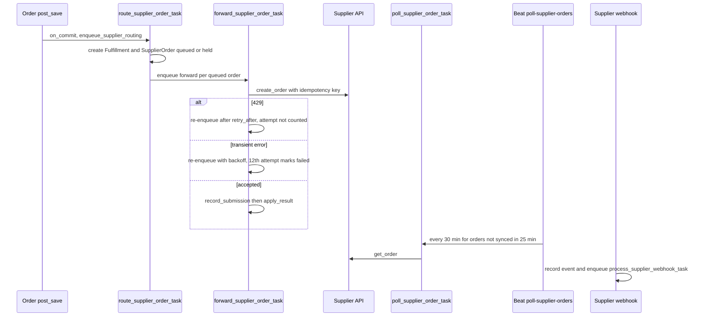
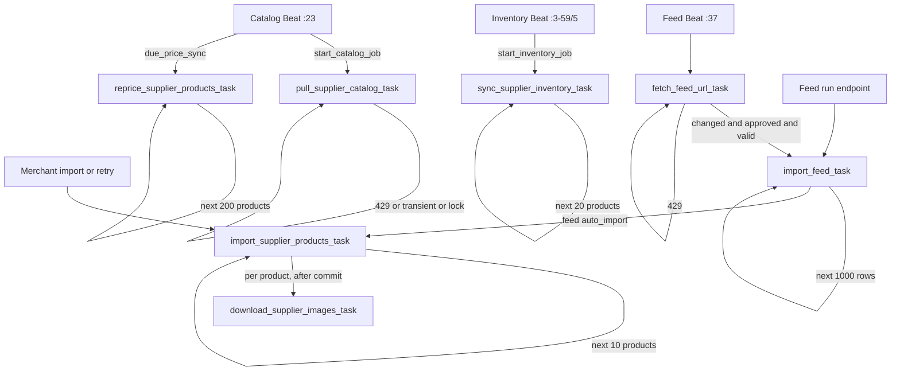
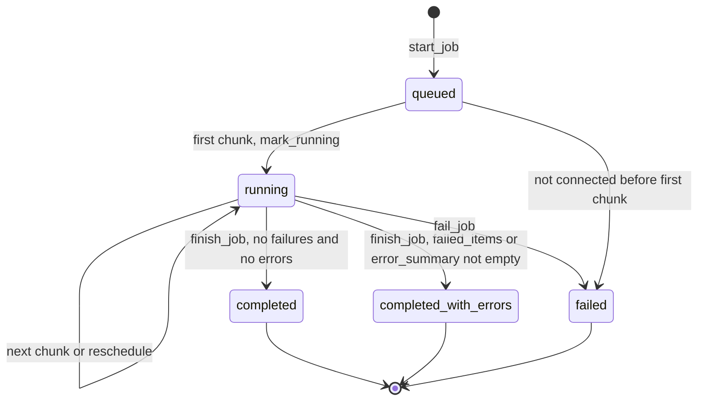

# Dropshipping jobs and schedules

> **Source**: DOC-505 · inventory A.8 · INT-039 (M29)
> **Code**: `sharwa_saas/products/tasks/suppliers.py` (all 24 supplier tasks) · `products/services/suppliers/` (`jobs.py`, `catalog_service.py`, `import_service.py`, `inventory_service.py`, `pricing_service.py`, `feed_engine.py`, `order_forward_service.py`, `api_service.py`) · `products/models/suppliers_dropship.py` · `products/signals_dropshipping.py` · `tenants/webhooks_suppliers.py` · `api/views_dropshipping.py` · `config/settings.py` (`CELERY_BEAT_SCHEDULE`) · `deploy/celery.env`
> **Last verified against code**: 2026-10-28 (step 38)

## 1. Purpose

This page documents every Celery task and Beat entry of the dropshipping card (suppliers CJ, Makhazen, Knawat, and the flat-file feed supplier): the schedule of each Beat entry, the retry rule of each job type, and the **self-chaining** mechanism that lets one long job (a 50,000-row feed, a 10,000-product catalog) run as many short tasks that take turns on the worker.

It answers the questions of the roadmap task: which job types exist, which of them are never created (the `order_*` types), how the hourly catalog Beat honours `SupplierConnection.catalog_sync_interval_min`, how periodic re-pricing works, how `fetch_scheduled_feeds_for_tenant` honours `FeedMapping.schedule_interval_min`, and what each retry endpoint does.

Out of scope: adapter protocols, the pricing formula, checkout stock holds. The marketplace side is in [`marketplaces.md`](marketplaces.md). The register of all jobs is [`../50-background-jobs.md`](../50-background-jobs.md); the operator view is [`../../ops/runbooks/celery.md`](../../ops/runbooks/celery.md).

## 2. Components

| Component | Location | Role |
|---|---|---|
| Supplier tasks | `products/tasks/suppliers.py` | 24 `@shared_task(name='products.tasks.<function>')` tasks; thin executors of service decisions |
| `SUPPLIER_QUEUES` | `products/tasks/suppliers.py:21` | `sync` → `suppliers_sync` (heavy, catalog and feeds), `orders` → `suppliers_orders` (touches a customer) |
| `enqueue_*` helpers | `products/tasks/suppliers.py:100-115,313-318,460-470,667-686` | The only places that call `apply_async(queue=..., countdown=...)` for the chains |
| `_run_supplier_chunk` | `products/tasks/suppliers.py:118-147` | Shared chunk shell: job active check, installation check, lock, processor, auth failure |
| `_run_supplier_order` | `products/tasks/suppliers.py:701-732` | Shared shell for forward / poll / cancel of one `SupplierOrder` |
| `jobs.py` | `services/suppliers/jobs.py` | `SupplierSyncJob` lifecycle: `active_job`, `start_job`, `update_job`, `finish_job`, `fail_job` |
| Shared limiter and lock | `services/marketplaces/marketplace_rate_limit.py` | Supplier code reuses the marketplace token bucket, circuit breaker and `acquire_job_lock` with the supplier code in place of the market code (limits for `cj`, `makhazen`, `knawat`, `flat_feed` at `:48-87`) |
| Webhook receiver | `tenants/webhooks_suppliers.py:39-104`, route `config/urls_public.py:73` | Public `POST /webhooks/suppliers/<supplier_code>/<bridge_token>/` records the event and enqueues processing |
| Order signal | `products/signals_dropshipping.py` | `post_save` on `Order` → `schedule_routing` (`order_forward_service.py:72-80`) |
| DRF endpoints | `api/views_dropshipping.py`, `api/urls.py:604-630` | JSON API (guard: `channels.dropshipping.manage` plus the plan feature) |
| Legacy template endpoints | `config/urls_tenant.py:537-570` | Django dashboard actions (flash messages and redirects) |

## 3. State fields touched

| Model (store schema) | Fields written by these jobs | Notes |
|---|---|---|
| `SupplierSyncJob` | `status` (`queued` → `running` → `completed` / `completed_with_errors` / `failed`), `total_items`, `processed_items`, `failed_items`, `error_summary` (max 200 entries `{ref, code, message}`, message cut to 300), `payload` (cursor, per-job counters), `triggered_by` (`merchant` / `auto` / `beat`), `started_at`, `finished_at` | `models/suppliers_dropship.py:123-176`. Written only through `jobs.py` under a short `select_for_update` |
| `SupplierConnection` (singleton per supplier) | `last_catalog_sync_at`, `last_full_catalog_sync_at`, `last_inventory_sync_at`, `last_price_sync_at` | Settings read by Beat: `catalog_sync_enabled`, `catalog_sync_interval_min` (default 360), `price_sync_enabled` (default on), `price_sync_interval_min` (default 360), `inventory_sync_enabled`, `inventory_sync_interval_min` (default 30), `order_forward_enabled` |
| `SupplierProduct` / `SupplierVariant` | mirror rows, `is_discontinued`, `last_seen_at`, `stock_synced_at`, `import_status`, `last_import_job_id`, `price_locked`, `images_downloaded_at` | Catalog, import, inventory and feed jobs |
| `FeedMapping` | `last_fetched_at`, `last_fetch_status`, `etag`, `last_modified_header`, `last_import_at`, `last_import_job_id` | Feed fetch and import |
| `SupplierWebhookEvent` | `processed_at`, `payload` (cleared on success), `processing_error` | Unique event id per supplier; sweeper and purge |
| `SupplierOrder` | `status` (`queued`, `held`, `submitted`, `accepted`, `processing`, `shipped`, `delivered`, `cancelled`, `rejected`, `failed`), `attempts`, `next_attempt_at`, `external_order_id`, `last_error_code`, `last_error`, `last_synced_at`, `shipping_address` (cleared on final state) | The order flow is tracked here, **not** in `SupplierSyncJob` (see [§4.5](#45-order-job-types-that-are-never-created)) |
| `Fulfillment`, `FulfillmentItem`, `DropshipForwardLog` | created by routing | `route_order_to_suppliers` |
| Redis | `mp:lock:{schema}:{code}:{name}`, token buckets, circuit flags | Lock `code` is the supplier code, except `suppliers` for repricing and `flat_feed` for feeds |

## 4. Flows

### 4.1 Beat entries and fan-out

All six entries are in `CELERY_BEAT_SCHEDULE` (`config/settings.py:701-730`). Each runs a **dispatcher** on the `default` queue (limits 120 s soft / 180 s hard, `_common.py:31`) that reads the public bridge `ChannelSessionIndex` and sends one `*_for_tenant` task per store through `_fan_out_to_schemas` (`_common.py:55`). The per-store tasks (limits 300 s soft / 360 s hard, `_common.py:28`) run inside `schema_context` and wrap their loop in `try/except` that logs with `logger.exception`. None of the Beat tasks has a Celery retry: the next tick is the retry. None is in `CELERY_TASK_ROUTES`, so all dispatchers and per-store tasks run on `default`.

| Beat entry (`settings.py`) | Dispatcher / per-store task | Schedule | What the per-store task does | Retry |
|---|---|---|---|---|
| `check-supplier-connection-health` (`:701-704`) | `check_supplier_connection_health` (`tasks/suppliers.py:48-63`) / `..._for_tenant` (`:24-45`) | `crontab(minute='11,26,41,56')` | For each active supplier installation whose `connection_health` is set and not `reauth_required`, runs `run_health_check`; returns `{schema, checked}` | none |
| `schedule-supplier-catalog-refresh` (`:706-709`) | `schedule_supplier_catalog_refresh` (`:290-304`) / `..._for_tenant` (`:213-262`) | `crontab(minute='23')`, hourly | (1) periodic re-pricing `_due_price_sync`, (2) catalog refresh when due, (3) revives a stale catalog chain. Details in [§4.3](#43-catalog-refresh-and-periodic-re-pricing) | none; the job it starts has its own retry |
| `fetch-scheduled-feeds` (`:711-714`) | `fetch_scheduled_feeds` (`:433-444`) / `..._for_tenant` (`:391-430`) | `crontab(minute='37')`, hourly | Queues `fetch_feed_url_task` for each due approved link feed. Details in [§4.4](#44-scheduled-feed-fetch) | none |
| `schedule-supplier-inventory-sync` (`:717-720`) | `schedule_supplier_inventory_sync` (`:598-613`) / `..._for_tenant` (`:546-595`) | `crontab(minute='3-59/5')`, minutes 3, 8, ... 58 | Starts an inventory job for each supplier whose interval is due, revives a stale chain, and re-queues unprocessed webhook events | none |
| `poll-supplier-orders` (`:722-725`) | `poll_supplier_orders` (`:816-830`) / `..._for_tenant` (`:766-813`) | `crontab(minute='9,39')`, every 30 minutes | Polls stale supplier orders, re-queues stuck `queued` orders, routes ready orders that were never routed | none |
| `purge-supplier-webhook-payloads` (`:727-730`) | `purge_supplier_webhook_payloads` (`:641-655`) / `..._for_tenant` (`:616-638`) | `crontab(hour=3, minute=17)`, daily | Clears raw payloads older than 7 days, deletes event rows older than 90 days (`WEBHOOK_PAYLOAD_KEEP_DAYS`, `WEBHOOK_ROW_KEEP_DAYS`, `:456-457`) | none |

The inventory interval is `max(inventory_sync_interval_min, adapter.min_sync_interval_min, SupplierConnection.MIN_INTERVAL = 15)` (`:571-572`); since the Beat runs every 5 minutes, the effective granularity is 5 minutes. The sweeper inside `schedule_supplier_inventory_sync_for_tenant` re-queues webhook events that are `signature_valid`, unprocessed, have no `processing_error`, were received between 5 minutes and 1 day ago, up to 200 per store per tick (`:581-586`).

### 4.2 Job register

All tasks have `acks_late` and `reject_on_worker_lost` from the global settings (`settings.py:564-565`). None has `autoretry_for`, `max_retries` or `retry_backoff`: retries are explicit re-enqueues with a countdown, which do not consume a Celery retry counter. **Queue** is the `queue=` given to `apply_async`.

| Job | Kind | Trigger (file:line) | Queue | Schedule | Retry | Idempotency | Failure handling |
|---|---|---|---|---|---|---|---|
| `products.tasks.pull_supplier_catalog_task` | self-chaining (`:150-160`) | `enqueue_supplier_catalog` from the catalog Beat (`:256`), `dropshipping_catalog_refresh` (`products/views/dropshipping_catalog.py:255-262`), `retry_job` (`api_service.py:1239-1243`) | `suppliers_sync` | immediate, then chained | 429 → `retry_after`; transient → `min(60*2^(n-1), 1800)` s, job fails when the count passes 5; lock miss → 15 s | lock `...:catalog` 600 s, one live `catalog_pull` per supplier (`start_catalog_job`), content-hash upsert | `fail_job` with the error code; `NOT_CONNECTED`, `AUTH` |
| `products.tasks.import_supplier_products_task` | self-chaining (`:163-173`) | `enqueue_supplier_import`: `POST /api/v1/dropshipping/suppliers/<code>/import/` (`api_service.py:726-755`), legacy catalog import and retry, feed `auto_import` (`:349-350`), job retry | `suppliers_sync` | immediate, chunks of 10 | 429 → `retry_after`; transient → `min(60*attempts, 600)` s up to 5 times, then that product goes to `fetch_failures` and the chain continues | lock `...:import` 600 s, one transaction per product, cursor `payload.index` advanced after each product | per-item errors in `error_summary`; auth lost → job `failed` plus `reauth_required` |
| `products.tasks.reprice_supplier_products_task` | self-chaining (`:176-201`) | `enqueue_supplier_reprice` from `_due_price_sync` (`:258-259`), `apply_rule` (`api_service.py:582-598`), legacy reprice actions (`dropshipping_catalog.py:409-422,544,575`), job retry | `suppliers_sync` | immediate, chunks of 200 | none (no network); lock miss → 15 s | lock `...:suppliers:reprice` 600 s, cursor `after_id` | `PRICING` errors per product in `error_summary` |
| `products.tasks.download_supplier_images_task` | one-shot (`:204-210`) | `_enqueue_images` in `import_service.py:233-238`, after commit of each imported product | `suppliers_sync` | on demand | none | `images_downloaded_at` skip, up to 8 images (`test_downloads_up_to_eight_then_idempotent`) | broker failure only logs a warning, the external image URL stays |
| `products.tasks.sync_supplier_inventory_task` | self-chaining (`:473-483`) | `enqueue_supplier_inventory`: `POST /api/v1/dropshipping/suppliers/<code>/sync-inventory/`, Beat (`:588`), legacy `inventory/sync/`, job retry | `suppliers_sync` | immediate, chunks of 20 | same rules as catalog (429, backoff, fail after 5) | lock `...:inventory` 600 s; skips products already synced since `payload.started_at` | `fail_job`; per-product errors recorded; `NOT_FOUND` marks the product discontinued |
| `products.tasks.import_feed_task` | self-chaining (`:321-351`) | `enqueue_feed_import`: `POST /api/v1/dropshipping/feeds/<pk>/run/`, `fetch_feed_url_task` (`:387`), legacy run | `suppliers_sync` | immediate, chunks of 1000 rows | none for errors (they fail the job); lock miss → 15 s | lock `...:flat_feed:feed:<feed_id>` 900 s, byte or row cursor in `payload`, mapping `version` check | job `failed` with `FEED_GONE`, `MAPPING_CHANGED`, `FILE`, `NOT_CONNECTED`; bad rows in `error_summary` |
| `products.tasks.fetch_feed_url_task` | one-shot, can re-enqueue itself (`:354-388`) | `enqueue_feed_fetch` from the feed Beat (`:426`) and the legacy run view for link feeds | `suppliers_sync` | on demand | 429 on the `fetch_url` limiter → itself after `retry_after`; fetch failure → no retry (next hourly tick) | conditional GET (`ETag`, `Last-Modified`) plus SHA-256 digest | `FeedMapping.last_fetch_status`; changed but invalid file keeps the mapping and sets a review message |
| `products.tasks.process_supplier_webhook_task` | self-re-enqueue (`:486-543`) | `tenants/webhooks_suppliers.py:97-104` right after recording, and the inventory sweeper (`:590-592`) | `suppliers_orders` | immediate | lock miss → 15 s, `WebhookRetry` → `retry_after` (429) or 120 s (transient); at most 5 attempts (`WEBHOOK_MAX_ATTEMPTS`) | unique event row, `processed_at` re-checked under lock `webhook:<pk>` 300 s | `processing_error`; after 5 attempts «المورد مشغول — استنفدت محاولات المعالجة.»; auth lost → `reauth_required` |
| `products.tasks.route_supplier_order_task` | one-shot (`:689-698`) | `enqueue_supplier_routing` from `maybe_enqueue_routing` (`order_forward_service.py:83-100`, after commit of an order save) and the order sweeper (`:808-810`) | `suppliers_orders` | on demand | none | `route_order_to_suppliers` is idempotent: locks the order row, skips existing fulfillment and `SupplierOrder` | exceptions are logged and the 30-minute sweeper picks the order up again |
| `products.tasks.forward_supplier_order_task` | self-chaining (`:735-743`) | `enqueue_supplier_forward` from routing (`:697`), the sweeper (`:806-807`), `send_now` (`order_forward_service.py:548-565`) | `suppliers_orders` | immediate | 429 → `retry_after` and the attempt is not counted; transient → `min(60*2^(n-1), 1800)` s, fail on the 12th attempt; lock miss → 15 s | lock `...:so:<id>` 300 s, `idempotency_key` = SHA-256 of schema and fulfillment id passed to the supplier | `SupplierOrder` `failed` / `rejected` / `held` with `last_error_code`; see [§4.6](#46-order-forwarding-chain) |
| `products.tasks.poll_supplier_order_task` | one-shot (`:746-753`) | `enqueue_supplier_order_poll` from the order sweeper (`:802-804`) and the legacy refresh action | `suppliers_orders` | every 30 minutes for orders not synced in the last 25 minutes (`SUPPLIER_ORDER_POLL_STALE_MINUTES`, `:664`) | 429 → `retry_after`; transient → none (the next sweep retries); lock miss → 15 s | lock `...:so:<id>`, status only moves forward (`RANK`) | `last_error` kept; a supplier 404 maps to `rejected` |
| `products.tasks.cancel_supplier_order_task` | self-chaining (`:756-763`) | `on_order_cancelled` (`order_forward_service.py:491-516`) after commit, legacy cancel action | `suppliers_orders` | on demand | 429 → `retry_after`; transient → 300 s with **no attempt limit** (open item 3); lock miss → 15 s | terminal orders skipped | supplier refusal sets `CANCEL_REFUSED` |

Plus the 12 Beat-side tasks of [§4.1](#41-beat-entries-and-fan-out), all on `default`: 6 dispatchers and 6 `*_for_tenant` tasks. Total: 24 tasks.

### 4.3 Catalog refresh and periodic re-pricing

`schedule_supplier_catalog_refresh_for_tenant` (`tasks/suppliers.py:213-262`) runs hourly at minute 23 and does, for each supplier whose installation is ready (active, has `account_id`, not `reauth_required`):

1. **Periodic re-pricing first**, independent of the catalog switch: `_due_price_sync(conn, now)` (`:265-287`).
   - skipped when `price_sync_enabled` is off;
   - **first pass** (`last_price_sync_at is None`): writes `last_price_sync_at = now` and returns, so deploying does not trigger a repricing wave in every store (baseline only);
   - skipped when `last_price_sync_at` is newer than `price_sync_interval_min` (default 360);
   - otherwise writes `last_price_sync_at = now` **before** the next guards, then skips if a `price_sync` job is already live or if the supplier has no imported, unlocked product, else starts a `price_sync` job (`triggered_by='beat'`) which is queued after the loop.
2. **Catalog refresh** only when `catalog_sync_enabled`: interval is `catalog_sync_interval_min` (default 360, i.e. `SUPPLIER_CATALOG_REFRESH_HOURS = 6` is only the fallback for a zero value, `:243`). It is skipped while `last_catalog_sync_at` is newer than the interval. Because the Beat is hourly, the minimum useful interval is 60 minutes (`SupplierConnection.MIN_SLOW_INTERVAL = 60`, `models/suppliers_dropship.py:107`).
3. `start_catalog_job` returns `None` when nothing needs refreshing (adapter without catalog refresh, or a search-mode supplier with no tracked products), or **returns the live job** if one exists. A brand-new job is enqueued; a live job is enqueued again only when it was created more than 1 hour ago (`stale_before`, `:227,249-254`), which revives a chain lost with a dead worker (the task re-reads its cursor from the database and the lock stops two parallel chunks).

Mirror-mode suppliers pull pages (`full` pass when merchant-triggered or the last full pass is older than 24 h, `FULL_PASS_EVERY`); search-mode suppliers (CJ) refresh tracked imported products in chunks of `REFRESH_CHUNK = 20` after `after_id`. A full pass ends in `_finish_mirror_pass`: every product not seen during the pass becomes `is_discontinued`, and is hidden when `hide_when_out_of_stock` is on (`catalog_service.py:342-364`).

> The comment above the Beat entry (`settings.py:705`) and the dispatcher docstring (`tasks/suppliers.py:292`) still say "6 hours". The code uses the per-supplier interval; the comments are stale (open item 6).

### 4.4 Scheduled feed fetch

`fetch_scheduled_feeds_for_tenant` (`tasks/suppliers.py:391-430`) runs hourly at minute 37, only for stores that have the `flat_feed` bridge row and an active flat-feed installation. It selects feeds with `is_active`, `is_approved` and `source_kind='url'` (**link feeds only**, uploads are never fetched):

- `schedule_interval_min` empty: legacy `schedule` values. `hourly` is due when `last_fetched_at` is older than 55 minutes, `daily` when older than 23 h 55 min, and both when never fetched;
- `schedule_interval_min` set (with `schedule` in `hourly`, `daily`): due when never fetched or `last_fetched_at < now - (max(60, interval) - 5) minutes`. The 5-minute slack absorbs the jitter of an hourly Beat; the floor of 60 minutes matches the Beat period.

For each due feed it enqueues `fetch_feed_url_task`. That task fetches the URL (rate limited by the `fetch_url` bucket, 0.01 per second with burst 1, `marketplace_rate_limit.py:86`), and **starts an import only when the content changed, the feed is approved at the current mapping version, and `validate_feed` says it is approvable** (`:376-379`). A changed file that fails validation does not import; it writes a message to `last_fetch_status`.

### 4.5 Order job types that are never created

The roadmap says the `order_*` job types are never created. **Verified**: the model lists `order_forward` and `order_status_poll` (`models/suppliers_dropship.py:136-137`), and `catalog_search` (`:131`) is also unused. The only creators of a `SupplierSyncJob` go through `jobs.start_job` and pass these types:

| `job_type` | Created in | Created? |
|---|---|---|
| `catalog_pull` | `catalog_service.py:274` | yes (also for search-mode refresh, as `payload.mode = 'refresh'`) |
| `product_import` | `import_service.py:258,280` | yes (`mode = 'query'` variant at `:280`) |
| `inventory_sync` | `inventory_service.py:165` | yes |
| `price_sync` | `pricing_service.py:187` | yes (`supplier_code='all'` when all suppliers) |
| `feed_import` | `feed_engine.py:609` | yes |
| `catalog_search` | nowhere | **never created** |
| `order_forward` | nowhere | **never created** |
| `order_status_poll` | nowhere | **never created** |

The order pipeline (route → forward → poll → cancel) tracks its state on `SupplierOrder` rows instead, so it does not appear in the sync log. The API job list also filters it out: `_jobs()` keeps only the six types in `JOB_TYPES` (`api_service.py:51-54,1148-1149`), and that map contains `catalog_search` but not the two order types. Failures of order forwarding therefore reach the merchant through `SupplierOrder.status`, `hold_reason`, `last_error` and the attention list, not through a `sync_failed` notification.

### 4.6 Order forwarding chain

`maybe_enqueue_routing` only enqueues when the order contains supplier products and has no dropship `Fulfillment` yet, so ordinary orders cost no task. `route_order_to_suppliers` (`order_forward_service.py:129-190`) creates one `Fulfillment` and one `SupplierOrder` per supplier. The status is `held` when `order_forward_enabled` is off or the order is cash on delivery and `forward_cod_orders` is off, otherwise `queued`. Only `queued` orders are forwarded. A supplier without order forwarding (`flat_feed`) gets a manual `DropshipForwardLog` only.

Safety net, in `poll_supplier_orders_for_tenant` (`:766-813`), capped at 500 + 500 + 200 rows per store per tick:

- **poll**: `SupplierOrder` in `submitted`, `accepted`, `processing`, `shipped` with an `external_order_id` and `last_synced_at` null or older than 25 minutes;
- **re-forward**: `queued` orders whose `next_attempt_at` has passed, or with no `next_attempt_at` and created more than 10 minutes ago;
- **re-route**: orders created between 10 minutes and 7 days ago, not in `NOT_READY_STATUSES`, containing supplier products, with no dropship fulfillment (covers a broker outage at payment time).

The dispatcher of this Beat fans out only to stores with a bridge row for `cj`, `makhazen` or `knawat` (hard-coded list, `:827`).

### 4.7 Self-chaining map

The chain rules, common to catalog, import, inventory and feed (`_run_supplier_chunk`, `tasks/suppliers.py:118-147`):

1. The task reads the job. If it is missing or not `queued` / `running`, it stops with `job_inactive`. This is the stop condition for a job that was failed or finished meanwhile.
2. It checks the installation (`_supplier_installation_ready`: active, `account_id` present, not `reauth_required`). If not ready the job is failed with `NOT_CONNECTED` and the chain stops.
3. It takes the lock `mp:lock:{schema}:{supplier}:{name}` (600 s; 900 s for feeds). On a miss it returns a 15-second reschedule.
4. It runs **one chunk** inside the lock and **releases the lock before** any next task is enqueued (otherwise the next chunk would find it held). The lock fails open if Redis is down.
5. Outcome decides the next step: `reschedule` (re-enqueue the **same** chunk after N seconds), `next` (enqueue the next chunk with no countdown, at the tail of `suppliers_sync`), or neither (the job already finished or failed).
6. An auth error calls `_supplier_auth_failed`: `mark_health('reauth_required')`, opens the circuit for 3600 s, fails the job with code `AUTH`. After that every later task stops at step 2.

Rate waits are re-enqueues, never failures. Time limits: the chain tasks have none (open item 4).

### 4.8 Job lifecycle

`finish_job` picks `completed_with_errors` when `failed_items` or `error_summary` is non-empty (`jobs.py` `finish_job`), so even a skipped discontinued product (`NOT_FOUND` entry) marks a run as "with errors". A job in `queued` / `running` blocks a new one of the same type for the same supplier (`active_job`).

### 4.9 Retry endpoints and semantics

`POST /api/v1/dropshipping/jobs/<pk>/retry/` answers `202 {job_id}` (`views_dropshipping.py:261-264`, `api_service.py:1215-1243`). It only accepts a job in `failed` or `completed_with_errors` (otherwise `409` «إعادة التشغيل للمهام الفاشلة أو المكتملة بأخطاء فقط.»). It always creates a **new** job; the old one is left as history.

| Job type of the failed job | What the retry starts |
|---|---|
| `product_import` | `_retry_import` (`:1181-1213`): re-imports (a) products with `import_status='failed'` and no product from that job, (b) the `fetch_failures` recorded in the payload, and (c) if the job itself is `failed` (for example after an auth failure) every id of the original batch that has still no imported product. If nothing is left and the job was a query import, it re-runs the same query; else `409` «لا منتجات فاشلة لإعادة استيرادها.». `409` when another import is live |
| `feed_import` | `run_feed(feed_id)`: re-run of the whole feed (a new pass; the cursor starts again). `409` if the feed was deleted or deactivated, or is no longer approved at the current version |
| `inventory_sync` | `sync_inventory(code)`: a fresh inventory job (returns the live one if it exists) |
| `price_sync` | a new `price_sync` job with the same supplier, ids and `include_locked` |
| `catalog_pull` and others | `start_catalog_job`: a new catalog pass (returns the live one if it exists); `409` when nothing is left to refresh |

Other start endpoints (all `channels.dropshipping.manage`):

| Job type | Start endpoint | Concurrency rule | Error output |
|---|---|---|---|
| `inventory_sync` | `POST /api/v1/dropshipping/suppliers/<code>/sync-inventory/`, `202 {job_id}` (`api_service.py:349-363`) | `409` when the adapter has no live inventory, the supplier is not connected, or there are no imported products; a live job is returned instead of a second one | job `error_summary`, errors CSV |
| `product_import` | `POST .../suppliers/<code>/import/`, `202 {job_id, count}` (`:726-755`) | max 500 per batch (`400`), `409` while another import of this supplier is live | job `error_summary`, per-product `import_status` |
| `price_sync` | `POST /api/v1/dropshipping/pricing-rules/<pk>/apply/`, answers `200 {updated, job_id}` (`:582-598`): a `price_sync` job on the unlocked imported products whose rule resolves to this rule; `{updated: 0, job_id: null}` when there are none; `409` when the rule is inactive | none to start; chunks serialise on the `reprice` lock | `PRICING` entries |
| `feed_import` | `POST .../feeds/<pk>/run/`, `202 {job_id}` (`:1017-1032`) | `409` unless approved at the current version and approvable; a live job of the same feed is reused | `error_summary` rows `row N`, `GET .../feeds/<pk>/errors.csv/` |
| `catalog_pull` | no API start; legacy `POST /dashboard/dropshipping/<code>/catalog/refresh/`, Beat, or job retry | one live job per supplier | `error_summary` |
| supplier order | `POST .../orders/<pk>/resubmit/` (`:1110-1119`) | `409` unless the order is `held` or `failed` | `SupplierOrder.last_error_code`, `hold_reason` |

Errors CSV for jobs: `GET /api/v1/dropshipping/jobs/<pk>/errors.csv/` with the header «المرجع», «الرمز», «الرسالة» (`api_service.py:1174-1178`).

## 5. Invariants

1. **Schema first**: every task takes `schema_name` first and enters `schema_context` immediately; dispatchers use the trusted public bridge ([`../10-multi-tenancy.md`](../10-multi-tenancy.md)).
2. **One chunk per execution**: no supplier task loops over a whole job; the next chunk goes to the tail of the queue so many stores share one worker.
3. **A rate wait is not a failure**: 429 and bucket waits re-enqueue with a countdown; for orders the attempt counter is restored (`order_forward_service.py:255`).
4. **State is derived from the database on every run**: cursors live in `SupplierSyncJob.payload`, so a re-delivered or revived task continues from the stored cursor instead of restarting.
5. **Network calls stay outside transactions**; each product is imported in its own transaction, so a killed worker leaves no half product (`test_worker_killed_mid_bulk_import_no_half_product_no_duplicate`).
6. **Order submission is idempotent on the supplier side** by `SupplierOrder.idempotency_key` (unique), and `record_submission` is separate from the call on purpose so a worker killed in between re-sends with the same key and gets the same supplier order.
7. **No customer data in jobs**: `payload_snapshot` holds SKUs and quantities only; the address is cleared on a final state. General rules: [`../41-idempotency.md`](../41-idempotency.md), [`../42-concurrency.md`](../42-concurrency.md).

## 6. Background work

Schedules and retries are in [§4.1](#41-beat-entries-and-fan-out) and [§4.2](#42-job-register). The webhook intake is the one HTTP-driven part: the public receiver verifies the signature, writes at most 200 events per call (body max 1 MiB), turns duplicates into counters (unique constraint), then enqueues `process_supplier_webhook_task` per new event. A broker failure at that moment is tolerated: the row exists and the 5-minute inventory sweeper re-queues it. Invalid signatures are recorded without payload, capped at 50 per hour per supplier.

Notification: `sync_failed` is derived on read for `SupplierSyncJob` in `failed` / `completed_with_errors` of the last 30 days, newest 50, key `sync_failed:supplier:<pk>`, for `channels.dropshipping.manage` (`notification_service.py:194-202`).

## 7. Configuration

| Setting | Value | Where |
|---|---|---|
| Queues | `suppliers_sync`, `suppliers_orders` in `CELERY_QUEUES` | `deploy/celery.env:16` |
| Global Celery | `ACKS_LATE`, `REJECT_ON_WORKER_LOST` on, prefetch 1 | `config/settings.py:564-567` |
| `SUPPLIER_ADAPTER_MODES` | per-supplier `real` or `fake`; defaults: `cj` real, `makhazen` fake, `knawat` fake, `flat_feed` real | `config/settings.py:614`, `services/suppliers/registry.py:67` |
| Chunk sizes | catalog refresh 20, import 10 (max batch 500), inventory 20, reprice 200, feed 1000 rows | `catalog_service.py:38`, `import_service.py:34-35`, `inventory_service.py:33`, `pricing_service.py:161`, `feed_engine.py:39` |
| Intervals | inventory 15 to 1440 min, catalog and price 60 to 10080 min | `models/suppliers_dropship.py:105-108` |
| Rate limits | `cj`, `makhazen`, `knawat`, `flat_feed` entries in `OPERATION_LIMITS`; breaker 5 failures in 120 s opens 300 s, auth failure opens 3600 s | `marketplace_rate_limit.py:48-96` |
| Order limits | `MAX_TRANSIENT_ATTEMPTS = 12`, stale poll 25 min, re-route window 7 days | `order_forward_service.py:35`, `tasks/suppliers.py:664` |
| Timezone of Beat | no `CELERY_TIMEZONE` is set; Django `TIME_ZONE = 'Asia/Riyadh'` | `config/settings.py:371` (see unverified items in the step report) |

## 8. Failure modes and fixes

| Symptom | Cause | Check | Fix |
|---|---|---|---|
| Imports or syncs never start, jobs `queued` | Workers not consuming `suppliers_sync` / `suppliers_orders` | `-Q` list against `deploy/celery.env` | Restart the worker with the full queue list |
| Import says another import is running forever | The import chain died; imports, price jobs and feed jobs have no revival (open item 1) | Job `started_at`, worker logs | Engineer closes the job; no merchant endpoint does it |
| Prices do not follow cost | `price_sync_enabled` off, product `price_locked`, or first Beat pass only set the baseline | `last_price_sync_at`, product lock | Enable, unlock, or run apply rule |
| Stock stale for a supplier | Inventory Beat down, job stuck (revived after 30 min), circuit open | `last_inventory_sync_at`, job list | Wait for revival or retry the job |
| Supplier order `failed` | Auth, address, insufficient funds, 12 transient errors | `last_error_code` | Fix cause, then `resubmit` (resets attempts) |
| Webhook event never applied | 5 attempts exhausted, or signature invalid | `processing_error` on the event | Event stays; wait for supplier redelivery (the sweeper skips events with an error) |
| Cancelled order keeps retrying | Transient error loop of `cancel_supplier_order_task` | worker log | Open item 3 |

## 9. Open items

1. **Only catalog and inventory chains are revived.** `schedule_supplier_catalog_refresh_for_tenant` revives a catalog job older than 1 hour and the inventory sweeper revives after 30 minutes. `product_import`, `price_sync` and `feed_import` have no revival, and the "live job" guards (`active_job`, `active_feed_job`, and the skip in `_due_price_sync`) make a dead chain block new runs of the same type until the row is closed by hand.
2. **Unused model choices**: `catalog_search`, `order_forward`, `order_status_poll` (never created) and the trigger value `webhook` (`TRIGGER_CHOICES`, never passed to `start_job`).
3. **`cancel_supplier_order_task` retries a transient failure every 300 s without a limit** (`order_forward_service.py:529-530`); it stops only when the order becomes terminal.
4. **No time limits on chain tasks.** Only the dispatchers and `*_for_tenant` tasks use `DISPATCHER_TASK_LIMITS` / `TENANT_TASK_LIMITS`; a hung supplier call can hold a worker slot (the 600 s lock then expires and a second chunk may start).
5. **Hard-coded supplier list in the order Beat**: `poll_supplier_orders` fans out to `['cj', 'makhazen', 'knawat']` (`tasks/suppliers.py:827`) instead of the registry; a new forwarding supplier would be skipped until the list is updated.
6. **Stale comments**: `settings.py:705` and `tasks/suppliers.py:292` mention a fixed 6-hour catalog refresh; the model docstring `models/suppliers_dropship.py:632` names `purge_supplier_order_addresses`, which does not exist (addresses are cleared in `apply_result` on delivered, cancelled or rejected).
7. **`last_price_sync_at` is advanced before the skip guards**, so a due re-pricing skipped because a `price_sync` job is live waits a whole interval for the next attempt.
8. **A webhook event that exhausted its attempts is never re-queued** by the sweeper (it requires an empty `processing_error`).

## 10. Related pages

- [`marketplaces.md`](marketplaces.md): the marketplace jobs that share the limiter and lock module
- [`order-push.md`](order-push.md), [`webhooks.md`](webhooks.md): other job pages
- [`../50-background-jobs.md`](../50-background-jobs.md): register of all jobs and Beat entries
- [`../../ops/runbooks/celery.md`](../../ops/runbooks/celery.md): operating workers and Beat
- [`../10-multi-tenancy.md`](../10-multi-tenancy.md), [`../41-idempotency.md`](../41-idempotency.md), [`../42-concurrency.md`](../42-concurrency.md), [`../46-timelines-and-notifications.md`](../46-timelines-and-notifications.md)

**Tests that cover these jobs** (under `sharwa_saas/`):

| Area | Test file and names |
|---|---|
| Health beat, circuit, connect | `products/test_dropshipping_phase1.py` (`test_beat_task_skips_reauth_required`, `test_beat_task_skips_disconnected`) |
| Catalog chain, import, repricing, images | `products/test_dropshipping_phase2.py` (`test_job_lock_prevents_parallel_chunks`, `test_beat_starts_refresh_once_per_interval`, `test_worker_killed_mid_bulk_import_no_half_product_no_duplicate`, `test_downloads_up_to_eight_then_idempotent`) |
| Feeds, fetch, fairness | `products/test_dropshipping_phase3.py` (`test_fetch_task_imports_when_changed_and_approved`, `test_rate_limited_per_store`, `test_mapping_changed_mid_import_fails_job`, `test_fifty_thousand_rows_share_one_worker_with_small_import`), `products/test_feed_reader_xml_safety.py` |
| Inventory, webhooks, sweeper, purge | `products/test_dropshipping_phase4.py` (`test_inventory_job_through_tasks_and_beat`, `test_same_event_twice_applied_once`, `test_beat_requeues_unprocessed_and_purge`) |
| Order routing, forward, poll, cancel, revival | `products/test_dropshipping_phase5.py` (`test_routing_idempotent`, `test_worker_killed_after_create_retry_creates_no_duplicate`, `test_transient_backoff_then_gives_up`, `test_rate_limit_does_not_consume_attempt`, `test_beat_revives_lost_jobs`) |
| API: sync-inventory, apply rule, run feed, jobs retry, resubmit, intervals | `api/test_dropshipping_api.py` (`test_catalog_filters_import_and_inventory_sync`, `test_pricing_rules_crud_simulate_apply`, `test_jobs_listing_csv_and_retry`, `test_supplier_orders_attention_and_resubmit`, `SupplierBeatIntervalTests.test_catalog_interval_and_periodic_reprice`, `test_variant_mapping_and_link_schedule`) |
| Beat fan-out sets | `products/test_beat_fanout.py` |
