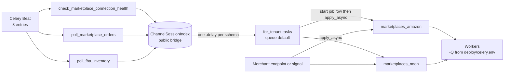
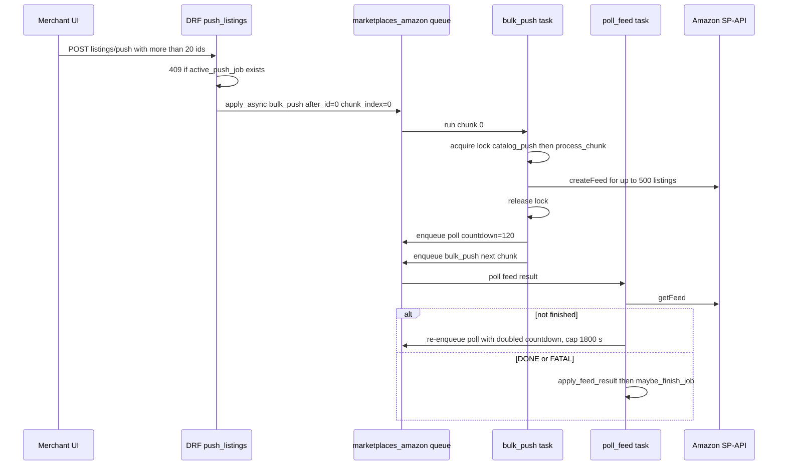
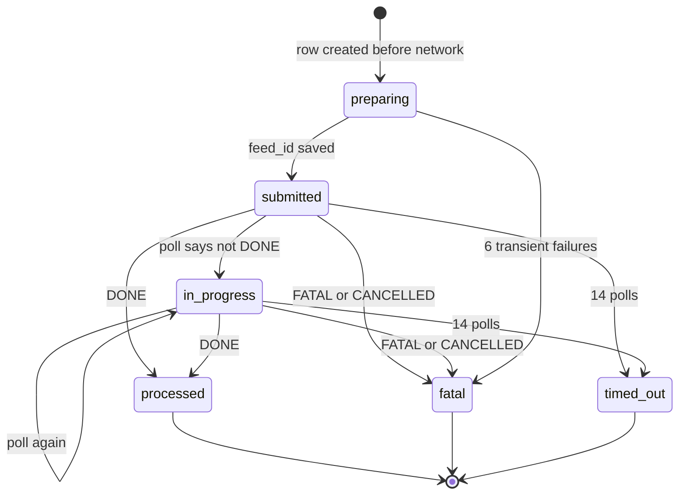
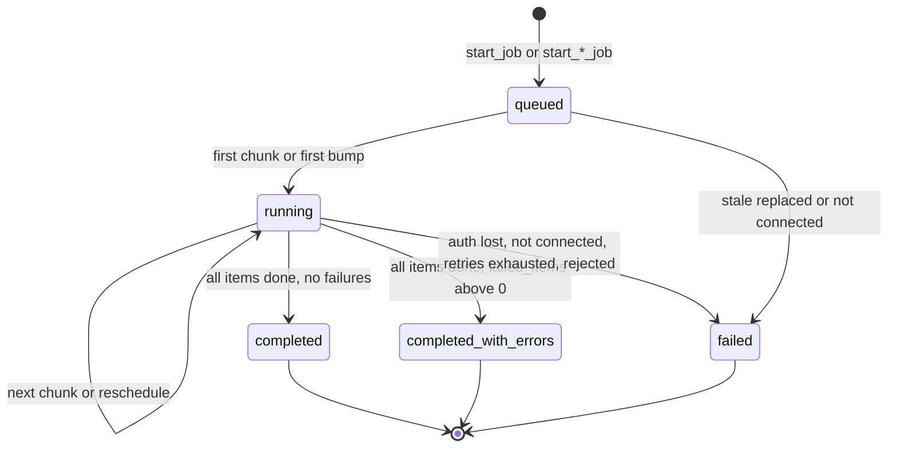
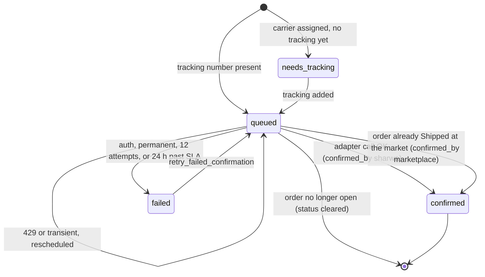

# Online marketplace jobs (Amazon, Noon)

> **Source**: DOC-504 · inventory A.8 · INT-038 (M28)
> **Code**: `sharwa_saas/products/tasks/marketplaces.py` (all 14 Celery tasks) · `products/services/marketplaces/` (`bulk_sync_service.py`, `order_pull_service.py`, `fba_inventory_service.py`, `shipment_confirm_service.py`, `listing_service.py`, `marketplace_rate_limit.py`, `connection_service.py`, `api_service.py`) · `products/signals_marketplaces.py` · `products/views/marketplace_listings.py`, `marketplaces_hub.py`, `marketplaces_connect.py` · `api/views_marketplaces.py` · `config/settings.py` (`CELERY_BEAT_SCHEDULE`) · `deploy/celery.env`
> **Last verified against code**: 2026-10-28 (step 38)

## 1. Purpose

This page is the job-level reference for everything Celery does for the online-marketplace card (Amazon and Noon): the health check, single and bulk listing pushes, barcode matching, Amazon feed polling, order pull, shipment confirmation back to the marketplace, and the read-only FBA inventory snapshot.

It answers, for every job type: **which endpoint starts it, what stops a second copy from running, and where its errors end up**. It also documents the schedule and retry rules of each task, including the self-chaining mechanism (a task does one chunk, then enqueues the next chunk itself).

Out of scope: the OAuth and connect flow, the pricing formula, and order ingestion rules (stock deduction, pending policy). Those live in the marketplace API and orders pages. The supplier (dropshipping) side is in [`dropshipping.md`](dropshipping.md). The cross-job register is [`../50-background-jobs.md`](../50-background-jobs.md); the operator view is [`../../ops/runbooks/celery.md`](../../ops/runbooks/celery.md).

## 2. Components

| Component | Location | Role |
|---|---|---|
| 14 Celery tasks | `products/tasks/marketplaces.py` | Thin executors: take the service's decision (`next`, `reschedule`, `poll_feed`, `stop`) and enqueue accordingly |
| `MARKETPLACE_QUEUE_MAP` | `products/tasks/marketplaces.py:29-32` | `amazon` → `marketplaces_amazon`, `noon` → `marketplaces_noon`; used by every `apply_async(queue=...)` (default queue `default` for an unknown code) |
| `_marketplace_installation_ready` | `products/tasks/marketplaces.py:104-116` | Per-run guard: installation must be `is_effectively_active()` and not `reauth_required` |
| `_job_bump`, `_job_note_error` | `products/tasks/marketplaces.py:119-151` | Atomic counters (`F()`) and error append for single-push jobs |
| `bulk_sync_service` | `services/marketplaces/bulk_sync_service.py` | Bulk job scope, chunking, Feed submit and result, timeout, errors CSV rows |
| `order_pull_service` | `services/marketplaces/order_pull_service.py` | Pull job lifecycle (stale rule at `:84-107`), page loop (`run_order_pull` `:156-201`), order ingest |
| `fba_inventory_service` | `services/marketplaces/fba_inventory_service.py` | Snapshot job (`start_inventory_job` `:44-55`, `run_inventory_refresh` `:89-121`) |
| `shipment_confirm_service` | `services/marketplaces/shipment_confirm_service.py` | Triggers (`:55-87`), `request_shipment_confirmation` `:90-127`, `retry_failed_confirmation` `:130-148`, `run_confirmation` `:180-225` |
| `marketplace_rate_limit` | `services/marketplaces/marketplace_rate_limit.py` | Redis token bucket, penalty, circuit breaker, job lock `acquire_job_lock` `:338-348`, debounce `:326-335` |
| Signals | `products/signals_marketplaces.py:66-81` | `post_save` on `Product` / `ProductVariant` (price and stock auto-push), `post_save` on `ShipmentOrder` (waybill → shipment confirmation) |
| DRF endpoints | `api/views_marketplaces.py`, `api/urls.py:588-601` | JSON API used by the Next.js app (guard: `channels.marketplaces.manage` plus the plan feature `marketplaces`, `views_marketplaces.py:36-55`) |
| Legacy template endpoints | `config/urls_tenant.py:518-533`, views in `products/views/marketplace_listings.py`, `marketplaces_hub.py`, `marketplaces_connect.py` | Django-rendered dashboard actions (flash messages and redirects, not JSON) |
| Notifications | `products/services/notification_service.py:180-193` (`_sync_jobs`) | Derives `sync_failed` rows from failed `MarketplaceSyncJob` (see [§4.6](#46-errors-counters-and-notifications)) |

## 3. State fields touched

| Model (store schema) | Fields written by these jobs | Notes |
|---|---|---|
| `MarketplaceSyncJob` | `status` (`queued` → `running` → `completed` / `completed_with_errors` / `failed`), `total_items`, `submitted_items`, `processed_items`, `failed_items`, `error_summary` (JSON list, max 200 entries, each message cut to 300 chars), `payload` (cursor, chunk cursor, per-chunk retry counters), `triggered_by` (`merchant` / `auto` / `beat`), `started_at`, `finished_at` | `models/marketplaces.py:200-260`. Types in use: `catalog_push`, `barcode_match`, `order_pull`, `fba_inventory`, `shipment_confirm`. See open item 5 |
| `MarketplaceFeed` | `status` (`preparing` → `submitted` → `in_progress` → `processed` / `fatal` / `timed_out`), `feed_id`, `listing_ids`, `sent`, `poll_attempts`, `accepted_count`, `failed_count`, `last_error` | Unique per `(job, chunk_index)`; one row per Amazon Feed (`models/marketplaces.py:263-308`) |
| `MarketplaceListing` | `sync_status` (`pending` / `synced` / `failed` / `hidden_out_of_stock` ...), `last_error`, `last_error_code`, `last_job_id`, `last_feed_id`, `effective_price`, `external_id`, `product_type`, `fba_fulfillable_qty`, `fba_synced_at`, `last_synced_at` | `last_job_id` is the idempotency marker for chunks and the join key for the errors CSV |
| `MarketplaceSettings` | `last_orders_pull_at` (advanced only when a pull finishes) | Switches read by jobs: `auto_push_enabled`, `order_pull_enabled` |
| `MarketplaceOrderDetail` | `shipment_confirm_status` (`''` / `needs_tracking` / `queued` / `confirmed` / `failed`), `shipment_tracking_number`, `shipment_carrier`, `shipment_carrier_code`, `shipment_confirm_attempts`, `shipment_confirm_error` (500 chars), `shipment_confirmed_by` (`sharwa` / `marketplace`), `shipment_confirmed_at` | The shipment confirmation has no `MarketplaceSyncJob` while it works; a job row is written only on failure |
| `AppInstallation.config` (encrypted) | `connection_health` (`healthy` / `error` / `reauth_required`), `last_health_check_at`, `last_health_error` | Written by `mark_health` (`connection_service.py:120-129`) |
| Redis | `mp:lock:{schema}:{code}:{name}`, `mp:debounce:{schema}:{code}:{listing_id}`, token buckets, `mp:cb:{schema}:{code}:failures` / `:open` | Locks and debounce **fail open**, the token bucket **fails closed** (see [§7](#7-configuration)) |

Data-model pages (`../data-model/01` to `08`) do not contain the marketplace models.

## 4. Flows

### 4.1 Job register

All tasks use `@shared_task(name='products.tasks.<function>')` and are re-exported from `products/tasks/__init__.py`. Global Celery settings (`config/settings.py:564-565`): `CELERY_TASK_ACKS_LATE = True`, `CELERY_TASK_REJECT_ON_WORKER_LOST = True`, so a task whose worker dies is delivered again. No task here has a custom `base=` class or `on_failure` hook. **Queue** column: none of these tasks is in `CELERY_TASK_ROUTES` (`settings.py:569-596`); routing is dynamic, per call.

| Job | Kind | Trigger (file:line) | Queue | Schedule | Retry | Idempotency | Failure handling |
|---|---|---|---|---|---|---|---|
| `products.tasks.check_marketplace_connection_health` | Beat dispatcher (`tasks/marketplaces.py:61-85`) | Beat entry `check-marketplace-connection-health` (`settings.py:683-686`) | `default` | `crontab(minute='7,22,37,52')` | none (next tick) | read-only fan-out over `ChannelSessionIndex` rows with `channel_code` in `amazon`, `noon` | none; limits 120 s soft / 180 s hard (`_common.py:31`) |
| `products.tasks.check_marketplace_connection_health_for_tenant` | task, per store (`:35-58`) | the dispatcher, `_fan_out_to_schemas` (`_common.py:55`) | `default` | per tick | none | health write is a plain overwrite | the whole loop is wrapped in `try/except`: logged with `logger.exception`, returns `{'schema', 'checked'}`; limits 300 s soft / 360 s hard (`_common.py:28`) |
| `products.tasks.poll_marketplace_orders` | Beat dispatcher (`:491-506`) | Beat entry `poll-marketplace-orders` (`settings.py:689-692`) | `default` | `crontab(minute='1-59/5')` (minutes 1, 6, ... 56) | none | fan-out only | none |
| `products.tasks.poll_marketplace_orders_for_tenant` | task, per store (`:464-488`) | the dispatcher | `default` | per tick | none | one live `order_pull` job per market (`start_order_pull_job` returns `None` while one is live) | `try/except` with `logger.exception` |
| `products.tasks.pull_marketplace_orders_task` | self-chaining task (`:509-546`) | `_enqueue_order_pull` (`:457-461`) from the per-store task, from `POST .../jobs/` (`api_service.py:413-437`) and from `marketplace_pull_orders_now` (`marketplaces_hub.py:137-162`) | `marketplaces_amazon` or `marketplaces_noon` | immediate, then chained | no `self.retry`; service-level backoff `min(60*2^(n-1), 900)` s, fail on the 5th consecutive transient error; 429 → `retry_after` s; more pages → 1 s | job row state, lock `mp:lock:...:order_pull` (300 s), per-page cursor in `payload`, 10-minute overlap | job `failed` with code `NOT_CONNECTED`, `REAUTH_REQUIRED`, `TRANSIENT_EXHAUSTED`, `PULL_REJECTED` or `STALE` |
| `products.tasks.poll_fba_inventory` | Beat dispatcher (`:637-651`) | Beat entry `poll-fba-inventory` (`settings.py:695-698`) | `default` | `crontab(minute=41)` (hourly) | none | fan-out only | none |
| `products.tasks.poll_fba_inventory_for_tenant` | task, per store (`:609-634`) | the dispatcher | `default` | hourly | none | skips markets whose adapter has no `supports_fulfillment_inventory` (Noon), not-ready installs, and markets with no listings | `try/except` with `logger.exception` |
| `products.tasks.refresh_fba_inventory_task` | self-chaining task (`:654-687`) | `_enqueue_fba_inventory` (`:602-606`) from the per-store task, `POST .../jobs/` and `marketplace_refresh_fba_inventory` (`marketplaces_hub.py:185-215`) | `marketplaces_amazon` | immediate, then chained | same rules as order pull (5 transient errors, backoff cap 900 s, 20 pages per run) | job row, lock `...:fba_inventory` (300 s), cursor in `payload` | job `failed` (`NOT_CONNECTED`, `REAUTH_REQUIRED`, `TRANSIENT_EXHAUSTED`, `INVENTORY_REJECTED`, `STALE`) |
| `products.tasks.push_marketplace_listing_task` | task (`:154-190`) | `POST .../listings/push/` for 20 or fewer targets (`api_service.py:401-409`), `marketplace_listing_push` (`marketplace_listings.py:320-342`), bulk action `push` (`:433-435`) | per market | on demand | `autoretry_for=(MarketplaceTransientError,)`, `retry_backoff=True`, `retry_jitter=True`, `max_retries=5`; 429 → `self.retry(countdown=retry_after)` (counts against the same 5) | listing `sync_status`, job counters via `F()` | not-ready or reauth → job item counted as failed with `NOT_READY` / `REAUTH_REQUIRED`; permanent rejection → listing `failed` plus `last_error` |
| `products.tasks.update_marketplace_price_quantity_task` | task (`:193-220`) | `_enqueue_updates` (`signals_marketplaces.py:28-63`) from `post_save` on `Product` and `ProductVariant` | per market | `countdown=30` after the debounce | same decorator as the push task | debounce key (30 s), skips when `auto_push_enabled` is off | no `MarketplaceSyncJob`; permanent rejection → listing `failed`; reauth → `mark_health` |
| `products.tasks.match_marketplace_listings_by_barcode_task` | self-chaining task (`:223-307`) | bulk action `match_barcode` (`marketplace_listings.py:398-411`) | per market | immediate, then next chunk of 25 | same decorator (`max_retries=5`); 429 → `self.retry`; chunk is re-run from the same `after_index` | listings that already have an identifier are skipped, so a re-run does not double count | reauth → job `failed` with `REAUTH_REQUIRED`; not ready → job `failed` with `NOT_CONNECTED` |
| `products.tasks.bulk_push_marketplace_listings_task` | self-chaining task (`:350-390`) | `_enqueue_bulk` (`marketplace_listings.py:302-306`), `api_service.push_listings` (`:399`), `marketplace_push_all` (`:483-508`) | per market | immediate, next chunk with `countdown=0`; lock miss → 15 s | no Celery retry; transient errors reschedule the same chunk after `min(60*2^(n-1), 900)` s, 5 reschedules (60, 120, 240, 480, 900) then the chunk is abandoned (`MAX_TRANSIENT_RETRIES = 6`) | lock `...:catalog_push` (600 s), `MarketplaceFeed` unique `(job, chunk_index)`, `last_job_id` skip filter | see [§4.3](#43-bulk-push-and-feed-polling) |
| `products.tasks.poll_marketplace_feed_result_task` | self-chaining task (`:393-444`) | `_enqueue_feed_poll` (`:343-347`) from the bulk task, 120 s after a Feed is submitted | per market | `120 * 2^attempts` s, capped at 1800 s, at most 14 polls | no Celery retry; each unfinished poll re-enqueues itself | `apply_feed_result` locks the feed row and ignores a terminal feed | after 14 polls the feed is `timed_out` and pending listings become `failed` (`FEED_TIMEOUT`) |
| `products.tasks.confirm_marketplace_shipment_task` | self-chaining task (`:561-599`) | `_enqueue_shipment_confirmation` (`:554-558`) via `transaction.on_commit` in `request_shipment_confirmation` and `retry_failed_confirmation` | per market | immediate | no Celery retry; 429 → `retry_after` s; transient → `min(60*2^(n-1), 1800)` s, fail on the 12th attempt or 24 h after `latest_ship_date` | status guard `queued`, lock `...:ship:<detail_pk>` (120 s), compare-and-set on the tracking number at the end | `shipment_confirm_status='failed'`, error text, and a `shipment_confirm` job row with code `SHIPMENT_CONFIRM_FAILED` |
| `retry_failed_confirmation(detail)` | service function, **not a task** (`shipment_confirm_service.py:130-148`) | `POST /api/v1/marketplaces/orders/<order_id>/confirm-shipment/`, `marketplace_retry_shipment_confirmation` (`marketplaces_hub.py:165-182`) | n/a | on demand | n/a | only acts when status is `failed` and a tracking number exists | returns `False` otherwise |

> Note: `retry_failed_confirmation` (named in the roadmap) is a plain service function, not a Celery task. It flips `failed` back to `queued`, resets the attempt counter and re-enqueues `confirm_marketplace_shipment_task` after commit (`products/services/marketplaces/shipment_confirm_service.py:130-148`). The automatic confirmation on tracking entry is the `request_shipment_confirmation` path described in [§4.5](#45-shipment-confirmation).

### 4.2 Queues, Beat and fan-out

The dispatchers read the public bridge `ChannelSessionIndex` (rows with `channel_code` in the marketplace registry), so stores that never connected a marketplace are never touched. Each store gets its own `*_for_tenant` task, which means one slow or broken store cannot hold up the others. The `*_for_tenant` tasks only create the job row and enqueue the work on the market queue (no network call). The queues `marketplaces_amazon` and `marketplaces_noon` must be in `CELERY_QUEUES` (`deploy/celery.env:16`), otherwise tasks are accepted by Redis and never run; `deploy/check_celery_queues.py` guards that in CI.

### 4.3 Bulk push and feed polling

Amazon accepts up to `FEED_CHUNK = 500` listings per Feed (`bulk_sync_service.py:43`). Noon has no bulk feed (`noon_adapter.py:31`), so a bulk job on Noon uses `_process_direct_chunk` with `DIRECT_CHUNK = 50` single calls per chunk. The bulk job exists in two scopes: `scope='all'` (push-all, frozen with `max_id` so listings added mid-run do not extend the job) and `scope='selected'` (explicit `listing_ids`).

Chain rules (all in `tasks/marketplaces.py:350-444` and `bulk_sync_service.py:226-244`):

- **Stop condition (bulk task)**: job missing or not `queued` / `running` returns `job_inactive`; no installation returns `NOT_CONNECTED` and fails the job; empty chunk calls `_finish_if_empty` (sets `chunks_done`, recounts, `maybe_finish_job`).
- **The lock is released before the next chunk is enqueued** (`:371-374`), otherwise the next chunk would find it held. If the lock is held by another chunk of the same store and market, the same chunk is re-enqueued with `countdown=15`.
- **Rate limit (429 or local bucket wait)** is a reschedule of the *same chunk* with `countdown = max(1, retry_after)`; it does not consume any retry budget.
- **Transient error**: counter `payload['transient_retries'][chunk_index]`; reschedule `min(60 * 2^(attempts-1), 900)` s while `attempts < 6`; the 6th failure marks the chunk's listings `failed` with code `TRANSIENT_EXHAUSTED`, the feed `fatal`, and the job continues with the next chunk (`_abandon_chunk`, `bulk_sync_service.py:254-273`).
- **Auth error**: job `failed` (`REAUTH_REQUIRED`), `mark_health(..., 'reauth_required', ...)`, chain stops.
- **Crash safety**: the `MarketplaceFeed` row is created in `preparing` **before** any network call. If a worker dies after `createFeed` but before the `feed_id` is saved, the re-delivered chunk re-sends the same listings (harmless duplicate). If it dies after the `feed_id` is saved, the re-run skips the send and only continues the chain (`:301-314`).
- **Poll schedule**: first poll after `FEED_POLL_FIRST = 120` s, then `min(120 * 2^attempts, 1800)` s, so 240, 480, 960, then 1800 s repeatedly. `MAX_FEED_POLLS = 14`; the 14th unfinished poll calls `time_out_feed`. Counting from the first poll, the timeout is declared after about 19,800 s (5.5 h). A 429 on the poll re-enqueues with `retry_after` and does **not** increment `poll_attempts`; an unusable installation or an auth error re-enqueues with 1800 s and does increment it.
- **Job completion**: `maybe_finish_job` (`:127-148`) closes the job only when `chunks_done` is set and every feed is terminal (`processed` / `fatal` / `timed_out`). Status is `completed_with_errors` when `failed_items > 0`, else `completed`.

### 4.4 Sync job lifecycle

Only three paths close a job: the service's finish function, `fail_job`, and (for `order_pull` and `fba_inventory`) the stale rule: a job still `queued` / `running` whose `started_at` (or `created_at`) is older than `STALE_JOB_MINUTES = 30` is failed with code `STALE` when the next start request arrives, and a new job starts from the same cursor (`order_pull_service.py:84-107`, `fba_inventory_service.py:44-55`). `catalog_push`, `barcode_match` and single-push jobs have no stale rule (open item 2).

### 4.5 Shipment confirmation

Triggers: `assign_order_shipping` calls `on_order_shipping_assigned` (`fulfillment_service.py:37`), and every `post_save` of a `ShipmentOrder` with a waybill calls `on_waybill_saved` (`signals_marketplaces.py:75-81`). Both swallow exceptions: a marketplace failure never breaks local shipping. Only open orders with `fulfillment_model == 'merchant'` are handled; marketplace-fulfilled (FBA / FBN) orders are never confirmed by the merchant. The enqueue is deferred with `transaction.on_commit`. A second request with the same tracking number while `queued` is a no-op; a different tracking number after `confirmed` is logged and not sent.

### 4.6 Errors, counters and notifications

| Output | Where | Notes |
|---|---|---|
| Counters | `MarketplaceSyncJob.total_items`, `submitted_items`, `processed_items`, `failed_items` | Single push: `_job_bump` adds 1 per listing and closes the job when `processed_items >= total_items`. Bulk: recounted from `MarketplaceListing.last_job_id` by `refresh_job_counters` (`bulk_sync_service.py:115-124`). Pull and FBA: incremented per page |
| `error_summary` | JSON list, 200 entries max, `{seller_sku, code, message}` (message cut to 300) | General errors have an empty `seller_sku` |
| Per-listing error | `MarketplaceListing.last_error` (up to 2000 chars from Feed results), `last_error_code` | Written together with `last_job_id` |
| Errors CSV | `GET /api/v1/marketplaces/jobs/<pk>/errors.csv/` (`views_marketplaces.py:153-178`), legacy `.../sync-jobs/<job_id>/errors.csv` (`marketplace_listings.py:513-545`) | UTF-8 with BOM, streamed. Rows: general entries, then every listing with `last_job_id = job` and a non-empty `last_error` (`job_error_rows`, `bulk_sync_service.py:502-521`). The API view also emits the `NO-ID` rows, which have no `last_job_id` |
| `triggered_by` | `merchant`, `auto`, `beat` | API labels (`api_service.py:40`) and filter `triggered_by=system` (everything except `merchant`, `:477-495`) |
| Job summary | `job_view` / `_summary` (`api_service.py:450-474`) | For `order_pull` shows created, updated and skipped counts from `payload` |
| `sync_failed` notification | derived on read by `_sync_jobs` (`notification_service.py:180-193`) | Source rows: `status` in `failed`, `completed_with_errors` within the last 30 days (`EVENT_WINDOW`, `:39`), newest 50; dedupe key `sync_failed:marketplace:<job pk>`; visible to `channels.marketplaces.manage`. There is no write-time hook in the tasks: if nobody triggers the notification sync, nothing appears |

## 5. Invariants

1. **Schema first**: every task takes `schema_name` as its first argument and enters `schema_context` in its first lines; the dispatchers take the schema name from the trusted public bridge, never from user input ([`../10-multi-tenancy.md`](../10-multi-tenancy.md)).
2. **Readiness is rechecked at run time, not at enqueue time**: a task queued before a disconnect is skipped or fails the job with `NOT_CONNECTED`.
3. **One live job per market for pulls and snapshots; one live bulk push per market**; locks only guard the *execution* of a chunk, the job rows guard the *start*. See the table in [§6](#6-background-work).
4. **Rate waits are not failures**: a 429 or a local bucket wait is re-enqueued with a countdown, never counted as a retry in the chain tasks.
5. **Re-delivery is safe**: `acks_late` plus `reject_on_worker_lost` can run a chunk twice; the `last_job_id` filter, the `(job, chunk_index)` unique feed, listings already holding an identifier, and the order idempotency in the pull path absorb that. General idempotency rules: [`../41-idempotency.md`](../41-idempotency.md) (this page's chunk-level mechanisms are not in its register).
6. **Local operations never depend on the marketplace**: shipment triggers and signals swallow every exception.

## 6. Background work

Per job type (`MarketplaceSyncJob.job_type`): start endpoint, concurrency rule, error output.

| Job type | Start endpoint | Concurrency rule | Error output |
|---|---|---|---|
| `catalog_push`, single mode (20 or fewer targets, or any count on Noon via selection) | `POST /api/v1/marketplaces/<market>/listings/push/` with `{listing_ids}`, answers `202 {job_id, count}` (`api_service.py:371-410`). Legacy: `POST /dashboard/marketplaces/<code>/listings/bulk/` action `push`, and `.../listings/<id>/push/` for one row | None between single jobs (many may run). Not blocked by a bulk job, because `active_push_job` filters `payload.mode = 'bulk'` | Job `error_summary`, listing `last_error` / `last_error_code`, errors CSV. API path records `NO-ID` for targets lacking an identifier (`api_service.py:396-407`) |
| `catalog_push`, bulk mode (Amazon and more than 20 targets, or push-all) | Same API endpoint (`> BULK_FEED_THRESHOLD = 20` and `supports_bulk_feed`). Push-all: `POST /dashboard/marketplaces/<code>/listings/push-all/` (legacy only) | **At most one live bulk job per market**: API returns `409` «هناك عملية نشر جماعي جارية لهذا السوق — انتظر اكتمالها.»; the legacy view flashes the same text. Per chunk: lock `catalog_push` (600 s) | Same as above plus feed-level codes `FEED_FATAL`, `FEED_CANCELLED`, `FEED_TIMEOUT`, `TRANSIENT_EXHAUSTED`, `NO_PRODUCT_TYPE`, `BAD_IDENTIFIER`, `NOT_READY` |
| `barcode_match` | Legacy only: `POST /dashboard/marketplaces/<code>/listings/bulk/` action `match_barcode` (`marketplace_listings.py:398-411`). No DRF endpoint | None per market. Chunk of 25 per run, no lock | Job `error_summary`; per-listing `last_error`. See open item 3 |
| `order_pull` | `POST /api/v1/marketplaces/<market>/jobs/` with `{"job_type": "order_pull"}`, `202 {job_id}` (`api_service.py:413-437`); legacy `POST /dashboard/marketplaces/<code>/orders/pull-now/`; Beat every 5 minutes | **One live job per market**. API returns `409` «يجري سحب الطلبات الآن بالفعل — ستظهر الطلبات الجديدة خلال لحظات.»; legacy flashes a warning. A job older than 30 minutes is replaced (`STALE`). Execution lock `order_pull` (300 s). Skipped when `order_pull_enabled` is off (Beat only) | Job `failed` with a code (see [§4.1](#41-job-register)); per-order failures are counted in `failed_items` and listed in `error_summary` |
| `fba_inventory` | `POST /api/v1/marketplaces/<market>/jobs/` with `{"job_type": "fba_inventory"}`; legacy `POST /dashboard/marketplaces/<code>/fba-inventory/refresh/`; Beat hourly | **One live job per market**, `409` «يجري جلب مخزون المستودع الآن بالفعل.»; `400` when the adapter has no fulfillment inventory (Noon); lock `fba_inventory` (300 s). Stale after 30 min | Job `failed` with a code; the snapshot is read only and never touches local stock |
| `shipment_confirm` (a record, not a running job) | No start endpoint: automatic on tracking entry or waybill. Retry: `POST /api/v1/marketplaces/orders/<order_id>/confirm-shipment/` and `POST /dashboard/marketplaces/orders/<order_id>/confirm-shipment/retry/` | Status guard `queued`; lock `ship:<detail_pk>` (120 s). The retry endpoint answers `409` when the order is marketplace-fulfilled, already confirmed, or not in `failed`, e.g. «التأكيد آلي عند إدخال رقم التتبع — لا يوجد تأكيد فاشل لإعادته.» (`api_service.py:540-557`) | `MarketplaceOrderDetail.shipment_confirm_error`, plus a failed `shipment_confirm` job row visible in the sync log |
| price / quantity auto-push | No endpoint: `post_save` signals | Debounce: 20 saves within 30 s enqueue one task per listing and market | Listing `failed` only; no job row (open item 1) |
| connection health | `POST /dashboard/marketplaces/<code>/check/` (one timed call), Beat every 15 minutes | None | `connection_health` / `last_health_error` on the installation; not a job row |

The `MarketplaceSyncJob` types written by code are exactly `catalog_push`, `barcode_match`, `order_pull`, `fba_inventory` and `shipment_confirm`. The other three model choices are never created (open items 1 and 5). The supplier equivalents, including the supplier `order_*` job types that are never created, are in [`dropshipping.md`](dropshipping.md#45-order-job-types-that-are-never-created).

## 7. Configuration

| Setting | Value | Where |
|---|---|---|
| `CELERY_TASK_ACKS_LATE`, `CELERY_TASK_REJECT_ON_WORKER_LOST` | `True` | `config/settings.py:564-565` |
| `CELERY_WORKER_PREFETCH_MULTIPLIER` | `1` | `config/settings.py:567` |
| Queues | `marketplaces_amazon`, `marketplaces_noon` in `CELERY_QUEUES` | `deploy/celery.env:16` |
| Beat entries | `check-marketplace-connection-health`, `poll-marketplace-orders`, `poll-fba-inventory` | `config/settings.py:683-698` |
| Time limits | per-store tasks 300 s soft / 360 s hard; dispatchers 120 s / 180 s; chain tasks have **none** | `products/tasks/_common.py:28,31` |
| `NOON_MARKETPLACE_ADAPTER` | environment variable, default `fake` | `config/settings.py:606` |
| Pull window | first pull 7 days (`FIRST_PULL_DAYS`), overlap 10 minutes, 20 pages per run | `order_pull_service.py:60-62` |
| Token bucket | per `(schema, market, operation)`; Amazon limits in `OPERATION_LIMITS`; Noon `default` 2 per second, burst 10 | `marketplace_rate_limit.py:48-88` |
| Penalty after a real 429 | rate halved for 600 s | `marketplace_rate_limit.py:90-91,316-323` |
| Circuit breaker | 5 failures within 120 s opens it for 300 s; an auth failure opens it for 3600 s until reconnect (`close_circuit`, `connection_service.py:94,116`) | `marketplace_rate_limit.py:93-96` |
| Failure policy | Token bucket fails **closed** (waits `1/rate`); job lock, debounce and breaker check fail **open** | `marketplace_rate_limit.py:282-297,326-359,370-377` |

The platform-wide rate-limit register [`../34-rate-limits.md`](../34-rate-limits.md) has one row for the outbound marketplace limiter (the 10-minute halving after a real 429).

## 8. Failure modes and fixes

| Symptom | Cause | Check | Fix |
|---|---|---|---|
| Marketplace jobs stay `queued` forever | No worker consumes `marketplaces_amazon` / `marketplaces_noon` | `-Q` in the running worker vs `deploy/celery.env`; `deploy/check_celery_queues.py` | Restart the worker with the full `CELERY_QUEUES` |
| No new orders arriving | Beat down, `order_pull_enabled` off, installation `reauth_required`, or a live job blocks | Sync log (`GET /api/v1/marketplaces/jobs/?job_type=order_pull`), `connection_health` | Start Beat, reconnect the market, or wait 30 min for the stale rule |
| Bulk push says a job is already running but nothing moves | The chain died and a `catalog_push` bulk job is still `running` (no stale rule) | Job `started_at`, worker logs | Open item 2: no endpoint closes it; needs a data fix by an engineer |
| Listings stuck in `pending` after a bulk push | Feed not finished; polls continue up to about 5.5 h | `MarketplaceFeed.status`, `poll_attempts` | Wait; after the timeout listings become `failed` (`FEED_TIMEOUT`) and can be pushed again |
| Shipment confirmation `failed` | Auth lost, permanent rejection, 12 transient failures, or 24 h past SLA | `shipment_confirm_error` | Reconnect if needed, then `confirm-shipment/` retry |
| Everything for one store pauses for 5 minutes | Circuit breaker opened by 5 failures in 2 minutes | Logs: circuit opened message | Wait; it half-opens by itself. After an auth failure, reconnect closes it |
| Price change did not reach the market | The task exhausted 5 retries and left no trace (no job row) | Worker logs only | Push the listing again (open item 1) |

## 9. Open items

1. **Auto price and quantity push is invisible.** `update_marketplace_price_quantity_task` creates no `MarketplaceSyncJob`, so after `max_retries=5` of transient errors the update is lost without a `sync_failed` notification (`tasks/marketplaces.py:193-220`). The job types `price_update` and `inventory_update` exist in the model choices (`models/marketplaces.py:208-209`) but no code creates them.
2. **No stale handling for `catalog_push` and `barcode_match`.** Only `order_pull` and `fba_inventory` have the 30-minute stale rule. A bulk job whose chain was lost keeps `active_push_job` true, so every later bulk push for that market is refused with `409` (`bulk_sync_service.py:60-66`). The chain tasks also have no `soft_time_limit`.
3. **`barcode_match` has no API endpoint.** It can only be started from the legacy Django dashboard (`marketplace_listings.py:398-411`); `api/urls.py:588-601` has no route for it. Likewise push-all (`marketplace_push_all`) is legacy only; the API pushes only selected listings.
4. **Rate-limit retries consume `max_retries` in the single-push, price-update and barcode tasks.** The module comment says a 429 should retry without ever becoming a terminal failure (`tasks/marketplaces.py:95`), but `self.retry(countdown=...)` increments the same retry counter as `autoretry_for`; after 5 combined retries Celery raises `MaxRetriesExceededError` and the task ends. For a single-push job the counter is then never bumped, so the job stays `running` (no `on_failure` hook).
5. **`feed_result` job type is never created**; only `catalog_push`, `barcode_match`, `order_pull`, `fba_inventory` and `shipment_confirm` are written by code (`models/marketplaces.py:206-215`).
6. **`marketplace_push_all` with zero items** sets `status='completed'` without `finished_at` (`marketplace_listings.py:499-503`).
7. **`NO-ID` rows exist only on the API path.** The legacy push action filters out listings without an identifier and only flashes a count (`marketplace_listings.py:413-420`).
8. **`sync_failed` has no write-time trigger** (see [§4.6](#46-errors-counters-and-notifications)); how often `notification_service.sync` runs is documented in [`../46-timelines-and-notifications.md`](../46-timelines-and-notifications.md).

## 10. Related pages

- [`dropshipping.md`](dropshipping.md): the supplier job chains and schedules
- [`order-push.md`](order-push.md): push jobs for orders
- [`../50-background-jobs.md`](../50-background-jobs.md): register of all jobs and Beat entries
- [`../../ops/runbooks/celery.md`](../../ops/runbooks/celery.md): operating workers and Beat
- [`../10-multi-tenancy.md`](../10-multi-tenancy.md), [`../41-idempotency.md`](../41-idempotency.md), [`../42-concurrency.md`](../42-concurrency.md), [`../46-timelines-and-notifications.md`](../46-timelines-and-notifications.md)

**Tests that cover these jobs** (all under `sharwa_saas/`):

| Area | Test file |
|---|---|
| Rate limiter, circuit breaker, health beat | `products/test_marketplaces_phase1.py` |
| Single push, auto-push debounce, barcode match chunks, retry | `products/test_marketplaces_phase2.py` |
| Feeds, chunks, polling, timeout, crash safety, push-all 409 | `products/test_marketplaces_phase3.py` |
| Order pull resilience, stale job, Beat start | `products/test_marketplaces_phase4.py` |
| Shipment confirmation, FBA snapshot, sustained 429, two stores fairness | `products/test_marketplaces_phase5.py` |
| DRF endpoints (push, jobs, trigger, orders, confirm-shipment) | `api/test_marketplaces_api.py` |
| Beat fan-out sets | `products/test_beat_fanout.py` |
