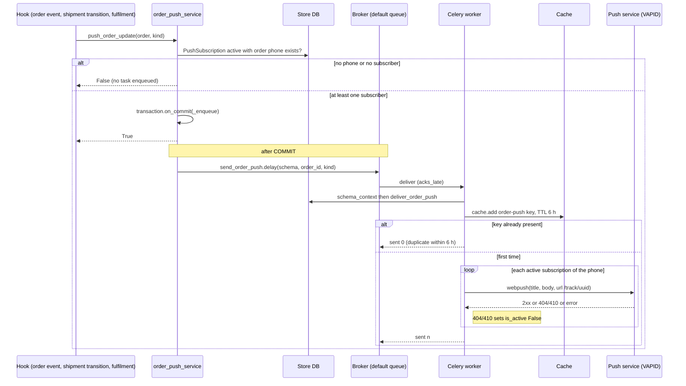
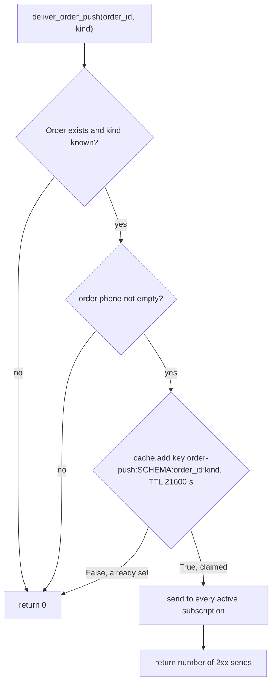

# Order push notifications — `send_order_push`

> **Source**: DOC-498 · inventory A.8 · INT-016 (M44)
> **Code**: `sharwa_saas/products/services/order_push_service.py` · `products/tasks/operations.py` (`send_order_push`, `send_push_broadcast`) · `products/services/push_service.py` · `products/order_events.py` · `products/services/shipment_state_service.py` · `products/services/fulfillment_service.py` · `api/views_push.py` · `api/views.py` (`PushVapidPublicKeyView`, `PushSubscribeView`, `PushUnsubscribeView`) · `products/models/pwa.py` (`PushSubscription`) · `config/settings.py` (`CELERY_*`, `VAPID_*`)
> **Last verified against code**: 2026-10-28 (step 38)

## 1. Purpose

A buyer who tapped the "notify me when my order changes" prompt on the order-success page gets a **browser (Web Push) notification** when the order is shipped, in transit, ready for pickup, delivered, returned, cancelled or its payment is confirmed. The push carries the store name in the title and a link to the public tracking page `/track/<uuid>`.

This page covers the **server side of that promise**: which code paths enqueue a push, the single Celery task that sends it, the 6-hour de-duplication key, and the merchant broadcast endpoint that shares the same transport. It does not cover the browser subscription flow or the service worker (see [`m44-pwa.md`](../../api/domains/05-storefront/m44-pwa.md)), nor WhatsApp messages for the same order events (see [`whatsapp.md`](whatsapp.md)).

Order push is a **side effect**, never part of the order transaction: no subscriber means no task, the task is enqueued after commit, and nothing in the chain is allowed to raise into the caller.

## 2. Components

| Component | Location | Role |
|---|---|---|
| `push_order_update(order, kind)` | `order_push_service.py:64` | The only enqueue point. Validates `kind`, resolves the order phone, checks that at least one active subscription exists, then registers `transaction.on_commit` (`:81`) → `send_order_push.delay(schema_name, order_id, kind)` (`:77`). Wrapped in `try/except` twice — returns `False`, never raises. |
| `push_for_order_event(order, event_type)` | `order_push_service.py:88` | Maps an order event name to a push kind through `ORDER_EVENT_KINDS` (`:42-47`). |
| `push_for_shipment(shipment, to_status)` | `order_push_service.py:93` | Maps an accepted shipment transition to a kind through `SHIPMENT_KINDS` (`:48-53`). |
| `deliver_order_push(order_id, kind)` | `order_push_service.py:106` | Runs inside the worker: de-dupe, build title/body/url, send to every active subscription of the phone. Returns the number sent. |
| `send_order_push` (task) | `products/tasks/operations.py:201-208` | `schema_context(schema_name)` then `deliver_order_push`. Returns `{'sent': n}` (results are discarded: `CELERY_TASK_IGNORE_RESULT = True`, `settings.py:563`). |
| `send_push_to_subscription` | `push_service.py:49` | One Web Push through `pywebpush` with the platform VAPID key. 404/410 deactivates the subscription; every other error is logged and swallowed. |
| `send_push_broadcast` (task) | `operations.py:211` | Merchant broadcast to **all** active subscriptions (not order-bound). Enqueued by `push_service.send_push_to_all_subscribers` (`:92`). |
| Push endpoints | `api/views_push.py`, `api/views.py:281-350`, routes `api/urls.py:108-113` | Subscribe / unsubscribe / VAPID key / stats / manual broadcast. |
| `PushSubscription` | `products/models/pwa.py:64` | The subscription row (store schema). |

## 3. State fields touched

`send_order_push` owns no model. It reads `Order` and `PushSubscription` and writes at most one field on one of them.

| Model | Schema | Field | Read / written | By |
|---|---|---|---|---|
| `Order` | store | `customer_phone` (normalised with `clean_phone_number`), `public_uuid` (the `/track/<uuid>` link), `pk` (the number in the text) | read | `order_phone`, `deliver_order_push` |
| `PushSubscription` | store | `customer_phone` (set at subscribe time from the **order**, not from client input), `is_active`, `endpoint` (unique), `p256dh`, `auth` | read; `is_active` written (`False`) with `updated_at` | `_subscriptions` (`order_push_service.py:60`, filter `is_active=True, customer_phone=phone`); `send_push_to_subscription` on 404/410 (`push_service.py:80-83`) |
| `StoreSetting` | store | `store_name` | read | title prefix (`order_push_service.py:117-119`) |
| cache | Django default cache (Redis db 0, key prefix `sharwa`, `settings.py:CACHES`) | `order-push:<SCHEMA>:<order_id>:<kind>` (TTL 21 600 s) | `cache.add` | de-dupe (`:114`) |
| cache | same | `push-test:<SCHEMA>` (TTL 60 s) | `cache.add` | broadcast cool-down (`api/views_push.py:66`) |

The data-model description of the subscription table lives in [`../data-model/05-storefront.md`](../data-model/05-storefront.md) (Domain 5, PWA).

## 4. Flows

### 4.1 Trigger table — who enqueues which push

Every row ends in `push_order_update(order, kind)`; the "Kind" column is the key into `MESSAGES` (`order_push_service.py:33-41`).

| Trigger (event) | Kind | Emitter (file:line) | Reached from |
|---|---|---|---|
| `ORDER_SHIPPED` | `shipped` | `products/views/shipping.py:244-246` (legacy dashboard view `assign_order_shipping_view`, only when a provider is set) | `POST dashboard/orders/<id>/assign-shipping/` (`config/urls_tenant.py:452`) |
| `ORDER_DELIVERED` | `delivered` | `order_api_service.py:459-460` (`change_status` to `completed`) | `POST /api/v1/orders/<id>/status/` |
| `ORDER_DELIVERED` | `delivered` | `products/views/merchant_dashboard.py:1439-1441` (legacy status view) | dashboard order status change |
| `ORDER_DELIVERED` | `delivered` | `suppliers/order_forward_service.py:439-440` (`_mark_delivered`: all fulfilments delivered, order paid, status set to `completed`) | supplier order delivery sync (see [`dropshipping.md`](dropshipping.md)) |
| `ORDER_CANCELLED` | `cancelled` | `order_api_service.py:461-462` (cancel), `:512` (payment proof rejected); `merchant_dashboard.py:1442-1447`, `:1552-1555` (legacy) | `POST /api/v1/orders/<id>/status/`, `POST /api/v1/orders/<id>/payment/reject/` |
| `PAYMENT_RECEIVED` | `payment_received` | `order_api_service.py:486` (`approve`), `:501` (`confirm`); `merchant_dashboard.py:1526-1527` (legacy) | `POST /api/v1/orders/<id>/payment/<action>/` |
| `ORDER_CREATED` | — (**ignored**, not in `ORDER_EVENT_KINDS`) | `checkout_service.py:836-837` (`notify_order_created`) | storefront checkout (the buyer is on the success page) |
| accepted shipment transition `picked_up` | `shipped` | `shipment_state_service.py:267-269` | `apply_shipment_transition` (carrier webhook, courier app, merchant, system) |
| accepted shipment transition `in_transit` | `in_transit` | same | same |
| accepted shipment transition `delivered` | `delivered` | same | same |
| accepted shipment transition `returned` | `returned` | same | same |
| `mark_fulfillment_prepared` on a pickup order | `ready_for_pickup` | `fulfillment_service.py:62-66` (only when `order.pickup_location_id` is set) | staff marks the pickup fulfilment prepared |

All `ORDER_*` / `PAYMENT_RECEIVED` rows pass through `notify_sharwaconnect_of_order_event`, which calls `push_for_order_event` first (`order_events.py:101-102`), before the WebhookEndpoint emit and the WhatsApp event — the push channel is independent of whether the WhatsApp app is installed.

Shipment transitions only count when the event is **accepted**: the call is guarded by `if not event.is_rejected` (`shipment_state_service.py:267`), so a rejected or stale carrier event never pushes (`api/test_pwa_push_api.py::test_accepted_shipment_transition_pushes` sends a legal `picked_up` and an illegal `delivered` and expects one push).

Notification texts (`MESSAGES`, `{n}` = the order number; the title is prefixed `<store name> — ` when `StoreSetting.store_name` is not empty):

| Kind | Title | Body |
|---|---|---|
| `payment_received` | «تم تأكيد الدفع» | «تم تأكيد دفع طلبك رقم {n}.» |
| `shipped` | «طلبك في الطريق» | «شُحن طلبك رقم {n} — تابع رحلته من صفحة التتبع.» |
| `in_transit` | «طلبك قيد التوصيل» | «طلبك رقم {n} في الطريق إليك الآن.» |
| `ready_for_pickup` | «طلبك جاهز للاستلام» | «طلبك رقم {n} جاهز للاستلام — أظهر رمز الاستلام من صفحة التتبع.» |
| `delivered` | «تم التسليم» | «تم تسليم طلبك رقم {n}. شكراً لتسوقك معنا.» |
| `returned` | «تعذّر التسليم» | «تعذّر تسليم طلبك رقم {n} — تواصل مع المتجر لإعادة الإرسال.» |
| `cancelled` | «أُلغي الطلب» | «أُلغي طلبك رقم {n}. تواصل مع المتجر لأي استفسار.» |

### 4.2 Enqueue and delivery

**Payload sent to the browser** (`push_service.py:66-68`): `{"title": <store — title>, "body": <body>, "url": "/track/<public_uuid>"}` serialised with `ensure_ascii=False`; `icon` is added only when the caller passes one (the order push does not). The URL is relative: the service worker resolves it against the store origin. The VAPID claim subject is `mailto:<VAPID_CLAIMS_EMAIL>`.

Key points of the code path:

- **Phone match.** Both sides use `clean_phone_number` (`products/utils.py:111`: strips `+`, spaces and dashes, drops a leading `00` or `0`, prefixes `967` to a 9-digit number starting with `7`). The subscription phone is written by `PushSubscribeView` from the order identified by `order_uuid` (`api/views.py:316-321`), never from a client-supplied phone — a client phone without an order is ignored, so nobody can subscribe to another buyer's number.
- **Cheap pre-check, strict re-check.** The hook only tests `_subscriptions(phone).exists()` (`:70`); the worker re-queries the live set at send time (`:122`).
- **Never raises.** `push_order_update` catches everything and logs (`:78-79`, `:83-84`). `_enqueue` also catches a broker failure inside the commit hook, so a missing Redis cannot turn a successful order update into an HTTP 500.

### 4.3 Throttle (de-duplication)

The throttle key is `order-push:<SCHEMA>:<order_id>:<kind>` with `DEDUPE_TTL = 6 * 3600` (`order_push_service.py:32`, `:114`). One notification **per (order, kind) per 6 hours**, per store. Consequences (all from the code, `:106-125`):

- `shipped` fires from two places (courier assignment and carrier pick-up) and `delivered` from two (order completed and shipment delivered) — the second one within 6 h is dropped by design (`order_push_service.py` header comment).
- The key is **claimed before sending**. If every send fails with a transient error, or the worker is killed after the claim and the task is redelivered, the retry sees the key and sends nothing: delivery is at-most-once per window, not at-least-once.
- The key is per (order, kind), not per subscription: a device that subscribes after the push was sent does not receive it later.

## 5. Invariants

| Invariant | Enforced by |
|---|---|
| No active subscription with the order's phone ⇒ no task is enqueued | `push_order_update` (`order_push_service.py:70`) |
| A push is enqueued only after the surrounding transaction commits | `transaction.on_commit` (`:81`); outside any transaction Django runs the callback immediately |
| Nothing in the enqueue path raises into the order flow | two nested `try/except` (`:66-85`, `:76-79`) |
| `ORDER_CREATED` never pushes | not a key of `ORDER_EVENT_KINDS` |
| At most one push per (order, kind) per 6 h per store | `cache.add` (`:114`) — atomic on Redis |
| The subscription phone comes from the order, never from the client | `PushSubscribeView` (`api/views.py:311-321`) |
| A dead subscription (404/410) is deactivated, not deleted | `send_push_to_subscription` (`push_service.py:80-83`) |
| The private VAPID key and subscription keys are never logged | `push_service.py` log lines carry only status and endpoint |

## 6. Background work

### 6.1 Job table

| Job (dotted path / task name) | Kind | Trigger (who / where) | Queue | Schedule | Retry | Idempotency | Failure handling |
|---|---|---|---|---|---|---|---|
| `products.tasks.operations.send_order_push` / `products.tasks.send_order_push` | task | `push_order_update` → `transaction.on_commit` → `.delay` (`order_push_service.py:77`); hooks listed in §4.1 | `default` (no entry in `CELERY_TASK_ROUTES`, `CELERY_TASK_DEFAULT_QUEUE = 'default'`, `settings.py:568`) | none (event-driven) | no `max_retries`, no `autoretry_for`, no time limits on the task; global `CELERY_TASK_ACKS_LATE = True` and `CELERY_TASK_REJECT_ON_WORKER_LOST = True` (`settings.py:564-565`) | cache key `order-push:<SCHEMA>:<order_id>:<kind>`, TTL 6 h (`:114`) | Individual push errors are swallowed in `send_push_to_subscription` (`False` returned). 404/410 sets `PushSubscription.is_active = False`. An unexpected exception (DB error) fails the task with no retry and is only visible in the Celery log; nothing is persisted for the operator, and the claimed cache key suppresses a re-send for 6 h. |
| `products.tasks.operations.send_push_broadcast` / `products.tasks.send_push_broadcast` | task | `send_push_to_all_subscribers` (`push_service.py:92-106`) from `POST /api/v1/push/test/` (`api/views_push.py:70`) | `default` | none | none (same global ack settings) | none in the task; the endpoint guards with cache key `push-test:<SCHEMA>` (60 s cool-down) | Same swallow-and-continue per subscription; the loop over subscriptions continues after any single failure. Result `{'broadcast': True}` is discarded. |

Neither task carries `TENANT_TASK_LIMITS` (soft 300 s / hard 360 s, `products/tasks/_common.py:28`); they run under the worker defaults only. A very large broadcast is therefore not time-boxed per task.

### 6.2 State fields changed by each job

| Job | Fields changed |
|---|---|
| `send_order_push` | `PushSubscription.is_active` → `False` and `updated_at` (only on 404/410). Cache: `order-push:<SCHEMA>:<order_id>:<kind>` created. Nothing on `Order`. |
| `send_push_broadcast` | `PushSubscription.is_active` → `False` and `updated_at` (404/410). Cache: none (the cool-down key is set by the endpoint). |

### 6.3 Endpoints

| Route | Auth | Effect |
|---|---|---|
| `GET /api/v1/push/vapid-public-key/` (`api/urls.py:108`, `api/views.py:281`) | public (`HasTenantContext`, no authentication) | `{publicKey}` — the platform-wide VAPID public key (`settings.VAPID_PUBLIC_KEY`) |
| `POST /api/v1/push/subscribe/` (`api/views.py:299`) | public; rate limit `120/m` per IP (`group='push_subscribe'`) | upsert by `endpoint`; with `order_uuid` binds `customer_phone` from that order (400 `{order_uuid: [...]}` if the order does not exist); responds `201 {ok: true}` |
| `POST /api/v1/push/unsubscribe/` (`api/views.py:341`) | public | `is_active = False` for the `endpoint` (row kept); 400 without `endpoint` |
| `GET /api/v1/push/stats/` (`api/views_push.py:31`) | owner or `reports.view` | `{active_subscribers}` |
| `POST /api/v1/push/test/` (`api/views_push.py:41`) | **owner only** (a staff session gets 403) | body `{title ≤ 60, body ≤ 200}` → `202 {queued_for}` (the number of active subscribers); 400 with field errors, or 400 when there are no active subscribers; **429 + `Retry-After: 60`** when another broadcast was sent in the last 60 s |

`push/test/` does **not** use `send_order_push`: it enqueues `send_push_broadcast`, which sends the same title/body to every active subscription of the store. Order-bound pushes are not exposed through any endpoint — they can only be triggered by the hooks in §4.1.

## 7. Configuration

| Name | Where | Value / default |
|---|---|---|
| `DEDUPE_TTL` | `order_push_service.py:32` | `6 * 3600` s |
| `COOLDOWN` (broadcast) | `api/views_push.py:26` | 60 s |
| `TITLE_MAX` / `BODY_MAX` | `api/views_push.py:24-25` | 60 / 200 characters |
| `VAPID_PUBLIC_KEY`, `VAPID_PRIVATE_KEY`, `VAPID_CLAIMS_EMAIL` | environment, read in `config/settings.py` (lines 97-99) | empty by default; one key pair for the whole platform. Without `pywebpush` installed `send_push_to_subscription` logs an error and returns `False` (`push_service.py:62-64`). |
| Cache backend | `config/settings.py` `CACHES['default']` | Redis db 0, `KEY_PREFIX='sharwa'`; `LocMemCache` only when `DJANGO_TESTING=1`. The de-dupe key is only global across workers on the Redis backend. |
| Celery | `CELERY_TASK_ACKS_LATE`, `CELERY_TASK_REJECT_ON_WORKER_LOST`, `CELERY_TASK_DEFAULT_QUEUE`, `CELERY_TASK_IGNORE_RESULT` | see [`../50-background-jobs.md`](../50-background-jobs.md) and [`../../ops/environment.md`](../../ops/environment.md) |

The `default` queue must be consumed by a worker (`deploy/celery.env` `CELERY_QUEUES` starts with `default`); see [`../../ops/runbooks/celery.md`](../../ops/runbooks/celery.md).

## 8. Failure modes and fixes

| Failure | Symptom | Cause | Handling / fix |
|---|---|---|---|
| Broker down at commit time | order update succeeds, no push | `_enqueue` swallows the exception and logs «تعذّر إدراج إشعار المتصفح '%s' للطلب #%s — تم تجاهله.» (`order_push_service.py:79`) | the push is lost (no retry, no row); restore the broker. The log line is the only trace. |
| Workers down | pushes pile up in `default`, delivered later | no consumer | on restart `acks_late` redelivers; the 6 h key is claimed only when the task actually runs, so late delivery still sends |
| Buyer got no "delivered" push after "shipped"-type duplicates | second push of the same kind dropped | 6 h throttle by design | none — expected |
| All sends fail with a transient push-service error | nothing delivered, nothing retried | key claimed before sending; `send_push_to_subscription` returns `False` and logs «فشل عابر في إرسال إشعار (status=%s): %s» | wait out the 6 h window or trigger a different kind |
| Subscription deleted in the browser | no push, row switches to inactive after the next attempt | push service answers 404/410 | automatic: `is_active = False`, kept for history (`push_service.py:80-83`) |
| VAPID keys not configured | every push returns `False` | empty `VAPID_*` | set the three environment variables ([`../../ops/environment.md`](../../ops/environment.md)) |
| Order without a phone | no push | `order_phone` returns `None` | none — expected |
| `push/test/` → 429 | merchant clicked twice | cool-down key `push-test:<SCHEMA>` | wait 60 s (`Retry-After`) |

## 9. Open items

> ⚠️ Discrepancy — roadmap says `ORDER_SHIPPED` is a hook of `notify_sharwaconnect_of_order_event` (SHIPPED / DELIVERED / CANCELLED / PAYMENT_RECEIVED) / code does map `ORDER_SHIPPED → shipped` (`order_push_service.py:43`) but its **only** emitter is the legacy HTML view `assign_order_shipping_view` (`products/views/shipping.py:244-246`, session-authenticated dashboard route `dashboard/orders/<id>/assign-shipping/`). The Next.js API path (`order_api_service.py`) emits only `ORDER_DELIVERED`, `ORDER_CANCELLED` and `PAYMENT_RECEIVED`, and `fulfillment_service.assign_order_shipping` (also used by the supplier order forward, `order_forward_service.py:421`) does not emit `ORDER_SHIPPED`. A buyer therefore gets `shipped` from the API flow only through the accepted shipment transition `picked_up`. Reported in step 38.

> ⚠️ Discrepancy — roadmap says the manual broadcast `push/test/` belongs to the `send_order_push` job family / code does enqueue a separate task `send_push_broadcast` (`api/views_push.py:70` → `push_service.py:105`), documented in §6.1. Reported in step 38.

- At-most-once semantics: the throttle key is claimed before the send (§4.3), so a worker crash after the claim or an all-transient-failure send is never retried within 6 h. If at-least-once is wanted, the key should be set after a successful send.
- `send_order_push` and `send_push_broadcast` have no `soft_time_limit` / `time_limit` (unlike every `*_for_tenant` task, `TENANT_TASK_LIMITS`); a hung push endpoint is bounded only by `pywebpush`'s own timeout.
- `api/views_push.py` docstring says the broadcast runs in Celery as `send_push_to_all_subscribers`; the Celery task is `send_push_broadcast` (the function `send_push_to_all_subscribers` only enqueues it).
- Unverified: the `pywebpush` HTTP timeout used for `webpush(...)` (library default, not set in `push_service.py`).

**Tests** (verified files, test counts from `def test_` in each file):

- `api/test_pwa_push_api.py` — 11 tests: `test_install_event_from_nextjs`, `test_subscribe_binds_phone_from_order_only`, `test_free_phone_without_order_is_ignored`, `test_unknown_order_uuid_is_400`, `test_unsubscribe`, `test_order_event_pushes_to_that_phone_only_once` (de-dupe), `test_no_subscribers_no_task_and_created_is_silent`, `test_accepted_shipment_transition_pushes`, `test_ready_for_pickup_pushes`, `test_merchant_stats_and_test_push` (202 / 400 / 429 + `Retry-After: 60`), `test_staff_cannot_broadcast`.
- `products/test_push_notifications.py` — 10 tests: VAPID key endpoint, subscribe/upsert/unsubscribe, `send_push_to_subscription` success / 410 deactivation / 500 keeps active, `send_push_to_all_subscribers` enqueues the task.
- No test runs `send_push_broadcast` itself, and none covers a broker failure inside the commit hook.

## 10. Related pages

- [`whatsapp.md`](whatsapp.md) — the WhatsApp channel of the same order events (`notify_sharwaconnect_of_order_event`).
- [`webhooks.md`](webhooks.md) — the merchant webhook emitted from the same hook.
- [`../50-background-jobs.md`](../50-background-jobs.md) — the job register; [`../../ops/runbooks/celery.md`](../../ops/runbooks/celery.md) — operating workers and Beat.
- [`../41-idempotency.md`](../41-idempotency.md) — pattern D (cache key with TTL).
- [`../46-timelines-and-notifications.md`](../46-timelines-and-notifications.md) — the in-dashboard notification bell (a different mechanism).
- [`../34-rate-limits.md`](../34-rate-limits.md) — the `120/m` subscribe limit.
- [`../data-model/05-storefront.md`](../data-model/05-storefront.md) — `PushSubscription`.
- API: [`m44-pwa.md`](../../api/domains/05-storefront/m44-pwa.md), [`m06-orders.md`](../../api/domains/04-orders-returns/m06-orders.md).
