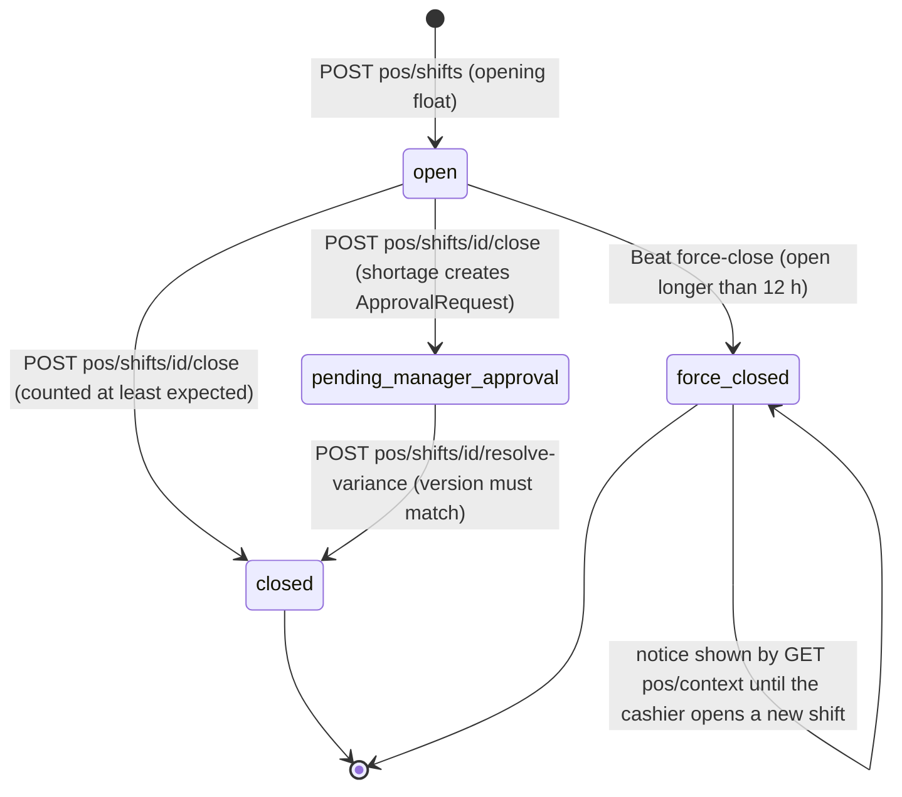
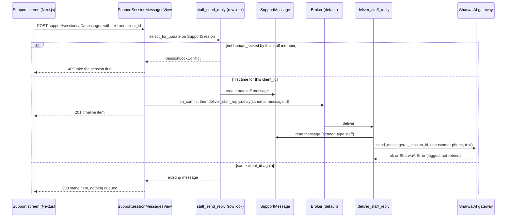
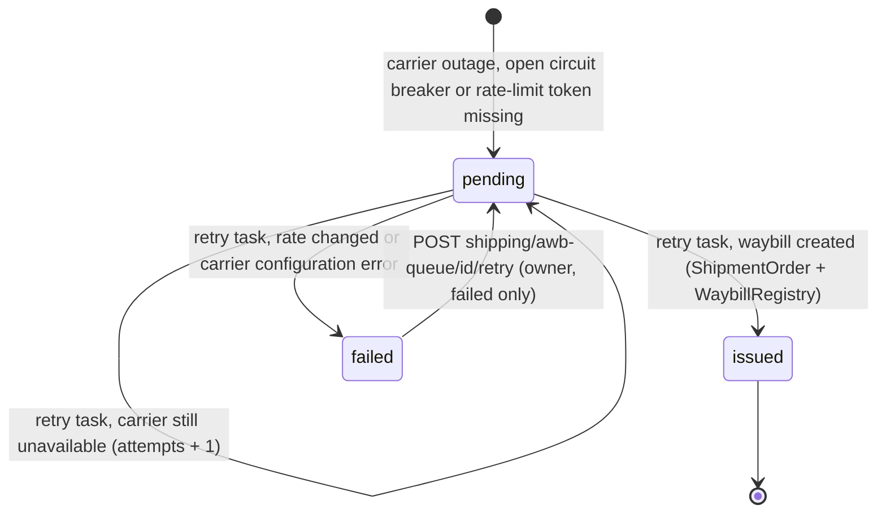
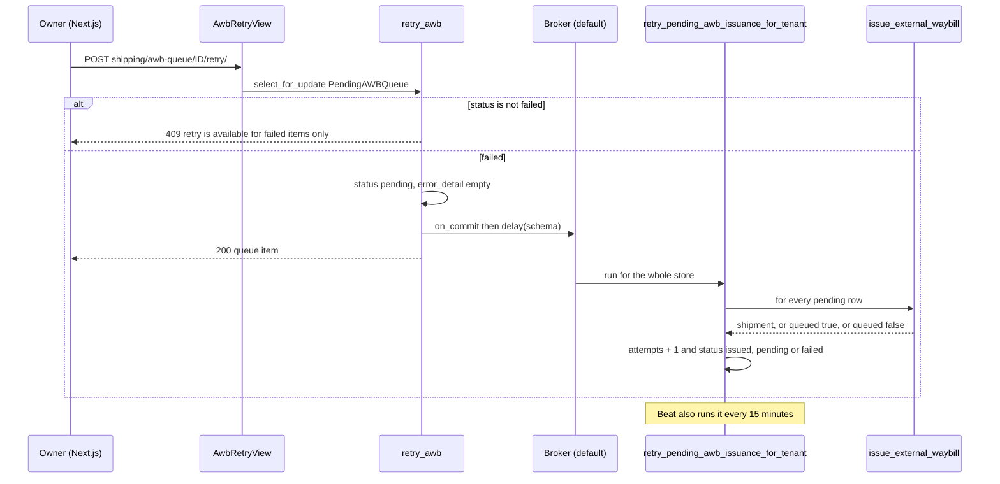

# POS, support-reply and AWB-retry jobs

> **Source**: DOC-502 · inventory A.8 · INT-033 (M16), INT-042 (M32), INT-047 (M39)
> **Code**: `sharwa_saas/products/tasks/operations.py` (`force_close_expired_shifts`, `force_close_expired_shifts_for_tenant`, `SHIFT_MAX_DURATION_HOURS`) · `products/tasks/support.py` (`deliver_staff_reply`, `send_staff_reply_message`, `_deliver_staff_message`, `process_support_inbound_message`, `notify_staff_of_escalation`) · `products/tasks/shipping.py` (`retry_pending_awb_issuance`, `retry_pending_awb_issuance_for_tenant`) · `products/tasks/_common.py` (`_fan_out_per_tenant`, `TENANT_TASK_LIMITS`, `DISPATCHER_TASK_LIMITS`) · `products/services/pos_service.py` · `products/services/support_api_service.py` · `products/services/support_lock_service.py` · `products/services/sharwa_ship_api_service.py` (`retry_awb`) · `products/services/carrier_service.py` (`issue_external_waybill`) · `products/models/staff_pos.py` (`Shift`) · `products/models/support.py` · `products/models/shipping.py` (`PendingAWBQueue`) · `config/settings.py` (`CELERY_BEAT_SCHEDULE`)
> **Last verified against code**: 2026-10-28 (step 38)

## 1. Purpose

Three small job families that sit behind staff-facing screens:

- **POS** — a Beat sweeper that force-closes cash-register shifts left open for more than 12 hours, and the notice the cashier sees on return.
- **Support** — the Celery half of "a staff member replies to a customer on the support screen": the reply is written synchronously under a row lock and only the gateway send is queued. Two reply tasks exist (the new API path and a legacy dashboard path) and share one delivery helper. Two bot-side tasks in the same module are listed for completeness.
- **AWB (3PL waybill) retry** — a Beat sweeper that re-attempts carrier waybill issuance for queued fulfilments, and the owner-only "retry" endpoint that re-queues a failed item.

Out of scope: the POS sale / refund / variance flows ([`../41-idempotency.md`](../41-idempotency.md), [`../45-approvals.md`](../45-approvals.md)); the support state machine and AI bot ([`../42-concurrency.md`](../42-concurrency.md) for the version lock); carrier webhooks and the DLQ ([`provisioning-and-carrier-webhooks.md`](provisioning-and-carrier-webhooks.md)). API pages for these domains: [`m15-shipping.md`](../../api/domains/11-shipping/m15-shipping.md), [`m39-sharwa-ship.md`](../../api/domains/11-shipping/m39-sharwa-ship.md); POS and support have only their domain index pages so far ([`13-channels-operations`](../../api/domains/13-channels-operations/README.md), [`14-apps-ai-support`](../../api/domains/14-apps-ai-support/README.md)).

## 2. Components

| Component | Location | Role |
|---|---|---|
| `force_close_expired_shifts` | `products/tasks/operations.py:90-96` | Beat dispatcher: fans out one child per ready store |
| `force_close_expired_shifts_for_tenant(schema_name)` | `products/tasks/operations.py:66-87` | closes the stale `open` shifts of one store |
| `deliver_staff_reply(schema_name, message_id)` | `products/tasks/support.py:341-353` | sends an already-saved staff reply through the gateway |
| `send_staff_reply_message(schema_name, session_id, staff_id, text)` | `products/tasks/support.py:299-324` | legacy path: writes the reply under the lock **inside the task**, then sends |
| `_deliver_staff_message(message, ...)` | `products/tasks/support.py:327-338` | shared helper: reads `ai_session_id` from the `sharwa_ai` installation, calls `send_message` |
| `staff_send_reply` | `products/services/support_lock_service.py:171-198` | writes the `SupportMessage` under `select_for_update` |
| `session_reply` | `products/services/support_api_service.py:324-343` | API entry; `transaction.on_commit` → `deliver_staff_reply.delay` |
| `retry_pending_awb_issuance` | `products/tasks/shipping.py:252-257` | Beat dispatcher |
| `retry_pending_awb_issuance_for_tenant(schema_name)` | `products/tasks/shipping.py:227-249` | loops all `pending` queue rows of one store |
| `issue_external_waybill` | `products/services/carrier_service.py:119-200` | tries the carrier adapter, parks the item in `PendingAWBQueue` on outage |
| `retry_awb(pk)` | `products/services/sharwa_ship_api_service.py:369-388` | endpoint service: `failed` → `pending` + queue the tenant task on commit |
| `_awb` (notification sync) | `products/services/notification_service.py:205-215` | derives the `awb_failed` notification from `status='failed'` rows |

## 3. State fields touched

| Model | Schema | Fields | Written by |
|---|---|---|---|
| `Shift` (`products/models/staff_pos.py:33`) | store | `status` (`open` → `force_closed`), `closed_at`, `version` (+1, optimistic lock), `force_close_notice_seen` (set to `False` = notice pending) | `force_close_expired_shifts_for_tenant` |
| `Shift.force_close_notice_seen` | store | set to `True` for the same cashier's `force_closed` shifts when they open a new shift (`pos_service.py:425-427`) | `POST /api/v1/pos/shifts/` |
| `SupportMessage` (`products/models/support.py:78`) | store | created: `direction='out'`, `sender_type='staff'`, `raw_text`, `sender_name`, `client_id` (nullable, unique per session via constraint `support_message_client_id_once`) | `staff_send_reply` (API: in the request, legacy: in the task) |
| `SupportSession` | store | read only by the reply path (`status='human_locked'`, `locked_by_staff_id`); `version` bumped by the lock services, not by the reply | `support_lock_service` |
| `PendingAWBQueue` (`products/models/shipping.py:218`) | store | `status` ∈ `pending` / `processing` / `issued` / `failed`, `attempts`, `error_detail`, `payload.zone_code`, `updated_at` | retry task: `attempts`, `status`, `updated_at`; retry endpoint: `status`, `error_detail=''`, `updated_at` |
| `ShipmentOrder`, `WaybillRegistry` | store / public | created when issuance succeeds (`status` `pending_pickup`, or `label_pending` when the label URL is empty) | `issue_external_waybill` |
| `Notification` (`awb_failed`) | store | derived, `dedupe_key = awb_failed:<queue id>`, resolved when the row leaves `failed` | notification sync, not a job |

Migrations: `products/0229_pos_api` (adds `Shift.version`, `Shift.force_close_notice_seen`, `Shift.approval`, `Shift.opened_by` nullable), `products/0234_support_api` (`SupportMessage.client_id`, `sender_name`, the unique constraint, `SupportSession.version`). Data-model pages for Domains 11, 13 and 14 are not linked here.

## 4. Flows

### 4.1 Job register

| Job | Kind | Trigger (file:line) | Queue | Schedule | Retry | Idempotency | Failure handling |
|---|---|---|---|---|---|---|---|
| `products.tasks.force_close_expired_shifts` | Beat dispatcher | Beat `force-close-expired-shifts` (`config/settings.py:634-637`) | `default` | `crontab(minute='*/30')` | none; `DISPATCHER_TASK_LIMITS` soft 120 s / hard 180 s | stateless fan-out (`_fan_out_per_tenant`, ready stores only) | returns `{'dispatched': n}`; a broker error aborts this tick only |
| `products.tasks.force_close_expired_shifts_for_tenant` | task (per tenant) | dispatcher `.delay(schema_name)` (`operations.py:96`) | `default` | every 30 min via dispatcher | none; `TENANT_TASK_LIMITS` soft 300 s / hard 360 s; global `acks_late` + `reject_on_worker_lost` | row state: selects `status='open'` and `opened_at` older than `SHIFT_MAX_DURATION_HOURS = 12`; a closed shift is never selected again | returns `{'schema','closed_count'}`, logs one line per shift; nothing is persisted on error, the next tick repeats |
| `products.tasks.deliver_staff_reply` | task | `session_reply` via `transaction.on_commit` (`support_api_service.py:340-342`); endpoint `POST /api/v1/support/sessions/<id>/messages/` | `default` (no route; `support` queue unused) | on demand | none (`bind=True`, `ignore_result=True`); no time limit; the HTTP call has timeouts 10 s connect / 20 s read (`sharwa_ai_client.py:15-16`) | the message row is created once (`client_id` unique per session, replay returns 200 and **does not** enqueue); the send itself has no "sent" flag, a redelivery after a worker crash sends again | gateway error or missing `ai_session_id` is **logged only**; the saved message stays; the customer simply does not receive it |
| `products.tasks.send_staff_reply_message` | task (legacy path) | `support_session_reply_view` (`products/views/support_hub.py:131-134`), route `POST /dashboard/support-sessions/<id>/reply/` (`config/urls_tenant.py:464`) | `default` | on demand | none | none: each call writes a new message (no `client_id`); a lock conflict returns quietly | `SessionLockConflict` → warning, nothing sent; gateway errors logged only (message kept) |
| `products.tasks.retry_pending_awb_issuance` | Beat dispatcher | Beat `retry-pending-awb-issuance` (`settings.py:668-671`) | `default` | `crontab(minute='*/15')` | none; dispatcher limits 120/180 s | stateless fan-out | returns `{'dispatched': n}` |
| `products.tasks.retry_pending_awb_issuance_for_tenant` | task (per tenant) | dispatcher (`shipping.py:257`) **and** `retry_awb` on commit (`sharwa_ship_api_service.py:383-387`, `POST /api/v1/shipping/awb-queue/<id>/retry/`) | `default` | every 15 min, plus on every successful retry request | none; tenant limits 300/360 s | row state: only `status='pending'` rows are processed; success moves a row to `issued` | per-row result is persisted (`attempts` +1, `status`); no `error_detail` is written; an exception inside the loop aborts the remaining rows until the next tick |
| `products.tasks.process_support_inbound_message` *(adjacent)* | task | signal `handle_incoming_support_message` (`products/signals_support.py:38`) | `default` | on demand | none | `SupportMessage.gateway_message_id` unique; duplicate → logged and ignored | see support-bot code; no DLQ |
| `products.tasks.notify_staff_of_escalation` *(adjacent)* | task | `escalate_session` (`support_lock_service.py:166-167`) | `default` | on demand | none | called once per real `bot_active → escalated` transition | creates a `BehaviorAlert`; unknown session → warning |

Every row inherits the globals `CELERY_TASK_ACKS_LATE = True`, `CELERY_TASK_REJECT_ON_WORKER_LOST = True`, `CELERY_TASK_IGNORE_RESULT = True`, `CELERY_TASK_DEFAULT_QUEUE = 'default'` (`settings.py:563-568`). None of these tasks is in `CELERY_TASK_ROUTES`, so they all run on `default`. Fan-out skips stores that are not `ready` (`_common.py:_fan_out_per_tenant`).

### 4.2 Shift states and the force-close job

What the job does to one shift (`operations.py:75-81`): `status='force_closed'`, `closed_at=now`, `version += 1`, `force_close_notice_seen=False`, then `save(update_fields=[...])`. It does **not** compute `expected_closing`, `actual_closing`, `variance`, or create an `ApprovalRequest`, and writes no `AuditLog` row (the cashier's own close, `pos_service.close_shift`, does all three). The register is released at once: the partial unique index `unique_open_shift_per_register` only covers `status='open'`, and `LIVE = ('open', 'pending_manager_approval')` excludes `force_closed` (`pos_service.py:50`).

The cashier sees the notice through `GET /api/v1/pos/context/`, field `force_closed_notice = {shift_id, register_name, closed_at}`, for the newest `force_closed` shift of that staff member with `force_close_notice_seen=False` (`pos_service.py:265-284`). `POST /api/v1/pos/shifts/` (open) flips the flag to `True` for all of that cashier's pending notices before creating the new shift (`pos_service.py:425-427`), so the next context call returns `null`. The owner (no `StaffMember`) is matched with `opened_by IS NULL`.

The `version` bump is the optimistic-lock token: a client that loaded the shift before the sweep and then calls `resolve-variance` or another version-checked action gets 409 with «تغيّرت الوردية، أعد التحميل.» (`pos_service.py:577`).

### 4.3 Staff reply: write now, send later

- **Authorization.** `support.takeover_session` (owner implicitly) else 403 «ليست لديك صلاحية استلام جلسات الدعم.» (`api/views_support.py:31`, `:101-102`).
- **Validation.** Empty text → 400 `{"text": ["«اكتب رداً.»"]}`; longer than 4096 characters → 400; `client_id` is truncated to 64 characters (`support_api_service.py:327-331`).
- **Lock conflict.** Not `human_locked`, or locked by another staff member → 409 «استلم الجلسة أولاً لتتمكن من الردّ.» (`support_api_service.py:337`).
- **Legacy path.** `send_staff_reply_message` is queued by the Django dashboard route *before* any write; the task calls `staff_send_reply` itself, so if the session was released in between, the reply is dropped quietly and the staff member has already seen «جارٍ إرسال ردك...» (`support_hub.py:135`). Both tasks end in `_deliver_staff_message`.
- **No delivery state.** `SupportMessage` has no `status` / error column, so a failed send looks identical to a delivered one in the timeline. (The channel inbox does track this, see [`channels.md`](channels.md).)

### 4.4 AWB queue: park, retry, give up

Details that matter:

- **The task is per store, not per item.** The endpoint passes only the schema; the task processes **every** `pending` row of the store, including ones the owner did not click. Each row costs one carrier call.
- **Outcomes** of `issue_external_waybill(fulfillment, carrier_code, zone_code)`: `(shipment, False)` → `issued`; `(None, True)` (circuit open, rate-limit token denied, `CarrierUnavailableError`) → stays `pending`; `(None, False)` (`CarrierRateChangedError` — price must be confirmed by hand — or any other `CarrierError`, a configuration problem) → `failed` (`carrier_service.py:126-161`, `shipping.py:236-246`).
- **Endpoint gates.** Feature `sharwa_ship` (403 «ميزة شروة شيب غير مفعّلة لمتجرك.»), `orders.view` (403 «ليست لديك صلاحية لعرض الشحنات.»), owner only (403 «هذا الإجراء مقصور على مالك المتجر.»); unknown id → 404 «العنصر غير موجود.»; not `failed` → 409 «إعادة المحاولة متاحة للعناصر الفاشلة فقط.» (`views_sharwa_ship.py:33-36`, `sharwa_ship_api_service.py:369-388`). `GET /api/v1/shipping/awb-queue/` lists the newest 200 rows for carriers `aramex` and `smsa` only (`EXTERNAL`).
- **Immediate kick is best effort.** If `.delay` raises, the exception is swallowed and the 15-minute Beat picks the row up (`sharwa_ship_api_service.py:385-386`).
- **Notification.** The `awb_failed` entry is not produced by the task. The notification sync lists the newest 200 `failed` rows, title «فشل إصدار بوليصة للطلب #<order id>», body = `error_detail` (200 chars) or the default «استنفدت المحاولات لدى الناقل.», link `/dashboard/shipping/sharwa-ship/queue`, permission `orders.view`; it disappears when the row leaves `failed` (`notification_service.py:205-215`).

## 5. Invariants

- A shift is force-closed only from `open`; the unique partial index guarantees at most one `open` shift per register.
- A reply message is created at most once per `(session, client_id)`; the reply is only ever written while the session is `human_locked` by that staff member, checked under `select_for_update`.
- The network call to the gateway never happens inside the row lock or inside the HTTP request (project rule "no network from a view").
- `PendingAWBQueue` holds at most one row per `(fulfillment, carrier_code)` **by convention**: `issue_external_waybill` uses `get_or_create`, but there is no database unique constraint on the pair.
- Every Beat job here is a fan-out dispatcher; the per-store work carries its own time limits, so one slow store does not block the others (`products/test_beat_fanout.py`).

## 6. Background work

See [§4.1](#41-job-register). Needed running: a worker consuming `default`, and exactly one Beat. If the worker is down: staff replies are saved but never sent, AWB items stay `pending`, shifts stay `open` past 12 hours. If Beat is down: shifts are never force-closed and AWB items are retried only when the owner clicks retry on a `failed` row. Operations: [`../../ops/runbooks/celery.md`](../../ops/runbooks/celery.md); register: [`../50-background-jobs.md`](../50-background-jobs.md).

## 7. Configuration

| Setting / variable | Default | Effect |
|---|---|---|
| `SHIFT_MAX_DURATION_HOURS` | 12 (`operations.py:63`) | age after which an `open` shift is force-closed; a code constant, not a per-store setting yet |
| Beat `force-close-expired-shifts` | `*/30` | sweep cadence, so a shift is closed between 12 h and 12 h 30 min |
| Beat `retry-pending-awb-issuance` | `*/15` | AWB retry cadence |
| `TENANT_TASK_LIMITS` / `DISPATCHER_TASK_LIMITS` | 300/360 s / 120/180 s (`_common.py:28,31`) | per-store and dispatcher limits |
| `SHARWA_AI_GATEWAY_BASE_URL`, `SHARWA_AI_GATEWAY_API_KEY` | unset | gateway used by the reply tasks; unset → `SharwaAIError`, logged, reply not sent |
| `StoreAppInstallation('sharwa_ai').config['ai_session_id']` | — | the linked gateway session; missing → «لا توجد جلسة بوابة مرتبطة» logged, not sent |

## 8. Failure modes and fixes

| Failure | Symptom | Cause | Handling / fix |
|---|---|---|---|
| Reply "sent" but customer got nothing | message visible in the timeline, customer silent | gateway error, unset env, or no linked gateway session; logged only | check worker logs for «فشل إرسال رد الموظف عبر البوابة» / «لا توجد جلسة بوابة مرتبطة»; resend a new reply (use a new `client_id`) |
| Reply sent twice | customer receives the same text twice | worker crashed after the gateway call and before ack (`acks_late`) | none in code; rare |
| Replies never leave | messages saved, nothing delivered | no worker on `default` | start the worker; tasks queued meanwhile run on arrival |
| Cashier loses a shift | register shows no open shift, notice on next login | open > 12 h | expected; the cashier opens a new shift; the cash count of the force-closed shift must be handled by the owner (no variance row is created) |
| AWB item stuck `pending` | `attempts` grows every 15 min | carrier down or circuit open | wait; items never fail by attempt count ([§9](#9-open-items)) |
| AWB item `failed` | `awb_failed` notification | price changed (needs manual confirmation) or carrier configuration error | fix the carrier configuration / confirm the price, then `POST .../retry/` |
| Retry click does nothing visible | item returns to `pending` and stays | the same cause persists | check `attempts` and the carrier status page |
| Beat down | no force-close, no scheduled AWB retry | Beat process not running | start exactly one Beat |

## 9. Open items

- **No code path creates the first `PendingAWBQueue` row.** `issue_external_waybill` is the only creator (inside three `get_or_create` calls) and its only caller is `retry_pending_awb_issuance_for_tenant`, which itself iterates existing `pending` rows. The initial waybill issue in `shipping_service` only mentions it in a comment (`products/services/shipping_service.py:1111`). Rows are created in tests only (`api/test_sharwa_ship_api.py`, `products/test_carrier_integration.py`).
- **No attempt ceiling.** The docstring says "until success or giving up" (`shipping.py:254-255`), but the code only increments `attempts`; a row stays `pending` forever while the carrier is unavailable. `failed` is reached only by a rate change or a configuration error.
- **`failed` rows carry no reason.** The task never writes `error_detail`, and the retry endpoint clears it; the `awb_failed` notification then shows the default «استنفدت المحاولات لدى الناقل.» even though the failure was not attempt exhaustion.
- **`processing` is never set** (declared in `PendingAWBQueue.STATUS_CHOICES`, no writer).
- **One bad row blocks the rest.** The loop in `retry_pending_awb_issuance_for_tenant` has no per-item `try/except`; an unexpected exception aborts the remaining rows of that store until the next tick.
- **Force-close has no row lock.** The task reads `open` shifts without `select_for_update` and saves `status` with `update_fields`; a cashier's own `close_shift` committing between the read and the save could be overwritten with `force_closed` (and a stale `version + 1`). *Derived from the code, not reproduced.*
- **Force-close leaves no accounting trail**: no `AuditLog`, no variance, no approval request.
- **`send_staff_reply_message` is legacy-only** and has no `client_id` de-duplication; the API path uses `deliver_staff_reply`.
- **Replies have no delivery status** (contrast `Message.status` in [`channels.md`](channels.md)).
- **Tests do not run the task bodies of** `deliver_staff_reply`, `retry_pending_awb_issuance_for_tenant`; the API tests patch `.delay`. The Beat fan-out and time limits of both dispatchers are covered by `products/test_tasks.py`.

> ⚠️ Discrepancy — roadmap says "`retry_pending_awb_issuance_for_tenant` queued on commit by `awb-queue/<id>/retry/` (failed only, 409 otherwise)" / code does: matches, but the task is queued with the **schema only** and retries every `pending` row of the store, not the clicked item (`products/services/sharwa_ship_api_service.py:383-384`, `products/tasks/shipping.py:235`). Reported in step 38.

> ⚠️ Discrepancy — roadmap says "`awb_failed` notification" is part of the AWB job / code does: no task creates it; it is derived by the notification sync from `PendingAWBQueue.status='failed'` (`products/services/notification_service.py:205-215`). Reported in step 38.

> ⚠️ Discrepancy — roadmap says "`send_staff_reply_message` shares the delivery helper" and lists it beside the new API path / code does: it does share `_deliver_staff_message`, but its only caller is the legacy Django dashboard route `support_session_reply_view`; the API never uses it (`products/views/support_hub.py:131`, `products/services/support_api_service.py:340`). Reported in step 38.

## 10. Tests that cover these jobs

| File | Tests |
|---|---|
| `api/test_pos_api.py` | `PosApiTests.test_force_close_notice` (runs `force_close_expired_shifts_for_tenant`, reads `pos/context/`, opens a new shift, notice becomes `null`); the file holds 17 tests |
| `api/test_support_api.py` | `SupportApiTests.test_staff_reply_dedup_and_lock` (409 before takeover, 400 empty text, 201 + `deliver_staff_reply.delay(schema, id)` on commit, replay → 200 and no second enqueue) |
| `products/test_support_phase3.py` | `SendStaffReplyMessageTaskTests` (send via gateway with the right args, a gateway failure keeps the saved message), `SupportSessionReplyViewTests` (legacy view rejects an unlocked session and empty text without queueing) |
| `api/test_sharwa_ship_api.py` | `test_awb_queue_retry_and_rate_cards` (list, retry → `pending` with `error_detail=''`, second retry → 409 text) |
| `products/test_carrier_integration.py` | `test_issue_external_waybill_smsa_queues` |
| `products/test_tasks.py` | `BeatFanOutDispatchTests` (both dispatchers fan out one child per store, children carry 300/360 s limits) |
| `products/test_beat_fanout.py` | static guards on every dispatcher (limits, no loop over `schema_context`) |
| `products/test_tasks_package.py` | the task names stay importable from `products.tasks` |

Run: `python manage.py test api.test_pos_api api.test_support_api products.test_support_phase3 api.test_sharwa_ship_api products.test_tasks products.test_beat_fanout`.

## 11. Related pages

- Architecture: [`../41-idempotency.md`](../41-idempotency.md) · [`../42-concurrency.md`](../42-concurrency.md) · [`../45-approvals.md`](../45-approvals.md) · [`../46-timelines-and-notifications.md`](../46-timelines-and-notifications.md) · [`../10-multi-tenancy.md`](../10-multi-tenancy.md) · [`../50-background-jobs.md`](../50-background-jobs.md)
- Siblings: [`provisioning-and-carrier-webhooks.md`](provisioning-and-carrier-webhooks.md) · [`channels.md`](channels.md) · [`whatsapp.md`](whatsapp.md)
- Ops: [`../../ops/runbooks/celery.md`](../../ops/runbooks/celery.md)
- API: [`m15-shipping.md`](../../api/domains/11-shipping/m15-shipping.md) · [`m39-sharwa-ship.md`](../../api/domains/11-shipping/m39-sharwa-ship.md)
