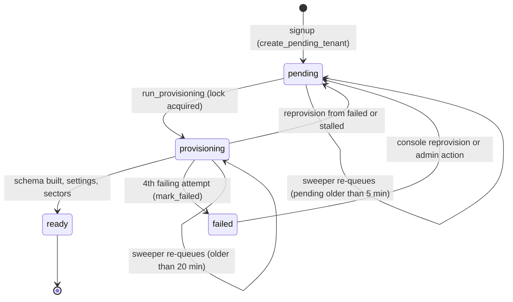
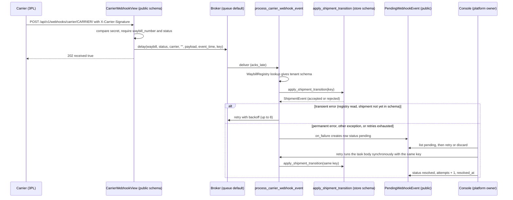

# Provisioning, carrier-webhook and Sharwa Ship console jobs

> **Source**: DOC-501 · inventory A.8 · INT-030 (M20), INT-002, INT-004
> **Code**: `sharwa_saas/tenants/tasks.py` (`provision_tenant_schema`, `retry_stalled_tenant_provisioning`, `activate_sharwa_ship_task`, `deactivate_sharwa_ship_task`, `aggregate_tenant_stats`) · `tenants/provisioning.py` (`queue_provisioning`, `run_provisioning`, `mark_failed`) · `products/tasks/shipping.py` (`process_carrier_webhook_event`, `carrier_idempotency_key`, `_WebhookDLQTask`, `trigger_delivered_return_review`) · `api/views.py` (`CarrierWebhookView`) · `tenants/models.py` (`Client`, `WaybillRegistry`, `PendingWebhookEvent`) · `tenants/console_service.py` (`webhook_event_action`, `list_webhook_events`, `reprovision`, `toggle_sharwa_ship`, `overview`) · `api/views_platform.py` · `config/settings.py` (`CELERY_*`, `CARRIER_WEBHOOK_SECRETS`)
> **Last verified against code**: 2026-10-28 (step 38)

## 1. Purpose

This page is the **job-level reference** for the Celery work that runs in the **public schema** and is driven by the platform console:

- building a new store's schema (`provision_tenant_schema`) and the Beat sweeper that re-queues stuck builds;
- processing carrier (3PL) webhook events (`process_carrier_webhook_event`), the dead-letter queue (DLQ) it writes (`PendingWebhookEvent`) and the console's **retry / discard** procedure ([§4.4](#44-dlq-retry-and-discard-procedure));
- the console / admin background tasks that switch **Sharwa Ship** («شروة شيب») on or off for a store.

The design of provisioning itself (registration flow, guard middleware, status token) is in [`../11-provisioning.md`](../11-provisioning.md); this page does not repeat it. The shipment state machine that the carrier task calls is in the shipping API pages ([`m15-shipping.md`](../../api/domains/11-shipping/m15-shipping.md), [`m39-sharwa-ship.md`](../../api/domains/11-shipping/m39-sharwa-ship.md)); how the register and the worker processes fit together is in [`../50-background-jobs.md`](../50-background-jobs.md) and [`../../ops/runbooks/celery.md`](../../ops/runbooks/celery.md).

## 2. Components

| Component | Location | Role |
|---|---|---|
| `provision_tenant_schema(client_id)` | `tenants/tasks.py:175-200` | Celery task; calls `run_provisioning`, retries, calls `mark_failed` on the last attempt |
| `retry_stalled_tenant_provisioning()` | `tenants/tasks.py:207-234` | Beat sweeper; re-queues stalled stores via `queue_provisioning` |
| `queue_provisioning(client_id)` | `tenants/provisioning.py:116-125` | `provision_tenant_schema.delay(...)`; never raises |
| `run_provisioning` / `mark_failed` | `tenants/provisioning.py:167-209` / `:212-220` | the work, the cache lock, the `failed` write |
| `process_carrier_webhook_event(...)` | `products/tasks/shipping.py:64-121` | applies one carrier event to a shipment inside the store schema |
| `carrier_idempotency_key(...)` | `products/tasks/shipping.py:28-35` | the single source of the carrier event's idempotency key (webhook view **and** console retry) |
| `_WebhookDLQTask.on_failure` | `products/tasks/shipping.py:38-61` | writes a `PendingWebhookEvent` (public schema) when the task fails for good |
| `trigger_delivered_return_review(...)` | `products/tasks/shipping.py:124-144` | follow-on log-only job for a `delivered → returned` transition |
| `CarrierWebhookView` | `api/views.py:693-734`, route `api/urls.py:195` | HTTP entry: `POST /api/v1/webhooks/carrier/<carrier_code>/` |
| `webhook_event_action`, `list_webhook_events` | `tenants/console_service.py:953-1000`, `:937-950` | console DLQ list, **retry**, **discard** |
| `reprovision` | `tenants/console_service.py:431-454` | console re-provision (sets `pending`, calls `queue_provisioning`) |
| `toggle_sharwa_ship`, `sharwa_ship_state` | `tenants/console_service.py:457-491`, `:236-245` | console enable/disable of Sharwa Ship; 10-minute "in flight" marker |
| `activate_sharwa_ship_task`, `deactivate_sharwa_ship_task` | `tenants/tasks.py:19-84`, `:87-117` | background bulk switch of the platform delivery method |
| `ConsoleReprovisionView`, `ConsoleSharwaShipView`, `ConsoleWebhookEvent*View` | `api/views_platform.py:215-218`, `:227-231`, `:266-279` | console endpoints (owner-only writes) |

## 3. State fields touched

| Model | Schema | Fields written by these jobs | Notes |
|---|---|---|---|
| `Client` (`tenants.Client`) | public | `provisioning_status` (`pending` / `provisioning` / `ready` / `failed`), `provisioning_started_at`, `provisioned_at`, `provisioning_error` (≤ 2000 chars, `ExcType: message`) | "stalled" is **not** a stored value: it is derived (`stalled_q`, `is_stalled`, `console_service.py:163-180`) |
| `PendingWebhookEvent` | public | created by `on_failure`: `waybill_number`, `tenant_schema_name` (`''` when the view passed none), `carrier_code`, `payload`, `error_detail` (≤ 2000), `attempts`, `status='pending'`. Updated by the console: `status` → `resolved` / `discarded`, `resolved_at`, `attempts`, `error_detail` | `status` values `pending` / `resolved` / `discarded`; `resolved_at` added by migration `tenants/0027_platform_console_api` |
| `WaybillRegistry` | public | read only (`waybill_number` unique → `tenant_schema_name`); written when a waybill is issued (`shipping_billing_service.py:111`, `carrier_service.py:176`) | lets a webhook with no tenant context find the store |
| `ShipmentOrder` | store | `status`, `delivered_at`, `carrier_code` (stamped from the webhook if different) | through `apply_shipment_transition`, never directly |
| `ShipmentEvent` | store | one row per accepted **or rejected** transition; `idempotency_key` is `unique` (`products/models/shipping.py:142`) | rejected transitions are rows, not exceptions |
| `DeliveryMethod` | store | `is_sharwa_official`, `is_active` (and on first activation `name`, `price=0`, `sort_order=0`) | Sharwa Ship tasks |
| `PlatformActionLog` | public | one row per console action: `stores.reprovision`, `sharwa_ship.activate` / `.deactivate`, `webhook_event.retry` / `.discard` | `log_action` swallows DB errors (`console_service.py:110-121`) |
| cache | — | `tenant-provisioning-lock:<client_id>` (20 min), `platform:sharwa-ship-job:<SCHEMA>` (10 min) | Redis in production |

Data-model context: [`../data-model/01-public-onboarding.md`](../data-model/01-public-onboarding.md) (`Client`, `Domain`). `PendingWebhookEvent`, `PlatformActionLog` and `WaybillRegistry` belong to Domain 16 / Domain 11 data-model pages (not linked here).

## 4. Flows

### 4.1 Job register

| Job | Kind | Trigger (file:line) | Queue | Schedule | Retry | Idempotency | Failure handling |
|---|---|---|---|---|---|---|---|
| `tenants.tasks.provision_tenant_schema` (task name = dotted path, `@shared_task`, no `name=`) | task | `queue_provisioning` (`tenants/provisioning.py:121`), called from: registration `on_commit` (`tenants/registration.py:71`, via `api/views_onboarding.py:361` and `tenants/views.py:202`), the sweeper (`tenants/tasks.py:231`), console `reprovision` (`console_service.py:450`), Django admin action `reprovision_tenants` (`tenants/admin.py:143`) | `default` (no route in `CELERY_TASK_ROUTES`, `settings.py:568`) | on demand | `bind=True`, `max_retries=3` (`PROVISIONING_MAX_RETRIES`), `default_retry_delay=60` s fixed (no backoff), `acks_late=True` (explicit), `reject_on_worker_lost` from global `CELERY_TASK_REJECT_ON_WORKER_LOST=True`; `soft_time_limit=900`, `time_limit=960` | cache lock `tenant-provisioning-lock:<client_id>` via `cache.add` TTL 1200 s; `ready` store returns `{skipped: True}`; existing schema resumed with `migrate_schemas`; sector seed idempotent | on the 4th failing attempt `mark_failed` → `provisioning_status='failed'` + `provisioning_error`; schema is **not** dropped; no merchant notification, operator sees `failed_stores` on the console overview and uses re-provision |
| `tenants.tasks.retry_stalled_tenant_provisioning` | Beat (sweeper) | Beat entry `retry-stalled-tenant-provisioning` (`settings.py:625-628`) | `default` | `crontab(minute='2-59/5')` → :02, :07, … :57 | none (next tick is the retry) | re-queue is harmless: lock + `ready` skip absorb duplicates | returns `{'requeued': n}`; logs a warning with ids; `failed` stores are **never** re-queued (manual decision) |
| `products.tasks.process_carrier_webhook_event` | task | `CarrierWebhookView.post` → `.delay(...)` (`api/views.py:729`); console DLQ retry calls it **synchronously** (`console_service.py:985`) | `default` | on demand | `base=_WebhookDLQTask`, `bind=True`, `autoretry_for=(CarrierWebhookTransientError,)`, `retry_backoff=True`, `retry_backoff_max=120`, `retry_jitter=True`, `max_retries=8`; `acks_late`/`reject_on_worker_lost` global; **no** time limit | `idempotency_key` = `carrier_idempotency_key(...)` → `ShipmentEvent.idempotency_key` unique; `apply_shipment_transition` returns the existing event on replay | transient exhausted, permanent error or **any other exception** → `on_failure` writes `PendingWebhookEvent`; operator uses the console retry / discard ([§4.4](#44-dlq-retry-and-discard-procedure)) |
| `products.tasks.trigger_delivered_return_review` | task | `_enqueue_delivered_return_review` (`products/services/shipment_state_service.py:287`) on `delivered → returned` | `default` | on demand | none | none (read-only: logs a warning with `exposure`, never refunds) | enqueue failure is logged and does not roll back the transition (`shipment_state_service.py:290-294`); the financial decision stays human |
| `tenants.tasks.activate_sharwa_ship_task` | task | console `toggle_sharwa_ship` (`console_service.py:479`) · admin action `activate_sharwa_ship` (`tenants/admin.py:182`) | `default` | on demand | none (plain `@shared_task`); global `acks_late` | `get_or_create(is_sharwa_official=True)`; re-activates an inactive row; skips stores whose `sharwa_ship` feature is off | per-store `try/except` → counted in `failed`; result dict is logged only (`CELERY_TASK_IGNORE_RESULT=True`); console shows state from `DeliveryMethod` |
| `tenants.tasks.deactivate_sharwa_ship_task` | task | console `toggle_sharwa_ship` (`console_service.py:479`) · admin action `deactivate_sharwa_ship` (`tenants/admin.py:203`) | `default` | on demand | none | `UPDATE ... is_active=False` — repeating it is a no-op (`not_found += 1`) | same as activate; row is never deleted |
| `tenants.tasks.aggregate_tenant_stats` | task (**unscheduled**) | no caller and no Beat entry in the code ([§9](#9-open-items)) | `default` | none | none | `update_or_create(client, date)` per store | — |

Globals that apply to every row: `CELERY_TASK_ACKS_LATE=True` (`settings.py:564`), `CELERY_TASK_REJECT_ON_WORKER_LOST=True` (`:565`), `CELERY_WORKER_PREFETCH_MULTIPLIER=1` (`:567`), `CELERY_TASK_DEFAULT_QUEUE='default'` (`:568`), `CELERY_TASK_IGNORE_RESULT=True` (`:563`). None of these jobs appears in `CELERY_TASK_ROUTES` (`settings.py:569-587`), so they all run on `default` — deliberately: a new queue would need the worker's `-Q` list (`deploy/celery.env:16`) changed, and forgetting that would leave every new store `pending` (`tenants/tasks.py:167-169`).

### 4.2 Store provisioning lifecycle

"Stalled" overlays two states: `pending` with `created_on` older than 5 minutes, or `provisioning` with `provisioning_started_at` older than 20 minutes (`tenants/tasks.py:203-204`). The `pending` clock is `created_on` (store creation), not the time it became `pending`, so a store that is re-provisioned long after creation is stalled **immediately** and the next sweeper tick re-queues it; the lock keeps that harmless.

Re-provision (console `reprovision`, `console_service.py:431-454`) refuses: unknown schema; `ready` stores («المتجر جاهز — لا شيء لإعادة تجهيزه.»); stores that are neither `failed` nor stalled («إعادة تجهيز قيد التنفيذ بالفعل.»). For the rest it does `provisioning_status='pending'`, `provisioning_error=''`, then `queue_provisioning`. The Django admin action `reprovision_tenants` (`tenants/admin.py:125-144`) re-queues **every** non-`ready` store it is given, including ones still in progress ([`../11-provisioning.md`](../11-provisioning.md) §4.6).

### 4.3 Carrier webhook → shipment, with the DLQ

Key facts, all from the code:

- **Entry.** `CarrierWebhookView` has no session auth. It compares `X-Carrier-Signature` with `settings.CARRIER_WEBHOOK_SECRETS[carrier_code]` using `hmac.compare_digest` (`api/views.py:712-716`); the dict keys are `aramex`, `smsa`, `sharwa_ship` and each value comes from an environment variable (`CARRIER_ARAMEX_SECRET`, `CARRIER_SMSA_SECRET`, `CARRIER_SHARWA_SHIP_SECRET`; `settings.py:781-785`). A carrier with no variable set is disabled: any signature gets 401 «غير مصرح.». Missing `waybill_number` or `status` gets 400 «waybill_number وstatus إلزاميان.». `event_time` defaults to "now" when absent (`views.py:721`). The view always passes an empty `tenant_schema_name`, so the task resolves the store from `WaybillRegistry`.
- **Idempotency key.** `carrier_idempotency_key` returns `wh:<carrier>:<event_id>` when the payload has `event_id`, otherwise `wh:<carrier>:<waybill>:<status>:<event_time>` (`shipping.py:28-35`). The view (`views.py:726-727`) and the console retry (`console_service.py:980-981`) both call it. The key is stored in `ShipmentEvent.idempotency_key` (unique); a replay returns the stored event with no side effect ([`../41-idempotency.md`](../41-idempotency.md), pattern B).
- **Invalid transitions are not failures.** `apply_shipment_transition` records a transition that is not allowed, stale, or for an already cancelled / refunded order as a *rejected* `ShipmentEvent` and returns normally, so the task succeeds and nothing reaches the DLQ. The DLQ only holds events that raised.
- **Retried errors.** Only `CarrierWebhookTransientError` is retried: the central registry read failed (`shipping.py:91-92`) or the waybill is registered centrally but its shipment row does not exist yet in the store schema — a creation race (`:99-102`). Backoff delays without jitter are 1, 2, 4, 8, 16, 32, 64, 120 s (cap `retry_backoff_max=120`); with `retry_jitter=True` each delay is random between 0 and that value, so the whole retry window is at most about 4 minutes.
- **Failed immediately, no retry.** `CarrierWebhookPermanentError` (unknown waybill, `shipping.py:93-94`) and every other exception (for example an unparsable `event_time` in `fromisoformat`, `:104-105`) go straight to `on_failure`.
- **What the DLQ row holds.** `on_failure` copies the positional arguments: `waybill_number`, `carrier_code`, `tenant_schema_name`, `raw_payload`; `error_detail=str(exc)[:2000]`; `attempts=self.max_retries` (always 8, even when the failure was immediate) (`shipping.py:43-59`). If writing the row itself fails it only logs «تعذّر تسجيل حدث الويبهوك الفاشل في DLQ | waybill=%s» (`:61`); that event is then lost.
- **Follow-ons of an accepted transition** (run inside the task, after the lock is released): order push (`push_for_shipment`), the `shipment.event` outgoing webhook (`emit`), and for `delivered → returned` the `trigger_delivered_return_review` job (`shipment_state_service.py:260-276`).

### 4.4 DLQ retry and discard procedure

Who: **platform owner (superuser) only.** Reads work for operators; every write (retry, discard, re-provision, Sharwa Ship toggle) returns 403 «هذا الإجراء لمالك المنصة فقط.» for an operator, because `webhooks` and `stores` are not in `OPERATOR_WRITES = ('dues', 'sharwa_pay')` (`console_service.py:77`, `views_platform.py:272-278`). All routes are on the platform (public) host only and need the console session cookie plus CSRF.

1. **See the backlog.** `GET /api/v1/platform/overview/` returns `pending_webhook_events` (rows with `status='pending'`), `failed_stores` and `stalled_stores` (`console_service.py:356-360`). A non-zero `pending_webhook_events` is the DLQ.
2. **List the rows.** `GET /api/v1/platform/webhook-events/?status=pending` (`status` ∈ `pending` / `resolved` / `discarded`; `source=<carrier_code>` exact match, for example `aramex`, `smsa` or `sharwa_ship`, which is also the column default; `page`, `page_size` max 100). Each row has `id`, `source`, `event_type` (from `payload.status`, else `event_type`, else `event`, else «—»), `schema_name`, `store_name`, `store_missing`, `reason` (= `error_detail`), `payload` (pretty-printed JSON), `attempts`, `received_at`, `resolved_at`.
3. **Read the reason and decide.**
   - `reason` starts with «رقم بوليصة غير معروف» → the waybill is not in `WaybillRegistry`. Check that the shipment was really issued by Sharwa; if the carrier sent a stray or test waybill, **discard** (step 6). If the shipment exists but registered late, **retry**.
   - `reason` mentions «بوليصة غير موجودة بعد في schema» or the registry read → a creation race or database blip; the shipment normally exists now → **retry**.
   - `store_missing` is `true` (the store was deleted) → only **discard** is possible.
   - Payload has no `status` → only **discard** is possible.
4. **Retry.** `POST /api/v1/platform/webhook-events/<id>/retry/` (no body). The server runs the task body **synchronously in the request** (no worker needed, no retries, no `on_failure`), inside `transaction.atomic()`, with `to_status = payload.status`, `event_time = payload.event_time` (fallback: the row's `created_at`) and the key from `carrier_idempotency_key`, so a transition the first run already applied is not applied twice (`console_service.py:972-996`).
   - Success → `200`, `{"detail": "«أُعيدت معالجة الحدث بنجاح.»", "level": "success", "event": {...}}`; the row becomes `status='resolved'`, `resolved_at=now`, `attempts + 1`.
   - Failure → `400`, `{"detail": "«تعذّرت إعادة المعالجة:» <error>", "level": "error"}`; the row **stays `pending`**, `attempts + 1`, `error_detail` replaced by the new error. Do not loop on it: read the new `reason`, fix the cause (missing shipment, wrong waybill), then retry once.
   - `400` «المتجر لم يعد موجوداً — التجاهل فقط.» or «الحدث بلا حالة مستهدفة في حمولته — التجاهل فقط.» → go to step 6.
   - `409` «الحدث غير موجود أو تم التعامل معه مسبقاً.» → another operator already resolved or discarded it; reload the list.
5. **Verify a retry.** The shipment's status moved (shipment detail in the store dashboard or `GET /api/v1/shipping/shipments/<id>/`), a `ShipmentEvent` with `source='webhook'` and the key `wh:<carrier>:...` exists, the row shows `resolved`, and the console action log has `webhook_event.retry`. A *rejected* transition also resolves the row (the task returned normally); check `is_rejected` / `rejection_reason` on the event if the shipment did not move.
6. **Discard.** `POST /api/v1/platform/webhook-events/<id>/discard/` → `200` «تم تجاهل الحدث.»; `status='discarded'`, `resolved_at=now`; action log `webhook_event.discard`. Discard is final: the row is kept (never deleted) but there is no "un-discard" endpoint.
7. **Close out.** Re-read `overview.pending_webhook_events`; it must reach 0. Rows are never deleted by any job; `resolved` and `discarded` rows stay for audit.

### 4.5 Sharwa Ship enable / disable from the console

`POST /api/v1/platform/stores/<SCHEMA>/sharwa-ship/` with `{"active": true|false}` (`views_platform.py:227-231`) runs `toggle_sharwa_ship`:

1. Store must be `ready`, else 400 «المتجر غير جاهز بعد.».
2. If the store state is already `activating` / `deactivating` → 409 «مهمة أخرى قيد المعالجة على هذا المتجر.».
3. If the store is already in the requested state → 409 «شروة شيب مفعّلة بالفعل.» / «شروة شيب غير مفعّلة أصلاً.».
4. For **activate only**, the feature gate is checked **up front**: `Feature(code='sharwa_ship').is_enabled_for_client(client)`; if off → 400 «ميزة «شروة شيب» غير متاحة لهذا المتجر — فعّلها من «الميزات» أولاً.» and **no task is queued** (the task would skip the store silently, `tenants/tasks.py:45-49`; this check makes it explicit).
5. The marker `platform:sharwa-ship-job:<SCHEMA>` = `activate` / `deactivate` is set with TTL `SHIP_JOB_TTL_SECONDS = 600` (`console_service.py:49`, `:472-476`), then `task.delay([schema])`. Broker down → marker deleted and 503 «تعذّر إرسال المهمة الآن — حاول بعد قليل.».
6. The response says «قيد تفعيل شروة شيب — يتحدّث تلقائياً.» / «قيد إلغاء شروة شيب.»; `store.sharwa_ship` is `activating` / `deactivating` while the marker exists **and** `DeliveryMethod(is_sharwa_official, is_active)` has not yet reached the target. The marker is dropped as soon as the real state matches, or after 10 minutes.

The truth is always the `DeliveryMethod` row in the store schema; the marker is only a UI hint. If no worker consumes `default`, the store shows `activating` for 10 minutes and then falls back to `inactive` with no error.

## 5. Invariants

- A store whose `provisioning_status` is not `ready` is excluded from every per-tenant Beat fan-out (`products/tasks/_common.py:_fan_out_per_tenant` filter) and from `aggregate_tenant_stats`; requests to its host get the 503 wait page ([`../11-provisioning.md`](../11-provisioning.md)).
- At most one provisioning run per store at a time: `cache.add('tenant-provisioning-lock:<client_id>', 1, timeout=1200)` (`provisioning.py:171`). The lock is released in `finally`; a second run raises `ProvisioningLocked`, which the task turns into `{'status': 'locked'}` — a normal return, not a retry (`tasks.py:189-191`).
- `mark_failed` never drops the schema and the sweeper never touches `failed` stores.
- `queue_provisioning` never raises (`provisioning.py:123-125`); a dead broker leaves the store `pending` and the sweeper picks it up.
- A carrier event is applied at most once per idempotency key (`ShipmentEvent.idempotency_key` unique; `_create_event` absorbs an `IntegrityError` race by returning the existing row, `shipment_state_service.py:115-128`).
- The console retry and the webhook view build the key with the **same function**; DLQ rows are never deleted, only resolved or discarded.
- Console DLQ actions are conditional updates (`filter(pk, status='pending').update(...)`), so two operators clicking at once cannot both win — the loser gets 409.

## 6. Background work

See [§4.1](#41-job-register) for the full register. Operational summary:

| Needed running | Why |
|---|---|
| A worker consuming `default` | every job on this page uses it |
| Exactly one Beat | `retry-stalled-tenant-provisioning` fires every 5 minutes; two Beats double-fire it (harmless here because of the lock, but not for other schedules) |
| Redis shared by all workers | the provisioning lock and the Sharwa Ship marker are cache keys |

Worker / Beat processes and the queue list: [`../../ops/runbooks/celery.md`](../../ops/runbooks/celery.md).

## 7. Configuration

| Setting / variable | Default | Effect |
|---|---|---|
| `PROVISIONING_SOFT_TIME_LIMIT` / `PROVISIONING_TIME_LIMIT` / `PROVISIONING_MAX_RETRIES` | 900 s / 960 s / 3 (`tenants/tasks.py:170-172`) | provisioning limits; above the generic tenant limits `TENANT_TASK_LIMITS = 300/360` |
| `PROVISIONING_LOCK_TTL_SECONDS` | 1200 (`provisioning.py:32`) | lock lifetime = the 20-minute stalled threshold |
| `STALLED_PENDING_AFTER_MINUTES` / `STALLED_IN_PROGRESS_AFTER_MINUTES` | 5 / 20 (`tasks.py:203-204`) | sweeper and console "stalled" definition (same constants) |
| `SHIP_JOB_TTL_SECONDS` | 600 (`console_service.py:49`) | Sharwa Ship "in flight" marker |
| `CELERY_BROKER_URL` | `redis://localhost:6379/1` | broker (cache uses database 0) |
| `CARRIER_ARAMEX_SECRET`, `CARRIER_SMSA_SECRET`, `CARRIER_SHARWA_SHIP_SECRET` | unset = carrier disabled | shared secrets compared with `X-Carrier-Signature` |
| `DJANGO_TESTING=1` | — | `CELERY_TASK_ALWAYS_EAGER` and `CELERY_TASK_EAGER_PROPAGATES` (`settings.py:770-771`): `.delay()` runs inline in tests |

Values come from the environment ([`../../ops/environment.md`](../../ops/environment.md)); never write a real secret into a page or a ticket.

## 8. Failure modes and fixes

| Failure | Symptom | Cause | Handling / fix |
|---|---|---|---|
| Broker down at signup | new store stays `pending`; wait page keeps polling | `delay()` raised, swallowed by `queue_provisioning` | sweeper re-queues after 5 min; if the broker is still down, restore it, no manual step |
| Worker SIGKILLed mid-migration | store stuck `provisioning` | deploy or OOM; `acks_late` + `reject_on_worker_lost` redeliver the message | The lock key lives up to 20 minutes after the kill, so a redelivered message usually returns `locked` and is acked (the code does not retry on `locked`). The sweeper re-queues once `provisioning_started_at` is older than 20 minutes; `run_provisioning` then resumes with `migrate_schemas`. *Derived from the code, not reproduced.* |
| Provisioning keeps failing | `failed_stores` > 0 on the overview; wait page shows the failed message | 4 failed attempts (first + 3 retries, 60 s apart) | read `provisioning_error` on the store detail, fix the cause, then re-provision from the console (`POST /api/v1/platform/stores/reprovision/` with `{"schemas": ["<SCHEMA>"]}`) |
| Re-provision does nothing | `queued: false` with a reason | store `ready`, or in progress and not stalled | wait for the stall threshold, or use the Django admin action |
| Carrier 401 | carrier retries and gives up | secret env var unset or different | set `CARRIER_<NAME>_SECRET`, restart web; no event was queued |
| Event in DLQ: unknown waybill | `reason` starts with «رقم بوليصة غير معروف» | waybill not in `WaybillRegistry` | [§4.4](#44-dlq-retry-and-discard-procedure) step 3 |
| Event in DLQ with `attempts` = 8 but the failure was immediate | misleading attempts count | `on_failure` stores `max_retries`, not the real count | read `reason`, not `attempts` |
| Console retry returns 400 repeatedly | row stays `pending`, `attempts` grows | cause not fixed | stop retrying; fix or discard |
| No worker on `default` | Sharwa Ship shows `activating` for 10 min then reverts; new stores `pending`; carrier events pile up unprocessed (the view still answers 202) | queue not consumed | start the worker ([runbook](../../ops/runbooks/celery.md)); queued messages are processed on arrival |
| `ProvisioningLocked` ignored | nothing happens for a store | another run holds the lock | wait up to 20 min; do not clear the key by hand unless the worker is confirmed dead |

## 9. Open items

- **Tests do not cover the carrier task body or the DLQ writer.** There is no test of `process_carrier_webhook_event` end to end, of `_WebhookDLQTask.on_failure`, of `trigger_delivered_return_review`, or of `activate_sharwa_ship_task` / `deactivate_sharwa_ship_task` bodies (the tests only patch `.delay`). Registered-name checks exist in `products/test_tasks_package.py`.
- **Retry key can differ from the first run.** `webhook_event_action` falls back to `event.created_at.isoformat()` when `payload.event_time` is absent (`console_service.py:978`), while the view used the receipt time (`api/views.py:721`). For a payload with neither `event_id` nor `event_time`, the console retry computes a different key than the original attempt, so a partially applied first run is not de-duplicated by key (the state machine still rejects an invalid repeat as a rejected event).
- **`attempts` in the DLQ is not the real attempt count** (always `max_retries` from `on_failure`, +1 per console retry, including successful ones).
- **Sweeper "pending" clock is `created_on`**, not the time the store became `pending` again ([§4.2](#42-store-provisioning-lifecycle)).
- **`tenants.tasks.aggregate_tenant_stats` is dead code**: its docstring says "Celery Beat nightly" (`tenants/tasks.py:121`) but `CELERY_BEAT_SCHEDULE` has no entry for it and nothing calls it; `TenantStatsSnapshot` is fed by `products.tasks.populate_tenant_stats_snapshot` (`settings.py`, Beat `populate-tenant-stats-snapshot`, 00:40).
- **No front-end proof for the DLQ source filter.** The `source` query is an exact match on `carrier_code` (`console_service.py:942-944`); the console UI source list is not in the repository copy used for this page, so which carriers the UI offers could not be checked.
- **Console DLQ retry runs in the web process** with no time limit; a slow `apply_shipment_transition` holds the request.

> ⚠️ Discrepancy — roadmap says the DLQ "source filter includes `sharwa_ship`" / code does: `source` is a free exact match on `PendingWebhookEvent.carrier_code` with no fixed list; `sharwa_ship` is only the model default and one key of `CARRIER_WEBHOOK_SECRETS` (`tenants/models.py:371`, `tenants/console_service.py:942-944`). Reported in step 38.

> ⚠️ Discrepancy — roadmap says "Sharwa Ship enable/disable tasks from the console (10-min marker; refused up front when feature off)" and names no queue or retry / code does: both tasks are plain `@shared_task` with no retry and no dedicated queue, and the "up front" refusal exists for **activate only** (`tenants/console_service.py:466-471`); deactivate has no feature check. Reported in step 38.

## 10. Tests that cover these jobs

| File | Tests |
|---|---|
| `tenants/test_provisioning.py` | `RunProvisioningTests` (new schema, resume, ready skipped, concurrent lock, lock released after failure), `ProvisionTaskTests` (`test_final_failure_marks_failed_and_sends_no_welcome`, `test_task_limits_are_above_general_tenant_limits`, `test_queue_provisioning_never_raises_when_broker_is_down`), `SweeperTests.test_requeues_only_stalled_stores`, `StatusEndpointTests`, `GuardMiddlewareTests`, `FanOutSkipsUnreadyStoresTests` |
| `api/test_platform_console_api.py` | `test_reprovision_and_detail`, `test_sharwa_ship_toggle`, `test_webhook_events` (list filters, retry failing keeps `pending` and bumps `attempts`, retry succeeding resolves, discard, 409 on a handled row), `test_carrier_webhook_uses_the_shared_idempotency_key` |
| `products/test_shipment_state.py` | `test_idempotency_returns_existing_event`, `test_invalid_transition_is_recorded_rejected`, `test_stale_event_is_rejected`, `test_delivered_then_returned_triggers_financial_review` |
| `products/test_tasks_package.py` | the task registry keeps `process_carrier_webhook_event` and friends importable from `products.tasks` |

Run: `python manage.py test tenants.test_provisioning api.test_platform_console_api products.test_shipment_state`.

## 11. Related pages

- Architecture: [`../11-provisioning.md`](../11-provisioning.md) · [`../10-multi-tenancy.md`](../10-multi-tenancy.md) · [`../13-cross-schema-access.md`](../13-cross-schema-access.md) · [`../15-plans-and-features.md`](../15-plans-and-features.md) · [`../41-idempotency.md`](../41-idempotency.md) · [`../42-concurrency.md`](../42-concurrency.md) · [`../37-audit.md`](../37-audit.md) · [`../50-background-jobs.md`](../50-background-jobs.md)
- Data model: [`../data-model/01-public-onboarding.md`](../data-model/01-public-onboarding.md)
- Ops: [`../../ops/runbooks/celery.md`](../../ops/runbooks/celery.md) (links to the DLQ procedure in §4.4) · [`../../ops/environment.md`](../../ops/environment.md)
- Sibling job pages: [`webhooks.md`](webhooks.md) · [`order-push.md`](order-push.md) · [`pos-support-awb.md`](pos-support-awb.md)
- API: [`m15-shipping.md`](../../api/domains/11-shipping/m15-shipping.md) · [`m39-sharwa-ship.md`](../../api/domains/11-shipping/m39-sharwa-ship.md) · [`16-platform-console`](../../api/domains/16-platform-console/README.md)
