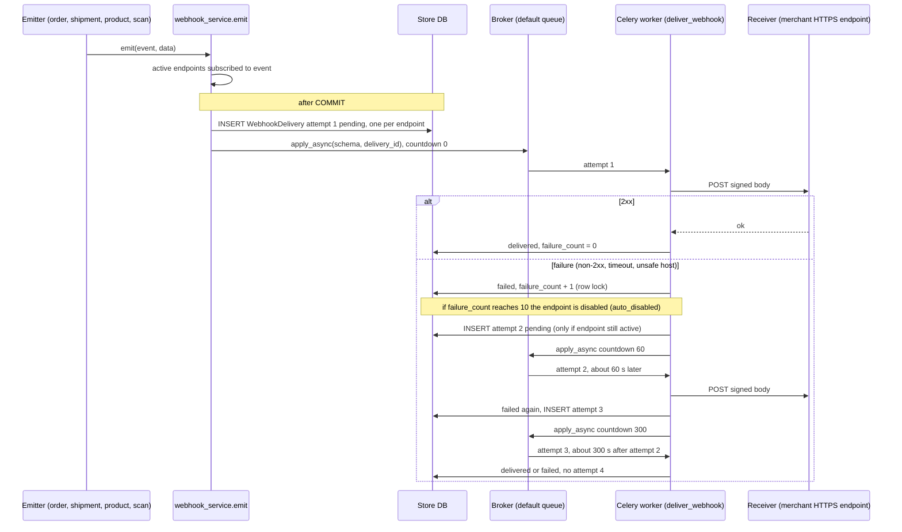
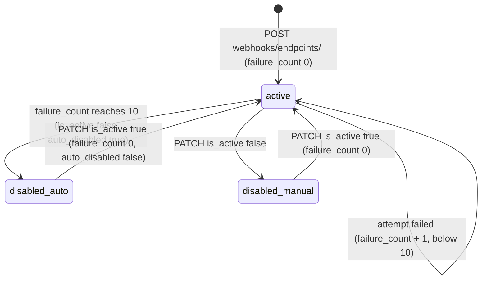

# Outgoing webhook delivery jobs

> **Source**: DOC-500 · inventory A.8 · INT-023 (M19)
> **Code**: `sharwa_saas/products/services/webhook_service.py` · `products/tasks/operations.py` (`deliver_webhook`, `dispatch_low_stock_webhooks*`) · `products/models/webhooks.py` (`WebhookEndpoint`, `WebhookDelivery`, `AUTO_DISABLE_AFTER`) · `api/views_integrations.py` · emitters: `products/order_events.py`, `products/models/orders.py` (`Order.set_fulfillment_status`), `products/services/refund_service.py`, `products/services/shipment_state_service.py`, `products/models/catalog.py` (`Product._log_field_changes`) · `config/settings.py` (`CELERY_BEAT_SCHEDULE`)
> **Last verified against code**: 2026-10-28 (step 38)

## 1. Purpose

A merchant can register up to ten HTTPS endpoints that Sharwa calls when something happens in the store (an order is created, a shipment moves, a product changes, stock runs low). This page documents the **delivery engine**: how an event becomes a `WebhookDelivery` row, how it is signed and sent, the retry timeline, when an endpoint is switched off automatically, and the one Beat schedule involved (low stock).

It does not cover **inbound** webhooks (bank top-ups, SharwaConnect, carriers, suppliers: `tenants/webhooks*.py`) — see [`whatsapp.md`](whatsapp.md), [`provisioning-and-carrier-webhooks.md`](provisioning-and-carrier-webhooks.md) and [`dropshipping.md`](dropshipping.md) — nor the settings screen (API page [`m19-domains-integrations.md`](../../api/domains/12-settings-staff-integrations/m19-domains-integrations.md)).

Delivery is a side effect: events are recorded after the surrounding transaction commits and **never raise** into the code that caused them.

## 2. Components

| Component | Location | Role |
|---|---|---|
| `emit(event, data)` | `webhook_service.py:342` | Finds active endpoints subscribed to `event`; if any, builds one payload (one `id`) and registers `transaction.on_commit` → for each endpoint creates a `WebhookDelivery(status='pending', attempt=1)` and enqueues it. Returns the number of endpoints; never raises. |
| `emit_order(event, order, **extra)` | `webhook_service.py:401` | `emit(event, {**order_data(order), **extra})`; never raises. |
| `_enqueue(delivery_id, countdown)` | `webhook_service.py:334` | `deliver_webhook.apply_async((schema, delivery_id), countdown=...)`; swallows and logs a broker failure. |
| `deliver_webhook` (task) | `tasks/operations.py:176-183` | `schema_context` → `deliver_with_retry(delivery_id)`. |
| `deliver_with_retry(delivery_id)` | `webhook_service.py:316` | One attempt plus scheduling of the next attempt on failure. |
| `send(delivery)` | `webhook_service.py:261` | SSRF re-check, signature, `requests.post`, row update, endpoint failure counter (row-locked). |
| `test_endpoint(pk)` | `webhook_service.py:365` | Synchronous test event `webhook.test` (works on a disabled endpoint). |
| `redeliver(delivery_id)` | `webhook_service.py:373` | New attempt row for a `failed` delivery, sent synchronously. |
| `low_stock_scan()` | `webhook_service.py:409` | Per-store scan behind Beat `dispatch-low-stock-webhooks`. |
| `dispatch_low_stock_webhooks` / `_for_tenant` | `tasks/operations.py:195-198`, `:186-192` | Beat dispatcher and per-store child. |
| `url_error(url)`, `_host_is_public(host)` | `webhook_service.py:79`, `:67` | Address safety, at save time and again at every send. |
| Owner API | `api/views_integrations.py:104-156`, routes `api/urls.py:426-432` | Events catalogue, endpoint CRUD, rotate secret, test, delivery log, redeliver. |

## 3. Data model

Store schema. The full data-model page of Domain 12 is planned (`data-model/12-settings-staff-integrations.md`); the fields used by the engine:

| Model | Key fields | Constraints / notes | Added by |
|---|---|---|---|
| `WebhookEndpoint` (`models/webhooks.py:14`) | `url` (≤ 500), `events` (JSON list of codes), `is_active`, `description` (≤ 200), `secret` (encrypted with `django_cryptography`, ≤ 100, format `whsec_<url-safe token>`), `failure_count`, `auto_disabled`, `created_at`, `updated_at` | at most `MAX_ENDPOINTS = 10` per store, unique `url` (checked in code, not by a DB constraint) | INT-023 |
| `WebhookDelivery` (`models/webhooks.py:34`) | `endpoint` FK (cascade), `event_id` (indexed, = payload `id`, shared by all attempts), `event` (indexed), `payload` (JSON), `status` ∈ `pending` / `delivered` / `failed`, `response_code`, `duration_ms`, `attempt` (1-based), `error` (≤ 255), `created_at` (indexed) | index `(endpoint, created_at)`; **one row per attempt**, never updated into another attempt | INT-023 |
| cache | `webhook_low_stock:<SCHEMA>` → sorted list of product ids currently low, TTL 30 days | baseline for "entry into the low range" | INT-023 |

## 4. Flows

### 4.1 Event emitters

Event codes are the `EVENTS` catalogue (`webhook_service.py:41-49`, also served by `GET /api/v1/webhooks/events/`). Every emitter calls `emit` / `emit_order` and cannot fail its caller.

| Event | Emitter (file:line) | Fires when | `data` |
|---|---|---|---|
| `order.created` | `order_events.py:105-106` ← `notify_sharwaconnect_of_order_event(order, 'ORDER_CREATED')` ← `checkout_service.notify_order_created` (`checkout_service.py:836-837`; called from `views/cart_checkout.py:738` and `storefront_checkout_service.py:822`) | a storefront checkout creates an order | `order_data` + `source_event: "ORDER_CREATED"` |
| `order.status_changed` | `order_events.py:106` (same function, any other event type) | `ORDER_SHIPPED`, `ORDER_DELIVERED`, `ORDER_CANCELLED`, `PAYMENT_RECEIVED` are notified: status → `completed` / `cancelled` (`order_api_service.py:459-462`), payment approve / confirm / reject (`:486`, `:501`, `:512`), legacy dashboard actions, supplier delivery, courier assignment (`views/shipping.py:244-246`) — full list in [`order-push.md` §4.1](order-push.md#41-trigger-table--who-enqueues-which-push) | `order_data` + `source_event` (the `ORDER_*` / `PAYMENT_RECEIVED` constant) |
| `order.fulfillment_changed` | `models/orders.py:619-620`, inside `Order.set_fulfillment_status` (def `:577`) | the free-form fulfilment status of an order is set | `order_data` |
| `order.refunded` | `refund_service.py:202-203`, end of `process_order_refund` (def `:67`) | any refund (M06, return approval, POS) | `order_data` + `refund_amount` (string), `refund_method`, `full_refund` |
| `shipment.event` | `shipment_state_service.py:270-276`, end of `apply_shipment_transition` | every **accepted** transition (guard `if not event.is_rejected`, `:267`) | `shipment_id`, `waybill`, `order_id`, `carrier_code`, `from_status`, `to_status`, `source`, `event_time` |
| `product.updated` | `models/catalog.py:596-604`, inside `Product._log_field_changes` (def `:569`), called from `Product.save` only for an existing row **without** `update_fields` (`:512-513`) | a tracked field other than `stock` changed | `product_id`, `name`, `sku`, `price`, `currency`, `is_available`, `changed_fields` (sorted, `stock` removed) |
| `inventory.low_stock` | `webhook_service.py:425-428`, from `low_stock_scan` | a product **enters** the low range, see §4.4 | `product_id`, `name`, `sku`, `stock`, `low_stock_threshold` |
| `webhook.test` | `test_endpoint` (`:365`) | merchant presses "send test event"; not subscribable (not in `EVENT_CODES`) | `{message: ...}` |

`order_data` (`webhook_service.py:385`): `order_id`, `public_uuid`, `status`, `payment_status`, `fulfillment_status` (name or `null`), `total_price` (string), `currency`, `customer_name`, `customer_phone`, `sales_channel`, `created_at`.

Envelope (`build_payload`, `:246`): `{"id": "evt_<32 hex>", "event": "<code>", "created_at": "<ISO 8601>", "store": {"schema": "<SCHEMA>", "name": "<store name>"}, "data": {...}}`. The `id` is generated once per `emit` and shared by every endpoint and every retry — receivers should de-duplicate on it.

### 4.2 Request, signature and safety

`send` (`webhook_service.py:261-306`) posts the compact JSON body (`separators=(',', ':')`, `ensure_ascii=False`) with:

| Header | Value |
|---|---|
| `Content-Type` | `application/json` |
| `User-Agent` | `Sharwa-Webhooks/1.0` |
| `X-Sharwa-Event` | the event code |
| `X-Sharwa-Delivery` | the `WebhookDelivery` primary key — **different for each attempt** |
| `X-Sharwa-Signature` | `t=<unix seconds>,v1=<hex HMAC-SHA256(secret, "<t>." + body)>` (`sign`, `:256`); `t` is taken at send time, so every attempt carries a fresh timestamp |

Receiver check: recompute `HMAC-SHA256(secret, "<t>." + raw body)` and compare to `v1` in constant time; reject old `t`. (`api/test_integrations_api.py::test_test_event_signed` recomputes the signature exactly this way.)

Limits: `TIMEOUT = (3, 10)` (connect, read, seconds), **redirects are not followed** (`allow_redirects=False`, so a 3xx is a failure), success is any `2xx`.

**SSRF protection** is applied twice:

1. When saving (`url_error`, `:79-103`): `https` only; `localhost`, `*.local`, `*.internal`, `*.localhost` refused; a literal IP must be globally routable; a DNS name is resolved and refused if any answer is private, loopback, link-local, reserved, multicast or unspecified; a name that does not resolve yet is **accepted** (`_host_is_public` returns `None`). Messages: «العنوان يجب أن يبدأ بـ https://», «لا تُقبل العناوين الداخلية — استخدم عنواناً عاماً.», «عنوان غير صالح.».
2. At **every send** (`:270`): `_host_is_public(host) is not True` → the attempt is a failure with error «تعذّر الوصول للعنوان أو أنه عنوان داخلي.» and no HTTP request is made (this also blocks a name that no longer resolves, and DNS rebinding after save).

Failure text stored in `WebhookDelivery.error`: the HTTP reason (or `HTTP <code>`) for a non-2xx, «انتهت مهلة الاستجابة.» on timeout, `«تعذّر الاتصال:» <ExceptionName>` for other connection errors.

### 4.3 Delivery and retry timeline

Timeline of a permanently failing delivery (`AUTO_RETRIES = 3`, `RETRY_DELAYS = (60, 300)`, `webhook_service.py:38-39`, `:326-330`):

| Attempt | Row `attempt` | Scheduled | Countdown source |
|---|---|---|---|
| 1 | 1 | immediately after commit | `_enqueue(d.pk)` |
| 2 | 2 | 60 s after attempt 1 finished | `RETRY_DELAYS[0]` |
| 3 | 3 | 300 s after attempt 2 finished | `RETRY_DELAYS[1]` |
| 4 | — | never | `delivery.attempt < AUTO_RETRIES` is false |

So the last automatic attempt is about 6 minutes (360 s plus request time) after the first. A failed row stays `failed`; its successor is a **new** row with the same `event_id`.

Guards in `deliver_with_retry`: a missing row or a row whose status is not `pending` is ignored (idempotent against duplicate delivery of the Celery message); an inactive endpoint (other than for `webhook.test`) turns the row `failed` with error «نقطة النهاية معطّلة.» and schedules nothing; the next attempt is created only if the endpoint is still active after the attempt.

### 4.4 Endpoint health and auto-disable

- The counter counts **failed attempts**, not failed events: three completely failed events are 9 attempts, and the first attempt of the next one disables the endpoint (`send`, `webhook_service.py:296-305`, under `select_for_update`). A success resets it to 0, so the rule is 10 *consecutive* failed attempts. Test events and redeliveries count too.
- Re-enabling is `PATCH webhooks/endpoints/<id>/ {"is_active": true}` on an inactive endpoint: `auto_disabled = false`, `failure_count = 0` (`patch_endpoint`, `:198-204`).
- Rows already queued for a just-disabled endpoint are closed as «نقطة النهاية معطّلة.» when their task runs; nothing is retried automatically after re-enabling — use redeliver.

### 4.5 Test event and redeliver (synchronous)

| Action | Route | Behaviour |
|---|---|---|
| Test | `POST /api/v1/webhooks/endpoints/<id>/test/` | creates a `webhook.test` delivery (attempt 1) and runs `send` in the request; works even when the endpoint is disabled; payload `data.message` «حدث تجريبي من شروة — تحقّق من التوقيع ثم أعد 2xx.»; returns the delivery view; affects `failure_count` |
| Redeliver | `POST /api/v1/webhooks/deliveries/<id>/redeliver/` | only for `status='failed'` (else 400 «إعادة الإرسال للتسليمات الفاشلة فقط.», unknown id 404); creates a row with `attempt = previous + 1` and the same `event_id` / payload and sends it **in the request** — no queue, no further automatic retry; works on an inactive endpoint |

### 4.6 Low-stock scan

`low_stock_scan()` (`webhook_service.py:409-430`):

1. returns `0` at once when no **active** endpoint subscribes to `inventory.low_stock`;
2. loads the previous set from cache `webhook_low_stock:<SCHEMA>`;
3. computes the current low set with `product_service._low_q()` = `stock > 0 AND stock <= low_stock_threshold` (`product_service.py:90-91`; a product at 0 is not "low");
4. emits `inventory.low_stock` for every product in `current − previous` (entry into the range);
5. stores `current` for 30 days.

Why a scan and not a hook: stock is decremented with `F()` expressions, so `Product.save()` — where `product.updated` is emitted — never runs for sales.

## 5. Invariants

| Invariant | Enforced by |
|---|---|
| An event is recorded only after the causing transaction commits | `transaction.on_commit(_dispatch)` (`webhook_service.py:358`) |
| An emitter never fails its caller | `try/except` in `emit`, `emit_order`, `_dispatch`, `_enqueue` |
| At most 10 endpoints per store, unique URL | `create_endpoint` (`:182-190`), `patch_endpoint` |
| The secret is returned once (create / rotate) and encrypted at rest | `encrypt(...)` on the field; `endpoint_view` exposes only `has_secret` |
| Only HTTPS to public addresses, no redirects | `url_error` + `_host_is_public` before every send + `allow_redirects=False` |
| Every attempt is its own immutable row | `_next_attempt` creates rows; `send` updates only the row being sent |
| `failure_count` is updated atomically | `select_for_update` on the endpoint (`:297`) |
| A delivery row is processed at most once by `deliver_with_retry` | `status != 'pending'` guard (`:319`) |
| Low-stock fires once per entry into the range | cache baseline (`:418-429`) |

## 6. Background work

### 6.1 Job table

| Job (dotted path / task name) | Kind | Trigger (who / where) | Queue | Schedule | Retry | Idempotency | Failure handling |
|---|---|---|---|---|---|---|---|
| `products.tasks.operations.deliver_webhook` / `products.tasks.deliver_webhook` | task | `emit` → `_dispatch` → `_enqueue` (`webhook_service.py:353-354`, `:337`); retry attempts from `deliver_with_retry` (`:330`) | `default` (no route) | event-driven; retry countdowns 60 s then 300 s | application-level: up to 3 attempts as separate rows (above); **no** Celery `autoretry_for` / `max_retries`; limits `TENANT_TASK_LIMITS` soft 300 s / hard 360 s; global `acks_late` + `reject_on_worker_lost` | row `status == 'pending'` guard; payload `id` stable across attempts | outcome persisted on the row (`status`, `response_code`, `duration_ms`, `error`); endpoint counter and auto-disable; operator uses the delivery log and redeliver |
| `products.tasks.operations.dispatch_low_stock_webhooks` / `products.tasks.dispatch_low_stock_webhooks` | Beat (dispatcher) | Beat `dispatch-low-stock-webhooks` (`settings.py:650-653`) | `default` | `crontab(minute='*/15')` | none; `DISPATCHER_TASK_LIMITS` soft 120 s / hard 180 s | stateless | logged by Celery; next tick re-scans |
| `products.tasks.operations.dispatch_low_stock_webhooks_for_tenant` / `products.tasks.dispatch_low_stock_webhooks_for_tenant` | task (per store) | `_fan_out_per_tenant` from the dispatcher | `default` | every 15 min | none; `TENANT_TASK_LIMITS` | cache baseline `webhook_low_stock:<SCHEMA>` | returns `{schema, emitted}`; failures only in the Celery log |
| `webhook_service.test_endpoint` | none (synchronous) | `POST webhooks/endpoints/<id>/test/` | — | — | none | new row each call | response carries the delivery status |
| `webhook_service.redeliver` | none (synchronous) | `POST webhooks/deliveries/<id>/redeliver/` | — | — | none | only for `failed` rows | response carries the new delivery |

### 6.2 State fields changed by each job

| Job | Fields |
|---|---|
| `deliver_webhook` | `WebhookDelivery.status`, `response_code`, `duration_ms`, `error`; new `WebhookDelivery` row for the next attempt; `WebhookEndpoint.failure_count`, `is_active`, `auto_disabled`, `updated_at` |
| `dispatch_low_stock_webhooks_for_tenant` | cache `webhook_low_stock:<SCHEMA>`; new `WebhookDelivery` rows (one per subscribed endpoint per product) |
| test / redeliver | same as `deliver_webhook`, plus the new row |

### 6.3 Owner endpoints (`/api/v1/`, owner only: staff get 403 «الـ Webhooks مقصورة على مالك المتجر.»)

| Route | Effect |
|---|---|
| `GET webhooks/events/` | the seven subscribable events |
| `GET`, `POST webhooks/endpoints/` | list; create (201 with `secret` once) |
| `GET`, `PATCH`, `DELETE webhooks/endpoints/<id>/` | read; edit (re-enable resets the counter); delete (204, cascades deliveries) |
| `POST webhooks/endpoints/<id>/rotate-secret/` | new secret, returned once; the old one stops working immediately |
| `POST webhooks/endpoints/<id>/test/` | §4.5 |
| `GET webhooks/endpoints/<id>/deliveries/` | log; filters `status` (`pending` / `delivered` / `failed`), `event`, `from`, `to` (dates, compared on `created_at`), `page`, `page_size` (default 20, max 100); newest first |
| `POST webhooks/deliveries/<id>/redeliver/` | §4.5 |

## 7. Configuration

| Constant | Where | Value |
|---|---|---|
| `AUTO_RETRIES` | `webhook_service.py:38` | 3 attempts |
| `RETRY_DELAYS` | `:39` | `(60, 300)` s |
| `TIMEOUT` | `:40` | `(3, 10)` s |
| `MAX_ENDPOINTS` | `:37` | 10 |
| `AUTO_DISABLE_AFTER` | `models/webhooks.py:11` | 10 |
| Low-stock baseline TTL | `:429` | 30 days |
| Beat `dispatch-low-stock-webhooks` | `settings.py:650-653` | every 15 minutes |

There are no environment variables. The `default` queue must be consumed and Beat must run (single instance): [`../../ops/runbooks/celery.md`](../../ops/runbooks/celery.md).

## 8. Failure modes and fixes

| Failure | Symptom | Cause | Handling / fix |
|---|---|---|---|
| Receiver returns 4xx/5xx or times out | delivery `failed`, up to 3 attempts | receiver problem | fix the receiver, then redeliver the failed rows |
| 10 consecutive failed attempts | endpoint `is_active = false`, `auto_disabled = true` | broken receiver | repair, `PATCH {"is_active": true}` (counter reset), redeliver missed events |
| Receiver on a private address | «تعذّر الوصول للعنوان أو أنه عنوان داخلي.» | SSRF guard | use a public HTTPS endpoint |
| Worker down | deliveries stay `pending` | no consumer on `default` | start the worker; pending rows are processed on restart |
| Broker down at emit time | `WebhookDelivery` rows `pending` forever | `_enqueue` swallows the failure and logs «تعذّر جدولة تسليم Webhook #%s» | `redeliver` refuses `pending` rows (400) — see §9 |
| Beat down | no `inventory.low_stock` events | `dispatch-low-stock-webhooks` not firing | start Beat; the next scan emits products that entered the range meanwhile |
| Duplicate POST at the receiver | same payload `id` twice | worker killed after the POST but before the row was saved (`acks_late`) | receiver de-duplicates on `id` |
| Secret leaked | forged requests | — | `rotate-secret` |

## 9. Open items

- **Stuck `pending` rows.** If the broker is unreachable at `_enqueue` (initial or retry), the row stays `pending`; `deliver_with_retry` is the only thing that finishes a pending row and `redeliver` only accepts `failed` rows (`webhook_service.py:377-378`). No sweeper exists. A merchant sees `pending` in the log with no action available.
- **`order.created` coverage vs. the catalogue text.** The `EVENTS` description says it fires "when an order is created from the store, the cashier or the channels" (`webhook_service.py:42`), but the only call path is `notify_order_created` (storefront checkout). POS orders, phone orders, B2B drafts, marketplace and channel orders do not emit `order.created`; no code path emits `order.status_changed` for status changes other than the four notified transitions (`order.fulfillment_changed` is separate).
- **`failure_count` counts attempts**, so a single dead endpoint is disabled after about four events, and test or manual redeliveries can contribute to the 10.
- `_host_is_public` resolves the name and `requests.post` resolves it again; the two lookups are not pinned to the same address.
- `low_stock_scan` returns before refreshing its baseline when no active endpoint subscribes; the first scan after someone subscribes emits every product that is currently low. If the cache is flushed the same burst happens.
- `store.schema` in every payload exposes the tenant schema name to the receiver.
- Tests do not cover: the `shipment.event`, `order.*` and refund emitters, the Beat entry, the `deliver_webhook` task wrapper, or the send-time SSRF refusal (all tests patch `_host_is_public` to `True`).

**Tests** (verified): `api/test_integrations_api.py::WebhookApiTests` — 8 tests: `test_owner_only`, `test_events_and_validation`, `test_secret_once_and_rotate`, `test_test_event_signed` (headers, HMAC, no redirects), `test_auto_disable_and_reenable`, `test_deliveries_filters_and_redeliver` (filters, attempt 2, 400 on a delivered row, 404), `test_emit_and_retry` (on_commit emit, countdown 60, no 4th attempt, stock-only change is silent), `test_low_stock_scan_once_per_entry`. `products/test_beat_fanout.py` guards the Beat dispatchers (25 product Beat tasks, fan-out helper, time limits).

## 10. Related pages

- [`order-push.md`](order-push.md) — the other consumer of the order event hook; [`whatsapp.md`](whatsapp.md) — `notify_sharwaconnect_of_order_event`.
- [`../50-background-jobs.md`](../50-background-jobs.md) — register; [`../../ops/runbooks/celery.md`](../../ops/runbooks/celery.md) — operating workers and Beat.
- [`../35-outbound-and-redirect-safety.md`](../35-outbound-and-redirect-safety.md) — outbound request safety; [`../41-idempotency.md`](../41-idempotency.md).
- [`../46-timelines-and-notifications.md`](../46-timelines-and-notifications.md) — shipment events and the product change log that feed `shipment.event` / `product.updated`.
- API: [`m19-domains-integrations.md`](../../api/domains/12-settings-staff-integrations/m19-domains-integrations.md); integrator guides [`webhooks-outgoing.md`](../../api/integrators/webhooks-outgoing.md), [`webhooks-events.md`](../../api/integrators/webhooks-events.md), [`webhooks-verify-samples.md`](../../api/integrators/webhooks-verify-samples.md).
