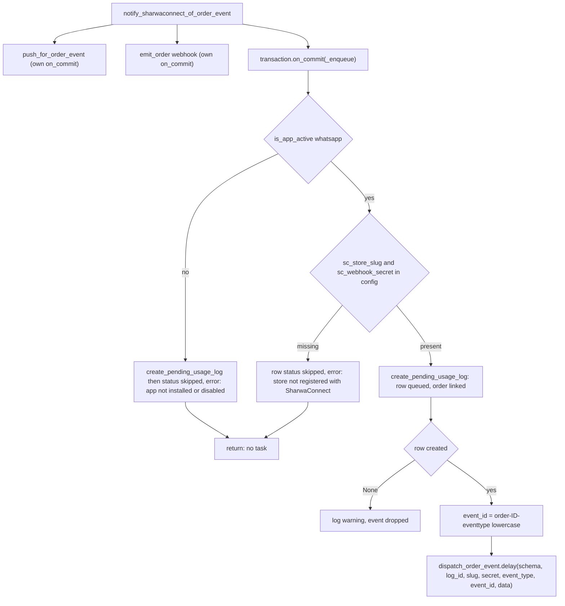
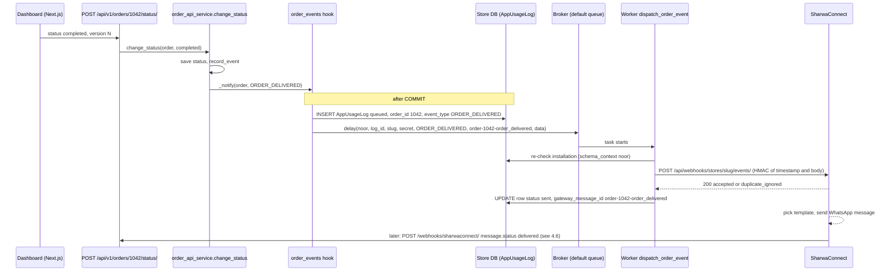
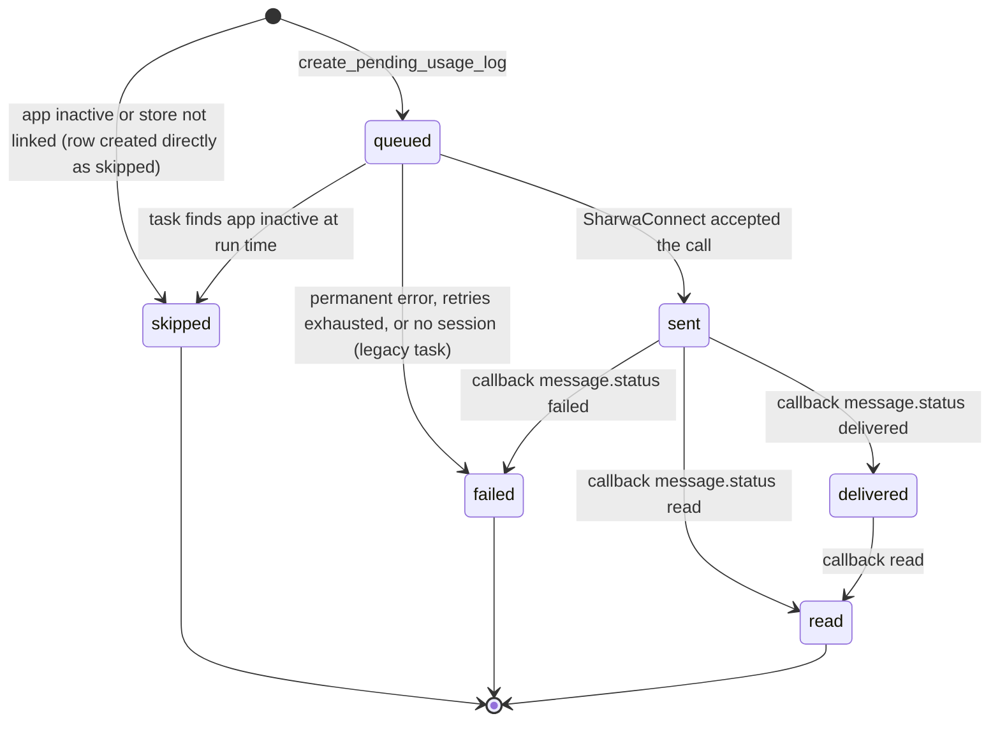

# WhatsApp / SharwaConnect messaging jobs

> **Source**: DOC-506 · inventory A.8 · INT-040 (M30)
> **Code**: `sharwa_saas/products/order_events.py` · `products/tasks/whatsapp.py` · `products/whatsapp_service.py` · `products/services/sharwaconnect_client.py` · `products/services/app_marketplace_service.py` (`is_app_active`, `create_pending_usage_log`, `mark_usage_log_result`) · `products/services/apps_api_service.py` (usage log API) · `products/models/apps.py` (`StoreAppInstallation`, `AppUsageLog`) · `tenants/webhooks.py` (`sharwaconnect_webhook`) · `tenants/webhook_replay.py` · `tenants/platform_events.py` · `config/settings.py` (`CELERY_TASK_ROUTES`)
> **Last verified against code**: 2026-10-28 (step 38)

## 1. Purpose

Since the architectural decision of 2026-09-08 (quoted in `order_events.py:4-10`), Sharwa **does not compose or send WhatsApp messages for store events itself**. When an order event happens it (1) writes one `AppUsageLog` row, and (2) tells the SharwaConnect service about the event over a signed HTTP call made from a Celery task. SharwaConnect picks the template for that store, fills the variables and sends the message from the merchant's linked WhatsApp session. Sharwa only learns the outcome of the *hand-off* directly; delivery and read receipts come back later through the public callback `POST /webhooks/sharwaconnect/`.

This page documents:

- the order-event hook `notify_sharwaconnect_of_order_event` and the task `dispatch_order_event` (the live path);
- the platform-level event task `dispatch_platform_event` (merchant welcome message);
- the inbound callback view `sharwaconnect_webhook` that updates usage rows and session state;
- the legacy pair `send_whatsapp_notification_async` → `dispatch_whatsapp_message`, which is still in the code but has no live caller (see the discrepancy in §4.5);
- the trace from an order event to a `AppUsageLog` row (§4.3).

Free-text sends to customers (campaigns, inbox replies) use `dispatch_channel_message` and `send_custom_message`; they are documented in [`campaigns.md`](campaigns.md) and [`channels.md`](channels.md) and only referenced here. Merchant OTP messages do not use any of this: they call `WhatsAppService.send_message` synchronously from the tenant registration views (stated in `whatsapp_service.py:7-12` and `platform_events.py:8-16`).

## 2. Components

| Component | Location | Role |
|---|---|---|
| `notify_sharwaconnect_of_order_event(order, event_type, **extra)` | `order_events.py:85-170` | Single entry point for all order events. Fans out to web push, outgoing webhooks and SharwaConnect. Never raises. |
| `_order_event_data(order, event_type, **extra)` | `order_events.py:50-82` | Builds the `data` object with the variable names the SharwaConnect templates expect. |
| `dispatch_order_event` (task) | `tasks/whatsapp.py:78-126` | Re-checks the app, posts the event, finalises the usage row. |
| `dispatch_platform_event` (task) | `tasks/whatsapp.py:129-164` | Same call for platform events (no store schema, no usage row). |
| `dispatch_whatsapp_message` (task) | `tasks/whatsapp.py:22-75` | Legacy free-text send. Orphaned and unable to succeed (§4.5). |
| `send_whatsapp_notification_async` | `whatsapp_service.py:44-104` | Legacy enqueue helper for the task above. No caller. |
| `sharwaconnect_client.send_order_event` | `sharwaconnect_client.py:261-350` | `POST /api/webhooks/stores/<slug>/events/`, HMAC signed with the store's own secret. |
| `sharwaconnect_client.send_message` | `sharwaconnect_client.py:228-246` | Always raises «إرسال الرسائل عبر SharwaConnect غير مفعَّل بعد في هذا التكامل.» |
| `get_installation`, `is_app_active` | `app_marketplace_service.py:20`, `:25` | Gate: installed, `is_active`, subscription not expired. |
| `create_pending_usage_log`, `mark_usage_log_result` | `app_marketplace_service.py:184`, `:201` | Create the `queued` row, then update that same row (one message = one row). |
| `_LoggingFailureTask.on_failure` | `tasks/_common.py:74-86` | Marks the row `failed` when retries are exhausted. |
| `sharwaconnect_webhook` | `tenants/webhooks.py:195-246`, route `config/urls_public.py:62` | Inbound callback: message status, session status, inbound customer messages. |
| Usage API | `api/views_apps.py:98-107`, `apps_api_service.py:208-262`, routes `api/urls.py:634-635` | Read side: `apps/whatsapp/usage/` and `apps/whatsapp/summary/`. |

## 3. Data model

Store schema unless noted.

| Model | Key fields | Notes |
|---|---|---|
| `StoreAppInstallation` (`models/apps.py:7`) | `app_code` (`whatsapp`), `is_active`, `suspended_by_platform`, `subscription_expires_at`, `config_encrypted` (encrypted JSON) | `config` keys used here: `sc_store_slug`, `sc_webhook_secret` (outbound events), `wa_session_id`, `wa_session_status`, `connected_phone_number`. |
| `AppUsageLog` (`models/apps.py:102`) | `installation` FK, `event_type` (≤ 50, indexed), `recipient_phone` (≤ 20, indexed), `status` (≤ 10), `error_detail` (≤ 255), `gateway_message_id` (≤ 100, indexed), `order` FK (`SET_NULL`, related name `app_usage_logs`, added by INT-040), `created_at` | Indexes `(installation, created_at)` and `(installation, status, created_at)`. Table `products_appusagelog`. The data-model page that will cover the apps domain is planned (domain 14) and is not linked yet. |
| `WhatsAppSessionIndex` (public schema, `tenants/models.py:162`) | `session_id` (unique), `schema_name` | Lets the callback find the store from the gateway's `session_id`. **Nothing in the code creates rows** (see §9). |
| `WhatsAppMessageCostLog` (`models/operations.py:77`) | `message_type`, `cost_amount`, `currency`, `related_order`, `sent_at` | Written only by the orphaned `send_whatsapp_notification_async` (`whatsapp_service.py:92-99`), read by the cost report (`reports_registry.py:553-559`). |
| cache | `webhook-nonce:sharwaconnect:<nonce>` (TTL 600 s) | Replay guard for the inbound callback (`tenants/webhook_replay.py:28-30`, `:60-66`). |

`AppUsageLog.status` values (`models/apps.py:105-112`): `queued`, `sent`, `delivered`, `read`, `failed`, `skipped`.

## 4. Flows

### 4.1 Event map and payloads

`event_type` values written by the hook (`order_events.py:43-47`) and the data sent. All payloads also carry `customer_phone` (passed through `clean_phone_number`, `order_events.py:65`), `customer_name`, `order_id` (string) and `language` (`ar`).

| Event | Raised by (who calls the hook) | Extra data |
|---|---|---|
| `ORDER_CREATED` | `checkout_service.notify_order_created` (`checkout_service.py:836-837`) | `total_amount`, `currency` |
| `ORDER_SHIPPED` | legacy shipping view when a carrier is assigned (`views/shipping.py:244-246`) | `tracking_number`, `carrier_name` |
| `ORDER_DELIVERED` | `order_api_service.change_status` to `completed` (`:459-460`); legacy dashboard (`merchant_dashboard.py:1440-1441`); supplier delivery (`suppliers/order_forward_service.py:439-440`) | none |
| `ORDER_CANCELLED` | `change_status` to `cancelled` (`order_api_service.py:461-462`), rejecting a payment under review (`:512`), legacy dashboard (`merchant_dashboard.py:1444`, `:1553`) | `cancellation_reason` |
| `PAYMENT_RECEIVED` | `payment_action` approve / confirm (`order_api_service.py:486`, `:501`), legacy dashboard (`merchant_dashboard.py:1527`) | `amount_paid`, `currency` |

The full list of callers of the hook is in [`order-push.md` §4.1](order-push.md#41-trigger-table--who-enqueues-which-push). No event is raised for an indeterminate payment or a failed direct-gateway payment (`order_events.py:28-31`).

**Names stored versus names shown.** The row stores the constant (`ORDER_DELIVERED`). The usage API translates when it reads (`apps_api_service.py:36-47`):

| Stored `AppUsageLog.event_type` | API `event_type` |
|---|---|
| `order_new` or `ORDER_CREATED` | `order_new` |
| `order_shipping_update` or `ORDER_SHIPPED` | `order_shipping_update` |
| `order_delivered` or `ORDER_DELIVERED` | `order_delivered` |
| `order_cancelled` or `ORDER_CANCELLED` | `order_cancelled` |
| `payment_confirmed` or `PAYMENT_RECEIVED` | `payment_confirmed` |
| `payment_failed`, `abandoned_cart_reminder`, `otp`, `manual` | same |
| anything else (for example `campaign_broadcast`, `channel_message_out`) | `manual` (`usage_view`, `apps_api_service.py:208-216`) |

The `event_type` filter works in the other direction: `?event_type=order_delivered` selects rows whose stored value is either spelling (`list_usage`, `apps_api_service.py:227-239`).

> ⚠️ Discrepancy — roadmap says the event map is `ORDER_CREATED → order_new`, `ORDER_SHIPPED → order_shipping_update`, … as if rows were written with the left-hand names / code does that translation only when the usage log is read; `notify_sharwaconnect_of_order_event` stores the `ORDER_*` constant (`order_events.py:130`, `:153`; map at `apps_api_service.py:36-47`). Reported in step 38.

### 4.2 Gate and enqueue (inside the hook)

Details that matter:

- The gate runs inside `transaction.on_commit` (`order_events.py:170`), so nothing is sent for an order whose transaction rolls back. The whole `_enqueue` is wrapped in `try/except` (`:108-123`): a broker outage is logged with `logger.exception` and swallowed, so the order request never fails because of WhatsApp.
- If the app has **no installation row at all**, `create_pending_usage_log` returns `None` (`app_marketplace_service.py:195-196`) and `skipped` rows are not written (`if log:` at `order_events.py:132`, `:146`). A `skipped` row therefore means "installed but inactive, expired, suspended-by-billing-state or not linked to SharwaConnect".
- `is_app_active` is `installation.is_effectively_active()`: `is_active` and (`subscription_expires_at` empty or not yet passed). `suspended_by_platform` is **not** consulted here; the usage API does check it (`apps_api_service.py:201-205`).
- The webhook secret travels as a Celery argument, i.e. through the broker (`order_events.py:166-168`). Protect Redis accordingly ([`../../ops/runbooks/celery.md`](../../ops/runbooks/celery.md)).
- `event_id = f"order-{order.id}-{event_type.lower()}"` (`:163`) is stable per (order, event type). SharwaConnect de-duplicates on it, so a double click or a Celery redelivery does not send twice (`sharwaconnect_client.py:283-288`). The flip side: cancelling, re-opening and cancelling the same order again produces a second local row but SharwaConnect ignores the second event.

### 4.3 Trace: from an order event to a usage log row

Worked example with fake data: store `noor` (schema `<SCHEMA>` = `noor`), order `1042`, customer `9677XXXXXXXX`, owner marks the order completed.

Step by step, with code:

| # | What happens | Code |
|---|---|---|
| 1 | Merchant changes the status; body `{status, version}`. | `api/views_orders.py:154-160` → `order_api_service.change_status` (`order_api_service.py:432`) |
| 2 | Status saved and timeline event recorded, then `_notify(order, 'ORDER_DELIVERED')`. | `order_api_service.py:459-460`, `_notify` `:410-413` |
| 3 | Hook registers `on_commit(_enqueue)`; push and webhook emitters register their own. | `order_events.py:101-106`, `:170` |
| 4 | After commit: app active, config has slug and secret, **`AppUsageLog` created with `status='queued'`, `event_type='ORDER_DELIVERED'`, `recipient_phone`, `order=order`**. | `order_events.py:128-160`, `create_pending_usage_log` `app_marketplace_service.py:184-198` |
| 5 | Task queued with the row id as the second argument. | `order_events.py:165-168` |
| 6 | Worker: `schema_context(noor)`, installation re-checked, signed POST. | `tasks/whatsapp.py:101-116`, `sharwaconnect_client.py:294-317` |
| 7 | Success: same row set to `sent`, `gateway_message_id = result['event_id']`. | `tasks/whatsapp.py:124-126`, `mark_usage_log_result` `app_marketplace_service.py:201-221` |
| 8 | Merchant reads it back. | `GET /api/v1/apps/whatsapp/usage/?event_type=order_delivered` → `{count, results: [{id, event_type: "order_delivered", recipient_phone, status: "sent", order_id: 1042, error: null, created_at}]}` |

To find the row for an order without the API, filter on the foreign key: `AppUsageLog.objects.filter(order_id=1042)` in the `noor` schema (`order` has `related_name='app_usage_logs'`, so `order.app_usage_logs.all()` works too). One order normally produces one row per event type (created, payment received, shipped, delivered, cancelled).

What the row does **not** tell you: the final delivery of the WhatsApp message. For order events `sent` means "SharwaConnect accepted the event" (docstring `tasks/whatsapp.py:95-99`). SharwaConnect chooses the template and may still skip or fail the send on its side.

### 4.4 Retry and failure of `dispatch_order_event`

| Outcome of the HTTP call | Class raised | Effect |
|---|---|---|
| network error, connect or read timeout | `SharwaConnectTransientError` | `autoretry_for`: retries with exponential backoff |
| HTTP 429 or ≥ 500 | `SharwaConnectTransientError` | same |
| other HTTP ≥ 400 (400, 401, 403, 404 …) or non-JSON body | `SharwaConnectPermanentError` | caught in the task: row `failed`, `error_detail = exc.message` (generic Arabic text such as «تعذّر إرسال حدث الطلب عبر خدمة الواتساب.»), no retry |
| `WA_GATEWAY_BASE_URL` empty | base `SharwaConnectError` (not a subclass of either) | not retried, not caught: the task fails and `on_failure` marks the row `failed` with «فشل نهائي بعد استنفاد إعادة المحاولات: …» even though no retry happened |
| 200 | none | row `sent` (including `duplicate_ignored`) |

Backoff: `retry_backoff=True` (1 s base), `retry_backoff_max=300`, `retry_jitter=True`, `max_retries=5` → up to 6 executions, delays about 1, 2, 4, 8, 16 s (jittered, so each is between 0 and that value). The retry window is therefore roughly half a minute plus the request timeouts (10 s connect, 20 s read per attempt, `sharwaconnect_client.py:33-34`). An outage of SharwaConnect longer than that ends in `failed` and nothing re-sends the event automatically.

There are no `soft_time_limit` / `time_limit` on these tasks. `CELERY_TASK_ACKS_LATE` and `CELERY_TASK_REJECT_ON_WORKER_LOST` are global (`config/settings.py:562-568`): a killed worker re-runs the task, which is safe because of the `event_id` de-duplication on the SharwaConnect side.

### 4.5 Legacy path: `send_whatsapp_notification_async` → `dispatch_whatsapp_message`

`send_whatsapp_notification_async(phone, message, *, event_type='manual', related_order=None, cost_amount=None)` (`whatsapp_service.py:44`) registers an `on_commit` that creates the `queued` row, writes a `WhatsAppMessageCostLog` line (default 0.30 SAR, `:26`) and calls `dispatch_whatsapp_message.delay(schema, log_id, phone, message)` (queue `whatsapp`, `settings.py:573`). The task checks the app, requires `config['wa_session_id']` and `config['wa_session_status'] == 'CONNECTED'`, then calls `sharwaconnect_client.send_message`.

> ⚠️ Discrepancy — roadmap says to document `dispatch_whatsapp_message` and `send_whatsapp_notification_async` as live jobs next to the order hook / code does not call `send_whatsapp_notification_async` from any non-test module (grep over `sharwa_saas`; the module docstring `order_events.py:85-90` calls it "disabled / unused"), and even if called the task cannot succeed: `sharwaconnect_client.send_message` always raises `SharwaConnectError` (`sharwaconnect_client.py:242-246`) and nothing in the code writes `wa_session_id` (read only at `tasks/whatsapp.py:53`). The only live reference to the `whatsapp` queue for WhatsApp traffic is `dispatch_channel_message` (`CHANNEL_DISPATCH_QUEUE_MAP['whatsapp']`, `tasks/channels.py:264-269`). Reported in step 38.

Consequences: no `WhatsAppMessageCostLog` row is created for order events, so the WhatsApp cost report (`reports_registry.py:553`) does not grow from order events. `dispatch_order_event` itself is **not** routed to the `whatsapp` queue: it runs on `default`.

### 4.6 Inbound callback `POST /webhooks/sharwaconnect/`

Public route (`config/urls_public.py:62`), `@csrf_exempt`, POST only. Order of checks (`tenants/webhooks.py:195-246`):

1. **Signature** (`_verify_sharwaconnect_signature`, `:149-167`): header `X-SharwaConnect-Signature` = hex HMAC-SHA256 of the raw body with `WA_GATEWAY_WEBHOOK_SECRET`. An empty secret rejects everything. Failure: 403 `{"ok": false, "error": "invalid_signature"}`.
2. JSON parse: 400 `invalid_json`.
3. **Replay guard** (`_sharwaconnect_replay_guard`, `:170-190` → `webhook_replay.replay_guard`): body field `timestamp` (seconds or milliseconds) within ±300 s, else 403 `stale_or_missing_timestamp`; nonce `msg:<message_id>` for `message.received`, otherwise `sig:<signature>`; a repeat is 409 `replay_detected`; a cache failure is 503 `replay_guard_unavailable` (fail closed). Two successive `message.status` events for one message are accepted because their signatures differ.
4. `session_id` required: 400 `missing_session_id`. Looked up in `WhatsAppSessionIndex`; unknown → **200** `{"ok": true, "status": "unknown_session_ignored"}` (`:228-235`).
5. `schema_context(index.schema_name)` and dispatch on `payload['event']`:

| `event` | Handler | Effect |
|---|---|---|
| `message.status` | `_handle_message_status_event` (`:280-294`) | If `status` ∈ `delivered`, `read`, `failed` (lower-cased): `AppUsageLog.filter(gateway_message_id=message_id).update(status=...)`. No match → warning only. |
| `session.status` | `_handle_session_status_event` (`:297-312`) | Upper-cases `status` into `config['wa_session_status']`; for `DISCONNECTED` / `SESSION_EXPIRED` removes `connected_phone_number`. Never changes `is_active`. |
| `message.received` | `_handle_incoming_channel_message_event` (`:249-277`) | Sends signal `incoming_channel_message` (channel `whatsapp`) for the inbox; see [`channels.md`](channels.md). |
| other | warning «نوع حدث webhook SharwaConnect غير معروف: …» | 200 |

The status update is a plain overwrite: an out-of-order `delivered` arriving after `read` moves the row backwards.

### 4.7 Status lifecycle of a usage row

A row can stay `queued` forever if the broker was down at `.delay()` time or no worker consumes `default` (§8).

### 4.8 Platform event: merchant welcome

`tenants/provisioning.py:153-163` (`_send_welcome`, after the store is ready) calls `notify_sharwaconnect_of_merchant_welcome` (`platform_events.py:34`), which reads `SHARWACONNECT_PLATFORM_STORE_SLUG` and `SHARWACONNECT_PLATFORM_WEBHOOK_SECRET` from the environment (placeholders only here; names in [`../../ops/environment.md`](../../ops/environment.md)), and queues `dispatch_platform_event.delay(slug, secret, 'MERCHANT_WELCOME', 'merchant-welcome-<phone>-<unix time>', data)`. Either variable empty → warning and skip. The task has no usage row and no schema context; a permanent failure is only a `logger.error` («فشل دائم عند إرسال حدث منصّي …»), exhausted retries only show in the Celery log. The `event_id` contains the time, so it does not de-duplicate across calls. The merchant's OTP never uses this path.

## 5. Invariants

| Invariant | Enforced by |
|---|---|
| An order event never fails the order request | `try/except` around `_enqueue_unsafe` (`order_events.py:108-123`); `on_commit` |
| Nothing is sent for a rolled-back transaction | `transaction.on_commit(_enqueue)` (`:170`) |
| One message = one `AppUsageLog` row for its whole life | `create_pending_usage_log` once, then only `mark_usage_log_result` (`app_marketplace_service.py:184-221`) |
| Every row written by the hook carries its order | `order=order` (`order_events.py:130`, `:144`, `:153`); `AppUsageLog.order` is `SET_NULL`, so deleting an order keeps the audit row |
| The app state is checked twice | at enqueue (`is_app_active`) and at run time (`is_effectively_active`, `tasks/whatsapp.py:106`) |
| The usage log writer never raises | `mark_usage_log_result` and `log_app_usage` swallow errors |
| Duplicate events are harmless | stable `event_id`; SharwaConnect `get_or_create` on (store, event_id) |
| Customer phone is normalised before leaving | `clean_phone_number` (`order_events.py:65`); `AppUsageLog.recipient_phone` stores the same value |
| Inbound callbacks are authenticated, fresh and non-repeatable | HMAC + ±300 s window + nonce (§4.6) |
| `session.status` never switches the app off | `_handle_session_status_event` writes config only |

## 6. Background work

### 6.1 Job table

| Job (dotted path / task name) | Kind | Trigger (who / where) | Queue | Schedule | Retry | Idempotency | Failure handling |
|---|---|---|---|---|---|---|---|
| `products.tasks.whatsapp.dispatch_order_event` / `products.tasks.dispatch_order_event` | task | `notify_sharwaconnect_of_order_event` → `_enqueue_unsafe` (`order_events.py:165-168`) | `default` (not in `CELERY_TASK_ROUTES`) | event-driven, after commit | `autoretry_for=(SharwaConnectTransientError,)`, `max_retries=5`, `retry_backoff=True`, `retry_backoff_max=300`, `retry_jitter=True`; global `acks_late` and `reject_on_worker_lost`; no time limits | `event_id` per (order, event type); row updated in place | `skipped` / `failed` + `error_detail` on the row; `on_failure` after exhaustion (`_LoggingFailureTask`); no automatic replay; operator checks the usage log |
| `products.tasks.whatsapp.dispatch_platform_event` / `products.tasks.dispatch_platform_event` | task | `tenants/platform_events._notify_unsafe` (`platform_events.py:79-82`) from `tenants/provisioning.py:153-163` | `default` | once per provisioned store | same autoretry settings; `base` is plain `Task` (no `on_failure`) | `event_id` contains a timestamp, not stable | `logger.error` on permanent error; Celery log on exhaustion |
| `products.tasks.whatsapp.dispatch_whatsapp_message` / `products.tasks.dispatch_whatsapp_message` | task (legacy, orphaned) | `whatsapp_service.send_whatsapp_notification_async` (`whatsapp_service.py:102`); no caller | `whatsapp` (`settings.py:573`) | none | same autoretry settings | none (each call creates a row) | would mark `failed`: no connected session, or `send_message` raises |
| `products.whatsapp_service.send_whatsapp_notification_async` | none (plain function) | no caller | — | — | — | — | — |
| `products.order_events.notify_sharwaconnect_of_order_event` | none (hook, runs `on_commit`) | order flows listed in §4.1 | — | — | — | via `event_id` downstream | swallowed and logged |
| `tenants.webhooks.sharwaconnect_webhook` | none (HTTP callback) | SharwaConnect → `POST /webhooks/sharwaconnect/` | web process | on demand | SharwaConnect retries on its side (not in this repo) | nonce cache | JSON error codes of §4.6 |
| `products.tasks.channels.dispatch_channel_message` | task (documented elsewhere) | campaigns, inbox replies | `whatsapp` for channel `whatsapp` | — | same autoretry settings | — | see [`channels.md`](channels.md), [`campaigns.md`](campaigns.md) |

No Beat schedule exists for WhatsApp work: nothing in `CELERY_BEAT_SCHEDULE` (`settings.py:622-764`) refers to these tasks, and there is no sweeper for rows stuck in `queued`.

### 6.2 State fields changed by each job

| Job | Fields |
|---|---|
| hook `notify_sharwaconnect_of_order_event` | creates `AppUsageLog` (`installation`, `event_type`, `recipient_phone`, `status` = `queued` or `skipped`, `error_detail`, `order`) |
| `dispatch_order_event` | `AppUsageLog.status` (`sent` / `failed` / `skipped`), `error_detail` (≤ 255), `gateway_message_id` |
| `dispatch_platform_event` | none |
| `dispatch_whatsapp_message` | `AppUsageLog.status`, `error_detail`, `gateway_message_id` |
| `sharwaconnect_webhook` | `AppUsageLog.status` (`delivered` / `read` / `failed`); `StoreAppInstallation.config_encrypted` (`wa_session_status`, `connected_phone_number`), `updated_at` |

### 6.3 Endpoints

| Route | Purpose |
|---|---|
| Order endpoints in §4.1 (`POST /api/v1/orders/<id>/status/`, `.../payment/<action>/`, storefront checkout, legacy dashboard actions) | trigger the hook |
| `POST /webhooks/sharwaconnect/` (public, no CSRF) | SharwaConnect callbacks |
| `GET /api/v1/apps/whatsapp/usage/` | filters `status`, `event_type` (contract name), `from`, `to` (`YYYY-MM-DD`, else 400 «تاريخ بصيغة YYYY-MM-DD.»), `page`, `page_size` (default 20, max 100); newest first |
| `GET /api/v1/apps/whatsapp/summary/` | last 7 days: `last_7_days`, `delivered` (counts `delivered` and `read`), `failed`, `queued` |
| `GET /api/v1/apps/whatsapp/connect-url/`, install / activate / deactivate | out of scope: [`../../api/domains/14-apps-ai-support/README.md`](../../api/domains/14-apps-ai-support/README.md) |

Both usage endpoints answer 409 «تطبيق الواتساب غير مثبَّت أو غير مفعّل.» unless the app is installed, effectively active and not suspended by the platform (`apps_api_service.py:201-205`), 403 when the plan lacks `app_marketplace` (`views_apps.py`, see [`../15-plans-and-features.md`](../15-plans-and-features.md)).

## 7. Configuration

| Name | Where | Meaning |
|---|---|---|
| `WA_GATEWAY_BASE_URL` | env, `sharwaconnect_client.py:252` | Root of the SharwaConnect service; empty → `SharwaConnectError` (not retried) |
| `WA_GATEWAY_API_KEY` | env, `sharwaconnect_client.py:59` | Signing key for `/api/internal/` calls (store registration, QR, status). Not used by `send_order_event`. |
| `WA_GATEWAY_WEBHOOK_SECRET` | env, `tenants/webhooks.py:146` | Inbound callback HMAC secret; empty → every callback is rejected with 403 |
| `SHARWACONNECT_PLATFORM_STORE_SLUG`, `SHARWACONNECT_PLATFORM_WEBHOOK_SECRET` | env, `platform_events.py:57-58` | Platform welcome message |
| `config['sc_store_slug']`, `config['sc_webhook_secret']` | `StoreAppInstallation`, written by `views/apps.py::_get_or_register_sc_store` (`:273-310`; slug is `sharwa-<SCHEMA>`) | Per-store identity and signing secret for events |
| `WHATSAPP_CHANNEL_PROVIDER = 'sharwaconnect'` | `settings.py:601` | Provider for channel sends |
| `CONNECT_TIMEOUT = 10`, `READ_TIMEOUT = 20` | `sharwaconnect_client.py:33-34` | Request timeouts in seconds |
| `REPLAY_WINDOW_S = 300`, `REPLAY_NONCE_TTL_S = 600` | `webhook_replay.py:28-29` | Replay protection |
| `DEFAULT_WHATSAPP_MESSAGE_COST = 0.30` | `whatsapp_service.py:26` | Legacy cost log amount |

The outbound event request (`send_order_event`, `sharwaconnect_client.py:294-317`) is a `POST` of compact JSON `{event_id, event_type, timestamp, data}` with headers `X-Sharwa-Timestamp` and `X-Sharwa-Signature` = hex HMAC-SHA256(`webhook_secret`, `"<timestamp>."` + body). The method and path are not signed. This differs from the `/api/internal/` signature (`X-Sharwa-Platform-*`, `sharwaconnect_client.py:68-75`), which signs method and path as well. Environment details and failure text: [`../../ops/environment.md`](../../ops/environment.md).

## 8. Failure modes and fixes

| Symptom | Cause | Fix |
|---|---|---|
| Rows with `skipped` and «التطبيق غير مثبَّت أو معطّل.» | App inactive or subscription expired at enqueue | Reactivate or renew the app. Events during the gap are not replayed. |
| `skipped` with «المتجر غير مسجَّل بشروة كونكت بعد (افتح لوحة شروة كونكت أولاً).» | `sc_store_slug` or `sc_webhook_secret` missing in the installation config | Merchant opens the SharwaConnect panel once (registration via `_get_or_register_sc_store`). The client function `rotate_webhook_secret` exists but nothing calls it |
| `skipped` with «التطبيق غير نشط وقت التنفيذ الفعلي.» | App switched off while the task waited | As above |
| `failed` with the generic «تعذّر إرسال حدث الطلب عبر خدمة الواتساب.» | SharwaConnect answered 4xx: bad signature (secret mismatch), store unknown or disabled, invalid payload | Compare the stored secret with the SharwaConnect store; read the worker log (`internal_detail` is not stored on the row) |
| `failed` with «فشل نهائي بعد استنفاد إعادة المحاولات: …» | SharwaConnect down for longer than the retry window, or `WA_GATEWAY_BASE_URL` missing | Fix the cause. There is no replay: raise the order event again only by repeating the action, which SharwaConnect will de-duplicate if the first call had reached it |
| Rows stay `queued` | Broker down at enqueue (error swallowed), or no worker on `default`, or worker killed repeatedly | Start the worker; rows whose task was lost stay `queued` (no sweeper). See [`../../ops/runbooks/celery.md`](../../ops/runbooks/celery.md) |
| Rows stay `sent`, never `delivered` | Callback not arriving or not matching (see §9) | Check `WA_GATEWAY_WEBHOOK_SECRET`, `WhatsAppSessionIndex`, and what id SharwaConnect puts in `message_id` |
| Callback answers 403 `invalid_signature` | Secret empty or different on the two sides | Align `WA_GATEWAY_WEBHOOK_SECRET` |
| Callback answers 403 `stale_or_missing_timestamp` or 409 `replay_detected` | Clock skew over 300 s, missing body `timestamp`, or a repeated event | Fix NTP; a repeat is expected |
| Callback answers 200 `unknown_session_ignored` | No `WhatsAppSessionIndex` row for that `session_id` | See §9 |
| Customer received no message but the row is `sent` | SharwaConnect had no template for that event or the WhatsApp session is down | Check the SharwaConnect panel; Sharwa cannot see this |

## 9. Open items

- **`WhatsAppSessionIndex` is never populated by code.** The model docstring says it is filled by `products/views/apps.py::whatsapp_qr_start` (`tenants/models.py:174-176`), but a grep of the backend finds no `create`, `get_or_create` or `update_or_create` for it outside the Django admin registration (`tenants/admin.py:279`). Unless rows are added by hand, every `message.status`, `session.status` and `message.received` callback is answered `unknown_session_ignored` and ignored, so rows would never reach `delivered`/`read` and `wa_session_status` is only refreshed by the status poll in `views/apps.py`. Needs confirmation on the running system.
- **`gateway_message_id` for order events is not a WhatsApp message id.** `dispatch_order_event` stores `result['event_id']` (`tasks/whatsapp.py:125`), i.e. the value `order-<id>-<event>` that Sharwa itself sent, while the callback matches `message_id` (`tenants/webhooks.py:290`). Rows created by `dispatch_channel_message` store the provider's `external_message_id` and can match. Whether SharwaConnect reports status for event-driven messages with `message_id` equal to the event id is not visible from this repository.
- **No recovery for `queued` rows.** There is no sweeper or Beat task; a lost enqueue leaves the row `queued` and it is counted as `queued` in the summary.
- **Short retry window.** Total backoff is about 31 s (§4.4). A longer SharwaConnect outage loses the event.
- **Order events not raised in some flows.** `ORDER_SHIPPED` is raised only by the legacy courier-assignment view (`views/shipping.py:244-246`); no call exists in the shipment-transition code, so shipments created or moved through the API do not produce a WhatsApp shipping message (same gap as noted in [`order-push.md`](order-push.md)). POS, phone and marketplace orders do not call `notify_order_created`, so no `ORDER_CREATED` event is sent for them.
- **`suspended_by_platform` is not checked at enqueue or run time**, only by the usage API.
- **Event identity per (order, type).** Re-opening and re-cancelling an order yields a local `sent` row for a message SharwaConnect ignores.
- **Dead code with live side tables.** `send_whatsapp_notification_async`, `dispatch_whatsapp_message`, `sharwaconnect_client.send_message`, `WhatsAppMessageCostLog` creation are unreachable in the order flow; the cost report is therefore fed by nothing. `products/utils.py:118` still names the removed `WhatsAppSettings` model.
- **Stale test file.** `products/test_wa_simplify.py` imports `WhatsAppSettings` (removed, comment at `products/models/store_settings.py:759-764`) and patches `products.views.cart_checkout.send_whatsapp_notification_async`, which no longer exists, so the file cannot pass.
- **Tests that exist and what they cover** (verified):
  - `api/test_apps_api.py::test_whatsapp_usage_and_summary` (line 128): 409 when not installed, `create_pending_usage_log(order=...)` + `mark_usage_log_result`, contract event names (`ORDER_CREATED` → `order_new`, `PAYMENT_RECEIVED` → `payment_confirmed`, unknown → `manual`), filters, paging, 400 on a bad date, summary counts, 409 after deactivation.
  - `tenants/test_webhook_replay.py::SharwaConnectReplayTests` (9 tests): signature, timestamp window in seconds and milliseconds, missing/expired/future timestamp, duplicate `message_id`, exact replay, successive statuses, invalid signature does not burn the nonce. They patch the session index, so the handlers behind it are not executed.
  - `products/test_tasks_package.py`: pins that `dispatch_order_event`, `dispatch_platform_event` and `dispatch_whatsapp_message` stay registered under the names `products.tasks.<function>` and importable from `products.tasks` (registration only, no behaviour).
  - `api/test_pwa_push_api.py` calls `notify_sharwaconnect_of_order_event` but patches the push task; it does not exercise `dispatch_order_event`.
  - **Not covered**: `dispatch_order_event`, `dispatch_platform_event`, `send_order_event` signing, the gate branches in `order_events.py`, `_handle_message_status_event`, `_handle_session_status_event`.

## 10. Related pages

- [`order-push.md`](order-push.md) — the push channel that shares the same hook; [`webhooks.md`](webhooks.md) — the merchant outgoing webhooks raised from the same hook; [`campaigns.md`](campaigns.md), [`channels.md`](channels.md) — free-text WhatsApp sends via `dispatch_channel_message`; [`provisioning-and-carrier-webhooks.md`](provisioning-and-carrier-webhooks.md) — where the welcome event is raised.
- [`../50-background-jobs.md`](../50-background-jobs.md), [`../../ops/runbooks/celery.md`](../../ops/runbooks/celery.md), [`../../ops/environment.md`](../../ops/environment.md).
- [`../46-timelines-and-notifications.md`](../46-timelines-and-notifications.md), [`../41-idempotency.md`](../41-idempotency.md), [`../10-multi-tenancy.md`](../10-multi-tenancy.md) (schema context in tasks), [`../13-cross-schema-access.md`](../13-cross-schema-access.md) (public-schema index used by callbacks), [`../15-plans-and-features.md`](../15-plans-and-features.md).
- API: [`../../api/domains/14-apps-ai-support/README.md`](../../api/domains/14-apps-ai-support/README.md), [`../../api/integrators/webhooks-inbound.md`](../../api/integrators/webhooks-inbound.md).
